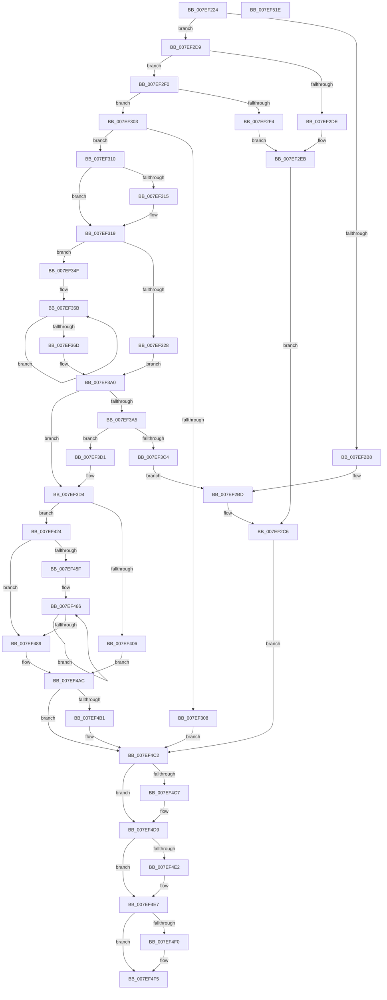

# HvRecoverFlushProtocolStateFromFiles

- RVA: `0x007EF224`–`0x007EF51F` (길이 `763` bytes)
- VA: `0x00000001407EF224`
- 실행 섹션: `PAGE`
- PDB 이름 있음: `예`; PDB Function 태그: `아니요`
- unwind 정보 RVA: `0x000CC7C4`
- 디코드: `197`개 명령, `763/763` bytes 표시
- 미해석 바이트: `0` (있으면 어셈블리에 `.byte`로 보존)

> 이 문서는 커널 이미지의 기계어와 PDB 기호를 분석해 생성했습니다. 4번과 5번은 함수 원형과 자료형을 바이너리 사용 방식에서 추정한 C 해석이며 원본 소스 복구 결과는 아닙니다.

## 1. Dependencies

- 직접 호출 지점: **13**; 고유 호출 대상: **9**
- 직접 호출자로 확인된 함수: **1**
- RIP 상대 이미지 참조: **2**

### Outgoing calls
- `0x007EF291` → [memset](../../text/6C/memset_function_006C6C40.md) (function, `0x006C6C40`)
- `0x007EF2A3` → [HvpGetHiveHeader](../9B/HvpGetHiveHeader_function_009B8758.md) (function, `0x009B8758`)
- `0x007EF2CF` → [SetFailureLocation](../../text/46/SetFailureLocation_function_0046EF54.md) (function, `0x0046EF54`)
- `0x007EF3B7` → [guard_dispatch_icall](../../text/6B/guard_dispatch_icall_function_006BAAD0.md) (function, `0x006BAAD0`)
- `0x007EF3F8` → [HvAnalyzeLogFiles](../9B/HvAnalyzeLogFiles_function_009B9A9C.md) (function, `0x009B9A9C`)
- `0x007EF41A` → [SetFailureLocation](../../text/46/SetFailureLocation_function_0046EF54.md) (function, `0x0046EF54`)
- `0x007EF470` → [HvpLogTypeToLogArrayIndex](../9B/HvpLogTypeToLogArrayIndex_function_009B2DFC.md) (function, `0x009B2DFC`)
- `0x007EF49D` → [HvpHeaderCheckSum](../../pagecmrc/BC/HvpHeaderCheckSum_function_00BC97A0.md) (function, `0x00BC97A0`)
- `0x007EF4BD` → [guard_dispatch_icall](../../text/6B/guard_dispatch_icall_function_006BAAD0.md) (function, `0x006BAAD0`)
- `0x007EF4D4` → [guard_dispatch_icall](../../text/6B/guard_dispatch_icall_function_006BAAD0.md) (function, `0x006BAAD0`)
- `0x007EF4E2` → [CmSiFreeMemory](../../text/47/CmSiFreeMemory_function_00475D80.md) (function, `0x00475D80`)
- `0x007EF4F0` → [CmSiFreeMemory](../../text/47/CmSiFreeMemory_function_00475D80.md) (function, `0x00475D80`)
- `0x007EF4FE` → [_security_check_cookie](../../text/6A/_security_check_cookie_function_006AC640.md) (function, `0x006AC640`)

### Direct callers
- [CmpRecoverFlushProtocolStateFromFiles](CmpRecoverFlushProtocolStateFromFiles_function_007EE4B0.md) at `0x007EE4C5`

### Static image references
- `0x007EF240` → RVA `0x00E0A740` (`.data`; read)
- `0x007EF328` → RVA `0x00A6DA60` (`HvpRecoverDataReadRoutine`; read)

## 2. Other-region calls and transfers

- 다른 실행 섹션으로 향하는 call: **10**
  - `0x007EF291` → [memset](../../text/6C/memset_function_006C6C40.md) (`PAGE` → `.text`)
  - `0x007EF2CF` → [SetFailureLocation](../../text/46/SetFailureLocation_function_0046EF54.md) (`PAGE` → `.text`)
  - `0x007EF3B7` → [guard_dispatch_icall](../../text/6B/guard_dispatch_icall_function_006BAAD0.md) (`PAGE` → `.text`)
  - `0x007EF41A` → [SetFailureLocation](../../text/46/SetFailureLocation_function_0046EF54.md) (`PAGE` → `.text`)
  - `0x007EF49D` → [HvpHeaderCheckSum](../../pagecmrc/BC/HvpHeaderCheckSum_function_00BC97A0.md) (`PAGE` → `PAGECMRC`)
  - `0x007EF4BD` → [guard_dispatch_icall](../../text/6B/guard_dispatch_icall_function_006BAAD0.md) (`PAGE` → `.text`)
  - `0x007EF4D4` → [guard_dispatch_icall](../../text/6B/guard_dispatch_icall_function_006BAAD0.md) (`PAGE` → `.text`)
  - `0x007EF4E2` → [CmSiFreeMemory](../../text/47/CmSiFreeMemory_function_00475D80.md) (`PAGE` → `.text`)
  - `0x007EF4F0` → [CmSiFreeMemory](../../text/47/CmSiFreeMemory_function_00475D80.md) (`PAGE` → `.text`)
  - `0x007EF4FE` → [_security_check_cookie](../../text/6A/_security_check_cookie_function_006AC640.md) (`PAGE` → `.text`)
- 별도 외부 분기/꼬리 이동을 확인하지 못했습니다.

## 3. Assembly (complete function range)

```asm
007EF224  48 89 5C 24 18                  mov qword ptr [rsp + 0x18], rbx
007EF229  55                              push rbp
007EF22A  56                              push rsi
007EF22B  57                              push rdi
007EF22C  41 54                           push r12
007EF22E  41 55                           push r13
007EF230  41 56                           push r14
007EF232  41 57                           push r15
007EF234  48 8D 6C 24 E0                  lea rbp, [rsp - 0x20]
007EF239  48 81 EC 20 01 00 00            sub rsp, 0x120
007EF240  48 8B 05 F9 B4 61 00            mov rax, qword ptr [rip + 0x61b4f9]
007EF247  48 33 C4                        xor rax, rsp
007EF24A  48 89 45 10                     mov qword ptr [rbp + 0x10], rax
007EF24E  45 33 FF                        xor r15d, r15d
007EF251  0F 57 C0                        xorps xmm0, xmm0
007EF254  48 8B F2                        mov rsi, rdx
007EF257  4C 89 7C 24 40                  mov qword ptr [rsp + 0x40], r15
007EF25C  48 8B D9                        mov rbx, rcx
007EF25F  4C 89 7C 24 48                  mov qword ptr [rsp + 0x48], r15
007EF264  33 D2                           xor edx, edx
007EF266  44 89 7C 24 54                  mov dword ptr [rsp + 0x54], r15d
007EF26B  45 8D 47 5C                     lea r8d, [r15 + 0x5c]
007EF26F  4C 89 7C 24 68                  mov qword ptr [rsp + 0x68], r15
007EF274  48 8D 4D B0                     lea rcx, [rbp - 0x50]
007EF278  4C 89 7C 24 70                  mov qword ptr [rsp + 0x70], r15
007EF27D  45 8B F7                        mov r14d, r15d
007EF280  4C 89 7C 24 78                  mov qword ptr [rsp + 0x78], r15
007EF285  0F 11 45 80                     movups xmmword ptr [rbp - 0x80], xmm0
007EF289  0F 11 45 90                     movups xmmword ptr [rbp - 0x70], xmm0
007EF28D  0F 11 45 A0                     movups xmmword ptr [rbp - 0x60], xmm0
007EF291  E8 AA 79 ED FF                  call 0x1406c6c40
007EF296  4C 8D 44 24 40                  lea r8, [rsp + 0x40]
007EF29B  48 8B CB                        mov rcx, rbx
007EF29E  48 8D 54 24 48                  lea rdx, [rsp + 0x48]
007EF2A3  E8 B0 94 1C 00                  call 0x1409b8758
007EF2A8  4C 8B 6C 24 48                  mov r13, qword ptr [rsp + 0x48]
007EF2AD  45 8D 67 02                     lea r12d, [r15 + 2]
007EF2B1  8B F8                           mov edi, eax
007EF2B3  41 3B C4                        cmp eax, r12d
007EF2B6  75 21                           jne 0x1407ef2d9
007EF2B8  44 89 7C 24 20                  mov dword ptr [rsp + 0x20], r15d
007EF2BD  41 B9 9A 00 00 C0               mov r9d, 0xc000009a
007EF2C3  41 8B F9                        mov edi, r9d
007EF2C6  33 D2                           xor edx, edx
007EF2C8  48 8B CE                        mov rcx, rsi
007EF2CB  44 8D 42 26                     lea r8d, [rdx + 0x26]
007EF2CF  E8 80 FC C7 FF                  call 0x14046ef54
007EF2D4  E9 E9 01 00 00                  jmp 0x1407ef4c2
007EF2D9  83 FF 07                        cmp edi, 7
007EF2DC  75 12                           jne 0x1407ef2f0
007EF2DE  BF 4D 01 00 C0                  mov edi, 0xc000014d
007EF2E3  C7 44 24 20 10 00 00 00         mov dword ptr [rsp + 0x20], 0x10
007EF2EB  44 8B CF                        mov r9d, edi
007EF2EE  EB D6                           jmp 0x1407ef2c6
007EF2F0  85 FF                           test edi, edi
007EF2F2  75 0F                           jne 0x1407ef303
007EF2F4  BF 5C 01 00 C0                  mov edi, 0xc000015c
007EF2F9  C7 44 24 20 20 00 00 00         mov dword ptr [rsp + 0x20], 0x20
007EF301  EB E8                           jmp 0x1407ef2eb
007EF303  83 FF 03                        cmp edi, 3
007EF306  75 08                           jne 0x1407ef310
007EF308  41 8B FF                        mov edi, r15d
007EF30B  E9 B2 01 00 00                  jmp 0x1407ef4c2
007EF310  83 FF 05                        cmp edi, 5
007EF313  75 04                           jne 0x1407ef319
007EF315  45 8B 7D 08                     mov r15d, dword ptr [r13 + 8]
007EF319  41 B9 01 00 00 00               mov r9d, 1
007EF31F  44 39 8B A8 00 00 00            cmp dword ptr [rbx + 0xa8], r9d
007EF326  75 27                           jne 0x1407ef34f
007EF328  48 8D 05 31 E7 27 00            lea rax, [rip + 0x27e731]
007EF32F  48 89 5D 80                     mov qword ptr [rbp - 0x80], rbx
007EF333  48 89 44 24 58                  mov qword ptr [rsp + 0x58], rax
007EF338  45 8B E1                        mov r12d, r9d
007EF33B  48 8D 45 80                     lea rax, [rbp - 0x80]
007EF33F  44 89 4D 94                     mov dword ptr [rbp - 0x6c], r9d
007EF343  48 89 44 24 60                  mov qword ptr [rsp + 0x60], rax
007EF348  44 89 4C 24 50                  mov dword ptr [rsp + 0x50], r9d
007EF34D  EB 51                           jmp 0x1407ef3a0
007EF34F  B9 04 00 00 00                  mov ecx, 4
007EF354  48 8D 45 94                     lea rax, [rbp - 0x6c]
007EF358  49 8B D4                        mov rdx, r12
007EF35B  48 89 58 EC                     mov qword ptr [rax - 0x14], rbx
007EF35F  89 08                           mov dword ptr [rax], ecx
007EF361  41 03 C9                        add ecx, r9d
007EF364  48 8D 40 18                     lea rax, [rax + 0x18]
007EF368  49 2B D1                        sub rdx, r9
007EF36B  75 EE                           jne 0x1407ef35b
007EF36D  48 8D 05 EC E6 27 00            lea rax, [rip + 0x27e6ec]
007EF374  C7 44 24 50 04 00 00 00         mov dword ptr [rsp + 0x50], 4
007EF37C  48 89 44 24 58                  mov qword ptr [rsp + 0x58], rax
007EF381  48 8D 4D 80                     lea rcx, [rbp - 0x80]
007EF385  48 89 44 24 70                  mov qword ptr [rsp + 0x70], rax
007EF38A  48 8D 45 98                     lea rax, [rbp - 0x68]
007EF38E  48 89 44 24 78                  mov qword ptr [rsp + 0x78], rax
007EF393  48 89 4C 24 60                  mov qword ptr [rsp + 0x60], rcx
007EF398  C7 44 24 68 05 00 00 00         mov dword ptr [rsp + 0x68], 5
007EF3A0  83 FF 04                        cmp edi, 4
007EF3A3  75 2F                           jne 0x1407ef3d4
007EF3A5  48 8B 43 18                     mov rax, qword ptr [rbx + 0x18]
007EF3A9  41 B8 43 4D 33 34               mov r8d, 0x34334d43
007EF3AF  41 8A D1                        mov dl, r9b
007EF3B2  B9 00 10 00 00                  mov ecx, 0x1000
007EF3B7  E8 14 B7 EC FF                  call 0x1406baad0
007EF3BC  4C 8B F0                        mov r14, rax
007EF3BF  48 85 C0                        test rax, rax
007EF3C2  75 0D                           jne 0x1407ef3d1
007EF3C4  C7 44 24 20 30 00 00 00         mov dword ptr [rsp + 0x20], 0x30
007EF3CC  E9 EC FE FF FF                  jmp 0x1407ef2bd
007EF3D1  83 FF 04                        cmp edi, 4
007EF3D4  48 8D 45 B0                     lea rax, [rbp - 0x50]
007EF3D8  4C 89 74 24 30                  mov qword ptr [rsp + 0x30], r14
007EF3DD  48 89 44 24 28                  mov qword ptr [rsp + 0x28], rax
007EF3E2  4C 8D 4C 24 50                  lea r9, [rsp + 0x50]
007EF3E7  41 0F 94 C0                     sete r8b
007EF3EB  44 89 64 24 20                  mov dword ptr [rsp + 0x20], r12d
007EF3F0  41 8B D7                        mov edx, r15d
007EF3F3  48 8D 4C 24 40                  lea rcx, [rsp + 0x40]
007EF3F8  E8 9F A6 1C 00                  call 0x1409b9a9c
007EF3FD  45 33 FF                        xor r15d, r15d
007EF400  8B F8                           mov edi, eax
007EF402  85 C0                           test eax, eax
007EF404  79 1E                           jns 0x1407ef424
007EF406  44 8B C8                        mov r9d, eax
007EF409  C7 44 24 20 40 00 00 00         mov dword ptr [rsp + 0x20], 0x40
007EF411  33 D2                           xor edx, edx
007EF413  45 8D 47 26                     lea r8d, [r15 + 0x26]
007EF417  48 8B CE                        mov rcx, rsi
007EF41A  E8 35 FB C7 FF                  call 0x14046ef54
007EF41F  E9 88 00 00 00                  jmp 0x1407ef4ac
007EF424  8B 45 F4                        mov eax, dword ptr [rbp - 0xc]
007EF427  89 83 B8 00 00 00               mov dword ptr [rbx + 0xb8], eax
007EF42D  8B 45 F8                        mov eax, dword ptr [rbp - 8]
007EF430  89 83 A8 00 00 00               mov dword ptr [rbx + 0xa8], eax
007EF436  8B 45 00                        mov eax, dword ptr [rbp]
007EF439  89 83 AC 00 00 00               mov dword ptr [rbx + 0xac], eax
007EF43F  8B 45 FC                        mov eax, dword ptr [rbp - 4]
007EF442  89 83 B0 00 00 00               mov dword ptr [rbx + 0xb0], eax
007EF448  8B 45 04                        mov eax, dword ptr [rbp + 4]
007EF44B  89 83 B4 00 00 00               mov dword ptr [rbx + 0xb4], eax
007EF451  8B 45 EC                        mov eax, dword ptr [rbp - 0x14]
007EF454  44 88 BB C2 00 00 00            mov byte ptr [rbx + 0xc2], r15b
007EF45B  85 C0                           test eax, eax
007EF45D  74 2A                           je 0x1407ef489
007EF45F  48 8D 55 E4                     lea rdx, [rbp - 0x1c]
007EF463  44 8B C0                        mov r8d, eax
007EF466  8B 02                           mov eax, dword ptr [rdx]
007EF468  48 8D 0C 40                     lea rcx, [rax + rax*2]
007EF46C  8B 4C CD B8                     mov ecx, dword ptr [rbp + rcx*8 - 0x48]
007EF470  E8 87 39 1C 00                  call 0x1409b2dfc
007EF475  8B C8                           mov ecx, eax
007EF477  48 8D 52 04                     lea rdx, [rdx + 4]
007EF47B  C6 84 19 C0 00 00 00 01         mov byte ptr [rcx + rbx + 0xc0], 1
007EF483  49 83 E8 01                     sub r8, 1
007EF487  75 DD                           jne 0x1407ef466
007EF489  48 8B 4B 40                     mov rcx, qword ptr [rbx + 0x40]
007EF48D  48 8B 44 24 40                  mov rax, qword ptr [rsp + 0x40]
007EF492  48 89 41 0C                     mov qword ptr [rcx + 0xc], rax
007EF496  4C 8B 4B 40                     mov r9, qword ptr [rbx + 0x40]
007EF49A  49 8B C9                        mov rcx, r9
007EF49D  E8 FE A2 3D 00                  call 0x140bc97a0
007EF4A2  41 89 81 FC 01 00 00            mov dword ptr [r9 + 0x1fc], eax
007EF4A9  41 8B FF                        mov edi, r15d
007EF4AC  4D 85 F6                        test r14, r14
007EF4AF  74 11                           je 0x1407ef4c2
007EF4B1  48 8B 43 20                     mov rax, qword ptr [rbx + 0x20]
007EF4B5  BA 00 10 00 00                  mov edx, 0x1000
007EF4BA  49 8B CE                        mov rcx, r14
007EF4BD  E8 0E B6 EC FF                  call 0x1406baad0
007EF4C2  4D 85 ED                        test r13, r13
007EF4C5  74 12                           je 0x1407ef4d9
007EF4C7  48 8B 43 20                     mov rax, qword ptr [rbx + 0x20]
007EF4CB  49 8B CD                        mov rcx, r13
007EF4CE  8B 93 84 00 00 00               mov edx, dword ptr [rbx + 0x84]
007EF4D4  E8 F7 B5 EC FF                  call 0x1406baad0
007EF4D9  48 8B 4D 88                     mov rcx, qword ptr [rbp - 0x78]
007EF4DD  48 85 C9                        test rcx, rcx
007EF4E0  74 05                           je 0x1407ef4e7
007EF4E2  E8 99 68 C8 FF                  call 0x140475d80
007EF4E7  48 8B 4D A0                     mov rcx, qword ptr [rbp - 0x60]
007EF4EB  48 85 C9                        test rcx, rcx
007EF4EE  74 05                           je 0x1407ef4f5
007EF4F0  E8 8B 68 C8 FF                  call 0x140475d80
007EF4F5  8B C7                           mov eax, edi
007EF4F7  48 8B 4D 10                     mov rcx, qword ptr [rbp + 0x10]
007EF4FB  48 33 CC                        xor rcx, rsp
007EF4FE  E8 3D D1 EB FF                  call 0x1406ac640
007EF503  48 8B 9C 24 70 01 00 00         mov rbx, qword ptr [rsp + 0x170]
007EF50B  48 81 C4 20 01 00 00            add rsp, 0x120
007EF512  41 5F                           pop r15
007EF514  41 5E                           pop r14
007EF516  41 5D                           pop r13
007EF518  41 5C                           pop r12
007EF51A  5F                              pop rdi
007EF51B  5E                              pop rsi
007EF51C  5D                              pop rbp
007EF51D  C3                              ret
007EF51E  CC                              int3
```

## 4. C-style interpretation (structured pseudocode)

```c
__int64 __fastcall HvRecoverFlushProtocolStateFromFiles(__int64 a1, __int64 a2)
{
    __int64 result;
    __int64 v_r15;
    __int64 v_rsp;
    unsigned __int64 v_stack_m100;
    unsigned int v_stack_m104;
    unsigned int v_stack_m108;
    unsigned __int64 v_stack_m110;
    unsigned __int64 v_stack_m118;
    unsigned __int64 v_stack_m128;
    unsigned __int64 v_stack_m130;
    unsigned int v_stack_m138;
    unsigned __int64 v_stack_m48;
    unsigned int v_stack_m54;
    unsigned __int64 v_stack_m58;
    unsigned int v_stack_m5C;
    unsigned int v_stack_m60;
    unsigned int v_stack_m64;
    unsigned int v_stack_m6C;
    unsigned __int64 v_stack_m74;
    unsigned __int64 v_stack_mA8;
    unsigned __int64 v_stack_mB8;
    unsigned __int64 v_stack_mC0;
    unsigned int v_stack_mC4;
    unsigned __int64 v_stack_mC8;
    unsigned __int64 v_stack_mD0;
    unsigned __int64 v_stack_mD8;
    unsigned __int64 v_stack_mE0;
    unsigned __int64 v_stack_mE8;
    unsigned __int64 v_stack_mF0;
    unsigned __int64 v_stack_mF8;
    unsigned __int64 v_stack_p18;

    v_stack_p18 = v_rbx;
    v_rsp = (v_rsp) - (288);
    result = (*(unsigned __int64 *)(v_rip + 6403321)) ^ (v_rsp);
    v_stack_m48 = result;
    v_r15 = 0;
    v_stack_m118 = 0;
    v_stack_m110 = 0;
    a2 = 0;
    v_stack_m104 = 0;
    v_stack_mF0 = 0;
    v_stack_mE8 = 0;
    v_stack_mE0 = 0;
    v_stack_mD8 = v_xmm0;
    v_stack_mC8 = v_xmm0;
    v_stack_mB8 = v_xmm0;
    result = memset(v_stack_mA8, a2, v_r15 + 92, a4);
    result = HvpGetHiveHeader(a1, v_stack_m110, v_stack_m118, a4);
    if (((unsigned int)(result)) != ((unsigned int)(v_r15 + 2))) goto loc_007EF2D9;
    v_stack_m138 = 0;
loc_007EF2BD:
loc_007EF2C6:
    a2 = 0;
    result = SetFailureLocation(0, a2, a2 + 38, (unsigned int)(0xC000009AULL));
    goto loc_007EF4C2;
loc_007EF2D9:
    if (((unsigned int)((unsigned int)((unsigned int)((unsigned int)(0xC000009AULL))))) != 7) goto loc_007EF2F0;
    v_stack_m138 = 16;
loc_007EF2EB:
    goto loc_007EF2C6;
loc_007EF2F0:
    if ((unsigned int)((unsigned int)(0xC000014DULL)) != 0) goto loc_007EF303;
    v_stack_m138 = 32;
    goto loc_007EF2EB;
loc_007EF303:
    if (((unsigned int)((unsigned int)(0xC000015CULL))) != 3) goto loc_007EF310;
    goto loc_007EF4C2;
loc_007EF310:
    if (0 == 5) {
        v_r15 = *(unsigned int *)(v_stack_m110 + 8);
    }
    if ((*(unsigned int *)(a1 + 168)) != 1) goto loc_007EF34F;
    v_stack_mD8 = a1;
    v_stack_m100 = v_rip + 2615089;
    v_stack_mC4 = 1;
    v_stack_mF8 = v_stack_mD8;
    v_stack_m108 = 1;
    goto loc_007EF3A0;
loc_007EF34F:
loc_007EF35B:
    *(unsigned __int64 *)(v_stack_mC4 - 20) = a1;
    *(unsigned int *)(v_stack_mC4) = 4;
    a1 = (unsigned int)((4) + (1));
    a2 = (1) - (1);
    if (condition_is_not_equal) goto loc_007EF35B;
    v_stack_m108 = 4;
    v_stack_m100 = v_rip + 2615020;
    v_stack_mE8 = v_rip + 2615020;
    v_stack_mE0 = v_stack_mC0;
    v_stack_mF8 = v_stack_mD8;
    v_stack_mF0 = 5;
loc_007EF3A0:
    if (0 != 4) goto loc_007EF3D4;
    result = guard_dispatch_icall((unsigned int)(0x1000ULL), 1, (unsigned int)(0x34334D43ULL), 1);
    if (result != 0) goto loc_007EF3D1;
    v_stack_m138 = 48;
    goto loc_007EF2BD;
loc_007EF3D1:
loc_007EF3D4:
    v_stack_m128 = result;
    v_stack_m130 = v_stack_mA8;
    a3 = (0 == 4) ? 1 : 0;
    v_stack_m138 = 1;
    result = HvAnalyzeLogFiles(v_stack_m118, (unsigned int)((unsigned int)(v_r15)), a3, v_stack_m108);
    v_r15 = 0;
    if (!sign_flag) goto loc_007EF424;
    v_stack_m138 = 64;
    a2 = 0;
    result = SetFailureLocation(0, a2, v_r15 + 38, (unsigned int)((unsigned int)(result)));
    goto loc_007EF4AC;
loc_007EF424:
    *(unsigned int *)(a1 + 184) = (unsigned int)((unsigned int)(v_stack_m64));
    *(unsigned int *)(a1 + 168) = (unsigned int)((unsigned int)(v_stack_m60));
    *(unsigned int *)(a1 + 172) = (unsigned int)((unsigned int)(v_stack_m58));
    *(unsigned int *)(a1 + 176) = (unsigned int)((unsigned int)(v_stack_m5C));
    *(unsigned int *)(a1 + 180) = (unsigned int)((unsigned int)(v_stack_m54));
    *(unsigned __int8 *)(a1 + 194) = 0;
    if ((unsigned int)((unsigned int)(v_stack_m6C)) == 0) goto loc_007EF489;
loc_007EF466:
    result = HvpLogTypeToLogArrayIndex((unsigned int)(*(unsigned int *)(v_stack_m58 + (unsigned int)(*(unsigned int *)(v_stack_m74)) + (unsigned int)(*(unsigned int *)(v_stack_m74)) * 2 * 8 - 72)), v_stack_m74, (unsigned int)((unsigned int)((unsigned int)(v_stack_m6C))), (unsigned int)((unsigned int)(result)));
    *(unsigned __int8 *)((unsigned int)((unsigned int)(result)) + a1 * 1 + 192) = 1;
    a3 = ((unsigned int)((unsigned int)((unsigned int)(v_stack_m6C)))) - (1);
    if (condition_is_not_equal) goto loc_007EF466;
loc_007EF489:
    *(unsigned __int64 *)(*(unsigned __int64 *)(a1 + 64) + 12) = v_stack_m118;
    result = HvpHeaderCheckSum(*(unsigned __int64 *)(a1 + 64), v_stack_m74 + 4, a3, *(unsigned __int64 *)(a1 + 64));
    *(unsigned int *)(*(unsigned __int64 *)(a1 + 64) + 508) = (unsigned int)(result);
loc_007EF4AC:
    if (result != 0) {
        result = *(unsigned __int64 *)(a1 + 32);
        a2 = 0x1000ULL;
        a1 = result;
        result = guard_dispatch_icall(a1, a2, a3, *(unsigned __int64 *)(a1 + 64));
    }
    if (v_stack_m110 != 0) {
        result = *(unsigned __int64 *)(a1 + 32);
        a1 = v_stack_m110;
        a2 = *(unsigned int *)(a1 + 132);
        result = guard_dispatch_icall(a1, a2, a3, *(unsigned __int64 *)(a1 + 64));
    }
    if (v_stack_mD0 != 0) {
        result = CmSiFreeMemory(v_stack_mD0, a2, a3, *(unsigned __int64 *)(a1 + 64));
    }
    if (v_stack_mB8 != 0) {
        result = CmSiFreeMemory(v_stack_mB8, a2, a3, *(unsigned __int64 *)(a1 + 64));
    }
    a1 = (v_stack_m48) ^ (v_rsp);
    result = _security_check_cookie(a1, a2, a3, *(unsigned __int64 *)(a1 + 64));
    v_rsp = (v_rsp) + (288);
    return result;
}
```

## 5. (Beta) C Style

```c
int64_t HvRecoverFlushProtocolStateFromFiles(void *Arg1, int64_t Arg2)
{
    uint8_t *arg1 = (uint8_t *)Arg1;

    int64_t result;
    int64_t local_r15;
    int64_t local_rsp;
    uint64_t v_stack_m100;
    uint32_t v_stack_m104;
    uint32_t v_stack_m108;
    uint64_t v_stack_m110;
    uint64_t v_stack_m118;
    uint64_t v_stack_m128;
    uint64_t v_stack_m130;
    uint32_t v_stack_m138;
    uint64_t v_stack_m48;
    uint32_t v_stack_m54;
    uint64_t v_stack_m58;
    uint32_t v_stack_m5C;
    uint32_t v_stack_m60;
    uint32_t v_stack_m64;
    uint32_t v_stack_m6C;
    uint64_t v_stack_m74;
    uint64_t v_stack_mA8;
    uint64_t v_stack_mB8;
    uint64_t v_stack_mC0;
    uint32_t v_stack_mC4;
    uint64_t v_stack_mC8;
    uint64_t v_stack_mD0;
    uint64_t v_stack_mD8;
    uint64_t v_stack_mE0;
    uint64_t v_stack_mE8;
    uint64_t v_stack_mF0;
    uint64_t v_stack_mF8;
    uint64_t v_stack_p18;

    v_stack_p18 = local_rbx;
    local_rsp = (local_rsp) - (288);
    result = (*(uint64_t *)(v_rip + 0x61B4F9)) ^ (local_rsp);
    v_stack_m48 = result;
    local_r15 = 0;
    v_stack_m118 = 0;
    v_stack_m110 = 0;
    Arg2 = 0;
    v_stack_m104 = 0;
    v_stack_mF0 = 0;
    v_stack_mE8 = 0;
    v_stack_mE0 = 0;
    v_stack_mD8 = v_xmm0;
    v_stack_mC8 = v_xmm0;
    v_stack_mB8 = v_xmm0;
    result = memset(v_stack_mA8, Arg2, local_r15 + 92, a4);
    result = HvpGetHiveHeader(Arg1, v_stack_m110, v_stack_m118, a4);
    if (((uint32_t)(result)) != ((uint32_t)(local_r15 + 2))) goto loc_007EF2D9;
    v_stack_m138 = 0;
loc_007EF2BD:
loc_007EF2C6:
    Arg2 = 0;
    result = SetFailureLocation(0, Arg2, Arg2 + 38, (uint32_t)(0xC000009AULL));
    goto loc_007EF4C2;
loc_007EF2D9:
    if (((uint32_t)((uint32_t)((uint32_t)((uint32_t)(0xC000009AULL))))) != 7) goto loc_007EF2F0;
    v_stack_m138 = 16;
loc_007EF2EB:
    goto loc_007EF2C6;
loc_007EF2F0:
    if ((uint32_t)((uint32_t)(0xC000014DULL)) != 0) goto loc_007EF303;
    v_stack_m138 = 32;
    goto loc_007EF2EB;
loc_007EF303:
    if (((uint32_t)((uint32_t)(0xC000015CULL))) != 3) goto loc_007EF310;
    goto loc_007EF4C2;
loc_007EF310:
    if (0 == 5) {
        local_r15 = *(uint32_t *)(v_stack_m110 + 0x8);
    }
    if ((*(uint32_t *)(arg1 + 0xA8)) != 1) goto loc_007EF34F;
    v_stack_mD8 = Arg1;
    v_stack_m100 = v_rip + 2615089;
    v_stack_mC4 = 1;
    v_stack_mF8 = v_stack_mD8;
    v_stack_m108 = 1;
    goto loc_007EF3A0;
loc_007EF34F:
loc_007EF35B:
    *(void **)(v_stack_mC4 - 0x14) = Arg1;
    *(uint32_t *)(v_stack_mC4) = 4;
    Arg1 = (uint32_t)((4) + (1));
    Arg2 = (1) - (1);
    if (condition_is_not_equal) goto loc_007EF35B;
    v_stack_m108 = 4;
    v_stack_m100 = v_rip + 2615020;
    v_stack_mE8 = v_rip + 2615020;
    v_stack_mE0 = v_stack_mC0;
    v_stack_mF8 = v_stack_mD8;
    v_stack_mF0 = 5;
loc_007EF3A0:
    if (0 != 4) goto loc_007EF3D4;
    result = guard_dispatch_icall((uint32_t)(0x1000ULL), 1, (uint32_t)(0x34334D43ULL), 1);
    if (result != 0) goto loc_007EF3D1;
    v_stack_m138 = 48;
    goto loc_007EF2BD;
loc_007EF3D1:
loc_007EF3D4:
    v_stack_m128 = result;
    v_stack_m130 = v_stack_mA8;
    a3 = (0 == 4) ? 1 : 0;
    v_stack_m138 = 1;
    result = HvAnalyzeLogFiles(v_stack_m118, (uint32_t)((uint32_t)(local_r15)), a3, v_stack_m108);
    local_r15 = 0;
    if (!sign_flag) goto loc_007EF424;
    v_stack_m138 = 64;
    Arg2 = 0;
    result = SetFailureLocation(0, Arg2, local_r15 + 38, (uint32_t)((uint32_t)(result)));
    goto loc_007EF4AC;
loc_007EF424:
    *(uint32_t *)(arg1 + 0xB8) = (uint32_t)((uint32_t)(v_stack_m64));
    *(uint32_t *)(arg1 + 0xA8) = (uint32_t)((uint32_t)(v_stack_m60));
    *(uint32_t *)(arg1 + 0xAC) = (uint32_t)((uint32_t)(v_stack_m58));
    *(uint32_t *)(arg1 + 0xB0) = (uint32_t)((uint32_t)(v_stack_m5C));
    *(uint32_t *)(arg1 + 0xB4) = (uint32_t)((uint32_t)(v_stack_m54));
    *(uint8_t *)(arg1 + 0xC2) = 0;
    if ((uint32_t)((uint32_t)(v_stack_m6C)) == 0) goto loc_007EF489;
loc_007EF466:
    result = HvpLogTypeToLogArrayIndex((uint32_t)(*(uint32_t *)(v_stack_m58 + (uint32_t)(*(uint32_t *)(v_stack_m74)) + (uint32_t)(*(uint32_t *)(v_stack_m74)) * 2 * 8 - 0x48)), v_stack_m74, (uint32_t)((uint32_t)((uint32_t)(v_stack_m6C))), (uint32_t)((uint32_t)(result)));
    *(uint8_t *)((uint32_t)((uint32_t)(result)) + arg1 * 1 + 0xC0) = 1;
    a3 = ((uint32_t)((uint32_t)((uint32_t)(v_stack_m6C)))) - (1);
    if (condition_is_not_equal) goto loc_007EF466;
loc_007EF489:
    *(uint64_t *)(*(uint64_t *)(arg1 + 0x40) + 0xC) = v_stack_m118;
    result = HvpHeaderCheckSum(*(uint64_t *)(arg1 + 0x40), v_stack_m74 + 4, a3, *(uint64_t *)(arg1 + 0x40));
    *(uint32_t *)(*(uint64_t *)(arg1 + 0x40) + 0x1FC) = (uint32_t)(result);
loc_007EF4AC:
    if (result != 0) {
        result = *(uint64_t *)(arg1 + 0x20);
        Arg2 = 0x1000ULL;
        Arg1 = result;
        result = guard_dispatch_icall(Arg1, Arg2, a3, *(uint64_t *)(arg1 + 0x40));
    }
    if (v_stack_m110 != 0) {
        result = *(uint64_t *)(arg1 + 0x20);
        Arg1 = v_stack_m110;
        Arg2 = *(uint32_t *)(arg1 + 0x84);
        result = guard_dispatch_icall(Arg1, Arg2, a3, *(uint64_t *)(arg1 + 0x40));
    }
    if (v_stack_mD0 != 0) {
        result = CmSiFreeMemory(v_stack_mD0, Arg2, a3, *(uint64_t *)(arg1 + 0x40));
    }
    if (v_stack_mB8 != 0) {
        result = CmSiFreeMemory(v_stack_mB8, Arg2, a3, *(uint64_t *)(arg1 + 0x40));
    }
    Arg1 = (v_stack_m48) ^ (local_rsp);
    result = _security_check_cookie(Arg1, Arg2, a3, *(uint64_t *)(arg1 + 0x40));
    local_rsp = (local_rsp) + (288);
    return result;
}
```

### 관측된 메모리 오프셋

구조체 형식이 확인되지 않은 접근은 인자 기준의 오프셋으로만 기록했습니다.

| 기준 인자 | 오프셋 표현 | 폭 (bit) | 접근 |
|---|---:|---:|---|
| `Arg1` | `+ 0x18` | `64` | `R` |
| `Arg1` | `+ 0x20` | `64` | `R` |
| `Arg1` | `+ 0x40` | `64` | `R` |
| `Arg1` | `+ 0x84` | `32` | `R` |
| `Arg1` | `+ 0xA8` | `32` | `R` |
| `Arg1` | `+ 0xA8` | `32` | `W` |
| `Arg1` | `+ 0xAC` | `32` | `W` |
| `Arg1` | `+ 0xB0` | `32` | `W` |
| `Arg1` | `+ 0xB4` | `32` | `W` |
| `Arg1` | `+ 0xB8` | `32` | `W` |
| `Arg1` | `+ 0xC2` | `8` | `W` |

## 6. Execution-region graph

[열기: 2D/3D 그래프와 함수 탐색 컨트롤 패널](../../../control-panel.html?section=page&rva=0x007EF224&view=graph)

- 2D 그래프는 위에서 아래로 흐르고, 3D 그래프는 빈 공간을 드래그해 회전합니다. Shift+드래그는 이동, 휠은 확대·축소, 함수 노드 선택은 대상 보고서 이동입니다.

### Static fallback


