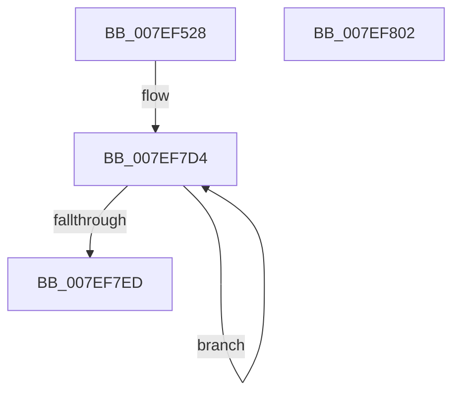

# HvSwapHiveStorage

- RVA: `0x007EF528`–`0x007EF803` (길이 `731` bytes)
- VA: `0x00000001407EF528`
- 실행 섹션: `PAGE`
- PDB 이름 있음: `예`; PDB Function 태그: `아니요`
- unwind 정보 RVA: `0x0005C954`
- 디코드: `158`개 명령, `731/731` bytes 표시
- 미해석 바이트: `0` (있으면 어셈블리에 `.byte`로 보존)

> 이 문서는 커널 이미지의 기계어와 PDB 기호를 분석해 생성했습니다. 4번과 5번은 함수 원형과 자료형을 바이너리 사용 방식에서 추정한 C 해석이며 원본 소스 복구 결과는 아닙니다.

## 1. Dependencies

- 직접 호출 지점: **1**; 고유 호출 대상: **1**
- 직접 호출자로 확인된 함수: **1**
- RIP 상대 이미지 참조: **0**

### Outgoing calls
- `0x007EF7DB` → [HvpSwapDual](HvpSwapDual_function_007EFAE8.md) (function, `0x007EFAE8`)

### Direct callers
- [CmpSwapHiveStorage](CmpSwapHiveStorage_function_007EE54C.md) at `0x007EE56D`

### Static image references
- 디코드된 RIP-relative 메모리 참조가 없습니다.

## 2. Other-region calls and transfers

- 다른 실행 섹션으로 향하는 call: **0**
- 별도 외부 분기/꼬리 이동을 확인하지 못했습니다.

## 3. Assembly (complete function range)

```asm
007EF528  48 89 5C 24 08                  mov qword ptr [rsp + 8], rbx
007EF52D  48 89 6C 24 10                  mov qword ptr [rsp + 0x10], rbp
007EF532  48 89 74 24 18                  mov qword ptr [rsp + 0x18], rsi
007EF537  57                              push rdi
007EF538  48 83 EC 20                     sub rsp, 0x20
007EF53C  4C 8B 41 28                     mov r8, qword ptr [rcx + 0x28]
007EF540  48 8B F2                        mov rsi, rdx
007EF543  48 8B 59 08                     mov rbx, qword ptr [rcx + 8]
007EF547  48 8B F9                        mov rdi, rcx
007EF54A  4C 8B 51 18                     mov r10, qword ptr [rcx + 0x18]
007EF54E  BD 02 00 00 00                  mov ebp, 2
007EF553  4C 8B 49 20                     mov r9, qword ptr [rcx + 0x20]
007EF557  4C 8B 5A 10                     mov r11, qword ptr [rdx + 0x10]
007EF55B  48 8B 51 30                     mov rdx, qword ptr [rcx + 0x30]
007EF55F  48 8B 46 08                     mov rax, qword ptr [rsi + 8]
007EF563  48 89 41 08                     mov qword ptr [rcx + 8], rax
007EF567  48 8B 46 10                     mov rax, qword ptr [rsi + 0x10]
007EF56B  48 89 41 10                     mov qword ptr [rcx + 0x10], rax
007EF56F  48 8B 46 18                     mov rax, qword ptr [rsi + 0x18]
007EF573  48 89 41 18                     mov qword ptr [rcx + 0x18], rax
007EF577  48 8B 46 20                     mov rax, qword ptr [rsi + 0x20]
007EF57B  48 89 41 20                     mov qword ptr [rcx + 0x20], rax
007EF57F  48 8B 46 28                     mov rax, qword ptr [rsi + 0x28]
007EF583  48 89 41 28                     mov qword ptr [rcx + 0x28], rax
007EF587  48 8B 46 30                     mov rax, qword ptr [rsi + 0x30]
007EF58B  48 89 41 30                     mov qword ptr [rcx + 0x30], rax
007EF58F  4C 89 46 28                     mov qword ptr [rsi + 0x28], r8
007EF593  48 89 5E 08                     mov qword ptr [rsi + 8], rbx
007EF597  4C 89 5E 10                     mov qword ptr [rsi + 0x10], r11
007EF59B  4C 89 56 18                     mov qword ptr [rsi + 0x18], r10
007EF59F  4C 89 4E 20                     mov qword ptr [rsi + 0x20], r9
007EF5A3  48 89 56 30                     mov qword ptr [rsi + 0x30], rdx
007EF5A7  48 8B 49 40                     mov rcx, qword ptr [rcx + 0x40]
007EF5AB  48 8B 46 40                     mov rax, qword ptr [rsi + 0x40]
007EF5AF  48 89 47 40                     mov qword ptr [rdi + 0x40], rax
007EF5B3  48 89 4E 40                     mov qword ptr [rsi + 0x40], rcx
007EF5B7  8B 4F 6C                        mov ecx, dword ptr [rdi + 0x6c]
007EF5BA  8B 46 6C                        mov eax, dword ptr [rsi + 0x6c]
007EF5BD  89 47 6C                        mov dword ptr [rdi + 0x6c], eax
007EF5C0  89 4E 6C                        mov dword ptr [rsi + 0x6c], ecx
007EF5C3  48 8B 46 60                     mov rax, qword ptr [rsi + 0x60]
007EF5C7  48 8B 4F 60                     mov rcx, qword ptr [rdi + 0x60]
007EF5CB  48 89 47 60                     mov qword ptr [rdi + 0x60], rax
007EF5CF  48 89 4E 60                     mov qword ptr [rsi + 0x60], rcx
007EF5D3  8B 4F 58                        mov ecx, dword ptr [rdi + 0x58]
007EF5D6  8B 46 58                        mov eax, dword ptr [rsi + 0x58]
007EF5D9  89 47 58                        mov dword ptr [rdi + 0x58], eax
007EF5DC  89 4E 58                        mov dword ptr [rsi + 0x58], ecx
007EF5DF  8B 4F 68                        mov ecx, dword ptr [rdi + 0x68]
007EF5E2  8B 46 68                        mov eax, dword ptr [rsi + 0x68]
007EF5E5  89 47 68                        mov dword ptr [rdi + 0x68], eax
007EF5E8  89 4E 68                        mov dword ptr [rsi + 0x68], ecx
007EF5EB  48 8B 46 78                     mov rax, qword ptr [rsi + 0x78]
007EF5EF  48 8B 4F 78                     mov rcx, qword ptr [rdi + 0x78]
007EF5F3  48 89 47 78                     mov qword ptr [rdi + 0x78], rax
007EF5F7  48 89 4E 78                     mov qword ptr [rsi + 0x78], rcx
007EF5FB  8B 4F 70                        mov ecx, dword ptr [rdi + 0x70]
007EF5FE  8B 46 70                        mov eax, dword ptr [rsi + 0x70]
007EF601  89 47 70                        mov dword ptr [rdi + 0x70], eax
007EF604  89 4E 70                        mov dword ptr [rsi + 0x70], ecx
007EF607  8B 8F 80 00 00 00               mov ecx, dword ptr [rdi + 0x80]
007EF60D  8B 86 80 00 00 00               mov eax, dword ptr [rsi + 0x80]
007EF613  89 87 80 00 00 00               mov dword ptr [rdi + 0x80], eax
007EF619  89 8E 80 00 00 00               mov dword ptr [rsi + 0x80], ecx
007EF61F  8B 8F 84 00 00 00               mov ecx, dword ptr [rdi + 0x84]
007EF625  8B 86 84 00 00 00               mov eax, dword ptr [rsi + 0x84]
007EF62B  89 87 84 00 00 00               mov dword ptr [rdi + 0x84], eax
007EF631  89 8E 84 00 00 00               mov dword ptr [rsi + 0x84], ecx
007EF637  8B 8F 88 00 00 00               mov ecx, dword ptr [rdi + 0x88]
007EF63D  8B 86 88 00 00 00               mov eax, dword ptr [rsi + 0x88]
007EF643  89 87 88 00 00 00               mov dword ptr [rdi + 0x88], eax
007EF649  89 8E 88 00 00 00               mov dword ptr [rsi + 0x88], ecx
007EF64F  8A 8F 8C 00 00 00               mov cl, byte ptr [rdi + 0x8c]
007EF655  8A C1                           mov al, cl
007EF657  32 86 8C 00 00 00               xor al, byte ptr [rsi + 0x8c]
007EF65D  24 01                           and al, 1
007EF65F  32 C1                           xor al, cl
007EF661  88 87 8C 00 00 00               mov byte ptr [rdi + 0x8c], al
007EF667  8A 86 8C 00 00 00               mov al, byte ptr [rsi + 0x8c]
007EF66D  44 8A C0                        mov r8b, al
007EF670  44 32 C1                        xor r8b, cl
007EF673  41 80 E0 01                     and r8b, 1
007EF677  44 32 C0                        xor r8b, al
007EF67A  44 88 86 8C 00 00 00            mov byte ptr [rsi + 0x8c], r8b
007EF681  8A 97 8C 00 00 00               mov dl, byte ptr [rdi + 0x8c]
007EF687  44 32 C2                        xor r8b, dl
007EF68A  44 22 C5                        and r8b, bpl
007EF68D  48 8D 9F 18 01 00 00            lea rbx, [rdi + 0x118]
007EF694  44 32 C2                        xor r8b, dl
007EF697  44 88 87 8C 00 00 00            mov byte ptr [rdi + 0x8c], r8b
007EF69E  8A 86 8C 00 00 00               mov al, byte ptr [rsi + 0x8c]
007EF6A4  8A C8                           mov cl, al
007EF6A6  32 CA                           xor cl, dl
007EF6A8  BA 13 80 1F 00                  mov edx, 0x1f8013
007EF6AD  40 22 CD                        and cl, bpl
007EF6B0  32 C8                           xor cl, al
007EF6B2  8A 86 8D 00 00 00               mov al, byte ptr [rsi + 0x8d]
007EF6B8  88 8E 8C 00 00 00               mov byte ptr [rsi + 0x8c], cl
007EF6BE  8A 8F 8D 00 00 00               mov cl, byte ptr [rdi + 0x8d]
007EF6C4  88 87 8D 00 00 00               mov byte ptr [rdi + 0x8d], al
007EF6CA  88 8E 8D 00 00 00               mov byte ptr [rsi + 0x8d], cl
007EF6D0  8B 86 90 00 00 00               mov eax, dword ptr [rsi + 0x90]
007EF6D6  8B 8F 90 00 00 00               mov ecx, dword ptr [rdi + 0x90]
007EF6DC  89 87 90 00 00 00               mov dword ptr [rdi + 0x90], eax
007EF6E2  89 8E 90 00 00 00               mov dword ptr [rsi + 0x90], ecx
007EF6E8  8B 86 94 00 00 00               mov eax, dword ptr [rsi + 0x94]
007EF6EE  8B 8F 94 00 00 00               mov ecx, dword ptr [rdi + 0x94]
007EF6F4  89 87 94 00 00 00               mov dword ptr [rdi + 0x94], eax
007EF6FA  89 8E 94 00 00 00               mov dword ptr [rsi + 0x94], ecx
007EF700  8B 86 98 00 00 00               mov eax, dword ptr [rsi + 0x98]
007EF706  8B 8F 98 00 00 00               mov ecx, dword ptr [rdi + 0x98]
007EF70C  89 87 98 00 00 00               mov dword ptr [rdi + 0x98], eax
007EF712  89 8E 98 00 00 00               mov dword ptr [rsi + 0x98], ecx
007EF718  8B 86 9C 00 00 00               mov eax, dword ptr [rsi + 0x9c]
007EF71E  8B 8F 9C 00 00 00               mov ecx, dword ptr [rdi + 0x9c]
007EF724  89 87 9C 00 00 00               mov dword ptr [rdi + 0x9c], eax
007EF72A  89 8E 9C 00 00 00               mov dword ptr [rsi + 0x9c], ecx
007EF730  8B 8F A0 00 00 00               mov ecx, dword ptr [rdi + 0xa0]
007EF736  8B C1                           mov eax, ecx
007EF738  25 EC 7F E0 FF                  and eax, 0xffe07fec
007EF73D  89 87 A0 00 00 00               mov dword ptr [rdi + 0xa0], eax
007EF743  8B 86 A0 00 00 00               mov eax, dword ptr [rsi + 0xa0]
007EF749  33 C8                           xor ecx, eax
007EF74B  23 CA                           and ecx, edx
007EF74D  33 C8                           xor ecx, eax
007EF74F  23 C2                           and eax, edx
007EF751  89 8E A0 00 00 00               mov dword ptr [rsi + 0xa0], ecx
007EF757  09 87 A0 00 00 00               or dword ptr [rdi + 0xa0], eax
007EF75D  0F 10 86 E0 00 00 00            movups xmm0, xmmword ptr [rsi + 0xe0]
007EF764  0F 10 9F E0 00 00 00            movups xmm3, xmmword ptr [rdi + 0xe0]
007EF76B  0F 10 A7 F0 00 00 00            movups xmm4, xmmword ptr [rdi + 0xf0]
007EF772  0F 10 AF 00 01 00 00            movups xmm5, xmmword ptr [rdi + 0x100]
007EF779  F2 0F 10 97 10 01 00 00         movsd xmm2, qword ptr [rdi + 0x110]
007EF781  0F 11 87 E0 00 00 00            movups xmmword ptr [rdi + 0xe0], xmm0
007EF788  0F 10 8E F0 00 00 00            movups xmm1, xmmword ptr [rsi + 0xf0]
007EF78F  0F 11 8F F0 00 00 00            movups xmmword ptr [rdi + 0xf0], xmm1
007EF796  0F 10 86 00 01 00 00            movups xmm0, xmmword ptr [rsi + 0x100]
007EF79D  0F 11 87 00 01 00 00            movups xmmword ptr [rdi + 0x100], xmm0
007EF7A4  F2 0F 10 8E 10 01 00 00         movsd xmm1, qword ptr [rsi + 0x110]
007EF7AC  F2 0F 11 8F 10 01 00 00         movsd qword ptr [rdi + 0x110], xmm1
007EF7B4  0F 11 9E E0 00 00 00            movups xmmword ptr [rsi + 0xe0], xmm3
007EF7BB  0F 11 A6 F0 00 00 00            movups xmmword ptr [rsi + 0xf0], xmm4
007EF7C2  0F 11 AE 00 01 00 00            movups xmmword ptr [rsi + 0x100], xmm5
007EF7C9  F2 0F 11 96 10 01 00 00         movsd qword ptr [rsi + 0x110], xmm2
007EF7D1  48 2B F7                        sub rsi, rdi
007EF7D4  48 8D 14 1E                     lea rdx, [rsi + rbx]
007EF7D8  48 8B CB                        mov rcx, rbx
007EF7DB  E8 08 03 00 00                  call 0x1407efae8
007EF7E0  48 81 C3 78 02 00 00            add rbx, 0x278
007EF7E7  48 83 ED 01                     sub rbp, 1
007EF7EB  75 E7                           jne 0x1407ef7d4
007EF7ED  48 8B 5C 24 30                  mov rbx, qword ptr [rsp + 0x30]
007EF7F2  48 8B 6C 24 38                  mov rbp, qword ptr [rsp + 0x38]
007EF7F7  48 8B 74 24 40                  mov rsi, qword ptr [rsp + 0x40]
007EF7FC  48 83 C4 20                     add rsp, 0x20
007EF800  5F                              pop rdi
007EF801  C3                              ret
007EF802  CC                              int3
```

## 4. C-style interpretation (structured pseudocode)

```c
__int64 __fastcall HvSwapHiveStorage(__int64 a1, __int64 a2)
{
    __int64 result;
    __int64 v_rbp;
    __int64 v_rbx;
    __int64 v_rsi;
    __int64 v_rsp;
    unsigned __int64 v_stack_p10;
    unsigned __int64 v_stack_p18;
    unsigned __int64 v_stack_p8;

    v_stack_p8 = v_rbx;
    v_stack_p10 = v_rbp;
    v_stack_p18 = v_rsi;
    v_rsp = (v_rsp) - (32);
    *(unsigned __int64 *)(a1 + 8) = *(unsigned __int64 *)(a2 + 8);
    *(unsigned __int64 *)(a1 + 16) = *(unsigned __int64 *)(a2 + 16);
    *(unsigned __int64 *)(a1 + 24) = *(unsigned __int64 *)(a2 + 24);
    *(unsigned __int64 *)(a1 + 32) = *(unsigned __int64 *)(a2 + 32);
    *(unsigned __int64 *)(a1 + 40) = *(unsigned __int64 *)(a2 + 40);
    *(unsigned __int64 *)(a1 + 48) = *(unsigned __int64 *)(a2 + 48);
    *(unsigned __int64 *)(a2 + 40) = *(unsigned __int64 *)(a1 + 40);
    *(unsigned __int64 *)(a2 + 8) = *(unsigned __int64 *)(a1 + 8);
    *(unsigned __int64 *)(a2 + 16) = *(unsigned __int64 *)(a2 + 16);
    *(unsigned __int64 *)(a2 + 24) = *(unsigned __int64 *)(a1 + 24);
    *(unsigned __int64 *)(a2 + 32) = *(unsigned __int64 *)(a1 + 32);
    *(unsigned __int64 *)(a2 + 48) = *(unsigned __int64 *)(a1 + 48);
    *(unsigned __int64 *)(a1 + 64) = *(unsigned __int64 *)(a2 + 64);
    *(unsigned __int64 *)(a2 + 64) = *(unsigned __int64 *)(a1 + 64);
    *(unsigned int *)(a1 + 108) = (unsigned int)((unsigned int)(*(unsigned int *)(a2 + 108)));
    *(unsigned int *)(a2 + 108) = (unsigned int)((unsigned int)(*(unsigned int *)(a1 + 108)));
    *(unsigned __int64 *)(a1 + 96) = *(unsigned __int64 *)(a2 + 96);
    *(unsigned __int64 *)(a2 + 96) = *(unsigned __int64 *)(a1 + 96);
    *(unsigned int *)(a1 + 88) = (unsigned int)((unsigned int)(*(unsigned int *)(a2 + 88)));
    *(unsigned int *)(a2 + 88) = (unsigned int)((unsigned int)(*(unsigned int *)(a1 + 88)));
    *(unsigned int *)(a1 + 104) = (unsigned int)((unsigned int)(*(unsigned int *)(a2 + 104)));
    *(unsigned int *)(a2 + 104) = (unsigned int)((unsigned int)(*(unsigned int *)(a1 + 104)));
    *(unsigned __int64 *)(a1 + 120) = *(unsigned __int64 *)(a2 + 120);
    *(unsigned __int64 *)(a2 + 120) = *(unsigned __int64 *)(a1 + 120);
    *(unsigned int *)(a1 + 112) = (unsigned int)((unsigned int)(*(unsigned int *)(a2 + 112)));
    *(unsigned int *)(a2 + 112) = (unsigned int)((unsigned int)(*(unsigned int *)(a1 + 112)));
    *(unsigned int *)(a1 + 128) = (unsigned int)((unsigned int)(*(unsigned int *)(a2 + 128)));
    *(unsigned int *)(a2 + 128) = (unsigned int)((unsigned int)(*(unsigned int *)(a1 + 128)));
    *(unsigned int *)(a1 + 132) = (unsigned int)((unsigned int)(*(unsigned int *)(a2 + 132)));
    *(unsigned int *)(a2 + 132) = (unsigned int)((unsigned int)(*(unsigned int *)(a1 + 132)));
    *(unsigned int *)(a1 + 136) = (unsigned int)((unsigned int)(*(unsigned int *)(a2 + 136)));
    *(unsigned int *)(a2 + 136) = (unsigned int)((unsigned int)(*(unsigned int *)(a1 + 136)));
    result = (unsigned __int8)(((unsigned __int8)(*(unsigned __int8 *)(a1 + 140))) ^ (*(unsigned __int8 *)(a2 + 140)));
    result = (unsigned __int8)((result) & (1));
    result = (unsigned __int8)((result) ^ ((unsigned __int8)(*(unsigned __int8 *)(a1 + 140))));
    *(unsigned __int8 *)(a1 + 140) = (unsigned __int8)(result);
    a3 = (unsigned __int8)(((unsigned __int8)(*(unsigned __int8 *)(a2 + 140))) ^ ((unsigned __int8)(*(unsigned __int8 *)(a1 + 140))));
    a3 = (unsigned __int8)((a3) & (1));
    a3 = (unsigned __int8)((a3) ^ ((unsigned __int8)(*(unsigned __int8 *)(a2 + 140))));
    *(unsigned __int8 *)(a2 + 140) = (unsigned __int8)(a3);
    a3 = (unsigned __int8)((a3) ^ ((unsigned __int8)(*(unsigned __int8 *)(a1 + 140))));
    a3 = (unsigned __int8)((a3) & (2));
    a3 = (unsigned __int8)((a3) ^ ((unsigned __int8)(*(unsigned __int8 *)(a1 + 140))));
    *(unsigned __int8 *)(a1 + 140) = (unsigned __int8)(a3);
    a1 = (unsigned __int8)(((unsigned __int8)(*(unsigned __int8 *)(a2 + 140))) ^ ((unsigned __int8)(*(unsigned __int8 *)(a1 + 140))));
    a1 = (unsigned __int8)((a1) & (2));
    a1 = (unsigned __int8)((a1) ^ ((unsigned __int8)(*(unsigned __int8 *)(a2 + 140))));
    *(unsigned __int8 *)(a2 + 140) = (unsigned __int8)(a1);
    *(unsigned __int8 *)(a1 + 141) = (unsigned __int8)(*(unsigned __int8 *)(a2 + 141));
    *(unsigned __int8 *)(a2 + 141) = (unsigned __int8)(*(unsigned __int8 *)(a1 + 141));
    *(unsigned int *)(a1 + 144) = (unsigned int)((unsigned int)(*(unsigned int *)(a2 + 144)));
    *(unsigned int *)(a2 + 144) = (unsigned int)((unsigned int)(*(unsigned int *)(a1 + 144)));
    *(unsigned int *)(a1 + 148) = (unsigned int)((unsigned int)(*(unsigned int *)(a2 + 148)));
    *(unsigned int *)(a2 + 148) = (unsigned int)((unsigned int)(*(unsigned int *)(a1 + 148)));
    *(unsigned int *)(a1 + 152) = (unsigned int)((unsigned int)(*(unsigned int *)(a2 + 152)));
    *(unsigned int *)(a2 + 152) = (unsigned int)((unsigned int)(*(unsigned int *)(a1 + 152)));
    *(unsigned int *)(a1 + 156) = (unsigned int)((unsigned int)(*(unsigned int *)(a2 + 156)));
    *(unsigned int *)(a2 + 156) = (unsigned int)((unsigned int)(*(unsigned int *)(a1 + 156)));
    result = (unsigned int)(((unsigned int)((unsigned int)((unsigned int)(*(unsigned int *)(a1 + 160))))) & (0xFFE07FECULL));
    *(unsigned int *)(a1 + 160) = (unsigned int)(result);
    a1 = (unsigned int)(((unsigned int)(*(unsigned int *)(a1 + 160))) ^ ((unsigned int)((unsigned int)(*(unsigned int *)(a2 + 160)))));
    a1 = (unsigned int)((a1) & ((unsigned int)((unsigned int)(0x1F8013ULL))));
    a1 = (unsigned int)((a1) ^ ((unsigned int)((unsigned int)(*(unsigned int *)(a2 + 160)))));
    result = (unsigned int)(((unsigned int)(*(unsigned int *)(a2 + 160))) & ((unsigned int)((unsigned int)(0x1F8013ULL))));
    *(unsigned int *)(a2 + 160) = (unsigned int)(a1);
    *(unsigned __int64 *)(a1 + 224) = v_xmm0;
    *(unsigned __int64 *)(a1 + 240) = v_xmm1;
    *(unsigned __int64 *)(a1 + 256) = v_xmm0;
    *(unsigned __int64 *)(a1 + 272) = v_xmm1;
    *(unsigned __int64 *)(a2 + 224) = v_xmm3;
    *(unsigned __int64 *)(a2 + 240) = v_xmm4;
    *(unsigned __int64 *)(a2 + 256) = v_xmm5;
    *(unsigned __int64 *)(a2 + 272) = v_xmm2;
    v_rsi = (a2) - (a1);
loc_007EF7D4:
    result = HvpSwapDual(a1 + 280, v_rsi + a1 + 280 * 1, a3, *(unsigned __int64 *)(a1 + 32));
    v_rbx = (a1 + 280) + (632);
    v_rbp = (2) - (1);
    if (condition_is_not_equal) goto loc_007EF7D4;
    v_rsp = (v_rsp) + (32);
    return result;
}
```

## 5. (Beta) C Style

```c
int64_t HvSwapHiveStorage(void *Arg1, void *Arg2)
{
    uint8_t *arg1 = (uint8_t *)Arg1;
    uint8_t *arg2 = (uint8_t *)Arg2;

    int64_t result;
    int64_t local_rbp;
    int64_t local_rbx;
    int64_t local_rsi;
    int64_t local_rsp;
    uint64_t v_stack_p10;
    uint64_t v_stack_p18;
    uint64_t v_stack_p8;

    v_stack_p8 = local_rbx;
    v_stack_p10 = local_rbp;
    v_stack_p18 = local_rsi;
    local_rsp = (local_rsp) - (32);
    *(uint64_t *)(arg1 + 0x8) = *(uint64_t *)(arg2 + 0x8);
    *(uint64_t *)(arg1 + 0x10) = *(uint64_t *)(arg2 + 0x10);
    *(uint64_t *)(arg1 + 0x18) = *(uint64_t *)(arg2 + 0x18);
    *(uint64_t *)(arg1 + 0x20) = *(uint64_t *)(arg2 + 0x20);
    *(uint64_t *)(arg1 + 0x28) = *(uint64_t *)(arg2 + 0x28);
    *(uint64_t *)(arg1 + 0x30) = *(uint64_t *)(arg2 + 0x30);
    *(uint64_t *)(arg2 + 0x28) = *(uint64_t *)(arg1 + 0x28);
    *(uint64_t *)(arg2 + 0x8) = *(uint64_t *)(arg1 + 0x8);
    *(uint64_t *)(arg2 + 0x10) = *(uint64_t *)(arg2 + 0x10);
    *(uint64_t *)(arg2 + 0x18) = *(uint64_t *)(arg1 + 0x18);
    *(uint64_t *)(arg2 + 0x20) = *(uint64_t *)(arg1 + 0x20);
    *(uint64_t *)(arg2 + 0x30) = *(uint64_t *)(arg1 + 0x30);
    *(uint64_t *)(arg1 + 0x40) = *(uint64_t *)(arg2 + 0x40);
    *(uint64_t *)(arg2 + 0x40) = *(uint64_t *)(arg1 + 0x40);
    *(uint32_t *)(arg1 + 0x6C) = (uint32_t)((uint32_t)(*(uint32_t *)(arg2 + 0x6C)));
    *(uint32_t *)(arg2 + 0x6C) = (uint32_t)((uint32_t)(*(uint32_t *)(arg1 + 0x6C)));
    *(uint64_t *)(arg1 + 0x60) = *(uint64_t *)(arg2 + 0x60);
    *(uint64_t *)(arg2 + 0x60) = *(uint64_t *)(arg1 + 0x60);
    *(uint32_t *)(arg1 + 0x58) = (uint32_t)((uint32_t)(*(uint32_t *)(arg2 + 0x58)));
    *(uint32_t *)(arg2 + 0x58) = (uint32_t)((uint32_t)(*(uint32_t *)(arg1 + 0x58)));
    *(uint32_t *)(arg1 + 0x68) = (uint32_t)((uint32_t)(*(uint32_t *)(arg2 + 0x68)));
    *(uint32_t *)(arg2 + 0x68) = (uint32_t)((uint32_t)(*(uint32_t *)(arg1 + 0x68)));
    *(uint64_t *)(arg1 + 0x78) = *(uint64_t *)(arg2 + 0x78);
    *(uint64_t *)(arg2 + 0x78) = *(uint64_t *)(arg1 + 0x78);
    *(uint32_t *)(arg1 + 0x70) = (uint32_t)((uint32_t)(*(uint32_t *)(arg2 + 0x70)));
    *(uint32_t *)(arg2 + 0x70) = (uint32_t)((uint32_t)(*(uint32_t *)(arg1 + 0x70)));
    *(uint32_t *)(arg1 + 0x80) = (uint32_t)((uint32_t)(*(uint32_t *)(arg2 + 0x80)));
    *(uint32_t *)(arg2 + 0x80) = (uint32_t)((uint32_t)(*(uint32_t *)(arg1 + 0x80)));
    *(uint32_t *)(arg1 + 0x84) = (uint32_t)((uint32_t)(*(uint32_t *)(arg2 + 0x84)));
    *(uint32_t *)(arg2 + 0x84) = (uint32_t)((uint32_t)(*(uint32_t *)(arg1 + 0x84)));
    *(uint32_t *)(arg1 + 0x88) = (uint32_t)((uint32_t)(*(uint32_t *)(arg2 + 0x88)));
    *(uint32_t *)(arg2 + 0x88) = (uint32_t)((uint32_t)(*(uint32_t *)(arg1 + 0x88)));
    result = (uint8_t)(((uint8_t)(*(uint8_t *)(arg1 + 0x8C))) ^ (*(uint8_t *)(arg2 + 0x8C)));
    result = (uint8_t)((result) & (1));
    result = (uint8_t)((result) ^ ((uint8_t)(*(uint8_t *)(arg1 + 0x8C))));
    *(uint8_t *)(arg1 + 0x8C) = (uint8_t)(result);
    a3 = (uint8_t)(((uint8_t)(*(uint8_t *)(arg2 + 0x8C))) ^ ((uint8_t)(*(uint8_t *)(arg1 + 0x8C))));
    a3 = (uint8_t)((a3) & (1));
    a3 = (uint8_t)((a3) ^ ((uint8_t)(*(uint8_t *)(arg2 + 0x8C))));
    *(uint8_t *)(arg2 + 0x8C) = (uint8_t)(a3);
    a3 = (uint8_t)((a3) ^ ((uint8_t)(*(uint8_t *)(arg1 + 0x8C))));
    a3 = (uint8_t)((a3) & (2));
    a3 = (uint8_t)((a3) ^ ((uint8_t)(*(uint8_t *)(arg1 + 0x8C))));
    *(uint8_t *)(arg1 + 0x8C) = (uint8_t)(a3);
    Arg1 = (uint8_t)(((uint8_t)(*(uint8_t *)(arg2 + 0x8C))) ^ ((uint8_t)(*(uint8_t *)(arg1 + 0x8C))));
    Arg1 = (uint8_t)((Arg1) & (2));
    Arg1 = (uint8_t)((Arg1) ^ ((uint8_t)(*(uint8_t *)(arg2 + 0x8C))));
    *(uint8_t *)(arg2 + 0x8C) = (uint8_t)(Arg1);
    *(uint8_t *)(arg1 + 0x8D) = (uint8_t)(*(uint8_t *)(arg2 + 0x8D));
    *(uint8_t *)(arg2 + 0x8D) = (uint8_t)(*(uint8_t *)(arg1 + 0x8D));
    *(uint32_t *)(arg1 + 0x90) = (uint32_t)((uint32_t)(*(uint32_t *)(arg2 + 0x90)));
    *(uint32_t *)(arg2 + 0x90) = (uint32_t)((uint32_t)(*(uint32_t *)(arg1 + 0x90)));
    *(uint32_t *)(arg1 + 0x94) = (uint32_t)((uint32_t)(*(uint32_t *)(arg2 + 0x94)));
    *(uint32_t *)(arg2 + 0x94) = (uint32_t)((uint32_t)(*(uint32_t *)(arg1 + 0x94)));
    *(uint32_t *)(arg1 + 0x98) = (uint32_t)((uint32_t)(*(uint32_t *)(arg2 + 0x98)));
    *(uint32_t *)(arg2 + 0x98) = (uint32_t)((uint32_t)(*(uint32_t *)(arg1 + 0x98)));
    *(uint32_t *)(arg1 + 0x9C) = (uint32_t)((uint32_t)(*(uint32_t *)(arg2 + 0x9C)));
    *(uint32_t *)(arg2 + 0x9C) = (uint32_t)((uint32_t)(*(uint32_t *)(arg1 + 0x9C)));
    result = (uint32_t)(((uint32_t)((uint32_t)((uint32_t)(*(uint32_t *)(arg1 + 0xA0))))) & (0xFFE07FECULL));
    *(uint32_t *)(arg1 + 0xA0) = (uint32_t)(result);
    Arg1 = (uint32_t)(((uint32_t)(*(uint32_t *)(arg1 + 0xA0))) ^ ((uint32_t)((uint32_t)(*(uint32_t *)(arg2 + 0xA0)))));
    Arg1 = (uint32_t)((Arg1) & ((uint32_t)((uint32_t)(0x1F8013ULL))));
    Arg1 = (uint32_t)((Arg1) ^ ((uint32_t)((uint32_t)(*(uint32_t *)(arg2 + 0xA0)))));
    result = (uint32_t)(((uint32_t)(*(uint32_t *)(arg2 + 0xA0))) & ((uint32_t)((uint32_t)(0x1F8013ULL))));
    *(uint32_t *)(arg2 + 0xA0) = (uint32_t)(Arg1);
    *(uint64_t *)(arg1 + 0xE0) = v_xmm0;
    *(uint64_t *)(arg1 + 0xF0) = v_xmm1;
    *(uint64_t *)(arg1 + 0x100) = v_xmm0;
    *(uint64_t *)(arg1 + 0x110) = v_xmm1;
    *(uint64_t *)(arg2 + 0xE0) = v_xmm3;
    *(uint64_t *)(arg2 + 0xF0) = v_xmm4;
    *(uint64_t *)(arg2 + 0x100) = v_xmm5;
    *(uint64_t *)(arg2 + 0x110) = v_xmm2;
    local_rsi = (Arg2) - (Arg1);
loc_007EF7D4:
    result = HvpSwapDual(Arg1 + 280, local_rsi + Arg1 + 280 * 1, a3, *(uint64_t *)(arg1 + 0x20));
    local_rbx = (Arg1 + 280) + (632);
    local_rbp = (2) - (1);
    if (condition_is_not_equal) goto loc_007EF7D4;
    local_rsp = (local_rsp) + (32);
    return result;
}
```

### 관측된 메모리 오프셋

구조체 형식이 확인되지 않은 접근은 인자 기준의 오프셋으로만 기록했습니다.

| 기준 인자 | 오프셋 표현 | 폭 (bit) | 접근 |
|---|---:|---:|---|
| `Arg1` | `+ 0x8` | `64` | `R` |
| `Arg1` | `+ 0x8` | `64` | `W` |
| `Arg1` | `+ 0x10` | `64` | `W` |
| `Arg1` | `+ 0x18` | `64` | `R` |
| `Arg1` | `+ 0x18` | `64` | `W` |
| `Arg1` | `+ 0x20` | `64` | `R` |
| `Arg1` | `+ 0x20` | `64` | `W` |
| `Arg1` | `+ 0x28` | `64` | `R` |
| `Arg1` | `+ 0x28` | `64` | `W` |
| `Arg1` | `+ 0x30` | `64` | `R` |
| `Arg1` | `+ 0x30` | `64` | `W` |
| `Arg1` | `+ 0x40` | `64` | `R` |
| `Arg1` | `+ 0x40` | `64` | `W` |
| `Arg1` | `+ 0x58` | `32` | `R` |
| `Arg1` | `+ 0x58` | `32` | `W` |
| `Arg1` | `+ 0x60` | `64` | `R` |
| `Arg1` | `+ 0x60` | `64` | `W` |
| `Arg1` | `+ 0x68` | `32` | `R` |
| `Arg1` | `+ 0x68` | `32` | `W` |
| `Arg1` | `+ 0x6C` | `32` | `R` |
| `Arg1` | `+ 0x6C` | `32` | `W` |
| `Arg1` | `+ 0x70` | `32` | `R` |
| `Arg1` | `+ 0x70` | `32` | `W` |
| `Arg1` | `+ 0x78` | `64` | `R` |
| `Arg1` | `+ 0x78` | `64` | `W` |
| `Arg1` | `+ 0x80` | `32` | `R` |
| `Arg1` | `+ 0x80` | `32` | `W` |
| `Arg1` | `+ 0x84` | `32` | `R` |
| `Arg1` | `+ 0x84` | `32` | `W` |
| `Arg1` | `+ 0x88` | `32` | `R` |
| `Arg1` | `+ 0x88` | `32` | `W` |
| `Arg1` | `+ 0x8C` | `8` | `R` |

추가 오프셋 72개는 표에서 생략했습니다.

## 6. Execution-region graph

[열기: 2D/3D 그래프와 함수 탐색 컨트롤 패널](../../../control-panel.html?section=page&rva=0x007EF528&view=graph)

- 2D 그래프는 위에서 아래로 흐르고, 3D 그래프는 빈 공간을 드래그해 회전합니다. Shift+드래그는 이동, 휠은 확대·축소, 함수 노드 선택은 대상 보고서 이동입니다.

### Static fallback


