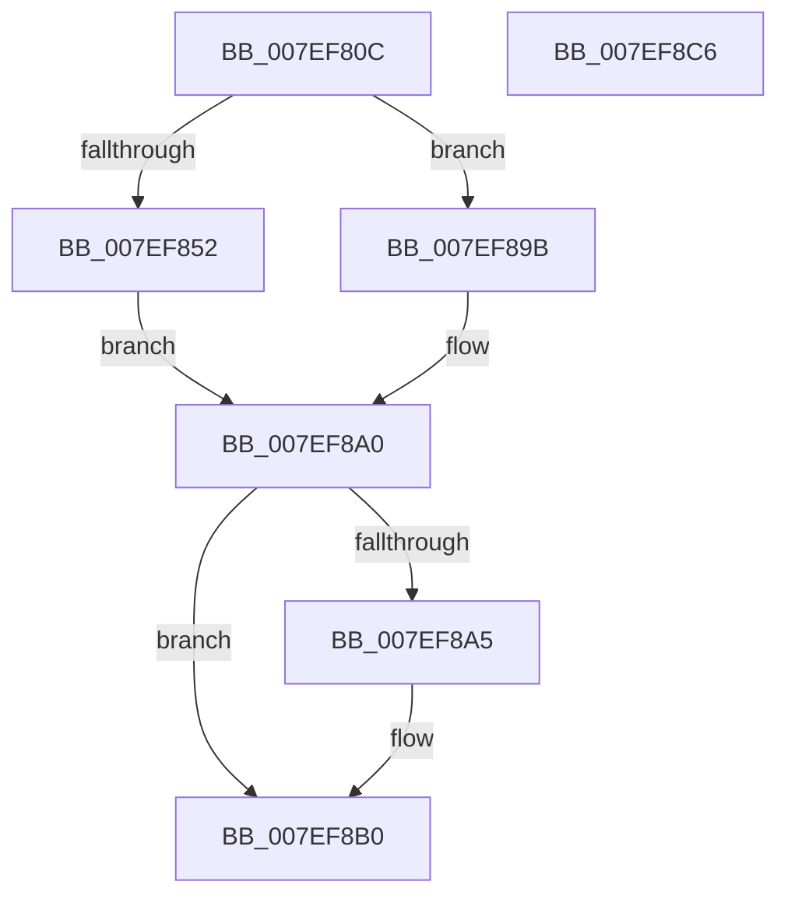

# HvpAddDummyBinToHive

- RVA: `0x007EF80C`–`0x007EF8C7` (길이 `187` bytes)
- VA: `0x00000001407EF80C`
- 실행 섹션: `PAGE`
- PDB 이름 있음: `예`; PDB Function 태그: `아니요`
- unwind 정보 RVA: `0x000BE1D0`
- 디코드: `56`개 명령, `187/187` bytes 표시
- 미해석 바이트: `0` (있으면 어셈블리에 `.byte`로 보존)

> 이 문서는 커널 이미지의 기계어와 PDB 기호를 분석해 생성했습니다. 4번과 5번은 함수 원형과 자료형을 바이너리 사용 방식에서 추정한 C 해석이며 원본 소스 복구 결과는 아닙니다.

## 1. Dependencies

- 직접 호출 지점: **4**; 고유 호출 대상: **4**
- 직접 호출자로 확인된 함수: **1**
- RIP 상대 이미지 참조: **0**

### Outgoing calls
- `0x007EF847` → [HvpAllocateBin](../9B/HvpAllocateBin_function_009B78A4.md) (function, `0x009B78A4`)
- `0x007EF85F` → [memset](../../text/6C/memset_function_006C6C40.md) (function, `0x006C6C40`)
- `0x007EF88C` → [HvpPointMapEntriesToBuffer](../9B/HvpPointMapEntriesToBuffer_function_009B7328.md) (function, `0x009B7328`)
- `0x007EF8AB` → [HvpFreeBin](../A8/HvpFreeBin_function_00A8158C.md) (function, `0x00A8158C`)

### Direct callers
- [HvpPerformLogFileRecovery](../9B/HvpPerformLogFileRecovery_function_009B7994.md) at `0x009B7B39`

### Static image references
- 디코드된 RIP-relative 메모리 참조가 없습니다.

## 2. Other-region calls and transfers

- 다른 실행 섹션으로 향하는 call: **1**
  - `0x007EF85F` → [memset](../../text/6C/memset_function_006C6C40.md) (`PAGE` → `.text`)
- 별도 외부 분기/꼬리 이동을 확인하지 못했습니다.

## 3. Assembly (complete function range)

```asm
007EF80C  4C 8B DC                        mov r11, rsp
007EF80F  49 89 5B 08                     mov qword ptr [r11 + 8], rbx
007EF813  49 89 73 10                     mov qword ptr [r11 + 0x10], rsi
007EF817  57                              push rdi
007EF818  41 56                           push r14
007EF81A  41 57                           push r15
007EF81C  48 83 EC 30                     sub rsp, 0x30
007EF820  49 83 63 20 00                  and qword ptr [r11 + 0x20], 0
007EF825  49 8D 43 20                     lea rax, [r11 + 0x20]
007EF829  4D 8B F0                        mov r14, r8
007EF82C  49 89 43 D8                     mov qword ptr [r11 - 0x28], rax
007EF830  8B F2                           mov esi, edx
007EF832  41 BF 00 10 00 00               mov r15d, 0x1000
007EF838  41 8B D7                        mov edx, r15d
007EF83B  41 B9 43 4D 33 30               mov r9d, 0x30334d43
007EF841  45 33 C0                        xor r8d, r8d
007EF844  48 8B F9                        mov rdi, rcx
007EF847  E8 58 80 1C 00                  call 0x1409b78a4
007EF84C  8B D8                           mov ebx, eax
007EF84E  85 C0                           test eax, eax
007EF850  78 49                           js 0x1407ef89b
007EF852  48 8B 5C 24 68                  mov rbx, qword ptr [rsp + 0x68]
007EF857  45 8B C7                        mov r8d, r15d
007EF85A  48 8B CB                        mov rcx, rbx
007EF85D  33 D2                           xor edx, edx
007EF85F  E8 DC 73 ED FF                  call 0x1406c6c40
007EF864  48 83 64 24 28 00               and qword ptr [rsp + 0x28], 0
007EF86A  44 8B CE                        mov r9d, esi
007EF86D  83 23 00                        and dword ptr [rbx], 0
007EF870  45 8B C7                        mov r8d, r15d
007EF873  48 8B D3                        mov rdx, rbx
007EF876  89 73 04                        mov dword ptr [rbx + 4], esi
007EF879  48 8B CF                        mov rcx, rdi
007EF87C  44 89 7B 08                     mov dword ptr [rbx + 8], r15d
007EF880  C7 43 20 20 F0 FF FF            mov dword ptr [rbx + 0x20], 0xfffff020
007EF887  C6 44 24 20 01                  mov byte ptr [rsp + 0x20], 1
007EF88C  E8 97 7A 1C 00                  call 0x1409b7328
007EF891  45 33 C0                        xor r8d, r8d
007EF894  49 89 1E                        mov qword ptr [r14], rbx
007EF897  33 DB                           xor ebx, ebx
007EF899  EB 05                           jmp 0x1407ef8a0
007EF89B  4C 8B 44 24 68                  mov r8, qword ptr [rsp + 0x68]
007EF8A0  4D 85 C0                        test r8, r8
007EF8A3  74 0B                           je 0x1407ef8b0
007EF8A5  41 8B D7                        mov edx, r15d
007EF8A8  48 8B CF                        mov rcx, rdi
007EF8AB  E8 DC 1C 29 00                  call 0x140a8158c
007EF8B0  48 8B 74 24 58                  mov rsi, qword ptr [rsp + 0x58]
007EF8B5  8B C3                           mov eax, ebx
007EF8B7  48 8B 5C 24 50                  mov rbx, qword ptr [rsp + 0x50]
007EF8BC  48 83 C4 30                     add rsp, 0x30
007EF8C0  41 5F                           pop r15
007EF8C2  41 5E                           pop r14
007EF8C4  5F                              pop rdi
007EF8C5  C3                              ret
007EF8C6  CC                              int3
```

## 4. C-style interpretation (structured pseudocode)

```c
__int64 __fastcall HvpAddDummyBinToHive(__int64 a1, int a2, __int64 a3)
{
    __int64 result;
    __int64 v_rbx;
    __int64 v_rsp;
    unsigned __int64 v_stack_m20;
    unsigned __int8 v_stack_m28;
    unsigned __int64 v_stack_p10;
    unsigned __int64 v_stack_p20;
    unsigned __int64 v_stack_p8;

    *(unsigned __int64 *)(v_rsp + 8) = v_rbx;
    *(unsigned __int64 *)(v_rsp + 16) = v_rsi;
    v_rsp = (v_rsp) - (48);
    *(unsigned __int64 *)(v_rsp - 40) = v_rsp + 32;
    a3 = 0;
    result = HvpAllocateBin(a1, (unsigned int)((unsigned int)((unsigned int)(0x1000ULL))), a3, (unsigned int)(0x30334D43ULL));
    if (sign_flag) goto loc_007EF89B;
    a2 = 0;
    result = memset(v_stack_p20, a2, (unsigned int)((unsigned int)((unsigned int)(0x1000ULL))), (unsigned int)(0x30334D43ULL));
    *(unsigned int *)(v_stack_p20 + 4) = (unsigned int)((unsigned int)(a2));
    *(unsigned int *)(v_stack_p20 + 8) = (unsigned int)((unsigned int)(0x1000ULL));
    *(unsigned int *)(v_stack_p20 + 32) = 0xFFFFF020ULL;
    v_stack_m28 = 1;
    result = HvpPointMapEntriesToBuffer(a1, v_stack_p20, (unsigned int)((unsigned int)((unsigned int)(0x1000ULL))), (unsigned int)((unsigned int)((unsigned int)(a2))));
    a3 = 0;
    *(unsigned __int64 *)(a3) = v_stack_p20;
    v_rbx = 0;
    goto loc_007EF8A0;
loc_007EF89B:
loc_007EF8A0:
    if (v_stack_p20 != 0) {
        a2 = (unsigned int)((unsigned int)(0x1000ULL));
        a1 = a1;
        result = HvpFreeBin(a1, a2, v_stack_p20, (unsigned int)((unsigned int)((unsigned int)(a2))));
    }
    v_rsp = (v_rsp) + (48);
    return 0;
}
```

## 5. (Beta) C Style

```c
int64_t HvpAddDummyBinToHive(int64_t Arg1, int32_t Arg2, void *Arg3)
{
    uint8_t *arg3 = (uint8_t *)Arg3;

    int64_t result;
    int64_t local_rbx;
    int64_t local_rsp;
    uint64_t v_stack_m20;
    uint8_t v_stack_m28;
    uint64_t v_stack_p10;
    uint64_t v_stack_p20;
    uint64_t v_stack_p8;

    *(uint64_t *)(local_rsp + 0x8) = local_rbx;
    *(uint64_t *)(local_rsp + 0x10) = local_rsi;
    local_rsp = (local_rsp) - (48);
    *(uint64_t *)(local_rsp - 0x28) = local_rsp + 32;
    Arg3 = 0;
    result = HvpAllocateBin(Arg1, (uint32_t)((uint32_t)((uint32_t)(0x1000ULL))), Arg3, (uint32_t)(0x30334D43ULL));
    if (sign_flag) goto loc_007EF89B;
    Arg2 = 0;
    result = memset(v_stack_p20, Arg2, (uint32_t)((uint32_t)((uint32_t)(0x1000ULL))), (uint32_t)(0x30334D43ULL));
    *(uint32_t *)(v_stack_p20 + 0x4) = (uint32_t)((uint32_t)(Arg2));
    *(uint32_t *)(v_stack_p20 + 0x8) = (uint32_t)((uint32_t)(0x1000ULL));
    *(uint32_t *)(v_stack_p20 + 0x20) = 0xFFFFF020ULL;
    v_stack_m28 = 1;
    result = HvpPointMapEntriesToBuffer(Arg1, v_stack_p20, (uint32_t)((uint32_t)((uint32_t)(0x1000ULL))), (uint32_t)((uint32_t)((uint32_t)(Arg2))));
    Arg3 = 0;
    *(uint64_t *)(arg3) = v_stack_p20;
    local_rbx = 0;
    goto loc_007EF8A0;
loc_007EF89B:
loc_007EF8A0:
    if (v_stack_p20 != 0) {
        Arg2 = (uint32_t)((uint32_t)(0x1000ULL));
        Arg1 = Arg1;
        result = HvpFreeBin(Arg1, Arg2, v_stack_p20, (uint32_t)((uint32_t)((uint32_t)(Arg2))));
    }
    local_rsp = (local_rsp) + (48);
    return 0;
}
```

### 관측된 메모리 오프셋

구조체 형식이 확인되지 않은 접근은 인자 기준의 오프셋으로만 기록했습니다.

| 기준 인자 | 오프셋 표현 | 폭 (bit) | 접근 |
|---|---:|---:|---|
| `Arg3` | `+ 0x0` | `64` | `W` |

## 6. Execution-region graph

[열기: 2D/3D 그래프와 함수 탐색 컨트롤 패널](../../../control-panel.html?section=page&rva=0x007EF80C&view=graph)

- 2D 그래프는 위에서 아래로 흐르고, 3D 그래프는 빈 공간을 드래그해 회전합니다. Shift+드래그는 이동, 휠은 확대·축소, 함수 노드 선택은 대상 보고서 이동입니다.

### Static fallback


