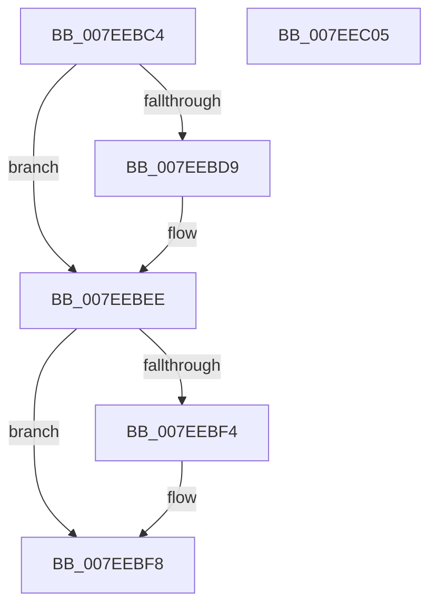

# HvpInpageErrorFilter

- RVA: `0x007EEBC4`–`0x007EEC06` (길이 `66` bytes)
- VA: `0x00000001407EEBC4`
- 실행 섹션: `PAGE`
- PDB 이름 있음: `예`; PDB Function 태그: `아니요`
- unwind 정보 RVA: `0x0005C788`
- 디코드: `20`개 명령, `66/66` bytes 표시
- 미해석 바이트: `0` (있으면 어셈블리에 `.byte`로 보존)

> 이 문서는 커널 이미지의 기계어와 PDB 기호를 분석해 생성했습니다. 4번과 5번은 함수 원형과 자료형을 바이너리 사용 방식에서 추정한 C 해석이며 원본 소스 복구 결과는 아닙니다.

## 1. Dependencies

- 직접 호출 지점: **1**; 고유 호출 대상: **1**
- 직접 호출자로 확인된 함수: **1**
- RIP 상대 이미지 참조: **0**

### Outgoing calls
- `0x007EEBE8` → [CmSiBugCheck](../../text/66/CmSiBugCheck_function_0066DF38.md) (function, `0x0066DF38`)

### Direct callers
- [HvpViewMapTouchPages$filt$0](../B1/HvpViewMapTouchPages_filt_0_function_00B10938.md) at `0x00B10945`

### Static image references
- 디코드된 RIP-relative 메모리 참조가 없습니다.

## 2. Other-region calls and transfers

- 다른 실행 섹션으로 향하는 call: **1**
  - `0x007EEBE8` → [CmSiBugCheck](../../text/66/CmSiBugCheck_function_0066DF38.md) (`PAGE` → `.text`)
- 별도 외부 분기/꼬리 이동을 확인하지 못했습니다.

## 3. Assembly (complete function range)

```asm
007EEBC4  48 83 EC 28                     sub rsp, 0x28
007EEBC8  48 8B 01                        mov rax, qword ptr [rcx]
007EEBCB  41 B8 06 00 00 C0               mov r8d, 0xc0000006
007EEBD1  4C 63 08                        movsxd r9, dword ptr [rax]
007EEBD4  45 3B C8                        cmp r9d, r8d
007EEBD7  74 15                           je 0x1407eebee
007EEBD9  49 8B D1                        mov rdx, r9
007EEBDC  4C 8B C0                        mov r8, rax
007EEBDF  4C 8B 49 08                     mov r9, qword ptr [rcx + 8]
007EEBE3  B9 21 00 00 00                  mov ecx, 0x21
007EEBE8  E8 4B F3 E7 FF                  call 0x14066df38
007EEBED  CC                              int3
007EEBEE  83 78 18 02                     cmp dword ptr [rax + 0x18], 2
007EEBF2  72 04                           jb 0x1407eebf8
007EEBF4  44 8B 40 30                     mov r8d, dword ptr [rax + 0x30]
007EEBF8  44 89 02                        mov dword ptr [rdx], r8d
007EEBFB  B8 01 00 00 00                  mov eax, 1
007EEC00  48 83 C4 28                     add rsp, 0x28
007EEC04  C3                              ret
007EEC05  CC                              int3
```

## 4. C-style interpretation (structured pseudocode)

```c
__int64 __fastcall HvpInpageErrorFilter(__int64 a1)
{
    __int64 result;
    __int64 v_rsp;

    v_rsp = (v_rsp) - (40);
    result = *(unsigned __int64 *)(a1);
    if (((unsigned int)((int)(*(unsigned int *)(*(unsigned __int64 *)(a1))))) != ((unsigned int)((unsigned int)(0xC0000006ULL)))) {
        a2 = (int)(*(unsigned int *)(*(unsigned __int64 *)(a1)));
        a3 = *(unsigned __int64 *)(a1);
        a4 = *(unsigned __int64 *)(a1 + 8);
        a1 = 33;
        result = CmSiBugCheck(a1, a2, a3, a4);
    }
    if ((*(unsigned int *)(result + 24)) >= 2) {
        a3 = *(unsigned int *)(result + 48);
    }
    *(unsigned int *)(a2) = (unsigned int)(a3);
    v_rsp = (v_rsp) + (40);
    return 1;
}
```

## 5. (Beta) C Style

```c
int64_t HvpInpageErrorFilter(void *Arg1)
{
    uint8_t *arg1 = (uint8_t *)Arg1;

    int64_t result;
    int64_t local_rsp;

    local_rsp = (local_rsp) - (40);
    result = *(uint64_t *)(arg1);
    if (((uint32_t)((int32_t)(*(uint32_t *)(*(uint64_t *)(arg1))))) != ((uint32_t)((uint32_t)(0xC0000006ULL)))) {
        a2 = (int32_t)(*(uint32_t *)(*(uint64_t *)(arg1)));
        a3 = *(uint64_t *)(arg1);
        a4 = *(uint64_t *)(arg1 + 0x8);
        Arg1 = 33;
        result = CmSiBugCheck(Arg1, a2, a3, a4);
    }
    if ((*(uint32_t *)(result + 0x18)) >= 2) {
        a3 = *(uint32_t *)(result + 0x30);
    }
    *(uint32_t *)(a2) = (uint32_t)(a3);
    local_rsp = (local_rsp) + (40);
    return 1;
}
```

### 관측된 메모리 오프셋

구조체 형식이 확인되지 않은 접근은 인자 기준의 오프셋으로만 기록했습니다.

| 기준 인자 | 오프셋 표현 | 폭 (bit) | 접근 |
|---|---:|---:|---|
| `Arg1` | `+ 0x0` | `64` | `R` |
| `Arg1` | `+ 0x8` | `64` | `R` |

## 6. Execution-region graph

[열기: 2D/3D 그래프와 함수 탐색 컨트롤 패널](../../../control-panel.html?section=page&rva=0x007EEBC4&view=graph)

- 2D 그래프는 위에서 아래로 흐르고, 3D 그래프는 빈 공간을 드래그해 회전합니다. Shift+드래그는 이동, 휠은 확대·축소, 함수 노드 선택은 대상 보고서 이동입니다.

### Static fallback


