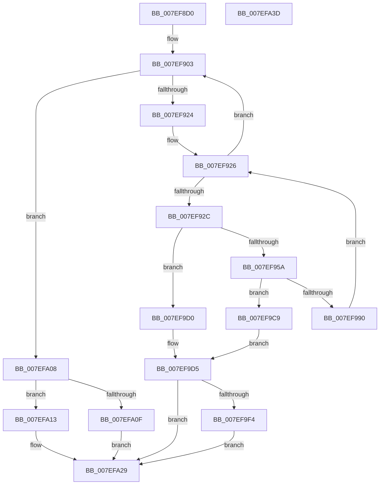

# HvpMapHiveImage

- RVA: `0x007EF8D0`–`0x007EFA3E` (길이 `366` bytes)
- VA: `0x00000001407EF8D0`
- 실행 섹션: `PAGE`
- PDB 이름 있음: `예`; PDB Function 태그: `아니요`
- unwind 정보 RVA: `0x000D70C0`
- 디코드: `98`개 명령, `366/366` bytes 표시
- 미해석 바이트: `0` (있으면 어셈블리에 `.byte`로 보존)

> 이 문서는 커널 이미지의 기계어와 PDB 기호를 분석해 생성했습니다. 4번과 5번은 함수 원형과 자료형을 바이너리 사용 방식에서 추정한 C 해석이며 원본 소스 복구 결과는 아닙니다.

## 1. Dependencies

- 직접 호출 지점: **8**; 고유 호출 대상: **7**
- 직접 호출자로 확인된 함수: **1**
- RIP 상대 이미지 참조: **0**

### Outgoing calls
- `0x007EF915` → [HvpReadHiveDataFromFile](HvpReadHiveDataFromFile_function_007EFA44.md) (function, `0x007EFA44`)
- `0x007EF94F` → [HvpAllocateBin](../9B/HvpAllocateBin_function_009B78A4.md) (function, `0x009B78A4`)
- `0x007EF968` → [memcpy](../../text/6C/memcpy_function_006C6840.md) (function, `0x006C6840`)
- `0x007EF985` → [HvpProtectBinPartial](../9B/HvpProtectBinPartial_function_009B5D84.md) (function, `0x009B5D84`)
- `0x007EF9AC` → [HvpPointMapEntriesToBuffer](../9B/HvpPointMapEntriesToBuffer_function_009B7328.md) (function, `0x009B7328`)
- `0x007EF9E7` → [SetFailureLocation](../../text/46/SetFailureLocation_function_0046EF54.md) (function, `0x0046EF54`)
- `0x007EFA01` → [HvpFreeBin](../A8/HvpFreeBin_function_00A8158C.md) (function, `0x00A8158C`)
- `0x007EFA24` → [SetFailureLocation](../../text/46/SetFailureLocation_function_0046EF54.md) (function, `0x0046EF54`)

### Direct callers
- [HvpMapHiveImageFromFile](../9B/HvpMapHiveImageFromFile_function_009BA028.md) at `0x009BA0AC`

### Static image references
- 디코드된 RIP-relative 메모리 참조가 없습니다.

## 2. Other-region calls and transfers

- 다른 실행 섹션으로 향하는 call: **3**
  - `0x007EF968` → [memcpy](../../text/6C/memcpy_function_006C6840.md) (`PAGE` → `.text`)
  - `0x007EF9E7` → [SetFailureLocation](../../text/46/SetFailureLocation_function_0046EF54.md) (`PAGE` → `.text`)
  - `0x007EFA24` → [SetFailureLocation](../../text/46/SetFailureLocation_function_0046EF54.md) (`PAGE` → `.text`)
- 별도 외부 분기/꼬리 이동을 확인하지 못했습니다.

## 3. Assembly (complete function range)

```asm
007EF8D0  48 8B C4                        mov rax, rsp
007EF8D3  48 89 58 10                     mov qword ptr [rax + 0x10], rbx
007EF8D7  4C 89 48 20                     mov qword ptr [rax + 0x20], r9
007EF8DB  44 89 40 18                     mov dword ptr [rax + 0x18], r8d
007EF8DF  55                              push rbp
007EF8E0  57                              push rdi
007EF8E1  41 54                           push r12
007EF8E3  41 56                           push r14
007EF8E5  41 57                           push r15
007EF8E7  48 83 EC 30                     sub rsp, 0x30
007EF8EB  48 83 60 08 00                  and qword ptr [rax + 8], 0
007EF8F0  48 8B E9                        mov rbp, rcx
007EF8F3  83 60 18 00                     and dword ptr [rax + 0x18], 0
007EF8F7  48 83 60 20 00                  and qword ptr [rax + 0x20], 0
007EF8FC  4C 8B 79 38                     mov r15, qword ptr [rcx + 0x38]
007EF900  45 33 F6                        xor r14d, r14d
007EF903  48 8B 8C 24 80 00 00 00         mov rcx, qword ptr [rsp + 0x80]
007EF90B  4C 8D 44 24 70                  lea r8, [rsp + 0x70]
007EF910  48 8D 54 24 60                  lea rdx, [rsp + 0x60]
007EF915  E8 2A 01 00 00                  call 0x1407efa44
007EF91A  8B D8                           mov ebx, eax
007EF91C  85 C0                           test eax, eax
007EF91E  0F 88 E4 00 00 00               js 0x1407efa08
007EF924  33 FF                           xor edi, edi
007EF926  3B 7C 24 70                     cmp edi, dword ptr [rsp + 0x70]
007EF92A  73 D7                           jae 0x1407ef903
007EF92C  48 8D 44 24 78                  lea rax, [rsp + 0x78]
007EF931  44 8B E7                        mov r12d, edi
007EF934  4C 03 64 24 60                  add r12, qword ptr [rsp + 0x60]
007EF939  41 B9 43 4D 33 31               mov r9d, 0x31334d43
007EF93F  45 33 C0                        xor r8d, r8d
007EF942  48 89 44 24 20                  mov qword ptr [rsp + 0x20], rax
007EF947  BA 00 10 00 00                  mov edx, 0x1000
007EF94C  48 8B CD                        mov rcx, rbp
007EF94F  E8 50 7F 1C 00                  call 0x1409b78a4
007EF954  8B D8                           mov ebx, eax
007EF956  85 C0                           test eax, eax
007EF958  78 76                           js 0x1407ef9d0
007EF95A  48 8B 4C 24 78                  mov rcx, qword ptr [rsp + 0x78]
007EF95F  41 B8 00 10 00 00               mov r8d, 0x1000
007EF965  49 8B D4                        mov rdx, r12
007EF968  E8 D3 6E ED FF                  call 0x1406c6840
007EF96D  48 8B 54 24 78                  mov rdx, qword ptr [rsp + 0x78]
007EF972  45 33 C9                        xor r9d, r9d
007EF975  48 8B CD                        mov rcx, rbp
007EF978  C6 44 24 28 00                  mov byte ptr [rsp + 0x28], 0
007EF97D  C7 44 24 20 00 10 00 00         mov dword ptr [rsp + 0x20], 0x1000
007EF985  E8 FA 63 1C 00                  call 0x1409b5d84
007EF98A  8B D8                           mov ebx, eax
007EF98C  85 C0                           test eax, eax
007EF98E  78 39                           js 0x1407ef9c9
007EF990  48 83 64 24 28 00               and qword ptr [rsp + 0x28], 0
007EF996  45 8B CE                        mov r9d, r14d
007EF999  48 8B 54 24 78                  mov rdx, qword ptr [rsp + 0x78]
007EF99E  41 B8 00 10 00 00               mov r8d, 0x1000
007EF9A4  48 8B CD                        mov rcx, rbp
007EF9A7  C6 44 24 20 01                  mov byte ptr [rsp + 0x20], 1
007EF9AC  E8 77 79 1C 00                  call 0x1409b7328
007EF9B1  48 83 64 24 78 00               and qword ptr [rsp + 0x78], 0
007EF9B7  41 81 C6 00 10 00 00            add r14d, 0x1000
007EF9BE  81 C7 00 10 00 00               add edi, 0x1000
007EF9C4  E9 5D FF FF FF                  jmp 0x1407ef926
007EF9C9  B8 20 00 00 00                  mov eax, 0x20
007EF9CE  EB 05                           jmp 0x1407ef9d5
007EF9D0  B8 10 00 00 00                  mov eax, 0x10
007EF9D5  41 B8 07 00 00 00               mov r8d, 7
007EF9DB  33 D2                           xor edx, edx
007EF9DD  44 8B CB                        mov r9d, ebx
007EF9E0  89 44 24 20                     mov dword ptr [rsp + 0x20], eax
007EF9E4  49 8B CF                        mov rcx, r15
007EF9E7  E8 68 F5 C7 FF                  call 0x14046ef54
007EF9EC  48 83 7C 24 78 00               cmp qword ptr [rsp + 0x78], 0
007EF9F2  74 35                           je 0x1407efa29
007EF9F4  4C 8B 44 24 78                  mov r8, qword ptr [rsp + 0x78]
007EF9F9  BA 00 10 00 00                  mov edx, 0x1000
007EF9FE  48 8B CD                        mov rcx, rbp
007EFA01  E8 86 1B 29 00                  call 0x140a8158c
007EFA06  EB 21                           jmp 0x1407efa29
007EFA08  3D 11 00 00 C0                  cmp eax, 0xc0000011
007EFA0D  75 04                           jne 0x1407efa13
007EFA0F  33 DB                           xor ebx, ebx
007EFA11  EB 16                           jmp 0x1407efa29
007EFA13  83 64 24 20 00                  and dword ptr [rsp + 0x20], 0
007EFA18  33 D2                           xor edx, edx
007EFA1A  44 8B C8                        mov r9d, eax
007EFA1D  49 8B CF                        mov rcx, r15
007EFA20  44 8D 42 07                     lea r8d, [rdx + 7]
007EFA24  E8 2B F5 C7 FF                  call 0x14046ef54
007EFA29  8B C3                           mov eax, ebx
007EFA2B  48 8B 5C 24 68                  mov rbx, qword ptr [rsp + 0x68]
007EFA30  48 83 C4 30                     add rsp, 0x30
007EFA34  41 5F                           pop r15
007EFA36  41 5E                           pop r14
007EFA38  41 5C                           pop r12
007EFA3A  5F                              pop rdi
007EFA3B  5D                              pop rbp
007EFA3C  C3                              ret
007EFA3D  CC                              int3
```

## 4. C-style interpretation (structured pseudocode)

```c
__int64 __fastcall HvpMapHiveImage(__int64 a1, __int64 a2, int a3, __int64 a4, __int64 a5)
{
    __int64 result;
    __int64 v_r12;
    __int64 v_r14;
    __int64 v_rbx;
    __int64 v_rdi;
    __int64 v_rsp;
    unsigned __int8 v_stack_m30;
    unsigned __int64 v_stack_m38;
    unsigned __int64 v_stack_p10;
    unsigned __int64 v_stack_p18;
    unsigned __int64 v_stack_p20;
    unsigned __int64 v_stack_p8;

    *(unsigned __int64 *)(v_rsp + 16) = v_rbx;
    *(unsigned __int64 *)(v_rsp + 32) = a4;
    *(unsigned int *)(v_rsp + 24) = a3;
    v_rsp = (v_rsp) - (48);
    v_r14 = 0;
loc_007EF903:
    result = HvpReadHiveDataFromFile(a5, v_stack_p8, v_stack_p18, a4);
    if (sign_flag) goto loc_007EFA08;
    v_rdi = 0;
loc_007EF926:
    if (0 >= v_stack_p18) goto loc_007EF903;
    v_r12 = (0) + (v_stack_p8);
    a3 = 0;
    v_stack_m38 = v_stack_p20;
    result = HvpAllocateBin(a1, (unsigned int)(0x1000ULL), a3, (unsigned int)(0x31334D43ULL));
    if (sign_flag) goto loc_007EF9D0;
    result = memcpy(v_stack_p20, v_r12, (unsigned int)(0x1000ULL), (unsigned int)(0x31334D43ULL));
    a4 = 0;
    v_stack_m30 = 0;
    v_stack_m38 = 0x1000ULL;
    result = HvpProtectBinPartial(a1, v_stack_p20, (unsigned int)(0x1000ULL), a4);
    if (sign_flag) goto loc_007EF9C9;
    v_stack_m38 = 1;
    result = HvpPointMapEntriesToBuffer(a1, v_stack_p20, (unsigned int)(0x1000ULL), 0);
    v_r14 = (unsigned int)((v_r14) + (0x1000ULL));
    v_rdi = (unsigned int)((v_rdi) + (0x1000ULL));
    goto loc_007EF926;
loc_007EF9C9:
    goto loc_007EF9D5;
loc_007EF9D0:
loc_007EF9D5:
    a2 = 0;
    v_stack_m38 = 16;
    result = SetFailureLocation(*(unsigned __int64 *)(a1 + 56), a2, 7, (unsigned int)((unsigned int)((unsigned int)((unsigned int)(result)))));
    if (v_stack_p20 == 0) goto loc_007EFA29;
    result = HvpFreeBin(a1, (unsigned int)(0x1000ULL), v_stack_p20, (unsigned int)((unsigned int)((unsigned int)((unsigned int)(result)))));
    goto loc_007EFA29;
loc_007EFA08:
    if (((unsigned int)(result)) != 0xC0000011ULL) goto loc_007EFA13;
    v_rbx = 0;
    goto loc_007EFA29;
loc_007EFA13:
    a2 = 0;
    result = SetFailureLocation(*(unsigned __int64 *)(a1 + 56), a2, a2 + 7, (unsigned int)((unsigned int)(result)));
loc_007EFA29:
    v_rsp = (v_rsp) + (48);
    return 0;
}
```

## 5. (Beta) C Style

```c
int64_t HvpMapHiveImage(void *Arg1, int64_t Arg2, int32_t Arg3, int64_t Arg4, int64_t Arg5)
{
    uint8_t *arg1 = (uint8_t *)Arg1;

    int64_t result;
    int64_t local_r12;
    int64_t local_r14;
    int64_t local_rbx;
    int64_t local_rdi;
    int64_t local_rsp;
    uint8_t v_stack_m30;
    uint64_t v_stack_m38;
    uint64_t v_stack_p10;
    uint64_t v_stack_p18;
    uint64_t v_stack_p20;
    uint64_t v_stack_p8;

    *(uint64_t *)(local_rsp + 0x10) = local_rbx;
    *(uint64_t *)(local_rsp + 0x20) = Arg4;
    *(uint32_t *)(local_rsp + 0x18) = Arg3;
    local_rsp = (local_rsp) - (48);
    local_r14 = 0;
loc_007EF903:
    result = HvpReadHiveDataFromFile(Arg5, v_stack_p8, v_stack_p18, Arg4);
    if (sign_flag) goto loc_007EFA08;
    local_rdi = 0;
loc_007EF926:
    if (0 >= v_stack_p18) goto loc_007EF903;
    local_r12 = (0) + (v_stack_p8);
    Arg3 = 0;
    v_stack_m38 = v_stack_p20;
    result = HvpAllocateBin(Arg1, (uint32_t)(0x1000ULL), Arg3, (uint32_t)(0x31334D43ULL));
    if (sign_flag) goto loc_007EF9D0;
    result = memcpy(v_stack_p20, local_r12, (uint32_t)(0x1000ULL), (uint32_t)(0x31334D43ULL));
    Arg4 = 0;
    v_stack_m30 = 0;
    v_stack_m38 = 0x1000ULL;
    result = HvpProtectBinPartial(Arg1, v_stack_p20, (uint32_t)(0x1000ULL), Arg4);
    if (sign_flag) goto loc_007EF9C9;
    v_stack_m38 = 1;
    result = HvpPointMapEntriesToBuffer(Arg1, v_stack_p20, (uint32_t)(0x1000ULL), 0);
    local_r14 = (uint32_t)((local_r14) + (0x1000ULL));
    local_rdi = (uint32_t)((local_rdi) + (0x1000ULL));
    goto loc_007EF926;
loc_007EF9C9:
    goto loc_007EF9D5;
loc_007EF9D0:
loc_007EF9D5:
    Arg2 = 0;
    v_stack_m38 = 16;
    result = SetFailureLocation(*(uint64_t *)(arg1 + 0x38), Arg2, 7, (uint32_t)((uint32_t)((uint32_t)((uint32_t)(result)))));
    if (v_stack_p20 == 0) goto loc_007EFA29;
    result = HvpFreeBin(Arg1, (uint32_t)(0x1000ULL), v_stack_p20, (uint32_t)((uint32_t)((uint32_t)((uint32_t)(result)))));
    goto loc_007EFA29;
loc_007EFA08:
    if (((uint32_t)(result)) != 0xC0000011ULL) goto loc_007EFA13;
    local_rbx = 0;
    goto loc_007EFA29;
loc_007EFA13:
    Arg2 = 0;
    result = SetFailureLocation(*(uint64_t *)(arg1 + 0x38), Arg2, Arg2 + 7, (uint32_t)((uint32_t)(result)));
loc_007EFA29:
    local_rsp = (local_rsp) + (48);
    return 0;
}
```

### 관측된 메모리 오프셋

구조체 형식이 확인되지 않은 접근은 인자 기준의 오프셋으로만 기록했습니다.

| 기준 인자 | 오프셋 표현 | 폭 (bit) | 접근 |
|---|---:|---:|---|
| `Arg1` | `+ 0x38` | `64` | `R` |

## 6. Execution-region graph

[열기: 2D/3D 그래프와 함수 탐색 컨트롤 패널](../../../control-panel.html?section=page&rva=0x007EF8D0&view=graph)

- 2D 그래프는 위에서 아래로 흐르고, 3D 그래프는 빈 공간을 드래그해 회전합니다. Shift+드래그는 이동, 휠은 확대·축소, 함수 노드 선택은 대상 보고서 이동입니다.

### Static fallback


