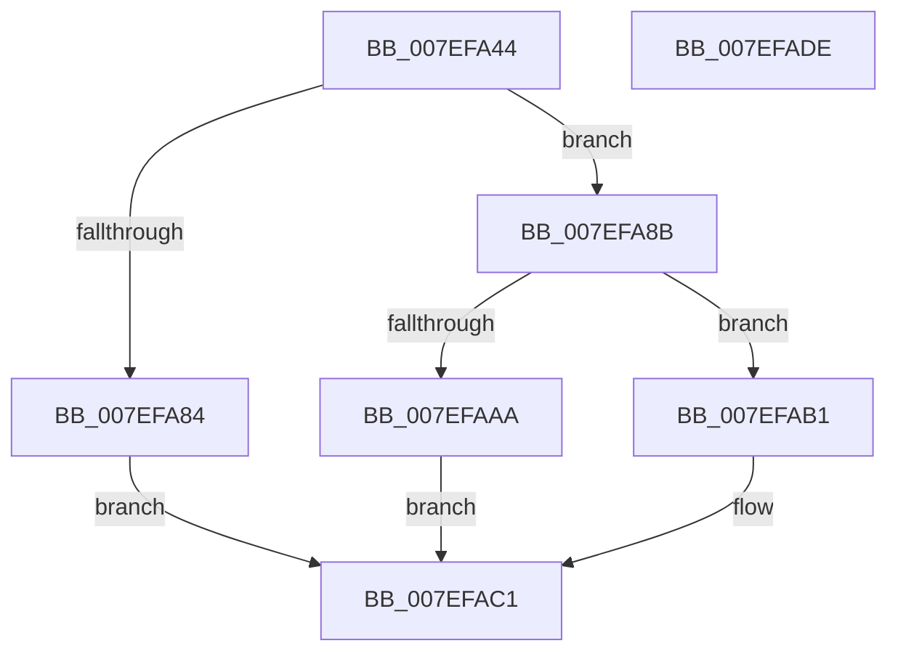

# HvpReadHiveDataFromFile

- RVA: `0x007EFA44`–`0x007EFADF` (길이 `155` bytes)
- VA: `0x00000001407EFA44`
- 실행 섹션: `PAGE`
- PDB 이름 있음: `예`; PDB Function 태그: `아니요`
- unwind 정보 RVA: `0x000BDE90`
- 디코드: `47`개 명령, `155/155` bytes 표시
- 미해석 바이트: `0` (있으면 어셈블리에 `.byte`로 보존)

> 이 문서는 커널 이미지의 기계어와 PDB 기호를 분석해 생성했습니다. 4번과 5번은 함수 원형과 자료형을 바이너리 사용 방식에서 추정한 C 해석이며 원본 소스 복구 결과는 아닙니다.

## 1. Dependencies

- 직접 호출 지점: **1**; 고유 호출 대상: **1**
- 직접 호출자로 확인된 함수: **1**
- RIP 상대 이미지 참조: **0**

### Outgoing calls
- `0x007EFAA1` → [guard_dispatch_icall](../../text/6B/guard_dispatch_icall_function_006BAAD0.md) (function, `0x006BAAD0`)

### Direct callers
- [HvpMapHiveImage](HvpMapHiveImage_function_007EF8D0.md) at `0x007EF915`

### Static image references
- 디코드된 RIP-relative 메모리 참조가 없습니다.

## 2. Other-region calls and transfers

- 다른 실행 섹션으로 향하는 call: **1**
  - `0x007EFAA1` → [guard_dispatch_icall](../../text/6B/guard_dispatch_icall_function_006BAAD0.md) (`PAGE` → `.text`)
- 별도 외부 분기/꼬리 이동을 확인하지 못했습니다.

## 3. Assembly (complete function range)

```asm
007EFA44  48 8B C4                        mov rax, rsp
007EFA47  48 89 58 08                     mov qword ptr [rax + 8], rbx
007EFA4B  48 89 70 10                     mov qword ptr [rax + 0x10], rsi
007EFA4F  48 89 78 18                     mov qword ptr [rax + 0x18], rdi
007EFA53  4C 89 70 20                     mov qword ptr [rax + 0x20], r14
007EFA57  41 57                           push r15
007EFA59  48 83 EC 30                     sub rsp, 0x30
007EFA5D  33 FF                           xor edi, edi
007EFA5F  4D 8B F0                        mov r14, r8
007EFA62  48 89 3A                        mov qword ptr [rdx], rdi
007EFA65  4C 8B FA                        mov r15, rdx
007EFA68  41 89 38                        mov dword ptr [r8], edi
007EFA6B  48 8B D9                        mov rbx, rcx
007EFA6E  8B 71 18                        mov esi, dword ptr [rcx + 0x18]
007EFA71  44 8B 49 20                     mov r9d, dword ptr [rcx + 0x20]
007EFA75  44 2B 49 1C                     sub r9d, dword ptr [rcx + 0x1c]
007EFA79  44 3B CE                        cmp r9d, esi
007EFA7C  41 0F 46 F1                     cmovbe esi, r9d
007EFA80  85 F6                           test esi, esi
007EFA82  75 07                           jne 0x1407efa8b
007EFA84  BF 11 00 00 C0                  mov edi, 0xc0000011
007EFA89  EB 36                           jmp 0x1407efac1
007EFA8B  48 8B 09                        mov rcx, qword ptr [rcx]
007EFA8E  4C 8B 4B 10                     mov r9, qword ptr [rbx + 0x10]
007EFA92  44 8B 43 0C                     mov r8d, dword ptr [rbx + 0xc]
007EFA96  8B 53 08                        mov edx, dword ptr [rbx + 8]
007EFA99  48 8B 41 30                     mov rax, qword ptr [rcx + 0x30]
007EFA9D  89 74 24 20                     mov dword ptr [rsp + 0x20], esi
007EFAA1  E8 2A B0 EC FF                  call 0x1406baad0
007EFAA6  85 C0                           test eax, eax
007EFAA8  79 07                           jns 0x1407efab1
007EFAAA  BF 4D 01 00 C0                  mov edi, 0xc000014d
007EFAAF  EB 10                           jmp 0x1407efac1
007EFAB1  01 73 0C                        add dword ptr [rbx + 0xc], esi
007EFAB4  48 8B 4B 10                     mov rcx, qword ptr [rbx + 0x10]
007EFAB8  01 73 1C                        add dword ptr [rbx + 0x1c], esi
007EFABB  49 89 0F                        mov qword ptr [r15], rcx
007EFABE  41 89 36                        mov dword ptr [r14], esi
007EFAC1  48 8B 5C 24 40                  mov rbx, qword ptr [rsp + 0x40]
007EFAC6  8B C7                           mov eax, edi
007EFAC8  48 8B 7C 24 50                  mov rdi, qword ptr [rsp + 0x50]
007EFACD  48 8B 74 24 48                  mov rsi, qword ptr [rsp + 0x48]
007EFAD2  4C 8B 74 24 58                  mov r14, qword ptr [rsp + 0x58]
007EFAD7  48 83 C4 30                     add rsp, 0x30
007EFADB  41 5F                           pop r15
007EFADD  C3                              ret
007EFADE  CC                              int3
```

## 4. C-style interpretation (structured pseudocode)

```c
__int64 __fastcall HvpReadHiveDataFromFile(__int64 a1, __int64 a2, __int64 a3)
{
    __int64 result;
    __int64 v_rdi;
    __int64 v_rsi;
    __int64 v_rsp;
    unsigned int v_stack_m18;
    unsigned __int64 v_stack_p10;
    unsigned __int64 v_stack_p18;
    unsigned __int64 v_stack_p20;
    unsigned __int64 v_stack_p8;

    *(unsigned __int64 *)(v_rsp + 8) = v_rbx;
    *(unsigned __int64 *)(v_rsp + 16) = v_rsi;
    *(unsigned __int64 *)(v_rsp + 24) = v_rdi;
    *(unsigned __int64 *)(v_rsp + 32) = v_r14;
    v_rsp = (v_rsp) - (48);
    v_rdi = 0;
    *(unsigned __int64 *)(a2) = 0;
    *(unsigned int *)(a3) = 0;
    a4 = (unsigned int)(((unsigned int)(*(unsigned int *)(a1 + 32))) - (*(unsigned int *)(a1 + 28)));
    v_rsi = (unsigned int)(*(unsigned int *)(a1 + 24));
    if (((unsigned int)(a4)) <= ((unsigned int)((unsigned int)(*(unsigned int *)(a1 + 24))))) { v_rsi = (unsigned int)(a4); }
    if ((unsigned int)(v_rsi) != 0) goto loc_007EFA8B;
    goto loc_007EFAC1;
loc_007EFA8B:
    v_stack_m18 = (unsigned int)(v_rsi);
    result = guard_dispatch_icall(*(unsigned __int64 *)(a1), (unsigned int)(*(unsigned int *)(a1 + 8)), (unsigned int)(*(unsigned int *)(a1 + 12)), *(unsigned __int64 *)(a1 + 16));
    if (!sign_flag) goto loc_007EFAB1;
    goto loc_007EFAC1;
loc_007EFAB1:
    *(unsigned __int64 *)(a2) = *(unsigned __int64 *)(a1 + 16);
    *(unsigned int *)(a3) = (unsigned int)(v_rsi);
loc_007EFAC1:
    v_rsp = (v_rsp) + (48);
    return (unsigned int)((unsigned int)((unsigned int)(0xC000014DULL)));
}
```

## 5. (Beta) C Style

```c
int64_t HvpReadHiveDataFromFile(void *Arg1, void *Arg2, void *Arg3)
{
    uint8_t *arg1 = (uint8_t *)Arg1;
    uint8_t *arg2 = (uint8_t *)Arg2;
    uint8_t *arg3 = (uint8_t *)Arg3;

    int64_t result;
    int64_t local_rdi;
    int64_t local_rsi;
    int64_t local_rsp;
    uint32_t v_stack_m18;
    uint64_t v_stack_p10;
    uint64_t v_stack_p18;
    uint64_t v_stack_p20;
    uint64_t v_stack_p8;

    *(uint64_t *)(local_rsp + 0x8) = local_rbx;
    *(uint64_t *)(local_rsp + 0x10) = local_rsi;
    *(uint64_t *)(local_rsp + 0x18) = local_rdi;
    *(uint64_t *)(local_rsp + 0x20) = local_r14;
    local_rsp = (local_rsp) - (48);
    local_rdi = 0;
    *(uint64_t *)(arg2) = 0;
    *(uint32_t *)(arg3) = 0;
    a4 = (uint32_t)(((uint32_t)(*(uint32_t *)(arg1 + 0x20))) - (*(uint32_t *)(arg1 + 0x1C)));
    local_rsi = (uint32_t)(*(uint32_t *)(arg1 + 0x18));
    if (((uint32_t)(a4)) <= ((uint32_t)((uint32_t)(*(uint32_t *)(arg1 + 0x18))))) { local_rsi = (uint32_t)(a4); }
    if ((uint32_t)(local_rsi) != 0) goto loc_007EFA8B;
    goto loc_007EFAC1;
loc_007EFA8B:
    v_stack_m18 = (uint32_t)(local_rsi);
    result = guard_dispatch_icall(*(uint64_t *)(arg1), (uint32_t)(*(uint32_t *)(arg1 + 0x8)), (uint32_t)(*(uint32_t *)(arg1 + 0xC)), *(uint64_t *)(arg1 + 0x10));
    if (!sign_flag) goto loc_007EFAB1;
    goto loc_007EFAC1;
loc_007EFAB1:
    *(uint64_t *)(arg2) = *(uint64_t *)(arg1 + 0x10);
    *(uint32_t *)(arg3) = (uint32_t)(local_rsi);
loc_007EFAC1:
    local_rsp = (local_rsp) + (48);
    return (uint32_t)((uint32_t)((uint32_t)(0xC000014DULL)));
}
```

### 관측된 메모리 오프셋

구조체 형식이 확인되지 않은 접근은 인자 기준의 오프셋으로만 기록했습니다.

| 기준 인자 | 오프셋 표현 | 폭 (bit) | 접근 |
|---|---:|---:|---|
| `Arg1` | `+ 0x0` | `64` | `R` |
| `Arg1` | `+ 0x8` | `32` | `R` |
| `Arg1` | `+ 0xC` | `32` | `R` |
| `Arg1` | `+ 0xC` | `32` | `R/W` |
| `Arg1` | `+ 0x10` | `64` | `R` |
| `Arg1` | `+ 0x18` | `32` | `R` |
| `Arg1` | `+ 0x1C` | `32` | `R` |
| `Arg1` | `+ 0x1C` | `32` | `R/W` |
| `Arg1` | `+ 0x20` | `32` | `R` |
| `Arg2` | `+ 0x0` | `64` | `W` |
| `Arg3` | `+ 0x0` | `32` | `W` |

## 6. Execution-region graph

[열기: 2D/3D 그래프와 함수 탐색 컨트롤 패널](../../../control-panel.html?section=page&rva=0x007EFA44&view=graph)

- 2D 그래프는 위에서 아래로 흐르고, 3D 그래프는 빈 공간을 드래그해 회전합니다. Shift+드래그는 이동, 휠은 확대·축소, 함수 노드 선택은 대상 보고서 이동입니다.

### Static fallback


