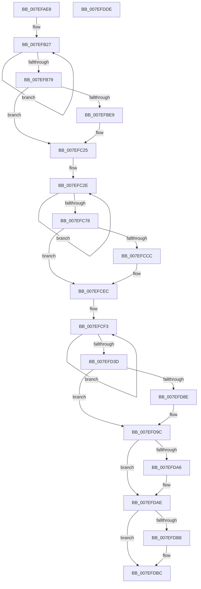

# HvpSwapDual

- RVA: `0x007EFAE8`–`0x007EFDDF` (길이 `759` bytes)
- VA: `0x00000001407EFAE8`
- 실행 섹션: `PAGE`
- PDB 이름 있음: `예`; PDB Function 태그: `아니요`
- unwind 정보 RVA: `0x000D70A0`
- 디코드: `189`개 명령, `759/759` bytes 표시
- 미해석 바이트: `0` (있으면 어셈블리에 `.byte`로 보존)

> 이 문서는 커널 이미지의 기계어와 PDB 기호를 분석해 생성했습니다. 4번과 5번은 함수 원형과 자료형을 바이너리 사용 방식에서 추정한 C 해석이며 원본 소스 복구 결과는 아닙니다.

## 1. Dependencies

- 직접 호출 지점: **1**; 고유 호출 대상: **1**
- 직접 호출자로 확인된 함수: **1**
- RIP 상대 이미지 참조: **1**

### Outgoing calls
- `0x007EFDC6` → [_security_check_cookie](../../text/6A/_security_check_cookie_function_006AC640.md) (function, `0x006AC640`)

### Direct callers
- [HvSwapHiveStorage](HvSwapHiveStorage_function_007EF528.md) at `0x007EF7DB`

### Static image references
- `0x007EFAFF` → RVA `0x00E0A740` (`.data`; read)

## 2. Other-region calls and transfers

- 다른 실행 섹션으로 향하는 call: **1**
  - `0x007EFDC6` → [_security_check_cookie](../../text/6A/_security_check_cookie_function_006AC640.md) (`PAGE` → `.text`)
- 별도 외부 분기/꼬리 이동을 확인하지 못했습니다.

## 3. Assembly (complete function range)

```asm
007EFAE8  48 89 5C 24 18                  mov qword ptr [rsp + 0x18], rbx
007EFAED  55                              push rbp
007EFAEE  56                              push rsi
007EFAEF  57                              push rdi
007EFAF0  48 8D AC 24 70 FE FF FF         lea rbp, [rsp - 0x190]
007EFAF8  48 81 EC 90 02 00 00            sub rsp, 0x290
007EFAFF  48 8B 05 3A AC 61 00            mov rax, qword ptr [rip + 0x61ac3a]
007EFB06  48 33 C4                        xor rax, rsp
007EFB09  48 89 85 80 01 00 00            mov qword ptr [rbp + 0x180], rax
007EFB10  BB 04 00 00 00                  mov ebx, 4
007EFB15  4C 8D 04 24                     lea r8, [rsp]
007EFB19  4C 8B C9                        mov r9, rcx
007EFB1C  48 8B C1                        mov rax, rcx
007EFB1F  4C 8B D2                        mov r10, rdx
007EFB22  8B CB                           mov ecx, ebx
007EFB24  8D 73 7C                        lea esi, [rbx + 0x7c]
007EFB27  0F 10 00                        movups xmm0, xmmword ptr [rax]
007EFB2A  0F 10 48 10                     movups xmm1, xmmword ptr [rax + 0x10]
007EFB2E  41 0F 11 00                     movups xmmword ptr [r8], xmm0
007EFB32  0F 10 40 20                     movups xmm0, xmmword ptr [rax + 0x20]
007EFB36  41 0F 11 48 10                  movups xmmword ptr [r8 + 0x10], xmm1
007EFB3B  0F 10 48 30                     movups xmm1, xmmword ptr [rax + 0x30]
007EFB3F  41 0F 11 40 20                  movups xmmword ptr [r8 + 0x20], xmm0
007EFB44  0F 10 40 40                     movups xmm0, xmmword ptr [rax + 0x40]
007EFB48  41 0F 11 48 30                  movups xmmword ptr [r8 + 0x30], xmm1
007EFB4D  0F 10 48 50                     movups xmm1, xmmword ptr [rax + 0x50]
007EFB51  41 0F 11 40 40                  movups xmmword ptr [r8 + 0x40], xmm0
007EFB56  0F 10 40 60                     movups xmm0, xmmword ptr [rax + 0x60]
007EFB5A  41 0F 11 48 50                  movups xmmword ptr [r8 + 0x50], xmm1
007EFB5F  0F 10 48 70                     movups xmm1, xmmword ptr [rax + 0x70]
007EFB63  48 03 C6                        add rax, rsi
007EFB66  41 0F 11 40 60                  movups xmmword ptr [r8 + 0x60], xmm0
007EFB6B  4C 03 C6                        add r8, rsi
007EFB6E  41 0F 11 48 F0                  movups xmmword ptr [r8 - 0x10], xmm1
007EFB73  48 83 E9 01                     sub rcx, 1
007EFB77  75 AE                           jne 0x1407efb27
007EFB79  0F 10 00                        movups xmm0, xmmword ptr [rax]
007EFB7C  49 8D 89 60 02 00 00            lea rcx, [r9 + 0x260]
007EFB83  0F 10 48 10                     movups xmm1, xmmword ptr [rax + 0x10]
007EFB87  48 8B 11                        mov rdx, qword ptr [rcx]
007EFB8A  4C 8D 9D 60 01 00 00            lea r11, [rbp + 0x160]
007EFB91  41 0F 11 00                     movups xmmword ptr [r8], xmm0
007EFB95  0F 10 40 20                     movups xmm0, xmmword ptr [rax + 0x20]
007EFB99  41 0F 11 48 10                  movups xmmword ptr [r8 + 0x10], xmm1
007EFB9E  0F 10 48 30                     movups xmm1, xmmword ptr [rax + 0x30]
007EFBA2  41 0F 11 40 20                  movups xmmword ptr [r8 + 0x20], xmm0
007EFBA7  0F 10 40 40                     movups xmm0, xmmword ptr [rax + 0x40]
007EFBAB  41 0F 11 48 30                  movups xmmword ptr [r8 + 0x30], xmm1
007EFBB0  0F 10 48 50                     movups xmm1, xmmword ptr [rax + 0x50]
007EFBB4  41 0F 11 40 40                  movups xmmword ptr [r8 + 0x40], xmm0
007EFBB9  0F 10 40 60                     movups xmm0, xmmword ptr [rax + 0x60]
007EFBBD  48 8B 40 70                     mov rax, qword ptr [rax + 0x70]
007EFBC1  41 0F 11 48 50                  movups xmmword ptr [r8 + 0x50], xmm1
007EFBC6  41 0F 11 40 60                  movups xmmword ptr [r8 + 0x60], xmm0
007EFBCB  49 89 40 70                     mov qword ptr [r8 + 0x70], rax
007EFBCF  4C 8D 85 60 01 00 00            lea r8, [rbp + 0x160]
007EFBD6  4C 89 85 60 01 00 00            mov qword ptr [rbp + 0x160], r8
007EFBDD  4C 89 9D 68 01 00 00            mov qword ptr [rbp + 0x168], r11
007EFBE4  48 3B D1                        cmp rdx, rcx
007EFBE7  74 3C                           je 0x1407efc25
007EFBE9  48 8B 41 08                     mov rax, qword ptr [rcx + 8]
007EFBED  4C 8D 85 60 01 00 00            lea r8, [rbp + 0x160]
007EFBF4  48 89 95 60 01 00 00            mov qword ptr [rbp + 0x160], rdx
007EFBFB  48 89 85 68 01 00 00            mov qword ptr [rbp + 0x168], rax
007EFC02  4C 89 42 08                     mov qword ptr [rdx + 8], r8
007EFC06  48 8D 95 60 01 00 00            lea rdx, [rbp + 0x160]
007EFC0D  48 89 10                        mov qword ptr [rax], rdx
007EFC10  4C 8B 9D 68 01 00 00            mov r11, qword ptr [rbp + 0x168]
007EFC17  4C 8B 85 60 01 00 00            mov r8, qword ptr [rbp + 0x160]
007EFC1E  48 89 49 08                     mov qword ptr [rcx + 8], rcx
007EFC22  48 89 09                        mov qword ptr [rcx], rcx
007EFC25  49 8B D1                        mov rdx, r9
007EFC28  49 8B C2                        mov rax, r10
007EFC2B  48 8B FB                        mov rdi, rbx
007EFC2E  0F 10 00                        movups xmm0, xmmword ptr [rax]
007EFC31  0F 11 02                        movups xmmword ptr [rdx], xmm0
007EFC34  0F 10 48 10                     movups xmm1, xmmword ptr [rax + 0x10]
007EFC38  0F 11 4A 10                     movups xmmword ptr [rdx + 0x10], xmm1
007EFC3C  0F 10 40 20                     movups xmm0, xmmword ptr [rax + 0x20]
007EFC40  0F 11 42 20                     movups xmmword ptr [rdx + 0x20], xmm0
007EFC44  0F 10 48 30                     movups xmm1, xmmword ptr [rax + 0x30]
007EFC48  0F 11 4A 30                     movups xmmword ptr [rdx + 0x30], xmm1
007EFC4C  0F 10 40 40                     movups xmm0, xmmword ptr [rax + 0x40]
007EFC50  0F 11 42 40                     movups xmmword ptr [rdx + 0x40], xmm0
007EFC54  0F 10 48 50                     movups xmm1, xmmword ptr [rax + 0x50]
007EFC58  0F 11 4A 50                     movups xmmword ptr [rdx + 0x50], xmm1
007EFC5C  0F 10 40 60                     movups xmm0, xmmword ptr [rax + 0x60]
007EFC60  0F 11 42 60                     movups xmmword ptr [rdx + 0x60], xmm0
007EFC64  48 03 D6                        add rdx, rsi
007EFC67  0F 10 48 70                     movups xmm1, xmmword ptr [rax + 0x70]
007EFC6B  48 03 C6                        add rax, rsi
007EFC6E  0F 11 4A F0                     movups xmmword ptr [rdx - 0x10], xmm1
007EFC72  48 83 EF 01                     sub rdi, 1
007EFC76  75 B6                           jne 0x1407efc2e
007EFC78  0F 10 00                        movups xmm0, xmmword ptr [rax]
007EFC7B  0F 11 02                        movups xmmword ptr [rdx], xmm0
007EFC7E  0F 10 48 10                     movups xmm1, xmmword ptr [rax + 0x10]
007EFC82  0F 11 4A 10                     movups xmmword ptr [rdx + 0x10], xmm1
007EFC86  0F 10 40 20                     movups xmm0, xmmword ptr [rax + 0x20]
007EFC8A  0F 11 42 20                     movups xmmword ptr [rdx + 0x20], xmm0
007EFC8E  0F 10 48 30                     movups xmm1, xmmword ptr [rax + 0x30]
007EFC92  0F 11 4A 30                     movups xmmword ptr [rdx + 0x30], xmm1
007EFC96  0F 10 40 40                     movups xmm0, xmmword ptr [rax + 0x40]
007EFC9A  0F 11 42 40                     movups xmmword ptr [rdx + 0x40], xmm0
007EFC9E  0F 10 48 50                     movups xmm1, xmmword ptr [rax + 0x50]
007EFCA2  0F 11 4A 50                     movups xmmword ptr [rdx + 0x50], xmm1
007EFCA6  0F 10 40 60                     movups xmm0, xmmword ptr [rax + 0x60]
007EFCAA  0F 11 42 60                     movups xmmword ptr [rdx + 0x60], xmm0
007EFCAE  48 8B 40 70                     mov rax, qword ptr [rax + 0x70]
007EFCB2  48 89 42 70                     mov qword ptr [rdx + 0x70], rax
007EFCB6  49 8D 92 60 02 00 00            lea rdx, [r10 + 0x260]
007EFCBD  48 89 49 08                     mov qword ptr [rcx + 8], rcx
007EFCC1  48 89 09                        mov qword ptr [rcx], rcx
007EFCC4  48 8B 3A                        mov rdi, qword ptr [rdx]
007EFCC7  48 3B FA                        cmp rdi, rdx
007EFCCA  74 20                           je 0x1407efcec
007EFCCC  48 8B 42 08                     mov rax, qword ptr [rdx + 8]
007EFCD0  48 89 39                        mov qword ptr [rcx], rdi
007EFCD3  48 89 41 08                     mov qword ptr [rcx + 8], rax
007EFCD7  48 89 4F 08                     mov qword ptr [rdi + 8], rcx
007EFCDB  48 89 08                        mov qword ptr [rax], rcx
007EFCDE  4C 8B 9D 68 01 00 00            mov r11, qword ptr [rbp + 0x168]
007EFCE5  4C 8B 85 60 01 00 00            mov r8, qword ptr [rbp + 0x160]
007EFCEC  49 8B CA                        mov rcx, r10
007EFCEF  48 8D 04 24                     lea rax, [rsp]
007EFCF3  0F 10 00                        movups xmm0, xmmword ptr [rax]
007EFCF6  0F 10 48 10                     movups xmm1, xmmword ptr [rax + 0x10]
007EFCFA  0F 11 01                        movups xmmword ptr [rcx], xmm0
007EFCFD  0F 10 40 20                     movups xmm0, xmmword ptr [rax + 0x20]
007EFD01  0F 11 49 10                     movups xmmword ptr [rcx + 0x10], xmm1
007EFD05  0F 10 48 30                     movups xmm1, xmmword ptr [rax + 0x30]
007EFD09  0F 11 41 20                     movups xmmword ptr [rcx + 0x20], xmm0
007EFD0D  0F 10 40 40                     movups xmm0, xmmword ptr [rax + 0x40]
007EFD11  0F 11 49 30                     movups xmmword ptr [rcx + 0x30], xmm1
007EFD15  0F 10 48 50                     movups xmm1, xmmword ptr [rax + 0x50]
007EFD19  0F 11 41 40                     movups xmmword ptr [rcx + 0x40], xmm0
007EFD1D  0F 10 40 60                     movups xmm0, xmmword ptr [rax + 0x60]
007EFD21  0F 11 49 50                     movups xmmword ptr [rcx + 0x50], xmm1
007EFD25  0F 10 48 70                     movups xmm1, xmmword ptr [rax + 0x70]
007EFD29  48 03 C6                        add rax, rsi
007EFD2C  0F 11 41 60                     movups xmmword ptr [rcx + 0x60], xmm0
007EFD30  48 03 CE                        add rcx, rsi
007EFD33  0F 11 49 F0                     movups xmmword ptr [rcx - 0x10], xmm1
007EFD37  48 83 EB 01                     sub rbx, 1
007EFD3B  75 B6                           jne 0x1407efcf3
007EFD3D  0F 10 00                        movups xmm0, xmmword ptr [rax]
007EFD40  0F 10 48 10                     movups xmm1, xmmword ptr [rax + 0x10]
007EFD44  0F 11 01                        movups xmmword ptr [rcx], xmm0
007EFD47  0F 10 40 20                     movups xmm0, xmmword ptr [rax + 0x20]
007EFD4B  0F 11 49 10                     movups xmmword ptr [rcx + 0x10], xmm1
007EFD4F  0F 10 48 30                     movups xmm1, xmmword ptr [rax + 0x30]
007EFD53  0F 11 41 20                     movups xmmword ptr [rcx + 0x20], xmm0
007EFD57  0F 10 40 40                     movups xmm0, xmmword ptr [rax + 0x40]
007EFD5B  0F 11 49 30                     movups xmmword ptr [rcx + 0x30], xmm1
007EFD5F  0F 10 48 50                     movups xmm1, xmmword ptr [rax + 0x50]
007EFD63  0F 11 41 40                     movups xmmword ptr [rcx + 0x40], xmm0
007EFD67  0F 10 40 60                     movups xmm0, xmmword ptr [rax + 0x60]
007EFD6B  48 8B 40 70                     mov rax, qword ptr [rax + 0x70]
007EFD6F  0F 11 49 50                     movups xmmword ptr [rcx + 0x50], xmm1
007EFD73  0F 11 41 60                     movups xmmword ptr [rcx + 0x60], xmm0
007EFD77  48 89 41 70                     mov qword ptr [rcx + 0x70], rax
007EFD7B  48 8D 85 60 01 00 00            lea rax, [rbp + 0x160]
007EFD82  48 89 52 08                     mov qword ptr [rdx + 8], rdx
007EFD86  48 89 12                        mov qword ptr [rdx], rdx
007EFD89  4C 3B C0                        cmp r8, rax
007EFD8C  74 0E                           je 0x1407efd9c
007EFD8E  4C 89 02                        mov qword ptr [rdx], r8
007EFD91  4C 89 5A 08                     mov qword ptr [rdx + 8], r11
007EFD95  49 89 50 08                     mov qword ptr [r8 + 8], rdx
007EFD99  49 89 13                        mov qword ptr [r11], rdx
007EFD9C  49 8D 4A 10                     lea rcx, [r10 + 0x10]
007EFDA0  49 39 49 08                     cmp qword ptr [r9 + 8], rcx
007EFDA4  75 08                           jne 0x1407efdae
007EFDA6  49 8D 41 10                     lea rax, [r9 + 0x10]
007EFDAA  49 89 41 08                     mov qword ptr [r9 + 8], rax
007EFDAE  49 8D 41 10                     lea rax, [r9 + 0x10]
007EFDB2  49 39 42 08                     cmp qword ptr [r10 + 8], rax
007EFDB6  75 04                           jne 0x1407efdbc
007EFDB8  49 89 4A 08                     mov qword ptr [r10 + 8], rcx
007EFDBC  48 8B 8D 80 01 00 00            mov rcx, qword ptr [rbp + 0x180]
007EFDC3  48 33 CC                        xor rcx, rsp
007EFDC6  E8 75 C8 EB FF                  call 0x1406ac640
007EFDCB  48 8B 9C 24 C0 02 00 00         mov rbx, qword ptr [rsp + 0x2c0]
007EFDD3  48 81 C4 90 02 00 00            add rsp, 0x290
007EFDDA  5F                              pop rdi
007EFDDB  5E                              pop rsi
007EFDDC  5D                              pop rbp
007EFDDD  C3                              ret
007EFDDE  CC                              int3
```

## 4. C-style interpretation (structured pseudocode)

```c
__int64 __fastcall HvpSwapDual(__int64 a1, __int64 a2)
{
    __int64 result;
    __int64 v_r11;
    __int64 v_rbx;
    __int64 v_rdi;
    __int64 v_rsp;
    unsigned __int64 v_stack_m1A8;
    unsigned __int64 v_stack_m28;
    unsigned __int64 v_stack_m2A8;
    unsigned __int64 v_stack_m40;
    unsigned __int64 v_stack_m48;
    unsigned __int64 v_stack_p18;

    v_stack_p18 = v_rbx;
    v_rsp = (v_rsp) - (656);
    result = (*(unsigned __int64 *)(v_rip + 6401082)) ^ (v_rsp);
    v_stack_m28 = result;
loc_007EFB27:
    *(unsigned __int64 *)(v_stack_m2A8) = v_xmm0;
    *(unsigned __int64 *)(v_stack_m2A8 + 16) = v_xmm1;
    *(unsigned __int64 *)(v_stack_m2A8 + 32) = v_xmm0;
    *(unsigned __int64 *)(v_stack_m2A8 + 48) = v_xmm1;
    *(unsigned __int64 *)(v_stack_m2A8 + 64) = v_xmm0;
    *(unsigned __int64 *)(v_stack_m2A8 + 80) = v_xmm1;
    result = (a1) + (4 + 124);
    *(unsigned __int64 *)(v_stack_m2A8 + 96) = v_xmm0;
    a3 = (v_stack_m2A8) + (4 + 124);
    *(unsigned __int64 *)(a3 - 16) = v_xmm1;
    a1 = (4) - (1);
    if (condition_is_not_equal) goto loc_007EFB27;
    *(unsigned __int64 *)(a3) = v_xmm0;
    *(unsigned __int64 *)(a3 + 16) = v_xmm1;
    *(unsigned __int64 *)(a3 + 32) = v_xmm0;
    *(unsigned __int64 *)(a3 + 48) = v_xmm1;
    *(unsigned __int64 *)(a3 + 64) = v_xmm0;
    *(unsigned __int64 *)(a3 + 80) = v_xmm1;
    *(unsigned __int64 *)(a3 + 96) = v_xmm0;
    *(unsigned __int64 *)(a3 + 112) = *(unsigned __int64 *)(result + 112);
    v_stack_m48 = v_stack_m48;
    v_stack_m40 = v_stack_m48;
    result = *(unsigned __int64 *)(result + 112);
    v_r11 = v_stack_m48;
    if ((*(unsigned __int64 *)(a1 + 608)) != (a1 + 608)) {
        result = *(unsigned __int64 *)(a1 + 608 + 8);
        a3 = v_stack_m48;
        v_stack_m48 = *(unsigned __int64 *)(a1 + 608);
        v_stack_m40 = result;
        *(unsigned __int64 *)(*(unsigned __int64 *)(a1 + 608) + 8) = a3;
        a2 = v_stack_m48;
        *(unsigned __int64 *)(result) = a2;
        v_r11 = v_stack_m40;
        a3 = v_stack_m48;
        *(unsigned __int64 *)(a1 + 608 + 8) = a1 + 608;
        *(unsigned __int64 *)(a1 + 608) = a1 + 608;
    }
loc_007EFC2E:
    *(unsigned __int64 *)(a1) = v_xmm0;
    *(unsigned __int64 *)(a1 + 16) = v_xmm1;
    *(unsigned __int64 *)(a1 + 32) = v_xmm0;
    *(unsigned __int64 *)(a1 + 48) = v_xmm1;
    *(unsigned __int64 *)(a1 + 64) = v_xmm0;
    *(unsigned __int64 *)(a1 + 80) = v_xmm1;
    *(unsigned __int64 *)(a1 + 96) = v_xmm0;
    a2 = (a1) + (4 + 124);
    result = (a2) + (4 + 124);
    *(unsigned __int64 *)(a2 - 16) = v_xmm1;
    v_rdi = (4) - (1);
    if (condition_is_not_equal) goto loc_007EFC2E;
    *(unsigned __int64 *)(a2) = v_xmm0;
    *(unsigned __int64 *)(a2 + 16) = v_xmm1;
    *(unsigned __int64 *)(a2 + 32) = v_xmm0;
    *(unsigned __int64 *)(a2 + 48) = v_xmm1;
    *(unsigned __int64 *)(a2 + 64) = v_xmm0;
    *(unsigned __int64 *)(a2 + 80) = v_xmm1;
    *(unsigned __int64 *)(a2 + 96) = v_xmm0;
    *(unsigned __int64 *)(a2 + 112) = *(unsigned __int64 *)(result + 112);
    *(unsigned __int64 *)(a1 + 608 + 8) = a1 + 608;
    *(unsigned __int64 *)(a1 + 608) = a1 + 608;
    result = *(unsigned __int64 *)(result + 112);
    if ((*(unsigned __int64 *)(a2 + 608)) != (a2 + 608)) {
        result = *(unsigned __int64 *)(a2 + 608 + 8);
        *(unsigned __int64 *)(a1 + 608) = *(unsigned __int64 *)(a2 + 608);
        *(unsigned __int64 *)(a1 + 608 + 8) = result;
        *(unsigned __int64 *)(*(unsigned __int64 *)(a2 + 608) + 8) = a1 + 608;
        *(unsigned __int64 *)(result) = a1 + 608;
        v_r11 = v_stack_m40;
        a3 = v_stack_m48;
    }
loc_007EFCF3:
    *(unsigned __int64 *)(a2) = v_xmm0;
    *(unsigned __int64 *)(a2 + 16) = v_xmm1;
    *(unsigned __int64 *)(a2 + 32) = v_xmm0;
    *(unsigned __int64 *)(a2 + 48) = v_xmm1;
    *(unsigned __int64 *)(a2 + 64) = v_xmm0;
    *(unsigned __int64 *)(a2 + 80) = v_xmm1;
    result = (v_stack_m2A8) + (4 + 124);
    *(unsigned __int64 *)(a2 + 96) = v_xmm0;
    a1 = (a2) + (4 + 124);
    *(unsigned __int64 *)(a1 - 16) = v_xmm1;
    v_rbx = (4) - (1);
    if (condition_is_not_equal) goto loc_007EFCF3;
    *(unsigned __int64 *)(a1) = v_xmm0;
    *(unsigned __int64 *)(a1 + 16) = v_xmm1;
    *(unsigned __int64 *)(a1 + 32) = v_xmm0;
    *(unsigned __int64 *)(a1 + 48) = v_xmm1;
    *(unsigned __int64 *)(a1 + 64) = v_xmm0;
    *(unsigned __int64 *)(a1 + 80) = v_xmm1;
    *(unsigned __int64 *)(a1 + 96) = v_xmm0;
    *(unsigned __int64 *)(a1 + 112) = *(unsigned __int64 *)(result + 112);
    *(unsigned __int64 *)(a2 + 608 + 8) = a2 + 608;
    *(unsigned __int64 *)(a2 + 608) = a2 + 608;
    if (a3 != v_stack_m48) {
        *(unsigned __int64 *)(a2 + 608) = a3;
        *(unsigned __int64 *)(a2 + 608 + 8) = v_r11;
        *(unsigned __int64 *)(a3 + 8) = a2 + 608;
        *(unsigned __int64 *)(v_r11) = a2 + 608;
    }
    result = v_stack_m48;
    if ((*(unsigned __int64 *)(a1 + 8)) == (a2 + 16)) {
        result = a1 + 16;
        *(unsigned __int64 *)(a1 + 8) = result;
    }
    if ((*(unsigned __int64 *)(a2 + 8)) == (a1 + 16)) {
        *(unsigned __int64 *)(a2 + 8) = a2 + 16;
    }
    a1 = (v_stack_m28) ^ (v_rsp);
    result = _security_check_cookie(a1, a2 + 608, a3, a1);
    v_rsp = (v_rsp) + (656);
    return result;
}
```

## 5. (Beta) C Style

```c
int64_t HvpSwapDual(void *Arg1, void *Arg2)
{
    uint8_t *arg1 = (uint8_t *)Arg1;
    uint8_t *arg2 = (uint8_t *)Arg2;

    int64_t result;
    int64_t local_r11;
    int64_t local_rbx;
    int64_t local_rdi;
    int64_t local_rsp;
    uint64_t v_stack_m1A8;
    uint64_t v_stack_m28;
    uint64_t v_stack_m2A8;
    uint64_t v_stack_m40;
    uint64_t v_stack_m48;
    uint64_t v_stack_p18;

    v_stack_p18 = local_rbx;
    local_rsp = (local_rsp) - (656);
    result = (*(uint64_t *)(v_rip + 0x61AC3A)) ^ (local_rsp);
    v_stack_m28 = result;
loc_007EFB27:
    *(uint64_t *)(v_stack_m2A8) = v_xmm0;
    *(uint64_t *)(v_stack_m2A8 + 0x10) = v_xmm1;
    *(uint64_t *)(v_stack_m2A8 + 0x20) = v_xmm0;
    *(uint64_t *)(v_stack_m2A8 + 0x30) = v_xmm1;
    *(uint64_t *)(v_stack_m2A8 + 0x40) = v_xmm0;
    *(uint64_t *)(v_stack_m2A8 + 0x50) = v_xmm1;
    result = (Arg1) + (4 + 124);
    *(uint64_t *)(v_stack_m2A8 + 0x60) = v_xmm0;
    a3 = (v_stack_m2A8) + (4 + 124);
    *(uint64_t *)(a3 - 0x10) = v_xmm1;
    Arg1 = (4) - (1);
    if (condition_is_not_equal) goto loc_007EFB27;
    *(uint64_t *)(a3) = v_xmm0;
    *(uint64_t *)(a3 + 0x10) = v_xmm1;
    *(uint64_t *)(a3 + 0x20) = v_xmm0;
    *(uint64_t *)(a3 + 0x30) = v_xmm1;
    *(uint64_t *)(a3 + 0x40) = v_xmm0;
    *(uint64_t *)(a3 + 0x50) = v_xmm1;
    *(uint64_t *)(a3 + 0x60) = v_xmm0;
    *(uint64_t *)(a3 + 0x70) = *(uint64_t *)(result + 0x70);
    v_stack_m48 = v_stack_m48;
    v_stack_m40 = v_stack_m48;
    result = *(uint64_t *)(result + 0x70);
    local_r11 = v_stack_m48;
    if ((*(uint64_t *)(arg1 + 0x260)) != (Arg1 + 608)) {
        result = *(uint64_t *)(arg1 + 0x260 + 0x8);
        a3 = v_stack_m48;
        v_stack_m48 = *(uint64_t *)(arg1 + 0x260);
        v_stack_m40 = result;
        *(uint64_t *)(*(uint64_t *)(arg1 + 0x260) + 0x8) = a3;
        Arg2 = v_stack_m48;
        *(void **)(result) = Arg2;
        local_r11 = v_stack_m40;
        a3 = v_stack_m48;
        *(void **)(arg1 + 0x260 + 0x8) = Arg1 + 608;
        *(void **)(arg1 + 0x260) = Arg1 + 608;
    }
loc_007EFC2E:
    *(uint64_t *)(arg1) = v_xmm0;
    *(uint64_t *)(arg1 + 0x10) = v_xmm1;
    *(uint64_t *)(arg1 + 0x20) = v_xmm0;
    *(uint64_t *)(arg1 + 0x30) = v_xmm1;
    *(uint64_t *)(arg1 + 0x40) = v_xmm0;
    *(uint64_t *)(arg1 + 0x50) = v_xmm1;
    *(uint64_t *)(arg1 + 0x60) = v_xmm0;
    Arg2 = (Arg1) + (4 + 124);
    result = (Arg2) + (4 + 124);
    *(uint64_t *)(arg2 - 0x10) = v_xmm1;
    local_rdi = (4) - (1);
    if (condition_is_not_equal) goto loc_007EFC2E;
    *(uint64_t *)(arg2) = v_xmm0;
    *(uint64_t *)(arg2 + 0x10) = v_xmm1;
    *(uint64_t *)(arg2 + 0x20) = v_xmm0;
    *(uint64_t *)(arg2 + 0x30) = v_xmm1;
    *(uint64_t *)(arg2 + 0x40) = v_xmm0;
    *(uint64_t *)(arg2 + 0x50) = v_xmm1;
    *(uint64_t *)(arg2 + 0x60) = v_xmm0;
    *(uint64_t *)(arg2 + 0x70) = *(uint64_t *)(result + 0x70);
    *(void **)(arg1 + 0x260 + 0x8) = Arg1 + 608;
    *(void **)(arg1 + 0x260) = Arg1 + 608;
    result = *(uint64_t *)(result + 0x70);
    if ((*(uint64_t *)(arg2 + 0x260)) != (Arg2 + 608)) {
        result = *(uint64_t *)(arg2 + 0x260 + 0x8);
        *(uint64_t *)(arg1 + 0x260) = *(uint64_t *)(arg2 + 0x260);
        *(uint64_t *)(arg1 + 0x260 + 0x8) = result;
        *(void **)(*(uint64_t *)(arg2 + 0x260) + 0x8) = Arg1 + 608;
        *(void **)(result) = Arg1 + 608;
        local_r11 = v_stack_m40;
        a3 = v_stack_m48;
    }
loc_007EFCF3:
    *(uint64_t *)(arg2) = v_xmm0;
    *(uint64_t *)(arg2 + 0x10) = v_xmm1;
    *(uint64_t *)(arg2 + 0x20) = v_xmm0;
    *(uint64_t *)(arg2 + 0x30) = v_xmm1;
    *(uint64_t *)(arg2 + 0x40) = v_xmm0;
    *(uint64_t *)(arg2 + 0x50) = v_xmm1;
    result = (v_stack_m2A8) + (4 + 124);
    *(uint64_t *)(arg2 + 0x60) = v_xmm0;
    Arg1 = (Arg2) + (4 + 124);
    *(uint64_t *)(arg1 - 0x10) = v_xmm1;
    local_rbx = (4) - (1);
    if (condition_is_not_equal) goto loc_007EFCF3;
    *(uint64_t *)(arg1) = v_xmm0;
    *(uint64_t *)(arg1 + 0x10) = v_xmm1;
    *(uint64_t *)(arg1 + 0x20) = v_xmm0;
    *(uint64_t *)(arg1 + 0x30) = v_xmm1;
    *(uint64_t *)(arg1 + 0x40) = v_xmm0;
    *(uint64_t *)(arg1 + 0x50) = v_xmm1;
    *(uint64_t *)(arg1 + 0x60) = v_xmm0;
    *(uint64_t *)(arg1 + 0x70) = *(uint64_t *)(result + 0x70);
    *(void **)(arg2 + 0x260 + 0x8) = Arg2 + 608;
    *(void **)(arg2 + 0x260) = Arg2 + 608;
    if (a3 != v_stack_m48) {
        *(uint64_t *)(arg2 + 0x260) = a3;
        *(uint64_t *)(arg2 + 0x260 + 0x8) = local_r11;
        *(void **)(a3 + 0x8) = Arg2 + 608;
        *(void **)(local_r11) = Arg2 + 608;
    }
    result = v_stack_m48;
    if ((*(uint64_t *)(arg1 + 0x8)) == (Arg2 + 16)) {
        result = Arg1 + 16;
        *(uint64_t *)(arg1 + 0x8) = result;
    }
    if ((*(uint64_t *)(arg2 + 0x8)) == (Arg1 + 16)) {
        *(void **)(arg2 + 0x8) = Arg2 + 16;
    }
    Arg1 = (v_stack_m28) ^ (local_rsp);
    result = _security_check_cookie(Arg1, Arg2 + 608, a3, Arg1);
    local_rsp = (local_rsp) + (656);
    return result;
}
```

### 관측된 메모리 오프셋

구조체 형식이 확인되지 않은 접근은 인자 기준의 오프셋으로만 기록했습니다.

| 기준 인자 | 오프셋 표현 | 폭 (bit) | 접근 |
|---|---:|---:|---|
| `Arg1` | `- 0x10` | `128` | `R` |
| `Arg1` | `+ 0x0` | `64` | `R` |
| `Arg1` | `+ 0x0` | `64` | `W` |
| `Arg1` | `+ 0x0` | `128` | `R` |
| `Arg1` | `+ 0x8` | `64` | `R` |
| `Arg1` | `+ 0x8` | `64` | `W` |
| `Arg1` | `+ 0x10` | `64` | `R` |
| `Arg1` | `+ 0x10` | `128` | `R` |
| `Arg1` | `+ 0x20` | `128` | `R` |
| `Arg1` | `+ 0x30` | `128` | `R` |
| `Arg1` | `+ 0x40` | `128` | `R` |
| `Arg1` | `+ 0x50` | `128` | `R` |
| `Arg1` | `+ 0x60` | `128` | `R` |
| `Arg1` | `+ 0x70` | `64` | `R` |
| `Arg1` | `+ 0x70` | `64` | `W` |
| `Arg1` | `+ 0x70` | `128` | `R` |
| `Arg1` | `+ 0x260` | `64` | `R` |
| `Arg2` | `- 0x10` | `128` | `R` |
| `Arg2` | `+ 0x0` | `64` | `R` |
| `Arg2` | `+ 0x0` | `64` | `W` |
| `Arg2` | `+ 0x0` | `128` | `R` |
| `Arg2` | `+ 0x8` | `64` | `R` |
| `Arg2` | `+ 0x8` | `64` | `W` |
| `Arg2` | `+ 0x10` | `64` | `R` |
| `Arg2` | `+ 0x10` | `128` | `R` |
| `Arg2` | `+ 0x20` | `128` | `R` |
| `Arg2` | `+ 0x30` | `128` | `R` |
| `Arg2` | `+ 0x40` | `128` | `R` |
| `Arg2` | `+ 0x50` | `128` | `R` |
| `Arg2` | `+ 0x60` | `128` | `R` |
| `Arg2` | `+ 0x70` | `64` | `R` |
| `Arg2` | `+ 0x70` | `64` | `W` |

추가 오프셋 2개는 표에서 생략했습니다.

## 6. Execution-region graph

[열기: 2D/3D 그래프와 함수 탐색 컨트롤 패널](../../../control-panel.html?section=page&rva=0x007EFAE8&view=graph)

- 2D 그래프는 위에서 아래로 흐르고, 3D 그래프는 빈 공간을 드래그해 회전합니다. Shift+드래그는 이동, 휠은 확대·축소, 함수 노드 선택은 대상 보고서 이동입니다.

### Static fallback


