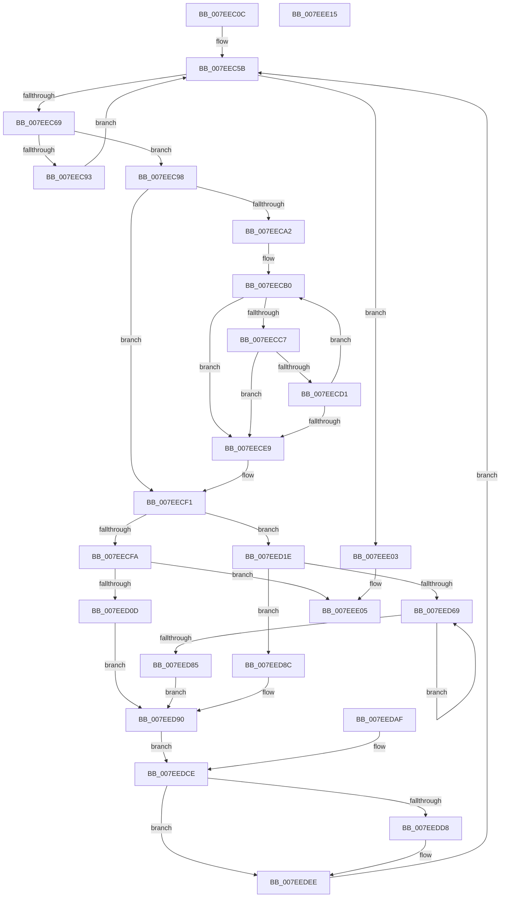

# HvpViewMapMigrateCOWData

- RVA: `0x007EEC0C`–`0x007EEE16` (길이 `522` bytes)
- VA: `0x00000001407EEC0C`
- 실행 섹션: `PAGE`
- PDB 이름 있음: `예`; PDB Function 태그: `아니요`
- unwind 정보 RVA: `0x000D7048`
- 디코드: `143`개 명령, `522/522` bytes 표시
- 미해석 바이트: `0` (있으면 어셈블리에 `.byte`로 보존)

> 이 문서는 커널 이미지의 기계어와 PDB 기호를 분석해 생성했습니다. 4번과 5번은 함수 원형과 자료형을 바이너리 사용 방식에서 추정한 C 해석이며 원본 소스 복구 결과는 아닙니다.

## 1. Dependencies

- 직접 호출 지점: **4**; 고유 호출 대상: **4**
- 직접 호출자로 확인된 함수: **1**
- RIP 상대 이미지 참조: **0**

### Outgoing calls
- `0x007EED00` → [HvpViewMapMakeViewRangeCOWByCaller](../9B/HvpViewMapMakeViewRangeCOWByCaller_function_009B5BB4.md) (function, `0x009B5BB4`)
- `0x007EED5C` → [CmSiProtectViewOfSection](../../text/47/CmSiProtectViewOfSection_function_004746B8.md) (function, `0x004746B8`)
- `0x007EEDA8` → [memcpy](../../text/6C/memcpy_function_006C6840.md) (function, `0x006C6840`)
- `0x007EEDE9` → [HvpViewMapMakeViewRangeReadOnly](../9B/HvpViewMapMakeViewRangeReadOnly_function_009B5AC8.md) (function, `0x009B5AC8`)

### Direct callers
- [HvpViewMapPromoteRangeToMapping](../9B/HvpViewMapPromoteRangeToMapping_function_009B94C8.md) at `0x009B9767`

### Static image references
- 디코드된 RIP-relative 메모리 참조가 없습니다.

## 2. Other-region calls and transfers

- 다른 실행 섹션으로 향하는 call: **2**
  - `0x007EED5C` → [CmSiProtectViewOfSection](../../text/47/CmSiProtectViewOfSection_function_004746B8.md) (`PAGE` → `.text`)
  - `0x007EEDA8` → [memcpy](../../text/6C/memcpy_function_006C6840.md) (`PAGE` → `.text`)
- 별도 외부 분기/꼬리 이동을 확인하지 못했습니다.

## 3. Assembly (complete function range)

```asm
007EEC0C  4C 89 44 24 18                  mov qword ptr [rsp + 0x18], r8
007EEC11  48 89 54 24 10                  mov qword ptr [rsp + 0x10], rdx
007EEC16  48 89 4C 24 08                  mov qword ptr [rsp + 8], rcx
007EEC1B  53                              push rbx
007EEC1C  56                              push rsi
007EEC1D  57                              push rdi
007EEC1E  41 54                           push r12
007EEC20  41 55                           push r13
007EEC22  41 56                           push r14
007EEC24  41 57                           push r15
007EEC26  48 83 EC 60                     sub rsp, 0x60
007EEC2A  4D 8B E8                        mov r13, r8
007EEC2D  48 8B F2                        mov rsi, rdx
007EEC30  4C 8B E2                        mov r12, rdx
007EEC33  48 89 54 24 58                  mov qword ptr [rsp + 0x58], rdx
007EEC38  48 8B 5A 28                     mov rbx, qword ptr [rdx + 0x28]
007EEC3C  4D 8B 48 28                     mov r9, qword ptr [r8 + 0x28]
007EEC40  48 8B 42 30                     mov rax, qword ptr [rdx + 0x30]
007EEC44  4D 8B 78 30                     mov r15, qword ptr [r8 + 0x30]
007EEC48  4C 3B F8                        cmp r15, rax
007EEC4B  4C 0F 4D F8                     cmovge r15, rax
007EEC4F  4C 89 7C 24 48                  mov qword ptr [rsp + 0x48], r15
007EEC54  4C 3B CB                        cmp r9, rbx
007EEC57  49 0F 4D D9                     cmovge rbx, r9
007EEC5B  48 89 5C 24 30                  mov qword ptr [rsp + 0x30], rbx
007EEC60  49 3B DF                        cmp rbx, r15
007EEC63  0F 8D 9A 01 00 00               jge 0x1407eee03
007EEC69  4D 8B 4D 18                     mov r9, qword ptr [r13 + 0x18]
007EEC6D  48 8B C3                        mov rax, rbx
007EEC70  49 2B C1                        sub rax, r9
007EEC73  48 C1 E8 0C                     shr rax, 0xc
007EEC77  48 83 C0 48                     add rax, 0x48
007EEC7B  49 03 C5                        add rax, r13
007EEC7E  48 89 44 24 50                  mov qword ptr [rsp + 0x50], rax
007EEC83  44 8A 00                        mov r8b, byte ptr [rax]
007EEC86  48 8D BB 00 10 00 00            lea rdi, [rbx + 0x1000]
007EEC8D  41 F6 C0 06                     test r8b, 6
007EEC91  75 05                           jne 0x1407eec98
007EEC93  48 8B DF                        mov rbx, rdi
007EEC96  EB C3                           jmp 0x1407eec5b
007EEC98  48 89 7C 24 38                  mov qword ptr [rsp + 0x38], rdi
007EEC9D  49 3B FF                        cmp rdi, r15
007EECA0  7D 4F                           jge 0x1407eecf1
007EECA2  41 8A D0                        mov dl, r8b
007EECA5  D0 EA                           shr dl, 1
007EECA7  80 E2 01                        and dl, 1
007EECAA  48 8B CF                        mov rcx, rdi
007EECAD  49 2B C9                        sub rcx, r9
007EECB0  48 8B C1                        mov rax, rcx
007EECB3  48 C1 E8 0C                     shr rax, 0xc
007EECB7  46 8A 4C 28 48                  mov r9b, byte ptr [rax + r13 + 0x48]
007EECBC  41 8A C1                        mov al, r9b
007EECBF  D0 E8                           shr al, 1
007EECC1  24 01                           and al, 1
007EECC3  3A C2                           cmp al, dl
007EECC5  75 22                           jne 0x1407eece9
007EECC7  41 8A C0                        mov al, r8b
007EECCA  41 32 C1                        xor al, r9b
007EECCD  A8 04                           test al, 4
007EECCF  75 18                           jne 0x1407eece9
007EECD1  48 81 C7 00 10 00 00            add rdi, 0x1000
007EECD8  48 89 7C 24 38                  mov qword ptr [rsp + 0x38], rdi
007EECDD  48 81 C1 00 10 00 00            add rcx, 0x1000
007EECE4  49 3B FF                        cmp rdi, r15
007EECE7  7C C7                           jl 0x1407eecb0
007EECE9  48 8B 8C 24 A0 00 00 00         mov rcx, qword ptr [rsp + 0xa0]
007EECF1  41 F6 C0 02                     test r8b, 2
007EECF5  4C 8B C3                        mov r8, rbx
007EECF8  74 24                           je 0x1407eed1e
007EECFA  4C 8B CF                        mov r9, rdi
007EECFD  48 8B D6                        mov rdx, rsi
007EED00  E8 AF 6E 1C 00                  call 0x1409b5bb4
007EED05  85 C0                           test eax, eax
007EED07  0F 88 F8 00 00 00               js 0x1407eee05
007EED0D  4C 8B F7                        mov r14, rdi
007EED10  4C 2B F3                        sub r14, rbx
007EED13  49 8D 4C 24 38                  lea rcx, [r12 + 0x38]
007EED18  49 83 C4 18                     add r12, 0x18
007EED1C  EB 72                           jmp 0x1407eed90
007EED1E  83 A4 24 B8 00 00 00 00         and dword ptr [rsp + 0xb8], 0
007EED26  48 8D 46 38                     lea rax, [rsi + 0x38]
007EED2A  48 89 44 24 40                  mov qword ptr [rsp + 0x40], rax
007EED2F  4C 8D 66 18                     lea r12, [rsi + 0x18]
007EED33  4D 2B 04 24                     sub r8, qword ptr [r12]
007EED37  4C 03 00                        add r8, qword ptr [rax]
007EED3A  4C 8B F7                        mov r14, rdi
007EED3D  4C 2B F3                        sub r14, rbx
007EED40  48 8D 84 24 B8 00 00 00         lea rax, [rsp + 0xb8]
007EED48  48 89 44 24 28                  mov qword ptr [rsp + 0x28], rax
007EED4D  C7 44 24 20 08 00 00 00         mov dword ptr [rsp + 0x20], 8
007EED55  4D 8B CE                        mov r9, r14
007EED58  48 8B 51 18                     mov rdx, qword ptr [rcx + 0x18]
007EED5C  E8 57 59 C8 FF                  call 0x1404746b8
007EED61  48 8B CB                        mov rcx, rbx
007EED64  48 3B DF                        cmp rbx, rdi
007EED67  7D 23                           jge 0x1407eed8c
007EED69  48 8B C1                        mov rax, rcx
007EED6C  49 2B 04 24                     sub rax, qword ptr [r12]
007EED70  48 C1 E8 0C                     shr rax, 0xc
007EED74  80 4C 30 48 08                  or byte ptr [rax + rsi + 0x48], 8
007EED79  48 81 C1 00 10 00 00            add rcx, 0x1000
007EED80  48 3B CF                        cmp rcx, rdi
007EED83  7C E4                           jl 0x1407eed69
007EED85  48 8B 4C 24 40                  mov rcx, qword ptr [rsp + 0x40]
007EED8A  EB 04                           jmp 0x1407eed90
007EED8C  48 8D 4E 38                     lea rcx, [rsi + 0x38]
007EED90  49 8B 55 38                     mov rdx, qword ptr [r13 + 0x38]
007EED94  49 2B 55 18                     sub rdx, qword ptr [r13 + 0x18]
007EED98  48 03 D3                        add rdx, rbx
007EED9B  48 8B 09                        mov rcx, qword ptr [rcx]
007EED9E  49 2B 0C 24                     sub rcx, qword ptr [r12]
007EEDA2  48 03 CB                        add rcx, rbx
007EEDA5  4D 8B C6                        mov r8, r14
007EEDA8  E8 93 7A ED FF                  call 0x1406c6840
007EEDAD  EB 1F                           jmp 0x1407eedce
007EEDAF  4C 8B AC 24 B0 00 00 00         mov r13, qword ptr [rsp + 0xb0]
007EEDB7  48 8B B4 24 A8 00 00 00         mov rsi, qword ptr [rsp + 0xa8]
007EEDBF  48 8B 5C 24 30                  mov rbx, qword ptr [rsp + 0x30]
007EEDC4  48 8B 7C 24 38                  mov rdi, qword ptr [rsp + 0x38]
007EEDC9  4C 8B 7C 24 48                  mov r15, qword ptr [rsp + 0x48]
007EEDCE  48 8B 44 24 50                  mov rax, qword ptr [rsp + 0x50]
007EEDD3  F6 00 02                        test byte ptr [rax], 2
007EEDD6  75 16                           jne 0x1407eedee
007EEDD8  4C 8B CF                        mov r9, rdi
007EEDDB  4C 8B C3                        mov r8, rbx
007EEDDE  48 8B D6                        mov rdx, rsi
007EEDE1  48 8B 8C 24 A0 00 00 00         mov rcx, qword ptr [rsp + 0xa0]
007EEDE9  E8 DA 6C 1C 00                  call 0x1409b5ac8
007EEDEE  48 8B DF                        mov rbx, rdi
007EEDF1  48 8B 8C 24 A0 00 00 00         mov rcx, qword ptr [rsp + 0xa0]
007EEDF9  4C 8B 64 24 58                  mov r12, qword ptr [rsp + 0x58]
007EEDFE  E9 58 FE FF FF                  jmp 0x1407eec5b
007EEE03  33 C0                           xor eax, eax
007EEE05  48 83 C4 60                     add rsp, 0x60
007EEE09  41 5F                           pop r15
007EEE0B  41 5E                           pop r14
007EEE0D  41 5D                           pop r13
007EEE0F  41 5C                           pop r12
007EEE11  5F                              pop rdi
007EEE12  5E                              pop rsi
007EEE13  5B                              pop rbx
007EEE14  C3                              ret
007EEE15  CC                              int3
```

## 4. C-style interpretation (structured pseudocode)

```c
__int64 __fastcall HvpViewMapMigrateCOWData(__int64 a1, __int64 a2, __int64 a3)
{
    __int64 result;
    __int64 v_r12;
    __int64 v_r14;
    __int64 v_r15;
    __int64 v_rbx;
    __int64 v_rdi;
    __int64 v_rsp;
    unsigned __int64 v_stack_m40;
    unsigned __int64 v_stack_m48;
    unsigned __int64 v_stack_m50;
    unsigned __int64 v_stack_m58;
    unsigned __int64 v_stack_m60;
    unsigned __int64 v_stack_m68;
    unsigned __int64 v_stack_m70;
    unsigned int v_stack_m78;
    unsigned __int64 v_stack_p10;
    unsigned __int64 v_stack_p18;
    unsigned int v_stack_p20;
    unsigned __int64 v_stack_p8;

    v_stack_p18 = a3;
    v_stack_p10 = a2;
    v_stack_p8 = a1;
    v_rsp = (v_rsp) - (96);
    v_stack_m40 = a2;
    v_r15 = *(unsigned __int64 *)(a3 + 48);
    if ((*(unsigned __int64 *)(a3 + 48)) >= (*(unsigned __int64 *)(a2 + 48))) { v_r15 = *(unsigned __int64 *)(a2 + 48); }
    v_stack_m50 = v_r15;
    v_rbx = *(unsigned __int64 *)(a2 + 40);
    if ((*(unsigned __int64 *)(a3 + 40)) >= (*(unsigned __int64 *)(a2 + 40))) { v_rbx = *(unsigned __int64 *)(a3 + 40); }
loc_007EEC5B:
    v_stack_m68 = v_rbx;
    if (v_rbx >= v_r15) goto loc_007EEE03;
    result = (v_rbx) - (*(unsigned __int64 *)(a3 + 24));
    result = (result) >> (12);
    result = (result) + (72);
    result = (result) + (a3);
    v_stack_m48 = result;
    if ((((unsigned __int8)(*(unsigned __int8 *)(result))) & (6)) != 0) goto loc_007EEC98;
    goto loc_007EEC5B;
loc_007EEC98:
    v_stack_m60 = v_rbx + 4096;
    if ((v_rbx + 4096) >= v_r15) goto loc_007EECF1;
    a2 = (unsigned __int8)(((unsigned __int8)(*(unsigned __int8 *)(result))) >> (1));
    a2 = (unsigned __int8)((a2) & (1));
    a1 = (v_rbx + 4096) - (*(unsigned __int64 *)(a3 + 24));
loc_007EECB0:
    result = (a1) >> (12);
    result = (unsigned __int8)(((unsigned __int8)(*(unsigned __int8 *)(result + a3 * 1 + 72))) >> (1));
    result = (unsigned __int8)((result) & (1));
    if (((unsigned __int8)(result)) != ((unsigned __int8)(a2))) goto loc_007EECE9;
    result = (unsigned __int8)(((unsigned __int8)(*(unsigned __int8 *)(result))) ^ ((unsigned __int8)(*(unsigned __int8 *)(result + a3 * 1 + 72))));
    if ((((unsigned __int8)(result)) & (4)) != 0) goto loc_007EECE9;
    v_rdi = (v_rbx + 4096) + (0x1000ULL);
    v_stack_m60 = v_rdi;
    a1 = (a1) + (0x1000ULL);
    if (v_rdi < v_r15) goto loc_007EECB0;
loc_007EECE9:
loc_007EECF1:
    if ((((unsigned __int8)(*(unsigned __int8 *)(result))) & (2)) == 0) goto loc_007EED1E;
    result = HvpViewMapMakeViewRangeCOWByCaller(v_stack_p8, a2, v_rbx + 4096, v_rdi);
    if (sign_flag) goto loc_007EEE05;
    v_r14 = (v_rdi) - (v_rbx + 4096);
    v_r12 = (a2) + (24);
    goto loc_007EED90;
loc_007EED1E:
    v_stack_m58 = a2 + 56;
    a3 = (v_rbx + 4096) - (*(unsigned __int64 *)(a2 + 24));
    a3 = (a3) + (*(unsigned __int64 *)(a2 + 56));
    v_r14 = (v_rdi) - (v_rbx + 4096);
    v_stack_m70 = v_stack_p20;
    v_stack_m78 = 8;
    result = CmSiProtectViewOfSection(a2 + 56, *(unsigned __int64 *)(a2 + 56 + 24), a3, v_r14);
    if ((v_rbx + 4096) >= v_rdi) goto loc_007EED8C;
loc_007EED69:
    result = (v_rbx + 4096) - (*(unsigned __int64 *)(a2 + 24));
    result = (result) >> (12);
    a1 = (v_rbx + 4096) + (0x1000ULL);
    if (a1 < v_rdi) goto loc_007EED69;
    goto loc_007EED90;
loc_007EED8C:
loc_007EED90:
    a2 = (*(unsigned __int64 *)(a3 + 56)) - (*(unsigned __int64 *)(a3 + 24));
    a2 = (a2) + (v_rbx + 4096);
    a1 = (*(unsigned __int64 *)(a2 + 56)) - (*(unsigned __int64 *)(a2 + 24));
    a1 = (a1) + (v_rbx + 4096);
    result = memcpy(a1, a2, v_r14, v_r14);
    goto loc_007EEDCE;
loc_007EEDCE:
    result = v_stack_m48;
    if (((*(unsigned __int8 *)(v_stack_m48)) & (2)) == 0) {
        a4 = v_rdi;
        a3 = v_rbx + 4096;
        a2 = a2;
        a1 = v_stack_p8;
        result = HvpViewMapMakeViewRangeReadOnly(a1, a2, a3, a4);
    }
    goto loc_007EEC5B;
loc_007EEE03:
    result = 0;
loc_007EEE05:
    v_rsp = (v_rsp) + (96);
    return result;
}
```

## 5. (Beta) C Style

```c
int64_t HvpViewMapMigrateCOWData(int64_t Arg1, void *Arg2, void *Arg3)
{
    uint8_t *arg2 = (uint8_t *)Arg2;
    uint8_t *arg3 = (uint8_t *)Arg3;

    int64_t result;
    int64_t local_r12;
    int64_t local_r14;
    int64_t local_r15;
    int64_t local_rbx;
    int64_t local_rdi;
    int64_t local_rsp;
    uint64_t v_stack_m40;
    uint64_t v_stack_m48;
    uint64_t v_stack_m50;
    uint64_t v_stack_m58;
    uint64_t v_stack_m60;
    uint64_t v_stack_m68;
    uint64_t v_stack_m70;
    uint32_t v_stack_m78;
    uint64_t v_stack_p10;
    uint64_t v_stack_p18;
    uint32_t v_stack_p20;
    uint64_t v_stack_p8;

    v_stack_p18 = Arg3;
    v_stack_p10 = Arg2;
    v_stack_p8 = Arg1;
    local_rsp = (local_rsp) - (96);
    v_stack_m40 = Arg2;
    local_r15 = *(uint64_t *)(arg3 + 0x30);
    if ((*(uint64_t *)(arg3 + 0x30)) >= (*(uint64_t *)(arg2 + 0x30))) { local_r15 = *(uint64_t *)(arg2 + 0x30); }
    v_stack_m50 = local_r15;
    local_rbx = *(uint64_t *)(arg2 + 0x28);
    if ((*(uint64_t *)(arg3 + 0x28)) >= (*(uint64_t *)(arg2 + 0x28))) { local_rbx = *(uint64_t *)(arg3 + 0x28); }
loc_007EEC5B:
    v_stack_m68 = local_rbx;
    if (local_rbx >= local_r15) goto loc_007EEE03;
    result = (local_rbx) - (*(uint64_t *)(arg3 + 0x18));
    result = (result) >> (12);
    result = (result) + (72);
    result = (result) + (Arg3);
    v_stack_m48 = result;
    if ((((uint8_t)(*(uint8_t *)(result))) & (6)) != 0) goto loc_007EEC98;
    goto loc_007EEC5B;
loc_007EEC98:
    v_stack_m60 = local_rbx + 4096;
    if ((local_rbx + 4096) >= local_r15) goto loc_007EECF1;
    Arg2 = (uint8_t)(((uint8_t)(*(uint8_t *)(result))) >> (1));
    Arg2 = (uint8_t)((Arg2) & (1));
    Arg1 = (local_rbx + 4096) - (*(uint64_t *)(arg3 + 0x18));
loc_007EECB0:
    result = (Arg1) >> (12);
    result = (uint8_t)(((uint8_t)(*(uint8_t *)(result + arg3 * 1 + 0x48))) >> (1));
    result = (uint8_t)((result) & (1));
    if (((uint8_t)(result)) != ((uint8_t)(Arg2))) goto loc_007EECE9;
    result = (uint8_t)(((uint8_t)(*(uint8_t *)(result))) ^ ((uint8_t)(*(uint8_t *)(result + arg3 * 1 + 0x48))));
    if ((((uint8_t)(result)) & (4)) != 0) goto loc_007EECE9;
    local_rdi = (local_rbx + 4096) + (0x1000ULL);
    v_stack_m60 = local_rdi;
    Arg1 = (Arg1) + (0x1000ULL);
    if (local_rdi < local_r15) goto loc_007EECB0;
loc_007EECE9:
loc_007EECF1:
    if ((((uint8_t)(*(uint8_t *)(result))) & (2)) == 0) goto loc_007EED1E;
    result = HvpViewMapMakeViewRangeCOWByCaller(v_stack_p8, Arg2, local_rbx + 4096, local_rdi);
    if (sign_flag) goto loc_007EEE05;
    local_r14 = (local_rdi) - (local_rbx + 4096);
    local_r12 = (Arg2) + (24);
    goto loc_007EED90;
loc_007EED1E:
    v_stack_m58 = Arg2 + 56;
    Arg3 = (local_rbx + 4096) - (*(uint64_t *)(arg2 + 0x18));
    Arg3 = (Arg3) + (*(uint64_t *)(arg2 + 0x38));
    local_r14 = (local_rdi) - (local_rbx + 4096);
    v_stack_m70 = v_stack_p20;
    v_stack_m78 = 8;
    result = CmSiProtectViewOfSection(Arg2 + 56, *(uint64_t *)(arg2 + 0x38 + 0x18), Arg3, local_r14);
    if ((local_rbx + 4096) >= local_rdi) goto loc_007EED8C;
loc_007EED69:
    result = (local_rbx + 4096) - (*(uint64_t *)(arg2 + 0x18));
    result = (result) >> (12);
    Arg1 = (local_rbx + 4096) + (0x1000ULL);
    if (Arg1 < local_rdi) goto loc_007EED69;
    goto loc_007EED90;
loc_007EED8C:
loc_007EED90:
    Arg2 = (*(uint64_t *)(arg3 + 0x38)) - (*(uint64_t *)(arg3 + 0x18));
    Arg2 = (Arg2) + (local_rbx + 4096);
    Arg1 = (*(uint64_t *)(arg2 + 0x38)) - (*(uint64_t *)(arg2 + 0x18));
    Arg1 = (Arg1) + (local_rbx + 4096);
    result = memcpy(Arg1, Arg2, local_r14, local_r14);
    goto loc_007EEDCE;
loc_007EEDCE:
    result = v_stack_m48;
    if (((*(uint8_t *)(v_stack_m48)) & (2)) == 0) {
        a4 = local_rdi;
        Arg3 = local_rbx + 4096;
        Arg2 = Arg2;
        Arg1 = v_stack_p8;
        result = HvpViewMapMakeViewRangeReadOnly(Arg1, Arg2, Arg3, a4);
    }
    goto loc_007EEC5B;
loc_007EEE03:
    result = 0;
loc_007EEE05:
    local_rsp = (local_rsp) + (96);
    return result;
}
```

### 관측된 메모리 오프셋

구조체 형식이 확인되지 않은 접근은 인자 기준의 오프셋으로만 기록했습니다.

| 기준 인자 | 오프셋 표현 | 폭 (bit) | 접근 |
|---|---:|---:|---|
| `Arg2` | `+ 0x0` | `64` | `R` |
| `Arg2` | `+ 0x18` | `64` | `R` |
| `Arg2` | `+ 0x28` | `64` | `R` |
| `Arg2` | `+ 0x30` | `64` | `R` |
| `Arg2` | `+ 0x38` | `64` | `R` |
| `Arg3` | `+ 0x18` | `64` | `R` |
| `Arg3` | `+ 0x28` | `64` | `R` |
| `Arg3` | `+ 0x30` | `64` | `R` |
| `Arg3` | `+ 0x38` | `64` | `R` |

## 6. Execution-region graph

[열기: 2D/3D 그래프와 함수 탐색 컨트롤 패널](../../../control-panel.html?section=page&rva=0x007EEC0C&view=graph)

- 2D 그래프는 위에서 아래로 흐르고, 3D 그래프는 빈 공간을 드래그해 회전합니다. Shift+드래그는 이동, 휠은 확대·축소, 함수 노드 선택은 대상 보고서 이동입니다.

### Static fallback


