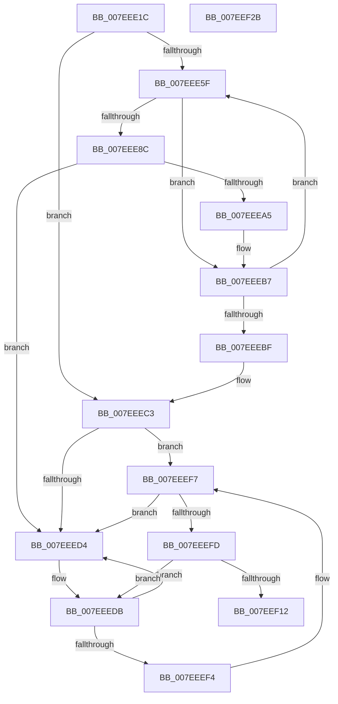

# HvpViewMapShrinkStorage

- RVA: `0x007EEE1C`–`0x007EEF2C` (길이 `272` bytes)
- VA: `0x00000001407EEE1C`
- 실행 섹션: `PAGE`
- PDB 이름 있음: `예`; PDB Function 태그: `아니요`
- unwind 정보 RVA: `0x000D702C`
- 디코드: `80`개 명령, `272/272` bytes 표시
- 미해석 바이트: `0` (있으면 어셈블리에 `.byte`로 보존)

> 이 문서는 커널 이미지의 기계어와 PDB 기호를 분석해 생성했습니다. 4번과 5번은 함수 원형과 자료형을 바이너리 사용 방식에서 추정한 C 해석이며 원본 소스 복구 결과는 아닙니다.

## 1. Dependencies

- 직접 호출 지점: **4**; 고유 호출 대상: **4**
- 직접 호출자로 확인된 함수: **2**
- RIP 상대 이미지 참조: **0**

### Outgoing calls
- `0x007EEE65` → [HvpViewMapFindViewForFileOffset](../9B/HvpViewMapFindViewForFileOffset_function_009B5CD8.md) (function, `0x009B5CD8`)
- `0x007EEE7D` → [HvpViewMapMakeViewRangeInvalid](../9B/HvpViewMapMakeViewRangeInvalid_function_009B7770.md) (function, `0x009B7770`)
- `0x007EEE93` → [RtlRbRemoveNode](../../text/2E/RtlRbRemoveNode_function_002E4C10.md) (function, `0x002E4C10`)
- `0x007EEEE1` → [HvpViewMapFreeView](../9B/HvpViewMapFreeView_function_009B6F9C.md) (function, `0x009B6F9C`)

### Direct callers
- [HvpAddBin](../AF/HvpAddBin_function_00AF7D48.md) at `0x00AF8137`
- [sub_00B3E78C](../B3/Unknown_function_00B3E78C.md) at `0x00B3E8C8`

### Static image references
- 디코드된 RIP-relative 메모리 참조가 없습니다.

## 2. Other-region calls and transfers

- 다른 실행 섹션으로 향하는 call: **1**
  - `0x007EEE93` → [RtlRbRemoveNode](../../text/2E/RtlRbRemoveNode_function_002E4C10.md) (`PAGE` → `.text`)
- 별도 외부 분기/꼬리 이동을 확인하지 못했습니다.

## 3. Assembly (complete function range)

```asm
007EEE1C  48 89 5C 24 08                  mov qword ptr [rsp + 8], rbx
007EEE21  48 89 74 24 10                  mov qword ptr [rsp + 0x10], rsi
007EEE26  48 89 7C 24 18                  mov qword ptr [rsp + 0x18], rdi
007EEE2B  55                              push rbp
007EEE2C  41 56                           push r14
007EEE2E  41 57                           push r15
007EEE30  48 8B EC                        mov rbp, rsp
007EEE33  48 83 EC 30                     sub rsp, 0x30
007EEE37  4C 8B 79 08                     mov r15, qword ptr [rcx + 8]
007EEE3B  8D 82 00 10 00 00               lea eax, [rdx + 0x1000]
007EEE41  44 8B F0                        mov r14d, eax
007EEE44  48 8B F9                        mov rdi, rcx
007EEE47  44 8B D0                        mov r10d, eax
007EEE4A  48 8D 45 F0                     lea rax, [rbp - 0x10]
007EEE4E  48 89 45 F8                     mov qword ptr [rbp - 8], rax
007EEE52  48 8D 45 F0                     lea rax, [rbp - 0x10]
007EEE56  48 89 45 F0                     mov qword ptr [rbp - 0x10], rax
007EEE5A  4D 3B F7                        cmp r14, r15
007EEE5D  7D 64                           jge 0x1407eeec3
007EEE5F  49 8B D2                        mov rdx, r10
007EEE62  48 8B CF                        mov rcx, rdi
007EEE65  E8 6E 6E 1C 00                  call 0x1409b5cd8
007EEE6A  4D 8B C2                        mov r8, r10
007EEE6D  48 8B D0                        mov rdx, rax
007EEE70  48 8B CF                        mov rcx, rdi
007EEE73  48 8B D8                        mov rbx, rax
007EEE76  48 8B 70 30                     mov rsi, qword ptr [rax + 0x30]
007EEE7A  4C 8B CE                        mov r9, rsi
007EEE7D  E8 EE 88 1C 00                  call 0x1409b7770
007EEE82  48 8B 4B 30                     mov rcx, qword ptr [rbx + 0x30]
007EEE86  48 39 4B 28                     cmp qword ptr [rbx + 0x28], rcx
007EEE8A  75 2B                           jne 0x1407eeeb7
007EEE8C  48 8D 4F 28                     lea rcx, [rdi + 0x28]
007EEE90  48 8B D3                        mov rdx, rbx
007EEE93  E8 78 5D AF FF                  call 0x1402e4c10
007EEE98  48 8B 45 F8                     mov rax, qword ptr [rbp - 8]
007EEE9C  48 8D 4D F0                     lea rcx, [rbp - 0x10]
007EEEA0  48 39 08                        cmp qword ptr [rax], rcx
007EEEA3  75 2F                           jne 0x1407eeed4
007EEEA5  48 89 43 08                     mov qword ptr [rbx + 8], rax
007EEEA9  48 8D 4D F0                     lea rcx, [rbp - 0x10]
007EEEAD  48 89 0B                        mov qword ptr [rbx], rcx
007EEEB0  48 89 18                        mov qword ptr [rax], rbx
007EEEB3  48 89 5D F8                     mov qword ptr [rbp - 8], rbx
007EEEB7  4C 8B D6                        mov r10, rsi
007EEEBA  49 3B F7                        cmp rsi, r15
007EEEBD  7C A0                           jl 0x1407eee5f
007EEEBF  48 8B 45 F0                     mov rax, qword ptr [rbp - 0x10]
007EEEC3  4C 89 77 08                     mov qword ptr [rdi + 8], r14
007EEEC7  48 8D 55 F0                     lea rdx, [rbp - 0x10]
007EEECB  48 8B 08                        mov rcx, qword ptr [rax]
007EEECE  48 39 50 08                     cmp qword ptr [rax + 8], rdx
007EEED2  74 23                           je 0x1407eeef7
007EEED4  B9 03 00 00 00                  mov ecx, 3
007EEED9  CD 29                           int 0x29
007EEEDB  48 8B D0                        mov rdx, rax
007EEEDE  48 8B CF                        mov rcx, rdi
007EEEE1  E8 B6 80 1C 00                  call 0x1409b6f9c
007EEEE6  48 8B 45 F0                     mov rax, qword ptr [rbp - 0x10]
007EEEEA  48 8D 4D F0                     lea rcx, [rbp - 0x10]
007EEEEE  48 39 48 08                     cmp qword ptr [rax + 8], rcx
007EEEF2  75 E0                           jne 0x1407eeed4
007EEEF4  48 8B 08                        mov rcx, qword ptr [rax]
007EEEF7  48 39 41 08                     cmp qword ptr [rcx + 8], rax
007EEEFB  75 D7                           jne 0x1407eeed4
007EEEFD  48 89 4D F0                     mov qword ptr [rbp - 0x10], rcx
007EEF01  48 8D 55 F0                     lea rdx, [rbp - 0x10]
007EEF05  48 89 51 08                     mov qword ptr [rcx + 8], rdx
007EEF09  48 8D 4D F0                     lea rcx, [rbp - 0x10]
007EEF0D  48 3B C1                        cmp rax, rcx
007EEF10  75 C9                           jne 0x1407eeedb
007EEF12  48 8B 5C 24 50                  mov rbx, qword ptr [rsp + 0x50]
007EEF17  48 8B 74 24 58                  mov rsi, qword ptr [rsp + 0x58]
007EEF1C  48 8B 7C 24 60                  mov rdi, qword ptr [rsp + 0x60]
007EEF21  48 83 C4 30                     add rsp, 0x30
007EEF25  41 5F                           pop r15
007EEF27  41 5E                           pop r14
007EEF29  5D                              pop rbp
007EEF2A  C3                              ret
007EEF2B  CC                              int3
```

## 4. C-style interpretation (structured pseudocode)

```c
__int64 __fastcall HvpViewMapShrinkStorage(__int64 a1, __int64 a2)
{
    __int64 result;
    __int64 v_rsp;
    unsigned __int64 v_stack_m20;
    unsigned __int64 v_stack_m28;
    unsigned __int64 v_stack_p10;
    unsigned __int64 v_stack_p18;
    unsigned __int64 v_stack_p8;

    v_stack_p8 = v_rbx;
    v_stack_p10 = v_rsi;
    v_stack_p18 = v_rdi;
    v_rsp = (v_rsp) - (48);
    v_stack_m20 = v_stack_m28;
    v_stack_m28 = v_stack_m28;
    if (((unsigned int)((unsigned int)(a2 + 4096))) >= (*(unsigned __int64 *)(a1 + 8))) goto loc_007EEEC3;
loc_007EEE5F:
    result = HvpViewMapFindViewForFileOffset(a1, (unsigned int)((unsigned int)(a2 + 4096)), a3, a4);
    result = HvpViewMapMakeViewRangeInvalid(a1, result, (unsigned int)((unsigned int)(a2 + 4096)), *(unsigned __int64 *)(result + 48));
    if ((*(unsigned __int64 *)(result + 40)) != (*(unsigned __int64 *)(result + 48))) goto loc_007EEEB7;
    result = RtlRbRemoveNode(a1 + 40, result, (unsigned int)((unsigned int)(a2 + 4096)), *(unsigned __int64 *)(result + 48));
    if ((*(unsigned __int64 *)(v_stack_m20)) != v_stack_m28) goto loc_007EEED4;
    *(unsigned __int64 *)(result + 8) = v_stack_m20;
    *(unsigned __int64 *)(result) = v_stack_m28;
    *(unsigned __int64 *)(v_stack_m20) = result;
    v_stack_m20 = result;
loc_007EEEB7:
    if ((*(unsigned __int64 *)(result + 48)) < (*(unsigned __int64 *)(a1 + 8))) goto loc_007EEE5F;
loc_007EEEC3:
    *(unsigned __int64 *)(a1 + 8) = (unsigned int)((unsigned int)(a2 + 4096));
    if ((*(unsigned __int64 *)(v_stack_m28 + 8)) == v_stack_m28) goto loc_007EEEF7;
loc_007EEED4:
loc_007EEEDB:
    result = HvpViewMapFreeView(a1, v_stack_m28, (unsigned int)((unsigned int)(a2 + 4096)), *(unsigned __int64 *)(result + 48));
    if ((*(unsigned __int64 *)(v_stack_m28 + 8)) != v_stack_m28) goto loc_007EEED4;
loc_007EEEF7:
    if ((*(unsigned __int64 *)(*(unsigned __int64 *)(v_stack_m28) + 8)) != v_stack_m28) goto loc_007EEED4;
    v_stack_m28 = *(unsigned __int64 *)(v_stack_m28);
    *(unsigned __int64 *)(*(unsigned __int64 *)(v_stack_m28) + 8) = v_stack_m28;
    if (v_stack_m28 != v_stack_m28) goto loc_007EEEDB;
    v_rsp = (v_rsp) + (48);
    return v_stack_m28;
}
```

## 5. (Beta) C Style

```c
int64_t HvpViewMapShrinkStorage(void *Arg1, void *Arg2)
{
    uint8_t *arg1 = (uint8_t *)Arg1;
    uint8_t *arg2 = (uint8_t *)Arg2;

    int64_t result;
    int64_t local_rsp;
    uint64_t v_stack_m20;
    uint64_t v_stack_m28;
    uint64_t v_stack_p10;
    uint64_t v_stack_p18;
    uint64_t v_stack_p8;

    v_stack_p8 = local_rbx;
    v_stack_p10 = local_rsi;
    v_stack_p18 = local_rdi;
    local_rsp = (local_rsp) - (48);
    v_stack_m20 = v_stack_m28;
    v_stack_m28 = v_stack_m28;
    if (((uint32_t)((uint32_t)(Arg2 + 4096))) >= (*(uint64_t *)(arg1 + 0x8))) goto loc_007EEEC3;
loc_007EEE5F:
    result = HvpViewMapFindViewForFileOffset(Arg1, (uint32_t)((uint32_t)(Arg2 + 4096)), a3, a4);
    result = HvpViewMapMakeViewRangeInvalid(Arg1, result, (uint32_t)((uint32_t)(Arg2 + 4096)), *(uint64_t *)(result + 0x30));
    if ((*(uint64_t *)(result + 0x28)) != (*(uint64_t *)(result + 0x30))) goto loc_007EEEB7;
    result = RtlRbRemoveNode(Arg1 + 40, result, (uint32_t)((uint32_t)(Arg2 + 4096)), *(uint64_t *)(result + 0x30));
    if ((*(uint64_t *)(v_stack_m20)) != v_stack_m28) goto loc_007EEED4;
    *(uint64_t *)(result + 0x8) = v_stack_m20;
    *(uint64_t *)(result) = v_stack_m28;
    *(uint64_t *)(v_stack_m20) = result;
    v_stack_m20 = result;
loc_007EEEB7:
    if ((*(uint64_t *)(result + 0x30)) < (*(uint64_t *)(arg1 + 0x8))) goto loc_007EEE5F;
loc_007EEEC3:
    *(uint64_t *)(arg1 + 0x8) = (uint32_t)((uint32_t)(Arg2 + 4096));
    if ((*(uint64_t *)(v_stack_m28 + 0x8)) == v_stack_m28) goto loc_007EEEF7;
loc_007EEED4:
loc_007EEEDB:
    result = HvpViewMapFreeView(Arg1, v_stack_m28, (uint32_t)((uint32_t)(Arg2 + 4096)), *(uint64_t *)(result + 0x30));
    if ((*(uint64_t *)(v_stack_m28 + 0x8)) != v_stack_m28) goto loc_007EEED4;
loc_007EEEF7:
    if ((*(uint64_t *)(*(uint64_t *)(v_stack_m28) + 0x8)) != v_stack_m28) goto loc_007EEED4;
    v_stack_m28 = *(uint64_t *)(v_stack_m28);
    *(uint64_t *)(*(uint64_t *)(v_stack_m28) + 0x8) = v_stack_m28;
    if (v_stack_m28 != v_stack_m28) goto loc_007EEEDB;
    local_rsp = (local_rsp) + (48);
    return v_stack_m28;
}
```

### 관측된 메모리 오프셋

구조체 형식이 확인되지 않은 접근은 인자 기준의 오프셋으로만 기록했습니다.

| 기준 인자 | 오프셋 표현 | 폭 (bit) | 접근 |
|---|---:|---:|---|
| `Arg1` | `+ 0x8` | `64` | `R` |
| `Arg1` | `+ 0x8` | `64` | `W` |
| `Arg1` | `+ 0x28` | `64` | `R` |
| `Arg2` | `+ 0x1000` | `32` | `R` |

## 6. Execution-region graph

[열기: 2D/3D 그래프와 함수 탐색 컨트롤 패널](../../../control-panel.html?section=page&rva=0x007EEE1C&view=graph)

- 2D 그래프는 위에서 아래로 흐르고, 3D 그래프는 빈 공간을 드래그해 회전합니다. Shift+드래그는 이동, 휠은 확대·축소, 함수 노드 선택은 대상 보고서 이동입니다.

### Static fallback


