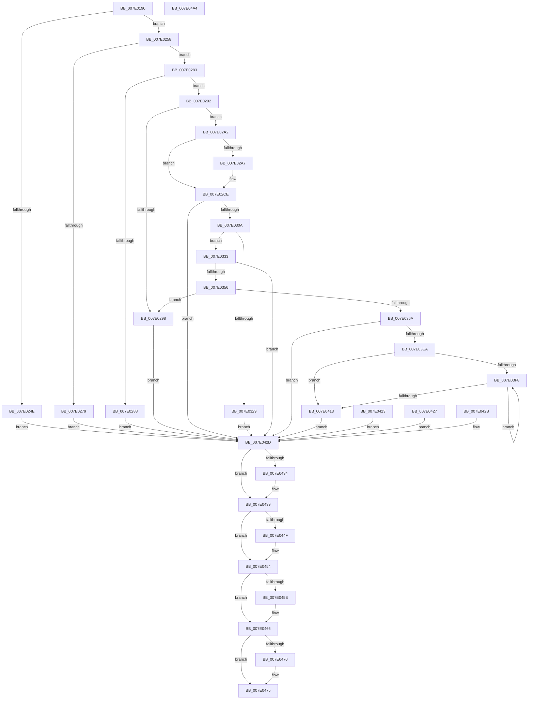

# NtQueryOpenSubKeysEx

- RVA: `0x007E0190`–`0x007E04A5` (길이 `789` bytes)
- VA: `0x00000001407E0190`
- 실행 섹션: `PAGE`
- PDB 이름 있음: `예`; PDB Function 태그: `아니요`
- unwind 정보 RVA: `0x000D6850`
- 디코드: `190`개 명령, `789/789` bytes 표시
- 미해석 바이트: `0` (있으면 어셈블리에 `.byte`로 보존)

> 이 문서는 커널 이미지의 기계어와 PDB 기호를 분석해 생성했습니다. 4번과 5번은 함수 원형과 자료형을 바이너리 사용 방식에서 추정한 C 해석이며 원본 소스 복구 결과는 아닙니다.

## 1. Dependencies

- 직접 호출 지점: **22**; 고유 호출 대상: **21**
- 직접 호출자로 확인된 함수: **0**
- RIP 상대 이미지 참조: **3**

### Outgoing calls
- `0x007E01E2` → [memset](../../text/6C/memset_function_006C6C40.md) (function, `0x006C6C40`)
- `0x007E0218` → [CmpInitializeParseContext](../87/CmpInitializeParseContext_function_008767F0.md) (function, `0x008767F0`)
- `0x007E023C` → [CmpInitializeThreadInfo](../../text/3F/CmpInitializeThreadInfo_function_003FBE70.md) (function, `0x003FBE70`)
- `0x007E0241` → [CmpAcquireShutdownRundown](../../pagecmrc/BC/CmpAcquireShutdownRundown_function_00BC9400.md) (function, `0x00BC9400`)
- `0x007E0270` → [SeSinglePrivilegeCheck](../87/SeSinglePrivilegeCheck_function_00871E20.md) (function, `0x00871E20`)
- `0x007E02C8` → [ProbeForWrite](../8E/ProbeForWrite_function_008E91C0.md) (function, `0x008E91C0`)
- `0x007E02FB` → [ObReferenceObjectByNameEx](../8B/ObReferenceObjectByNameEx_function_008BD524.md) (function, `0x008BD524`)
- `0x007E031A` → [CmpAllocateTransientPoolWithQuota](../../text/46/CmpAllocateTransientPoolWithQuota_function_00461190.md) (function, `0x00461190`)
- `0x007E0333` → [CmpLockRegistryExclusive](../84/CmpLockRegistryExclusive_function_0084F9B4.md) (function, `0x0084F9B4`)
- `0x007E0347` → [CmpPerformKeyBodyDeletionCheck](../../pagecmrc/BC/CmpPerformKeyBodyDeletionCheck_function_00BC97D0.md) (function, `0x00BC97D0`)
- `0x007E03A4` → [CmpAttachToRegistryProcess](../../pagecmrc/BC/CmpAttachToRegistryProcess_function_00BC98E0.md) (function, `0x00BC98E0`)
- `0x007E03B4` → [CmpSearchForOpenSubKeys](../9A/CmpSearchForOpenSubKeys_function_009AE76C.md) (function, `0x009AE76C`)
- `0x007E03C1` → [CmpDetachFromRegistryProcess](../../pagecmrc/BC/CmpDetachFromRegistryProcess_function_00BC9920.md) (function, `0x00BC9920`)
- `0x007E03CA` → [CmpUnlockRegistry](../../pagecmrc/BC/CmpUnlockRegistry_function_00BC9A84.md) (function, `0x00BC9A84`)
- `0x007E0419` → [memcpy](../../text/6C/memcpy_function_006C6840.md) (function, `0x006C6840`)
- `0x007E0434` → [CmpUnlockRegistry](../../pagecmrc/BC/CmpUnlockRegistry_function_00BC9A84.md) (function, `0x00BC9A84`)
- `0x007E0443` → [CmpCleanupParseContext](../87/CmpCleanupParseContext_function_00876910.md) (function, `0x00876910`)
- `0x007E044F` → [CmpReleaseShutdownRundown](../../pagecmrc/BC/CmpReleaseShutdownRundown_function_00BC9880.md) (function, `0x00BC9880`)
- `0x007E0461` → [ObfDereferenceObject](../../text/2F/ObfDereferenceObject_function_002F9350.md) (function, `0x002F9350`)
- `0x007E0470` → [CmSiFreeMemory](../../text/47/CmSiFreeMemory_function_00475D80.md) (function, `0x00475D80`)
- `0x007E047D` → [CmCleanupThreadInfo](../../text/41/CmCleanupThreadInfo_function_0041FD50.md) (function, `0x0041FD50`)
- `0x007E048F` → [_security_check_cookie](../../text/6A/_security_check_cookie_function_006AC640.md) (function, `0x006AC640`)

### Direct callers
- 이 함수 시작 RVA로 연결되는 직접 call은 확인되지 않았습니다. 간접 호출은 완전히 역산할 수 없습니다.

### Static image references
- `0x007E01A0` → RVA `0x00E0A740` (`.data`; read)
- `0x007E0269` → RVA `0x00FD9AE0` (`PAGEDATA`; read)
- `0x007E02E9` → RVA `0x00FC6AC0` (`ALMOSTRO`; read)

## 2. Other-region calls and transfers

- 다른 실행 섹션으로 향하는 call: **15**
  - `0x007E01E2` → [memset](../../text/6C/memset_function_006C6C40.md) (`PAGE` → `.text`)
  - `0x007E023C` → [CmpInitializeThreadInfo](../../text/3F/CmpInitializeThreadInfo_function_003FBE70.md) (`PAGE` → `.text`)
  - `0x007E0241` → [CmpAcquireShutdownRundown](../../pagecmrc/BC/CmpAcquireShutdownRundown_function_00BC9400.md) (`PAGE` → `PAGECMRC`)
  - `0x007E031A` → [CmpAllocateTransientPoolWithQuota](../../text/46/CmpAllocateTransientPoolWithQuota_function_00461190.md) (`PAGE` → `.text`)
  - `0x007E0347` → [CmpPerformKeyBodyDeletionCheck](../../pagecmrc/BC/CmpPerformKeyBodyDeletionCheck_function_00BC97D0.md) (`PAGE` → `PAGECMRC`)
  - `0x007E03A4` → [CmpAttachToRegistryProcess](../../pagecmrc/BC/CmpAttachToRegistryProcess_function_00BC98E0.md) (`PAGE` → `PAGECMRC`)
  - `0x007E03C1` → [CmpDetachFromRegistryProcess](../../pagecmrc/BC/CmpDetachFromRegistryProcess_function_00BC9920.md) (`PAGE` → `PAGECMRC`)
  - `0x007E03CA` → [CmpUnlockRegistry](../../pagecmrc/BC/CmpUnlockRegistry_function_00BC9A84.md) (`PAGE` → `PAGECMRC`)
  - `0x007E0419` → [memcpy](../../text/6C/memcpy_function_006C6840.md) (`PAGE` → `.text`)
  - `0x007E0434` → [CmpUnlockRegistry](../../pagecmrc/BC/CmpUnlockRegistry_function_00BC9A84.md) (`PAGE` → `PAGECMRC`)
  - `0x007E044F` → [CmpReleaseShutdownRundown](../../pagecmrc/BC/CmpReleaseShutdownRundown_function_00BC9880.md) (`PAGE` → `PAGECMRC`)
  - `0x007E0461` → [ObfDereferenceObject](../../text/2F/ObfDereferenceObject_function_002F9350.md) (`PAGE` → `.text`)
  - `0x007E0470` → [CmSiFreeMemory](../../text/47/CmSiFreeMemory_function_00475D80.md) (`PAGE` → `.text`)
  - `0x007E047D` → [CmCleanupThreadInfo](../../text/41/CmCleanupThreadInfo_function_0041FD50.md) (`PAGE` → `.text`)
  - `0x007E048F` → [_security_check_cookie](../../text/6A/_security_check_cookie_function_006AC640.md) (`PAGE` → `.text`)
- 별도 외부 분기/꼬리 이동을 확인하지 못했습니다.

## 3. Assembly (complete function range)

```asm
007E0190  40 53                           push rbx
007E0192  56                              push rsi
007E0193  41 54                           push r12
007E0195  41 56                           push r14
007E0197  41 57                           push r15
007E0199  48 81 EC B0 02 00 00            sub rsp, 0x2b0
007E01A0  48 8B 05 99 A5 62 00            mov rax, qword ptr [rip + 0x62a599]
007E01A7  48 33 C4                        xor rax, rsp
007E01AA  48 89 84 24 A0 02 00 00         mov qword ptr [rsp + 0x2a0], rax
007E01B2  4D 8B E1                        mov r12, r9
007E01B5  4D 8B F8                        mov r15, r8
007E01B8  8B F2                           mov esi, edx
007E01BA  4C 8B F1                        mov r14, rcx
007E01BD  0F 57 C0                        xorps xmm0, xmm0
007E01C0  33 C0                           xor eax, eax
007E01C2  0F 11 84 24 88 00 00 00         movups xmmword ptr [rsp + 0x88], xmm0
007E01CA  48 89 84 24 98 00 00 00         mov qword ptr [rsp + 0x98], rax
007E01D2  33 D2                           xor edx, edx
007E01D4  41 B8 D0 01 00 00               mov r8d, 0x1d0
007E01DA  48 8D 8C 24 D0 00 00 00         lea rcx, [rsp + 0xd0]
007E01E2  E8 59 6A EE FF                  call 0x1406c6c40
007E01E7  83 A4 24 80 00 00 00 00         and dword ptr [rsp + 0x80], 0
007E01EF  0F 57 C0                        xorps xmm0, xmm0
007E01F2  0F 11 84 24 A0 00 00 00         movups xmmword ptr [rsp + 0xa0], xmm0
007E01FA  0F 11 84 24 B0 00 00 00         movups xmmword ptr [rsp + 0xb0], xmm0
007E0202  0F 11 84 24 C0 00 00 00         movups xmmword ptr [rsp + 0xc0], xmm0
007E020A  48 83 64 24 48 00               and qword ptr [rsp + 0x48], 0
007E0210  48 8D 8C 24 D0 00 00 00         lea rcx, [rsp + 0xd0]
007E0218  E8 D3 65 09 00                  call 0x1408767f0
007E021D  0F 57 C0                        xorps xmm0, xmm0
007E0220  0F 11 44 24 50                  movups xmmword ptr [rsp + 0x50], xmm0
007E0225  0F 11 44 24 60                  movups xmmword ptr [rsp + 0x60], xmm0
007E022A  0F 11 44 24 70                  movups xmmword ptr [rsp + 0x70], xmm0
007E022F  C6 44 24 40 00                  mov byte ptr [rsp + 0x40], 0
007E0234  48 8D 8C 24 88 00 00 00         lea rcx, [rsp + 0x88]
007E023C  E8 2F BC C1 FF                  call 0x1403fbe70
007E0241  E8 BA 91 3E 00                  call 0x140bc9400
007E0246  88 44 24 41                     mov byte ptr [rsp + 0x41], al
007E024A  84 C0                           test al, al
007E024C  75 0A                           jne 0x1407e0258
007E024E  BB 89 01 00 C0                  mov ebx, 0xc0000189
007E0253  E9 D5 01 00 00                  jmp 0x1407e042d
007E0258  65 48 8B 04 25 88 01 00 00      mov rax, qword ptr gs:[0x188]
007E0261  8A 98 32 02 00 00               mov bl, byte ptr [rax + 0x232]
007E0267  8A D3                           mov dl, bl
007E0269  48 8B 0D 70 98 7F 00            mov rcx, qword ptr [rip + 0x7f9870]
007E0270  E8 AB 1B 09 00                  call 0x140871e20
007E0275  84 C0                           test al, al
007E0277  75 0A                           jne 0x1407e0283
007E0279  BB 61 00 00 C0                  mov ebx, 0xc0000061
007E027E  E9 AA 01 00 00                  jmp 0x1407e042d
007E0283  83 FE 08                        cmp esi, 8
007E0286  73 0A                           jae 0x1407e0292
007E0288  BB 23 00 00 C0                  mov ebx, 0xc0000023
007E028D  E9 9B 01 00 00                  jmp 0x1407e042d
007E0292  40 F6 C6 01                     test sil, 1
007E0296  74 0A                           je 0x1407e02a2
007E0298  BB 0D 00 00 C0                  mov ebx, 0xc000000d
007E029D  E9 8B 01 00 00                  jmp 0x1407e042d
007E02A2  80 FB 01                        cmp bl, 1
007E02A5  75 27                           jne 0x1407e02ce
007E02A7  48 B9 00 00 FF FF FF 7F 00 00   movabs rcx, 0x7fffffff0000
007E02B1  4C 3B E1                        cmp r12, rcx
007E02B4  49 0F 42 CC                     cmovb rcx, r12
007E02B8  8B 01                           mov eax, dword ptr [rcx]
007E02BA  89 01                           mov dword ptr [rcx], eax
007E02BC  48 8B D6                        mov rdx, rsi
007E02BF  41 B8 04 00 00 00               mov r8d, 4
007E02C5  49 8B CF                        mov rcx, r15
007E02C8  E8 F3 8E 10 00                  call 0x1408e91c0
007E02CD  90                              nop
007E02CE  48 8D 44 24 48                  lea rax, [rsp + 0x48]
007E02D3  48 89 44 24 30                  mov qword ptr [rsp + 0x30], rax
007E02D8  48 8D 84 24 D0 00 00 00         lea rax, [rsp + 0xd0]
007E02E0  48 89 44 24 28                  mov qword ptr [rsp + 0x28], rax
007E02E5  88 5C 24 20                     mov byte ptr [rsp + 0x20], bl
007E02E9  4C 8B 0D D0 67 7E 00            mov r9, qword ptr [rip + 0x7e67d0]
007E02F0  33 D2                           xor edx, edx
007E02F2  41 B8 19 00 02 00               mov r8d, 0x20019
007E02F8  49 8B CE                        mov rcx, r14
007E02FB  E8 24 D2 0D 00                  call 0x1408bd524
007E0300  8B D8                           mov ebx, eax
007E0302  85 C0                           test eax, eax
007E0304  0F 88 23 01 00 00               js 0x1407e042d
007E030A  89 74 24 50                     mov dword ptr [rsp + 0x50], esi
007E030E  4C 8B F6                        mov r14, rsi
007E0311  41 B8 43 4D 38 31               mov r8d, 0x31384d43
007E0317  48 8B D6                        mov rdx, rsi
007E031A  E8 71 0E C8 FF                  call 0x140461190
007E031F  48 89 44 24 58                  mov qword ptr [rsp + 0x58], rax
007E0324  48 85 C0                        test rax, rax
007E0327  75 0A                           jne 0x1407e0333
007E0329  BB 9A 00 00 C0                  mov ebx, 0xc000009a
007E032E  E9 FA 00 00 00                  jmp 0x1407e042d
007E0333  E8 7C F6 06 00                  call 0x14084f9b4
007E0338  C6 44 24 40 01                  mov byte ptr [rsp + 0x40], 1
007E033D  33 D2                           xor edx, edx
007E033F  48 8B 74 24 48                  mov rsi, qword ptr [rsp + 0x48]
007E0344  48 8B CE                        mov rcx, rsi
007E0347  E8 84 94 3E 00                  call 0x140bc97d0
007E034C  8B D8                           mov ebx, eax
007E034E  85 C0                           test eax, eax
007E0350  0F 88 D7 00 00 00               js 0x1407e042d
007E0356  48 8B 46 08                     mov rax, qword ptr [rsi + 8]
007E035A  F7 80 B8 00 00 00 00 00 04 00   test dword ptr [rax + 0xb8], 0x40000
007E0364  0F 84 2E FF FF FF               je 0x1407e0298
007E036A  48 8B 44 24 58                  mov rax, qword ptr [rsp + 0x58]
007E036F  83 20 00                        and dword ptr [rax], 0
007E0372  C7 44 24 60 08 00 00 00         mov dword ptr [rsp + 0x60], 8
007E037A  C7 44 24 68 08 00 00 00         mov dword ptr [rsp + 0x68], 8
007E0382  48 8B 4C 24 58                  mov rcx, qword ptr [rsp + 0x58]
007E0387  49 03 CE                        add rcx, r14
007E038A  48 89 4C 24 78                  mov qword ptr [rsp + 0x78], rcx
007E038F  48 8B C6                        mov rax, rsi
007E0392  48 89 44 24 70                  mov qword ptr [rsp + 0x70], rax
007E0397  83 64 24 64 00                  and dword ptr [rsp + 0x64], 0
007E039C  48 8D 8C 24 A0 00 00 00         lea rcx, [rsp + 0xa0]
007E03A4  E8 37 95 3E 00                  call 0x140bc98e0
007E03A9  4C 8D 44 24 50                  lea r8, [rsp + 0x50]
007E03AE  33 D2                           xor edx, edx
007E03B0  48 8B 4E 08                     mov rcx, qword ptr [rsi + 8]
007E03B4  E8 B3 E3 1C 00                  call 0x1409ae76c
007E03B9  48 8D 8C 24 A0 00 00 00         lea rcx, [rsp + 0xa0]
007E03C1  E8 5A 95 3E 00                  call 0x140bc9920
007E03C6  8B 5C 24 64                     mov ebx, dword ptr [rsp + 0x64]
007E03CA  E8 B5 96 3E 00                  call 0x140bc9a84
007E03CF  C6 44 24 40 00                  mov byte ptr [rsp + 0x40], 0
007E03D4  8B 44 24 60                     mov eax, dword ptr [rsp + 0x60]
007E03D8  41 89 04 24                     mov dword ptr [r12], eax
007E03DC  48 8B 54 24 58                  mov rdx, qword ptr [rsp + 0x58]
007E03E1  8B 02                           mov eax, dword ptr [rdx]
007E03E3  41 89 07                        mov dword ptr [r15], eax
007E03E6  85 DB                           test ebx, ebx
007E03E8  78 43                           js 0x1407e042d
007E03EA  4C 8B D2                        mov r10, rdx
007E03ED  4D 2B D7                        sub r10, r15
007E03F0  45 33 C9                        xor r9d, r9d
007E03F3  44 39 0A                        cmp dword ptr [rdx], r9d
007E03F6  76 1B                           jbe 0x1407e0413
007E03F8  41 8B C1                        mov eax, r9d
007E03FB  48 FF C0                        inc rax
007E03FE  48 8D 04 40                     lea rax, [rax + rax*2]
007E0402  4C 29 14 C2                     sub qword ptr [rdx + rax*8], r10
007E0406  41 FF C1                        inc r9d
007E0409  48 8B 54 24 58                  mov rdx, qword ptr [rsp + 0x58]
007E040E  44 3B 0A                        cmp r9d, dword ptr [rdx]
007E0411  72 E5                           jb 0x1407e03f8
007E0413  4D 8B C6                        mov r8, r14
007E0416  49 8B CF                        mov rcx, r15
007E0419  E8 22 64 EE FF                  call 0x1406c6840
007E041E  90                              nop
007E041F  33 DB                           xor ebx, ebx
007E0421  EB 0A                           jmp 0x1407e042d
007E0423  8B D8                           mov ebx, eax
007E0425  EB 06                           jmp 0x1407e042d
007E0427  8B D8                           mov ebx, eax
007E0429  EB 02                           jmp 0x1407e042d
007E042B  8B D8                           mov ebx, eax
007E042D  80 7C 24 40 00                  cmp byte ptr [rsp + 0x40], 0
007E0432  74 05                           je 0x1407e0439
007E0434  E8 4B 96 3E 00                  call 0x140bc9a84
007E0439  33 D2                           xor edx, edx
007E043B  48 8D 8C 24 D0 00 00 00         lea rcx, [rsp + 0xd0]
007E0443  E8 C8 64 09 00                  call 0x140876910
007E0448  80 7C 24 41 00                  cmp byte ptr [rsp + 0x41], 0
007E044D  74 05                           je 0x1407e0454
007E044F  E8 2C 94 3E 00                  call 0x140bc9880
007E0454  48 8B 74 24 48                  mov rsi, qword ptr [rsp + 0x48]
007E0459  48 85 F6                        test rsi, rsi
007E045C  74 08                           je 0x1407e0466
007E045E  48 8B CE                        mov rcx, rsi
007E0461  E8 EA 8E B1 FF                  call 0x1402f9350
007E0466  48 8B 4C 24 58                  mov rcx, qword ptr [rsp + 0x58]
007E046B  48 85 C9                        test rcx, rcx
007E046E  74 05                           je 0x1407e0475
007E0470  E8 0B 59 C9 FF                  call 0x140475d80
007E0475  48 8D 8C 24 88 00 00 00         lea rcx, [rsp + 0x88]
007E047D  E8 CE F8 C3 FF                  call 0x14041fd50
007E0482  8B C3                           mov eax, ebx
007E0484  48 8B 8C 24 A0 02 00 00         mov rcx, qword ptr [rsp + 0x2a0]
007E048C  48 33 CC                        xor rcx, rsp
007E048F  E8 AC C1 EC FF                  call 0x1406ac640
007E0494  48 81 C4 B0 02 00 00            add rsp, 0x2b0
007E049B  41 5F                           pop r15
007E049D  41 5E                           pop r14
007E049F  41 5C                           pop r12
007E04A1  5E                              pop rsi
007E04A2  5B                              pop rbx
007E04A3  C3                              ret
007E04A4  CC                              int3
```

## 4. C-style interpretation (structured pseudocode)

```c
__int64 __fastcall NtQueryOpenSubKeysEx(__int64 a1, int a2, __int64 a3, __int64 a4)
{
    __int64 result;
    __int64 v_r10;
    __int64 v_rbx;
    __int64 v_rsp;
    unsigned __int64 v_stack_m208;
    unsigned __int64 v_stack_m218;
    unsigned __int64 v_stack_m228;
    unsigned __int64 v_stack_m238;
    unsigned __int64 v_stack_m240;
    unsigned __int64 v_stack_m250;
    unsigned int v_stack_m258;
    unsigned __int64 v_stack_m260;
    unsigned __int64 v_stack_m268;
    unsigned int v_stack_m270;
    unsigned int v_stack_m274;
    unsigned __int64 v_stack_m278;
    unsigned __int64 v_stack_m280;
    unsigned __int64 v_stack_m288;
    unsigned __int64 v_stack_m290;
    unsigned __int8 v_stack_m297;
    unsigned __int8 v_stack_m298;
    unsigned __int64 v_stack_m2A8;
    unsigned __int64 v_stack_m2B0;
    unsigned __int8 v_stack_m2B8;
    unsigned __int64 v_stack_m38;

    v_rsp = (v_rsp) - (688);
    result = (*(unsigned __int64 *)(v_rip + 6464921)) ^ (v_rsp);
    v_stack_m38 = result;
    result = 0;
    v_stack_m250 = v_xmm0;
    v_stack_m240 = 0;
    a2 = 0;
    result = memset(v_stack_m208, a2, 464, a4);
    v_stack_m238 = v_xmm0;
    v_stack_m228 = v_xmm0;
    v_stack_m218 = v_xmm0;
    result = CmpInitializeParseContext(v_stack_m208, a2, 464, a4);
    v_stack_m288 = v_xmm0;
    v_stack_m278 = v_xmm0;
    v_stack_m268 = v_xmm0;
    v_stack_m298 = 0;
    result = CmpInitializeThreadInfo(v_stack_m250, a2, 464, a4);
    result = CmpAcquireShutdownRundown(v_stack_m250, a2, 464, a4);
    v_stack_m297 = (unsigned __int8)(result);
    if ((unsigned __int8)(result) != 0) goto loc_007E0258;
    goto loc_007E042D;
loc_007E0258:
    result = SeSinglePrivilegeCheck(*(unsigned __int64 *)(v_rip + 8362096), (unsigned __int8)(*(unsigned __int8 *)(*(unsigned __int64 *)(gs_base + (0 + 392)) + 562)), 464, a4);
    if ((unsigned __int8)(result) != 0) goto loc_007E0283;
    goto loc_007E042D;
loc_007E0283:
    if (((unsigned int)((unsigned int)(a2))) >= 8) goto loc_007E0292;
    goto loc_007E042D;
loc_007E0292:
    if ((((unsigned __int8)((unsigned int)(a2))) & (1)) == 0) goto loc_007E02A2;
loc_007E0298:
    goto loc_007E042D;
loc_007E02A2:
    if (((unsigned __int8)((unsigned int)(0xC000000DULL))) == 1) {
        a1 = *(unsigned __int64 *)(v_rip + 8362096);
        if (a4 < (*(unsigned __int64 *)(v_rip + 8362096))) { a1 = a4; }
        result = *(unsigned int *)(a1);
        *(unsigned int *)(a1) = (unsigned int)(result);
        a2 = (unsigned int)(a2);
        a3 = 4;
        a1 = a3;
        result = ProbeForWrite(a1, a2, a3, a4);
    }
    v_stack_m2A8 = v_stack_m290;
    v_stack_m2B0 = v_stack_m208;
    v_stack_m2B8 = (unsigned __int8)((unsigned int)(0xC000000DULL));
    a2 = 0;
    result = ObReferenceObjectByNameEx(a1, a2, (unsigned int)(0x20019ULL), *(unsigned __int64 *)(v_rip + 8284112));
    if (sign_flag) goto loc_007E042D;
    v_stack_m288 = (unsigned int)((unsigned int)(a2));
    result = CmpAllocateTransientPoolWithQuota(a1, (unsigned int)(a2), (unsigned int)(0x31384D43ULL), *(unsigned __int64 *)(v_rip + 8284112));
    v_stack_m280 = result;
    if (result != 0) goto loc_007E0333;
    goto loc_007E042D;
loc_007E0333:
    result = CmpLockRegistryExclusive(a1, (unsigned int)(a2), (unsigned int)(0x31384D43ULL), *(unsigned __int64 *)(v_rip + 8284112));
    v_stack_m298 = 1;
    a2 = 0;
    result = CmpPerformKeyBodyDeletionCheck(v_stack_m290, a2, (unsigned int)(0x31384D43ULL), *(unsigned __int64 *)(v_rip + 8284112));
    if (sign_flag) goto loc_007E042D;
    if (((*(unsigned int *)(*(unsigned __int64 *)(v_stack_m290 + 8) + 184)) & (0x40000ULL)) == 0) goto loc_007E0298;
    v_stack_m278 = 8;
    v_stack_m270 = 8;
    a1 = (v_stack_m280) + ((unsigned int)(a2));
    v_stack_m260 = a1;
    v_stack_m268 = v_stack_m290;
    result = CmpAttachToRegistryProcess(v_stack_m238, a2, (unsigned int)(0x31384D43ULL), *(unsigned __int64 *)(v_rip + 8284112));
    a2 = 0;
    result = CmpSearchForOpenSubKeys(*(unsigned __int64 *)(v_stack_m290 + 8), a2, v_stack_m288, *(unsigned __int64 *)(v_rip + 8284112));
    result = CmpDetachFromRegistryProcess(v_stack_m238, a2, v_stack_m288, *(unsigned __int64 *)(v_rip + 8284112));
    result = CmpUnlockRegistry(v_stack_m238, a2, v_stack_m288, *(unsigned __int64 *)(v_rip + 8284112));
    v_stack_m298 = 0;
    *(unsigned int *)(a4) = (unsigned int)((unsigned int)(v_stack_m278));
    *(unsigned int *)(a3) = (unsigned int)((unsigned int)(*(unsigned int *)(v_stack_m280)));
    if (sign_flag) goto loc_007E042D;
    v_r10 = (v_stack_m280) - (a3);
    a4 = 0;
    if ((*(unsigned int *)(v_stack_m280)) <= 0) goto loc_007E0413;
loc_007E03F8:
    result = (0) + 1;
    a4 = (unsigned int)((a4) + 1);
    if (((unsigned int)(a4)) < (*(unsigned int *)(v_stack_m280))) goto loc_007E03F8;
loc_007E0413:
    result = memcpy(a3, v_stack_m280, (unsigned int)(a2), a4);
    v_rbx = 0;
    goto loc_007E042D;
loc_007E042D:
    if (v_stack_m298 != 0) {
        result = CmpUnlockRegistry(a3, v_stack_m280, (unsigned int)(a2), a4);
    }
    a2 = 0;
    result = CmpCleanupParseContext(v_stack_m208, a2, (unsigned int)(a2), a4);
    if (v_stack_m297 != 0) {
        result = CmpReleaseShutdownRundown(v_stack_m208, a2, (unsigned int)(a2), a4);
    }
    if (v_stack_m290 != 0) {
        a1 = v_stack_m290;
        result = ObfDereferenceObject(a1, a2, (unsigned int)(a2), a4);
    }
    if (v_stack_m280 != 0) {
        result = CmSiFreeMemory(v_stack_m280, a2, (unsigned int)(a2), a4);
    }
    result = CmCleanupThreadInfo(v_stack_m250, a2, (unsigned int)(a2), a4);
    a1 = (v_stack_m38) ^ (v_rsp);
    result = _security_check_cookie(a1, a2, (unsigned int)(a2), a4);
    v_rsp = (v_rsp) + (688);
    return result;
}
```

## 5. (Beta) C Style

```c
int64_t NtQueryOpenSubKeysEx(int64_t Arg1, int32_t Arg2, void *Arg3, int64_t Arg4)
{
    uint8_t *arg3 = (uint8_t *)Arg3;

    int64_t result;
    int64_t local_r10;
    int64_t local_rbx;
    int64_t local_rsp;
    uint64_t v_stack_m208;
    uint64_t v_stack_m218;
    uint64_t v_stack_m228;
    uint64_t v_stack_m238;
    uint64_t v_stack_m240;
    uint64_t v_stack_m250;
    uint32_t v_stack_m258;
    uint64_t v_stack_m260;
    uint64_t v_stack_m268;
    uint32_t v_stack_m270;
    uint32_t v_stack_m274;
    uint64_t v_stack_m278;
    uint64_t v_stack_m280;
    uint64_t v_stack_m288;
    uint64_t v_stack_m290;
    uint8_t v_stack_m297;
    uint8_t v_stack_m298;
    uint64_t v_stack_m2A8;
    uint64_t v_stack_m2B0;
    uint8_t v_stack_m2B8;
    uint64_t v_stack_m38;

    local_rsp = (local_rsp) - (688);
    result = (*(uint64_t *)(v_rip + 0x62A599)) ^ (local_rsp);
    v_stack_m38 = result;
    result = 0;
    v_stack_m250 = v_xmm0;
    v_stack_m240 = 0;
    Arg2 = 0;
    result = memset(v_stack_m208, Arg2, 464, Arg4);
    v_stack_m238 = v_xmm0;
    v_stack_m228 = v_xmm0;
    v_stack_m218 = v_xmm0;
    result = CmpInitializeParseContext(v_stack_m208, Arg2, 464, Arg4);
    v_stack_m288 = v_xmm0;
    v_stack_m278 = v_xmm0;
    v_stack_m268 = v_xmm0;
    v_stack_m298 = 0;
    result = CmpInitializeThreadInfo(v_stack_m250, Arg2, 464, Arg4);
    result = CmpAcquireShutdownRundown(v_stack_m250, Arg2, 464, Arg4);
    v_stack_m297 = (uint8_t)(result);
    if ((uint8_t)(result) != 0) goto loc_007E0258;
    goto loc_007E042D;
loc_007E0258:
    result = SeSinglePrivilegeCheck(*(uint64_t *)(v_rip + 0x7F9870), (uint8_t)(*(uint8_t *)(*(uint64_t *)(gs_base + (0 + 0x188)) + 0x232)), 464, Arg4);
    if ((uint8_t)(result) != 0) goto loc_007E0283;
    goto loc_007E042D;
loc_007E0283:
    if (((uint32_t)((uint32_t)(Arg2))) >= 8) goto loc_007E0292;
    goto loc_007E042D;
loc_007E0292:
    if ((((uint8_t)((uint32_t)(Arg2))) & (1)) == 0) goto loc_007E02A2;
loc_007E0298:
    goto loc_007E042D;
loc_007E02A2:
    if (((uint8_t)((uint32_t)(0xC000000DULL))) == 1) {
        Arg1 = *(uint64_t *)(v_rip + 0x7F9870);
        if (Arg4 < (*(uint64_t *)(v_rip + 0x7F9870))) { Arg1 = Arg4; }
        result = *(uint32_t *)(Arg1);
        *(uint32_t *)(Arg1) = (uint32_t)(result);
        Arg2 = (uint32_t)(Arg2);
        Arg3 = 4;
        Arg1 = Arg3;
        result = ProbeForWrite(Arg1, Arg2, Arg3, Arg4);
    }
    v_stack_m2A8 = v_stack_m290;
    v_stack_m2B0 = v_stack_m208;
    v_stack_m2B8 = (uint8_t)((uint32_t)(0xC000000DULL));
    Arg2 = 0;
    result = ObReferenceObjectByNameEx(Arg1, Arg2, (uint32_t)(0x20019ULL), *(uint64_t *)(v_rip + 0x7E67D0));
    if (sign_flag) goto loc_007E042D;
    v_stack_m288 = (uint32_t)((uint32_t)(Arg2));
    result = CmpAllocateTransientPoolWithQuota(Arg1, (uint32_t)(Arg2), (uint32_t)(0x31384D43ULL), *(uint64_t *)(v_rip + 0x7E67D0));
    v_stack_m280 = result;
    if (result != 0) goto loc_007E0333;
    goto loc_007E042D;
loc_007E0333:
    result = CmpLockRegistryExclusive(Arg1, (uint32_t)(Arg2), (uint32_t)(0x31384D43ULL), *(uint64_t *)(v_rip + 0x7E67D0));
    v_stack_m298 = 1;
    Arg2 = 0;
    result = CmpPerformKeyBodyDeletionCheck(v_stack_m290, Arg2, (uint32_t)(0x31384D43ULL), *(uint64_t *)(v_rip + 0x7E67D0));
    if (sign_flag) goto loc_007E042D;
    if (((*(uint32_t *)(*(uint64_t *)(v_stack_m290 + 0x8) + 0xB8)) & (0x40000ULL)) == 0) goto loc_007E0298;
    v_stack_m278 = 8;
    v_stack_m270 = 8;
    Arg1 = (v_stack_m280) + ((uint32_t)(Arg2));
    v_stack_m260 = Arg1;
    v_stack_m268 = v_stack_m290;
    result = CmpAttachToRegistryProcess(v_stack_m238, Arg2, (uint32_t)(0x31384D43ULL), *(uint64_t *)(v_rip + 0x7E67D0));
    Arg2 = 0;
    result = CmpSearchForOpenSubKeys(*(uint64_t *)(v_stack_m290 + 0x8), Arg2, v_stack_m288, *(uint64_t *)(v_rip + 0x7E67D0));
    result = CmpDetachFromRegistryProcess(v_stack_m238, Arg2, v_stack_m288, *(uint64_t *)(v_rip + 0x7E67D0));
    result = CmpUnlockRegistry(v_stack_m238, Arg2, v_stack_m288, *(uint64_t *)(v_rip + 0x7E67D0));
    v_stack_m298 = 0;
    *(uint32_t *)(Arg4) = (uint32_t)((uint32_t)(v_stack_m278));
    *(uint32_t *)(arg3) = (uint32_t)((uint32_t)(*(uint32_t *)(v_stack_m280)));
    if (sign_flag) goto loc_007E042D;
    local_r10 = (v_stack_m280) - (Arg3);
    Arg4 = 0;
    if ((*(uint32_t *)(v_stack_m280)) <= 0) goto loc_007E0413;
loc_007E03F8:
    result = (0) + 1;
    Arg4 = (uint32_t)((Arg4) + 1);
    if (((uint32_t)(Arg4)) < (*(uint32_t *)(v_stack_m280))) goto loc_007E03F8;
loc_007E0413:
    result = memcpy(Arg3, v_stack_m280, (uint32_t)(Arg2), Arg4);
    local_rbx = 0;
    goto loc_007E042D;
loc_007E042D:
    if (v_stack_m298 != 0) {
        result = CmpUnlockRegistry(Arg3, v_stack_m280, (uint32_t)(Arg2), Arg4);
    }
    Arg2 = 0;
    result = CmpCleanupParseContext(v_stack_m208, Arg2, (uint32_t)(Arg2), Arg4);
    if (v_stack_m297 != 0) {
        result = CmpReleaseShutdownRundown(v_stack_m208, Arg2, (uint32_t)(Arg2), Arg4);
    }
    if (v_stack_m290 != 0) {
        Arg1 = v_stack_m290;
        result = ObfDereferenceObject(Arg1, Arg2, (uint32_t)(Arg2), Arg4);
    }
    if (v_stack_m280 != 0) {
        result = CmSiFreeMemory(v_stack_m280, Arg2, (uint32_t)(Arg2), Arg4);
    }
    result = CmCleanupThreadInfo(v_stack_m250, Arg2, (uint32_t)(Arg2), Arg4);
    Arg1 = (v_stack_m38) ^ (local_rsp);
    result = _security_check_cookie(Arg1, Arg2, (uint32_t)(Arg2), Arg4);
    local_rsp = (local_rsp) + (688);
    return result;
}
```

### 관측된 메모리 오프셋

구조체 형식이 확인되지 않은 접근은 인자 기준의 오프셋으로만 기록했습니다.

| 기준 인자 | 오프셋 표현 | 폭 (bit) | 접근 |
|---|---:|---:|---|
| `Arg3` | `+ 0x0` | `32` | `W` |

## 6. Execution-region graph

[열기: 2D/3D 그래프와 함수 탐색 컨트롤 패널](../../../control-panel.html?section=page&rva=0x007E0190&view=graph)

- 2D 그래프는 위에서 아래로 흐르고, 3D 그래프는 빈 공간을 드래그해 회전합니다. Shift+드래그는 이동, 휠은 확대·축소, 함수 노드 선택은 대상 보고서 이동입니다.

### Static fallback


