# NtRenameKey

- RVA: `0x007E04B0`–`0x007E095D` (길이 `1,197` bytes)
- VA: `0x00000001407E04B0`
- 실행 섹션: `PAGE`
- PDB 이름 있음: `예`; PDB Function 태그: `아니요`
- unwind 정보 RVA: `0x000D66D8`
- 디코드: `284`개 명령, `1,197/1,197` bytes 표시
- 미해석 바이트: `0` (있으면 어셈블리에 `.byte`로 보존)

> 이 문서는 커널 이미지의 기계어와 PDB 기호를 분석해 생성했습니다. 4번과 5번은 함수 원형과 자료형을 바이너리 사용 방식에서 추정한 C 해석이며 원본 소스 복구 결과는 아닙니다.

## 1. Dependencies

- 직접 호출 지점: **25**; 고유 호출 대상: **24**
- 직접 호출자로 확인된 함수: **0**
- RIP 상대 이미지 참조: **2**

### Outgoing calls
- `0x007E0511` → [CmpInitializeThreadInfo](../../text/3F/CmpInitializeThreadInfo_function_003FBE70.md) (function, `0x003FBE70`)
- `0x007E0589` → [CmpAcquireShutdownRundown](../../pagecmrc/BC/CmpAcquireShutdownRundown_function_00BC9400.md) (function, `0x00BC9400`)
- `0x007E05FF` → [ExRaiseDatatypeMisalignment](../89/ExRaiseDatatypeMisalignment_function_00899FD0.md) (function, `0x00899FD0`)
- `0x007E0660` → [CmpDoesBufferRequireCapturing](../84/CmpDoesBufferRequireCapturing_function_00848DF0.md) (function, `0x00848DF0`)
- `0x007E0672` → [CmpAllocateTransientPoolWithQuota](../../text/46/CmpAllocateTransientPoolWithQuota_function_00461190.md) (function, `0x00461190`)
- `0x007E06A7` → [memcpy](../../text/6C/memcpy_function_006C6840.md) (function, `0x006C6840`)
- `0x007E070E` → [CmObReferenceObjectByHandle](../../pagecmrc/BC/CmObReferenceObjectByHandle_function_00BC9350.md) (function, `0x00BC9350`)
- `0x007E0724` → [SeCaptureSubjectContext](../86/SeCaptureSubjectContext_function_0086B820.md) (function, `0x0086B820`)
- `0x007E0739` → [CmDoVirtualTest](../../text/4A/CmDoVirtualTest_function_004AB560.md) (function, `0x004AB560`)
- `0x007E0763` → [CmObReferenceObjectByHandle](../../pagecmrc/BC/CmObReferenceObjectByHandle_function_00BC9350.md) (function, `0x00BC9350`)
- `0x007E0777` → [CmKeyBodyNeedsVirtualImage](../84/CmKeyBodyNeedsVirtualImage_function_00849864.md) (function, `0x00849864`)
- `0x007E07AB` → [CmpIsRegistryLockAcquired](../../text/45/CmpIsRegistryLockAcquired_function_00456A7C.md) (function, `0x00456A7C`)
- `0x007E07F7` → [CmpCallCallBacksEx](../86/CmpCallCallBacksEx_function_00865F40.md) (function, `0x00865F40`)
- `0x007E0837` → [CmKeyBodyReplicateToVirtual](../84/CmKeyBodyReplicateToVirtual_function_00843FE4.md) (function, `0x00843FE4`)
- `0x007E084A` → [CmpAttachToRegistryProcess](../../pagecmrc/BC/CmpAttachToRegistryProcess_function_00BC98E0.md) (function, `0x00BC98E0`)
- `0x007E086D` → [CmRenameKey](CmRenameKey_function_007E8F48.md) (function, `0x007E8F48`)
- `0x007E087C` → [CmpDetachFromRegistryProcess](../../pagecmrc/BC/CmpDetachFromRegistryProcess_function_00BC9920.md) (function, `0x00BC9920`)
- `0x007E08B4` → [SeReleaseSubjectContext](../86/SeReleaseSubjectContext_function_0086B710.md) (function, `0x0086B710`)
- `0x007E08E2` → [CmPostCallbackNotificationEx](../86/CmPostCallbackNotificationEx_function_00865E50.md) (function, `0x00865E50`)
- `0x007E08EE` → [KeLeaveCriticalRegion](../../text/25/KeLeaveCriticalRegion_function_0025D8B0.md) (function, `0x0025D8B0`)
- `0x007E08FD` → [ObfDereferenceObject](../../text/2F/ObfDereferenceObject_function_002F9350.md) (function, `0x002F9350`)
- `0x007E090F` → [CmSiFreeMemory](../../text/47/CmSiFreeMemory_function_00475D80.md) (function, `0x00475D80`)
- `0x007E091B` → [CmpReleaseShutdownRundown](../../pagecmrc/BC/CmpReleaseShutdownRundown_function_00BC9880.md) (function, `0x00BC9880`)
- `0x007E0928` → [CmCleanupThreadInfo](../../text/41/CmCleanupThreadInfo_function_0041FD50.md) (function, `0x0041FD50`)
- `0x007E093A` → [_security_check_cookie](../../text/6A/_security_check_cookie_function_006AC640.md) (function, `0x006AC640`)

### Direct callers
- 이 함수 시작 RVA로 연결되는 직접 call은 확인되지 않았습니다. 간접 호출은 완전히 역산할 수 없습니다.

### Static image references
- `0x007E04CB` → RVA `0x00E0A740` (`.data`; read)
- `0x007E07A2` → RVA `0x00EEFB88` (`.data`; read)

## 2. Other-region calls and transfers

- 다른 실행 섹션으로 향하는 call: **16**
  - `0x007E0511` → [CmpInitializeThreadInfo](../../text/3F/CmpInitializeThreadInfo_function_003FBE70.md) (`PAGE` → `.text`)
  - `0x007E0589` → [CmpAcquireShutdownRundown](../../pagecmrc/BC/CmpAcquireShutdownRundown_function_00BC9400.md) (`PAGE` → `PAGECMRC`)
  - `0x007E0672` → [CmpAllocateTransientPoolWithQuota](../../text/46/CmpAllocateTransientPoolWithQuota_function_00461190.md) (`PAGE` → `.text`)
  - `0x007E06A7` → [memcpy](../../text/6C/memcpy_function_006C6840.md) (`PAGE` → `.text`)
  - `0x007E070E` → [CmObReferenceObjectByHandle](../../pagecmrc/BC/CmObReferenceObjectByHandle_function_00BC9350.md) (`PAGE` → `PAGECMRC`)
  - `0x007E0739` → [CmDoVirtualTest](../../text/4A/CmDoVirtualTest_function_004AB560.md) (`PAGE` → `.text`)
  - `0x007E0763` → [CmObReferenceObjectByHandle](../../pagecmrc/BC/CmObReferenceObjectByHandle_function_00BC9350.md) (`PAGE` → `PAGECMRC`)
  - `0x007E07AB` → [CmpIsRegistryLockAcquired](../../text/45/CmpIsRegistryLockAcquired_function_00456A7C.md) (`PAGE` → `.text`)
  - `0x007E084A` → [CmpAttachToRegistryProcess](../../pagecmrc/BC/CmpAttachToRegistryProcess_function_00BC98E0.md) (`PAGE` → `PAGECMRC`)
  - `0x007E087C` → [CmpDetachFromRegistryProcess](../../pagecmrc/BC/CmpDetachFromRegistryProcess_function_00BC9920.md) (`PAGE` → `PAGECMRC`)
  - `0x007E08EE` → [KeLeaveCriticalRegion](../../text/25/KeLeaveCriticalRegion_function_0025D8B0.md) (`PAGE` → `.text`)
  - `0x007E08FD` → [ObfDereferenceObject](../../text/2F/ObfDereferenceObject_function_002F9350.md) (`PAGE` → `.text`)
  - `0x007E090F` → [CmSiFreeMemory](../../text/47/CmSiFreeMemory_function_00475D80.md) (`PAGE` → `.text`)
  - `0x007E091B` → [CmpReleaseShutdownRundown](../../pagecmrc/BC/CmpReleaseShutdownRundown_function_00BC9880.md) (`PAGE` → `PAGECMRC`)
  - `0x007E0928` → [CmCleanupThreadInfo](../../text/41/CmCleanupThreadInfo_function_0041FD50.md) (`PAGE` → `.text`)
  - `0x007E093A` → [_security_check_cookie](../../text/6A/_security_check_cookie_function_006AC640.md) (`PAGE` → `.text`)
- 별도 외부 분기/꼬리 이동을 확인하지 못했습니다.

## 3. Assembly (complete function range)

```asm
007E04B0  4C 8B DC                        mov r11, rsp
007E04B3  49 89 5B 18                     mov qword ptr [r11 + 0x18], rbx
007E04B7  49 89 73 20                     mov qword ptr [r11 + 0x20], rsi
007E04BB  57                              push rdi
007E04BC  41 54                           push r12
007E04BE  41 55                           push r13
007E04C0  41 56                           push r14
007E04C2  41 57                           push r15
007E04C4  48 81 EC 40 01 00 00            sub rsp, 0x140
007E04CB  48 8B 05 6E A2 62 00            mov rax, qword ptr [rip + 0x62a26e]
007E04D2  48 33 C4                        xor rax, rsp
007E04D5  48 89 84 24 38 01 00 00         mov qword ptr [rsp + 0x138], rax
007E04DD  48 8B DA                        mov rbx, rdx
007E04E0  48 89 8C 24 A0 00 00 00         mov qword ptr [rsp + 0xa0], rcx
007E04E8  0F 57 C0                        xorps xmm0, xmm0
007E04EB  33 C0                           xor eax, eax
007E04ED  41 0F 11 43 88                  movups xmmword ptr [r11 - 0x78], xmm0
007E04F2  49 89 43 98                     mov qword ptr [r11 - 0x68], rax
007E04F6  0F 11 44 24 60                  movups xmmword ptr [rsp + 0x60], xmm0
007E04FB  0F 57 C9                        xorps xmm1, xmm1
007E04FE  41 0F 11 4B A0                  movups xmmword ptr [r11 - 0x60], xmm1
007E0503  41 0F 11 4B B0                  movups xmmword ptr [r11 - 0x50], xmm1
007E0508  41 0F 11 4B C0                  movups xmmword ptr [r11 - 0x40], xmm1
007E050D  49 8D 4B 88                     lea rcx, [r11 - 0x78]
007E0511  E8 5A B9 C1 FF                  call 0x1403fbe70
007E0516  33 FF                           xor edi, edi
007E0518  44 8A EF                        mov r13b, dil
007E051B  40 88 7C 24 40                  mov byte ptr [rsp + 0x40], dil
007E0520  48 89 7C 24 48                  mov qword ptr [rsp + 0x48], rdi
007E0525  48 89 7C 24 70                  mov qword ptr [rsp + 0x70], rdi
007E052A  65 48 8B 04 25 88 01 00 00      mov rax, qword ptr gs:[0x188]
007E0533  44 0F BE A0 32 02 00 00         movsx r12d, byte ptr [rax + 0x232]
007E053B  44 8A FF                        mov r15b, dil
007E053E  0F 57 C0                        xorps xmm0, xmm0
007E0541  33 C0                           xor eax, eax
007E0543  0F 11 84 24 C8 00 00 00         movups xmmword ptr [rsp + 0xc8], xmm0
007E054B  0F 11 84 24 D8 00 00 00         movups xmmword ptr [rsp + 0xd8], xmm0
007E0553  48 89 84 24 E8 00 00 00         mov qword ptr [rsp + 0xe8], rax
007E055B  48 8D 44 24 78                  lea rax, [rsp + 0x78]
007E0560  48 89 84 24 80 00 00 00         mov qword ptr [rsp + 0x80], rax
007E0568  48 8D 44 24 78                  lea rax, [rsp + 0x78]
007E056D  48 89 44 24 78                  mov qword ptr [rsp + 0x78], rax
007E0572  89 7C 24 50                     mov dword ptr [rsp + 0x50], edi
007E0576  44 8A F7                        mov r14b, dil
007E0579  0F 11 84 24 A8 00 00 00         movups xmmword ptr [rsp + 0xa8], xmm0
007E0581  0F 11 84 24 B8 00 00 00         movups xmmword ptr [rsp + 0xb8], xmm0
007E0589  E8 72 8E 3E 00                  call 0x140bc9400
007E058E  88 44 24 43                     mov byte ptr [rsp + 0x43], al
007E0592  84 C0                           test al, al
007E0594  75 0D                           jne 0x1407e05a3
007E0596  BB 89 01 00 C0                  mov ebx, 0xc0000189
007E059B  40 8A F7                        mov sil, dil
007E059E  E9 04 03 00 00                  jmp 0x1407e08a7
007E05A3  41 B9 01 00 00 00               mov r9d, 1
007E05A9  45 3A E1                        cmp r12b, r9b
007E05AC  75 70                           jne 0x1407e061e
007E05AE  0F 57 C0                        xorps xmm0, xmm0
007E05B1  0F 11 84 24 90 00 00 00         movups xmmword ptr [rsp + 0x90], xmm0
007E05B9  49 BA 00 00 FF FF FF 7F 00 00   movabs r10, 0x7fffffff0000
007E05C3  49 8B CA                        mov rcx, r10
007E05C6  49 3B DA                        cmp rbx, r10
007E05C9  48 0F 42 CB                     cmovb rcx, rbx
007E05CD  90                              nop
007E05CE  8B 01                           mov eax, dword ptr [rcx]
007E05D0  89 84 24 90 00 00 00            mov dword ptr [rsp + 0x90], eax
007E05D7  48 8B 51 08                     mov rdx, qword ptr [rcx + 8]
007E05DB  48 89 94 24 98 00 00 00         mov qword ptr [rsp + 0x98], rdx
007E05E3  0F 28 84 24 90 00 00 00         movaps xmm0, xmmword ptr [rsp + 0x90]
007E05EB  66 0F 7F 44 24 60               movdqa xmmword ptr [rsp + 0x60], xmm0
007E05F1  66 0F 7E C0                     movd eax, xmm0
007E05F5  66 85 C0                        test ax, ax
007E05F8  74 2D                           je 0x1407e0627
007E05FA  41 84 D1                        test r9b, dl
007E05FD  74 05                           je 0x1407e0604
007E05FF  E8 CC 99 0B 00                  call 0x140899fd0
007E0604  0F B7 C0                        movzx eax, ax
007E0607  4C 8D 04 10                     lea r8, [rax + rdx]
007E060B  48 8D 0C 10                     lea rcx, [rax + rdx]
007E060F  49 3B CA                        cmp rcx, r10
007E0612  77 05                           ja 0x1407e0619
007E0614  4C 3B C2                        cmp r8, rdx
007E0617  73 0E                           jae 0x1407e0627
007E0619  41 8A 02                        mov al, byte ptr [r10]
007E061C  EB 09                           jmp 0x1407e0627
007E061E  0F 10 03                        movups xmm0, xmmword ptr [rbx]
007E0621  F3 0F 7F 44 24 60               movdqu xmmword ptr [rsp + 0x60], xmm0
007E0627  44 0F B7 44 24 60               movzx r8d, word ptr [rsp + 0x60]
007E062D  41 0F B7 C0                     movzx eax, r8w
007E0631  66 41 2B C1                     sub ax, r9w
007E0635  B9 FF 01 00 00                  mov ecx, 0x1ff
007E063A  66 3B C1                        cmp ax, cx
007E063D  0F 87 43 02 00 00               ja 0x1407e0886
007E0643  45 84 C1                        test r9b, r8b
007E0646  0F 85 3A 02 00 00               jne 0x1407e0886
007E064C  48 8B 74 24 68                  mov rsi, qword ptr [rsp + 0x68]
007E0651  66 39 3E                        cmp word ptr [rsi], di
007E0654  0F 84 2C 02 00 00               je 0x1407e0886
007E065A  41 8B CC                        mov ecx, r12d
007E065D  48 8B D6                        mov rdx, rsi
007E0660  E8 8B 87 06 00                  call 0x140848df0
007E0665  84 C0                           test al, al
007E0667  74 5A                           je 0x1407e06c3
007E0669  41 8B D0                        mov edx, r8d
007E066C  41 B8 43 4D 6E 42               mov r8d, 0x426e4d43
007E0672  E8 19 0B C8 FF                  call 0x140461190
007E0677  48 89 44 24 70                  mov qword ptr [rsp + 0x70], rax
007E067C  48 85 C0                        test rax, rax
007E067F  75 13                           jne 0x1407e0694
007E0681  BB 9A 00 00 C0                  mov ebx, 0xc000009a
007E0686  89 5C 24 54                     mov dword ptr [rsp + 0x54], ebx
007E068A  40 8A 74 24 40                  mov sil, byte ptr [rsp + 0x40]
007E068F  E9 13 02 00 00                  jmp 0x1407e08a7
007E0694  44 0F B7 44 24 60               movzx r8d, word ptr [rsp + 0x60]
007E069A  48 8B 54 24 68                  mov rdx, qword ptr [rsp + 0x68]
007E069F  48 8B 74 24 70                  mov rsi, qword ptr [rsp + 0x70]
007E06A4  48 8B CE                        mov rcx, rsi
007E06A7  E8 94 61 EE FF                  call 0x1406c6840
007E06AC  48 89 74 24 68                  mov qword ptr [rsp + 0x68], rsi
007E06B1  44 0F B7 44 24 60               movzx r8d, word ptr [rsp + 0x60]
007E06B7  66 44 89 44 24 62               mov word ptr [rsp + 0x62], r8w
007E06BD  41 B9 01 00 00 00               mov r9d, 1
007E06C3  8B CF                           mov ecx, edi
007E06C5  41 0F B7 D0                     movzx edx, r8w
007E06C9  D1 EA                           shr edx, 1
007E06CB  3B CA                           cmp ecx, edx
007E06CD  73 1D                           jae 0x1407e06ec
007E06CF  8B C1                           mov eax, ecx
007E06D1  66 83 3C 46 5C                  cmp word ptr [rsi + rax*2], 0x5c
007E06D6  74 05                           je 0x1407e06dd
007E06D8  41 03 C9                        add ecx, r9d
007E06DB  EB EE                           jmp 0x1407e06cb
007E06DD  BB 0D 00 00 C0                  mov ebx, 0xc000000d
007E06E2  40 8A 74 24 40                  mov sil, byte ptr [rsp + 0x40]
007E06E7  E9 BB 01 00 00                  jmp 0x1407e08a7
007E06EC  48 89 7C 24 28                  mov qword ptr [rsp + 0x28], rdi
007E06F1  48 8D 44 24 48                  lea rax, [rsp + 0x48]
007E06F6  48 89 44 24 20                  mov qword ptr [rsp + 0x20], rax
007E06FB  45 8A CC                        mov r9b, r12b
007E06FE  BA 06 00 02 00                  mov edx, 0x20006
007E0703  48 8B B4 24 A0 00 00 00         mov rsi, qword ptr [rsp + 0xa0]
007E070B  48 8B CE                        mov rcx, rsi
007E070E  E8 3D 8C 3E 00                  call 0x140bc9350
007E0713  8B D8                           mov ebx, eax
007E0715  3D 22 00 00 C0                  cmp eax, 0xc0000022
007E071A  75 67                           jne 0x1407e0783
007E071C  48 8D 8C 24 A8 00 00 00         lea rcx, [rsp + 0xa8]
007E0724  E8 F7 B0 08 00                  call 0x14086b820
007E0729  41 B6 01                        mov r14b, 1
007E072C  48 8D 54 24 50                  lea rdx, [rsp + 0x50]
007E0731  48 8D 8C 24 A8 00 00 00         lea rcx, [rsp + 0xa8]
007E0739  E8 22 AE CC FF                  call 0x1404ab560
007E073E  84 C0                           test al, al
007E0740  75 07                           jne 0x1407e0749
007E0742  BB 22 00 00 C0                  mov ebx, 0xc0000022
007E0747  EB 99                           jmp 0x1407e06e2
007E0749  48 89 7C 24 28                  mov qword ptr [rsp + 0x28], rdi
007E074E  48 8D 44 24 48                  lea rax, [rsp + 0x48]
007E0753  48 89 44 24 20                  mov qword ptr [rsp + 0x20], rax
007E0758  45 8A CC                        mov r9b, r12b
007E075B  BA 19 00 02 00                  mov edx, 0x20019
007E0760  48 8B CE                        mov rcx, rsi
007E0763  E8 E8 8B 3E 00                  call 0x140bc9350
007E0768  8B D8                           mov ebx, eax
007E076A  85 C0                           test eax, eax
007E076C  0F 88 70 FF FF FF               js 0x1407e06e2
007E0772  48 8B 4C 24 48                  mov rcx, qword ptr [rsp + 0x48]
007E0777  E8 E8 90 06 00                  call 0x140849864
007E077C  84 C0                           test al, al
007E077E  74 C2                           je 0x1407e0742
007E0780  45 8A FE                        mov r15b, r14b
007E0783  45 8A F7                        mov r14b, r15b
007E0786  85 DB                           test ebx, ebx
007E0788  0F 88 54 FF FF FF               js 0x1407e06e2
007E078E  65 48 8B 04 25 88 01 00 00      mov rax, qword ptr gs:[0x188]
007E0797  66 FF 88 E4 01 00 00            dec word ptr [rax + 0x1e4]
007E079E  90                              nop
007E079F  40 B6 01                        mov sil, 1
007E07A2  83 3D DF F3 70 00 00            cmp dword ptr [rip + 0x70f3df], 0
007E07A9  74 67                           je 0x1407e0812
007E07AB  E8 CC 62 C7 FF                  call 0x140456a7c
007E07B0  85 C0                           test eax, eax
007E07B2  75 5E                           jne 0x1407e0812
007E07B4  48 8B 4C 24 48                  mov rcx, qword ptr [rsp + 0x48]
007E07B9  48 89 8C 24 C8 00 00 00         mov qword ptr [rsp + 0xc8], rcx
007E07C1  48 8D 44 24 60                  lea rax, [rsp + 0x60]
007E07C6  48 89 84 24 D0 00 00 00         mov qword ptr [rsp + 0xd0], rax
007E07CE  48 8D 44 24 78                  lea rax, [rsp + 0x78]
007E07D3  48 89 44 24 30                  mov qword ptr [rsp + 0x30], rax
007E07D8  48 89 4C 24 28                  mov qword ptr [rsp + 0x28], rcx
007E07DD  C7 44 24 20 13 00 00 00         mov dword ptr [rsp + 0x20], 0x13
007E07E5  44 8A CE                        mov r9b, sil
007E07E8  45 33 C0                        xor r8d, r8d
007E07EB  48 8D 94 24 C8 00 00 00         lea rdx, [rsp + 0xc8]
007E07F3  41 8D 48 04                     lea ecx, [r8 + 4]
007E07F7  E8 44 57 08 00                  call 0x140865f40
007E07FC  85 C0                           test eax, eax
007E07FE  79 0F                           jns 0x1407e080f
007E0800  8B DF                           mov ebx, edi
007E0802  3D 03 05 00 C0                  cmp eax, 0xc0000503
007E0807  0F 45 D8                        cmovne ebx, eax
007E080A  E9 98 00 00 00                  jmp 0x1407e08a7
007E080F  44 8A EE                        mov r13b, sil
007E0812  45 84 FF                        test r15b, r15b
007E0815  74 2B                           je 0x1407e0842
007E0817  48 8D 44 24 50                  lea rax, [rsp + 0x50]
007E081C  48 89 44 24 20                  mov qword ptr [rsp + 0x20], rax
007E0821  4C 8D 8C 24 A8 00 00 00         lea r9, [rsp + 0xa8]
007E0829  41 B8 06 00 02 00               mov r8d, 0x20006
007E082F  41 8A D4                        mov dl, r12b
007E0832  48 8D 4C 24 48                  lea rcx, [rsp + 0x48]
007E0837  E8 A8 37 06 00                  call 0x140843fe4
007E083C  8B D8                           mov ebx, eax
007E083E  85 C0                           test eax, eax
007E0840  78 65                           js 0x1407e08a7
007E0842  48 8D 8C 24 08 01 00 00         lea rcx, [rsp + 0x108]
007E084A  E8 91 90 3E 00                  call 0x140bc98e0
007E084F  0F 28 44 24 60                  movaps xmm0, xmmword ptr [rsp + 0x60]
007E0854  66 0F 7F 84 24 90 00 00 00      movdqa xmmword ptr [rsp + 0x90], xmm0
007E085D  45 8A C4                        mov r8b, r12b
007E0860  48 8D 94 24 90 00 00 00         lea rdx, [rsp + 0x90]
007E0868  48 8B 4C 24 48                  mov rcx, qword ptr [rsp + 0x48]
007E086D  E8 D6 86 00 00                  call 0x1407e8f48
007E0872  8B D8                           mov ebx, eax
007E0874  48 8D 8C 24 08 01 00 00         lea rcx, [rsp + 0x108]
007E087C  E8 9F 90 3E 00                  call 0x140bc9920
007E0881  45 8A F7                        mov r14b, r15b
007E0884  EB 21                           jmp 0x1407e08a7
007E0886  BB 0D 00 00 C0                  mov ebx, 0xc000000d
007E088B  89 5C 24 54                     mov dword ptr [rsp + 0x54], ebx
007E088F  40 8A 74 24 40                  mov sil, byte ptr [rsp + 0x40]
007E0894  EB 11                           jmp 0x1407e08a7
007E0896  8B D8                           mov ebx, eax
007E0898  89 44 24 54                     mov dword ptr [rsp + 0x54], eax
007E089C  33 FF                           xor edi, edi
007E089E  44 8A EF                        mov r13b, dil
007E08A1  40 8A F7                        mov sil, dil
007E08A4  44 8A F7                        mov r14b, dil
007E08A7  45 84 F6                        test r14b, r14b
007E08AA  74 0D                           je 0x1407e08b9
007E08AC  48 8D 8C 24 A8 00 00 00         lea rcx, [rsp + 0xa8]
007E08B4  E8 57 AE 08 00                  call 0x14086b710
007E08B9  45 84 ED                        test r13b, r13b
007E08BC  74 2B                           je 0x1407e08e9
007E08BE  48 8D 44 24 78                  lea rax, [rsp + 0x78]
007E08C3  48 89 44 24 28                  mov qword ptr [rsp + 0x28], rax
007E08C8  48 89 7C 24 20                  mov qword ptr [rsp + 0x20], rdi
007E08CD  4C 8D 8C 24 C8 00 00 00         lea r9, [rsp + 0xc8]
007E08D5  44 8B C3                        mov r8d, ebx
007E08D8  48 8B 54 24 48                  mov rdx, qword ptr [rsp + 0x48]
007E08DD  B9 13 00 00 00                  mov ecx, 0x13
007E08E2  E8 69 55 08 00                  call 0x140865e50
007E08E7  8B D8                           mov ebx, eax
007E08E9  40 84 F6                        test sil, sil
007E08EC  74 05                           je 0x1407e08f3
007E08EE  E8 BD CF A7 FF                  call 0x14025d8b0
007E08F3  48 8B 4C 24 48                  mov rcx, qword ptr [rsp + 0x48]
007E08F8  48 85 C9                        test rcx, rcx
007E08FB  74 05                           je 0x1407e0902
007E08FD  E8 4E 8A B1 FF                  call 0x1402f9350
007E0902  48 8B 74 24 70                  mov rsi, qword ptr [rsp + 0x70]
007E0907  48 85 F6                        test rsi, rsi
007E090A  74 08                           je 0x1407e0914
007E090C  48 8B CE                        mov rcx, rsi
007E090F  E8 6C 54 C9 FF                  call 0x140475d80
007E0914  40 38 7C 24 43                  cmp byte ptr [rsp + 0x43], dil
007E0919  74 05                           je 0x1407e0920
007E091B  E8 60 8F 3E 00                  call 0x140bc9880
007E0920  48 8D 8C 24 F0 00 00 00         lea rcx, [rsp + 0xf0]
007E0928  E8 23 F4 C3 FF                  call 0x14041fd50
007E092D  8B C3                           mov eax, ebx
007E092F  48 8B 8C 24 38 01 00 00         mov rcx, qword ptr [rsp + 0x138]
007E0937  48 33 CC                        xor rcx, rsp
007E093A  E8 01 BD EC FF                  call 0x1406ac640
007E093F  4C 8D 9C 24 40 01 00 00         lea r11, [rsp + 0x140]
007E0947  49 8B 5B 40                     mov rbx, qword ptr [r11 + 0x40]
007E094B  49 8B 73 48                     mov rsi, qword ptr [r11 + 0x48]
007E094F  49 8B E3                        mov rsp, r11
007E0952  41 5F                           pop r15
007E0954  41 5E                           pop r14
007E0956  41 5D                           pop r13
007E0958  41 5C                           pop r12
007E095A  5F                              pop rdi
007E095B  C3                              ret
007E095C  CC                              int3
```

## 4. C-style interpretation (structured pseudocode)

```c
__int64 __fastcall NtRenameKey(__int64 a1, __int64 a2)
{
    __int64 result;
    __int64 v_rbx;
    __int64 v_rdi;
    __int64 v_rsp;
    unsigned __int64 v_stack_m100;
    unsigned __int16 v_stack_m106;
    unsigned __int64 v_stack_m108;
    unsigned int v_stack_m114;
    unsigned int v_stack_m118;
    unsigned __int64 v_stack_m120;
    unsigned __int8 v_stack_m125;
    unsigned __int8 v_stack_m128;
    unsigned __int64 v_stack_m138;
    unsigned __int64 v_stack_m140;
    unsigned __int64 v_stack_m148;
    unsigned __int64 v_stack_m28;
    unsigned __int64 v_stack_m30;
    unsigned __int64 v_stack_m60;
    unsigned __int64 v_stack_m78;
    unsigned __int64 v_stack_m80;
    unsigned __int64 v_stack_m90;
    unsigned __int64 v_stack_m98;
    unsigned __int64 v_stack_mA0;
    unsigned __int64 v_stack_mB0;
    unsigned __int64 v_stack_mC0;
    unsigned __int64 v_stack_mC8;
    unsigned __int64 v_stack_mD0;
    unsigned __int64 v_stack_mD8;
    unsigned __int64 v_stack_mE8;
    unsigned __int64 v_stack_mF0;
    unsigned __int64 v_stack_mF8;

    *(unsigned __int64 *)(v_rsp + 24) = v_rbx;
    *(unsigned __int64 *)(v_rsp + 32) = v_rsi;
    v_rsp = (v_rsp) - (320);
    result = (*(unsigned __int64 *)(v_rip + 6464110)) ^ (v_rsp);
    v_stack_m30 = result;
    v_stack_mC8 = a1;
    result = 0;
    *(unsigned __int64 *)(v_rsp - 120) = v_xmm0;
    *(unsigned __int64 *)(v_rsp - 104) = 0;
    v_stack_m108 = v_xmm0;
    *(unsigned __int64 *)(v_rsp - 96) = v_xmm1;
    *(unsigned __int64 *)(v_rsp - 80) = v_xmm1;
    *(unsigned __int64 *)(v_rsp - 64) = v_xmm1;
    result = CmpInitializeThreadInfo(v_rsp - 120, a2, a3, a4);
    v_rdi = 0;
    v_stack_m128 = 0;
    v_stack_m120 = 0;
    v_stack_mF8 = 0;
    result = 0;
    v_stack_mA0 = v_xmm0;
    v_stack_m90 = v_xmm0;
    v_stack_m80 = 0;
    v_stack_mE8 = v_stack_mF0;
    v_stack_mF0 = v_stack_mF0;
    v_stack_m118 = 0;
    v_stack_mC0 = v_xmm0;
    v_stack_mB0 = v_xmm0;
    result = CmpAcquireShutdownRundown(v_rsp - 120, a2, a3, a4);
    v_stack_m125 = (unsigned __int8)(result);
    if ((unsigned __int8)(result) != 0) goto loc_007E05A3;
    goto loc_007E08A7;
loc_007E05A3:
    if (((unsigned __int8)((__int8)(*(unsigned __int8 *)(*(unsigned __int64 *)(gs_base + (0 + 392)) + 562)))) != 1) goto loc_007E061E;
    v_stack_mD8 = v_xmm0;
    a1 = v_r10;
    if (((unsigned int)(0xC0000189ULL)) < v_r10) { a1 = (unsigned int)(0xC0000189ULL); }
    v_stack_mD8 = (unsigned int)((unsigned int)(*(unsigned int *)(a1)));
    v_stack_mD0 = *(unsigned __int64 *)(a1 + 8);
    v_stack_m108 = v_xmm0;
    if ((unsigned __int16)((unsigned int)(*(unsigned int *)(a1))) == 0) goto loc_007E0627;
    result = (unsigned int)(*(unsigned int *)(a1));
    if (((1) & ((unsigned __int8)(*(unsigned __int64 *)(a1 + 8)))) != 0) {
        result = ExRaiseDatatypeMisalignment(a1, *(unsigned __int64 *)(a1 + 8), a3, 1);
    }
    if (((unsigned __int16)(result) + *(unsigned __int64 *)(a1 + 8) * 1) > v_r10) goto loc_007E0619;
    if (((unsigned __int16)(result) + *(unsigned __int64 *)(a1 + 8) * 1) >= (*(unsigned __int64 *)(a1 + 8))) goto loc_007E0627;
loc_007E0619:
    goto loc_007E0627;
loc_007E061E:
    v_stack_m108 = v_xmm0;
loc_007E0627:
    result = (unsigned __int16)(((unsigned __int16)(v_stack_m108)) - (1));
    if (((unsigned __int16)(result)) > 511) goto loc_007E0886;
    if (((1) & ((unsigned __int8)(v_stack_m108))) != 0) goto loc_007E0886;
    if ((*(unsigned __int16 *)(v_stack_m100)) == 0) goto loc_007E0886;
    result = CmpDoesBufferRequireCapturing((unsigned int)((unsigned int)((__int8)(*(unsigned __int8 *)(*(unsigned __int64 *)(gs_base + (0 + 392)) + 562)))), v_stack_m100, v_stack_m108, 1);
    if ((unsigned __int8)(result) == 0) goto loc_007E06C3;
    result = CmpAllocateTransientPoolWithQuota((unsigned int)((unsigned int)((__int8)(*(unsigned __int8 *)(*(unsigned __int64 *)(gs_base + (0 + 392)) + 562)))), (unsigned int)((unsigned int)(v_stack_m108)), (unsigned int)(0x426E4D43ULL), 1);
    v_stack_mF8 = result;
    if (result != 0) goto loc_007E0694;
    v_stack_m114 = (unsigned int)((unsigned int)(0xC000009AULL));
    goto loc_007E08A7;
loc_007E0694:
    result = memcpy(v_stack_mF8, v_stack_m100, v_stack_m108, 1);
    v_stack_m100 = v_stack_mF8;
    v_stack_m106 = (unsigned __int16)(v_stack_m108);
loc_007E06C3:
    a2 = (unsigned int)(((unsigned __int16)(v_stack_m108)) >> (1));
loc_007E06CB:
    if (0 >= ((unsigned int)(a2))) goto loc_007E06EC;
    if ((*(unsigned __int16 *)(v_stack_mF8 + 0 * 2)) == 92) goto loc_007E06DD;
    a1 = (unsigned int)((0) + (1));
    goto loc_007E06CB;
loc_007E06DD:
loc_007E06E2:
    goto loc_007E08A7;
loc_007E06EC:
    v_stack_m140 = 0;
    v_stack_m148 = v_stack_m120;
    result = CmObReferenceObjectByHandle(v_stack_mC8, (unsigned int)(0x20006ULL), v_stack_m108, (unsigned __int8)((__int8)(*(unsigned __int8 *)(*(unsigned __int64 *)(gs_base + (0 + 392)) + 562))));
    if (((unsigned int)(result)) != 0xC0000022ULL) goto loc_007E0783;
    result = SeCaptureSubjectContext(v_stack_mC0, (unsigned int)(0x20006ULL), v_stack_m108, (unsigned __int8)((__int8)(*(unsigned __int8 *)(*(unsigned __int64 *)(gs_base + (0 + 392)) + 562))));
    result = CmDoVirtualTest(v_stack_mC0, v_stack_m118, v_stack_m108, (unsigned __int8)((__int8)(*(unsigned __int8 *)(*(unsigned __int64 *)(gs_base + (0 + 392)) + 562))));
    if ((unsigned __int8)(result) != 0) goto loc_007E0749;
loc_007E0742:
    goto loc_007E06E2;
loc_007E0749:
    v_stack_m140 = 0;
    v_stack_m148 = v_stack_m120;
    result = CmObReferenceObjectByHandle(v_stack_mC8, (unsigned int)(0x20019ULL), v_stack_m108, (unsigned __int8)((__int8)(*(unsigned __int8 *)(*(unsigned __int64 *)(gs_base + (0 + 392)) + 562))));
    if (sign_flag) goto loc_007E06E2;
    result = CmKeyBodyNeedsVirtualImage(v_stack_m120, (unsigned int)(0x20019ULL), v_stack_m108, (unsigned __int8)((__int8)(*(unsigned __int8 *)(*(unsigned __int64 *)(gs_base + (0 + 392)) + 562))));
    if ((unsigned __int8)(result) == 0) goto loc_007E0742;
loc_007E0783:
    if (sign_flag) goto loc_007E06E2;
    if ((*(unsigned int *)(v_rip + 7402463)) == 0) goto loc_007E0812;
    result = CmpIsRegistryLockAcquired(v_stack_m120, (unsigned int)(0x20019ULL), v_stack_m108, (unsigned __int8)((__int8)(*(unsigned __int8 *)(*(unsigned __int64 *)(gs_base + (0 + 392)) + 562))));
    if ((unsigned int)(result) != 0) goto loc_007E0812;
    v_stack_mA0 = v_stack_m120;
    v_stack_m98 = v_stack_m108;
    v_stack_m138 = v_stack_mF0;
    v_stack_m140 = v_stack_m120;
    v_stack_m148 = 19;
    a3 = 0;
    result = CmpCallCallBacksEx(a3 + 4, v_stack_mA0, a3, 1);
    if (!sign_flag) goto loc_007E080F;
    v_rbx = 0;
    if (((unsigned int)(result)) != 0xC0000503ULL) { v_rbx = (unsigned int)(result); }
    goto loc_007E08A7;
loc_007E080F:
loc_007E0812:
    if (1 == 0) goto loc_007E0842;
    v_stack_m148 = v_stack_m118;
    result = CmKeyBodyReplicateToVirtual(v_stack_m120, (unsigned __int8)((__int8)(*(unsigned __int8 *)(*(unsigned __int64 *)(gs_base + (0 + 392)) + 562))), (unsigned int)(0x20006ULL), v_stack_mC0);
    if (sign_flag) goto loc_007E08A7;
loc_007E0842:
    result = CmpAttachToRegistryProcess(v_stack_m60, (unsigned __int8)((__int8)(*(unsigned __int8 *)(*(unsigned __int64 *)(gs_base + (0 + 392)) + 562))), (unsigned int)(0x20006ULL), v_stack_mC0);
    v_stack_mD8 = v_xmm0;
    result = CmRenameKey(v_stack_m120, v_stack_mD8, (unsigned __int8)((__int8)(*(unsigned __int8 *)(*(unsigned __int64 *)(gs_base + (0 + 392)) + 562))), v_stack_mC0);
    result = CmpDetachFromRegistryProcess(v_stack_m60, v_stack_mD8, (unsigned __int8)((__int8)(*(unsigned __int8 *)(*(unsigned __int64 *)(gs_base + (0 + 392)) + 562))), v_stack_mC0);
    goto loc_007E08A7;
loc_007E0886:
    v_stack_m114 = (unsigned int)((unsigned int)(0xC000000DULL));
    goto loc_007E08A7;
loc_007E08A7:
    if (1 != 0) {
        a1 = v_stack_mC0;
        result = SeReleaseSubjectContext(a1, v_stack_mD8, (unsigned __int8)((__int8)(*(unsigned __int8 *)(*(unsigned __int64 *)(gs_base + (0 + 392)) + 562))), v_stack_mC0);
    }
    v_rbx = (unsigned int)(0xC000000DULL);
    if (1 != 0) {
        result = v_stack_mF0;
        v_stack_m140 = result;
        v_stack_m148 = 0;
        a4 = v_stack_mA0;
        a3 = (unsigned int)((unsigned int)(0xC000000DULL));
        a2 = v_stack_m120;
        a1 = 19;
        result = CmPostCallbackNotificationEx(a1, a2, a3, a4);
        v_rbx = (unsigned int)(result);
    }
    if ((unsigned __int8)(v_stack_m128) != 0) {
        result = KeLeaveCriticalRegion(a1, a2, a3, a4);
    }
    if (v_stack_m120 != 0) {
        result = ObfDereferenceObject(v_stack_m120, a2, a3, a4);
    }
    if (v_stack_mF8 != 0) {
        a1 = v_stack_mF8;
        result = CmSiFreeMemory(a1, a2, a3, a4);
    }
    if (v_stack_m125 != 0) {
        result = CmpReleaseShutdownRundown(a1, a2, a3, a4);
    }
    result = CmCleanupThreadInfo(v_stack_m78, a2, a3, a4);
    a1 = (v_stack_m30) ^ (v_rsp);
    result = _security_check_cookie(a1, a2, a3, a4);
    return result;
}
```

## 5. (Beta) C Style

```c
int64_t NtRenameKey(int64_t Arg1, void *Arg2)
{
    uint8_t *arg2 = (uint8_t *)Arg2;

    int64_t result;
    int64_t local_rbx;
    int64_t local_rdi;
    int64_t local_rsp;
    uint64_t v_stack_m100;
    uint16_t v_stack_m106;
    uint64_t v_stack_m108;
    uint32_t v_stack_m114;
    uint32_t v_stack_m118;
    uint64_t v_stack_m120;
    uint8_t v_stack_m125;
    uint8_t v_stack_m128;
    uint64_t v_stack_m138;
    uint64_t v_stack_m140;
    uint64_t v_stack_m148;
    uint64_t v_stack_m28;
    uint64_t v_stack_m30;
    uint64_t v_stack_m60;
    uint64_t v_stack_m78;
    uint64_t v_stack_m80;
    uint64_t v_stack_m90;
    uint64_t v_stack_m98;
    uint64_t v_stack_mA0;
    uint64_t v_stack_mB0;
    uint64_t v_stack_mC0;
    uint64_t v_stack_mC8;
    uint64_t v_stack_mD0;
    uint64_t v_stack_mD8;
    uint64_t v_stack_mE8;
    uint64_t v_stack_mF0;
    uint64_t v_stack_mF8;

    *(uint64_t *)(local_rsp + 0x18) = local_rbx;
    *(uint64_t *)(local_rsp + 0x20) = local_rsi;
    local_rsp = (local_rsp) - (320);
    result = (*(uint64_t *)(v_rip + 0x62A26E)) ^ (local_rsp);
    v_stack_m30 = result;
    v_stack_mC8 = Arg1;
    result = 0;
    *(uint64_t *)(local_rsp - 0x78) = v_xmm0;
    *(uint64_t *)(local_rsp - 0x68) = 0;
    v_stack_m108 = v_xmm0;
    *(uint64_t *)(local_rsp - 0x60) = v_xmm1;
    *(uint64_t *)(local_rsp - 0x50) = v_xmm1;
    *(uint64_t *)(local_rsp - 0x40) = v_xmm1;
    result = CmpInitializeThreadInfo(local_rsp - 120, Arg2, a3, a4);
    local_rdi = 0;
    v_stack_m128 = 0;
    v_stack_m120 = 0;
    v_stack_mF8 = 0;
    result = 0;
    v_stack_mA0 = v_xmm0;
    v_stack_m90 = v_xmm0;
    v_stack_m80 = 0;
    v_stack_mE8 = v_stack_mF0;
    v_stack_mF0 = v_stack_mF0;
    v_stack_m118 = 0;
    v_stack_mC0 = v_xmm0;
    v_stack_mB0 = v_xmm0;
    result = CmpAcquireShutdownRundown(local_rsp - 120, Arg2, a3, a4);
    v_stack_m125 = (uint8_t)(result);
    if ((uint8_t)(result) != 0) goto loc_007E05A3;
    goto loc_007E08A7;
loc_007E05A3:
    if (((uint8_t)((int8_t)(*(uint8_t *)(*(uint64_t *)(gs_base + (0 + 0x188)) + 0x232)))) != 1) goto loc_007E061E;
    v_stack_mD8 = v_xmm0;
    Arg1 = local_r10;
    if (((uint32_t)(0xC0000189ULL)) < local_r10) { Arg1 = (uint32_t)(0xC0000189ULL); }
    v_stack_mD8 = (uint32_t)((uint32_t)(*(uint32_t *)(Arg1)));
    v_stack_mD0 = *(uint64_t *)(Arg1 + 0x8);
    v_stack_m108 = v_xmm0;
    if ((uint16_t)((uint32_t)(*(uint32_t *)(Arg1))) == 0) goto loc_007E0627;
    result = (uint32_t)(*(uint32_t *)(Arg1));
    if (((1) & ((uint8_t)(*(uint64_t *)(Arg1 + 0x8)))) != 0) {
        result = ExRaiseDatatypeMisalignment(Arg1, *(uint64_t *)(Arg1 + 0x8), a3, 1);
    }
    if (((uint16_t)(result) + *(uint64_t *)(Arg1 + 0x8) * 1) > local_r10) goto loc_007E0619;
    if (((uint16_t)(result) + *(uint64_t *)(Arg1 + 0x8) * 1) >= (*(uint64_t *)(Arg1 + 0x8))) goto loc_007E0627;
loc_007E0619:
    goto loc_007E0627;
loc_007E061E:
    v_stack_m108 = v_xmm0;
loc_007E0627:
    result = (uint16_t)(((uint16_t)(v_stack_m108)) - (1));
    if (((uint16_t)(result)) > 511) goto loc_007E0886;
    if (((1) & ((uint8_t)(v_stack_m108))) != 0) goto loc_007E0886;
    if ((*(uint16_t *)(v_stack_m100)) == 0) goto loc_007E0886;
    result = CmpDoesBufferRequireCapturing((uint32_t)((uint32_t)((int8_t)(*(uint8_t *)(*(uint64_t *)(gs_base + (0 + 0x188)) + 0x232)))), v_stack_m100, v_stack_m108, 1);
    if ((uint8_t)(result) == 0) goto loc_007E06C3;
    result = CmpAllocateTransientPoolWithQuota((uint32_t)((uint32_t)((int8_t)(*(uint8_t *)(*(uint64_t *)(gs_base + (0 + 0x188)) + 0x232)))), (uint32_t)((uint32_t)(v_stack_m108)), (uint32_t)(0x426E4D43ULL), 1);
    v_stack_mF8 = result;
    if (result != 0) goto loc_007E0694;
    v_stack_m114 = (uint32_t)((uint32_t)(0xC000009AULL));
    goto loc_007E08A7;
loc_007E0694:
    result = memcpy(v_stack_mF8, v_stack_m100, v_stack_m108, 1);
    v_stack_m100 = v_stack_mF8;
    v_stack_m106 = (uint16_t)(v_stack_m108);
loc_007E06C3:
    Arg2 = (uint32_t)(((uint16_t)(v_stack_m108)) >> (1));
loc_007E06CB:
    if (0 >= ((uint32_t)(Arg2))) goto loc_007E06EC;
    if ((*(uint16_t *)(v_stack_mF8 + 0x0 * 2)) == 92) goto loc_007E06DD;
    Arg1 = (uint32_t)((0) + (1));
    goto loc_007E06CB;
loc_007E06DD:
loc_007E06E2:
    goto loc_007E08A7;
loc_007E06EC:
    v_stack_m140 = 0;
    v_stack_m148 = v_stack_m120;
    result = CmObReferenceObjectByHandle(v_stack_mC8, (uint32_t)(0x20006ULL), v_stack_m108, (uint8_t)((int8_t)(*(uint8_t *)(*(uint64_t *)(gs_base + (0 + 0x188)) + 0x232))));
    if (((uint32_t)(result)) != 0xC0000022ULL) goto loc_007E0783;
    result = SeCaptureSubjectContext(v_stack_mC0, (uint32_t)(0x20006ULL), v_stack_m108, (uint8_t)((int8_t)(*(uint8_t *)(*(uint64_t *)(gs_base + (0 + 0x188)) + 0x232))));
    result = CmDoVirtualTest(v_stack_mC0, v_stack_m118, v_stack_m108, (uint8_t)((int8_t)(*(uint8_t *)(*(uint64_t *)(gs_base + (0 + 0x188)) + 0x232))));
    if ((uint8_t)(result) != 0) goto loc_007E0749;
loc_007E0742:
    goto loc_007E06E2;
loc_007E0749:
    v_stack_m140 = 0;
    v_stack_m148 = v_stack_m120;
    result = CmObReferenceObjectByHandle(v_stack_mC8, (uint32_t)(0x20019ULL), v_stack_m108, (uint8_t)((int8_t)(*(uint8_t *)(*(uint64_t *)(gs_base + (0 + 0x188)) + 0x232))));
    if (sign_flag) goto loc_007E06E2;
    result = CmKeyBodyNeedsVirtualImage(v_stack_m120, (uint32_t)(0x20019ULL), v_stack_m108, (uint8_t)((int8_t)(*(uint8_t *)(*(uint64_t *)(gs_base + (0 + 0x188)) + 0x232))));
    if ((uint8_t)(result) == 0) goto loc_007E0742;
loc_007E0783:
    if (sign_flag) goto loc_007E06E2;
    if ((*(uint32_t *)(v_rip + 0x70F3DF)) == 0) goto loc_007E0812;
    result = CmpIsRegistryLockAcquired(v_stack_m120, (uint32_t)(0x20019ULL), v_stack_m108, (uint8_t)((int8_t)(*(uint8_t *)(*(uint64_t *)(gs_base + (0 + 0x188)) + 0x232))));
    if ((uint32_t)(result) != 0) goto loc_007E0812;
    v_stack_mA0 = v_stack_m120;
    v_stack_m98 = v_stack_m108;
    v_stack_m138 = v_stack_mF0;
    v_stack_m140 = v_stack_m120;
    v_stack_m148 = 19;
    a3 = 0;
    result = CmpCallCallBacksEx(a3 + 4, v_stack_mA0, a3, 1);
    if (!sign_flag) goto loc_007E080F;
    local_rbx = 0;
    if (((uint32_t)(result)) != 0xC0000503ULL) { local_rbx = (uint32_t)(result); }
    goto loc_007E08A7;
loc_007E080F:
loc_007E0812:
    if (1 == 0) goto loc_007E0842;
    v_stack_m148 = v_stack_m118;
    result = CmKeyBodyReplicateToVirtual(v_stack_m120, (uint8_t)((int8_t)(*(uint8_t *)(*(uint64_t *)(gs_base + (0 + 0x188)) + 0x232))), (uint32_t)(0x20006ULL), v_stack_mC0);
    if (sign_flag) goto loc_007E08A7;
loc_007E0842:
    result = CmpAttachToRegistryProcess(v_stack_m60, (uint8_t)((int8_t)(*(uint8_t *)(*(uint64_t *)(gs_base + (0 + 0x188)) + 0x232))), (uint32_t)(0x20006ULL), v_stack_mC0);
    v_stack_mD8 = v_xmm0;
    result = CmRenameKey(v_stack_m120, v_stack_mD8, (uint8_t)((int8_t)(*(uint8_t *)(*(uint64_t *)(gs_base + (0 + 0x188)) + 0x232))), v_stack_mC0);
    result = CmpDetachFromRegistryProcess(v_stack_m60, v_stack_mD8, (uint8_t)((int8_t)(*(uint8_t *)(*(uint64_t *)(gs_base + (0 + 0x188)) + 0x232))), v_stack_mC0);
    goto loc_007E08A7;
loc_007E0886:
    v_stack_m114 = (uint32_t)((uint32_t)(0xC000000DULL));
    goto loc_007E08A7;
loc_007E08A7:
    if (1 != 0) {
        Arg1 = v_stack_mC0;
        result = SeReleaseSubjectContext(Arg1, v_stack_mD8, (uint8_t)((int8_t)(*(uint8_t *)(*(uint64_t *)(gs_base + (0 + 0x188)) + 0x232))), v_stack_mC0);
    }
    local_rbx = (uint32_t)(0xC000000DULL);
    if (1 != 0) {
        result = v_stack_mF0;
        v_stack_m140 = result;
        v_stack_m148 = 0;
        a4 = v_stack_mA0;
        a3 = (uint32_t)((uint32_t)(0xC000000DULL));
        Arg2 = v_stack_m120;
        Arg1 = 19;
        result = CmPostCallbackNotificationEx(Arg1, Arg2, a3, a4);
        local_rbx = (uint32_t)(result);
    }
    if ((uint8_t)(v_stack_m128) != 0) {
        result = KeLeaveCriticalRegion(Arg1, Arg2, a3, a4);
    }
    if (v_stack_m120 != 0) {
        result = ObfDereferenceObject(v_stack_m120, Arg2, a3, a4);
    }
    if (v_stack_mF8 != 0) {
        Arg1 = v_stack_mF8;
        result = CmSiFreeMemory(Arg1, Arg2, a3, a4);
    }
    if (v_stack_m125 != 0) {
        result = CmpReleaseShutdownRundown(Arg1, Arg2, a3, a4);
    }
    result = CmCleanupThreadInfo(v_stack_m78, Arg2, a3, a4);
    Arg1 = (v_stack_m30) ^ (local_rsp);
    result = _security_check_cookie(Arg1, Arg2, a3, a4);
    return result;
}
```

### 관측된 메모리 오프셋

구조체 형식이 확인되지 않은 접근은 인자 기준의 오프셋으로만 기록했습니다.

| 기준 인자 | 오프셋 표현 | 폭 (bit) | 접근 |
|---|---:|---:|---|
| `Arg2` | `+ 0x0` | `128` | `R` |

## 6. Execution-region graph

[열기: 2D/3D 그래프와 함수 탐색 컨트롤 패널](../../../control-panel.html?section=page&rva=0x007E04B0&view=graph)

- 2D 그래프는 위에서 아래로 흐르고, 3D 그래프는 빈 공간을 드래그해 회전합니다. Shift+드래그는 이동, 휠은 확대·축소, 함수 노드 선택은 대상 보고서 이동입니다.

### Static fallback

```mermaid
flowchart TD
  bb_007E04B0[BB_007E04B0]
  bb_007E0596[BB_007E0596]
  bb_007E05A3[BB_007E05A3]
  bb_007E05AE[BB_007E05AE]
  bb_007E05FA[BB_007E05FA]
  bb_007E05FF[BB_007E05FF]
  bb_007E0604[BB_007E0604]
  bb_007E0614[BB_007E0614]
  bb_007E0619[BB_007E0619]
  bb_007E061E[BB_007E061E]
  bb_007E0627[BB_007E0627]
  bb_007E0643[BB_007E0643]
  bb_007E064C[BB_007E064C]
  bb_007E065A[BB_007E065A]
  bb_007E0669[BB_007E0669]
  bb_007E0681[BB_007E0681]
  bb_007E0694[BB_007E0694]
  bb_007E06C3[BB_007E06C3]
  bb_007E06CB[BB_007E06CB]
  bb_007E06CF[BB_007E06CF]
  bb_007E06D8[BB_007E06D8]
  bb_007E06DD[BB_007E06DD]
  bb_007E06E2[BB_007E06E2]
  bb_007E06EC[BB_007E06EC]
  bb_007E071C[BB_007E071C]
  bb_007E0742[BB_007E0742]
  bb_007E0749[BB_007E0749]
  bb_007E0772[BB_007E0772]
  bb_007E0780[BB_007E0780]
  bb_007E0783[BB_007E0783]
  bb_007E078E[BB_007E078E]
  bb_007E07AB[BB_007E07AB]
  bb_007E07B4[BB_007E07B4]
  bb_007E0800[BB_007E0800]
  bb_007E080F[BB_007E080F]
  bb_007E0812[BB_007E0812]
  bb_007E0817[BB_007E0817]
  bb_007E0842[BB_007E0842]
  bb_007E0886[BB_007E0886]
  bb_007E0896[BB_007E0896]
  bb_007E08A7[BB_007E08A7]
  bb_007E08AC[BB_007E08AC]
  bb_007E08B9[BB_007E08B9]
  bb_007E08BE[BB_007E08BE]
  bb_007E08E9[BB_007E08E9]
  bb_007E08EE[BB_007E08EE]
  bb_007E08F3[BB_007E08F3]
  bb_007E08FD[BB_007E08FD]
  bb_007E0902[BB_007E0902]
  bb_007E090C[BB_007E090C]
  bb_007E0914[BB_007E0914]
  bb_007E091B[BB_007E091B]
  bb_007E0920[BB_007E0920]
  bb_007E095C[BB_007E095C]
  bb_007E04B0 -->|branch| bb_007E05A3
  bb_007E04B0 -->|fallthrough| bb_007E0596
  bb_007E0596 -->|branch| bb_007E08A7
  bb_007E05A3 -->|branch| bb_007E061E
  bb_007E05A3 -->|fallthrough| bb_007E05AE
  bb_007E05AE -->|branch| bb_007E0627
  bb_007E05AE -->|fallthrough| bb_007E05FA
  bb_007E05FA -->|branch| bb_007E0604
  bb_007E05FA -->|fallthrough| bb_007E05FF
  bb_007E05FF -->|flow| bb_007E0604
  bb_007E0604 -->|branch| bb_007E0619
  bb_007E0604 -->|fallthrough| bb_007E0614
  bb_007E0614 -->|branch| bb_007E0627
  bb_007E0614 -->|fallthrough| bb_007E0619
  bb_007E0619 -->|branch| bb_007E0627
  bb_007E061E -->|flow| bb_007E0627
  bb_007E0627 -->|branch| bb_007E0886
  bb_007E0627 -->|fallthrough| bb_007E0643
  bb_007E0643 -->|branch| bb_007E0886
  bb_007E0643 -->|fallthrough| bb_007E064C
  bb_007E064C -->|branch| bb_007E0886
  bb_007E064C -->|fallthrough| bb_007E065A
  bb_007E065A -->|branch| bb_007E06C3
  bb_007E065A -->|fallthrough| bb_007E0669
  bb_007E0669 -->|branch| bb_007E0694
  bb_007E0669 -->|fallthrough| bb_007E0681
  bb_007E0681 -->|branch| bb_007E08A7
  bb_007E0694 -->|flow| bb_007E06C3
  bb_007E06C3 -->|flow| bb_007E06CB
  bb_007E06CB -->|branch| bb_007E06EC
  bb_007E06CB -->|fallthrough| bb_007E06CF
  bb_007E06CF -->|branch| bb_007E06DD
  bb_007E06CF -->|fallthrough| bb_007E06D8
  bb_007E06D8 -->|branch| bb_007E06CB
  bb_007E06DD -->|flow| bb_007E06E2
  bb_007E06E2 -->|branch| bb_007E08A7
  bb_007E06EC -->|branch| bb_007E0783
  bb_007E06EC -->|fallthrough| bb_007E071C
  bb_007E071C -->|branch| bb_007E0749
  bb_007E071C -->|fallthrough| bb_007E0742
  bb_007E0742 -->|branch| bb_007E06E2
  bb_007E0749 -->|branch| bb_007E06E2
  bb_007E0749 -->|fallthrough| bb_007E0772
  bb_007E0772 -->|branch| bb_007E0742
  bb_007E0772 -->|fallthrough| bb_007E0780
  bb_007E0780 -->|flow| bb_007E0783
  bb_007E0783 -->|branch| bb_007E06E2
  bb_007E0783 -->|fallthrough| bb_007E078E
  bb_007E078E -->|branch| bb_007E0812
  bb_007E078E -->|fallthrough| bb_007E07AB
  bb_007E07AB -->|branch| bb_007E0812
  bb_007E07AB -->|fallthrough| bb_007E07B4
  bb_007E07B4 -->|branch| bb_007E080F
  bb_007E07B4 -->|fallthrough| bb_007E0800
  bb_007E0800 -->|branch| bb_007E08A7
  bb_007E080F -->|flow| bb_007E0812
  bb_007E0812 -->|branch| bb_007E0842
  bb_007E0812 -->|fallthrough| bb_007E0817
  bb_007E0817 -->|branch| bb_007E08A7
  bb_007E0817 -->|fallthrough| bb_007E0842
  bb_007E0842 -->|branch| bb_007E08A7
  bb_007E0886 -->|branch| bb_007E08A7
  bb_007E0896 -->|flow| bb_007E08A7
  bb_007E08A7 -->|branch| bb_007E08B9
  bb_007E08A7 -->|fallthrough| bb_007E08AC
  bb_007E08AC -->|flow| bb_007E08B9
  bb_007E08B9 -->|branch| bb_007E08E9
  bb_007E08B9 -->|fallthrough| bb_007E08BE
  bb_007E08BE -->|flow| bb_007E08E9
  bb_007E08E9 -->|branch| bb_007E08F3
  bb_007E08E9 -->|fallthrough| bb_007E08EE
  bb_007E08EE -->|flow| bb_007E08F3
  bb_007E08F3 -->|branch| bb_007E0902
  bb_007E08F3 -->|fallthrough| bb_007E08FD
  bb_007E08FD -->|flow| bb_007E0902
  bb_007E0902 -->|branch| bb_007E0914
  bb_007E0902 -->|fallthrough| bb_007E090C
  bb_007E090C -->|flow| bb_007E0914
  bb_007E0914 -->|branch| bb_007E0920
  bb_007E0914 -->|fallthrough| bb_007E091B
  bb_007E091B -->|flow| bb_007E0920
```


