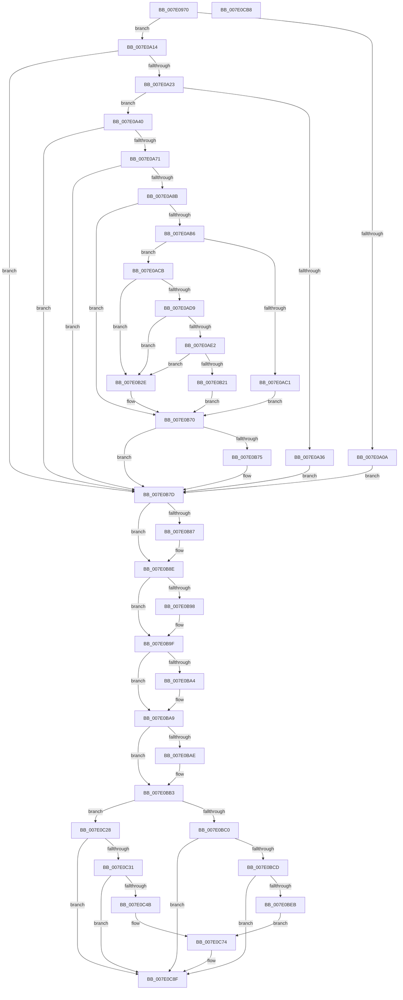

# NtReplaceKey

- RVA: `0x007E0970`–`0x007E0CB9` (길이 `841` bytes)
- VA: `0x00000001407E0970`
- 실행 섹션: `PAGE`
- PDB 이름 있음: `예`; PDB Function 태그: `아니요`
- unwind 정보 RVA: `0x000966BC`
- 디코드: `209`개 명령, `841/841` bytes 표시
- 미해석 바이트: `0` (있으면 어셈블리에 `.byte`로 보존)

> 이 문서는 커널 이미지의 기계어와 PDB 기호를 분석해 생성했습니다. 4번과 5번은 함수 원형과 자료형을 바이너리 사용 방식에서 추정한 C 해석이며 원본 소스 복구 결과는 아닙니다.

## 1. Dependencies

- 직접 호출 지점: **21**; 고유 호출 대상: **18**
- 직접 호출자로 확인된 함수: **0**
- RIP 상대 이미지 참조: **6**

### Outgoing calls
- `0x007E09F9` → [CmpInitializeThreadInfo](../../text/3F/CmpInitializeThreadInfo_function_003FBE70.md) (function, `0x003FBE70`)
- `0x007E09FE` → [CmpAcquireHiveLoadUnloadRundown](../../pagecmrc/BC/CmpAcquireHiveLoadUnloadRundown_function_00BC9C6C.md) (function, `0x00BC9C6C`)
- `0x007E0A14` → [CmCheckNoTxContext](../87/CmCheckNoTxContext_function_00876A80.md) (function, `0x00876A80`)
- `0x007E0A2D` → [SeSinglePrivilegeCheck](../87/SeSinglePrivilegeCheck_function_00871E20.md) (function, `0x00871E20`)
- `0x007E0A5F` → [CmpNameFromAttributes](../87/CmpNameFromAttributes_function_00876AC8.md) (function, `0x00876AC8`)
- `0x007E0A7C` → [CmpNameFromAttributes](../87/CmpNameFromAttributes_function_00876AC8.md) (function, `0x00876AC8`)
- `0x007E0AA2` → [CmObReferenceObjectByHandle](../../pagecmrc/BC/CmObReferenceObjectByHandle_function_00BC9350.md) (function, `0x00BC9350`)
- `0x007E0AD9` → [CmpIsRegistryLockAcquired](../../text/45/CmpIsRegistryLockAcquired_function_00456A7C.md) (function, `0x00456A7C`)
- `0x007E0B18` → [CmpCallCallBacksEx](../86/CmpCallCallBacksEx_function_00865F40.md) (function, `0x00865F40`)
- `0x007E0B40` → [CmReplaceKey](CmReplaceKey_function_007EA1C8.md) (function, `0x007EA1C8`)
- `0x007E0B60` → [CmPostCallbackNotificationEx](../86/CmPostCallbackNotificationEx_function_00865E50.md) (function, `0x00865E50`)
- `0x007E0B78` → [ObfDereferenceObject](../../text/2F/ObfDereferenceObject_function_002F9350.md) (function, `0x002F9350`)
- `0x007E0B89` → [ExFreePoolWithTag](../../poolcode/B8/ExFreePoolWithTag_function_00B82870.md) (function, `0x00B82870`)
- `0x007E0B9A` → [ExFreePoolWithTag](../../poolcode/B8/ExFreePoolWithTag_function_00B82870.md) (function, `0x00B82870`)
- `0x007E0BA4` → [KeLeaveCriticalRegion](../../text/25/KeLeaveCriticalRegion_function_0025D8B0.md) (function, `0x0025D8B0`)
- `0x007E0BAE` → [CmpReleaseHiveLoadUnloadRundown](../../pagecmrc/BC/CmpReleaseHiveLoadUnloadRundown_function_00BC9CAC.md) (function, `0x00BC9CAC`)
- `0x007E0BB7` → [CmCleanupThreadInfo](../../text/41/CmCleanupThreadInfo_function_0041FD50.md) (function, `0x0041FD50`)
- `0x007E0BDE` → [tlgKeywordOn](../../text/42/tlgKeywordOn_function_0042EAA0.md) (function, `0x0042EAA0`)
- `0x007E0C42` → [tlgKeywordOn](../../text/42/tlgKeywordOn_function_0042EAA0.md) (function, `0x0042EAA0`)
- `0x007E0C8A` → [tlgWriteTransfer_EtwWriteTransfer](../../text/42/tlgWriteTransfer_EtwWriteTransfer_function_004260E0.md) (function, `0x004260E0`)
- `0x007E0C98` → [_security_check_cookie](../../text/6A/_security_check_cookie_function_006AC640.md) (function, `0x006AC640`)

### Direct callers
- 이 함수 시작 RVA로 연결되는 직접 call은 확인되지 않았습니다. 간접 호출은 완전히 역산할 수 없습니다.

### Static image references
- `0x007E098C` → RVA `0x00E0A740` (`.data`; read)
- `0x007E0A23` → RVA `0x00FD9AE0` (`PAGEDATA`; read)
- `0x007E0ACB` → RVA `0x00EEFB88` (`.data`; read)
- `0x007E0BC0` → RVA `0x00E09F58` (`.data`; read)
- `0x007E0BF8` → RVA `0x00055FC6` (`.rdata`; read)
- `0x007E0C5C` → RVA `0x00056002` (`.rdata`; read)

## 2. Other-region calls and transfers

- 다른 실행 섹션으로 향하는 call: **14**
  - `0x007E09F9` → [CmpInitializeThreadInfo](../../text/3F/CmpInitializeThreadInfo_function_003FBE70.md) (`PAGE` → `.text`)
  - `0x007E09FE` → [CmpAcquireHiveLoadUnloadRundown](../../pagecmrc/BC/CmpAcquireHiveLoadUnloadRundown_function_00BC9C6C.md) (`PAGE` → `PAGECMRC`)
  - `0x007E0AA2` → [CmObReferenceObjectByHandle](../../pagecmrc/BC/CmObReferenceObjectByHandle_function_00BC9350.md) (`PAGE` → `PAGECMRC`)
  - `0x007E0AD9` → [CmpIsRegistryLockAcquired](../../text/45/CmpIsRegistryLockAcquired_function_00456A7C.md) (`PAGE` → `.text`)
  - `0x007E0B78` → [ObfDereferenceObject](../../text/2F/ObfDereferenceObject_function_002F9350.md) (`PAGE` → `.text`)
  - `0x007E0B89` → [ExFreePoolWithTag](../../poolcode/B8/ExFreePoolWithTag_function_00B82870.md) (`PAGE` → `POOLCODE`)
  - `0x007E0B9A` → [ExFreePoolWithTag](../../poolcode/B8/ExFreePoolWithTag_function_00B82870.md) (`PAGE` → `POOLCODE`)
  - `0x007E0BA4` → [KeLeaveCriticalRegion](../../text/25/KeLeaveCriticalRegion_function_0025D8B0.md) (`PAGE` → `.text`)
  - `0x007E0BAE` → [CmpReleaseHiveLoadUnloadRundown](../../pagecmrc/BC/CmpReleaseHiveLoadUnloadRundown_function_00BC9CAC.md) (`PAGE` → `PAGECMRC`)
  - `0x007E0BB7` → [CmCleanupThreadInfo](../../text/41/CmCleanupThreadInfo_function_0041FD50.md) (`PAGE` → `.text`)
  - `0x007E0BDE` → [tlgKeywordOn](../../text/42/tlgKeywordOn_function_0042EAA0.md) (`PAGE` → `.text`)
  - `0x007E0C42` → [tlgKeywordOn](../../text/42/tlgKeywordOn_function_0042EAA0.md) (`PAGE` → `.text`)
  - `0x007E0C8A` → [tlgWriteTransfer_EtwWriteTransfer](../../text/42/tlgWriteTransfer_EtwWriteTransfer_function_004260E0.md) (`PAGE` → `.text`)
  - `0x007E0C98` → [_security_check_cookie](../../text/6A/_security_check_cookie_function_006AC640.md) (`PAGE` → `.text`)
- 별도 외부 분기/꼬리 이동을 확인하지 못했습니다.

## 3. Assembly (complete function range)

```asm
007E0970  48 89 5C 24 20                  mov qword ptr [rsp + 0x20], rbx
007E0975  55                              push rbp
007E0976  56                              push rsi
007E0977  57                              push rdi
007E0978  41 54                           push r12
007E097A  41 55                           push r13
007E097C  41 56                           push r14
007E097E  41 57                           push r15
007E0980  48 8D 6C 24 E0                  lea rbp, [rsp - 0x20]
007E0985  48 81 EC 20 01 00 00            sub rsp, 0x120
007E098C  48 8B 05 AD 9D 62 00            mov rax, qword ptr [rip + 0x629dad]
007E0993  48 33 C4                        xor rax, rsp
007E0996  48 89 45 10                     mov qword ptr [rbp + 0x10], rax
007E099A  0F 57 C0                        xorps xmm0, xmm0
007E099D  33 C0                           xor eax, eax
007E099F  48 21 44 24 40                  and qword ptr [rsp + 0x40], rax
007E09A4  0F 57 C9                        xorps xmm1, xmm1
007E09A7  48 89 45 90                     mov qword ptr [rbp - 0x70], rax
007E09AB  4C 8B F9                        mov r15, rcx
007E09AE  0F 11 45 80                     movups xmmword ptr [rbp - 0x80], xmm0
007E09B2  65 48 8B 04 25 88 01 00 00      mov rax, qword ptr gs:[0x188]
007E09BB  48 8D 4D 80                     lea rcx, [rbp - 0x80]
007E09BF  4D 8B F0                        mov r14, r8
007E09C2  4C 8B E2                        mov r12, rdx
007E09C5  40 32 F6                        xor sil, sil
007E09C8  40 8A B8 32 02 00 00            mov dil, byte ptr [rax + 0x232]
007E09CF  48 8D 44 24 50                  lea rax, [rsp + 0x50]
007E09D4  48 89 44 24 58                  mov qword ptr [rsp + 0x58], rax
007E09D9  48 8D 44 24 50                  lea rax, [rsp + 0x50]
007E09DE  48 89 44 24 50                  mov qword ptr [rsp + 0x50], rax
007E09E3  0F 11 44 24 70                  movups xmmword ptr [rsp + 0x70], xmm0
007E09E8  0F 11 4C 24 60                  movups xmmword ptr [rsp + 0x60], xmm1
007E09ED  0F 11 45 98                     movups xmmword ptr [rbp - 0x68], xmm0
007E09F1  0F 11 45 A8                     movups xmmword ptr [rbp - 0x58], xmm0
007E09F5  0F 11 45 B8                     movups xmmword ptr [rbp - 0x48], xmm0
007E09F9  E8 72 B4 C1 FF                  call 0x1403fbe70
007E09FE  E8 69 92 3E 00                  call 0x140bc9c6c
007E0A03  44 8A E8                        mov r13b, al
007E0A06  84 C0                           test al, al
007E0A08  75 0A                           jne 0x1407e0a14
007E0A0A  BB 89 01 00 C0                  mov ebx, 0xc0000189
007E0A0F  E9 69 01 00 00                  jmp 0x1407e0b7d
007E0A14  E8 67 60 09 00                  call 0x140876a80
007E0A19  8B D8                           mov ebx, eax
007E0A1B  85 C0                           test eax, eax
007E0A1D  0F 88 5A 01 00 00               js 0x1407e0b7d
007E0A23  48 8B 0D B6 90 7F 00            mov rcx, qword ptr [rip + 0x7f90b6]
007E0A2A  40 8A D7                        mov dl, dil
007E0A2D  E8 EE 13 09 00                  call 0x140871e20
007E0A32  84 C0                           test al, al
007E0A34  75 0A                           jne 0x1407e0a40
007E0A36  BB 61 00 00 C0                  mov ebx, 0xc0000061
007E0A3B  E9 3D 01 00 00                  jmp 0x1407e0b7d
007E0A40  65 48 8B 04 25 88 01 00 00      mov rax, qword ptr gs:[0x188]
007E0A49  4C 8D 44 24 70                  lea r8, [rsp + 0x70]
007E0A4E  40 8A D7                        mov dl, dil
007E0A51  49 8B CF                        mov rcx, r15
007E0A54  40 B6 01                        mov sil, 1
007E0A57  66 FF 88 E4 01 00 00            dec word ptr [rax + 0x1e4]
007E0A5E  90                              nop
007E0A5F  E8 64 60 09 00                  call 0x140876ac8
007E0A64  45 33 FF                        xor r15d, r15d
007E0A67  8B D8                           mov ebx, eax
007E0A69  85 C0                           test eax, eax
007E0A6B  0F 88 0C 01 00 00               js 0x1407e0b7d
007E0A71  4C 8D 44 24 60                  lea r8, [rsp + 0x60]
007E0A76  40 8A D7                        mov dl, dil
007E0A79  49 8B CE                        mov rcx, r14
007E0A7C  E8 47 60 09 00                  call 0x140876ac8
007E0A81  8B D8                           mov ebx, eax
007E0A83  85 C0                           test eax, eax
007E0A85  0F 88 F2 00 00 00               js 0x1407e0b7d
007E0A8B  48 8D 44 24 40                  lea rax, [rsp + 0x40]
007E0A90  4C 89 7C 24 28                  mov qword ptr [rsp + 0x28], r15
007E0A95  44 8A CF                        mov r9b, dil
007E0A98  48 89 44 24 20                  mov qword ptr [rsp + 0x20], rax
007E0A9D  33 D2                           xor edx, edx
007E0A9F  49 8B CC                        mov rcx, r12
007E0AA2  E8 A9 88 3E 00                  call 0x140bc9350
007E0AA7  48 8B 7C 24 40                  mov rdi, qword ptr [rsp + 0x40]
007E0AAC  8B D8                           mov ebx, eax
007E0AAE  85 C0                           test eax, eax
007E0AB0  0F 88 BA 00 00 00               js 0x1407e0b70
007E0AB6  48 8B 47 08                     mov rax, qword ptr [rdi + 8]
007E0ABA  8B 48 08                        mov ecx, dword ptr [rax + 8]
007E0ABD  84 C9                           test cl, cl
007E0ABF  79 0A                           jns 0x1407e0acb
007E0AC1  BB 22 00 00 C0                  mov ebx, 0xc0000022
007E0AC6  E9 A5 00 00 00                  jmp 0x1407e0b70
007E0ACB  44 39 3D B6 F0 70 00            cmp dword ptr [rip + 0x70f0b6], r15d
007E0AD2  BB 2E 00 00 00                  mov ebx, 0x2e
007E0AD7  74 55                           je 0x1407e0b2e
007E0AD9  E8 9E 5F C7 FF                  call 0x140456a7c
007E0ADE  85 C0                           test eax, eax
007E0AE0  75 4C                           jne 0x1407e0b2e
007E0AE2  48 8D 44 24 60                  lea rax, [rsp + 0x60]
007E0AE7  48 89 7D 98                     mov qword ptr [rbp - 0x68], rdi
007E0AEB  48 89 45 A0                     mov qword ptr [rbp - 0x60], rax
007E0AEF  48 8D 55 98                     lea rdx, [rbp - 0x68]
007E0AF3  48 8D 44 24 70                  lea rax, [rsp + 0x70]
007E0AF8  44 8A CE                        mov r9b, sil
007E0AFB  48 89 45 A8                     mov qword ptr [rbp - 0x58], rax
007E0AFF  8D 4B FF                        lea ecx, [rbx - 1]
007E0B02  48 8D 44 24 50                  lea rax, [rsp + 0x50]
007E0B07  45 33 C0                        xor r8d, r8d
007E0B0A  48 89 44 24 30                  mov qword ptr [rsp + 0x30], rax
007E0B0F  4C 89 7C 24 28                  mov qword ptr [rsp + 0x28], r15
007E0B14  89 5C 24 20                     mov dword ptr [rsp + 0x20], ebx
007E0B18  E8 23 54 08 00                  call 0x140865f40
007E0B1D  85 C0                           test eax, eax
007E0B1F  79 0D                           jns 0x1407e0b2e
007E0B21  3D 03 05 00 C0                  cmp eax, 0xc0000503
007E0B26  41 8B DF                        mov ebx, r15d
007E0B29  0F 45 D8                        cmovne ebx, eax
007E0B2C  EB 42                           jmp 0x1407e0b70
007E0B2E  48 8B 4F 08                     mov rcx, qword ptr [rdi + 8]
007E0B32  4C 8D 4C 24 60                  lea r9, [rsp + 0x60]
007E0B37  4C 8D 44 24 70                  lea r8, [rsp + 0x70]
007E0B3C  48 8B 49 20                     mov rcx, qword ptr [rcx + 0x20]
007E0B40  E8 83 96 00 00                  call 0x1407ea1c8
007E0B45  48 8D 54 24 50                  lea rdx, [rsp + 0x50]
007E0B4A  44 8B C0                        mov r8d, eax
007E0B4D  48 89 54 24 28                  mov qword ptr [rsp + 0x28], rdx
007E0B52  4C 8D 4D 98                     lea r9, [rbp - 0x68]
007E0B56  48 8B D7                        mov rdx, rdi
007E0B59  4C 89 7C 24 20                  mov qword ptr [rsp + 0x20], r15
007E0B5E  8B CB                           mov ecx, ebx
007E0B60  E8 EB 52 08 00                  call 0x140865e50
007E0B65  3D 03 05 00 C0                  cmp eax, 0xc0000503
007E0B6A  8B D8                           mov ebx, eax
007E0B6C  41 0F 44 DF                     cmove ebx, r15d
007E0B70  48 85 FF                        test rdi, rdi
007E0B73  74 08                           je 0x1407e0b7d
007E0B75  48 8B CF                        mov rcx, rdi
007E0B78  E8 D3 87 B1 FF                  call 0x1402f9350
007E0B7D  48 8B 4C 24 68                  mov rcx, qword ptr [rsp + 0x68]
007E0B82  48 85 C9                        test rcx, rcx
007E0B85  74 07                           je 0x1407e0b8e
007E0B87  33 D2                           xor edx, edx
007E0B89  E8 E2 1C 3A 00                  call 0x140b82870
007E0B8E  48 8B 4C 24 78                  mov rcx, qword ptr [rsp + 0x78]
007E0B93  48 85 C9                        test rcx, rcx
007E0B96  74 07                           je 0x1407e0b9f
007E0B98  33 D2                           xor edx, edx
007E0B9A  E8 D1 1C 3A 00                  call 0x140b82870
007E0B9F  40 84 F6                        test sil, sil
007E0BA2  74 05                           je 0x1407e0ba9
007E0BA4  E8 07 CD A7 FF                  call 0x14025d8b0
007E0BA9  45 84 ED                        test r13b, r13b
007E0BAC  74 05                           je 0x1407e0bb3
007E0BAE  E8 F9 90 3E 00                  call 0x140bc9cac
007E0BB3  48 8D 4D 80                     lea rcx, [rbp - 0x80]
007E0BB7  E8 94 F1 C3 FF                  call 0x14041fd50
007E0BBC  85 DB                           test ebx, ebx
007E0BBE  79 68                           jns 0x1407e0c28
007E0BC0  83 3D 91 93 62 00 05            cmp dword ptr [rip + 0x629391], 5
007E0BC7  0F 86 C2 00 00 00               jbe 0x1407e0c8f
007E0BCD  48 BA 00 00 00 00 00 40 00 00   movabs rdx, 0x400000000000
007E0BD7  48 8D 0D 7A 93 62 00            lea rcx, [rip + 0x62937a]
007E0BDE  E8 BD DE C4 FF                  call 0x14042eaa0
007E0BE3  84 C0                           test al, al
007E0BE5  0F 84 A4 00 00 00               je 0x1407e0c8f
007E0BEB  48 8D 44 24 40                  lea rax, [rsp + 0x40]
007E0BF0  89 5C 24 40                     mov dword ptr [rsp + 0x40], ebx
007E0BF4  48 89 45 F0                     mov qword ptr [rbp - 0x10], rax
007E0BF8  48 8D 15 C7 53 87 FF            lea rdx, [rip - 0x78ac39]
007E0BFF  48 8D 44 24 48                  lea rax, [rsp + 0x48]
007E0C04  48 C7 45 08 08 00 00 00         mov qword ptr [rbp + 8], 8
007E0C0C  B9 04 00 00 00                  mov ecx, 4
007E0C11  48 89 45 00                     mov qword ptr [rbp], rax
007E0C15  48 8D 45 D0                     lea rax, [rbp - 0x30]
007E0C19  48 89 4D F8                     mov qword ptr [rbp - 8], rcx
007E0C1D  48 89 44 24 28                  mov qword ptr [rsp + 0x28], rax
007E0C22  89 4C 24 20                     mov dword ptr [rsp + 0x20], ecx
007E0C26  EB 4C                           jmp 0x1407e0c74
007E0C28  83 3D 29 93 62 00 05            cmp dword ptr [rip + 0x629329], 5
007E0C2F  76 5E                           jbe 0x1407e0c8f
007E0C31  48 BA 00 00 00 00 00 40 00 00   movabs rdx, 0x400000000000
007E0C3B  48 8D 0D 16 93 62 00            lea rcx, [rip + 0x629316]
007E0C42  E8 59 DE C4 FF                  call 0x14042eaa0
007E0C47  84 C0                           test al, al
007E0C49  74 44                           je 0x1407e0c8f
007E0C4B  48 8D 44 24 48                  lea rax, [rsp + 0x48]
007E0C50  48 C7 45 F8 08 00 00 00         mov qword ptr [rbp - 8], 8
007E0C58  48 89 45 F0                     mov qword ptr [rbp - 0x10], rax
007E0C5C  48 8D 15 9F 53 87 FF            lea rdx, [rip - 0x78ac61]
007E0C63  48 8D 45 D0                     lea rax, [rbp - 0x30]
007E0C67  48 89 44 24 28                  mov qword ptr [rsp + 0x28], rax
007E0C6C  C7 44 24 20 03 00 00 00         mov dword ptr [rsp + 0x20], 3
007E0C74  45 33 C9                        xor r9d, r9d
007E0C77  48 C7 44 24 48 00 00 00 01      mov qword ptr [rsp + 0x48], 0x1000000
007E0C80  45 33 C0                        xor r8d, r8d
007E0C83  48 8D 0D CE 92 62 00            lea rcx, [rip + 0x6292ce]
007E0C8A  E8 51 54 C4 FF                  call 0x1404260e0
007E0C8F  8B C3                           mov eax, ebx
007E0C91  48 8B 4D 10                     mov rcx, qword ptr [rbp + 0x10]
007E0C95  48 33 CC                        xor rcx, rsp
007E0C98  E8 A3 B9 EC FF                  call 0x1406ac640
007E0C9D  48 8B 9C 24 78 01 00 00         mov rbx, qword ptr [rsp + 0x178]
007E0CA5  48 81 C4 20 01 00 00            add rsp, 0x120
007E0CAC  41 5F                           pop r15
007E0CAE  41 5E                           pop r14
007E0CB0  41 5D                           pop r13
007E0CB2  41 5C                           pop r12
007E0CB4  5F                              pop rdi
007E0CB5  5E                              pop rsi
007E0CB6  5D                              pop rbp
007E0CB7  C3                              ret
007E0CB8  CC                              int3
```

## 4. C-style interpretation (structured pseudocode)

```c
__int64 __fastcall NtReplaceKey(__int64 a1, __int64 a2, __int64 a3)
{
    __int64 result;
    __int64 v_r15;
    __int64 v_rbx;
    __int64 v_rsi;
    __int64 v_rsp;
    unsigned __int64 v_stack_m100;
    unsigned __int64 v_stack_m108;
    unsigned __int64 v_stack_m110;
    unsigned __int64 v_stack_m118;
    unsigned __int64 v_stack_m128;
    unsigned __int64 v_stack_m130;
    unsigned __int64 v_stack_m138;
    unsigned __int64 v_stack_m48;
    unsigned __int64 v_stack_m50;
    unsigned __int64 v_stack_m58;
    unsigned __int64 v_stack_m60;
    unsigned __int64 v_stack_m68;
    unsigned __int64 v_stack_m88;
    unsigned __int64 v_stack_mA0;
    unsigned __int64 v_stack_mB0;
    unsigned __int64 v_stack_mB8;
    unsigned __int64 v_stack_mC0;
    unsigned __int64 v_stack_mC8;
    unsigned __int64 v_stack_mD8;
    unsigned __int64 v_stack_mE0;
    unsigned __int64 v_stack_mE8;
    unsigned __int64 v_stack_mF0;
    unsigned __int64 v_stack_mF8;
    unsigned __int64 v_stack_p20;

    v_stack_p20 = v_rbx;
    v_rsp = (v_rsp) - (288);
    result = (*(unsigned __int64 *)(v_rip + 6462893)) ^ (v_rsp);
    v_stack_m48 = result;
    result = 0;
    v_stack_mC8 = 0;
    v_stack_mD8 = v_xmm0;
    v_rsi = 0;
    v_stack_m100 = v_stack_m108;
    v_stack_m108 = v_stack_m108;
    v_stack_mE8 = v_xmm0;
    v_stack_mF8 = v_xmm1;
    v_stack_mC0 = v_xmm0;
    v_stack_mB0 = v_xmm0;
    v_stack_mA0 = v_xmm0;
    result = CmpInitializeThreadInfo(v_stack_mD8, a2, a3, a4);
    result = CmpAcquireHiveLoadUnloadRundown(v_stack_mD8, a2, a3, a4);
    if ((unsigned __int8)(result) != 0) goto loc_007E0A14;
    goto loc_007E0B7D;
loc_007E0A14:
    result = CmCheckNoTxContext(v_stack_mD8, a2, a3, a4);
    if (sign_flag) goto loc_007E0B7D;
    result = SeSinglePrivilegeCheck(*(unsigned __int64 *)(v_rip + 8360118), (unsigned __int8)(*(unsigned __int8 *)(*(unsigned __int64 *)(gs_base + (0 + 392)) + 562)), a3, a4);
    if ((unsigned __int8)(result) != 0) goto loc_007E0A40;
    goto loc_007E0B7D;
loc_007E0A40:
    result = CmpNameFromAttributes(a1, (unsigned __int8)(*(unsigned __int8 *)(*(unsigned __int64 *)(gs_base + (0 + 392)) + 562)), v_stack_mE8, a4);
    v_r15 = 0;
    if (sign_flag) goto loc_007E0B7D;
    result = CmpNameFromAttributes(a3, (unsigned __int8)(*(unsigned __int8 *)(*(unsigned __int64 *)(gs_base + (0 + 392)) + 562)), v_stack_mF8, a4);
    if (sign_flag) goto loc_007E0B7D;
    v_stack_m130 = 0;
    v_stack_m138 = v_stack_m118;
    a2 = 0;
    result = CmObReferenceObjectByHandle(0, a2, v_stack_mF8, (unsigned __int8)(*(unsigned __int8 *)(*(unsigned __int64 *)(gs_base + (0 + 392)) + 562)));
    if (sign_flag) goto loc_007E0B70;
    if (!sign_flag) goto loc_007E0ACB;
    goto loc_007E0B70;
loc_007E0ACB:
    if ((*(unsigned int *)(v_rip + 7401654)) == 0) goto loc_007E0B2E;
    result = CmpIsRegistryLockAcquired((unsigned int)(*(unsigned int *)(*(unsigned __int64 *)(v_stack_m118 + 8) + 8)), a2, v_stack_mF8, (unsigned __int8)(*(unsigned __int8 *)(*(unsigned __int64 *)(gs_base + (0 + 392)) + 562)));
    if ((unsigned int)(result) != 0) goto loc_007E0B2E;
    v_stack_mC0 = v_stack_m118;
    v_stack_mB8 = v_stack_mF8;
    v_stack_mB0 = v_stack_mE8;
    a3 = 0;
    v_stack_m128 = v_stack_m108;
    v_stack_m130 = 0;
    v_stack_m138 = 46;
    result = CmpCallCallBacksEx(46 - 1, v_stack_mC0, a3, 1);
    if (!sign_flag) goto loc_007E0B2E;
    v_rbx = 0;
    if (((unsigned int)(result)) != 0xC0000503ULL) { v_rbx = (unsigned int)(result); }
    goto loc_007E0B70;
loc_007E0B2E:
    result = CmReplaceKey(*(unsigned __int64 *)(*(unsigned __int64 *)(v_stack_m118 + 8) + 32), v_stack_mC0, v_stack_mE8, v_stack_mF8);
    v_stack_m130 = v_stack_m108;
    v_stack_m138 = 0;
    result = CmPostCallbackNotificationEx((unsigned int)((unsigned int)(v_rbx)), v_stack_m118, (unsigned int)((unsigned int)(result)), v_stack_mC0);
    v_rbx = (unsigned int)((unsigned int)(result));
    if (((unsigned int)(result)) == 0xC0000503ULL) { v_rbx = 0; }
loc_007E0B70:
    if (v_stack_m118 != 0) {
        a1 = v_stack_m118;
        result = ObfDereferenceObject(a1, v_stack_m118, (unsigned int)((unsigned int)(result)), v_stack_mC0);
    }
    if (v_stack_mF0 != 0) {
        a2 = 0;
        result = ExFreePoolWithTag(v_stack_mF0, a2, (unsigned int)((unsigned int)(result)), v_stack_mC0);
    }
    if (v_stack_mE0 != 0) {
        a2 = 0;
        result = ExFreePoolWithTag(v_stack_mE0, a2, (unsigned int)((unsigned int)(result)), v_stack_mC0);
    }
    if (1 != 0) {
        result = KeLeaveCriticalRegion(v_stack_mE0, a2, (unsigned int)((unsigned int)(result)), v_stack_mC0);
    }
    if ((unsigned __int8)((unsigned __int8)(result)) != 0) {
        result = CmpReleaseHiveLoadUnloadRundown(v_stack_mE0, a2, (unsigned int)((unsigned int)(result)), v_stack_mC0);
    }
    result = CmCleanupThreadInfo(v_stack_mD8, a2, (unsigned int)((unsigned int)(result)), v_stack_mC0);
    if (!sign_flag) goto loc_007E0C28;
    if ((*(unsigned int *)(v_rip + 6460305)) <= 5) goto loc_007E0C8F;
    result = tlgKeywordOn(v_rip + 6460282, a2, (unsigned int)((unsigned int)(result)), v_stack_mC0);
    if ((unsigned __int8)(result) == 0) goto loc_007E0C8F;
    v_stack_m118 = (unsigned int)(v_rbx);
    v_stack_m68 = v_stack_m118;
    v_stack_m50 = 8;
    v_stack_m58 = v_stack_m110;
    v_stack_m60 = 4;
    v_stack_m130 = v_stack_m88;
    v_stack_m138 = 4;
    goto loc_007E0C74;
loc_007E0C28:
    if ((*(unsigned int *)(v_rip + 6460201)) <= 5) goto loc_007E0C8F;
    result = tlgKeywordOn(v_rip + 6460182, v_rip - 7908409, (unsigned int)((unsigned int)(result)), v_stack_mC0);
    if ((unsigned __int8)(result) == 0) goto loc_007E0C8F;
    v_stack_m60 = 8;
    v_stack_m68 = v_stack_m110;
    v_stack_m130 = v_stack_m88;
    v_stack_m138 = 3;
loc_007E0C74:
    a4 = 0;
    v_stack_m110 = 0x1000000ULL;
    a3 = 0;
    result = tlgWriteTransfer_EtwWriteTransfer(v_rip + 6460110, v_rip - 7908449, a3, a4);
loc_007E0C8F:
    a1 = (v_stack_m48) ^ (v_rsp);
    result = _security_check_cookie(a1, v_rip - 7908449, a3, a4);
    v_rsp = (v_rsp) + (288);
    return result;
}
```

## 5. (Beta) C Style

```c
int64_t NtReplaceKey(int64_t Arg1, int64_t Arg2, int64_t Arg3)
{
    int64_t result;
    int64_t local_r15;
    int64_t local_rbx;
    int64_t local_rsi;
    int64_t local_rsp;
    uint64_t v_stack_m100;
    uint64_t v_stack_m108;
    uint64_t v_stack_m110;
    uint64_t v_stack_m118;
    uint64_t v_stack_m128;
    uint64_t v_stack_m130;
    uint64_t v_stack_m138;
    uint64_t v_stack_m48;
    uint64_t v_stack_m50;
    uint64_t v_stack_m58;
    uint64_t v_stack_m60;
    uint64_t v_stack_m68;
    uint64_t v_stack_m88;
    uint64_t v_stack_mA0;
    uint64_t v_stack_mB0;
    uint64_t v_stack_mB8;
    uint64_t v_stack_mC0;
    uint64_t v_stack_mC8;
    uint64_t v_stack_mD8;
    uint64_t v_stack_mE0;
    uint64_t v_stack_mE8;
    uint64_t v_stack_mF0;
    uint64_t v_stack_mF8;
    uint64_t v_stack_p20;

    v_stack_p20 = local_rbx;
    local_rsp = (local_rsp) - (288);
    result = (*(uint64_t *)(v_rip + 0x629DAD)) ^ (local_rsp);
    v_stack_m48 = result;
    result = 0;
    v_stack_mC8 = 0;
    v_stack_mD8 = v_xmm0;
    local_rsi = 0;
    v_stack_m100 = v_stack_m108;
    v_stack_m108 = v_stack_m108;
    v_stack_mE8 = v_xmm0;
    v_stack_mF8 = v_xmm1;
    v_stack_mC0 = v_xmm0;
    v_stack_mB0 = v_xmm0;
    v_stack_mA0 = v_xmm0;
    result = CmpInitializeThreadInfo(v_stack_mD8, Arg2, Arg3, a4);
    result = CmpAcquireHiveLoadUnloadRundown(v_stack_mD8, Arg2, Arg3, a4);
    if ((uint8_t)(result) != 0) goto loc_007E0A14;
    goto loc_007E0B7D;
loc_007E0A14:
    result = CmCheckNoTxContext(v_stack_mD8, Arg2, Arg3, a4);
    if (sign_flag) goto loc_007E0B7D;
    result = SeSinglePrivilegeCheck(*(uint64_t *)(v_rip + 0x7F90B6), (uint8_t)(*(uint8_t *)(*(uint64_t *)(gs_base + (0 + 0x188)) + 0x232)), Arg3, a4);
    if ((uint8_t)(result) != 0) goto loc_007E0A40;
    goto loc_007E0B7D;
loc_007E0A40:
    result = CmpNameFromAttributes(Arg1, (uint8_t)(*(uint8_t *)(*(uint64_t *)(gs_base + (0 + 0x188)) + 0x232)), v_stack_mE8, a4);
    local_r15 = 0;
    if (sign_flag) goto loc_007E0B7D;
    result = CmpNameFromAttributes(Arg3, (uint8_t)(*(uint8_t *)(*(uint64_t *)(gs_base + (0 + 0x188)) + 0x232)), v_stack_mF8, a4);
    if (sign_flag) goto loc_007E0B7D;
    v_stack_m130 = 0;
    v_stack_m138 = v_stack_m118;
    Arg2 = 0;
    result = CmObReferenceObjectByHandle(0, Arg2, v_stack_mF8, (uint8_t)(*(uint8_t *)(*(uint64_t *)(gs_base + (0 + 0x188)) + 0x232)));
    if (sign_flag) goto loc_007E0B70;
    if (!sign_flag) goto loc_007E0ACB;
    goto loc_007E0B70;
loc_007E0ACB:
    if ((*(uint32_t *)(v_rip + 0x70F0B6)) == 0) goto loc_007E0B2E;
    result = CmpIsRegistryLockAcquired((uint32_t)(*(uint32_t *)(*(uint64_t *)(v_stack_m118 + 0x8) + 0x8)), Arg2, v_stack_mF8, (uint8_t)(*(uint8_t *)(*(uint64_t *)(gs_base + (0 + 0x188)) + 0x232)));
    if ((uint32_t)(result) != 0) goto loc_007E0B2E;
    v_stack_mC0 = v_stack_m118;
    v_stack_mB8 = v_stack_mF8;
    v_stack_mB0 = v_stack_mE8;
    Arg3 = 0;
    v_stack_m128 = v_stack_m108;
    v_stack_m130 = 0;
    v_stack_m138 = 46;
    result = CmpCallCallBacksEx(46 - 1, v_stack_mC0, Arg3, 1);
    if (!sign_flag) goto loc_007E0B2E;
    local_rbx = 0;
    if (((uint32_t)(result)) != 0xC0000503ULL) { local_rbx = (uint32_t)(result); }
    goto loc_007E0B70;
loc_007E0B2E:
    result = CmReplaceKey(*(uint64_t *)(*(uint64_t *)(v_stack_m118 + 0x8) + 0x20), v_stack_mC0, v_stack_mE8, v_stack_mF8);
    v_stack_m130 = v_stack_m108;
    v_stack_m138 = 0;
    result = CmPostCallbackNotificationEx((uint32_t)((uint32_t)(local_rbx)), v_stack_m118, (uint32_t)((uint32_t)(result)), v_stack_mC0);
    local_rbx = (uint32_t)((uint32_t)(result));
    if (((uint32_t)(result)) == 0xC0000503ULL) { local_rbx = 0; }
loc_007E0B70:
    if (v_stack_m118 != 0) {
        Arg1 = v_stack_m118;
        result = ObfDereferenceObject(Arg1, v_stack_m118, (uint32_t)((uint32_t)(result)), v_stack_mC0);
    }
    if (v_stack_mF0 != 0) {
        Arg2 = 0;
        result = ExFreePoolWithTag(v_stack_mF0, Arg2, (uint32_t)((uint32_t)(result)), v_stack_mC0);
    }
    if (v_stack_mE0 != 0) {
        Arg2 = 0;
        result = ExFreePoolWithTag(v_stack_mE0, Arg2, (uint32_t)((uint32_t)(result)), v_stack_mC0);
    }
    if (1 != 0) {
        result = KeLeaveCriticalRegion(v_stack_mE0, Arg2, (uint32_t)((uint32_t)(result)), v_stack_mC0);
    }
    if ((uint8_t)((uint8_t)(result)) != 0) {
        result = CmpReleaseHiveLoadUnloadRundown(v_stack_mE0, Arg2, (uint32_t)((uint32_t)(result)), v_stack_mC0);
    }
    result = CmCleanupThreadInfo(v_stack_mD8, Arg2, (uint32_t)((uint32_t)(result)), v_stack_mC0);
    if (!sign_flag) goto loc_007E0C28;
    if ((*(uint32_t *)(v_rip + 0x629391)) <= 5) goto loc_007E0C8F;
    result = tlgKeywordOn(v_rip + 6460282, Arg2, (uint32_t)((uint32_t)(result)), v_stack_mC0);
    if ((uint8_t)(result) == 0) goto loc_007E0C8F;
    v_stack_m118 = (uint32_t)(local_rbx);
    v_stack_m68 = v_stack_m118;
    v_stack_m50 = 8;
    v_stack_m58 = v_stack_m110;
    v_stack_m60 = 4;
    v_stack_m130 = v_stack_m88;
    v_stack_m138 = 4;
    goto loc_007E0C74;
loc_007E0C28:
    if ((*(uint32_t *)(v_rip + 0x629329)) <= 5) goto loc_007E0C8F;
    result = tlgKeywordOn(v_rip + 6460182, v_rip - 7908409, (uint32_t)((uint32_t)(result)), v_stack_mC0);
    if ((uint8_t)(result) == 0) goto loc_007E0C8F;
    v_stack_m60 = 8;
    v_stack_m68 = v_stack_m110;
    v_stack_m130 = v_stack_m88;
    v_stack_m138 = 3;
loc_007E0C74:
    a4 = 0;
    v_stack_m110 = 0x1000000ULL;
    Arg3 = 0;
    result = tlgWriteTransfer_EtwWriteTransfer(v_rip + 6460110, v_rip - 7908449, Arg3, a4);
loc_007E0C8F:
    Arg1 = (v_stack_m48) ^ (local_rsp);
    result = _security_check_cookie(Arg1, v_rip - 7908449, Arg3, a4);
    local_rsp = (local_rsp) + (288);
    return result;
}
```

## 6. Execution-region graph

[열기: 2D/3D 그래프와 함수 탐색 컨트롤 패널](../../../control-panel.html?section=page&rva=0x007E0970&view=graph)

- 2D 그래프는 위에서 아래로 흐르고, 3D 그래프는 빈 공간을 드래그해 회전합니다. Shift+드래그는 이동, 휠은 확대·축소, 함수 노드 선택은 대상 보고서 이동입니다.

### Static fallback


