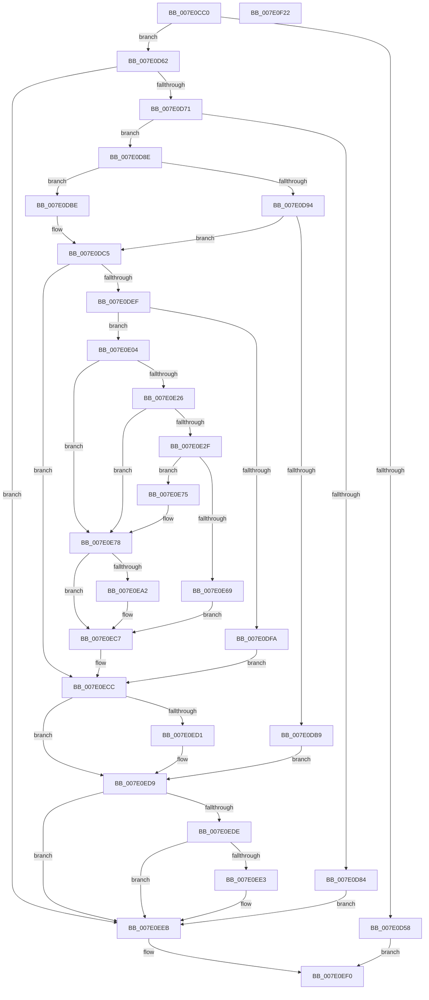

# NtRestoreKey

- RVA: `0x007E0CC0`–`0x007E0F23` (길이 `611` bytes)
- VA: `0x00000001407E0CC0`
- 실행 섹션: `PAGE`
- PDB 이름 있음: `예`; PDB Function 태그: `아니요`
- unwind 정보 RVA: `0x000D66A0`
- 디코드: `166`개 명령, `611/611` bytes 표시
- 미해석 바이트: `0` (있으면 어셈블리에 `.byte`로 보존)

> 이 문서는 커널 이미지의 기계어와 PDB 기호를 분석해 생성했습니다. 4번과 5번은 함수 원형과 자료형을 바이너리 사용 방식에서 추정한 C 해석이며 원본 소스 복구 결과는 아닙니다.

## 1. Dependencies

- 직접 호출 지점: **18**; 고유 호출 대상: **18**
- 직접 호출자로 확인된 함수: **0**
- RIP 상대 이미지 참조: **3**

### Outgoing calls
- `0x007E0D3A` → [CmpInitializeThreadInfo](../../text/3F/CmpInitializeThreadInfo_function_003FBE70.md) (function, `0x003FBE70`)
- `0x007E0D4F` → [CmpAcquireShutdownRundown](../../pagecmrc/BC/CmpAcquireShutdownRundown_function_00BC9400.md) (function, `0x00BC9400`)
- `0x007E0D62` → [CmCheckNoTxContext](../87/CmCheckNoTxContext_function_00876A80.md) (function, `0x00876A80`)
- `0x007E0D7B` → [SeSinglePrivilegeCheck](../87/SeSinglePrivilegeCheck_function_00871E20.md) (function, `0x00871E20`)
- `0x007E0DAA` → [IoConvertFileHandleToKernelHandle](../A8/IoConvertFileHandleToKernelHandle_function_00A85680.md) (function, `0x00A85680`)
- `0x007E0DDC` → [CmObReferenceObjectByHandle](../../pagecmrc/BC/CmObReferenceObjectByHandle_function_00BC9350.md) (function, `0x00BC9350`)
- `0x007E0E26` → [CmpIsRegistryLockAcquired](../../text/45/CmpIsRegistryLockAcquired_function_00456A7C.md) (function, `0x00456A7C`)
- `0x007E0E60` → [CmpCallCallBacksEx](../86/CmpCallCallBacksEx_function_00865F40.md) (function, `0x00865F40`)
- `0x007E0E7C` → [CmpAttachToRegistryProcess](../../pagecmrc/BC/CmpAttachToRegistryProcess_function_00BC98E0.md) (function, `0x00BC98E0`)
- `0x007E0E8D` → [CmRestoreKey](../7D/CmRestoreKey_function_007DCF04.md) (function, `0x007DCF04`)
- `0x007E0E98` → [CmpDetachFromRegistryProcess](../../pagecmrc/BC/CmpDetachFromRegistryProcess_function_00BC9920.md) (function, `0x00BC9920`)
- `0x007E0EC0` → [CmPostCallbackNotificationEx](../86/CmPostCallbackNotificationEx_function_00865E50.md) (function, `0x00865E50`)
- `0x007E0EC7` → [KeLeaveCriticalRegion](../../text/25/KeLeaveCriticalRegion_function_0025D8B0.md) (function, `0x0025D8B0`)
- `0x007E0ED4` → [ObfDereferenceObject](../../text/2F/ObfDereferenceObject_function_002F9350.md) (function, `0x002F9350`)
- `0x007E0EE6` → [ZwClose](../../text/6A/ZwClose_function_006AD2B0.md) (function, `0x006AD2B0`)
- `0x007E0EEB` → [CmpReleaseShutdownRundown](../../pagecmrc/BC/CmpReleaseShutdownRundown_function_00BC9880.md) (function, `0x00BC9880`)
- `0x007E0EF4` → [CmCleanupThreadInfo](../../text/41/CmCleanupThreadInfo_function_0041FD50.md) (function, `0x0041FD50`)
- `0x007E0F02` → [_security_check_cookie](../../text/6A/_security_check_cookie_function_006AC640.md) (function, `0x006AC640`)

### Direct callers
- 이 함수 시작 RVA로 연결되는 직접 call은 확인되지 않았습니다. 간접 호출은 완전히 역산할 수 없습니다.

### Static image references
- `0x007E0CDC` → RVA `0x00E0A740` (`.data`; read)
- `0x007E0D71` → RVA `0x00FD9AE0` (`PAGEDATA`; read)
- `0x007E0E1D` → RVA `0x00EEFB88` (`.data`; read)

## 2. Other-region calls and transfers

- 다른 실행 섹션으로 향하는 call: **12**
  - `0x007E0D3A` → [CmpInitializeThreadInfo](../../text/3F/CmpInitializeThreadInfo_function_003FBE70.md) (`PAGE` → `.text`)
  - `0x007E0D4F` → [CmpAcquireShutdownRundown](../../pagecmrc/BC/CmpAcquireShutdownRundown_function_00BC9400.md) (`PAGE` → `PAGECMRC`)
  - `0x007E0DDC` → [CmObReferenceObjectByHandle](../../pagecmrc/BC/CmObReferenceObjectByHandle_function_00BC9350.md) (`PAGE` → `PAGECMRC`)
  - `0x007E0E26` → [CmpIsRegistryLockAcquired](../../text/45/CmpIsRegistryLockAcquired_function_00456A7C.md) (`PAGE` → `.text`)
  - `0x007E0E7C` → [CmpAttachToRegistryProcess](../../pagecmrc/BC/CmpAttachToRegistryProcess_function_00BC98E0.md) (`PAGE` → `PAGECMRC`)
  - `0x007E0E98` → [CmpDetachFromRegistryProcess](../../pagecmrc/BC/CmpDetachFromRegistryProcess_function_00BC9920.md) (`PAGE` → `PAGECMRC`)
  - `0x007E0EC7` → [KeLeaveCriticalRegion](../../text/25/KeLeaveCriticalRegion_function_0025D8B0.md) (`PAGE` → `.text`)
  - `0x007E0ED4` → [ObfDereferenceObject](../../text/2F/ObfDereferenceObject_function_002F9350.md) (`PAGE` → `.text`)
  - `0x007E0EE6` → [ZwClose](../../text/6A/ZwClose_function_006AD2B0.md) (`PAGE` → `.text`)
  - `0x007E0EEB` → [CmpReleaseShutdownRundown](../../pagecmrc/BC/CmpReleaseShutdownRundown_function_00BC9880.md) (`PAGE` → `PAGECMRC`)
  - `0x007E0EF4` → [CmCleanupThreadInfo](../../text/41/CmCleanupThreadInfo_function_0041FD50.md) (`PAGE` → `.text`)
  - `0x007E0F02` → [_security_check_cookie](../../text/6A/_security_check_cookie_function_006AC640.md) (`PAGE` → `.text`)
- 별도 외부 분기/꼬리 이동을 확인하지 못했습니다.

## 3. Assembly (complete function range)

```asm
007E0CC0  48 89 5C 24 20                  mov qword ptr [rsp + 0x20], rbx
007E0CC5  55                              push rbp
007E0CC6  56                              push rsi
007E0CC7  57                              push rdi
007E0CC8  41 54                           push r12
007E0CCA  41 55                           push r13
007E0CCC  41 56                           push r14
007E0CCE  41 57                           push r15
007E0CD0  48 8D 6C 24 D9                  lea rbp, [rsp - 0x27]
007E0CD5  48 81 EC E0 00 00 00            sub rsp, 0xe0
007E0CDC  48 8B 05 5D 9A 62 00            mov rax, qword ptr [rip + 0x629a5d]
007E0CE3  48 33 C4                        xor rax, rsp
007E0CE6  48 89 45 1F                     mov qword ptr [rbp + 0x1f], rax
007E0CEA  33 C0                           xor eax, eax
007E0CEC  0F 57 C0                        xorps xmm0, xmm0
007E0CEF  48 21 45 8F                     and qword ptr [rbp - 0x71], rax
007E0CF3  0F 57 C9                        xorps xmm1, xmm1
007E0CF6  48 21 45 87                     and qword ptr [rbp - 0x79], rax
007E0CFA  48 8B F1                        mov rsi, rcx
007E0CFD  48 89 45 B7                     mov qword ptr [rbp - 0x49], rax
007E0D01  48 8D 4D A7                     lea rcx, [rbp - 0x59]
007E0D05  48 8D 45 97                     lea rax, [rbp - 0x69]
007E0D09  45 8B E8                        mov r13d, r8d
007E0D0C  48 89 45 9F                     mov qword ptr [rbp - 0x61], rax
007E0D10  4C 8B FA                        mov r15, rdx
007E0D13  48 8D 45 97                     lea rax, [rbp - 0x69]
007E0D17  45 32 E4                        xor r12b, r12b
007E0D1A  48 89 45 97                     mov qword ptr [rbp - 0x69], rax
007E0D1E  0F 11 45 A7                     movups xmmword ptr [rbp - 0x59], xmm0
007E0D22  0F 11 4D BF                     movups xmmword ptr [rbp - 0x41], xmm1
007E0D26  0F 11 4D CF                     movups xmmword ptr [rbp - 0x31], xmm1
007E0D2A  0F 11 4D DF                     movups xmmword ptr [rbp - 0x21], xmm1
007E0D2E  0F 11 45 EF                     movups xmmword ptr [rbp - 0x11], xmm0
007E0D32  0F 11 45 FF                     movups xmmword ptr [rbp - 1], xmm0
007E0D36  0F 11 45 0F                     movups xmmword ptr [rbp + 0xf], xmm0
007E0D3A  E8 31 B1 C1 FF                  call 0x1403fbe70
007E0D3F  65 48 8B 0C 25 88 01 00 00      mov rcx, qword ptr gs:[0x188]
007E0D48  44 8A B1 32 02 00 00            mov r14b, byte ptr [rcx + 0x232]
007E0D4F  E8 AC 86 3E 00                  call 0x140bc9400
007E0D54  84 C0                           test al, al
007E0D56  75 0A                           jne 0x1407e0d62
007E0D58  BB 89 01 00 C0                  mov ebx, 0xc0000189
007E0D5D  E9 8E 01 00 00                  jmp 0x1407e0ef0
007E0D62  E8 19 5D 09 00                  call 0x140876a80
007E0D67  8B D8                           mov ebx, eax
007E0D69  85 C0                           test eax, eax
007E0D6B  0F 88 7A 01 00 00               js 0x1407e0eeb
007E0D71  48 8B 0D 68 8D 7F 00            mov rcx, qword ptr [rip + 0x7f8d68]
007E0D78  41 8A D6                        mov dl, r14b
007E0D7B  E8 A0 10 09 00                  call 0x140871e20
007E0D80  84 C0                           test al, al
007E0D82  75 0A                           jne 0x1407e0d8e
007E0D84  BB 61 00 00 C0                  mov ebx, 0xc0000061
007E0D89  E9 5D 01 00 00                  jmp 0x1407e0eeb
007E0D8E  41 80 FE 01                     cmp r14b, 1
007E0D92  75 2A                           jne 0x1407e0dbe
007E0D94  45 33 C9                        xor r9d, r9d
007E0D97  48 8D 45 87                     lea rax, [rbp - 0x79]
007E0D9B  49 8B CF                        mov rcx, r15
007E0D9E  48 89 44 24 20                  mov qword ptr [rsp + 0x20], rax
007E0DA3  45 8D 41 01                     lea r8d, [r9 + 1]
007E0DA7  41 8A D0                        mov dl, r8b
007E0DAA  E8 D1 48 2A 00                  call 0x140a85680
007E0DAF  48 8B 7D 87                     mov rdi, qword ptr [rbp - 0x79]
007E0DB3  8B D8                           mov ebx, eax
007E0DB5  85 C0                           test eax, eax
007E0DB7  79 0C                           jns 0x1407e0dc5
007E0DB9  E9 1B 01 00 00                  jmp 0x1407e0ed9
007E0DBE  49 8B FF                        mov rdi, r15
007E0DC1  4C 89 7D 87                     mov qword ptr [rbp - 0x79], r15
007E0DC5  48 83 64 24 28 00               and qword ptr [rsp + 0x28], 0
007E0DCB  48 8D 45 8F                     lea rax, [rbp - 0x71]
007E0DCF  45 8A CE                        mov r9b, r14b
007E0DD2  48 89 44 24 20                  mov qword ptr [rsp + 0x20], rax
007E0DD7  33 D2                           xor edx, edx
007E0DD9  48 8B CE                        mov rcx, rsi
007E0DDC  E8 6F 85 3E 00                  call 0x140bc9350
007E0DE1  48 8B 75 8F                     mov rsi, qword ptr [rbp - 0x71]
007E0DE5  8B D8                           mov ebx, eax
007E0DE7  85 C0                           test eax, eax
007E0DE9  0F 88 DD 00 00 00               js 0x1407e0ecc
007E0DEF  48 8B 46 08                     mov rax, qword ptr [rsi + 8]
007E0DF3  8B 48 08                        mov ecx, dword ptr [rax + 8]
007E0DF6  84 C9                           test cl, cl
007E0DF8  79 0A                           jns 0x1407e0e04
007E0DFA  BB 22 00 00 C0                  mov ebx, 0xc0000022
007E0DFF  E9 C8 00 00 00                  jmp 0x1407e0ecc
007E0E04  65 48 8B 04 25 88 01 00 00      mov rax, qword ptr gs:[0x188]
007E0E0D  48 8B 75 8F                     mov rsi, qword ptr [rbp - 0x71]
007E0E11  48 8B 7D 87                     mov rdi, qword ptr [rbp - 0x79]
007E0E15  66 FF 88 E4 01 00 00            dec word ptr [rax + 0x1e4]
007E0E1C  90                              nop
007E0E1D  83 3D 64 ED 70 00 00            cmp dword ptr [rip + 0x70ed64], 0
007E0E24  74 52                           je 0x1407e0e78
007E0E26  E8 51 5C C7 FF                  call 0x140456a7c
007E0E2B  85 C0                           test eax, eax
007E0E2D  75 49                           jne 0x1407e0e78
007E0E2F  45 33 C0                        xor r8d, r8d
007E0E32  48 89 75 BF                     mov qword ptr [rbp - 0x41], rsi
007E0E36  48 8D 45 97                     lea rax, [rbp - 0x69]
007E0E3A  48 89 7D C7                     mov qword ptr [rbp - 0x39], rdi
007E0E3E  48 89 44 24 30                  mov qword ptr [rsp + 0x30], rax
007E0E43  48 8D 55 BF                     lea rdx, [rbp - 0x41]
007E0E47  48 83 64 24 28 00               and qword ptr [rsp + 0x28], 0
007E0E4D  41 B1 01                        mov r9b, 1
007E0E50  41 8D 48 29                     lea ecx, [r8 + 0x29]
007E0E54  44 89 6D CF                     mov dword ptr [rbp - 0x31], r13d
007E0E58  C7 44 24 20 2A 00 00 00         mov dword ptr [rsp + 0x20], 0x2a
007E0E60  E8 DB 50 08 00                  call 0x140865f40
007E0E65  85 C0                           test eax, eax
007E0E67  79 0C                           jns 0x1407e0e75
007E0E69  33 DB                           xor ebx, ebx
007E0E6B  3D 03 05 00 C0                  cmp eax, 0xc0000503
007E0E70  0F 45 D8                        cmovne ebx, eax
007E0E73  EB 52                           jmp 0x1407e0ec7
007E0E75  41 B4 01                        mov r12b, 1
007E0E78  48 8D 4D EF                     lea rcx, [rbp - 0x11]
007E0E7C  E8 5F 8A 3E 00                  call 0x140bc98e0
007E0E81  45 8A CE                        mov r9b, r14b
007E0E84  45 8B C5                        mov r8d, r13d
007E0E87  48 8B D7                        mov rdx, rdi
007E0E8A  48 8B CE                        mov rcx, rsi
007E0E8D  E8 72 C0 FF FF                  call 0x1407dcf04
007E0E92  48 8D 4D EF                     lea rcx, [rbp - 0x11]
007E0E96  8B D8                           mov ebx, eax
007E0E98  E8 83 8A 3E 00                  call 0x140bc9920
007E0E9D  45 84 E4                        test r12b, r12b
007E0EA0  74 25                           je 0x1407e0ec7
007E0EA2  48 8D 45 97                     lea rax, [rbp - 0x69]
007E0EA6  44 8B C3                        mov r8d, ebx
007E0EA9  48 89 44 24 28                  mov qword ptr [rsp + 0x28], rax
007E0EAE  4C 8D 4D BF                     lea r9, [rbp - 0x41]
007E0EB2  48 83 64 24 20 00               and qword ptr [rsp + 0x20], 0
007E0EB8  48 8B D6                        mov rdx, rsi
007E0EBB  B9 2A 00 00 00                  mov ecx, 0x2a
007E0EC0  E8 8B 4F 08 00                  call 0x140865e50
007E0EC5  8B D8                           mov ebx, eax
007E0EC7  E8 E4 C9 A7 FF                  call 0x14025d8b0
007E0ECC  48 85 F6                        test rsi, rsi
007E0ECF  74 08                           je 0x1407e0ed9
007E0ED1  48 8B CE                        mov rcx, rsi
007E0ED4  E8 77 84 B1 FF                  call 0x1402f9350
007E0ED9  48 85 FF                        test rdi, rdi
007E0EDC  74 0D                           je 0x1407e0eeb
007E0EDE  49 3B FF                        cmp rdi, r15
007E0EE1  74 08                           je 0x1407e0eeb
007E0EE3  48 8B CF                        mov rcx, rdi
007E0EE6  E8 C5 C3 EC FF                  call 0x1406ad2b0
007E0EEB  E8 90 89 3E 00                  call 0x140bc9880
007E0EF0  48 8D 4D A7                     lea rcx, [rbp - 0x59]
007E0EF4  E8 57 EE C3 FF                  call 0x14041fd50
007E0EF9  8B C3                           mov eax, ebx
007E0EFB  48 8B 4D 1F                     mov rcx, qword ptr [rbp + 0x1f]
007E0EFF  48 33 CC                        xor rcx, rsp
007E0F02  E8 39 B7 EC FF                  call 0x1406ac640
007E0F07  48 8B 9C 24 38 01 00 00         mov rbx, qword ptr [rsp + 0x138]
007E0F0F  48 81 C4 E0 00 00 00            add rsp, 0xe0
007E0F16  41 5F                           pop r15
007E0F18  41 5E                           pop r14
007E0F1A  41 5D                           pop r13
007E0F1C  41 5C                           pop r12
007E0F1E  5F                              pop rdi
007E0F1F  5E                              pop rsi
007E0F20  5D                              pop rbp
007E0F21  C3                              ret
007E0F22  CC                              int3
```

## 4. C-style interpretation (structured pseudocode)

```c
__int64 __fastcall NtRestoreKey(__int64 a1, __int64 a2, int a3, int a4)
{
    __int64 result;
    __int64 v_r12;
    __int64 v_rbx;
    __int64 v_rsp;
    unsigned __int64 v_stack_m40;
    unsigned __int64 v_stack_m50;
    unsigned __int64 v_stack_m5F;
    unsigned __int64 v_stack_m60;
    unsigned __int64 v_stack_m70;
    unsigned __int64 v_stack_m80;
    unsigned __int64 v_stack_m90;
    unsigned __int64 v_stack_m98;
    unsigned __int64 v_stack_mA0;
    unsigned __int64 v_stack_mA8;
    unsigned __int64 v_stack_mB8;
    unsigned __int64 v_stack_mC0;
    unsigned __int64 v_stack_mC8;
    unsigned __int64 v_stack_mD0;
    unsigned __int64 v_stack_mD8;
    unsigned __int64 v_stack_mE8;
    unsigned __int64 v_stack_mF0;
    unsigned __int64 v_stack_mF8;
    unsigned __int64 v_stack_p20;

    v_stack_p20 = v_rbx;
    v_rsp = (v_rsp) - (224);
    result = (*(unsigned __int64 *)(v_rip + 6462045)) ^ (v_rsp);
    v_stack_m40 = result;
    result = 0;
    v_stack_mA8 = 0;
    v_stack_mC0 = v_stack_mC8;
    v_r12 = 0;
    v_stack_mC8 = v_stack_mC8;
    v_stack_mB8 = v_xmm0;
    v_stack_mA0 = v_xmm1;
    v_stack_m90 = v_xmm1;
    v_stack_m80 = v_xmm1;
    v_stack_m70 = v_xmm0;
    v_stack_m60 = v_xmm0;
    v_stack_m50 = v_xmm0;
    result = CmpInitializeThreadInfo(v_stack_mB8, a2, a3, a4);
    result = CmpAcquireShutdownRundown(*(unsigned __int64 *)(gs_base + (0 + 392)), a2, a3, a4);
    if ((unsigned __int8)(result) != 0) goto loc_007E0D62;
    goto loc_007E0EF0;
loc_007E0D62:
    result = CmCheckNoTxContext(*(unsigned __int64 *)(gs_base + (0 + 392)), a2, a3, a4);
    if (sign_flag) goto loc_007E0EEB;
    result = SeSinglePrivilegeCheck(*(unsigned __int64 *)(v_rip + 8359272), (unsigned __int8)(*(unsigned __int8 *)(*(unsigned __int64 *)(gs_base + (0 + 392)) + 562)), a3, a4);
    if ((unsigned __int8)(result) != 0) goto loc_007E0D8E;
    goto loc_007E0EEB;
loc_007E0D8E:
    if (((unsigned __int8)(*(unsigned __int8 *)(*(unsigned __int64 *)(gs_base + (0 + 392)) + 562))) != 1) goto loc_007E0DBE;
    a4 = 0;
    v_stack_mF8 = v_stack_mD8;
    result = IoConvertFileHandleToKernelHandle(a2, (unsigned __int8)(a4 + 1), a4 + 1, a4);
    if (!sign_flag) goto loc_007E0DC5;
    goto loc_007E0ED9;
loc_007E0DBE:
    v_stack_mD8 = a2;
loc_007E0DC5:
    v_stack_mF8 = v_stack_mD0;
    a2 = 0;
    result = CmObReferenceObjectByHandle(a1, a2, a4 + 1, (unsigned __int8)(*(unsigned __int8 *)(*(unsigned __int64 *)(gs_base + (0 + 392)) + 562)));
    if (sign_flag) goto loc_007E0ECC;
    if (!sign_flag) goto loc_007E0E04;
    goto loc_007E0ECC;
loc_007E0E04:
    if ((*(unsigned int *)(v_rip + 7400804)) == 0) goto loc_007E0E78;
    result = CmpIsRegistryLockAcquired((unsigned int)(*(unsigned int *)(*(unsigned __int64 *)(v_stack_mD0 + 8) + 8)), a2, a4 + 1, (unsigned __int8)(*(unsigned __int8 *)(*(unsigned __int64 *)(gs_base + (0 + 392)) + 562)));
    if ((unsigned int)(result) != 0) goto loc_007E0E78;
    a3 = 0;
    v_stack_mA0 = v_stack_mD0;
    v_stack_m98 = v_stack_mD8;
    v_stack_mE8 = v_stack_mC8;
    v_stack_m90 = (unsigned int)((unsigned int)(a3));
    v_stack_mF8 = 42;
    result = CmpCallCallBacksEx(a3 + 41, v_stack_mA0, a3, 1);
    if (!sign_flag) goto loc_007E0E75;
    v_rbx = 0;
    if (((unsigned int)(result)) != 0xC0000503ULL) { v_rbx = (unsigned int)(result); }
    goto loc_007E0EC7;
loc_007E0E75:
loc_007E0E78:
    result = CmpAttachToRegistryProcess(v_stack_m70, v_stack_mA0, a3, 1);
    result = CmRestoreKey(v_stack_mD0, v_stack_mD8, (unsigned int)((unsigned int)((unsigned int)(a3))), (unsigned __int8)(*(unsigned __int8 *)(*(unsigned __int64 *)(gs_base + (0 + 392)) + 562)));
    result = CmpDetachFromRegistryProcess(v_stack_m70, v_stack_mD8, (unsigned int)((unsigned int)((unsigned int)(a3))), (unsigned __int8)(*(unsigned __int8 *)(*(unsigned __int64 *)(gs_base + (0 + 392)) + 562)));
    v_rbx = (unsigned int)((unsigned int)(result));
    if (1 != 0) {
        result = v_stack_mC8;
        a3 = (unsigned int)((unsigned int)((unsigned int)(result)));
        v_stack_mF0 = result;
        a4 = v_stack_mA0;
        a2 = v_stack_mD0;
        a1 = 42;
        result = CmPostCallbackNotificationEx(a1, a2, a3, a4);
        v_rbx = (unsigned int)(result);
    }
    result = KeLeaveCriticalRegion(a1, a2, a3, a4);
loc_007E0ECC:
    if (v_stack_mD0 != 0) {
        a1 = v_stack_mD0;
        result = ObfDereferenceObject(a1, a2, a3, a4);
    }
    if (v_stack_mD8 == 0) goto loc_007E0EEB;
    if (v_stack_mD8 != a2) {
        a1 = v_stack_mD8;
        result = ZwClose(a1, a2, a3, a4);
    }
    result = CmpReleaseShutdownRundown(a1, a2, a3, a4);
loc_007E0EF0:
    result = CmCleanupThreadInfo(v_stack_mB8, a2, a3, a4);
    a1 = (v_stack_m40) ^ (v_rsp);
    result = _security_check_cookie(a1, a2, a3, a4);
    v_rsp = (v_rsp) + (224);
    return result;
}
```

## 5. (Beta) C Style

```c
int64_t NtRestoreKey(int64_t Arg1, int64_t Arg2, int32_t Arg3, int32_t Arg4)
{
    int64_t result;
    int64_t local_r12;
    int64_t local_rbx;
    int64_t local_rsp;
    uint64_t v_stack_m40;
    uint64_t v_stack_m50;
    uint64_t v_stack_m5F;
    uint64_t v_stack_m60;
    uint64_t v_stack_m70;
    uint64_t v_stack_m80;
    uint64_t v_stack_m90;
    uint64_t v_stack_m98;
    uint64_t v_stack_mA0;
    uint64_t v_stack_mA8;
    uint64_t v_stack_mB8;
    uint64_t v_stack_mC0;
    uint64_t v_stack_mC8;
    uint64_t v_stack_mD0;
    uint64_t v_stack_mD8;
    uint64_t v_stack_mE8;
    uint64_t v_stack_mF0;
    uint64_t v_stack_mF8;
    uint64_t v_stack_p20;

    v_stack_p20 = local_rbx;
    local_rsp = (local_rsp) - (224);
    result = (*(uint64_t *)(v_rip + 0x629A5D)) ^ (local_rsp);
    v_stack_m40 = result;
    result = 0;
    v_stack_mA8 = 0;
    v_stack_mC0 = v_stack_mC8;
    local_r12 = 0;
    v_stack_mC8 = v_stack_mC8;
    v_stack_mB8 = v_xmm0;
    v_stack_mA0 = v_xmm1;
    v_stack_m90 = v_xmm1;
    v_stack_m80 = v_xmm1;
    v_stack_m70 = v_xmm0;
    v_stack_m60 = v_xmm0;
    v_stack_m50 = v_xmm0;
    result = CmpInitializeThreadInfo(v_stack_mB8, Arg2, Arg3, Arg4);
    result = CmpAcquireShutdownRundown(*(uint64_t *)(gs_base + (0 + 0x188)), Arg2, Arg3, Arg4);
    if ((uint8_t)(result) != 0) goto loc_007E0D62;
    goto loc_007E0EF0;
loc_007E0D62:
    result = CmCheckNoTxContext(*(uint64_t *)(gs_base + (0 + 0x188)), Arg2, Arg3, Arg4);
    if (sign_flag) goto loc_007E0EEB;
    result = SeSinglePrivilegeCheck(*(uint64_t *)(v_rip + 0x7F8D68), (uint8_t)(*(uint8_t *)(*(uint64_t *)(gs_base + (0 + 0x188)) + 0x232)), Arg3, Arg4);
    if ((uint8_t)(result) != 0) goto loc_007E0D8E;
    goto loc_007E0EEB;
loc_007E0D8E:
    if (((uint8_t)(*(uint8_t *)(*(uint64_t *)(gs_base + (0 + 0x188)) + 0x232))) != 1) goto loc_007E0DBE;
    Arg4 = 0;
    v_stack_mF8 = v_stack_mD8;
    result = IoConvertFileHandleToKernelHandle(Arg2, (uint8_t)(Arg4 + 1), Arg4 + 1, Arg4);
    if (!sign_flag) goto loc_007E0DC5;
    goto loc_007E0ED9;
loc_007E0DBE:
    v_stack_mD8 = Arg2;
loc_007E0DC5:
    v_stack_mF8 = v_stack_mD0;
    Arg2 = 0;
    result = CmObReferenceObjectByHandle(Arg1, Arg2, Arg4 + 1, (uint8_t)(*(uint8_t *)(*(uint64_t *)(gs_base + (0 + 0x188)) + 0x232)));
    if (sign_flag) goto loc_007E0ECC;
    if (!sign_flag) goto loc_007E0E04;
    goto loc_007E0ECC;
loc_007E0E04:
    if ((*(uint32_t *)(v_rip + 0x70ED64)) == 0) goto loc_007E0E78;
    result = CmpIsRegistryLockAcquired((uint32_t)(*(uint32_t *)(*(uint64_t *)(v_stack_mD0 + 0x8) + 0x8)), Arg2, Arg4 + 1, (uint8_t)(*(uint8_t *)(*(uint64_t *)(gs_base + (0 + 0x188)) + 0x232)));
    if ((uint32_t)(result) != 0) goto loc_007E0E78;
    Arg3 = 0;
    v_stack_mA0 = v_stack_mD0;
    v_stack_m98 = v_stack_mD8;
    v_stack_mE8 = v_stack_mC8;
    v_stack_m90 = (uint32_t)((uint32_t)(Arg3));
    v_stack_mF8 = 42;
    result = CmpCallCallBacksEx(Arg3 + 41, v_stack_mA0, Arg3, 1);
    if (!sign_flag) goto loc_007E0E75;
    local_rbx = 0;
    if (((uint32_t)(result)) != 0xC0000503ULL) { local_rbx = (uint32_t)(result); }
    goto loc_007E0EC7;
loc_007E0E75:
loc_007E0E78:
    result = CmpAttachToRegistryProcess(v_stack_m70, v_stack_mA0, Arg3, 1);
    result = CmRestoreKey(v_stack_mD0, v_stack_mD8, (uint32_t)((uint32_t)((uint32_t)(Arg3))), (uint8_t)(*(uint8_t *)(*(uint64_t *)(gs_base + (0 + 0x188)) + 0x232)));
    result = CmpDetachFromRegistryProcess(v_stack_m70, v_stack_mD8, (uint32_t)((uint32_t)((uint32_t)(Arg3))), (uint8_t)(*(uint8_t *)(*(uint64_t *)(gs_base + (0 + 0x188)) + 0x232)));
    local_rbx = (uint32_t)((uint32_t)(result));
    if (1 != 0) {
        result = v_stack_mC8;
        Arg3 = (uint32_t)((uint32_t)((uint32_t)(result)));
        v_stack_mF0 = result;
        Arg4 = v_stack_mA0;
        Arg2 = v_stack_mD0;
        Arg1 = 42;
        result = CmPostCallbackNotificationEx(Arg1, Arg2, Arg3, Arg4);
        local_rbx = (uint32_t)(result);
    }
    result = KeLeaveCriticalRegion(Arg1, Arg2, Arg3, Arg4);
loc_007E0ECC:
    if (v_stack_mD0 != 0) {
        Arg1 = v_stack_mD0;
        result = ObfDereferenceObject(Arg1, Arg2, Arg3, Arg4);
    }
    if (v_stack_mD8 == 0) goto loc_007E0EEB;
    if (v_stack_mD8 != Arg2) {
        Arg1 = v_stack_mD8;
        result = ZwClose(Arg1, Arg2, Arg3, Arg4);
    }
    result = CmpReleaseShutdownRundown(Arg1, Arg2, Arg3, Arg4);
loc_007E0EF0:
    result = CmCleanupThreadInfo(v_stack_mB8, Arg2, Arg3, Arg4);
    Arg1 = (v_stack_m40) ^ (local_rsp);
    result = _security_check_cookie(Arg1, Arg2, Arg3, Arg4);
    local_rsp = (local_rsp) + (224);
    return result;
}
```

## 6. Execution-region graph

[열기: 2D/3D 그래프와 함수 탐색 컨트롤 패널](../../../control-panel.html?section=page&rva=0x007E0CC0&view=graph)

- 2D 그래프는 위에서 아래로 흐르고, 3D 그래프는 빈 공간을 드래그해 회전합니다. Shift+드래그는 이동, 휠은 확대·축소, 함수 노드 선택은 대상 보고서 이동입니다.

### Static fallback


