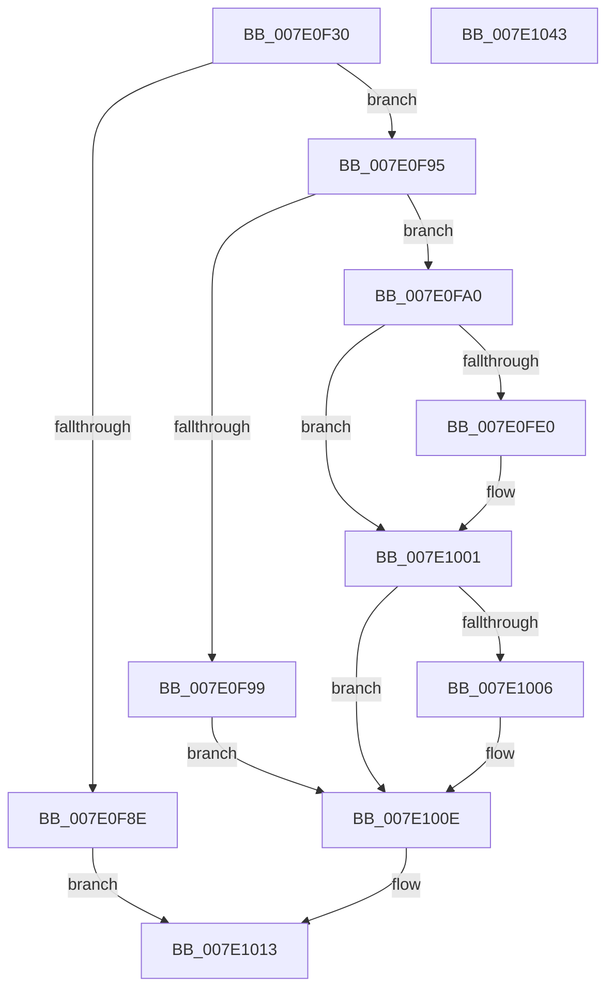

# NtRollbackRegistryTransaction

- RVA: `0x007E0F30`–`0x007E1044` (길이 `276` bytes)
- VA: `0x00000001407E0F30`
- 실행 섹션: `PAGE`
- PDB 이름 있음: `예`; PDB Function 태그: `아니요`
- unwind 정보 RVA: `0x000D67D0`
- 디코드: `74`개 명령, `276/276` bytes 표시
- 미해석 바이트: `0` (있으면 어셈블리에 `.byte`로 보존)

> 이 문서는 커널 이미지의 기계어와 PDB 기호를 분석해 생성했습니다. 4번과 5번은 함수 원형과 자료형을 바이너리 사용 방식에서 추정한 C 해석이며 원본 소스 복구 결과는 아닙니다.

## 1. Dependencies

- 직접 호출 지점: **10**; 고유 호출 대상: **10**
- 직접 호출자로 확인된 함수: **0**
- RIP 상대 이미지 참조: **2**

### Outgoing calls
- `0x007E0F7E` → [CmpInitializeThreadInfo](../../text/3F/CmpInitializeThreadInfo_function_003FBE70.md) (function, `0x003FBE70`)
- `0x007E0F83` → [CmpAcquireShutdownRundown](../../pagecmrc/BC/CmpAcquireShutdownRundown_function_00BC9400.md) (function, `0x00BC9400`)
- `0x007E0FD1` → [ObReferenceObjectByHandle](../86/ObReferenceObjectByHandle_function_00868DB0.md) (function, `0x00868DB0`)
- `0x007E0FE4` → [CmpAttachToRegistryProcess](../../pagecmrc/BC/CmpAttachToRegistryProcess_function_00BC98E0.md) (function, `0x00BC98E0`)
- `0x007E0FEC` → [CmpRollbackLightWeightTransaction](../9B/CmpRollbackLightWeightTransaction_function_009B1158.md) (function, `0x009B1158`)
- `0x007E0FF7` → [CmpDetachFromRegistryProcess](../../pagecmrc/BC/CmpDetachFromRegistryProcess_function_00BC9920.md) (function, `0x00BC9920`)
- `0x007E1009` → [ObfDereferenceObject](../../text/2F/ObfDereferenceObject_function_002F9350.md) (function, `0x002F9350`)
- `0x007E100E` → [CmpReleaseShutdownRundown](../../pagecmrc/BC/CmpReleaseShutdownRundown_function_00BC9880.md) (function, `0x00BC9880`)
- `0x007E1017` → [CmCleanupThreadInfo](../../text/41/CmCleanupThreadInfo_function_0041FD50.md) (function, `0x0041FD50`)
- `0x007E1025` → [_security_check_cookie](../../text/6A/_security_check_cookie_function_006AC640.md) (function, `0x006AC640`)

### Direct callers
- 이 함수 시작 RVA로 연결되는 직접 call은 확인되지 않았습니다. 간접 호출은 완전히 역산할 수 없습니다.

### Static image references
- `0x007E0F4B` → RVA `0x00E0A740` (`.data`; read)
- `0x007E0FAE` → RVA `0x00EF5720` (`.data`; read)

## 2. Other-region calls and transfers

- 다른 실행 섹션으로 향하는 call: **8**
  - `0x007E0F7E` → [CmpInitializeThreadInfo](../../text/3F/CmpInitializeThreadInfo_function_003FBE70.md) (`PAGE` → `.text`)
  - `0x007E0F83` → [CmpAcquireShutdownRundown](../../pagecmrc/BC/CmpAcquireShutdownRundown_function_00BC9400.md) (`PAGE` → `PAGECMRC`)
  - `0x007E0FE4` → [CmpAttachToRegistryProcess](../../pagecmrc/BC/CmpAttachToRegistryProcess_function_00BC98E0.md) (`PAGE` → `PAGECMRC`)
  - `0x007E0FF7` → [CmpDetachFromRegistryProcess](../../pagecmrc/BC/CmpDetachFromRegistryProcess_function_00BC9920.md) (`PAGE` → `PAGECMRC`)
  - `0x007E1009` → [ObfDereferenceObject](../../text/2F/ObfDereferenceObject_function_002F9350.md) (`PAGE` → `.text`)
  - `0x007E100E` → [CmpReleaseShutdownRundown](../../pagecmrc/BC/CmpReleaseShutdownRundown_function_00BC9880.md) (`PAGE` → `PAGECMRC`)
  - `0x007E1017` → [CmCleanupThreadInfo](../../text/41/CmCleanupThreadInfo_function_0041FD50.md) (`PAGE` → `.text`)
  - `0x007E1025` → [_security_check_cookie](../../text/6A/_security_check_cookie_function_006AC640.md) (`PAGE` → `.text`)
- 별도 외부 분기/꼬리 이동을 확인하지 못했습니다.

## 3. Assembly (complete function range)

```asm
007E0F30  48 8B C4                        mov rax, rsp
007E0F33  48 89 58 10                     mov qword ptr [rax + 0x10], rbx
007E0F37  48 89 70 18                     mov qword ptr [rax + 0x18], rsi
007E0F3B  48 89 78 20                     mov qword ptr [rax + 0x20], rdi
007E0F3F  55                              push rbp
007E0F40  48 8D 68 A1                     lea rbp, [rax - 0x5f]
007E0F44  48 81 EC 90 00 00 00            sub rsp, 0x90
007E0F4B  48 8B 05 EE 97 62 00            mov rax, qword ptr [rip + 0x6297ee]
007E0F52  48 33 C4                        xor rax, rsp
007E0F55  48 89 45 47                     mov qword ptr [rbp + 0x47], rax
007E0F59  0F 57 C9                        xorps xmm1, xmm1
007E0F5C  0F 57 C0                        xorps xmm0, xmm0
007E0F5F  33 C0                           xor eax, eax
007E0F61  48 8B F9                        mov rdi, rcx
007E0F64  48 8D 4D FF                     lea rcx, [rbp - 1]
007E0F68  48 89 45 0F                     mov qword ptr [rbp + 0xf], rax
007E0F6C  0F 11 45 FF                     movups xmmword ptr [rbp - 1], xmm0
007E0F70  8B DA                           mov ebx, edx
007E0F72  0F 11 4D 17                     movups xmmword ptr [rbp + 0x17], xmm1
007E0F76  0F 11 4D 27                     movups xmmword ptr [rbp + 0x27], xmm1
007E0F7A  0F 11 4D 37                     movups xmmword ptr [rbp + 0x37], xmm1
007E0F7E  E8 ED AE C1 FF                  call 0x1403fbe70
007E0F83  E8 78 84 3E 00                  call 0x140bc9400
007E0F88  33 F6                           xor esi, esi
007E0F8A  84 C0                           test al, al
007E0F8C  75 07                           jne 0x1407e0f95
007E0F8E  BB 89 01 00 C0                  mov ebx, 0xc0000189
007E0F93  EB 7E                           jmp 0x1407e1013
007E0F95  85 DB                           test ebx, ebx
007E0F97  74 07                           je 0x1407e0fa0
007E0F99  BB 0D 00 00 C0                  mov ebx, 0xc000000d
007E0F9E  EB 6E                           jmp 0x1407e100e
007E0FA0  65 48 8B 04 25 88 01 00 00      mov rax, qword ptr gs:[0x188]
007E0FA9  BA 10 00 00 00                  mov edx, 0x10
007E0FAE  4C 8B 05 6B 47 71 00            mov r8, qword ptr [rip + 0x71476b]
007E0FB5  48 8B CF                        mov rcx, rdi
007E0FB8  48 89 74 24 28                  mov qword ptr [rsp + 0x28], rsi
007E0FBD  48 89 75 F7                     mov qword ptr [rbp - 9], rsi
007E0FC1  44 8A 88 32 02 00 00            mov r9b, byte ptr [rax + 0x232]
007E0FC8  48 8D 45 F7                     lea rax, [rbp - 9]
007E0FCC  48 89 44 24 20                  mov qword ptr [rsp + 0x20], rax
007E0FD1  E8 DA 7D 08 00                  call 0x140868db0
007E0FD6  48 8B 7D F7                     mov rdi, qword ptr [rbp - 9]
007E0FDA  8B D8                           mov ebx, eax
007E0FDC  85 C0                           test eax, eax
007E0FDE  78 21                           js 0x1407e1001
007E0FE0  48 8D 4D 17                     lea rcx, [rbp + 0x17]
007E0FE4  E8 F7 88 3E 00                  call 0x140bc98e0
007E0FE9  48 8B CF                        mov rcx, rdi
007E0FEC  E8 67 01 1D 00                  call 0x1409b1158
007E0FF1  48 8D 4D 17                     lea rcx, [rbp + 0x17]
007E0FF5  8B D8                           mov ebx, eax
007E0FF7  E8 24 89 3E 00                  call 0x140bc9920
007E0FFC  85 DB                           test ebx, ebx
007E0FFE  0F 49 DE                        cmovns ebx, esi
007E1001  48 85 FF                        test rdi, rdi
007E1004  74 08                           je 0x1407e100e
007E1006  48 8B CF                        mov rcx, rdi
007E1009  E8 42 83 B1 FF                  call 0x1402f9350
007E100E  E8 6D 88 3E 00                  call 0x140bc9880
007E1013  48 8D 4D FF                     lea rcx, [rbp - 1]
007E1017  E8 34 ED C3 FF                  call 0x14041fd50
007E101C  8B C3                           mov eax, ebx
007E101E  48 8B 4D 47                     mov rcx, qword ptr [rbp + 0x47]
007E1022  48 33 CC                        xor rcx, rsp
007E1025  E8 16 B6 EC FF                  call 0x1406ac640
007E102A  4C 8D 9C 24 90 00 00 00         lea r11, [rsp + 0x90]
007E1032  49 8B 5B 18                     mov rbx, qword ptr [r11 + 0x18]
007E1036  49 8B 73 20                     mov rsi, qword ptr [r11 + 0x20]
007E103A  49 8B 7B 28                     mov rdi, qword ptr [r11 + 0x28]
007E103E  49 8B E3                        mov rsp, r11
007E1041  5D                              pop rbp
007E1042  C3                              ret
007E1043  CC                              int3
```

## 4. C-style interpretation (structured pseudocode)

```c
__int64 __fastcall NtRollbackRegistryTransaction(__int64 a1, int a2)
{
    __int64 result;
    __int64 v_rbx;
    __int64 v_rsi;
    __int64 v_rsp;
    unsigned __int64 v_stack_m70;
    unsigned __int64 v_stack_m78;
    unsigned __int64 v_stack_m8;

    *(unsigned __int64 *)(v_rsp + 16) = v_rbx;
    *(unsigned __int64 *)(v_rsp + 24) = v_rsi;
    *(unsigned __int64 *)(v_rsp + 32) = v_rdi;
    v_rsp = (v_rsp) - (144);
    result = (*(unsigned __int64 *)(v_rip + 6461422)) ^ (v_rsp);
    *(unsigned __int64 *)(v_rsp - 95 + 71) = result;
    result = 0;
    *(unsigned __int64 *)(v_rsp - 95 + 15) = 0;
    *(unsigned __int64 *)(v_rsp - 95 - 1) = v_xmm0;
    *(unsigned __int64 *)(v_rsp - 95 + 23) = v_xmm1;
    *(unsigned __int64 *)(v_rsp - 95 + 39) = v_xmm1;
    *(unsigned __int64 *)(v_rsp - 95 + 55) = v_xmm1;
    result = CmpInitializeThreadInfo(v_rsp - 95 - 1, a2, a3, a4);
    result = CmpAcquireShutdownRundown(v_rsp - 95 - 1, a2, a3, a4);
    v_rsi = 0;
    if ((unsigned __int8)(result) != 0) goto loc_007E0F95;
    goto loc_007E1013;
loc_007E0F95:
    if ((unsigned int)((unsigned int)(0xC0000189ULL)) == 0) goto loc_007E0FA0;
    goto loc_007E100E;
loc_007E0FA0:
    v_stack_m70 = 0;
    *(unsigned __int64 *)(v_rsp - 95 - 9) = 0;
    v_stack_m78 = v_rsp - 95 - 9;
    result = ObReferenceObjectByHandle(a1, 16, *(unsigned __int64 *)(v_rip + 7423851), *(unsigned __int8 *)(*(unsigned __int64 *)(gs_base + (0 + 392)) + 562));
    v_rbx = (unsigned int)((unsigned int)(result));
    if (!(sign_flag)) {
        a1 = v_rsp - 95 + 23;
        result = CmpAttachToRegistryProcess(a1, 16, *(unsigned __int64 *)(v_rip + 7423851), *(unsigned __int8 *)(*(unsigned __int64 *)(gs_base + (0 + 392)) + 562));
        a1 = *(unsigned __int64 *)(v_rsp - 95 - 9);
        result = CmpRollbackLightWeightTransaction(a1, 16, *(unsigned __int64 *)(v_rip + 7423851), *(unsigned __int8 *)(*(unsigned __int64 *)(gs_base + (0 + 392)) + 562));
        a1 = v_rsp - 95 + 23;
        v_rbx = (unsigned int)(result);
        result = CmpDetachFromRegistryProcess(a1, 16, *(unsigned __int64 *)(v_rip + 7423851), *(unsigned __int8 *)(*(unsigned __int64 *)(gs_base + (0 + 392)) + 562));
        if (!sign_flag) { v_rbx = 0; }
    }
    if (*(unsigned __int64 *)(v_rsp - 95 - 9) != 0) {
        a1 = *(unsigned __int64 *)(v_rsp - 95 - 9);
        result = ObfDereferenceObject(a1, 16, *(unsigned __int64 *)(v_rip + 7423851), *(unsigned __int8 *)(*(unsigned __int64 *)(gs_base + (0 + 392)) + 562));
    }
    result = CmpReleaseShutdownRundown(a1, 16, *(unsigned __int64 *)(v_rip + 7423851), *(unsigned __int8 *)(*(unsigned __int64 *)(gs_base + (0 + 392)) + 562));
loc_007E1013:
    result = CmCleanupThreadInfo(v_rsp - 95 - 1, 16, *(unsigned __int64 *)(v_rip + 7423851), *(unsigned __int8 *)(*(unsigned __int64 *)(gs_base + (0 + 392)) + 562));
    a1 = (*(unsigned __int64 *)(v_rsp - 95 + 71)) ^ (v_rsp);
    result = _security_check_cookie(a1, 16, *(unsigned __int64 *)(v_rip + 7423851), *(unsigned __int8 *)(*(unsigned __int64 *)(gs_base + (0 + 392)) + 562));
    return result;
}
```

## 5. (Beta) C Style

```c
int64_t NtRollbackRegistryTransaction(int64_t Arg1, int32_t Arg2)
{
    int64_t result;
    int64_t local_rbx;
    int64_t local_rsi;
    int64_t local_rsp;
    uint64_t v_stack_m70;
    uint64_t v_stack_m78;
    uint64_t v_stack_m8;

    *(uint64_t *)(local_rsp + 0x10) = local_rbx;
    *(uint64_t *)(local_rsp + 0x18) = local_rsi;
    *(uint64_t *)(local_rsp + 0x20) = local_rdi;
    local_rsp = (local_rsp) - (144);
    result = (*(uint64_t *)(v_rip + 0x6297EE)) ^ (local_rsp);
    *(uint64_t *)(local_rsp - 0x5F + 0x47) = result;
    result = 0;
    *(uint64_t *)(local_rsp - 0x5F + 0xF) = 0;
    *(uint64_t *)(local_rsp - 0x5F - 0x1) = v_xmm0;
    *(uint64_t *)(local_rsp - 0x5F + 0x17) = v_xmm1;
    *(uint64_t *)(local_rsp - 0x5F + 0x27) = v_xmm1;
    *(uint64_t *)(local_rsp - 0x5F + 0x37) = v_xmm1;
    result = CmpInitializeThreadInfo(local_rsp - 95 - 1, Arg2, a3, a4);
    result = CmpAcquireShutdownRundown(local_rsp - 95 - 1, Arg2, a3, a4);
    local_rsi = 0;
    if ((uint8_t)(result) != 0) goto loc_007E0F95;
    goto loc_007E1013;
loc_007E0F95:
    if ((uint32_t)((uint32_t)(0xC0000189ULL)) == 0) goto loc_007E0FA0;
    goto loc_007E100E;
loc_007E0FA0:
    v_stack_m70 = 0;
    *(uint64_t *)(local_rsp - 0x5F - 0x9) = 0;
    v_stack_m78 = local_rsp - 95 - 9;
    result = ObReferenceObjectByHandle(Arg1, 16, *(uint64_t *)(v_rip + 0x71476B), *(uint8_t *)(*(uint64_t *)(gs_base + (0 + 0x188)) + 0x232));
    local_rbx = (uint32_t)((uint32_t)(result));
    if (!(sign_flag)) {
        Arg1 = local_rsp - 95 + 23;
        result = CmpAttachToRegistryProcess(Arg1, 16, *(uint64_t *)(v_rip + 0x71476B), *(uint8_t *)(*(uint64_t *)(gs_base + (0 + 0x188)) + 0x232));
        Arg1 = *(uint64_t *)(local_rsp - 0x5F - 0x9);
        result = CmpRollbackLightWeightTransaction(Arg1, 16, *(uint64_t *)(v_rip + 0x71476B), *(uint8_t *)(*(uint64_t *)(gs_base + (0 + 0x188)) + 0x232));
        Arg1 = local_rsp - 95 + 23;
        local_rbx = (uint32_t)(result);
        result = CmpDetachFromRegistryProcess(Arg1, 16, *(uint64_t *)(v_rip + 0x71476B), *(uint8_t *)(*(uint64_t *)(gs_base + (0 + 0x188)) + 0x232));
        if (!sign_flag) { local_rbx = 0; }
    }
    if (*(uint64_t *)(local_rsp - 0x5F - 0x9) != 0) {
        Arg1 = *(uint64_t *)(local_rsp - 0x5F - 0x9);
        result = ObfDereferenceObject(Arg1, 16, *(uint64_t *)(v_rip + 0x71476B), *(uint8_t *)(*(uint64_t *)(gs_base + (0 + 0x188)) + 0x232));
    }
    result = CmpReleaseShutdownRundown(Arg1, 16, *(uint64_t *)(v_rip + 0x71476B), *(uint8_t *)(*(uint64_t *)(gs_base + (0 + 0x188)) + 0x232));
loc_007E1013:
    result = CmCleanupThreadInfo(local_rsp - 95 - 1, 16, *(uint64_t *)(v_rip + 0x71476B), *(uint8_t *)(*(uint64_t *)(gs_base + (0 + 0x188)) + 0x232));
    Arg1 = (*(uint64_t *)(local_rsp - 0x5F + 0x47)) ^ (local_rsp);
    result = _security_check_cookie(Arg1, 16, *(uint64_t *)(v_rip + 0x71476B), *(uint8_t *)(*(uint64_t *)(gs_base + (0 + 0x188)) + 0x232));
    return result;
}
```

## 6. Execution-region graph

[열기: 2D/3D 그래프와 함수 탐색 컨트롤 패널](../../../control-panel.html?section=page&rva=0x007E0F30&view=graph)

- 2D 그래프는 위에서 아래로 흐르고, 3D 그래프는 빈 공간을 드래그해 회전합니다. Shift+드래그는 이동, 휠은 확대·축소, 함수 노드 선택은 대상 보고서 이동입니다.

### Static fallback


