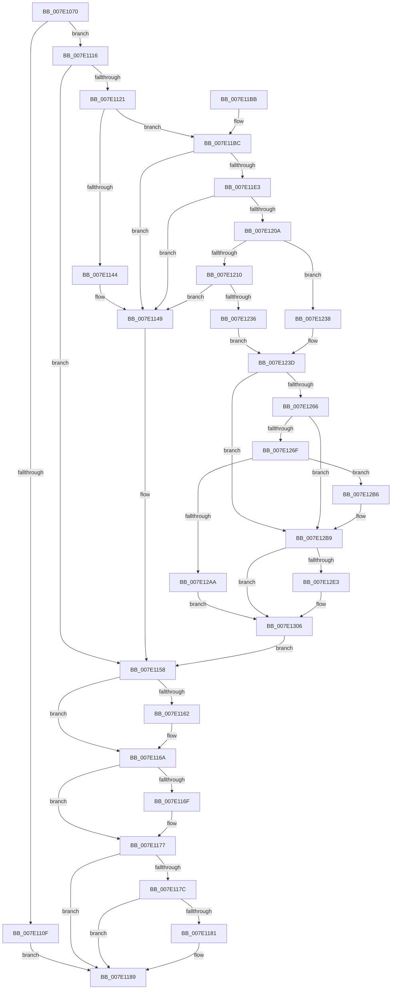

# NtSaveMergedKeys

- RVA: `0x007E1070`–`0x007E1310` (길이 `672` bytes)
- VA: `0x00000001407E1070`
- 실행 섹션: `PAGE`
- PDB 이름 있음: `예`; PDB Function 태그: `아니요`
- unwind 정보 RVA: `0x000D67F4`
- 디코드: `180`개 명령, `672/672` bytes 표시
- 미해석 바이트: `0` (있으면 어셈블리에 `.byte`로 보존)

> 이 문서는 커널 이미지의 기계어와 PDB 기호를 분석해 생성했습니다. 4번과 5번은 함수 원형과 자료형을 바이너리 사용 방식에서 추정한 C 해석이며 원본 소스 복구 결과는 아닙니다.

## 1. Dependencies

- 직접 호출 지점: **20**; 고유 호출 대상: **18**
- 직접 호출자로 확인된 함수: **0**
- RIP 상대 이미지 참조: **3**

### Outgoing calls
- `0x007E10EE` → [CmpInitializeThreadInfo](../../text/3F/CmpInitializeThreadInfo_function_003FBE70.md) (function, `0x003FBE70`)
- `0x007E1106` → [CmpAcquireShutdownRundown](../../pagecmrc/BC/CmpAcquireShutdownRundown_function_00BC9400.md) (function, `0x00BC9400`)
- `0x007E1116` → [CmCheckNoTxContext](../87/CmCheckNoTxContext_function_00876A80.md) (function, `0x00876A80`)
- `0x007E113B` → [SeSinglePrivilegeCheck](../87/SeSinglePrivilegeCheck_function_00871E20.md) (function, `0x00871E20`)
- `0x007E1158` → [CmpReleaseShutdownRundown](../../pagecmrc/BC/CmpReleaseShutdownRundown_function_00BC9880.md) (function, `0x00BC9880`)
- `0x007E1165` → [ObfDereferenceObject](../../text/2F/ObfDereferenceObject_function_002F9350.md) (function, `0x002F9350`)
- `0x007E1172` → [ObfDereferenceObject](../../text/2F/ObfDereferenceObject_function_002F9350.md) (function, `0x002F9350`)
- `0x007E1184` → [ZwClose](../../text/6A/ZwClose_function_006AD2B0.md) (function, `0x006AD2B0`)
- `0x007E118D` → [CmCleanupThreadInfo](../../text/41/CmCleanupThreadInfo_function_0041FD50.md) (function, `0x0041FD50`)
- `0x007E119B` → [_security_check_cookie](../../text/6A/_security_check_cookie_function_006AC640.md) (function, `0x006AC640`)
- `0x007E11D4` → [CmObReferenceObjectByHandle](../../pagecmrc/BC/CmObReferenceObjectByHandle_function_00BC9350.md) (function, `0x00BC9350`)
- `0x007E11FB` → [CmObReferenceObjectByHandle](../../pagecmrc/BC/CmObReferenceObjectByHandle_function_00BC9350.md) (function, `0x00BC9350`)
- `0x007E1227` → [IoConvertFileHandleToKernelHandle](../A8/IoConvertFileHandleToKernelHandle_function_00A85680.md) (function, `0x00A85680`)
- `0x007E1266` → [CmpIsRegistryLockAcquired](../../text/45/CmpIsRegistryLockAcquired_function_00456A7C.md) (function, `0x00456A7C`)
- `0x007E12A1` → [CmpCallCallBacksEx](../86/CmpCallCallBacksEx_function_00865F40.md) (function, `0x00865F40`)
- `0x007E12BD` → [CmpAttachToRegistryProcess](../../pagecmrc/BC/CmpAttachToRegistryProcess_function_00BC98E0.md) (function, `0x00BC98E0`)
- `0x007E12CE` → [CmSaveMergedKeys](../7D/CmSaveMergedKeys_function_007DE040.md) (function, `0x007DE040`)
- `0x007E12D9` → [CmpDetachFromRegistryProcess](../../pagecmrc/BC/CmpDetachFromRegistryProcess_function_00BC9920.md) (function, `0x00BC9920`)
- `0x007E12FF` → [CmPostCallbackNotificationEx](../86/CmPostCallbackNotificationEx_function_00865E50.md) (function, `0x00865E50`)
- `0x007E1306` → [KeLeaveCriticalRegion](../../text/25/KeLeaveCriticalRegion_function_0025D8B0.md) (function, `0x0025D8B0`)

### Direct callers
- 이 함수 시작 RVA로 연결되는 직접 call은 확인되지 않았습니다. 간접 호출은 완전히 역산할 수 없습니다.

### Static image references
- `0x007E108C` → RVA `0x00E0A740` (`.data`; read)
- `0x007E112A` → RVA `0x00FD9AC0` (`PAGEDATA`; read)
- `0x007E125D` → RVA `0x00EEFB88` (`.data`; read)

## 2. Other-region calls and transfers

- 다른 실행 섹션으로 향하는 call: **14**
  - `0x007E10EE` → [CmpInitializeThreadInfo](../../text/3F/CmpInitializeThreadInfo_function_003FBE70.md) (`PAGE` → `.text`)
  - `0x007E1106` → [CmpAcquireShutdownRundown](../../pagecmrc/BC/CmpAcquireShutdownRundown_function_00BC9400.md) (`PAGE` → `PAGECMRC`)
  - `0x007E1158` → [CmpReleaseShutdownRundown](../../pagecmrc/BC/CmpReleaseShutdownRundown_function_00BC9880.md) (`PAGE` → `PAGECMRC`)
  - `0x007E1165` → [ObfDereferenceObject](../../text/2F/ObfDereferenceObject_function_002F9350.md) (`PAGE` → `.text`)
  - `0x007E1172` → [ObfDereferenceObject](../../text/2F/ObfDereferenceObject_function_002F9350.md) (`PAGE` → `.text`)
  - `0x007E1184` → [ZwClose](../../text/6A/ZwClose_function_006AD2B0.md) (`PAGE` → `.text`)
  - `0x007E118D` → [CmCleanupThreadInfo](../../text/41/CmCleanupThreadInfo_function_0041FD50.md) (`PAGE` → `.text`)
  - `0x007E119B` → [_security_check_cookie](../../text/6A/_security_check_cookie_function_006AC640.md) (`PAGE` → `.text`)
  - `0x007E11D4` → [CmObReferenceObjectByHandle](../../pagecmrc/BC/CmObReferenceObjectByHandle_function_00BC9350.md) (`PAGE` → `PAGECMRC`)
  - `0x007E11FB` → [CmObReferenceObjectByHandle](../../pagecmrc/BC/CmObReferenceObjectByHandle_function_00BC9350.md) (`PAGE` → `PAGECMRC`)
  - `0x007E1266` → [CmpIsRegistryLockAcquired](../../text/45/CmpIsRegistryLockAcquired_function_00456A7C.md) (`PAGE` → `.text`)
  - `0x007E12BD` → [CmpAttachToRegistryProcess](../../pagecmrc/BC/CmpAttachToRegistryProcess_function_00BC98E0.md) (`PAGE` → `PAGECMRC`)
  - `0x007E12D9` → [CmpDetachFromRegistryProcess](../../pagecmrc/BC/CmpDetachFromRegistryProcess_function_00BC9920.md) (`PAGE` → `PAGECMRC`)
  - `0x007E1306` → [KeLeaveCriticalRegion](../../text/25/KeLeaveCriticalRegion_function_0025D8B0.md) (`PAGE` → `.text`)
- 별도 외부 분기/꼬리 이동을 확인하지 못했습니다.

## 3. Assembly (complete function range)

```asm
007E1070  48 89 5C 24 20                  mov qword ptr [rsp + 0x20], rbx
007E1075  55                              push rbp
007E1076  56                              push rsi
007E1077  57                              push rdi
007E1078  41 54                           push r12
007E107A  41 55                           push r13
007E107C  41 56                           push r14
007E107E  41 57                           push r15
007E1080  48 8D 6C 24 D9                  lea rbp, [rsp - 0x27]
007E1085  48 81 EC 00 01 00 00            sub rsp, 0x100
007E108C  48 8B 05 AD 96 62 00            mov rax, qword ptr [rip + 0x6296ad]
007E1093  48 33 C4                        xor rax, rsp
007E1096  48 89 45 1F                     mov qword ptr [rbp + 0x1f], rax
007E109A  0F 57 C0                        xorps xmm0, xmm0
007E109D  48 89 4D 8F                     mov qword ptr [rbp - 0x71], rcx
007E10A1  0F 57 C9                        xorps xmm1, xmm1
007E10A4  48 89 55 97                     mov qword ptr [rbp - 0x69], rdx
007E10A8  33 C0                           xor eax, eax
007E10AA  48 8D 4D 9F                     lea rcx, [rbp - 0x61]
007E10AE  33 F6                           xor esi, esi
007E10B0  48 89 45 AF                     mov qword ptr [rbp - 0x51], rax
007E10B4  45 33 F6                        xor r14d, r14d
007E10B7  48 89 45 E7                     mov qword ptr [rbp - 0x19], rax
007E10BB  33 FF                           xor edi, edi
007E10BD  48 89 74 24 48                  mov qword ptr [rsp + 0x48], rsi
007E10C2  0F 11 45 9F                     movups xmmword ptr [rbp - 0x61], xmm0
007E10C6  4C 89 74 24 50                  mov qword ptr [rsp + 0x50], r14
007E10CB  4D 8B E0                        mov r12, r8
007E10CE  0F 11 4D EF                     movups xmmword ptr [rbp - 0x11], xmm1
007E10D2  48 89 7C 24 40                  mov qword ptr [rsp + 0x40], rdi
007E10D7  45 32 ED                        xor r13b, r13b
007E10DA  0F 11 4D FF                     movups xmmword ptr [rbp - 1], xmm1
007E10DE  0F 11 4D 0F                     movups xmmword ptr [rbp + 0xf], xmm1
007E10E2  0F 11 45 B7                     movups xmmword ptr [rbp - 0x49], xmm0
007E10E6  0F 11 45 C7                     movups xmmword ptr [rbp - 0x39], xmm0
007E10EA  0F 11 45 D7                     movups xmmword ptr [rbp - 0x29], xmm0
007E10EE  E8 7D AD C1 FF                  call 0x1403fbe70
007E10F3  48 8D 44 24 58                  lea rax, [rsp + 0x58]
007E10F8  48 8D 4C 24 58                  lea rcx, [rsp + 0x58]
007E10FD  48 89 44 24 58                  mov qword ptr [rsp + 0x58], rax
007E1102  48 89 4D 87                     mov qword ptr [rbp - 0x79], rcx
007E1106  E8 F5 82 3E 00                  call 0x140bc9400
007E110B  84 C0                           test al, al
007E110D  75 07                           jne 0x1407e1116
007E110F  BB 89 01 00 C0                  mov ebx, 0xc0000189
007E1114  EB 73                           jmp 0x1407e1189
007E1116  E8 65 59 09 00                  call 0x140876a80
007E111B  8B D8                           mov ebx, eax
007E111D  85 C0                           test eax, eax
007E111F  78 37                           js 0x1407e1158
007E1121  65 48 8B 04 25 88 01 00 00      mov rax, qword ptr gs:[0x188]
007E112A  48 8B 0D 8F 89 7F 00            mov rcx, qword ptr [rip + 0x7f898f]
007E1131  44 8A B8 32 02 00 00            mov r15b, byte ptr [rax + 0x232]
007E1138  41 8A D7                        mov dl, r15b
007E113B  E8 E0 0C 09 00                  call 0x140871e20
007E1140  84 C0                           test al, al
007E1142  75 78                           jne 0x1407e11bc
007E1144  BB 61 00 00 C0                  mov ebx, 0xc0000061
007E1149  48 8B 7C 24 40                  mov rdi, qword ptr [rsp + 0x40]
007E114E  4C 8B 74 24 50                  mov r14, qword ptr [rsp + 0x50]
007E1153  48 8B 74 24 48                  mov rsi, qword ptr [rsp + 0x48]
007E1158  E8 23 87 3E 00                  call 0x140bc9880
007E115D  4D 85 F6                        test r14, r14
007E1160  74 08                           je 0x1407e116a
007E1162  49 8B CE                        mov rcx, r14
007E1165  E8 E6 81 B1 FF                  call 0x1402f9350
007E116A  48 85 F6                        test rsi, rsi
007E116D  74 08                           je 0x1407e1177
007E116F  48 8B CE                        mov rcx, rsi
007E1172  E8 D9 81 B1 FF                  call 0x1402f9350
007E1177  48 85 FF                        test rdi, rdi
007E117A  74 0D                           je 0x1407e1189
007E117C  49 3B FC                        cmp rdi, r12
007E117F  74 08                           je 0x1407e1189
007E1181  48 8B CF                        mov rcx, rdi
007E1184  E8 27 C1 EC FF                  call 0x1406ad2b0
007E1189  48 8D 4D 9F                     lea rcx, [rbp - 0x61]
007E118D  E8 BE EB C3 FF                  call 0x14041fd50
007E1192  8B C3                           mov eax, ebx
007E1194  48 8B 4D 1F                     mov rcx, qword ptr [rbp + 0x1f]
007E1198  48 33 CC                        xor rcx, rsp
007E119B  E8 A0 B4 EC FF                  call 0x1406ac640
007E11A0  48 8B 9C 24 58 01 00 00         mov rbx, qword ptr [rsp + 0x158]
007E11A8  48 81 C4 00 01 00 00            add rsp, 0x100
007E11AF  41 5F                           pop r15
007E11B1  41 5E                           pop r14
007E11B3  41 5D                           pop r13
007E11B5  41 5C                           pop r12
007E11B7  5F                              pop rdi
007E11B8  5E                              pop rsi
007E11B9  5D                              pop rbp
007E11BA  C3                              ret
007E11BB  CC                              int3
007E11BC  48 21 74 24 28                  and qword ptr [rsp + 0x28], rsi
007E11C1  48 8D 44 24 48                  lea rax, [rsp + 0x48]
007E11C6  48 8B 4D 8F                     mov rcx, qword ptr [rbp - 0x71]
007E11CA  45 8A CF                        mov r9b, r15b
007E11CD  33 D2                           xor edx, edx
007E11CF  48 89 44 24 20                  mov qword ptr [rsp + 0x20], rax
007E11D4  E8 77 81 3E 00                  call 0x140bc9350
007E11D9  8B D8                           mov ebx, eax
007E11DB  85 C0                           test eax, eax
007E11DD  0F 88 66 FF FF FF               js 0x1407e1149
007E11E3  48 21 74 24 28                  and qword ptr [rsp + 0x28], rsi
007E11E8  48 8D 44 24 50                  lea rax, [rsp + 0x50]
007E11ED  48 8B 4D 97                     mov rcx, qword ptr [rbp - 0x69]
007E11F1  45 8A CF                        mov r9b, r15b
007E11F4  33 D2                           xor edx, edx
007E11F6  48 89 44 24 20                  mov qword ptr [rsp + 0x20], rax
007E11FB  E8 50 81 3E 00                  call 0x140bc9350
007E1200  8B D8                           mov ebx, eax
007E1202  85 C0                           test eax, eax
007E1204  0F 88 3F FF FF FF               js 0x1407e1149
007E120A  41 80 FF 01                     cmp r15b, 1
007E120E  75 28                           jne 0x1407e1238
007E1210  45 33 C9                        xor r9d, r9d
007E1213  48 8D 44 24 40                  lea rax, [rsp + 0x40]
007E1218  41 8A D7                        mov dl, r15b
007E121B  48 89 44 24 20                  mov qword ptr [rsp + 0x20], rax
007E1220  49 8B CC                        mov rcx, r12
007E1223  45 8D 41 02                     lea r8d, [r9 + 2]
007E1227  E8 54 44 2A 00                  call 0x140a85680
007E122C  8B D8                           mov ebx, eax
007E122E  85 C0                           test eax, eax
007E1230  0F 88 13 FF FF FF               js 0x1407e1149
007E1236  EB 05                           jmp 0x1407e123d
007E1238  4C 89 64 24 40                  mov qword ptr [rsp + 0x40], r12
007E123D  65 48 8B 04 25 88 01 00 00      mov rax, qword ptr gs:[0x188]
007E1246  48 8B 74 24 48                  mov rsi, qword ptr [rsp + 0x48]
007E124B  4C 8B 74 24 50                  mov r14, qword ptr [rsp + 0x50]
007E1250  48 8B 7C 24 40                  mov rdi, qword ptr [rsp + 0x40]
007E1255  66 FF 88 E4 01 00 00            dec word ptr [rax + 0x1e4]
007E125C  90                              nop
007E125D  83 3D 24 E9 70 00 00            cmp dword ptr [rip + 0x70e924], 0
007E1264  74 53                           je 0x1407e12b9
007E1266  E8 11 58 C7 FF                  call 0x140456a7c
007E126B  85 C0                           test eax, eax
007E126D  75 4A                           jne 0x1407e12b9
007E126F  45 33 C0                        xor r8d, r8d
007E1272  48 89 75 C7                     mov qword ptr [rbp - 0x39], rsi
007E1276  48 8D 44 24 58                  lea rax, [rsp + 0x58]
007E127B  4C 89 75 CF                     mov qword ptr [rbp - 0x31], r14
007E127F  48 89 44 24 30                  mov qword ptr [rsp + 0x30], rax
007E1284  48 8D 55 B7                     lea rdx, [rbp - 0x49]
007E1288  48 83 64 24 28 00               and qword ptr [rsp + 0x28], 0
007E128E  41 B1 01                        mov r9b, 1
007E1291  41 8D 48 31                     lea ecx, [r8 + 0x31]
007E1295  48 89 7D BF                     mov qword ptr [rbp - 0x41], rdi
007E1299  C7 44 24 20 32 00 00 00         mov dword ptr [rsp + 0x20], 0x32
007E12A1  E8 9A 4C 08 00                  call 0x140865f40
007E12A6  85 C0                           test eax, eax
007E12A8  79 0C                           jns 0x1407e12b6
007E12AA  33 DB                           xor ebx, ebx
007E12AC  3D 03 05 00 C0                  cmp eax, 0xc0000503
007E12B1  0F 45 D8                        cmovne ebx, eax
007E12B4  EB 50                           jmp 0x1407e1306
007E12B6  41 B5 01                        mov r13b, 1
007E12B9  48 8D 4D EF                     lea rcx, [rbp - 0x11]
007E12BD  E8 1E 86 3E 00                  call 0x140bc98e0
007E12C2  45 8A CF                        mov r9b, r15b
007E12C5  4C 8B C7                        mov r8, rdi
007E12C8  49 8B D6                        mov rdx, r14
007E12CB  48 8B CE                        mov rcx, rsi
007E12CE  E8 6D CD FF FF                  call 0x1407de040
007E12D3  48 8D 4D EF                     lea rcx, [rbp - 0x11]
007E12D7  8B D8                           mov ebx, eax
007E12D9  E8 42 86 3E 00                  call 0x140bc9920
007E12DE  45 84 ED                        test r13b, r13b
007E12E1  74 23                           je 0x1407e1306
007E12E3  33 D2                           xor edx, edx
007E12E5  48 8D 44 24 58                  lea rax, [rsp + 0x58]
007E12EA  48 89 44 24 28                  mov qword ptr [rsp + 0x28], rax
007E12EF  4C 8D 4D B7                     lea r9, [rbp - 0x49]
007E12F3  48 83 64 24 20 00               and qword ptr [rsp + 0x20], 0
007E12F9  44 8B C3                        mov r8d, ebx
007E12FC  8D 4A 32                        lea ecx, [rdx + 0x32]
007E12FF  E8 4C 4B 08 00                  call 0x140865e50
007E1304  8B D8                           mov ebx, eax
007E1306  E8 A5 C5 A7 FF                  call 0x14025d8b0
007E130B  E9 48 FE FF FF                  jmp 0x1407e1158
```

## 4. C-style interpretation (structured pseudocode)

```c
__int64 __fastcall NtSaveMergedKeys(__int64 a1, __int64 a2, __int64 a3)
{
    __int64 result;
    __int64 v_r13;
    __int64 v_r14;
    __int64 v_rbx;
    __int64 v_rdi;
    __int64 v_rsi;
    __int64 v_rsp;
    unsigned __int64 v_stack_m40;
    unsigned __int64 v_stack_m50;
    unsigned __int64 v_stack_m5F;
    unsigned __int64 v_stack_m60;
    unsigned __int64 v_stack_m70;
    unsigned __int64 v_stack_m78;
    unsigned __int64 v_stack_m88;
    unsigned __int64 v_stack_m90;
    unsigned __int64 v_stack_m98;
    unsigned __int64 v_stack_mA0;
    unsigned __int64 v_stack_mA8;
    unsigned __int64 v_stack_mB0;
    unsigned __int64 v_stack_mC0;
    unsigned __int64 v_stack_mC8;
    unsigned __int64 v_stack_mD0;
    unsigned __int64 v_stack_mD8;
    unsigned __int64 v_stack_mE0;
    unsigned __int64 v_stack_mE8;
    unsigned __int64 v_stack_mF0;
    unsigned __int64 v_stack_mF8;
    unsigned __int64 v_stack_p20;
    unsigned __int64 v_stack_p28;
    unsigned __int64 v_stack_p30;
    unsigned __int64 v_stack_p40;
    unsigned __int64 v_stack_p48;
    unsigned __int64 v_stack_p50;
    unsigned __int64 v_stack_p58;

    v_stack_p20 = v_rbx;
    v_rsp = (v_rsp) - (256);
    result = (*(unsigned __int64 *)(v_rip + 6461101)) ^ (v_rsp);
    v_stack_m40 = result;
    v_stack_mD0 = a1;
    v_stack_mC8 = a2;
    result = 0;
    v_rsi = 0;
    v_stack_mB0 = 0;
    v_r14 = 0;
    v_stack_m78 = 0;
    v_rdi = 0;
    v_stack_mF0 = 0;
    v_stack_mC0 = v_xmm0;
    v_stack_mE8 = 0;
    v_stack_m70 = v_xmm1;
    v_stack_mF8 = 0;
    v_r13 = 0;
    v_stack_m60 = v_xmm1;
    v_stack_m50 = v_xmm1;
    v_stack_mA8 = v_xmm0;
    v_stack_m98 = v_xmm0;
    v_stack_m88 = v_xmm0;
    result = CmpInitializeThreadInfo(v_stack_mC0, a2, a3, a4);
    v_stack_mE0 = v_stack_mE0;
    v_stack_mD8 = v_stack_mE0;
    result = CmpAcquireShutdownRundown(v_stack_mE0, a2, a3, a4);
    if ((unsigned __int8)(result) != 0) goto loc_007E1116;
    goto loc_007E1189;
loc_007E1116:
    result = CmCheckNoTxContext(v_stack_mE0, a2, a3, a4);
    if (sign_flag) goto loc_007E1158;
    result = SeSinglePrivilegeCheck(*(unsigned __int64 *)(v_rip + 8358287), (unsigned __int8)(*(unsigned __int8 *)(*(unsigned __int64 *)(gs_base + (0 + 392)) + 562)), a3, a4);
    if ((unsigned __int8)(result) != 0) goto loc_007E11BC;
loc_007E1149:
loc_007E1158:
    result = CmpReleaseShutdownRundown(*(unsigned __int64 *)(v_rip + 8358287), (unsigned __int8)(*(unsigned __int8 *)(*(unsigned __int64 *)(gs_base + (0 + 392)) + 562)), a3, a4);
    if (v_stack_mE8 != 0) {
        a1 = v_stack_mE8;
        result = ObfDereferenceObject(a1, (unsigned __int8)(*(unsigned __int8 *)(*(unsigned __int64 *)(gs_base + (0 + 392)) + 562)), a3, a4);
    }
    if (v_stack_mF0 != 0) {
        a1 = v_stack_mF0;
        result = ObfDereferenceObject(a1, (unsigned __int8)(*(unsigned __int8 *)(*(unsigned __int64 *)(gs_base + (0 + 392)) + 562)), a3, a4);
    }
    if (v_stack_mF8 == 0) goto loc_007E1189;
    if (v_stack_mF8 != a3) {
        a1 = v_stack_mF8;
        result = ZwClose(a1, (unsigned __int8)(*(unsigned __int8 *)(*(unsigned __int64 *)(gs_base + (0 + 392)) + 562)), a3, a4);
    }
    result = CmCleanupThreadInfo(v_stack_mC0, (unsigned __int8)(*(unsigned __int8 *)(*(unsigned __int64 *)(gs_base + (0 + 392)) + 562)), a3, a4);
    a1 = (v_stack_m40) ^ (v_rsp);
    result = _security_check_cookie(a1, (unsigned __int8)(*(unsigned __int8 *)(*(unsigned __int64 *)(gs_base + (0 + 392)) + 562)), a3, a4);
    v_rsp = (v_rsp) + (256);
    return result;
loc_007E11BC:
    a2 = 0;
    v_stack_p20 = v_stack_p48;
    result = CmObReferenceObjectByHandle(v_stack_mD0, a2, a3, (unsigned __int8)(*(unsigned __int8 *)(*(unsigned __int64 *)(gs_base + (0 + 392)) + 562)));
    if (sign_flag) goto loc_007E1149;
    a2 = 0;
    v_stack_p20 = v_stack_p50;
    result = CmObReferenceObjectByHandle(v_stack_mC8, a2, a3, (unsigned __int8)(*(unsigned __int8 *)(*(unsigned __int64 *)(gs_base + (0 + 392)) + 562)));
    if (sign_flag) goto loc_007E1149;
    if (((unsigned __int8)(*(unsigned __int8 *)(*(unsigned __int64 *)(gs_base + (0 + 392)) + 562))) != 1) goto loc_007E1238;
    a4 = 0;
    v_stack_p20 = v_stack_p40;
    result = IoConvertFileHandleToKernelHandle(a3, (unsigned __int8)(*(unsigned __int8 *)(*(unsigned __int64 *)(gs_base + (0 + 392)) + 562)), a4 + 2, a4);
    if (sign_flag) goto loc_007E1149;
    goto loc_007E123D;
loc_007E1238:
    v_stack_p40 = a3;
loc_007E123D:
    if ((*(unsigned int *)(v_rip + 7399716)) == 0) goto loc_007E12B9;
    result = CmpIsRegistryLockAcquired(a3, (unsigned __int8)(*(unsigned __int8 *)(*(unsigned __int64 *)(gs_base + (0 + 392)) + 562)), a4 + 2, a4);
    if ((unsigned int)(result) != 0) goto loc_007E12B9;
    a3 = 0;
    v_stack_m98 = v_stack_p48;
    v_stack_m90 = v_stack_p50;
    v_stack_p30 = v_stack_p58;
    v_stack_mA0 = v_stack_p40;
    v_stack_p20 = 50;
    result = CmpCallCallBacksEx(a3 + 49, v_stack_mA8, a3, 1);
    if (!sign_flag) goto loc_007E12B6;
    v_rbx = 0;
    if (((unsigned int)(result)) != 0xC0000503ULL) { v_rbx = (unsigned int)(result); }
    goto loc_007E1306;
loc_007E12B6:
loc_007E12B9:
    result = CmpAttachToRegistryProcess(v_stack_m70, v_stack_mA8, a3, 1);
    result = CmSaveMergedKeys(v_stack_p48, v_stack_p50, v_stack_p40, (unsigned __int8)(*(unsigned __int8 *)(*(unsigned __int64 *)(gs_base + (0 + 392)) + 562)));
    result = CmpDetachFromRegistryProcess(v_stack_m70, v_stack_p50, v_stack_p40, (unsigned __int8)(*(unsigned __int8 *)(*(unsigned __int64 *)(gs_base + (0 + 392)) + 562)));
    v_rbx = (unsigned int)((unsigned int)(result));
    if (1 != 0) {
        a2 = 0;
        result = v_stack_p58;
        v_stack_p28 = result;
        a4 = v_stack_mA8;
        a3 = (unsigned int)((unsigned int)((unsigned int)(result)));
        a1 = a2 + 50;
        result = CmPostCallbackNotificationEx(a1, a2, a3, a4);
        v_rbx = (unsigned int)(result);
    }
    result = KeLeaveCriticalRegion(a1, a2, a3, a4);
    goto loc_007E1158;
}
```

## 5. (Beta) C Style

```c
int64_t NtSaveMergedKeys(int64_t Arg1, int64_t Arg2, int64_t Arg3)
{
    int64_t result;
    int64_t local_r13;
    int64_t local_r14;
    int64_t local_rbx;
    int64_t local_rdi;
    int64_t local_rsi;
    int64_t local_rsp;
    uint64_t v_stack_m40;
    uint64_t v_stack_m50;
    uint64_t v_stack_m5F;
    uint64_t v_stack_m60;
    uint64_t v_stack_m70;
    uint64_t v_stack_m78;
    uint64_t v_stack_m88;
    uint64_t v_stack_m90;
    uint64_t v_stack_m98;
    uint64_t v_stack_mA0;
    uint64_t v_stack_mA8;
    uint64_t v_stack_mB0;
    uint64_t v_stack_mC0;
    uint64_t v_stack_mC8;
    uint64_t v_stack_mD0;
    uint64_t v_stack_mD8;
    uint64_t v_stack_mE0;
    uint64_t v_stack_mE8;
    uint64_t v_stack_mF0;
    uint64_t v_stack_mF8;
    uint64_t v_stack_p20;
    uint64_t v_stack_p28;
    uint64_t v_stack_p30;
    uint64_t v_stack_p40;
    uint64_t v_stack_p48;
    uint64_t v_stack_p50;
    uint64_t v_stack_p58;

    v_stack_p20 = local_rbx;
    local_rsp = (local_rsp) - (256);
    result = (*(uint64_t *)(v_rip + 0x6296AD)) ^ (local_rsp);
    v_stack_m40 = result;
    v_stack_mD0 = Arg1;
    v_stack_mC8 = Arg2;
    result = 0;
    local_rsi = 0;
    v_stack_mB0 = 0;
    local_r14 = 0;
    v_stack_m78 = 0;
    local_rdi = 0;
    v_stack_mF0 = 0;
    v_stack_mC0 = v_xmm0;
    v_stack_mE8 = 0;
    v_stack_m70 = v_xmm1;
    v_stack_mF8 = 0;
    local_r13 = 0;
    v_stack_m60 = v_xmm1;
    v_stack_m50 = v_xmm1;
    v_stack_mA8 = v_xmm0;
    v_stack_m98 = v_xmm0;
    v_stack_m88 = v_xmm0;
    result = CmpInitializeThreadInfo(v_stack_mC0, Arg2, Arg3, a4);
    v_stack_mE0 = v_stack_mE0;
    v_stack_mD8 = v_stack_mE0;
    result = CmpAcquireShutdownRundown(v_stack_mE0, Arg2, Arg3, a4);
    if ((uint8_t)(result) != 0) goto loc_007E1116;
    goto loc_007E1189;
loc_007E1116:
    result = CmCheckNoTxContext(v_stack_mE0, Arg2, Arg3, a4);
    if (sign_flag) goto loc_007E1158;
    result = SeSinglePrivilegeCheck(*(uint64_t *)(v_rip + 0x7F898F), (uint8_t)(*(uint8_t *)(*(uint64_t *)(gs_base + (0 + 0x188)) + 0x232)), Arg3, a4);
    if ((uint8_t)(result) != 0) goto loc_007E11BC;
loc_007E1149:
loc_007E1158:
    result = CmpReleaseShutdownRundown(*(uint64_t *)(v_rip + 0x7F898F), (uint8_t)(*(uint8_t *)(*(uint64_t *)(gs_base + (0 + 0x188)) + 0x232)), Arg3, a4);
    if (v_stack_mE8 != 0) {
        Arg1 = v_stack_mE8;
        result = ObfDereferenceObject(Arg1, (uint8_t)(*(uint8_t *)(*(uint64_t *)(gs_base + (0 + 0x188)) + 0x232)), Arg3, a4);
    }
    if (v_stack_mF0 != 0) {
        Arg1 = v_stack_mF0;
        result = ObfDereferenceObject(Arg1, (uint8_t)(*(uint8_t *)(*(uint64_t *)(gs_base + (0 + 0x188)) + 0x232)), Arg3, a4);
    }
    if (v_stack_mF8 == 0) goto loc_007E1189;
    if (v_stack_mF8 != Arg3) {
        Arg1 = v_stack_mF8;
        result = ZwClose(Arg1, (uint8_t)(*(uint8_t *)(*(uint64_t *)(gs_base + (0 + 0x188)) + 0x232)), Arg3, a4);
    }
    result = CmCleanupThreadInfo(v_stack_mC0, (uint8_t)(*(uint8_t *)(*(uint64_t *)(gs_base + (0 + 0x188)) + 0x232)), Arg3, a4);
    Arg1 = (v_stack_m40) ^ (local_rsp);
    result = _security_check_cookie(Arg1, (uint8_t)(*(uint8_t *)(*(uint64_t *)(gs_base + (0 + 0x188)) + 0x232)), Arg3, a4);
    local_rsp = (local_rsp) + (256);
    return result;
loc_007E11BC:
    Arg2 = 0;
    v_stack_p20 = v_stack_p48;
    result = CmObReferenceObjectByHandle(v_stack_mD0, Arg2, Arg3, (uint8_t)(*(uint8_t *)(*(uint64_t *)(gs_base + (0 + 0x188)) + 0x232)));
    if (sign_flag) goto loc_007E1149;
    Arg2 = 0;
    v_stack_p20 = v_stack_p50;
    result = CmObReferenceObjectByHandle(v_stack_mC8, Arg2, Arg3, (uint8_t)(*(uint8_t *)(*(uint64_t *)(gs_base + (0 + 0x188)) + 0x232)));
    if (sign_flag) goto loc_007E1149;
    if (((uint8_t)(*(uint8_t *)(*(uint64_t *)(gs_base + (0 + 0x188)) + 0x232))) != 1) goto loc_007E1238;
    a4 = 0;
    v_stack_p20 = v_stack_p40;
    result = IoConvertFileHandleToKernelHandle(Arg3, (uint8_t)(*(uint8_t *)(*(uint64_t *)(gs_base + (0 + 0x188)) + 0x232)), a4 + 2, a4);
    if (sign_flag) goto loc_007E1149;
    goto loc_007E123D;
loc_007E1238:
    v_stack_p40 = Arg3;
loc_007E123D:
    if ((*(uint32_t *)(v_rip + 0x70E924)) == 0) goto loc_007E12B9;
    result = CmpIsRegistryLockAcquired(Arg3, (uint8_t)(*(uint8_t *)(*(uint64_t *)(gs_base + (0 + 0x188)) + 0x232)), a4 + 2, a4);
    if ((uint32_t)(result) != 0) goto loc_007E12B9;
    Arg3 = 0;
    v_stack_m98 = v_stack_p48;
    v_stack_m90 = v_stack_p50;
    v_stack_p30 = v_stack_p58;
    v_stack_mA0 = v_stack_p40;
    v_stack_p20 = 50;
    result = CmpCallCallBacksEx(Arg3 + 49, v_stack_mA8, Arg3, 1);
    if (!sign_flag) goto loc_007E12B6;
    local_rbx = 0;
    if (((uint32_t)(result)) != 0xC0000503ULL) { local_rbx = (uint32_t)(result); }
    goto loc_007E1306;
loc_007E12B6:
loc_007E12B9:
    result = CmpAttachToRegistryProcess(v_stack_m70, v_stack_mA8, Arg3, 1);
    result = CmSaveMergedKeys(v_stack_p48, v_stack_p50, v_stack_p40, (uint8_t)(*(uint8_t *)(*(uint64_t *)(gs_base + (0 + 0x188)) + 0x232)));
    result = CmpDetachFromRegistryProcess(v_stack_m70, v_stack_p50, v_stack_p40, (uint8_t)(*(uint8_t *)(*(uint64_t *)(gs_base + (0 + 0x188)) + 0x232)));
    local_rbx = (uint32_t)((uint32_t)(result));
    if (1 != 0) {
        Arg2 = 0;
        result = v_stack_p58;
        v_stack_p28 = result;
        a4 = v_stack_mA8;
        Arg3 = (uint32_t)((uint32_t)((uint32_t)(result)));
        Arg1 = Arg2 + 50;
        result = CmPostCallbackNotificationEx(Arg1, Arg2, Arg3, a4);
        local_rbx = (uint32_t)(result);
    }
    result = KeLeaveCriticalRegion(Arg1, Arg2, Arg3, a4);
    goto loc_007E1158;
}
```

## 6. Execution-region graph

[열기: 2D/3D 그래프와 함수 탐색 컨트롤 패널](../../../control-panel.html?section=page&rva=0x007E1070&view=graph)

- 2D 그래프는 위에서 아래로 흐르고, 3D 그래프는 빈 공간을 드래그해 회전합니다. Shift+드래그는 이동, 휠은 확대·축소, 함수 노드 선택은 대상 보고서 이동입니다.

### Static fallback


