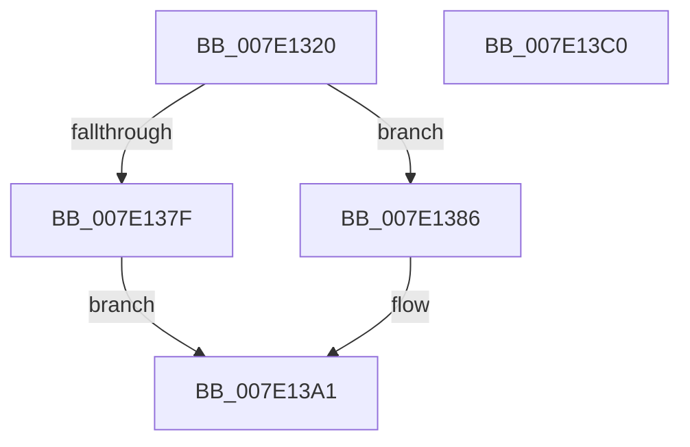

# NtThawRegistry

- RVA: `0x007E1320`–`0x007E13C1` (길이 `161` bytes)
- VA: `0x00000001407E1320`
- 실행 섹션: `PAGE`
- PDB 이름 있음: `예`; PDB Function 태그: `아니요`
- unwind 정보 RVA: `0x0009DFE8`
- 디코드: `39`개 명령, `161/161` bytes 표시
- 미해석 바이트: `0` (있으면 어셈블리에 `.byte`로 보존)

> 이 문서는 커널 이미지의 기계어와 PDB 기호를 분석해 생성했습니다. 4번과 5번은 함수 원형과 자료형을 바이너리 사용 방식에서 추정한 C 해석이며 원본 소스 복구 결과는 아닙니다.

## 1. Dependencies

- 직접 호출 지점: **7**; 고유 호출 대상: **7**
- 직접 호출자로 확인된 함수: **0**
- RIP 상대 이미지 참조: **2**

### Outgoing calls
- `0x007E135B` → [CmpInitializeThreadInfo](../../text/3F/CmpInitializeThreadInfo_function_003FBE70.md) (function, `0x003FBE70`)
- `0x007E1376` → [SeSinglePrivilegeCheck](../87/SeSinglePrivilegeCheck_function_00871E20.md) (function, `0x00871E20`)
- `0x007E138B` → [CmpAttachToRegistryProcess](../../pagecmrc/BC/CmpAttachToRegistryProcess_function_00BC98E0.md) (function, `0x00BC98E0`)
- `0x007E1390` → [CmThawRegistry](CmThawRegistry_function_007E8510.md) (function, `0x007E8510`)
- `0x007E139C` → [CmpDetachFromRegistryProcess](../../pagecmrc/BC/CmpDetachFromRegistryProcess_function_00BC9920.md) (function, `0x00BC9920`)
- `0x007E13A6` → [CmCleanupThreadInfo](../../text/41/CmCleanupThreadInfo_function_0041FD50.md) (function, `0x0041FD50`)
- `0x007E13B5` → [_security_check_cookie](../../text/6A/_security_check_cookie_function_006AC640.md) (function, `0x006AC640`)

### Direct callers
- 이 함수 시작 RVA로 연결되는 직접 call은 확인되지 않았습니다. 간접 호출은 완전히 역산할 수 없습니다.

### Static image references
- `0x007E1326` → RVA `0x00E0A740` (`.data`; read)
- `0x007E136F` → RVA `0x00FD9AC0` (`PAGEDATA`; read)

## 2. Other-region calls and transfers

- 다른 실행 섹션으로 향하는 call: **5**
  - `0x007E135B` → [CmpInitializeThreadInfo](../../text/3F/CmpInitializeThreadInfo_function_003FBE70.md) (`PAGE` → `.text`)
  - `0x007E138B` → [CmpAttachToRegistryProcess](../../pagecmrc/BC/CmpAttachToRegistryProcess_function_00BC98E0.md) (`PAGE` → `PAGECMRC`)
  - `0x007E139C` → [CmpDetachFromRegistryProcess](../../pagecmrc/BC/CmpDetachFromRegistryProcess_function_00BC9920.md) (`PAGE` → `PAGECMRC`)
  - `0x007E13A6` → [CmCleanupThreadInfo](../../text/41/CmCleanupThreadInfo_function_0041FD50.md) (`PAGE` → `.text`)
  - `0x007E13B5` → [_security_check_cookie](../../text/6A/_security_check_cookie_function_006AC640.md) (`PAGE` → `.text`)
- 별도 외부 분기/꼬리 이동을 확인하지 못했습니다.

## 3. Assembly (complete function range)

```asm
007E1320  40 53                           push rbx
007E1322  48 83 EC 70                     sub rsp, 0x70
007E1326  48 8B 05 13 94 62 00            mov rax, qword ptr [rip + 0x629413]
007E132D  48 33 C4                        xor rax, rsp
007E1330  48 89 44 24 68                  mov qword ptr [rsp + 0x68], rax
007E1335  0F 57 C9                        xorps xmm1, xmm1
007E1338  48 8D 4C 24 20                  lea rcx, [rsp + 0x20]
007E133D  0F 57 C0                        xorps xmm0, xmm0
007E1340  33 C0                           xor eax, eax
007E1342  0F 11 44 24 20                  movups xmmword ptr [rsp + 0x20], xmm0
007E1347  48 89 44 24 30                  mov qword ptr [rsp + 0x30], rax
007E134C  0F 11 4C 24 38                  movups xmmword ptr [rsp + 0x38], xmm1
007E1351  0F 11 4C 24 48                  movups xmmword ptr [rsp + 0x48], xmm1
007E1356  0F 11 4C 24 58                  movups xmmword ptr [rsp + 0x58], xmm1
007E135B  E8 10 AB C1 FF                  call 0x1403fbe70
007E1360  65 48 8B 0C 25 88 01 00 00      mov rcx, qword ptr gs:[0x188]
007E1369  8A 91 32 02 00 00               mov dl, byte ptr [rcx + 0x232]
007E136F  48 8B 0D 4A 87 7F 00            mov rcx, qword ptr [rip + 0x7f874a]
007E1376  E8 A5 0A 09 00                  call 0x140871e20
007E137B  84 C0                           test al, al
007E137D  75 07                           jne 0x1407e1386
007E137F  BB 61 00 00 C0                  mov ebx, 0xc0000061
007E1384  EB 1B                           jmp 0x1407e13a1
007E1386  48 8D 4C 24 38                  lea rcx, [rsp + 0x38]
007E138B  E8 50 85 3E 00                  call 0x140bc98e0
007E1390  E8 7B 71 00 00                  call 0x1407e8510
007E1395  48 8D 4C 24 38                  lea rcx, [rsp + 0x38]
007E139A  8B D8                           mov ebx, eax
007E139C  E8 7F 85 3E 00                  call 0x140bc9920
007E13A1  48 8D 4C 24 20                  lea rcx, [rsp + 0x20]
007E13A6  E8 A5 E9 C3 FF                  call 0x14041fd50
007E13AB  8B C3                           mov eax, ebx
007E13AD  48 8B 4C 24 68                  mov rcx, qword ptr [rsp + 0x68]
007E13B2  48 33 CC                        xor rcx, rsp
007E13B5  E8 86 B2 EC FF                  call 0x1406ac640
007E13BA  48 83 C4 70                     add rsp, 0x70
007E13BE  5B                              pop rbx
007E13BF  C3                              ret
007E13C0  CC                              int3
```

## 4. C-style interpretation (structured pseudocode)

```c
__int64 __fastcall NtThawRegistry(void)
{
    __int64 result;
    __int64 v_rsp;
    unsigned __int64 v_stack_m10;
    unsigned __int64 v_stack_m20;
    unsigned __int64 v_stack_m30;
    unsigned __int64 v_stack_m40;
    unsigned __int64 v_stack_m48;
    unsigned __int64 v_stack_m58;

    v_rsp = (v_rsp) - (112);
    result = (*(unsigned __int64 *)(v_rip + 6460435)) ^ (v_rsp);
    v_stack_m10 = result;
    result = 0;
    v_stack_m58 = v_xmm0;
    v_stack_m48 = 0;
    v_stack_m40 = v_xmm1;
    v_stack_m30 = v_xmm1;
    v_stack_m20 = v_xmm1;
    result = CmpInitializeThreadInfo(v_stack_m58, a2, a3, a4);
    result = SeSinglePrivilegeCheck(*(unsigned __int64 *)(v_rip + 8357706), *(unsigned __int8 *)(*(unsigned __int64 *)(gs_base + (0 + 392)) + 562), a3, a4);
    if ((unsigned __int8)(result) != 0) goto loc_007E1386;
    goto loc_007E13A1;
loc_007E1386:
    result = CmpAttachToRegistryProcess(v_stack_m40, *(unsigned __int8 *)(*(unsigned __int64 *)(gs_base + (0 + 392)) + 562), a3, a4);
    result = CmThawRegistry(v_stack_m40, *(unsigned __int8 *)(*(unsigned __int64 *)(gs_base + (0 + 392)) + 562), a3, a4);
    result = CmpDetachFromRegistryProcess(v_stack_m40, *(unsigned __int8 *)(*(unsigned __int64 *)(gs_base + (0 + 392)) + 562), a3, a4);
loc_007E13A1:
    result = CmCleanupThreadInfo(v_stack_m58, *(unsigned __int8 *)(*(unsigned __int64 *)(gs_base + (0 + 392)) + 562), a3, a4);
    a1 = (v_stack_m10) ^ (v_rsp);
    result = _security_check_cookie(a1, *(unsigned __int8 *)(*(unsigned __int64 *)(gs_base + (0 + 392)) + 562), a3, a4);
    v_rsp = (v_rsp) + (112);
    return result;
}
```

## 5. (Beta) C Style

```c
void NtThawRegistry(void)
{
    int64_t result;
    int64_t local_rsp;
    uint64_t v_stack_m10;
    uint64_t v_stack_m20;
    uint64_t v_stack_m30;
    uint64_t v_stack_m40;
    uint64_t v_stack_m48;
    uint64_t v_stack_m58;

    local_rsp = (local_rsp) - (112);
    result = (*(uint64_t *)(v_rip + 0x629413)) ^ (local_rsp);
    v_stack_m10 = result;
    result = 0;
    v_stack_m58 = v_xmm0;
    v_stack_m48 = 0;
    v_stack_m40 = v_xmm1;
    v_stack_m30 = v_xmm1;
    v_stack_m20 = v_xmm1;
    result = CmpInitializeThreadInfo(v_stack_m58, a2, a3, a4);
    result = SeSinglePrivilegeCheck(*(uint64_t *)(v_rip + 0x7F874A), *(uint8_t *)(*(uint64_t *)(gs_base + (0 + 0x188)) + 0x232), a3, a4);
    if ((uint8_t)(result) != 0) goto loc_007E1386;
    goto loc_007E13A1;
loc_007E1386:
    result = CmpAttachToRegistryProcess(v_stack_m40, *(uint8_t *)(*(uint64_t *)(gs_base + (0 + 0x188)) + 0x232), a3, a4);
    result = CmThawRegistry(v_stack_m40, *(uint8_t *)(*(uint64_t *)(gs_base + (0 + 0x188)) + 0x232), a3, a4);
    result = CmpDetachFromRegistryProcess(v_stack_m40, *(uint8_t *)(*(uint64_t *)(gs_base + (0 + 0x188)) + 0x232), a3, a4);
loc_007E13A1:
    result = CmCleanupThreadInfo(v_stack_m58, *(uint8_t *)(*(uint64_t *)(gs_base + (0 + 0x188)) + 0x232), a3, a4);
    a1 = (v_stack_m10) ^ (local_rsp);
    result = _security_check_cookie(a1, *(uint8_t *)(*(uint64_t *)(gs_base + (0 + 0x188)) + 0x232), a3, a4);
    local_rsp = (local_rsp) + (112);
    return result;
}
```

## 6. Execution-region graph

[열기: 2D/3D 그래프와 함수 탐색 컨트롤 패널](../../../control-panel.html?section=page&rva=0x007E1320&view=graph)

- 2D 그래프는 위에서 아래로 흐르고, 3D 그래프는 빈 공간을 드래그해 회전합니다. Shift+드래그는 이동, 휠은 확대·축소, 함수 노드 선택은 대상 보고서 이동입니다.

### Static fallback


