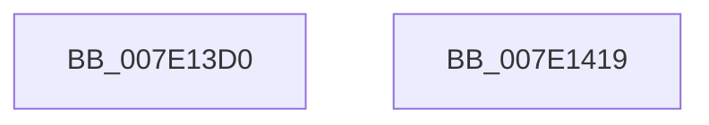

# NtUnloadKey2

- RVA: `0x007E13D0`–`0x007E141A` (길이 `74` bytes)
- VA: `0x00000001407E13D0`
- 실행 섹션: `PAGE`
- PDB 이름 있음: `예`; PDB Function 태그: `아니요`
- unwind 정보 RVA: `0x00063458`
- 디코드: `21`개 명령, `74/74` bytes 표시
- 미해석 바이트: `0` (있으면 어셈블리에 `.byte`로 보존)

> 이 문서는 커널 이미지의 기계어와 PDB 기호를 분석해 생성했습니다. 4번과 5번은 함수 원형과 자료형을 바이너리 사용 방식에서 추정한 C 해석이며 원본 소스 복구 결과는 아닙니다.

## 1. Dependencies

- 직접 호출 지점: **3**; 고유 호출 대상: **3**
- 직접 호출자로 확인된 함수: **0**
- RIP 상대 이미지 참조: **0**

### Outgoing calls
- `0x007E13EE` → [CmpInitializeThreadInfo](../../text/3F/CmpInitializeThreadInfo_function_003FBE70.md) (function, `0x003FBE70`)
- `0x007E13FF` → [CmUnloadKey](../9A/CmUnloadKey_function_009AF2FC.md) (function, `0x009AF2FC`)
- `0x007E140C` → [CmCleanupThreadInfo](../../text/41/CmCleanupThreadInfo_function_0041FD50.md) (function, `0x0041FD50`)

### Direct callers
- 이 함수 시작 RVA로 연결되는 직접 call은 확인되지 않았습니다. 간접 호출은 완전히 역산할 수 없습니다.

### Static image references
- 디코드된 RIP-relative 메모리 참조가 없습니다.

## 2. Other-region calls and transfers

- 다른 실행 섹션으로 향하는 call: **2**
  - `0x007E13EE` → [CmpInitializeThreadInfo](../../text/3F/CmpInitializeThreadInfo_function_003FBE70.md) (`PAGE` → `.text`)
  - `0x007E140C` → [CmCleanupThreadInfo](../../text/41/CmCleanupThreadInfo_function_0041FD50.md) (`PAGE` → `.text`)
- 별도 외부 분기/꼬리 이동을 확인하지 못했습니다.

## 3. Assembly (complete function range)

```asm
007E13D0  48 83 EC 48                     sub rsp, 0x48
007E13D4  0F 57 C0                        xorps xmm0, xmm0
007E13D7  33 C0                           xor eax, eax
007E13D9  4C 8B D9                        mov r11, rcx
007E13DC  48 89 44 24 30                  mov qword ptr [rsp + 0x30], rax
007E13E1  48 8D 4C 24 20                  lea rcx, [rsp + 0x20]
007E13E6  44 8B D2                        mov r10d, edx
007E13E9  0F 11 44 24 20                  movups xmmword ptr [rsp + 0x20], xmm0
007E13EE  E8 7D AA C1 FF                  call 0x1403fbe70
007E13F3  45 33 C0                        xor r8d, r8d
007E13F6  41 8B D2                        mov edx, r10d
007E13F9  45 33 C9                        xor r9d, r9d
007E13FC  49 8B CB                        mov rcx, r11
007E13FF  E8 F8 DE 1C 00                  call 0x1409af2fc
007E1404  48 8D 4C 24 20                  lea rcx, [rsp + 0x20]
007E1409  44 8B C0                        mov r8d, eax
007E140C  E8 3F E9 C3 FF                  call 0x14041fd50
007E1411  41 8B C0                        mov eax, r8d
007E1414  48 83 C4 48                     add rsp, 0x48
007E1418  C3                              ret
007E1419  CC                              int3
```

## 4. C-style interpretation (structured pseudocode)

```c
__int64 __fastcall NtUnloadKey2(__int64 a1, int a2, int a3, int a4)
{
    __int64 result;
    __int64 v_rsp;
    unsigned __int64 v_stack_m18;
    unsigned __int64 v_stack_m28;

    v_rsp = (v_rsp) - (72);
    result = 0;
    v_stack_m18 = 0;
    v_stack_m28 = v_xmm0;
    result = CmpInitializeThreadInfo(v_stack_m28, a2, a3, a4);
    a3 = 0;
    a4 = 0;
    result = CmUnloadKey(a1, (unsigned int)((unsigned int)((unsigned int)(a2))), a3, a4);
    result = CmCleanupThreadInfo(v_stack_m28, (unsigned int)((unsigned int)((unsigned int)(a2))), (unsigned int)((unsigned int)(result)), a4);
    v_rsp = (v_rsp) + (72);
    return (unsigned int)((unsigned int)((unsigned int)((unsigned int)(result))));
}
```

## 5. (Beta) C Style

```c
int64_t NtUnloadKey2(int64_t Arg1, int32_t Arg2, int32_t Arg3, int32_t Arg4)
{
    int64_t result;
    int64_t local_rsp;
    uint64_t v_stack_m18;
    uint64_t v_stack_m28;

    local_rsp = (local_rsp) - (72);
    result = 0;
    v_stack_m18 = 0;
    v_stack_m28 = v_xmm0;
    result = CmpInitializeThreadInfo(v_stack_m28, Arg2, Arg3, Arg4);
    Arg3 = 0;
    Arg4 = 0;
    result = CmUnloadKey(Arg1, (uint32_t)((uint32_t)((uint32_t)(Arg2))), Arg3, Arg4);
    result = CmCleanupThreadInfo(v_stack_m28, (uint32_t)((uint32_t)((uint32_t)(Arg2))), (uint32_t)((uint32_t)(result)), Arg4);
    local_rsp = (local_rsp) + (72);
    return (uint32_t)((uint32_t)((uint32_t)((uint32_t)(result))));
}
```

## 6. Execution-region graph

[열기: 2D/3D 그래프와 함수 탐색 컨트롤 패널](../../../control-panel.html?section=page&rva=0x007E13D0&view=graph)

- 2D 그래프는 위에서 아래로 흐르고, 3D 그래프는 빈 공간을 드래그해 회전합니다. Shift+드래그는 이동, 휠은 확대·축소, 함수 노드 선택은 대상 보고서 이동입니다.

### Static fallback


