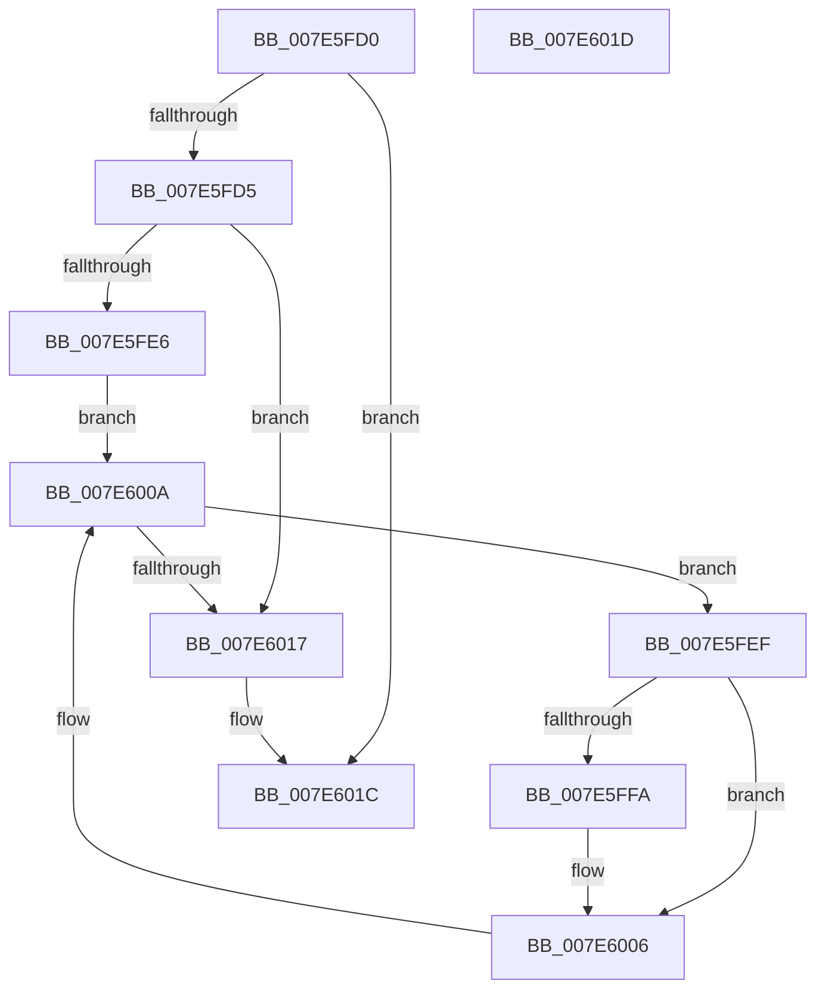

# wil_details_OnFeatureUsageProviderFlushNotification

- RVA: `0x007E5FD0`–`0x007E601E` (길이 `78` bytes)
- VA: `0x00000001407E5FD0`
- 실행 섹션: `PAGE`
- PDB 이름 있음: `예`; PDB Function 태그: `아니요`
- unwind 정보 RVA: `0x000805BC`
- 디코드: `26`개 명령, `78/78` bytes 표시
- 미해석 바이트: `0` (있으면 어셈블리에 `.byte`로 보존)

> 이 문서는 커널 이미지의 기계어와 PDB 기호를 분석해 생성했습니다. 4번과 5번은 함수 원형과 자료형을 바이너리 사용 방식에서 추정한 C 해석이며 원본 소스 복구 결과는 아닙니다.

## 1. Dependencies

- 직접 호출 지점: **2**; 고유 호출 대상: **2**
- 직접 호출자로 확인된 함수: **0**
- RIP 상대 이미지 참조: **2**

### Outgoing calls
- `0x007E6001` → [wil_details_RecordCachedUsage](../../text/4E/wil_details_RecordCachedUsage_function_004ED6CC.md) (function, `0x004ED6CC`)
- `0x007E600A` → [wil_details_FeatureDescriptors_SkipPadding](../../text/4C/wil_details_FeatureDescriptors_SkipPadding_function_004C9934.md) (function, `0x004C9934`)

### Direct callers
- 이 함수 시작 RVA로 연결되는 직접 call은 확인되지 않았습니다. 간접 호출은 완전히 역산할 수 없습니다.

### Static image references
- `0x007E5FDC` → RVA `0x00E0F458` (`.data`; read/write)
- `0x007E5FE6` → RVA `0x000DC0C0` (`.rdata`; read)

## 2. Other-region calls and transfers

- 다른 실행 섹션으로 향하는 call: **2**
  - `0x007E6001` → [wil_details_RecordCachedUsage](../../text/4E/wil_details_RecordCachedUsage_function_004ED6CC.md) (`PAGE` → `.text`)
  - `0x007E600A` → [wil_details_FeatureDescriptors_SkipPadding](../../text/4C/wil_details_FeatureDescriptors_SkipPadding_function_004C9934.md) (`PAGE` → `.text`)
- 별도 외부 분기/꼬리 이동을 확인하지 못했습니다.

## 3. Assembly (complete function range)

```asm
007E5FD0  83 F9 01                        cmp ecx, 1
007E5FD3  75 47                           jne 0x1407e601c
007E5FD5  53                              push rbx
007E5FD6  48 83 EC 20                     sub rsp, 0x20
007E5FDA  33 C0                           xor eax, eax
007E5FDC  87 05 76 94 62 00               xchg dword ptr [rip + 0x629476], eax
007E5FE2  85 C0                           test eax, eax
007E5FE4  74 31                           je 0x1407e6017
007E5FE6  48 8D 0D D3 60 8F FF            lea rcx, [rip - 0x709f2d]
007E5FED  EB 1B                           jmp 0x1407e600a
007E5FEF  48 8B 4B 08                     mov rcx, qword ptr [rbx + 8]
007E5FF3  8B 09                           mov ecx, dword ptr [rcx]
007E5FF5  F6 C1 01                        test cl, 1
007E5FF8  74 0C                           je 0x1407e6006
007E5FFA  48 8B 53 08                     mov rdx, qword ptr [rbx + 8]
007E5FFE  8B 4B 18                        mov ecx, dword ptr [rbx + 0x18]
007E6001  E8 C6 76 D0 FF                  call 0x1404ed6cc
007E6006  48 8D 4B 38                     lea rcx, [rbx + 0x38]
007E600A  E8 25 39 CE FF                  call 0x1404c9934
007E600F  48 8B D8                        mov rbx, rax
007E6012  48 85 C0                        test rax, rax
007E6015  75 D8                           jne 0x1407e5fef
007E6017  48 83 C4 20                     add rsp, 0x20
007E601B  5B                              pop rbx
007E601C  C3                              ret
007E601D  CC                              int3
```

## 4. C-style interpretation (structured pseudocode)

```c
__int64 __fastcall wil_details_OnFeatureUsageProviderFlushNotification(int a1)
{
    __int64 result;
    __int64 v_rsp;

    if (a1 != 1) goto loc_007E601C;
    v_rsp = (v_rsp) - (32);
    result = 0;
    if (0 == 0) goto loc_007E6017;
    goto loc_007E600A;
loc_007E5FEF:
    if ((((unsigned __int8)((unsigned int)(*(unsigned int *)(*(unsigned __int64 *)(v_rbx + 8))))) & (1)) != 0) {
        a2 = *(unsigned __int64 *)(v_rbx + 8);
        a1 = *(unsigned int *)(v_rbx + 24);
        result = wil_details_RecordCachedUsage(a1, a2, a3, a4);
    }
loc_007E600A:
    result = wil_details_FeatureDescriptors_SkipPadding(v_rbx + 56, a2, a3, a4);
    if (result != 0) goto loc_007E5FEF;
loc_007E6017:
    v_rsp = (v_rsp) + (32);
loc_007E601C:
    return result;
}
```

## 5. (Beta) C Style

```c
int64_t wil_details_OnFeatureUsageProviderFlushNotification(int32_t Arg1)
{
    int64_t result;
    int64_t local_rsp;

    if (Arg1 != 1) goto loc_007E601C;
    local_rsp = (local_rsp) - (32);
    result = 0;
    if (0 == 0) goto loc_007E6017;
    goto loc_007E600A;
loc_007E5FEF:
    if ((((uint8_t)((uint32_t)(*(uint32_t *)(*(uint64_t *)(local_rbx + 0x8))))) & (1)) != 0) {
        a2 = *(uint64_t *)(local_rbx + 0x8);
        Arg1 = *(uint32_t *)(local_rbx + 0x18);
        result = wil_details_RecordCachedUsage(Arg1, a2, a3, a4);
    }
loc_007E600A:
    result = wil_details_FeatureDescriptors_SkipPadding(local_rbx + 56, a2, a3, a4);
    if (result != 0) goto loc_007E5FEF;
loc_007E6017:
    local_rsp = (local_rsp) + (32);
loc_007E601C:
    return result;
}
```

## 6. Execution-region graph

[열기: 2D/3D 그래프와 함수 탐색 컨트롤 패널](../../../control-panel.html?section=page&rva=0x007E5FD0&view=graph)

- 2D 그래프는 위에서 아래로 흐르고, 3D 그래프는 빈 공간을 드래그해 회전합니다. Shift+드래그는 이동, 휠은 확대·축소, 함수 노드 선택은 대상 보고서 이동입니다.

### Static fallback


