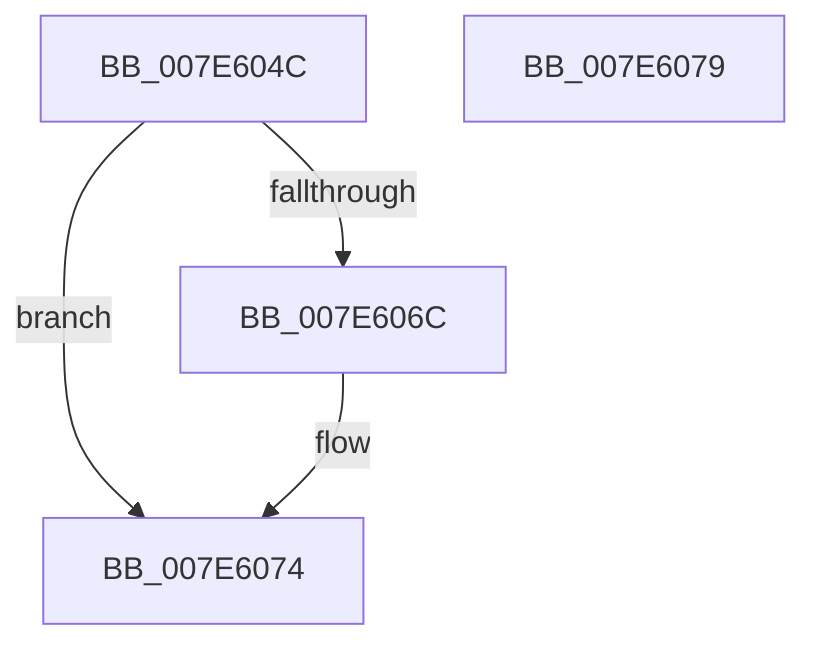

# wil_details_RegisterFeatureStagingChangeNotification

- RVA: `0x007E604C`–`0x007E607A` (길이 `46` bytes)
- VA: `0x00000001407E604C`
- 실행 섹션: `PAGE`
- PDB 이름 있음: `예`; PDB Function 태그: `아니요`
- unwind 정보 RVA: `0x0005C788`
- 디코드: `12`개 명령, `46/46` bytes 표시
- 미해석 바이트: `0` (있으면 어셈블리에 `.byte`로 보존)

> 이 문서는 커널 이미지의 기계어와 PDB 기호를 분석해 생성했습니다. 4번과 5번은 함수 원형과 자료형을 바이너리 사용 방식에서 추정한 C 해석이며 원본 소스 복구 결과는 아닙니다.

## 1. Dependencies

- 직접 호출 지점: **1**; 고유 호출 대상: **1**
- 직접 호출자로 확인된 함수: **1**
- RIP 상대 이미지 참조: **3**

### Outgoing calls
- `0x007E6063` → [RtlRegisterFeatureConfigurationChangeNotification](../../text/4D/RtlRegisterFeatureConfigurationChangeNotification_function_004D6350.md) (function, `0x004D6350`)

### Direct callers
- [CmInitSystem0](../../init/C5/CmInitSystem0_function_00C58E88.md) at `0x00C58EE7`

### Static image references
- `0x007E6050` → RVA `0x00FC49F0` (`.data`; read)
- `0x007E605C` → RVA `0x007E6030` (`wil_details_ReevaluateOnFeatureConfigurationChange`; read)
- `0x007E606C` → RVA `0x00FC49F0` (`.data`; read/write)

## 2. Other-region calls and transfers

- 다른 실행 섹션으로 향하는 call: **1**
  - `0x007E6063` → [RtlRegisterFeatureConfigurationChangeNotification](../../text/4D/RtlRegisterFeatureConfigurationChangeNotification_function_004D6350.md) (`PAGE` → `.text`)
- 별도 외부 분기/꼬리 이동을 확인하지 못했습니다.

## 3. Assembly (complete function range)

```asm
007E604C  48 83 EC 28                     sub rsp, 0x28
007E6050  4C 8D 0D 99 E9 7D 00            lea r9, [rip + 0x7de999]
007E6057  45 33 C0                        xor r8d, r8d
007E605A  33 D2                           xor edx, edx
007E605C  48 8D 0D CD FF FF FF            lea rcx, [rip - 0x33]
007E6063  E8 E8 02 CF FF                  call 0x1404d6350
007E6068  85 C0                           test eax, eax
007E606A  74 08                           je 0x1407e6074
007E606C  48 83 25 7C E9 7D 00 00         and qword ptr [rip + 0x7de97c], 0
007E6074  48 83 C4 28                     add rsp, 0x28
007E6078  C3                              ret
007E6079  CC                              int3
```

## 4. C-style interpretation (structured pseudocode)

```c
__int64 __fastcall wil_details_RegisterFeatureStagingChangeNotification(__int64 a1, int a2, int a3)
{
    __int64 result;
    __int64 v_rsp;

    v_rsp = (v_rsp) - (40);
    a3 = 0;
    a2 = 0;
    result = RtlRegisterFeatureConfigurationChangeNotification(v_rip - 51, a2, a3, v_rip + 8251801);
    if ((unsigned int)(result) != 0) {
    }
    v_rsp = (v_rsp) + (40);
    return result;
}
```

## 5. (Beta) C Style

```c
int64_t wil_details_RegisterFeatureStagingChangeNotification(int64_t Arg1, int32_t Arg2, int32_t Arg3)
{
    int64_t result;
    int64_t local_rsp;

    local_rsp = (local_rsp) - (40);
    Arg3 = 0;
    Arg2 = 0;
    result = RtlRegisterFeatureConfigurationChangeNotification(v_rip - 51, Arg2, Arg3, v_rip + 8251801);
    if ((uint32_t)(result) != 0) {
    }
    local_rsp = (local_rsp) + (40);
    return result;
}
```

## 6. Execution-region graph

[열기: 2D/3D 그래프와 함수 탐색 컨트롤 패널](../../../control-panel.html?section=page&rva=0x007E604C&view=graph)

- 2D 그래프는 위에서 아래로 흐르고, 3D 그래프는 빈 공간을 드래그해 회전합니다. Shift+드래그는 이동, 휠은 확대·축소, 함수 노드 선택은 대상 보고서 이동입니다.

### Static fallback


