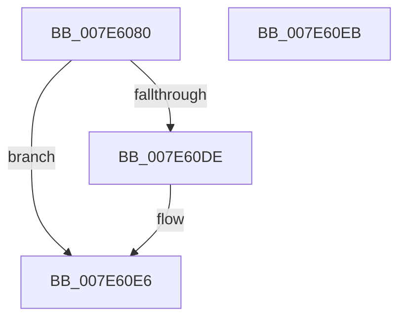

# wil_details_RegisterFeatureUsageProvider

- RVA: `0x007E6080`–`0x007E60EC` (길이 `108` bytes)
- VA: `0x00000001407E6080`
- 실행 섹션: `PAGE`
- PDB 이름 있음: `예`; PDB Function 태그: `아니요`
- unwind 정보 RVA: `0x00063458`
- 디코드: `21`개 명령, `108/108` bytes 표시
- 미해석 바이트: `0` (있으면 어셈블리에 `.byte`로 보존)

> 이 문서는 커널 이미지의 기계어와 PDB 기호를 분석해 생성했습니다. 4번과 5번은 함수 원형과 자료형을 바이너리 사용 방식에서 추정한 C 해석이며 원본 소스 복구 결과는 아닙니다.

## 1. Dependencies

- 직접 호출 지점: **2**; 고유 호출 대상: **2**
- 직접 호출자로 확인된 함수: **1**
- RIP 상대 이미지 참조: **7**

### Outgoing calls
- `0x007E609E` → [wil_details_FeatureDescriptors_SkipPadding](../../text/4C/wil_details_FeatureDescriptors_SkipPadding_function_004C9934.md) (function, `0x004C9934`)
- `0x007E60D5` → [CmFcManagerRegisterFeatureUsageProvider](../7F/CmFcManagerRegisterFeatureUsageProvider_function_007F48D4.md) (function, `0x007F48D4`)

### Direct callers
- [CmInitSystem0](../../init/C5/CmInitSystem0_function_00C58E88.md) at `0x00C58EEC`

### Static image references
- `0x007E6089` → RVA `0x0066AAB0` (`wil_details_RecordFeatureUsageReporting`; read)
- `0x007E6090` → RVA `0x000DC0C0` (`.rdata`; read)
- `0x007E6097` → RVA `0x00E0F4C8` (`.data`; write)
- `0x007E60A9` → RVA `0x00E0F3B0` (`.data`; read)
- `0x007E60BA` → RVA `0x000E0998` (`.rdata`; read)
- `0x007E60C9` → RVA `0x007E5FD0` (`wil_details_OnFeatureUsageProviderFlushNotification`; read)
- `0x007E60DE` → RVA `0x00E0F3B0` (`.data`; read/write)

## 2. Other-region calls and transfers

- 다른 실행 섹션으로 향하는 call: **1**
  - `0x007E609E` → [wil_details_FeatureDescriptors_SkipPadding](../../text/4C/wil_details_FeatureDescriptors_SkipPadding_function_004C9934.md) (`PAGE` → `.text`)
- 별도 외부 분기/꼬리 이동을 확인하지 못했습니다.

## 3. Assembly (complete function range)

```asm
007E6080  48 83 EC 48                     sub rsp, 0x48
007E6084  83 64 24 3C 00                  and dword ptr [rsp + 0x3c], 0
007E6089  48 8D 05 20 4A E8 FF            lea rax, [rip - 0x17b5e0]
007E6090  48 8D 0D 29 60 8F FF            lea rcx, [rip - 0x709fd7]
007E6097  48 89 05 2A 94 62 00            mov qword ptr [rip + 0x62942a], rax
007E609E  E8 91 38 CE FF                  call 0x1404c9934
007E60A3  48 83 64 24 30 00               and qword ptr [rsp + 0x30], 0
007E60A9  4C 8D 0D 00 93 62 00            lea r9, [rip + 0x629300]
007E60B0  48 89 44 24 20                  mov qword ptr [rsp + 0x20], rax
007E60B5  4C 8D 44 24 20                  lea r8, [rsp + 0x20]
007E60BA  48 8D 05 D7 A8 8F FF            lea rax, [rip - 0x705729]
007E60C1  C7 44 24 38 01 00 00 00         mov dword ptr [rsp + 0x38], 1
007E60C9  48 8D 15 00 FF FF FF            lea rdx, [rip - 0x100]
007E60D0  48 89 44 24 28                  mov qword ptr [rsp + 0x28], rax
007E60D5  E8 FA E7 00 00                  call 0x1407f48d4
007E60DA  85 C0                           test eax, eax
007E60DC  74 08                           je 0x1407e60e6
007E60DE  48 83 25 CA 92 62 00 00         and qword ptr [rip + 0x6292ca], 0
007E60E6  48 83 C4 48                     add rsp, 0x48
007E60EA  C3                              ret
007E60EB  CC                              int3
```

## 4. C-style interpretation (structured pseudocode)

```c
__int64 __fastcall wil_details_RegisterFeatureUsageProvider(void)
{
    __int64 result;
    __int64 v_rsp;
    unsigned int v_stack_m10;
    unsigned __int64 v_stack_m18;
    unsigned __int64 v_stack_m20;
    unsigned __int64 v_stack_m28;
    unsigned int v_stack_mC;

    v_rsp = (v_rsp) - (72);
    *(unsigned __int64 *)(v_rip + 6460458) = v_rip - 1553888;
    result = wil_details_FeatureDescriptors_SkipPadding(v_rip - 7380951, a2, a3, a4);
    v_stack_m28 = result;
    v_stack_m10 = 1;
    v_stack_m20 = v_rip - 7362345;
    result = CmFcManagerRegisterFeatureUsageProvider(v_rip - 7380951, v_rip - 256, v_stack_m28, v_rip + 6460160);
    if ((unsigned int)(result) != 0) {
    }
    v_rsp = (v_rsp) + (72);
    return result;
}
```

## 5. (Beta) C Style

```c
void wil_details_RegisterFeatureUsageProvider(void)
{
    int64_t result;
    int64_t local_rsp;
    uint32_t v_stack_m10;
    uint64_t v_stack_m18;
    uint64_t v_stack_m20;
    uint64_t v_stack_m28;
    uint32_t v_stack_mC;

    local_rsp = (local_rsp) - (72);
    *(uint64_t *)(v_rip + 0x62942A) = v_rip - 1553888;
    result = wil_details_FeatureDescriptors_SkipPadding(v_rip - 7380951, a2, a3, a4);
    v_stack_m28 = result;
    v_stack_m10 = 1;
    v_stack_m20 = v_rip - 7362345;
    result = CmFcManagerRegisterFeatureUsageProvider(v_rip - 7380951, v_rip - 256, v_stack_m28, v_rip + 6460160);
    if ((uint32_t)(result) != 0) {
    }
    local_rsp = (local_rsp) + (72);
    return result;
}
```

## 6. Execution-region graph

[열기: 2D/3D 그래프와 함수 탐색 컨트롤 패널](../../../control-panel.html?section=page&rva=0x007E6080&view=graph)

- 2D 그래프는 위에서 아래로 흐르고, 3D 그래프는 빈 공간을 드래그해 회전합니다. Shift+드래그는 이동, 휠은 확대·축소, 함수 노드 선택은 대상 보고서 이동입니다.

### Static fallback


