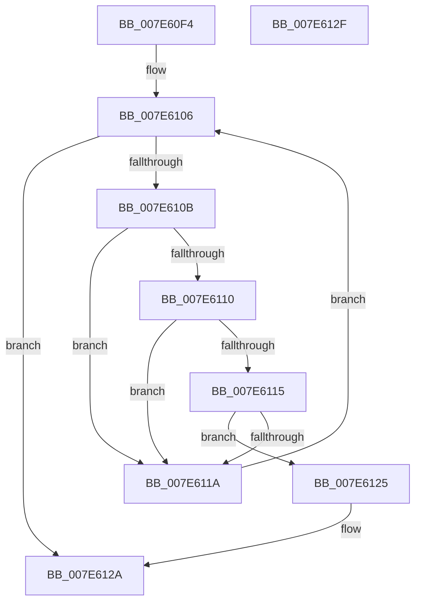

# wil_details_ShouldRegisterFeatureStagingChangeNotification

- RVA: `0x007E60F4`–`0x007E6130` (길이 `60` bytes)
- VA: `0x00000001407E60F4`
- 실행 섹션: `PAGE`
- PDB 이름 있음: `예`; PDB Function 태그: `아니요`
- unwind 정보 RVA: `0x0005C788`
- 디코드: `19`개 명령, `60/60` bytes 표시
- 미해석 바이트: `0` (있으면 어셈블리에 `.byte`로 보존)

> 이 문서는 커널 이미지의 기계어와 PDB 기호를 분석해 생성했습니다. 4번과 5번은 함수 원형과 자료형을 바이너리 사용 방식에서 추정한 C 해석이며 원본 소스 복구 결과는 아닙니다.

## 1. Dependencies

- 직접 호출 지점: **2**; 고유 호출 대상: **1**
- 직접 호출자로 확인된 함수: **1**
- RIP 상대 이미지 참조: **1**

### Outgoing calls
- `0x007E60FF` → [wil_details_FeatureDescriptors_SkipPadding](../../text/4C/wil_details_FeatureDescriptors_SkipPadding_function_004C9934.md) (function, `0x004C9934`)
- `0x007E611E` → [wil_details_FeatureDescriptors_SkipPadding](../../text/4C/wil_details_FeatureDescriptors_SkipPadding_function_004C9934.md) (function, `0x004C9934`)

### Direct callers
- [CmInitSystem0](../../init/C5/CmInitSystem0_function_00C58E88.md) at `0x00C58EDE`

### Static image references
- `0x007E60F8` → RVA `0x000DC0C0` (`.rdata`; read)

## 2. Other-region calls and transfers

- 다른 실행 섹션으로 향하는 call: **2**
  - `0x007E60FF` → [wil_details_FeatureDescriptors_SkipPadding](../../text/4C/wil_details_FeatureDescriptors_SkipPadding_function_004C9934.md) (`PAGE` → `.text`)
  - `0x007E611E` → [wil_details_FeatureDescriptors_SkipPadding](../../text/4C/wil_details_FeatureDescriptors_SkipPadding_function_004C9934.md) (`PAGE` → `.text`)
- 별도 외부 분기/꼬리 이동을 확인하지 못했습니다.

## 3. Assembly (complete function range)

```asm
007E60F4  48 83 EC 28                     sub rsp, 0x28
007E60F8  48 8D 0D C1 5F 8F FF            lea rcx, [rip - 0x70a03f]
007E60FF  E8 30 38 CE FF                  call 0x1404c9934
007E6104  33 D2                           xor edx, edx
007E6106  48 85 C0                        test rax, rax
007E6109  74 1F                           je 0x1407e612a
007E610B  38 50 1D                        cmp byte ptr [rax + 0x1d], dl
007E610E  75 0A                           jne 0x1407e611a
007E6110  38 50 1E                        cmp byte ptr [rax + 0x1e], dl
007E6113  75 05                           jne 0x1407e611a
007E6115  38 50 1C                        cmp byte ptr [rax + 0x1c], dl
007E6118  74 0B                           je 0x1407e6125
007E611A  48 8D 48 38                     lea rcx, [rax + 0x38]
007E611E  E8 11 38 CE FF                  call 0x1404c9934
007E6123  EB E1                           jmp 0x1407e6106
007E6125  B8 01 00 00 00                  mov eax, 1
007E612A  48 83 C4 28                     add rsp, 0x28
007E612E  C3                              ret
007E612F  CC                              int3
```

## 4. C-style interpretation (structured pseudocode)

```c
__int64 __fastcall wil_details_ShouldRegisterFeatureStagingChangeNotification(__int64 a1, int a2)
{
    __int64 result;
    __int64 v_rsp;

    v_rsp = (v_rsp) - (40);
    result = wil_details_FeatureDescriptors_SkipPadding(v_rip - 7381055, a2, a3, a4);
    a2 = 0;
loc_007E6106:
    if (result == 0) goto loc_007E612A;
    if ((*(unsigned __int8 *)(result + 29)) != 0) goto loc_007E611A;
    if ((*(unsigned __int8 *)(result + 30)) != 0) goto loc_007E611A;
    if ((*(unsigned __int8 *)(result + 28)) == 0) goto loc_007E6125;
loc_007E611A:
    result = wil_details_FeatureDescriptors_SkipPadding(result + 56, a2, a3, a4);
    goto loc_007E6106;
loc_007E6125:
loc_007E612A:
    v_rsp = (v_rsp) + (40);
    return 1;
}
```

## 5. (Beta) C Style

```c
int64_t wil_details_ShouldRegisterFeatureStagingChangeNotification(int64_t Arg1, int32_t Arg2)
{
    int64_t result;
    int64_t local_rsp;

    local_rsp = (local_rsp) - (40);
    result = wil_details_FeatureDescriptors_SkipPadding(v_rip - 7381055, Arg2, a3, a4);
    Arg2 = 0;
loc_007E6106:
    if (result == 0) goto loc_007E612A;
    if ((*(uint8_t *)(result + 0x1D)) != 0) goto loc_007E611A;
    if ((*(uint8_t *)(result + 0x1E)) != 0) goto loc_007E611A;
    if ((*(uint8_t *)(result + 0x1C)) == 0) goto loc_007E6125;
loc_007E611A:
    result = wil_details_FeatureDescriptors_SkipPadding(result + 56, Arg2, a3, a4);
    goto loc_007E6106;
loc_007E6125:
loc_007E612A:
    local_rsp = (local_rsp) + (40);
    return 1;
}
```

## 6. Execution-region graph

[열기: 2D/3D 그래프와 함수 탐색 컨트롤 패널](../../../control-panel.html?section=page&rva=0x007E60F4&view=graph)

- 2D 그래프는 위에서 아래로 흐르고, 3D 그래프는 빈 공간을 드래그해 회전합니다. Shift+드래그는 이동, 휠은 확대·축소, 함수 노드 선택은 대상 보고서 이동입니다.

### Static fallback


