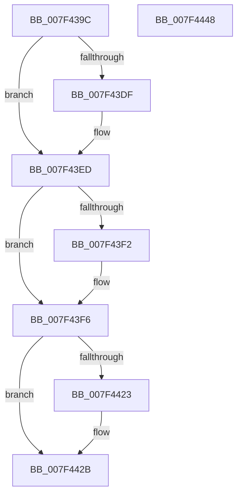

# CmFcManagerDrainAllFeatureUsageNotifications

- RVA: `0x007F439C`–`0x007F4449` (길이 `173` bytes)
- VA: `0x00000001407F439C`
- 실행 섹션: `PAGE`
- PDB 이름 있음: `예`; PDB Function 태그: `아니요`
- unwind 정보 RVA: `0x00060BC4`
- 디코드: `44`개 명령, `173/173` bytes 표시
- 미해석 바이트: `0` (있으면 어셈블리에 `.byte`로 보존)

> 이 문서는 커널 이미지의 기계어와 PDB 기호를 분석해 생성했습니다. 4번과 5번은 함수 원형과 자료형을 바이너리 사용 방식에서 추정한 C 해석이며 원본 소스 복구 결과는 아닙니다.

## 1. Dependencies

- 직접 호출 지점: **7**; 고유 호출 대상: **6**
- 직접 호출자로 확인된 함수: **1**
- RIP 상대 이미지 참조: **3**

### Outgoing calls
- `0x007F43CF` → [KeAbPreAcquire](../../text/21/KeAbPreAcquire_function_00210230.md) (function, `0x00210230`)
- `0x007F43E8` → [ExfAcquirePushLockExclusiveEx](../../text/20/ExfAcquirePushLockExclusiveEx_function_0020FC90.md) (function, `0x0020FC90`)
- `0x007F43FF` → [CmFcpManagerDrainUsageNotifications](../A4/CmFcpManagerDrainUsageNotifications_function_00A451BC.md) (function, `0x00A451BC`)
- `0x007F440D` → [CmFcpManagerDrainUsageNotifications](../A4/CmFcpManagerDrainUsageNotifications_function_00A451BC.md) (function, `0x00A451BC`)
- `0x007F4426` → [ExfTryToWakePushLock](../../text/26/ExfTryToWakePushLock_function_00265DD0.md) (function, `0x00265DD0`)
- `0x007F442E` → [KeAbPostRelease](../../text/2E/KeAbPostRelease_function_002E1600.md) (function, `0x002E1600`)
- `0x007F4433` → [KeLeaveCriticalRegion](../../text/25/KeLeaveCriticalRegion_function_0025D8B0.md) (function, `0x0025D8B0`)

### Direct callers
- [CmFcShutdownSystem](../7E/CmFcShutdownSystem_function_007E5BC4.md) at `0x007E5BCD`

### Static image references
- `0x007F43B4` → RVA `0x00EF7470` (`.data`; read)
- `0x007F43F8` → RVA `0x00EF72E0` (`.data`; read)
- `0x007F4412` → RVA `0x00EF7470` (`.data`; read/write)

## 2. Other-region calls and transfers

- 다른 실행 섹션으로 향하는 call: **5**
  - `0x007F43CF` → [KeAbPreAcquire](../../text/21/KeAbPreAcquire_function_00210230.md) (`PAGE` → `.text`)
  - `0x007F43E8` → [ExfAcquirePushLockExclusiveEx](../../text/20/ExfAcquirePushLockExclusiveEx_function_0020FC90.md) (`PAGE` → `.text`)
  - `0x007F4426` → [ExfTryToWakePushLock](../../text/26/ExfTryToWakePushLock_function_00265DD0.md) (`PAGE` → `.text`)
  - `0x007F442E` → [KeAbPostRelease](../../text/2E/KeAbPostRelease_function_002E1600.md) (`PAGE` → `.text`)
  - `0x007F4433` → [KeLeaveCriticalRegion](../../text/25/KeLeaveCriticalRegion_function_0025D8B0.md) (`PAGE` → `.text`)
- 별도 외부 분기/꼬리 이동을 확인하지 못했습니다.

## 3. Assembly (complete function range)

```asm
007F439C  48 89 5C 24 08                  mov qword ptr [rsp + 8], rbx
007F43A1  48 89 74 24 10                  mov qword ptr [rsp + 0x10], rsi
007F43A6  57                              push rdi
007F43A7  48 83 EC 20                     sub rsp, 0x20
007F43AB  65 48 8B 04 25 88 01 00 00      mov rax, qword ptr gs:[0x188]
007F43B4  48 8D 35 B5 30 70 00            lea rsi, [rip + 0x7030b5]
007F43BB  48 83 CB FF                     or rbx, 0xffffffffffffffff
007F43BF  45 33 C0                        xor r8d, r8d
007F43C2  33 D2                           xor edx, edx
007F43C4  48 8B CE                        mov rcx, rsi
007F43C7  66 01 98 E4 01 00 00            add word ptr [rax + 0x1e4], bx
007F43CE  90                              nop
007F43CF  E8 5C BE A1 FF                  call 0x140210230
007F43D4  F0 48 0F BA 2E 00               lock bts qword ptr [rsi], 0
007F43DA  48 8B F8                        mov rdi, rax
007F43DD  73 0E                           jae 0x1407f43ed
007F43DF  4C 8B C6                        mov r8, rsi
007F43E2  48 8B D0                        mov rdx, rax
007F43E5  48 8B CE                        mov rcx, rsi
007F43E8  E8 A3 B8 A1 FF                  call 0x14020fc90
007F43ED  48 85 FF                        test rdi, rdi
007F43F0  74 04                           je 0x1407f43f6
007F43F2  C6 47 0A 01                     mov byte ptr [rdi + 0xa], 1
007F43F6  B2 01                           mov dl, 1
007F43F8  48 8D 0D E1 2E 70 00            lea rcx, [rip + 0x702ee1]
007F43FF  E8 B8 0D 25 00                  call 0x140a451bc
007F4404  B2 01                           mov dl, 1
007F4406  48 8D 0D D3 2E 70 00            lea rcx, [rip + 0x702ed3]
007F440D  E8 AA 0D 25 00                  call 0x140a451bc
007F4412  F0 48 0F C1 1D 55 30 70 00      lock xadd qword ptr [rip + 0x703055], rbx
007F441B  80 E3 06                        and bl, 6
007F441E  80 FB 02                        cmp bl, 2
007F4421  75 08                           jne 0x1407f442b
007F4423  48 8B CE                        mov rcx, rsi
007F4426  E8 A5 19 A7 FF                  call 0x140265dd0
007F442B  48 8B CE                        mov rcx, rsi
007F442E  E8 CD D1 AE FF                  call 0x1402e1600
007F4433  E8 78 94 A6 FF                  call 0x14025d8b0
007F4438  48 8B 5C 24 30                  mov rbx, qword ptr [rsp + 0x30]
007F443D  48 8B 74 24 38                  mov rsi, qword ptr [rsp + 0x38]
007F4442  48 83 C4 20                     add rsp, 0x20
007F4446  5F                              pop rdi
007F4447  C3                              ret
007F4448  CC                              int3
```

## 4. C-style interpretation (structured pseudocode)

```c
__int64 __fastcall CmFcManagerDrainAllFeatureUsageNotifications(__int64 a1, int a2, int a3)
{
    __int64 result;
    __int64 v_rbx;
    __int64 v_rsp;
    unsigned __int64 v_stack_p10;
    unsigned __int64 v_stack_p8;

    v_stack_p8 = v_rbx;
    v_stack_p10 = v_rsi;
    v_rsp = (v_rsp) - (32);
    v_rbx = (v_rbx) | (-1);
    a3 = 0;
    a2 = 0;
    result = KeAbPreAcquire(v_rip + 7352501, a2, a3, a4);
    if (!(condition_is_above_or_equal)) {
        a3 = v_rip + 7352501;
        a2 = result;
        a1 = v_rip + 7352501;
        result = ExfAcquirePushLockExclusiveEx(a1, a2, a3, a4);
    }
    if (result != 0) {
        *(unsigned __int8 *)(result + 10) = 1;
    }
    result = CmFcpManagerDrainUsageNotifications(v_rip + 7352033, 1, a3, a4);
    result = CmFcpManagerDrainUsageNotifications(v_rip + 7352019, 1, a3, a4);
    v_rbx = (unsigned __int8)((v_rbx) & (6));
    if (((unsigned __int8)(v_rbx)) == 2) {
        a1 = v_rip + 7352501;
        result = ExfTryToWakePushLock(a1, 1, a3, a4);
    }
    result = KeAbPostRelease(v_rip + 7352501, 1, a3, a4);
    result = KeLeaveCriticalRegion(v_rip + 7352501, 1, a3, a4);
    v_rsp = (v_rsp) + (32);
    return result;
}
```

## 5. (Beta) C Style

```c
int64_t CmFcManagerDrainAllFeatureUsageNotifications(int64_t Arg1, int32_t Arg2, int32_t Arg3)
{
    int64_t result;
    int64_t local_rbx;
    int64_t local_rsp;
    uint64_t v_stack_p10;
    uint64_t v_stack_p8;

    v_stack_p8 = local_rbx;
    v_stack_p10 = local_rsi;
    local_rsp = (local_rsp) - (32);
    local_rbx = (local_rbx) | (-1);
    Arg3 = 0;
    Arg2 = 0;
    result = KeAbPreAcquire(v_rip + 7352501, Arg2, Arg3, a4);
    if (!(condition_is_above_or_equal)) {
        Arg3 = v_rip + 7352501;
        Arg2 = result;
        Arg1 = v_rip + 7352501;
        result = ExfAcquirePushLockExclusiveEx(Arg1, Arg2, Arg3, a4);
    }
    if (result != 0) {
        *(uint8_t *)(result + 0xA) = 1;
    }
    result = CmFcpManagerDrainUsageNotifications(v_rip + 7352033, 1, Arg3, a4);
    result = CmFcpManagerDrainUsageNotifications(v_rip + 7352019, 1, Arg3, a4);
    local_rbx = (uint8_t)((local_rbx) & (6));
    if (((uint8_t)(local_rbx)) == 2) {
        Arg1 = v_rip + 7352501;
        result = ExfTryToWakePushLock(Arg1, 1, Arg3, a4);
    }
    result = KeAbPostRelease(v_rip + 7352501, 1, Arg3, a4);
    result = KeLeaveCriticalRegion(v_rip + 7352501, 1, Arg3, a4);
    local_rsp = (local_rsp) + (32);
    return result;
}
```

## 6. Execution-region graph

[열기: 2D/3D 그래프와 함수 탐색 컨트롤 패널](../../../control-panel.html?section=page&rva=0x007F439C&view=graph)

- 2D 그래프는 위에서 아래로 흐르고, 3D 그래프는 빈 공간을 드래그해 회전합니다. Shift+드래그는 이동, 휠은 확대·축소, 함수 노드 선택은 대상 보고서 이동입니다.

### Static fallback


