# CmFcManagerOverwriteFeatureConfigurationSection

- RVA: `0x007F4450`–`0x007F48CC` (길이 `1,148` bytes)
- VA: `0x00000001407F4450`
- 실행 섹션: `PAGE`
- PDB 이름 있음: `예`; PDB Function 태그: `아니요`
- unwind 정보 RVA: `0x000D7480`
- 디코드: `272`개 명령, `1,148/1,148` bytes 표시
- 미해석 바이트: `0` (있으면 어셈블리에 `.byte`로 보존)

> 이 문서는 커널 이미지의 기계어와 PDB 기호를 분석해 생성했습니다. 4번과 5번은 함수 원형과 자료형을 바이너리 사용 방식에서 추정한 C 해석이며 원본 소스 복구 결과는 아닙니다.

## 1. Dependencies

- 직접 호출 지점: **31**; 고유 호출 대상: **22**
- 직접 호출자로 확인된 함수: **1**
- RIP 상대 이미지 참조: **14**

### Outgoing calls
- `0x007F44B3` → [memset](../../text/6C/memset_function_006C6C40.md) (function, `0x006C6C40`)
- `0x007F44C7` → [RtlpFcValidateFeatureConfigurationBuffer](../AD/RtlpFcValidateFeatureConfigurationBuffer_function_00AD14DC.md) (function, `0x00AD14DC`)
- `0x007F44F3` → [tlgKeywordOn](../../text/42/tlgKeywordOn_function_0042EAA0.md) (function, `0x0042EAA0`)
- `0x007F453F` → [tlgWriteTransfer_EtwWriteTransfer](../../text/42/tlgWriteTransfer_EtwWriteTransfer_function_004260E0.md) (function, `0x004260E0`)
- `0x007F459A` → [KeAbPreAcquire](../../text/21/KeAbPreAcquire_function_00210230.md) (function, `0x00210230`)
- `0x007F45B3` → [ExfAcquirePushLockExclusiveEx](../../text/20/ExfAcquirePushLockExclusiveEx_function_0020FC90.md) (function, `0x0020FC90`)
- `0x007F45D2` → [RtlpFcBufferManagerReferenceBuffers](../../text/4A/RtlpFcBufferManagerReferenceBuffers_function_004A73B8.md) (function, `0x004A73B8`)
- `0x007F4610` → [ExfTryToWakePushLock](../../text/26/ExfTryToWakePushLock_function_00265DD0.md) (function, `0x00265DD0`)
- `0x007F461C` → [KeAbPostRelease](../../text/2E/KeAbPostRelease_function_002E1600.md) (function, `0x002E1600`)
- `0x007F4632` → [RtlpFcBufferManagerDereferenceBuffers](../../text/37/RtlpFcBufferManagerDereferenceBuffers_function_00378D84.md) (function, `0x00378D84`)
- `0x007F4647` → [CmFcpUnmapSection](../A4/CmFcpUnmapSection_function_00A44B8C.md) (function, `0x00A44B8C`)
- `0x007F465A` → [CmFcpCleanupSectionState](../A3/CmFcpCleanupSectionState_function_00A304B4.md) (function, `0x00A304B4`)
- `0x007F4666` → [KeLeaveCriticalRegion](../../text/25/KeLeaveCriticalRegion_function_0025D8B0.md) (function, `0x0025D8B0`)
- `0x007F4674` → [_security_check_cookie](../../text/6A/_security_check_cookie_function_006AC640.md) (function, `0x006AC640`)
- `0x007F46C6` → [CmFcpManagerCreateSectionFromBuffer](CmFcpManagerCreateSectionFromBuffer_function_007F5438.md) (function, `0x007F5438`)
- `0x007F46DD` → [CmFcpMapSection](../AC/CmFcpMapSection_function_00AC1714.md) (function, `0x00AC1714`)
- `0x007F4717` → [CmFcpManagerCreateSection](../AD/CmFcpManagerCreateSection_function_00ADA3BC.md) (function, `0x00ADA3BC`)
- `0x007F472E` → [CmFcpMapSection](../AC/CmFcpMapSection_function_00AC1714.md) (function, `0x00AC1714`)
- `0x007F4766` → [RtlpFcUpdateGovernedFeaturesEffectiveStates](../78/RtlpFcUpdateGovernedFeaturesEffectiveStates_function_0078F658.md) (function, `0x0078F658`)
- `0x007F477D` → [RtlpFcValidateGovernedFeatures](../../text/5F/RtlpFcValidateGovernedFeatures_function_005F0E18.md) (function, `0x005F0E18`)
- `0x007F478C` → [RtlpFcBufferManagerDereferenceBuffers](../../text/37/RtlpFcBufferManagerDereferenceBuffers_function_00378D84.md) (function, `0x00378D84`)
- `0x007F47A0` → [KeAbPreAcquire](../../text/21/KeAbPreAcquire_function_00210230.md) (function, `0x00210230`)
- `0x007F47B9` → [ExfAcquirePushLockExclusiveEx](../../text/20/ExfAcquirePushLockExclusiveEx_function_0020FC90.md) (function, `0x0020FC90`)
- `0x007F4848` → [RtlpFcBufferManagerUpdateBuffers](../A4/RtlpFcBufferManagerUpdateBuffers_function_00A44DB0.md) (function, `0x00A44DB0`)
- `0x007F4857` → [RtlpFcWriteHighLowHigh](../../text/4C/RtlpFcWriteHighLowHigh_function_004C84BC.md) (function, `0x004C84BC`)
- `0x007F486D` → [RtlpFcWriteHighLowHigh](../../text/4C/RtlpFcWriteHighLowHigh_function_004C84BC.md) (function, `0x004C84BC`)
- `0x007F4887` → [ExfTryToWakePushLock](../../text/26/ExfTryToWakePushLock_function_00265DD0.md) (function, `0x00265DD0`)
- `0x007F488F` → [KeAbPostRelease](../../text/2E/KeAbPostRelease_function_002E1600.md) (function, `0x002E1600`)
- `0x007F48AC` → [ExfTryToWakePushLock](../../text/26/ExfTryToWakePushLock_function_00265DD0.md) (function, `0x00265DD0`)
- `0x007F48B8` → [KeAbPostRelease](../../text/2E/KeAbPostRelease_function_002E1600.md) (function, `0x002E1600`)
- `0x007F48C0` → [CmFcpManagerPublishChangeNotifications](../A4/CmFcpManagerPublishChangeNotifications_function_00A44E94.md) (function, `0x00A44E94`)

### Direct callers
- [CmUpdateFeatureConfiguration](../7E/CmUpdateFeatureConfiguration_function_007E5C10.md) at `0x007E5DD6`

### Static image references
- `0x007F446C` → RVA `0x00E0A740` (`.data`; read)
- `0x007F44D5` → RVA `0x00E09F20` (`.data`; read)
- `0x007F450B` → RVA `0x000575E8` (`.rdata`; read)
- `0x007F4555` → RVA `0x00EF72F0` (`.data`; read)
- `0x007F45CB` → RVA `0x00EF7368` (`.data`; read)
- `0x007F45F8` → RVA `0x00EF72F0` (`.data`; read/write)
- `0x007F46A8` → RVA `0x00EF72E0` (`.data`; read)
- `0x007F4791` → RVA `0x00EF72E8` (`.data`; read)
- `0x007F481D` → RVA `0x00EF7350` (`.data`; write)
- `0x007F4828` → RVA `0x00EF7358` (`.data`; write)
- `0x007F4833` → RVA `0x00EF7360` (`.data`; write)
- `0x007F4850` → RVA `0x00EF72F8` (`.data`; read)
- `0x007F485C` → RVA `0x00FC5008` (`ALMOSTRO`; read)
- `0x007F4875` → RVA `0x00EF72E8` (`.data`; read/write)

## 2. Other-region calls and transfers

- 다른 실행 섹션으로 향하는 call: **21**
  - `0x007F44B3` → [memset](../../text/6C/memset_function_006C6C40.md) (`PAGE` → `.text`)
  - `0x007F44F3` → [tlgKeywordOn](../../text/42/tlgKeywordOn_function_0042EAA0.md) (`PAGE` → `.text`)
  - `0x007F453F` → [tlgWriteTransfer_EtwWriteTransfer](../../text/42/tlgWriteTransfer_EtwWriteTransfer_function_004260E0.md) (`PAGE` → `.text`)
  - `0x007F459A` → [KeAbPreAcquire](../../text/21/KeAbPreAcquire_function_00210230.md) (`PAGE` → `.text`)
  - `0x007F45B3` → [ExfAcquirePushLockExclusiveEx](../../text/20/ExfAcquirePushLockExclusiveEx_function_0020FC90.md) (`PAGE` → `.text`)
  - `0x007F45D2` → [RtlpFcBufferManagerReferenceBuffers](../../text/4A/RtlpFcBufferManagerReferenceBuffers_function_004A73B8.md) (`PAGE` → `.text`)
  - `0x007F4610` → [ExfTryToWakePushLock](../../text/26/ExfTryToWakePushLock_function_00265DD0.md) (`PAGE` → `.text`)
  - `0x007F461C` → [KeAbPostRelease](../../text/2E/KeAbPostRelease_function_002E1600.md) (`PAGE` → `.text`)
  - `0x007F4632` → [RtlpFcBufferManagerDereferenceBuffers](../../text/37/RtlpFcBufferManagerDereferenceBuffers_function_00378D84.md) (`PAGE` → `.text`)
  - `0x007F4666` → [KeLeaveCriticalRegion](../../text/25/KeLeaveCriticalRegion_function_0025D8B0.md) (`PAGE` → `.text`)
  - `0x007F4674` → [_security_check_cookie](../../text/6A/_security_check_cookie_function_006AC640.md) (`PAGE` → `.text`)
  - `0x007F477D` → [RtlpFcValidateGovernedFeatures](../../text/5F/RtlpFcValidateGovernedFeatures_function_005F0E18.md) (`PAGE` → `.text`)
  - `0x007F478C` → [RtlpFcBufferManagerDereferenceBuffers](../../text/37/RtlpFcBufferManagerDereferenceBuffers_function_00378D84.md) (`PAGE` → `.text`)
  - `0x007F47A0` → [KeAbPreAcquire](../../text/21/KeAbPreAcquire_function_00210230.md) (`PAGE` → `.text`)
  - `0x007F47B9` → [ExfAcquirePushLockExclusiveEx](../../text/20/ExfAcquirePushLockExclusiveEx_function_0020FC90.md) (`PAGE` → `.text`)
  - `0x007F4857` → [RtlpFcWriteHighLowHigh](../../text/4C/RtlpFcWriteHighLowHigh_function_004C84BC.md) (`PAGE` → `.text`)
  - `0x007F486D` → [RtlpFcWriteHighLowHigh](../../text/4C/RtlpFcWriteHighLowHigh_function_004C84BC.md) (`PAGE` → `.text`)
  - `0x007F4887` → [ExfTryToWakePushLock](../../text/26/ExfTryToWakePushLock_function_00265DD0.md) (`PAGE` → `.text`)
  - `0x007F488F` → [KeAbPostRelease](../../text/2E/KeAbPostRelease_function_002E1600.md) (`PAGE` → `.text`)
  - `0x007F48AC` → [ExfTryToWakePushLock](../../text/26/ExfTryToWakePushLock_function_00265DD0.md) (`PAGE` → `.text`)
  - `0x007F48B8` → [KeAbPostRelease](../../text/2E/KeAbPostRelease_function_002E1600.md) (`PAGE` → `.text`)
- 별도 외부 분기/꼬리 이동을 확인하지 못했습니다.

## 3. Assembly (complete function range)

```asm
007F4450  48 89 5C 24 08                  mov qword ptr [rsp + 8], rbx
007F4455  55                              push rbp
007F4456  56                              push rsi
007F4457  57                              push rdi
007F4458  41 54                           push r12
007F445A  41 55                           push r13
007F445C  41 56                           push r14
007F445E  41 57                           push r15
007F4460  48 8D 6C 24 C0                  lea rbp, [rsp - 0x40]
007F4465  48 81 EC 40 01 00 00            sub rsp, 0x140
007F446C  48 8B 05 CD 62 61 00            mov rax, qword ptr [rip + 0x6162cd]
007F4473  48 33 C4                        xor rax, rsp
007F4476  48 89 45 30                     mov qword ptr [rbp + 0x30], rax
007F447A  33 F6                           xor esi, esi
007F447C  49 63 D8                        movsxd rbx, r8d
007F447F  33 C0                           xor eax, eax
007F4481  48 89 74 24 78                  mov qword ptr [rsp + 0x78], rsi
007F4486  4C 8B E2                        mov r12, rdx
007F4489  48 89 74 24 48                  mov qword ptr [rsp + 0x48], rsi
007F448E  0F 57 C0                        xorps xmm0, xmm0
007F4491  48 89 44 24 60                  mov qword ptr [rsp + 0x60], rax
007F4496  0F 57 C9                        xorps xmm1, xmm1
007F4499  48 89 45 90                     mov qword ptr [rbp - 0x70], rax
007F449D  44 8D 46 60                     lea r8d, [rsi + 0x60]
007F44A1  33 D2                           xor edx, edx
007F44A3  48 8D 4D A0                     lea rcx, [rbp - 0x60]
007F44A7  4D 8B F9                        mov r15, r9
007F44AA  0F 11 44 24 50                  movups xmmword ptr [rsp + 0x50], xmm0
007F44AF  0F 11 4D 80                     movups xmmword ptr [rbp - 0x80], xmm1
007F44B3  E8 88 27 ED FF                  call 0x1406c6c40
007F44B8  48 8B 95 A0 00 00 00            mov rdx, qword ptr [rbp + 0xa0]
007F44BF  49 8B CF                        mov rcx, r15
007F44C2  40 88 74 24 40                  mov byte ptr [rsp + 0x40], sil
007F44C7  E8 10 D0 2D 00                  call 0x140ad14dc
007F44CC  8D 56 01                        lea edx, [rsi + 1]
007F44CF  8B F8                           mov edi, eax
007F44D1  85 C0                           test eax, eax
007F44D3  79 74                           jns 0x1407f4549
007F44D5  83 3D 44 5A 61 00 05            cmp dword ptr [rip + 0x615a44], 5
007F44DC  0F 86 55 01 00 00               jbe 0x1407f4637
007F44E2  48 BA 01 00 00 00 00 40 00 00   movabs rdx, 0x400000000001
007F44EC  48 8D 0D 2D 5A 61 00            lea rcx, [rip + 0x615a2d]
007F44F3  E8 A8 A5 C3 FF                  call 0x14042eaa0
007F44F8  84 C0                           test al, al
007F44FA  0F 84 37 01 00 00               je 0x1407f4637
007F4500  21 75 2C                        and dword ptr [rbp + 0x2c], esi
007F4503  48 8D 45 98                     lea rax, [rbp - 0x68]
007F4507  48 89 45 20                     mov qword ptr [rbp + 0x20], rax
007F450B  48 8D 15 D6 30 86 FF            lea rdx, [rip - 0x79cf2a]
007F4512  48 8D 45 00                     lea rax, [rbp]
007F4516  48 C7 45 98 00 00 00 01         mov qword ptr [rbp - 0x68], 0x1000000
007F451E  48 89 44 24 28                  mov qword ptr [rsp + 0x28], rax
007F4523  48 8D 0D F6 59 61 00            lea rcx, [rip + 0x6159f6]
007F452A  45 33 C9                        xor r9d, r9d
007F452D  C7 44 24 20 03 00 00 00         mov dword ptr [rsp + 0x20], 3
007F4535  45 33 C0                        xor r8d, r8d
007F4538  C7 45 28 08 00 00 00            mov dword ptr [rbp + 0x28], 8
007F453F  E8 9C 1B C3 FF                  call 0x1404260e0
007F4544  E9 EE 00 00 00                  jmp 0x1407f4637
007F4549  89 54 24 74                     mov dword ptr [rsp + 0x74], edx
007F454D  4C 8D 6D A0                     lea r13, [rbp - 0x60]
007F4551  89 54 24 6C                     mov dword ptr [rsp + 0x6c], edx
007F4555  4C 8D 35 94 2D 70 00            lea r14, [rip + 0x702d94]
007F455C  88 54 24 40                     mov byte ptr [rsp + 0x40], dl
007F4560  45 33 C0                        xor r8d, r8d
007F4563  89 74 24 70                     mov dword ptr [rsp + 0x70], esi
007F4567  33 D2                           xor edx, edx
007F4569  8B 44 9C 70                     mov eax, dword ptr [rsp + rbx*4 + 0x70]
007F456D  89 74 24 68                     mov dword ptr [rsp + 0x68], esi
007F4571  8B 4C 9C 68                     mov ecx, dword ptr [rsp + rbx*4 + 0x68]
007F4575  48 83 CB FF                     or rbx, 0xffffffffffffffff
007F4579  89 4C 24 44                     mov dword ptr [rsp + 0x44], ecx
007F457D  48 8D 0C 40                     lea rcx, [rax + rax*2]
007F4581  65 48 8B 04 25 88 01 00 00      mov rax, qword ptr gs:[0x188]
007F458A  4D 8D 6C CD 00                  lea r13, [r13 + rcx*8]
007F458F  49 8B CE                        mov rcx, r14
007F4592  66 01 98 E4 01 00 00            add word ptr [rax + 0x1e4], bx
007F4599  90                              nop
007F459A  E8 91 BC A1 FF                  call 0x140210230
007F459F  F0 49 0F BA 2E 00               lock bts qword ptr [r14], 0
007F45A5  48 8B F8                        mov rdi, rax
007F45A8  73 0E                           jae 0x1407f45b8
007F45AA  4D 8B C6                        mov r8, r14
007F45AD  48 8B D0                        mov rdx, rax
007F45B0  49 8B CE                        mov rcx, r14
007F45B3  E8 D8 B6 A1 FF                  call 0x14020fc90
007F45B8  48 85 FF                        test rdi, rdi
007F45BB  74 04                           je 0x1407f45c1
007F45BD  C6 47 0A 01                     mov byte ptr [rdi + 0xa], 1
007F45C1  4C 8D 44 24 48                  lea r8, [rsp + 0x48]
007F45C6  48 8D 54 24 78                  lea rdx, [rsp + 0x78]
007F45CB  48 8D 0D 96 2D 70 00            lea rcx, [rip + 0x702d96]
007F45D2  E8 E1 2D CB FF                  call 0x1404a73b8
007F45D7  4C 8B 74 24 48                  mov r14, qword ptr [rsp + 0x48]
007F45DC  48 8B 74 24 78                  mov rsi, qword ptr [rsp + 0x78]
007F45E1  4D 85 E4                        test r12, r12
007F45E4  0F 84 AB 00 00 00               je 0x1407f4695
007F45EA  49 3B F4                        cmp rsi, r12
007F45ED  0F 84 A2 00 00 00               je 0x1407f4695
007F45F3  BF 01 00 00 C0                  mov edi, 0xc0000001
007F45F8  F0 48 0F C1 1D EF 2C 70 00      lock xadd qword ptr [rip + 0x702cef], rbx
007F4601  80 E3 06                        and bl, 6
007F4604  80 FB 02                        cmp bl, 2
007F4607  75 0C                           jne 0x1407f4615
007F4609  48 8D 0D E0 2C 70 00            lea rcx, [rip + 0x702ce0]
007F4610  E8 BB 17 A7 FF                  call 0x140265dd0
007F4615  48 8D 0D D4 2C 70 00            lea rcx, [rip + 0x702cd4]
007F461C  E8 DF CF AE FF                  call 0x1402e1600
007F4621  48 8B 54 24 48                  mov rdx, qword ptr [rsp + 0x48]
007F4626  48 85 D2                        test rdx, rdx
007F4629  74 0C                           je 0x1407f4637
007F462B  48 8D 0D 36 2D 70 00            lea rcx, [rip + 0x702d36]
007F4632  E8 4D 47 B8 FF                  call 0x140378d84
007F4637  BE 04 00 00 00                  mov esi, 4
007F463C  48 8D 5D A0                     lea rbx, [rbp - 0x60]
007F4640  44 8D 76 FD                     lea r14d, [rsi - 3]
007F4644  48 8B CB                        mov rcx, rbx
007F4647  E8 40 05 25 00                  call 0x140a44b8c
007F464C  48 83 C3 18                     add rbx, 0x18
007F4650  49 2B F6                        sub rsi, r14
007F4653  75 EF                           jne 0x1407f4644
007F4655  48 8D 4C 24 50                  lea rcx, [rsp + 0x50]
007F465A  E8 55 BE 23 00                  call 0x140a304b4
007F465F  40 38 74 24 40                  cmp byte ptr [rsp + 0x40], sil
007F4664  74 05                           je 0x1407f466b
007F4666  E8 45 92 A6 FF                  call 0x14025d8b0
007F466B  8B C7                           mov eax, edi
007F466D  48 8B 4D 30                     mov rcx, qword ptr [rbp + 0x30]
007F4671  48 33 CC                        xor rcx, rsp
007F4674  E8 C7 7F EB FF                  call 0x1406ac640
007F4679  48 8B 9C 24 80 01 00 00         mov rbx, qword ptr [rsp + 0x180]
007F4681  48 81 C4 40 01 00 00            add rsp, 0x140
007F4688  41 5F                           pop r15
007F468A  41 5E                           pop r14
007F468C  41 5D                           pop r13
007F468E  41 5C                           pop r12
007F4690  5F                              pop rdi
007F4691  5E                              pop rsi
007F4692  5D                              pop rbp
007F4693  C3                              ret
007F4694  CC                              int3
007F4695  48 83 C6 01                     add rsi, 1
007F4699  41 BC 01 00 00 00               mov r12d, 1
007F469F  49 0F 44 F4                     cmove rsi, r12
007F46A3  4D 85 FF                        test r15, r15
007F46A6  74 2D                           je 0x1407f46d5
007F46A8  4C 8B 0D 31 2C 70 00            mov r9, qword ptr [rip + 0x702c31]
007F46AF  48 8D 44 24 50                  lea rax, [rsp + 0x50]
007F46B4  48 8B 95 A0 00 00 00            mov rdx, qword ptr [rbp + 0xa0]
007F46BB  4C 8B C6                        mov r8, rsi
007F46BE  49 8B CF                        mov rcx, r15
007F46C1  48 89 44 24 20                  mov qword ptr [rsp + 0x20], rax
007F46C6  E8 6D 0D 00 00                  call 0x1407f5438
007F46CB  8B F8                           mov edi, eax
007F46CD  85 C0                           test eax, eax
007F46CF  0F 88 23 FF FF FF               js 0x1407f45f8
007F46D5  49 8B D5                        mov rdx, r13
007F46D8  48 8D 4C 24 50                  lea rcx, [rsp + 0x50]
007F46DD  E8 32 D0 2C 00                  call 0x140ac1714
007F46E2  8B F8                           mov edi, eax
007F46E4  85 C0                           test eax, eax
007F46E6  0F 88 0C FF FF FF               js 0x1407f45f8
007F46EC  4D 85 FF                        test r15, r15
007F46EF  0F 84 8D 00 00 00               je 0x1407f4782
007F46F5  49 83 7E 50 00                  cmp qword ptr [r14 + 0x50], 0
007F46FA  0F 84 82 00 00 00               je 0x1407f4782
007F4700  49 8B 4E 58                     mov rcx, qword ptr [r14 + 0x58]
007F4704  48 85 C9                        test rcx, rcx
007F4707  74 79                           je 0x1407f4782
007F4709  4C 8B 05 D0 2B 70 00            mov r8, qword ptr [rip + 0x702bd0]
007F4710  4C 8D 4D 80                     lea r9, [rbp - 0x80]
007F4714  48 8B D6                        mov rdx, rsi
007F4717  E8 A0 5C 2E 00                  call 0x140ada3bc
007F471C  8B F8                           mov edi, eax
007F471E  85 C0                           test eax, eax
007F4720  0F 88 D2 FE FF FF               js 0x1407f45f8
007F4726  48 8D 55 E8                     lea rdx, [rbp - 0x18]
007F472A  48 8D 4D 80                     lea rcx, [rbp - 0x80]
007F472E  E8 E1 CF 2C 00                  call 0x140ac1714
007F4733  8B F8                           mov edi, eax
007F4735  85 C0                           test eax, eax
007F4737  0F 88 BB FE FF FF               js 0x1407f45f8
007F473D  49 8B 56 58                     mov rdx, qword ptr [r14 + 0x58]
007F4741  48 8D 45 F8                     lea rax, [rbp - 8]
007F4745  49 8B 4E 50                     mov rcx, qword ptr [r14 + 0x50]
007F4749  45 33 C9                        xor r9d, r9d
007F474C  48 89 44 24 38                  mov qword ptr [rsp + 0x38], rax
007F4751  45 33 C0                        xor r8d, r8d
007F4754  48 8B 45 F0                     mov rax, qword ptr [rbp - 0x10]
007F4758  48 89 44 24 30                  mov qword ptr [rsp + 0x30], rax
007F475D  49 8B 45 08                     mov rax, qword ptr [r13 + 8]
007F4761  48 89 44 24 20                  mov qword ptr [rsp + 0x20], rax
007F4766  E8 ED AE F9 FF                  call 0x14078f658
007F476B  8B F8                           mov edi, eax
007F476D  85 C0                           test eax, eax
007F476F  0F 88 83 FE FF FF               js 0x1407f45f8
007F4775  48 8B 55 F8                     mov rdx, qword ptr [rbp - 8]
007F4779  48 8B 4D F0                     mov rcx, qword ptr [rbp - 0x10]
007F477D  E8 96 C6 DF FF                  call 0x1405f0e18
007F4782  49 8B D6                        mov rdx, r14
007F4785  48 8D 0D DC 2B 70 00            lea rcx, [rip + 0x702bdc]
007F478C  E8 F3 45 B8 FF                  call 0x140378d84
007F4791  4C 8D 35 50 2B 70 00            lea r14, [rip + 0x702b50]
007F4798  45 33 C0                        xor r8d, r8d
007F479B  49 8B CE                        mov rcx, r14
007F479E  33 D2                           xor edx, edx
007F47A0  E8 8B BA A1 FF                  call 0x140210230
007F47A5  F0 49 0F BA 2E 00               lock bts qword ptr [r14], 0
007F47AB  48 8B F8                        mov rdi, rax
007F47AE  73 0E                           jae 0x1407f47be
007F47B0  4D 8B C6                        mov r8, r14
007F47B3  48 8B D0                        mov rdx, rax
007F47B6  49 8B CE                        mov rcx, r14
007F47B9  E8 D2 B4 A1 FF                  call 0x14020fc90
007F47BE  48 85 FF                        test rdi, rdi
007F47C1  74 04                           je 0x1407f47c7
007F47C3  44 88 67 0A                     mov byte ptr [rdi + 0xa], r12b
007F47C7  48 83 7D F8 00                  cmp qword ptr [rbp - 8], 0
007F47CC  4C 8D 0D 0D 2B 70 00            lea r9, [rip + 0x702b0d]
007F47D3  8B 44 24 44                     mov eax, dword ptr [rsp + 0x44]
007F47D7  4C 8D 04 40                     lea r8, [rax + rax*2]
007F47DB  48 8B 44 24 50                  mov rax, qword ptr [rsp + 0x50]
007F47E0  4B 8B 4C C1 28                  mov rcx, qword ptr [r9 + r8*8 + 0x28]
007F47E5  4B 89 44 C1 28                  mov qword ptr [r9 + r8*8 + 0x28], rax
007F47EA  48 8B 44 24 58                  mov rax, qword ptr [rsp + 0x58]
007F47EF  48 89 4C 24 50                  mov qword ptr [rsp + 0x50], rcx
007F47F4  4B 8B 4C C1 30                  mov rcx, qword ptr [r9 + r8*8 + 0x30]
007F47F9  4B 89 44 C1 30                  mov qword ptr [r9 + r8*8 + 0x30], rax
007F47FE  4B 8B 54 C1 38                  mov rdx, qword ptr [r9 + r8*8 + 0x38]
007F4803  48 8B 44 24 60                  mov rax, qword ptr [rsp + 0x60]
007F4808  4B 89 44 C1 38                  mov qword ptr [r9 + r8*8 + 0x38], rax
007F480D  48 89 54 24 60                  mov qword ptr [rsp + 0x60], rdx
007F4812  48 89 4C 24 58                  mov qword ptr [rsp + 0x58], rcx
007F4817  74 21                           je 0x1407f483a
007F4819  48 8B 45 80                     mov rax, qword ptr [rbp - 0x80]
007F481D  48 89 05 2C 2B 70 00            mov qword ptr [rip + 0x702b2c], rax
007F4824  48 8B 45 88                     mov rax, qword ptr [rbp - 0x78]
007F4828  48 89 05 29 2B 70 00            mov qword ptr [rip + 0x702b29], rax
007F482F  48 8B 45 90                     mov rax, qword ptr [rbp - 0x70]
007F4833  48 89 05 26 2B 70 00            mov qword ptr [rip + 0x702b26], rax
007F483A  4C 8D 45 A0                     lea r8, [rbp - 0x60]
007F483E  48 8B D6                        mov rdx, rsi
007F4841  48 8D 0D 20 2B 70 00            lea rcx, [rip + 0x702b20]
007F4848  E8 63 05 25 00                  call 0x140a44db0
007F484D  48 8B D6                        mov rdx, rsi
007F4850  48 8D 0D A1 2A 70 00            lea rcx, [rip + 0x702aa1]
007F4857  E8 60 3C CD FF                  call 0x1404c84bc
007F485C  48 8B 0D A5 07 7D 00            mov rcx, qword ptr [rip + 0x7d07a5]
007F4863  48 8B D6                        mov rdx, rsi
007F4866  48 81 C1 20 07 00 00            add rcx, 0x720
007F486D  E8 4A 3C CD FF                  call 0x1404c84bc
007F4872  48 8B C3                        mov rax, rbx
007F4875  F0 48 0F C1 05 6A 2A 70 00      lock xadd qword ptr [rip + 0x702a6a], rax
007F487E  24 06                           and al, 6
007F4880  3C 02                           cmp al, 2
007F4882  75 08                           jne 0x1407f488c
007F4884  49 8B CE                        mov rcx, r14
007F4887  E8 44 15 A7 FF                  call 0x140265dd0
007F488C  49 8B CE                        mov rcx, r14
007F488F  E8 6C CD AE FF                  call 0x1402e1600
007F4894  F0 48 0F C1 1D 53 2A 70 00      lock xadd qword ptr [rip + 0x702a53], rbx
007F489D  80 E3 06                        and bl, 6
007F48A0  80 FB 02                        cmp bl, 2
007F48A3  75 0C                           jne 0x1407f48b1
007F48A5  48 8D 0D 44 2A 70 00            lea rcx, [rip + 0x702a44]
007F48AC  E8 1F 15 A7 FF                  call 0x140265dd0
007F48B1  48 8D 0D 38 2A 70 00            lea rcx, [rip + 0x702a38]
007F48B8  E8 43 CD AE FF                  call 0x1402e1600
007F48BD  48 8B D6                        mov rdx, rsi
007F48C0  E8 CF 05 25 00                  call 0x140a44e94
007F48C5  33 FF                           xor edi, edi
007F48C7  E9 6B FD FF FF                  jmp 0x1407f4637
```

## 4. C-style interpretation (structured pseudocode)

```c
__int64 __fastcall CmFcManagerOverwriteFeatureConfigurationSection(__int64 a1, __int64 a2, int a3, __int64 a4, __int64 a5)
{
    __int64 result;
    __int64 v_rbx;
    __int64 v_rdi;
    __int64 v_rsi;
    __int64 v_rsp;
    unsigned __int64 v_stack_m100;
    unsigned int v_stack_m104;
    unsigned int v_stack_m108;
    unsigned int v_stack_m10C;
    unsigned int v_stack_m110;
    unsigned __int64 v_stack_m118;
    unsigned __int64 v_stack_m128;
    unsigned __int64 v_stack_m130;
    unsigned int v_stack_m134;
    unsigned __int8 v_stack_m138;
    unsigned __int64 v_stack_m150;
    unsigned int v_stack_m158;
    unsigned __int64 v_stack_m48;
    unsigned int v_stack_m4C;
    unsigned int v_stack_m50;
    unsigned __int64 v_stack_m58;
    unsigned __int64 v_stack_m78;
    unsigned __int64 v_stack_m80;
    unsigned __int64 v_stack_m88;
    unsigned __int64 v_stack_m90;
    unsigned __int64 v_stack_mD8;
    unsigned __int64 v_stack_mE0;
    unsigned __int64 v_stack_mE8;
    unsigned __int64 v_stack_mF0;
    unsigned __int64 v_stack_mF8;
    unsigned __int64 v_stack_p20;
    unsigned __int64 v_stack_p30;
    unsigned __int64 v_stack_p38;
    unsigned int v_stack_p44;
    unsigned __int64 v_stack_p50;
    unsigned __int64 v_stack_p58;
    unsigned __int64 v_stack_p60;
    unsigned __int64 v_stack_p8;

    v_stack_p8 = v_rbx;
    v_rsp = (v_rsp) - (320);
    result = (*(unsigned __int64 *)(v_rip + 6382285)) ^ (v_rsp);
    v_stack_m48 = result;
    v_rsi = 0;
    result = 0;
    v_stack_m100 = 0;
    v_stack_m130 = 0;
    v_stack_m118 = 0;
    v_stack_mE8 = 0;
    a2 = 0;
    v_stack_m128 = v_xmm0;
    v_stack_mF8 = v_xmm1;
    result = memset(v_stack_mD8, a2, v_rsi + 96, a4);
    v_stack_m138 = 0;
    result = RtlpFcValidateFeatureConfigurationBuffer(a4, a5, v_rsi + 96, a4);
    if (!sign_flag) goto loc_007F4549;
    if ((*(unsigned int *)(v_rip + 6380100)) <= 5) goto loc_007F4637;
    result = tlgKeywordOn(v_rip + 6380077, v_rsi + 1, v_rsi + 96, a4);
    if ((unsigned __int8)(result) == 0) goto loc_007F4637;
    v_stack_m58 = v_stack_mE0;
    v_stack_mE0 = 0x1000000ULL;
    v_stack_m150 = v_stack_m78;
    a4 = 0;
    v_stack_m158 = 3;
    a3 = 0;
    v_stack_m50 = 8;
    result = tlgWriteTransfer_EtwWriteTransfer(v_rip + 6380022, v_rip - 7982890, a3, a4);
    goto loc_007F4637;
loc_007F4549:
    v_stack_m104 = (unsigned int)(v_rip - 7982890);
    v_stack_m10C = (unsigned int)(v_rip - 7982890);
    v_stack_m138 = (unsigned __int8)(v_rip - 7982890);
    a3 = 0;
    v_stack_m108 = 0;
    a2 = 0;
    v_stack_m110 = 0;
    v_rbx = ((int)(a3)) | (-1);
    v_stack_m134 = (unsigned int)((unsigned int)(*(unsigned int *)(v_rsp + (int)(a3) * 4 + 104)));
    result = KeAbPreAcquire(v_rip + 7351700, a2, a3, a4);
    if (!(condition_is_above_or_equal)) {
        a3 = v_rip + 7351700;
        a2 = result;
        a1 = v_rip + 7351700;
        result = ExfAcquirePushLockExclusiveEx(a1, a2, a3, a4);
    }
    if (result != 0) {
        *(unsigned __int8 *)(result + 10) = 1;
    }
    result = RtlpFcBufferManagerReferenceBuffers(v_rip + 7351702, v_stack_m100, v_stack_m130, a4);
    if (a2 == 0) goto loc_007F4695;
    if (v_stack_m100 == a2) goto loc_007F4695;
loc_007F45F8:
    v_rbx = (unsigned __int8)((v_rbx) & (6));
    if (((unsigned __int8)(v_rbx)) == 2) {
        a1 = v_rip + 7351520;
        result = ExfTryToWakePushLock(a1, v_stack_m100, v_stack_m130, a4);
    }
    result = KeAbPostRelease(v_rip + 7351508, v_stack_m100, v_stack_m130, a4);
    if (v_stack_m130 != 0) {
        a1 = v_rip + 7351606;
        result = RtlpFcBufferManagerDereferenceBuffers(a1, v_stack_m130, v_stack_m130, a4);
    }
loc_007F4644:
    result = CmFcpUnmapSection(v_stack_mD8, v_stack_m130, v_stack_m130, a4);
    v_rbx = (v_stack_mD8) + (24);
    v_rsi = (4) - (4 - 3);
    if (condition_is_not_equal) goto loc_007F4644;
    result = CmFcpCleanupSectionState(v_stack_m128, v_stack_m130, v_stack_m130, a4);
    if (v_stack_m138 != ((unsigned __int8)(v_rsi))) {
        result = KeLeaveCriticalRegion(v_stack_m128, v_stack_m130, v_stack_m130, a4);
    }
    a1 = (v_stack_m48) ^ (v_rsp);
    result = _security_check_cookie(a1, v_stack_m130, v_stack_m130, a4);
    v_rsp = (v_rsp) + (320);
    return result;
loc_007F4695:
    v_rsi = (v_rsi) + (1);
    if (condition_is_equal) { v_rsi = 1; }
    if (0 == 0) goto loc_007F46D5;
    v_stack_p20 = v_stack_p50;
    result = CmFcpManagerCreateSectionFromBuffer(0, a5, v_rsi, *(unsigned __int64 *)(v_rip + 7351345));
    if (sign_flag) goto loc_007F45F8;
loc_007F46D5:
    result = CmFcpMapSection(v_stack_p50, v_stack_mD8 + (unsigned int)(*(unsigned int *)(v_rsp + (int)(a3) * 4 + 112)) + (unsigned int)(*(unsigned int *)(v_rsp + (int)(a3) * 4 + 112)) * 2 * 8, v_rsi, *(unsigned __int64 *)(v_rip + 7351345));
    if (sign_flag) goto loc_007F45F8;
    if (0 == 0) goto loc_007F4782;
    if ((*(unsigned __int64 *)(4 - 3 + 80)) == 0) goto loc_007F4782;
    if (*(unsigned __int64 *)(4 - 3 + 88) == 0) goto loc_007F4782;
    result = CmFcpManagerCreateSection(*(unsigned __int64 *)(4 - 3 + 88), v_rsi, *(unsigned __int64 *)(v_rip + 7351248), v_stack_mF8);
    if (sign_flag) goto loc_007F45F8;
    result = CmFcpMapSection(v_stack_mF8, v_stack_m90, *(unsigned __int64 *)(v_rip + 7351248), v_stack_mF8);
    if (sign_flag) goto loc_007F45F8;
    a4 = 0;
    v_stack_p38 = v_stack_m80;
    a3 = 0;
    v_stack_p30 = v_stack_m88;
    v_stack_p20 = *(unsigned __int64 *)(v_stack_mD8 + (unsigned int)(*(unsigned int *)(v_rsp + (int)(a3) * 4 + 112)) + (unsigned int)(*(unsigned int *)(v_rsp + (int)(a3) * 4 + 112)) * 2 * 8 + 8);
    result = RtlpFcUpdateGovernedFeaturesEffectiveStates(*(unsigned __int64 *)(4 - 3 + 80), *(unsigned __int64 *)(4 - 3 + 88), a3, a4);
    if (sign_flag) goto loc_007F45F8;
    result = RtlpFcValidateGovernedFeatures(v_stack_m88, v_stack_m80, a3, a4);
loc_007F4782:
    result = RtlpFcBufferManagerDereferenceBuffers(v_rip + 7351260, 4 - 3, a3, a4);
    a3 = 0;
    a2 = 0;
    result = KeAbPreAcquire(v_rip + 7351120, a2, a3, a4);
    if (!(condition_is_above_or_equal)) {
        a3 = v_rip + 7351120;
        a2 = result;
        a1 = v_rip + 7351120;
        result = ExfAcquirePushLockExclusiveEx(a1, a2, a3, a4);
    }
    if (result != 0) {
        *(unsigned __int8 *)(result + 10) = 1;
    }
    *(unsigned __int64 *)(v_rip + 7351053 + (unsigned int)(v_stack_p44) + (unsigned int)(v_stack_p44) * 2 * 8 + 40) = v_stack_p50;
    v_stack_p50 = *(unsigned __int64 *)(v_rip + 7351053 + (unsigned int)(v_stack_p44) + (unsigned int)(v_stack_p44) * 2 * 8 + 40);
    *(unsigned __int64 *)(v_rip + 7351053 + (unsigned int)(v_stack_p44) + (unsigned int)(v_stack_p44) * 2 * 8 + 48) = v_stack_p58;
    *(unsigned __int64 *)(v_rip + 7351053 + (unsigned int)(v_stack_p44) + (unsigned int)(v_stack_p44) * 2 * 8 + 56) = v_stack_p60;
    v_stack_p60 = *(unsigned __int64 *)(v_rip + 7351053 + (unsigned int)(v_stack_p44) + (unsigned int)(v_stack_p44) * 2 * 8 + 56);
    v_stack_p58 = *(unsigned __int64 *)(v_rip + 7351053 + (unsigned int)(v_stack_p44) + (unsigned int)(v_stack_p44) * 2 * 8 + 48);
    result = v_stack_p60;
    if (v_stack_m80 != 0) {
        result = v_stack_mF8;
        *(unsigned __int64 *)(v_rip + 7351084) = result;
        result = v_stack_mF0;
        *(unsigned __int64 *)(v_rip + 7351081) = result;
        result = v_stack_mE8;
        *(unsigned __int64 *)(v_rip + 7351078) = result;
    }
    result = RtlpFcBufferManagerUpdateBuffers(v_rip + 7351072, v_rsi, v_stack_mD8, v_rip + 7351053);
    result = RtlpFcWriteHighLowHigh(v_rip + 7350945, v_rsi, v_stack_mD8, v_rip + 7351053);
    a1 = (*(unsigned __int64 *)(v_rip + 8193957)) + (0x720ULL);
    result = RtlpFcWriteHighLowHigh(a1, v_rsi, v_stack_mD8, v_rip + 7351053);
    result = (unsigned __int8)((v_stack_p8) & (6));
    if (((unsigned __int8)(result)) == 2) {
        a1 = v_rip + 7351120;
        result = ExfTryToWakePushLock(a1, v_rsi, v_stack_mD8, v_rip + 7351053);
    }
    result = KeAbPostRelease(v_rip + 7351120, v_rsi, v_stack_mD8, v_rip + 7351053);
    v_rbx = (unsigned __int8)((v_stack_p8) & (6));
    if (((unsigned __int8)(v_rbx)) == 2) {
        a1 = v_rip + 7350852;
        result = ExfTryToWakePushLock(a1, v_rsi, v_stack_mD8, v_rip + 7351053);
    }
    result = KeAbPostRelease(v_rip + 7350840, v_rsi, v_stack_mD8, v_rip + 7351053);
    result = CmFcpManagerPublishChangeNotifications(v_rip + 7350840, v_rsi, v_stack_mD8, v_rip + 7351053);
    v_rdi = 0;
    goto loc_007F4637;
}
```

## 5. (Beta) C Style

```c
int64_t CmFcManagerOverwriteFeatureConfigurationSection(int64_t Arg1, int64_t Arg2, int32_t Arg3, int64_t Arg4, int64_t Arg5)
{
    int64_t result;
    int64_t local_rbx;
    int64_t local_rdi;
    int64_t local_rsi;
    int64_t local_rsp;
    uint64_t v_stack_m100;
    uint32_t v_stack_m104;
    uint32_t v_stack_m108;
    uint32_t v_stack_m10C;
    uint32_t v_stack_m110;
    uint64_t v_stack_m118;
    uint64_t v_stack_m128;
    uint64_t v_stack_m130;
    uint32_t v_stack_m134;
    uint8_t v_stack_m138;
    uint64_t v_stack_m150;
    uint32_t v_stack_m158;
    uint64_t v_stack_m48;
    uint32_t v_stack_m4C;
    uint32_t v_stack_m50;
    uint64_t v_stack_m58;
    uint64_t v_stack_m78;
    uint64_t v_stack_m80;
    uint64_t v_stack_m88;
    uint64_t v_stack_m90;
    uint64_t v_stack_mD8;
    uint64_t v_stack_mE0;
    uint64_t v_stack_mE8;
    uint64_t v_stack_mF0;
    uint64_t v_stack_mF8;
    uint64_t v_stack_p20;
    uint64_t v_stack_p30;
    uint64_t v_stack_p38;
    uint32_t v_stack_p44;
    uint64_t v_stack_p50;
    uint64_t v_stack_p58;
    uint64_t v_stack_p60;
    uint64_t v_stack_p8;

    v_stack_p8 = local_rbx;
    local_rsp = (local_rsp) - (320);
    result = (*(uint64_t *)(v_rip + 0x6162CD)) ^ (local_rsp);
    v_stack_m48 = result;
    local_rsi = 0;
    result = 0;
    v_stack_m100 = 0;
    v_stack_m130 = 0;
    v_stack_m118 = 0;
    v_stack_mE8 = 0;
    Arg2 = 0;
    v_stack_m128 = v_xmm0;
    v_stack_mF8 = v_xmm1;
    result = memset(v_stack_mD8, Arg2, local_rsi + 96, Arg4);
    v_stack_m138 = 0;
    result = RtlpFcValidateFeatureConfigurationBuffer(Arg4, Arg5, local_rsi + 96, Arg4);
    if (!sign_flag) goto loc_007F4549;
    if ((*(uint32_t *)(v_rip + 0x615A44)) <= 5) goto loc_007F4637;
    result = tlgKeywordOn(v_rip + 6380077, local_rsi + 1, local_rsi + 96, Arg4);
    if ((uint8_t)(result) == 0) goto loc_007F4637;
    v_stack_m58 = v_stack_mE0;
    v_stack_mE0 = 0x1000000ULL;
    v_stack_m150 = v_stack_m78;
    Arg4 = 0;
    v_stack_m158 = 3;
    Arg3 = 0;
    v_stack_m50 = 8;
    result = tlgWriteTransfer_EtwWriteTransfer(v_rip + 6380022, v_rip - 7982890, Arg3, Arg4);
    goto loc_007F4637;
loc_007F4549:
    v_stack_m104 = (uint32_t)(v_rip - 7982890);
    v_stack_m10C = (uint32_t)(v_rip - 7982890);
    v_stack_m138 = (uint8_t)(v_rip - 7982890);
    Arg3 = 0;
    v_stack_m108 = 0;
    Arg2 = 0;
    v_stack_m110 = 0;
    local_rbx = ((int32_t)(Arg3)) | (-1);
    v_stack_m134 = (uint32_t)((uint32_t)(*(uint32_t *)(local_rsp + (int32_t)(Arg3) * 4 + 0x68)));
    result = KeAbPreAcquire(v_rip + 7351700, Arg2, Arg3, Arg4);
    if (!(condition_is_above_or_equal)) {
        Arg3 = v_rip + 7351700;
        Arg2 = result;
        Arg1 = v_rip + 7351700;
        result = ExfAcquirePushLockExclusiveEx(Arg1, Arg2, Arg3, Arg4);
    }
    if (result != 0) {
        *(uint8_t *)(result + 0xA) = 1;
    }
    result = RtlpFcBufferManagerReferenceBuffers(v_rip + 7351702, v_stack_m100, v_stack_m130, Arg4);
    if (Arg2 == 0) goto loc_007F4695;
    if (v_stack_m100 == Arg2) goto loc_007F4695;
loc_007F45F8:
    local_rbx = (uint8_t)((local_rbx) & (6));
    if (((uint8_t)(local_rbx)) == 2) {
        Arg1 = v_rip + 7351520;
        result = ExfTryToWakePushLock(Arg1, v_stack_m100, v_stack_m130, Arg4);
    }
    result = KeAbPostRelease(v_rip + 7351508, v_stack_m100, v_stack_m130, Arg4);
    if (v_stack_m130 != 0) {
        Arg1 = v_rip + 7351606;
        result = RtlpFcBufferManagerDereferenceBuffers(Arg1, v_stack_m130, v_stack_m130, Arg4);
    }
loc_007F4644:
    result = CmFcpUnmapSection(v_stack_mD8, v_stack_m130, v_stack_m130, Arg4);
    local_rbx = (v_stack_mD8) + (24);
    local_rsi = (4) - (4 - 3);
    if (condition_is_not_equal) goto loc_007F4644;
    result = CmFcpCleanupSectionState(v_stack_m128, v_stack_m130, v_stack_m130, Arg4);
    if (v_stack_m138 != ((uint8_t)(local_rsi))) {
        result = KeLeaveCriticalRegion(v_stack_m128, v_stack_m130, v_stack_m130, Arg4);
    }
    Arg1 = (v_stack_m48) ^ (local_rsp);
    result = _security_check_cookie(Arg1, v_stack_m130, v_stack_m130, Arg4);
    local_rsp = (local_rsp) + (320);
    return result;
loc_007F4695:
    local_rsi = (local_rsi) + (1);
    if (condition_is_equal) { local_rsi = 1; }
    if (0 == 0) goto loc_007F46D5;
    v_stack_p20 = v_stack_p50;
    result = CmFcpManagerCreateSectionFromBuffer(0, Arg5, local_rsi, *(uint64_t *)(v_rip + 0x702C31));
    if (sign_flag) goto loc_007F45F8;
loc_007F46D5:
    result = CmFcpMapSection(v_stack_p50, v_stack_mD8 + (uint32_t)(*(uint32_t *)(local_rsp + (int32_t)(Arg3) * 4 + 0x70)) + (uint32_t)(*(uint32_t *)(local_rsp + (int32_t)(Arg3) * 4 + 0x70)) * 2 * 8, local_rsi, *(uint64_t *)(v_rip + 0x702C31));
    if (sign_flag) goto loc_007F45F8;
    if (0 == 0) goto loc_007F4782;
    if ((*(uint64_t *)(4 - 0x3 + 0x50)) == 0) goto loc_007F4782;
    if (*(uint64_t *)(4 - 0x3 + 0x58) == 0) goto loc_007F4782;
    result = CmFcpManagerCreateSection(*(uint64_t *)(4 - 0x3 + 0x58), local_rsi, *(uint64_t *)(v_rip + 0x702BD0), v_stack_mF8);
    if (sign_flag) goto loc_007F45F8;
    result = CmFcpMapSection(v_stack_mF8, v_stack_m90, *(uint64_t *)(v_rip + 0x702BD0), v_stack_mF8);
    if (sign_flag) goto loc_007F45F8;
    Arg4 = 0;
    v_stack_p38 = v_stack_m80;
    Arg3 = 0;
    v_stack_p30 = v_stack_m88;
    v_stack_p20 = *(uint64_t *)(v_stack_mD8 + (uint32_t)(*(uint32_t *)(local_rsp + (int32_t)(Arg3) * 4 + 0x70)) + (uint32_t)(*(uint32_t *)(local_rsp + (int32_t)(Arg3) * 4 + 0x70)) * 2 * 8 + 0x8);
    result = RtlpFcUpdateGovernedFeaturesEffectiveStates(*(uint64_t *)(4 - 0x3 + 0x50), *(uint64_t *)(4 - 0x3 + 0x58), Arg3, Arg4);
    if (sign_flag) goto loc_007F45F8;
    result = RtlpFcValidateGovernedFeatures(v_stack_m88, v_stack_m80, Arg3, Arg4);
loc_007F4782:
    result = RtlpFcBufferManagerDereferenceBuffers(v_rip + 7351260, 4 - 3, Arg3, Arg4);
    Arg3 = 0;
    Arg2 = 0;
    result = KeAbPreAcquire(v_rip + 7351120, Arg2, Arg3, Arg4);
    if (!(condition_is_above_or_equal)) {
        Arg3 = v_rip + 7351120;
        Arg2 = result;
        Arg1 = v_rip + 7351120;
        result = ExfAcquirePushLockExclusiveEx(Arg1, Arg2, Arg3, Arg4);
    }
    if (result != 0) {
        *(uint8_t *)(result + 0xA) = 1;
    }
    *(uint64_t *)(v_rip + 0x702B0D + (uint32_t)(v_stack_p44) + (uint32_t)(v_stack_p44) * 2 * 8 + 0x28) = v_stack_p50;
    v_stack_p50 = *(uint64_t *)(v_rip + 0x702B0D + (uint32_t)(v_stack_p44) + (uint32_t)(v_stack_p44) * 2 * 8 + 0x28);
    *(uint64_t *)(v_rip + 0x702B0D + (uint32_t)(v_stack_p44) + (uint32_t)(v_stack_p44) * 2 * 8 + 0x30) = v_stack_p58;
    *(uint64_t *)(v_rip + 0x702B0D + (uint32_t)(v_stack_p44) + (uint32_t)(v_stack_p44) * 2 * 8 + 0x38) = v_stack_p60;
    v_stack_p60 = *(uint64_t *)(v_rip + 0x702B0D + (uint32_t)(v_stack_p44) + (uint32_t)(v_stack_p44) * 2 * 8 + 0x38);
    v_stack_p58 = *(uint64_t *)(v_rip + 0x702B0D + (uint32_t)(v_stack_p44) + (uint32_t)(v_stack_p44) * 2 * 8 + 0x30);
    result = v_stack_p60;
    if (v_stack_m80 != 0) {
        result = v_stack_mF8;
        *(uint64_t *)(v_rip + 0x702B2C) = result;
        result = v_stack_mF0;
        *(uint64_t *)(v_rip + 0x702B29) = result;
        result = v_stack_mE8;
        *(uint64_t *)(v_rip + 0x702B26) = result;
    }
    result = RtlpFcBufferManagerUpdateBuffers(v_rip + 7351072, local_rsi, v_stack_mD8, v_rip + 7351053);
    result = RtlpFcWriteHighLowHigh(v_rip + 7350945, local_rsi, v_stack_mD8, v_rip + 7351053);
    Arg1 = (*(uint64_t *)(v_rip + 0x7D07A5)) + (0x720ULL);
    result = RtlpFcWriteHighLowHigh(Arg1, local_rsi, v_stack_mD8, v_rip + 7351053);
    result = (uint8_t)((v_stack_p8) & (6));
    if (((uint8_t)(result)) == 2) {
        Arg1 = v_rip + 7351120;
        result = ExfTryToWakePushLock(Arg1, local_rsi, v_stack_mD8, v_rip + 7351053);
    }
    result = KeAbPostRelease(v_rip + 7351120, local_rsi, v_stack_mD8, v_rip + 7351053);
    local_rbx = (uint8_t)((v_stack_p8) & (6));
    if (((uint8_t)(local_rbx)) == 2) {
        Arg1 = v_rip + 7350852;
        result = ExfTryToWakePushLock(Arg1, local_rsi, v_stack_mD8, v_rip + 7351053);
    }
    result = KeAbPostRelease(v_rip + 7350840, local_rsi, v_stack_mD8, v_rip + 7351053);
    result = CmFcpManagerPublishChangeNotifications(v_rip + 7350840, local_rsi, v_stack_mD8, v_rip + 7351053);
    local_rdi = 0;
    goto loc_007F4637;
}
```

## 6. Execution-region graph

[열기: 2D/3D 그래프와 함수 탐색 컨트롤 패널](../../../control-panel.html?section=page&rva=0x007F4450&view=graph)

- 2D 그래프는 위에서 아래로 흐르고, 3D 그래프는 빈 공간을 드래그해 회전합니다. Shift+드래그는 이동, 휠은 확대·축소, 함수 노드 선택은 대상 보고서 이동입니다.

### Static fallback

```mermaid
flowchart TD
  bb_007F4450[BB_007F4450]
  bb_007F44D5[BB_007F44D5]
  bb_007F44E2[BB_007F44E2]
  bb_007F4500[BB_007F4500]
  bb_007F4549[BB_007F4549]
  bb_007F45AA[BB_007F45AA]
  bb_007F45B8[BB_007F45B8]
  bb_007F45BD[BB_007F45BD]
  bb_007F45C1[BB_007F45C1]
  bb_007F45EA[BB_007F45EA]
  bb_007F45F3[BB_007F45F3]
  bb_007F45F8[BB_007F45F8]
  bb_007F4609[BB_007F4609]
  bb_007F4615[BB_007F4615]
  bb_007F462B[BB_007F462B]
  bb_007F4637[BB_007F4637]
  bb_007F4644[BB_007F4644]
  bb_007F4655[BB_007F4655]
  bb_007F4666[BB_007F4666]
  bb_007F466B[BB_007F466B]
  bb_007F4694[BB_007F4694]
  bb_007F4695[BB_007F4695]
  bb_007F46A8[BB_007F46A8]
  bb_007F46D5[BB_007F46D5]
  bb_007F46EC[BB_007F46EC]
  bb_007F46F5[BB_007F46F5]
  bb_007F4700[BB_007F4700]
  bb_007F4709[BB_007F4709]
  bb_007F4726[BB_007F4726]
  bb_007F473D[BB_007F473D]
  bb_007F4775[BB_007F4775]
  bb_007F4782[BB_007F4782]
  bb_007F47B0[BB_007F47B0]
  bb_007F47BE[BB_007F47BE]
  bb_007F47C3[BB_007F47C3]
  bb_007F47C7[BB_007F47C7]
  bb_007F4819[BB_007F4819]
  bb_007F483A[BB_007F483A]
  bb_007F4884[BB_007F4884]
  bb_007F488C[BB_007F488C]
  bb_007F48A5[BB_007F48A5]
  bb_007F48B1[BB_007F48B1]
  bb_007F4450 -->|branch| bb_007F4549
  bb_007F4450 -->|fallthrough| bb_007F44D5
  bb_007F44D5 -->|branch| bb_007F4637
  bb_007F44D5 -->|fallthrough| bb_007F44E2
  bb_007F44E2 -->|branch| bb_007F4637
  bb_007F44E2 -->|fallthrough| bb_007F4500
  bb_007F4500 -->|branch| bb_007F4637
  bb_007F4549 -->|branch| bb_007F45B8
  bb_007F4549 -->|fallthrough| bb_007F45AA
  bb_007F45AA -->|flow| bb_007F45B8
  bb_007F45B8 -->|branch| bb_007F45C1
  bb_007F45B8 -->|fallthrough| bb_007F45BD
  bb_007F45BD -->|flow| bb_007F45C1
  bb_007F45C1 -->|branch| bb_007F4695
  bb_007F45C1 -->|fallthrough| bb_007F45EA
  bb_007F45EA -->|branch| bb_007F4695
  bb_007F45EA -->|fallthrough| bb_007F45F3
  bb_007F45F3 -->|flow| bb_007F45F8
  bb_007F45F8 -->|branch| bb_007F4615
  bb_007F45F8 -->|fallthrough| bb_007F4609
  bb_007F4609 -->|flow| bb_007F4615
  bb_007F4615 -->|branch| bb_007F4637
  bb_007F4615 -->|fallthrough| bb_007F462B
  bb_007F462B -->|flow| bb_007F4637
  bb_007F4637 -->|flow| bb_007F4644
  bb_007F4644 -->|branch| bb_007F4644
  bb_007F4644 -->|fallthrough| bb_007F4655
  bb_007F4655 -->|branch| bb_007F466B
  bb_007F4655 -->|fallthrough| bb_007F4666
  bb_007F4666 -->|flow| bb_007F466B
  bb_007F4694 -->|flow| bb_007F4695
  bb_007F4695 -->|branch| bb_007F46D5
  bb_007F4695 -->|fallthrough| bb_007F46A8
  bb_007F46A8 -->|branch| bb_007F45F8
  bb_007F46A8 -->|fallthrough| bb_007F46D5
  bb_007F46D5 -->|branch| bb_007F45F8
  bb_007F46D5 -->|fallthrough| bb_007F46EC
  bb_007F46EC -->|branch| bb_007F4782
  bb_007F46EC -->|fallthrough| bb_007F46F5
  bb_007F46F5 -->|branch| bb_007F4782
  bb_007F46F5 -->|fallthrough| bb_007F4700
  bb_007F4700 -->|branch| bb_007F4782
  bb_007F4700 -->|fallthrough| bb_007F4709
  bb_007F4709 -->|branch| bb_007F45F8
  bb_007F4709 -->|fallthrough| bb_007F4726
  bb_007F4726 -->|branch| bb_007F45F8
  bb_007F4726 -->|fallthrough| bb_007F473D
  bb_007F473D -->|branch| bb_007F45F8
  bb_007F473D -->|fallthrough| bb_007F4775
  bb_007F4775 -->|flow| bb_007F4782
  bb_007F4782 -->|branch| bb_007F47BE
  bb_007F4782 -->|fallthrough| bb_007F47B0
  bb_007F47B0 -->|flow| bb_007F47BE
  bb_007F47BE -->|branch| bb_007F47C7
  bb_007F47BE -->|fallthrough| bb_007F47C3
  bb_007F47C3 -->|flow| bb_007F47C7
  bb_007F47C7 -->|branch| bb_007F483A
  bb_007F47C7 -->|fallthrough| bb_007F4819
  bb_007F4819 -->|flow| bb_007F483A
  bb_007F483A -->|branch| bb_007F488C
  bb_007F483A -->|fallthrough| bb_007F4884
  bb_007F4884 -->|flow| bb_007F488C
  bb_007F488C -->|branch| bb_007F48B1
  bb_007F488C -->|fallthrough| bb_007F48A5
  bb_007F48A5 -->|flow| bb_007F48B1
  bb_007F48B1 -->|branch| bb_007F4637
```


