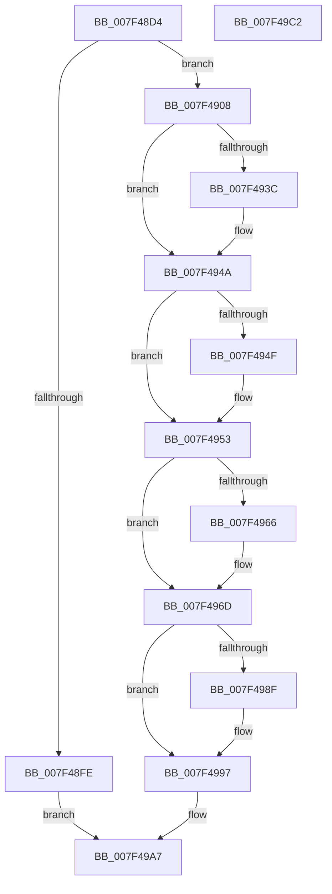

# CmFcManagerRegisterFeatureUsageProvider

- RVA: `0x007F48D4`–`0x007F49C3` (길이 `239` bytes)
- VA: `0x00000001407F48D4`
- 실행 섹션: `PAGE`
- PDB 이름 있음: `예`; PDB Function 태그: `아니요`
- unwind 정보 RVA: `0x00060300`
- 디코드: `64`개 명령, `239/239` bytes 표시
- 미해석 바이트: `0` (있으면 어셈블리에 `.byte`로 보존)

> 이 문서는 커널 이미지의 기계어와 PDB 기호를 분석해 생성했습니다. 4번과 5번은 함수 원형과 자료형을 바이너리 사용 방식에서 추정한 C 해석이며 원본 소스 복구 결과는 아닙니다.

## 1. Dependencies

- 직접 호출 지점: **6**; 고유 호출 대상: **6**
- 직접 호출자로 확인된 함수: **2**
- RIP 상대 이미지 참조: **5**

### Outgoing calls
- `0x007F48EF` → [CmFcpManagerAllocateUsageProviderSubscription](../AD/CmFcpManagerAllocateUsageProviderSubscription_function_00AD2E54.md) (function, `0x00AD2E54`)
- `0x007F492C` → [KeAbPreAcquire](../../text/21/KeAbPreAcquire_function_00210230.md) (function, `0x00210230`)
- `0x007F4945` → [ExfAcquirePushLockExclusiveEx](../../text/20/ExfAcquirePushLockExclusiveEx_function_0020FC90.md) (function, `0x0020FC90`)
- `0x007F4992` → [ExfTryToWakePushLock](../../text/26/ExfTryToWakePushLock_function_00265DD0.md) (function, `0x00265DD0`)
- `0x007F499A` → [KeAbPostRelease](../../text/2E/KeAbPostRelease_function_002E1600.md) (function, `0x002E1600`)
- `0x007F499F` → [KeLeaveCriticalRegion](../../text/25/KeLeaveCriticalRegion_function_0025D8B0.md) (function, `0x0025D8B0`)

### Direct callers
- [RtlRegisterFeatureUsageProvider](../78/RtlRegisterFeatureUsageProvider_function_0078F600.md) at `0x0078F60D`
- [wil_details_RegisterFeatureUsageProvider](../7E/wil_details_RegisterFeatureUsageProvider_function_007E6080.md) at `0x007E60D5`

### Static image references
- `0x007F4911` → RVA `0x00EF76A8` (`.data`; read)
- `0x007F4953` → RVA `0x00EF7888` (`.data`; read)
- `0x007F495A` → RVA `0x00EF7880` (`.data`; read)
- `0x007F4977` → RVA `0x00EF7888` (`.data`; write)
- `0x007F497E` → RVA `0x00EF76A8` (`.data`; read/write)

## 2. Other-region calls and transfers

- 다른 실행 섹션으로 향하는 call: **5**
  - `0x007F492C` → [KeAbPreAcquire](../../text/21/KeAbPreAcquire_function_00210230.md) (`PAGE` → `.text`)
  - `0x007F4945` → [ExfAcquirePushLockExclusiveEx](../../text/20/ExfAcquirePushLockExclusiveEx_function_0020FC90.md) (`PAGE` → `.text`)
  - `0x007F4992` → [ExfTryToWakePushLock](../../text/26/ExfTryToWakePushLock_function_00265DD0.md) (`PAGE` → `.text`)
  - `0x007F499A` → [KeAbPostRelease](../../text/2E/KeAbPostRelease_function_002E1600.md) (`PAGE` → `.text`)
  - `0x007F499F` → [KeLeaveCriticalRegion](../../text/25/KeLeaveCriticalRegion_function_0025D8B0.md) (`PAGE` → `.text`)
- 별도 외부 분기/꼬리 이동을 확인하지 못했습니다.

## 3. Assembly (complete function range)

```asm
007F48D4  48 89 5C 24 08                  mov qword ptr [rsp + 8], rbx
007F48D9  48 89 6C 24 10                  mov qword ptr [rsp + 0x10], rbp
007F48DE  48 89 74 24 18                  mov qword ptr [rsp + 0x18], rsi
007F48E3  57                              push rdi
007F48E4  41 56                           push r14
007F48E6  41 57                           push r15
007F48E8  48 83 EC 20                     sub rsp, 0x20
007F48EC  4D 8B F1                        mov r14, r9
007F48EF  E8 60 E5 2D 00                  call 0x140ad2e54
007F48F4  33 FF                           xor edi, edi
007F48F6  48 8B F0                        mov rsi, rax
007F48F9  48 85 C0                        test rax, rax
007F48FC  75 0A                           jne 0x1407f4908
007F48FE  BF 9A 00 00 C0                  mov edi, 0xc000009a
007F4903  E9 9F 00 00 00                  jmp 0x1407f49a7
007F4908  65 48 8B 04 25 88 01 00 00      mov rax, qword ptr gs:[0x188]
007F4911  4C 8D 3D 90 2D 70 00            lea r15, [rip + 0x702d90]
007F4918  48 83 CB FF                     or rbx, 0xffffffffffffffff
007F491C  45 33 C0                        xor r8d, r8d
007F491F  33 D2                           xor edx, edx
007F4921  49 8B CF                        mov rcx, r15
007F4924  66 01 98 E4 01 00 00            add word ptr [rax + 0x1e4], bx
007F492B  90                              nop
007F492C  E8 FF B8 A1 FF                  call 0x140210230
007F4931  F0 49 0F BA 2F 00               lock bts qword ptr [r15], 0
007F4937  48 8B E8                        mov rbp, rax
007F493A  73 0E                           jae 0x1407f494a
007F493C  4D 8B C7                        mov r8, r15
007F493F  48 8B D0                        mov rdx, rax
007F4942  49 8B CF                        mov rcx, r15
007F4945  E8 46 B3 A1 FF                  call 0x14020fc90
007F494A  48 85 ED                        test rbp, rbp
007F494D  74 04                           je 0x1407f4953
007F494F  C6 45 0A 01                     mov byte ptr [rbp + 0xa], 1
007F4953  48 8B 05 2E 2F 70 00            mov rax, qword ptr [rip + 0x702f2e]
007F495A  48 8D 0D 1F 2F 70 00            lea rcx, [rip + 0x702f1f]
007F4961  48 39 08                        cmp qword ptr [rax], rcx
007F4964  74 07                           je 0x1407f496d
007F4966  B9 03 00 00 00                  mov ecx, 3
007F496B  CD 29                           int 0x29
007F496D  48 89 0E                        mov qword ptr [rsi], rcx
007F4970  48 89 46 08                     mov qword ptr [rsi + 8], rax
007F4974  48 89 30                        mov qword ptr [rax], rsi
007F4977  48 89 35 0A 2F 70 00            mov qword ptr [rip + 0x702f0a], rsi
007F497E  F0 48 0F C1 1D 21 2D 70 00      lock xadd qword ptr [rip + 0x702d21], rbx
007F4987  80 E3 06                        and bl, 6
007F498A  80 FB 02                        cmp bl, 2
007F498D  75 08                           jne 0x1407f4997
007F498F  49 8B CF                        mov rcx, r15
007F4992  E8 39 14 A7 FF                  call 0x140265dd0
007F4997  49 8B CF                        mov rcx, r15
007F499A  E8 61 CC AE FF                  call 0x1402e1600
007F499F  E8 0C 8F A6 FF                  call 0x14025d8b0
007F49A4  49 89 36                        mov qword ptr [r14], rsi
007F49A7  48 8B 5C 24 40                  mov rbx, qword ptr [rsp + 0x40]
007F49AC  8B C7                           mov eax, edi
007F49AE  48 8B 6C 24 48                  mov rbp, qword ptr [rsp + 0x48]
007F49B3  48 8B 74 24 50                  mov rsi, qword ptr [rsp + 0x50]
007F49B8  48 83 C4 20                     add rsp, 0x20
007F49BC  41 5F                           pop r15
007F49BE  41 5E                           pop r14
007F49C0  5F                              pop rdi
007F49C1  C3                              ret
007F49C2  CC                              int3
```

## 4. C-style interpretation (structured pseudocode)

```c
__int64 __fastcall CmFcManagerRegisterFeatureUsageProvider(__int64 a1, int a2, int a3, __int64 a4)
{
    __int64 result;
    __int64 v_rbx;
    __int64 v_rdi;
    __int64 v_rsp;
    unsigned __int64 v_stack_p10;
    unsigned __int64 v_stack_p18;
    unsigned __int64 v_stack_p8;

    v_stack_p8 = v_rbx;
    v_stack_p10 = v_rbp;
    v_stack_p18 = v_rsi;
    v_rsp = (v_rsp) - (32);
    result = CmFcpManagerAllocateUsageProviderSubscription(a1, a2, a3, a4);
    v_rdi = 0;
    if (result != 0) goto loc_007F4908;
    goto loc_007F49A7;
loc_007F4908:
    v_rbx = (v_rbx) | (-1);
    a3 = 0;
    a2 = 0;
    result = KeAbPreAcquire(v_rip + 7351696, a2, a3, a4);
    if (!(condition_is_above_or_equal)) {
        a3 = v_rip + 7351696;
        a2 = result;
        a1 = v_rip + 7351696;
        result = ExfAcquirePushLockExclusiveEx(a1, a2, a3, a4);
    }
    if (result != 0) {
        *(unsigned __int8 *)(result + 10) = 1;
    }
    if ((*(unsigned __int64 *)(*(unsigned __int64 *)(v_rip + 7352110))) != (v_rip + 7352095)) {
        a1 = 3;
    }
    *(unsigned __int64 *)(result) = a1;
    *(unsigned __int64 *)(result + 8) = *(unsigned __int64 *)(v_rip + 7352110);
    *(unsigned __int64 *)(*(unsigned __int64 *)(v_rip + 7352110)) = result;
    *(unsigned __int64 *)(v_rip + 7352074) = result;
    v_rbx = (unsigned __int8)((v_rbx) & (6));
    result = *(unsigned __int64 *)(v_rip + 7352110);
    if (((unsigned __int8)(v_rbx)) == 2) {
        a1 = v_rip + 7351696;
        result = ExfTryToWakePushLock(a1, a2, a3, a4);
    }
    result = KeAbPostRelease(v_rip + 7351696, a2, a3, a4);
    result = KeLeaveCriticalRegion(v_rip + 7351696, a2, a3, a4);
    *(unsigned __int64 *)(a4) = result;
loc_007F49A7:
    v_rsp = (v_rsp) + (32);
    return (unsigned int)((unsigned int)((unsigned int)(0xC000009AULL)));
}
```

## 5. (Beta) C Style

```c
int64_t CmFcManagerRegisterFeatureUsageProvider(int64_t Arg1, int32_t Arg2, int32_t Arg3, void *Arg4)
{
    uint8_t *arg4 = (uint8_t *)Arg4;

    int64_t result;
    int64_t local_rbx;
    int64_t local_rdi;
    int64_t local_rsp;
    uint64_t v_stack_p10;
    uint64_t v_stack_p18;
    uint64_t v_stack_p8;

    v_stack_p8 = local_rbx;
    v_stack_p10 = local_rbp;
    v_stack_p18 = local_rsi;
    local_rsp = (local_rsp) - (32);
    result = CmFcpManagerAllocateUsageProviderSubscription(Arg1, Arg2, Arg3, Arg4);
    local_rdi = 0;
    if (result != 0) goto loc_007F4908;
    goto loc_007F49A7;
loc_007F4908:
    local_rbx = (local_rbx) | (-1);
    Arg3 = 0;
    Arg2 = 0;
    result = KeAbPreAcquire(v_rip + 7351696, Arg2, Arg3, Arg4);
    if (!(condition_is_above_or_equal)) {
        Arg3 = v_rip + 7351696;
        Arg2 = result;
        Arg1 = v_rip + 7351696;
        result = ExfAcquirePushLockExclusiveEx(Arg1, Arg2, Arg3, Arg4);
    }
    if (result != 0) {
        *(uint8_t *)(result + 0xA) = 1;
    }
    if ((*(uint64_t *)(*(uint64_t *)(v_rip + 0x702F2E))) != (v_rip + 7352095)) {
        Arg1 = 3;
    }
    *(uint64_t *)(result) = Arg1;
    *(uint64_t *)(result + 0x8) = *(uint64_t *)(v_rip + 0x702F2E);
    *(uint64_t *)(*(uint64_t *)(v_rip + 0x702F2E)) = result;
    *(uint64_t *)(v_rip + 0x702F0A) = result;
    local_rbx = (uint8_t)((local_rbx) & (6));
    result = *(uint64_t *)(v_rip + 0x702F2E);
    if (((uint8_t)(local_rbx)) == 2) {
        Arg1 = v_rip + 7351696;
        result = ExfTryToWakePushLock(Arg1, Arg2, Arg3, Arg4);
    }
    result = KeAbPostRelease(v_rip + 7351696, Arg2, Arg3, Arg4);
    result = KeLeaveCriticalRegion(v_rip + 7351696, Arg2, Arg3, Arg4);
    *(uint64_t *)(arg4) = result;
loc_007F49A7:
    local_rsp = (local_rsp) + (32);
    return (uint32_t)((uint32_t)((uint32_t)(0xC000009AULL)));
}
```

### 관측된 메모리 오프셋

구조체 형식이 확인되지 않은 접근은 인자 기준의 오프셋으로만 기록했습니다.

| 기준 인자 | 오프셋 표현 | 폭 (bit) | 접근 |
|---|---:|---:|---|
| `Arg4` | `+ 0x0` | `64` | `W` |

## 6. Execution-region graph

[열기: 2D/3D 그래프와 함수 탐색 컨트롤 패널](../../../control-panel.html?section=page&rva=0x007F48D4&view=graph)

- 2D 그래프는 위에서 아래로 흐르고, 3D 그래프는 빈 공간을 드래그해 회전합니다. Shift+드래그는 이동, 휠은 확대·축소, 함수 노드 선택은 대상 보고서 이동입니다.

### Static fallback


