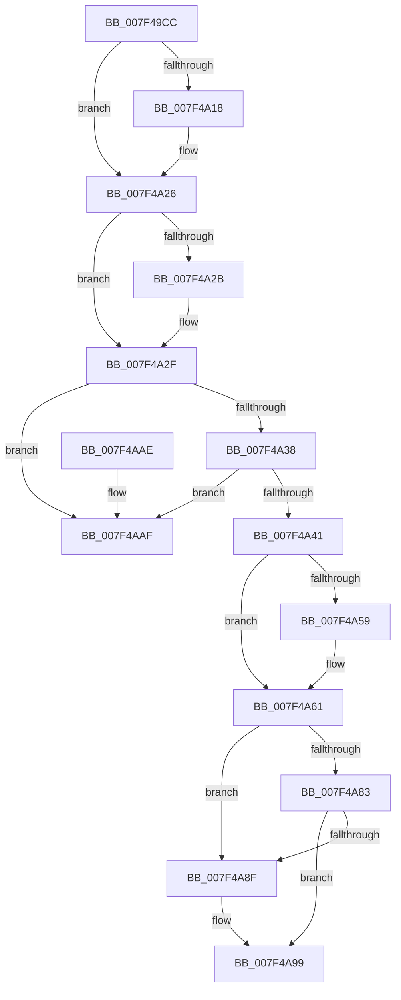

# CmFcManagerUnregisterFeatureConfigurationChangeNotification

- RVA: `0x007F49CC`–`0x007F4AB6` (길이 `234` bytes)
- VA: `0x00000001407F49CC`
- 실행 섹션: `PAGE`
- PDB 이름 있음: `예`; PDB Function 태그: `아니요`
- unwind 정보 RVA: `0x00069AD0`
- 디코드: `62`개 명령, `234/234` bytes 표시
- 미해석 바이트: `0` (있으면 어셈블리에 `.byte`로 보존)

> 이 문서는 커널 이미지의 기계어와 PDB 기호를 분석해 생성했습니다. 4번과 5번은 함수 원형과 자료형을 바이너리 사용 방식에서 추정한 C 해석이며 원본 소스 복구 결과는 아닙니다.

## 1. Dependencies

- 직접 호출 지점: **7**; 고유 호출 대상: **7**
- 직접 호출자로 확인된 함수: **1**
- RIP 상대 이미지 참조: **4**

### Outgoing calls
- `0x007F4A07` → [KeAbPreAcquire](../../text/21/KeAbPreAcquire_function_00210230.md) (function, `0x00210230`)
- `0x007F4A21` → [ExfAcquirePushLockExclusiveEx](../../text/20/ExfAcquirePushLockExclusiveEx_function_0020FC90.md) (function, `0x0020FC90`)
- `0x007F4A5C` → [ExfTryToWakePushLock](../../text/26/ExfTryToWakePushLock_function_00265DD0.md) (function, `0x00265DD0`)
- `0x007F4A64` → [KeAbPostRelease](../../text/2E/KeAbPostRelease_function_002E1600.md) (function, `0x002E1600`)
- `0x007F4A69` → [KeLeaveCriticalRegion](../../text/25/KeLeaveCriticalRegion_function_0025D8B0.md) (function, `0x0025D8B0`)
- `0x007F4A72` → [CmpWorkItemRundown](../70/CmpWorkItemRundown_function_00705820.md) (function, `0x00705820`)
- `0x007F4A94` → [ExFreePoolWithTag](../../poolcode/B8/ExFreePoolWithTag_function_00B82870.md) (function, `0x00B82870`)

### Direct callers
- [RtlUnregisterFeatureConfigurationChangeNotification](../78/RtlUnregisterFeatureConfigurationChangeNotification_function_0078F620.md) at `0x0078F627`

### Static image references
- `0x007F49E9` → RVA `0x00EF7558` (`.data`; read)
- `0x007F4A48` → RVA `0x00EF7558` (`.data`; read/write)
- `0x007F4A77` → RVA `0x00EF7570` (`.data`; read)
- `0x007F4A83` → RVA `0x00EF7690` (`.data`; read)

## 2. Other-region calls and transfers

- 다른 실행 섹션으로 향하는 call: **6**
  - `0x007F4A07` → [KeAbPreAcquire](../../text/21/KeAbPreAcquire_function_00210230.md) (`PAGE` → `.text`)
  - `0x007F4A21` → [ExfAcquirePushLockExclusiveEx](../../text/20/ExfAcquirePushLockExclusiveEx_function_0020FC90.md) (`PAGE` → `.text`)
  - `0x007F4A5C` → [ExfTryToWakePushLock](../../text/26/ExfTryToWakePushLock_function_00265DD0.md) (`PAGE` → `.text`)
  - `0x007F4A64` → [KeAbPostRelease](../../text/2E/KeAbPostRelease_function_002E1600.md) (`PAGE` → `.text`)
  - `0x007F4A69` → [KeLeaveCriticalRegion](../../text/25/KeLeaveCriticalRegion_function_0025D8B0.md) (`PAGE` → `.text`)
  - `0x007F4A94` → [ExFreePoolWithTag](../../poolcode/B8/ExFreePoolWithTag_function_00B82870.md) (`PAGE` → `POOLCODE`)
- 별도 외부 분기/꼬리 이동을 확인하지 못했습니다.

## 3. Assembly (complete function range)

```asm
007F49CC  48 89 5C 24 08                  mov qword ptr [rsp + 8], rbx
007F49D1  48 89 6C 24 10                  mov qword ptr [rsp + 0x10], rbp
007F49D6  48 89 74 24 18                  mov qword ptr [rsp + 0x18], rsi
007F49DB  57                              push rdi
007F49DC  48 83 EC 20                     sub rsp, 0x20
007F49E0  65 48 8B 04 25 88 01 00 00      mov rax, qword ptr gs:[0x188]
007F49E9  48 8D 2D 68 2B 70 00            lea rbp, [rip + 0x702b68]
007F49F0  48 8B FA                        mov rdi, rdx
007F49F3  48 83 CB FF                     or rbx, 0xffffffffffffffff
007F49F7  45 33 C0                        xor r8d, r8d
007F49FA  33 D2                           xor edx, edx
007F49FC  48 8B CD                        mov rcx, rbp
007F49FF  66 01 98 E4 01 00 00            add word ptr [rax + 0x1e4], bx
007F4A06  90                              nop
007F4A07  E8 24 B8 A1 FF                  call 0x140210230
007F4A0C  F0 48 0F BA 6D 00 00            lock bts qword ptr [rbp], 0
007F4A13  48 8B F0                        mov rsi, rax
007F4A16  73 0E                           jae 0x1407f4a26
007F4A18  4C 8B C5                        mov r8, rbp
007F4A1B  48 8B D0                        mov rdx, rax
007F4A1E  48 8B CD                        mov rcx, rbp
007F4A21  E8 6A B2 A1 FF                  call 0x14020fc90
007F4A26  48 85 F6                        test rsi, rsi
007F4A29  74 04                           je 0x1407f4a2f
007F4A2B  C6 46 0A 01                     mov byte ptr [rsi + 0xa], 1
007F4A2F  48 8B 17                        mov rdx, qword ptr [rdi]
007F4A32  48 39 7A 08                     cmp qword ptr [rdx + 8], rdi
007F4A36  75 77                           jne 0x1407f4aaf
007F4A38  48 8B 47 08                     mov rax, qword ptr [rdi + 8]
007F4A3C  48 39 38                        cmp qword ptr [rax], rdi
007F4A3F  75 6E                           jne 0x1407f4aaf
007F4A41  48 89 10                        mov qword ptr [rax], rdx
007F4A44  48 89 42 08                     mov qword ptr [rdx + 8], rax
007F4A48  F0 48 0F C1 1D 07 2B 70 00      lock xadd qword ptr [rip + 0x702b07], rbx
007F4A51  80 E3 06                        and bl, 6
007F4A54  80 FB 02                        cmp bl, 2
007F4A57  75 08                           jne 0x1407f4a61
007F4A59  48 8B CD                        mov rcx, rbp
007F4A5C  E8 6F 13 A7 FF                  call 0x140265dd0
007F4A61  48 8B CD                        mov rcx, rbp
007F4A64  E8 97 CB AE FF                  call 0x1402e1600
007F4A69  E8 42 8E A6 FF                  call 0x14025d8b0
007F4A6E  48 8D 4F 10                     lea rcx, [rdi + 0x10]
007F4A72  E8 A9 0D F1 FF                  call 0x140705820
007F4A77  48 8D 05 F2 2A 70 00            lea rax, [rip + 0x702af2]
007F4A7E  48 3B F8                        cmp rdi, rax
007F4A81  72 0C                           jb 0x1407f4a8f
007F4A83  48 8D 05 06 2C 70 00            lea rax, [rip + 0x702c06]
007F4A8A  48 3B F8                        cmp rdi, rax
007F4A8D  72 0A                           jb 0x1407f4a99
007F4A8F  33 D2                           xor edx, edx
007F4A91  48 8B CF                        mov rcx, rdi
007F4A94  E8 D7 DD 38 00                  call 0x140b82870
007F4A99  48 8B 5C 24 30                  mov rbx, qword ptr [rsp + 0x30]
007F4A9E  48 8B 6C 24 38                  mov rbp, qword ptr [rsp + 0x38]
007F4AA3  48 8B 74 24 40                  mov rsi, qword ptr [rsp + 0x40]
007F4AA8  48 83 C4 20                     add rsp, 0x20
007F4AAC  5F                              pop rdi
007F4AAD  C3                              ret
007F4AAE  CC                              int3
007F4AAF  B9 03 00 00 00                  mov ecx, 3
007F4AB4  CD 29                           int 0x29
```

## 4. C-style interpretation (structured pseudocode)

```c
__int64 __fastcall CmFcManagerUnregisterFeatureConfigurationChangeNotification(__int64 a1, __int64 a2, int a3)
{
    __int64 result;
    __int64 v_rbx;
    __int64 v_rsp;
    unsigned __int64 v_stack_p10;
    unsigned __int64 v_stack_p18;
    unsigned __int64 v_stack_p8;

    v_stack_p8 = v_rbx;
    v_stack_p10 = v_rbp;
    v_stack_p18 = v_rsi;
    v_rsp = (v_rsp) - (32);
    v_rbx = (v_rbx) | (-1);
    a3 = 0;
    a2 = 0;
    result = KeAbPreAcquire(v_rip + 7351144, a2, a3, a4);
    if (!(condition_is_above_or_equal)) {
        a3 = v_rip + 7351144;
        a2 = result;
        a1 = v_rip + 7351144;
        result = ExfAcquirePushLockExclusiveEx(a1, a2, a3, a4);
    }
    if (result != 0) {
        *(unsigned __int8 *)(result + 10) = 1;
    }
    if ((*(unsigned __int64 *)(*(unsigned __int64 *)(a2) + 8)) != a2) goto loc_007F4AAF;
    if ((*(unsigned __int64 *)(*(unsigned __int64 *)(a2 + 8))) != a2) goto loc_007F4AAF;
    *(unsigned __int64 *)(*(unsigned __int64 *)(a2 + 8)) = *(unsigned __int64 *)(a2);
    *(unsigned __int64 *)(*(unsigned __int64 *)(a2) + 8) = *(unsigned __int64 *)(a2 + 8);
    v_rbx = (unsigned __int8)((v_rbx) & (6));
    result = *(unsigned __int64 *)(a2 + 8);
    if (((unsigned __int8)(v_rbx)) == 2) {
        a1 = v_rip + 7351144;
        result = ExfTryToWakePushLock(a1, *(unsigned __int64 *)(a2), a3, a4);
    }
    result = KeAbPostRelease(v_rip + 7351144, *(unsigned __int64 *)(a2), a3, a4);
    result = KeLeaveCriticalRegion(v_rip + 7351144, *(unsigned __int64 *)(a2), a3, a4);
    result = CmpWorkItemRundown(a2 + 16, *(unsigned __int64 *)(a2), a3, a4);
    if (a2 < (v_rip + 7351026)) goto loc_007F4A8F;
    result = v_rip + 7351302;
    if (a2 >= (v_rip + 7351302)) {
        a2 = 0;
        a1 = 0;
        result = ExFreePoolWithTag(a1, a2, a3, a4);
    }
    v_rsp = (v_rsp) + (32);
    return result;
loc_007F4AAF:
    return result;
}
```

## 5. (Beta) C Style

```c
int64_t CmFcManagerUnregisterFeatureConfigurationChangeNotification(int64_t Arg1, void *Arg2, int32_t Arg3)
{
    uint8_t *arg2 = (uint8_t *)Arg2;

    int64_t result;
    int64_t local_rbx;
    int64_t local_rsp;
    uint64_t v_stack_p10;
    uint64_t v_stack_p18;
    uint64_t v_stack_p8;

    v_stack_p8 = local_rbx;
    v_stack_p10 = local_rbp;
    v_stack_p18 = local_rsi;
    local_rsp = (local_rsp) - (32);
    local_rbx = (local_rbx) | (-1);
    Arg3 = 0;
    Arg2 = 0;
    result = KeAbPreAcquire(v_rip + 7351144, Arg2, Arg3, a4);
    if (!(condition_is_above_or_equal)) {
        Arg3 = v_rip + 7351144;
        Arg2 = result;
        Arg1 = v_rip + 7351144;
        result = ExfAcquirePushLockExclusiveEx(Arg1, Arg2, Arg3, a4);
    }
    if (result != 0) {
        *(uint8_t *)(result + 0xA) = 1;
    }
    if ((*(uint64_t *)(*(uint64_t *)(arg2) + 0x8)) != Arg2) goto loc_007F4AAF;
    if ((*(uint64_t *)(*(uint64_t *)(arg2 + 0x8))) != Arg2) goto loc_007F4AAF;
    *(uint64_t *)(*(uint64_t *)(arg2 + 0x8)) = *(uint64_t *)(arg2);
    *(uint64_t *)(*(uint64_t *)(arg2) + 0x8) = *(uint64_t *)(arg2 + 0x8);
    local_rbx = (uint8_t)((local_rbx) & (6));
    result = *(uint64_t *)(arg2 + 0x8);
    if (((uint8_t)(local_rbx)) == 2) {
        Arg1 = v_rip + 7351144;
        result = ExfTryToWakePushLock(Arg1, *(uint64_t *)(arg2), Arg3, a4);
    }
    result = KeAbPostRelease(v_rip + 7351144, *(uint64_t *)(arg2), Arg3, a4);
    result = KeLeaveCriticalRegion(v_rip + 7351144, *(uint64_t *)(arg2), Arg3, a4);
    result = CmpWorkItemRundown(Arg2 + 16, *(uint64_t *)(arg2), Arg3, a4);
    if (Arg2 < (v_rip + 7351026)) goto loc_007F4A8F;
    result = v_rip + 7351302;
    if (Arg2 >= (v_rip + 7351302)) {
        Arg2 = 0;
        Arg1 = 0;
        result = ExFreePoolWithTag(Arg1, Arg2, Arg3, a4);
    }
    local_rsp = (local_rsp) + (32);
    return result;
loc_007F4AAF:
    return result;
}
```

### 관측된 메모리 오프셋

구조체 형식이 확인되지 않은 접근은 인자 기준의 오프셋으로만 기록했습니다.

| 기준 인자 | 오프셋 표현 | 폭 (bit) | 접근 |
|---|---:|---:|---|
| `Arg2` | `+ 0x0` | `64` | `R` |
| `Arg2` | `+ 0x8` | `64` | `R` |
| `Arg2` | `+ 0x10` | `64` | `R` |

## 6. Execution-region graph

[열기: 2D/3D 그래프와 함수 탐색 컨트롤 패널](../../../control-panel.html?section=page&rva=0x007F49CC&view=graph)

- 2D 그래프는 위에서 아래로 흐르고, 3D 그래프는 빈 공간을 드래그해 회전합니다. Shift+드래그는 이동, 휠은 확대·축소, 함수 노드 선택은 대상 보고서 이동입니다.

### Static fallback


