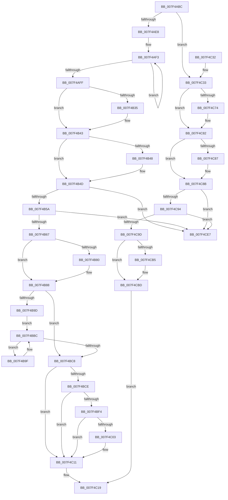

# CmFcManagerUnregisterFeatureUsageProvider

- RVA: `0x007F4ABC`–`0x007F4CEE` (길이 `562` bytes)
- VA: `0x00000001407F4ABC`
- 실행 섹션: `PAGE`
- PDB 이름 있음: `예`; PDB Function 태그: `아니요`
- unwind 정보 RVA: `0x000D7464`
- 디코드: `147`개 명령, `562/562` bytes 표시
- 미해석 바이트: `0` (있으면 어셈블리에 `.byte`로 보존)

> 이 문서는 커널 이미지의 기계어와 PDB 기호를 분석해 생성했습니다. 4번과 5번은 함수 원형과 자료형을 바이너리 사용 방식에서 추정한 C 해석이며 원본 소스 복구 결과는 아닙니다.

## 1. Dependencies

- 직접 호출 지점: **18**; 고유 호출 대상: **13**
- 직접 호출자로 확인된 함수: **1**
- RIP 상대 이미지 참조: **5**

### Outgoing calls
- `0x007F4ADB` → [Feature_Servicing_FixWarmRebootIssueOnLowCoreCPUs__private_IsEnabledDeviceUsageNoInline](../../text/66/Feature_Servicing_FixWarmRebootIssueOnLowCoreCPUs__private_IsEnabledDeviceUsageNoInline_function_0066B68C.md) (function, `0x0066B68C`)
- `0x007F4B25` → [KeAbPreAcquire](../../text/21/KeAbPreAcquire_function_00210230.md) (function, `0x00210230`)
- `0x007F4B3E` → [ExfAcquirePushLockExclusiveEx](../../text/20/ExfAcquirePushLockExclusiveEx_function_0020FC90.md) (function, `0x0020FC90`)
- `0x007F4B83` → [ExfTryToWakePushLock](../../text/26/ExfTryToWakePushLock_function_00265DD0.md) (function, `0x00265DD0`)
- `0x007F4B8B` → [KeAbPostRelease](../../text/2E/KeAbPostRelease_function_002E1600.md) (function, `0x002E1600`)
- `0x007F4B90` → [KeLeaveCriticalRegion](../../text/25/KeLeaveCriticalRegion_function_0025D8B0.md) (function, `0x0025D8B0`)
- `0x007F4BB7` → [ExBlockOnAddressPushLock](../../text/2A/ExBlockOnAddressPushLock_function_002A43A0.md) (function, `0x002A43A0`)
- `0x007F4BE2` → [guard_dispatch_icall](../../text/6B/guard_dispatch_icall_function_006BAAD0.md) (function, `0x006BAAD0`)
- `0x007F4C0C` → [ExfUnblockPushLock](../../text/2A/ExfUnblockPushLock_function_002A3FE0.md) (function, `0x002A3FE0`)
- `0x007F4C14` → [CmFcpReleaseUsageProviderSubscription](../../text/66/CmFcpReleaseUsageProviderSubscription_function_0066B3DC.md) (function, `0x0066B3DC`)
- `0x007F4C3B` → [CmFcManagerFlushFeatureUsage](../AC/CmFcManagerFlushFeatureUsage_function_00AC1814.md) (function, `0x00AC1814`)
- `0x007F4C64` → [KeAbPreAcquire](../../text/21/KeAbPreAcquire_function_00210230.md) (function, `0x00210230`)
- `0x007F4C7D` → [ExfAcquirePushLockExclusiveEx](../../text/20/ExfAcquirePushLockExclusiveEx_function_0020FC90.md) (function, `0x0020FC90`)
- `0x007F4CB8` → [ExfTryToWakePushLock](../../text/26/ExfTryToWakePushLock_function_00265DD0.md) (function, `0x00265DD0`)
- `0x007F4CC0` → [KeAbPostRelease](../../text/2E/KeAbPostRelease_function_002E1600.md) (function, `0x002E1600`)
- `0x007F4CC5` → [KeLeaveCriticalRegion](../../text/25/KeLeaveCriticalRegion_function_0025D8B0.md) (function, `0x0025D8B0`)
- `0x007F4CCE` → [CmpWorkItemRundown](../70/CmpWorkItemRundown_function_00705820.md) (function, `0x00705820`)
- `0x007F4CDD` → [CmFcpManagerFreeUsageProviderSubscription](../70/CmFcpManagerFreeUsageProviderSubscription_function_007056E0.md) (function, `0x007056E0`)

### Direct callers
- [RtlUnregisterFeatureUsageProvider](../78/RtlUnregisterFeatureUsageProvider_function_0078F640.md) at `0x0078F647`

### Static image references
- `0x007F4B08` → RVA `0x00EF76A8` (`.data`; read)
- `0x007F4B71` → RVA `0x00EF76A8` (`.data`; read/write)
- `0x007F4BCE` → RVA `0x00EF7A3C` (`.data`; read/write)
- `0x007F4BF9` → RVA `0x00EF78A0` (`.data`; read)
- `0x007F4CD6` → RVA `0x00EF72E0` (`.data`; read)

## 2. Other-region calls and transfers

- 다른 실행 섹션으로 향하는 call: **15**
  - `0x007F4ADB` → [Feature_Servicing_FixWarmRebootIssueOnLowCoreCPUs__private_IsEnabledDeviceUsageNoInline](../../text/66/Feature_Servicing_FixWarmRebootIssueOnLowCoreCPUs__private_IsEnabledDeviceUsageNoInline_function_0066B68C.md) (`PAGE` → `.text`)
  - `0x007F4B25` → [KeAbPreAcquire](../../text/21/KeAbPreAcquire_function_00210230.md) (`PAGE` → `.text`)
  - `0x007F4B3E` → [ExfAcquirePushLockExclusiveEx](../../text/20/ExfAcquirePushLockExclusiveEx_function_0020FC90.md) (`PAGE` → `.text`)
  - `0x007F4B83` → [ExfTryToWakePushLock](../../text/26/ExfTryToWakePushLock_function_00265DD0.md) (`PAGE` → `.text`)
  - `0x007F4B8B` → [KeAbPostRelease](../../text/2E/KeAbPostRelease_function_002E1600.md) (`PAGE` → `.text`)
  - `0x007F4B90` → [KeLeaveCriticalRegion](../../text/25/KeLeaveCriticalRegion_function_0025D8B0.md) (`PAGE` → `.text`)
  - `0x007F4BB7` → [ExBlockOnAddressPushLock](../../text/2A/ExBlockOnAddressPushLock_function_002A43A0.md) (`PAGE` → `.text`)
  - `0x007F4BE2` → [guard_dispatch_icall](../../text/6B/guard_dispatch_icall_function_006BAAD0.md) (`PAGE` → `.text`)
  - `0x007F4C0C` → [ExfUnblockPushLock](../../text/2A/ExfUnblockPushLock_function_002A3FE0.md) (`PAGE` → `.text`)
  - `0x007F4C14` → [CmFcpReleaseUsageProviderSubscription](../../text/66/CmFcpReleaseUsageProviderSubscription_function_0066B3DC.md) (`PAGE` → `.text`)
  - `0x007F4C64` → [KeAbPreAcquire](../../text/21/KeAbPreAcquire_function_00210230.md) (`PAGE` → `.text`)
  - `0x007F4C7D` → [ExfAcquirePushLockExclusiveEx](../../text/20/ExfAcquirePushLockExclusiveEx_function_0020FC90.md) (`PAGE` → `.text`)
  - `0x007F4CB8` → [ExfTryToWakePushLock](../../text/26/ExfTryToWakePushLock_function_00265DD0.md) (`PAGE` → `.text`)
  - `0x007F4CC0` → [KeAbPostRelease](../../text/2E/KeAbPostRelease_function_002E1600.md) (`PAGE` → `.text`)
  - `0x007F4CC5` → [KeLeaveCriticalRegion](../../text/25/KeLeaveCriticalRegion_function_0025D8B0.md) (`PAGE` → `.text`)
- 별도 외부 분기/꼬리 이동을 확인하지 못했습니다.

## 3. Assembly (complete function range)

```asm
007F4ABC  48 8B C4                        mov rax, rsp
007F4ABF  48 89 58 10                     mov qword ptr [rax + 0x10], rbx
007F4AC3  48 89 68 18                     mov qword ptr [rax + 0x18], rbp
007F4AC7  48 89 70 20                     mov qword ptr [rax + 0x20], rsi
007F4ACB  48 89 48 08                     mov qword ptr [rax + 8], rcx
007F4ACF  57                              push rdi
007F4AD0  41 56                           push r14
007F4AD2  41 57                           push r15
007F4AD4  48 83 EC 30                     sub rsp, 0x30
007F4AD8  48 8B FA                        mov rdi, rdx
007F4ADB  E8 AC 6B E7 FF                  call 0x14066b68c
007F4AE0  85 C0                           test eax, eax
007F4AE2  0F 84 4B 01 00 00               je 0x1407f4c33
007F4AE8  4C 8D 77 64                     lea r14, [rdi + 0x64]
007F4AEC  41 0F 0D 0E                     prefetchw byte ptr [r14]
007F4AF0  41 8B 06                        mov eax, dword ptr [r14]
007F4AF3  8B C8                           mov ecx, eax
007F4AF5  83 C9 04                        or ecx, 4
007F4AF8  F0 41 0F B1 0E                  lock cmpxchg dword ptr [r14], ecx
007F4AFD  75 F4                           jne 0x1407f4af3
007F4AFF  65 48 8B 0C 25 88 01 00 00      mov rcx, qword ptr gs:[0x188]
007F4B08  48 8D 35 99 2B 70 00            lea rsi, [rip + 0x702b99]
007F4B0F  48 83 CB FF                     or rbx, 0xffffffffffffffff
007F4B13  45 33 C0                        xor r8d, r8d
007F4B16  33 D2                           xor edx, edx
007F4B18  8B E8                           mov ebp, eax
007F4B1A  66 01 99 E4 01 00 00            add word ptr [rcx + 0x1e4], bx
007F4B21  48 8B CE                        mov rcx, rsi
007F4B24  90                              nop
007F4B25  E8 06 B7 A1 FF                  call 0x140210230
007F4B2A  F0 48 0F BA 2E 00               lock bts qword ptr [rsi], 0
007F4B30  4C 8B F8                        mov r15, rax
007F4B33  73 0E                           jae 0x1407f4b43
007F4B35  4C 8B C6                        mov r8, rsi
007F4B38  48 8B D0                        mov rdx, rax
007F4B3B  48 8B CE                        mov rcx, rsi
007F4B3E  E8 4D B1 A1 FF                  call 0x14020fc90
007F4B43  4D 85 FF                        test r15, r15
007F4B46  74 05                           je 0x1407f4b4d
007F4B48  41 C6 47 0A 01                  mov byte ptr [r15 + 0xa], 1
007F4B4D  48 8B 0F                        mov rcx, qword ptr [rdi]
007F4B50  48 39 79 08                     cmp qword ptr [rcx + 8], rdi
007F4B54  0F 85 8D 01 00 00               jne 0x1407f4ce7
007F4B5A  48 8B 47 08                     mov rax, qword ptr [rdi + 8]
007F4B5E  48 39 38                        cmp qword ptr [rax], rdi
007F4B61  0F 85 80 01 00 00               jne 0x1407f4ce7
007F4B67  48 89 08                        mov qword ptr [rax], rcx
007F4B6A  48 89 41 08                     mov qword ptr [rcx + 8], rax
007F4B6E  48 8B C3                        mov rax, rbx
007F4B71  F0 48 0F C1 05 2E 2B 70 00      lock xadd qword ptr [rip + 0x702b2e], rax
007F4B7A  24 06                           and al, 6
007F4B7C  3C 02                           cmp al, 2
007F4B7E  75 08                           jne 0x1407f4b88
007F4B80  48 8B CE                        mov rcx, rsi
007F4B83  E8 48 12 A7 FF                  call 0x140265dd0
007F4B88  48 8B CE                        mov rcx, rsi
007F4B8B  E8 70 CA AE FF                  call 0x1402e1600
007F4B90  E8 1B 8D A6 FF                  call 0x14025d8b0
007F4B95  41 B7 08                        mov r15b, 8
007F4B98  41 84 EF                        test r15b, bpl
007F4B9B  74 2B                           je 0x1407f4bc8
007F4B9D  EB 1D                           jmp 0x1407f4bbc
007F4B9F  48 83 64 24 20 00               and qword ptr [rsp + 0x20], 0
007F4BA5  4C 8D 44 24 50                  lea r8, [rsp + 0x50]
007F4BAA  41 B9 04 00 00 00               mov r9d, 4
007F4BB0  48 8D 4F 68                     lea rcx, [rdi + 0x68]
007F4BB4  49 8B D6                        mov rdx, r14
007F4BB7  E8 E4 F7 AA FF                  call 0x1402a43a0
007F4BBC  8B 6F 64                        mov ebp, dword ptr [rdi + 0x64]
007F4BBF  89 6C 24 50                     mov dword ptr [rsp + 0x50], ebp
007F4BC3  41 84 EF                        test r15b, bpl
007F4BC6  75 D7                           jne 0x1407f4b9f
007F4BC8  40 F6 C5 01                     test bpl, 1
007F4BCC  74 43                           je 0x1407f4c11
007F4BCE  F0 FF 05 67 2E 70 00            lock inc dword ptr [rip + 0x702e67]
007F4BD5  48 8B 47 50                     mov rax, qword ptr [rdi + 0x50]
007F4BD9  33 D2                           xor edx, edx
007F4BDB  4C 8B 47 48                     mov r8, qword ptr [rdi + 0x48]
007F4BDF  8D 4A 01                        lea ecx, [rdx + 1]
007F4BE2  E8 E9 5E EC FF                  call 0x1406baad0
007F4BE7  F0 0F C1 1D 4D 2E 70 00         lock xadd dword ptr [rip + 0x702e4d], ebx
007F4BEF  83 FB 01                        cmp ebx, 1
007F4BF2  75 1D                           jne 0x1407f4c11
007F4BF4  F0 83 0C 24 00                  lock or dword ptr [rsp], 0
007F4BF9  48 83 3D 9F 2C 70 00 00         cmp qword ptr [rip + 0x702c9f], 0
007F4C01  74 0E                           je 0x1407f4c11
007F4C03  33 D2                           xor edx, edx
007F4C05  48 8D 0D 94 2C 70 00            lea rcx, [rip + 0x702c94]
007F4C0C  E8 CF F3 AA FF                  call 0x1402a3fe0
007F4C11  48 8B CF                        mov rcx, rdi
007F4C14  E8 C3 67 E7 FF                  call 0x14066b3dc
007F4C19  48 8B 5C 24 58                  mov rbx, qword ptr [rsp + 0x58]
007F4C1E  48 8B 6C 24 60                  mov rbp, qword ptr [rsp + 0x60]
007F4C23  48 8B 74 24 68                  mov rsi, qword ptr [rsp + 0x68]
007F4C28  48 83 C4 30                     add rsp, 0x30
007F4C2C  41 5F                           pop r15
007F4C2E  41 5E                           pop r14
007F4C30  5F                              pop rdi
007F4C31  C3                              ret
007F4C32  CC                              int3
007F4C33  4C 8B C7                        mov r8, rdi
007F4C36  BA 01 00 00 00                  mov edx, 1
007F4C3B  E8 D4 CB 2C 00                  call 0x140ac1814
007F4C40  65 48 8B 04 25 88 01 00 00      mov rax, qword ptr gs:[0x188]
007F4C49  48 8D 35 58 2A 70 00            lea rsi, [rip + 0x702a58]
007F4C50  48 83 CB FF                     or rbx, 0xffffffffffffffff
007F4C54  45 33 C0                        xor r8d, r8d
007F4C57  33 D2                           xor edx, edx
007F4C59  48 8B CE                        mov rcx, rsi
007F4C5C  66 01 98 E4 01 00 00            add word ptr [rax + 0x1e4], bx
007F4C63  90                              nop
007F4C64  E8 C7 B5 A1 FF                  call 0x140210230
007F4C69  F0 48 0F BA 2E 00               lock bts qword ptr [rsi], 0
007F4C6F  48 8B E8                        mov rbp, rax
007F4C72  73 0E                           jae 0x1407f4c82
007F4C74  4C 8B C6                        mov r8, rsi
007F4C77  48 8B D0                        mov rdx, rax
007F4C7A  48 8B CE                        mov rcx, rsi
007F4C7D  E8 0E B0 A1 FF                  call 0x14020fc90
007F4C82  48 85 ED                        test rbp, rbp
007F4C85  74 04                           je 0x1407f4c8b
007F4C87  C6 45 0A 01                     mov byte ptr [rbp + 0xa], 1
007F4C8B  48 8B 0F                        mov rcx, qword ptr [rdi]
007F4C8E  48 39 79 08                     cmp qword ptr [rcx + 8], rdi
007F4C92  75 53                           jne 0x1407f4ce7
007F4C94  48 8B 47 08                     mov rax, qword ptr [rdi + 8]
007F4C98  48 39 38                        cmp qword ptr [rax], rdi
007F4C9B  75 4A                           jne 0x1407f4ce7
007F4C9D  48 89 08                        mov qword ptr [rax], rcx
007F4CA0  48 89 41 08                     mov qword ptr [rcx + 8], rax
007F4CA4  F0 48 0F C1 1D FB 29 70 00      lock xadd qword ptr [rip + 0x7029fb], rbx
007F4CAD  80 E3 06                        and bl, 6
007F4CB0  80 FB 02                        cmp bl, 2
007F4CB3  75 08                           jne 0x1407f4cbd
007F4CB5  48 8B CE                        mov rcx, rsi
007F4CB8  E8 13 11 A7 FF                  call 0x140265dd0
007F4CBD  48 8B CE                        mov rcx, rsi
007F4CC0  E8 3B C9 AE FF                  call 0x1402e1600
007F4CC5  E8 E6 8B A6 FF                  call 0x14025d8b0
007F4CCA  48 8D 4F 10                     lea rcx, [rdi + 0x10]
007F4CCE  E8 4D 0B F1 FF                  call 0x140705820
007F4CD3  48 8B D7                        mov rdx, rdi
007F4CD6  48 8D 0D 03 26 70 00            lea rcx, [rip + 0x702603]
007F4CDD  E8 FE 09 F1 FF                  call 0x1407056e0
007F4CE2  E9 32 FF FF FF                  jmp 0x1407f4c19
007F4CE7  B9 03 00 00 00                  mov ecx, 3
007F4CEC  CD 29                           int 0x29
```

## 4. C-style interpretation (structured pseudocode)

```c
__int64 __fastcall CmFcManagerUnregisterFeatureUsageProvider(__int64 a1, __int64 a2, int a3)
{
    __int64 result;
    __int64 v_rbx;
    __int64 v_rsp;
    unsigned __int64 v_stack_m28;
    unsigned int v_stack_m48;
    unsigned __int64 v_stack_p10;
    unsigned __int64 v_stack_p18;
    unsigned __int64 v_stack_p20;
    unsigned __int64 v_stack_p8;

    *(unsigned __int64 *)(v_rsp + 16) = v_rbx;
    *(unsigned __int64 *)(v_rsp + 24) = v_rbp;
    *(unsigned __int64 *)(v_rsp + 32) = v_rsi;
    *(unsigned __int64 *)(v_rsp + 8) = a1;
    v_rsp = (v_rsp) - (48);
    result = Feature_Servicing_FixWarmRebootIssueOnLowCoreCPUs__private_IsEnabledDeviceUsageNoInline(a1, a2, a3, a4);
    if ((unsigned int)(result) == 0) goto loc_007F4C33;
loc_007F4AF3:
    a1 = (unsigned int)(((unsigned int)((unsigned int)((unsigned int)(*(unsigned int *)(a2 + 100))))) | (4));
    if (condition_is_not_equal) goto loc_007F4AF3;
    v_rbx = (v_rbx) | (-1);
    a3 = 0;
    a2 = 0;
    result = KeAbPreAcquire(v_rip + 7351193, a2, a3, a4);
    if (!(condition_is_above_or_equal)) {
        a3 = v_rip + 7351193;
        a2 = result;
        a1 = v_rip + 7351193;
        result = ExfAcquirePushLockExclusiveEx(a1, a2, a3, a4);
    }
    if (result != 0) {
        *(unsigned __int8 *)(result + 10) = 1;
    }
    if ((*(unsigned __int64 *)(*(unsigned __int64 *)(a2) + 8)) != a2) goto loc_007F4CE7;
    if ((*(unsigned __int64 *)(*(unsigned __int64 *)(a2 + 8))) != a2) goto loc_007F4CE7;
    *(unsigned __int64 *)(*(unsigned __int64 *)(a2 + 8)) = *(unsigned __int64 *)(a2);
    *(unsigned __int64 *)(*(unsigned __int64 *)(a2) + 8) = *(unsigned __int64 *)(a2 + 8);
    result = (unsigned __int8)((v_rbx) & (6));
    if (((unsigned __int8)(result)) == 2) {
        a1 = v_rip + 7351193;
        result = ExfTryToWakePushLock(a1, a2, a3, a4);
    }
    result = KeAbPostRelease(v_rip + 7351193, a2, a3, a4);
    result = KeLeaveCriticalRegion(v_rip + 7351193, a2, a3, a4);
    if (((8) & ((unsigned __int8)((unsigned int)((unsigned int)((unsigned int)(*(unsigned int *)(a2 + 100))))))) == 0) goto loc_007F4BC8;
    goto loc_007F4BBC;
loc_007F4B9F:
    result = ExBlockOnAddressPushLock(a2 + 104, a2 + 100, v_stack_p8, 4);
loc_007F4BBC:
    v_stack_p8 = (unsigned int)((unsigned int)(*(unsigned int *)(a2 + 100)));
    if (((8) & ((unsigned __int8)((unsigned int)(*(unsigned int *)(a2 + 100))))) != 0) goto loc_007F4B9F;
loc_007F4BC8:
    if ((((unsigned __int8)((unsigned int)(*(unsigned int *)(a2 + 100)))) & (1)) == 0) goto loc_007F4C11;
    a2 = 0;
    result = guard_dispatch_icall(a2 + 1, a2, *(unsigned __int64 *)(a2 + 72), 4);
    if (((unsigned int)(v_rbx)) != 1) goto loc_007F4C11;
    if ((*(unsigned __int64 *)(v_rip + 7351455)) != 0) {
        a2 = 0;
        a1 = v_rip + 7351444;
        result = ExfUnblockPushLock(a1, a2, *(unsigned __int64 *)(a2 + 72), 4);
    }
    result = CmFcpReleaseUsageProviderSubscription(0, a2, *(unsigned __int64 *)(a2 + 72), 4);
loc_007F4C19:
    v_rsp = (v_rsp) + (48);
    return result;
loc_007F4C33:
    result = CmFcManagerFlushFeatureUsage(0, 1, 0, 4);
    v_rbx = (v_stack_p10) | (-1);
    a3 = 0;
    a2 = 0;
    result = KeAbPreAcquire(v_rip + 7350872, a2, a3, 4);
    if (!(condition_is_above_or_equal)) {
        a3 = v_rip + 7350872;
        a2 = result;
        a1 = v_rip + 7350872;
        result = ExfAcquirePushLockExclusiveEx(a1, a2, a3, 4);
    }
    if (result != 0) {
        *(unsigned __int8 *)(result + 10) = 1;
    }
    if ((*(unsigned __int64 *)(*(unsigned __int64 *)(a2) + 8)) != a2) goto loc_007F4CE7;
    if ((*(unsigned __int64 *)(*(unsigned __int64 *)(a2 + 8))) != a2) goto loc_007F4CE7;
    *(unsigned __int64 *)(*(unsigned __int64 *)(a2 + 8)) = *(unsigned __int64 *)(a2);
    *(unsigned __int64 *)(*(unsigned __int64 *)(a2) + 8) = *(unsigned __int64 *)(a2 + 8);
    v_rbx = (unsigned __int8)((v_rbx) & (6));
    result = *(unsigned __int64 *)(a2 + 8);
    if (((unsigned __int8)(v_rbx)) == 2) {
        a1 = v_rip + 7350872;
        result = ExfTryToWakePushLock(a1, a2, a3, 4);
    }
    result = KeAbPostRelease(v_rip + 7350872, a2, a3, 4);
    result = KeLeaveCriticalRegion(v_rip + 7350872, a2, a3, 4);
    result = CmpWorkItemRundown(a2 + 16, a2, a3, 4);
    result = CmFcpManagerFreeUsageProviderSubscription(v_rip + 7349763, a2, a3, 4);
    goto loc_007F4C19;
loc_007F4CE7:
    return result;
}
```

## 5. (Beta) C Style

```c
int64_t CmFcManagerUnregisterFeatureUsageProvider(int64_t Arg1, void *Arg2, int32_t Arg3)
{
    uint8_t *arg2 = (uint8_t *)Arg2;

    int64_t result;
    int64_t local_rbx;
    int64_t local_rsp;
    uint64_t v_stack_m28;
    uint32_t v_stack_m48;
    uint64_t v_stack_p10;
    uint64_t v_stack_p18;
    uint64_t v_stack_p20;
    uint64_t v_stack_p8;

    *(uint64_t *)(local_rsp + 0x10) = local_rbx;
    *(uint64_t *)(local_rsp + 0x18) = local_rbp;
    *(uint64_t *)(local_rsp + 0x20) = local_rsi;
    *(uint64_t *)(local_rsp + 0x8) = Arg1;
    local_rsp = (local_rsp) - (48);
    result = Feature_Servicing_FixWarmRebootIssueOnLowCoreCPUs__private_IsEnabledDeviceUsageNoInline(Arg1, Arg2, Arg3, a4);
    if ((uint32_t)(result) == 0) goto loc_007F4C33;
loc_007F4AF3:
    Arg1 = (uint32_t)(((uint32_t)((uint32_t)((uint32_t)(*(uint32_t *)(arg2 + 0x64))))) | (4));
    if (condition_is_not_equal) goto loc_007F4AF3;
    local_rbx = (local_rbx) | (-1);
    Arg3 = 0;
    Arg2 = 0;
    result = KeAbPreAcquire(v_rip + 7351193, Arg2, Arg3, a4);
    if (!(condition_is_above_or_equal)) {
        Arg3 = v_rip + 7351193;
        Arg2 = result;
        Arg1 = v_rip + 7351193;
        result = ExfAcquirePushLockExclusiveEx(Arg1, Arg2, Arg3, a4);
    }
    if (result != 0) {
        *(uint8_t *)(result + 0xA) = 1;
    }
    if ((*(uint64_t *)(*(uint64_t *)(arg2) + 0x8)) != Arg2) goto loc_007F4CE7;
    if ((*(uint64_t *)(*(uint64_t *)(arg2 + 0x8))) != Arg2) goto loc_007F4CE7;
    *(uint64_t *)(*(uint64_t *)(arg2 + 0x8)) = *(uint64_t *)(arg2);
    *(uint64_t *)(*(uint64_t *)(arg2) + 0x8) = *(uint64_t *)(arg2 + 0x8);
    result = (uint8_t)((local_rbx) & (6));
    if (((uint8_t)(result)) == 2) {
        Arg1 = v_rip + 7351193;
        result = ExfTryToWakePushLock(Arg1, Arg2, Arg3, a4);
    }
    result = KeAbPostRelease(v_rip + 7351193, Arg2, Arg3, a4);
    result = KeLeaveCriticalRegion(v_rip + 7351193, Arg2, Arg3, a4);
    if (((8) & ((uint8_t)((uint32_t)((uint32_t)((uint32_t)(*(uint32_t *)(arg2 + 0x64))))))) == 0) goto loc_007F4BC8;
    goto loc_007F4BBC;
loc_007F4B9F:
    result = ExBlockOnAddressPushLock(Arg2 + 104, Arg2 + 100, v_stack_p8, 4);
loc_007F4BBC:
    v_stack_p8 = (uint32_t)((uint32_t)(*(uint32_t *)(arg2 + 0x64)));
    if (((8) & ((uint8_t)((uint32_t)(*(uint32_t *)(arg2 + 0x64))))) != 0) goto loc_007F4B9F;
loc_007F4BC8:
    if ((((uint8_t)((uint32_t)(*(uint32_t *)(arg2 + 0x64)))) & (1)) == 0) goto loc_007F4C11;
    Arg2 = 0;
    result = guard_dispatch_icall(Arg2 + 1, Arg2, *(uint64_t *)(arg2 + 0x48), 4);
    if (((uint32_t)(local_rbx)) != 1) goto loc_007F4C11;
    if ((*(uint64_t *)(v_rip + 0x702C9F)) != 0) {
        Arg2 = 0;
        Arg1 = v_rip + 7351444;
        result = ExfUnblockPushLock(Arg1, Arg2, *(uint64_t *)(arg2 + 0x48), 4);
    }
    result = CmFcpReleaseUsageProviderSubscription(0, Arg2, *(uint64_t *)(arg2 + 0x48), 4);
loc_007F4C19:
    local_rsp = (local_rsp) + (48);
    return result;
loc_007F4C33:
    result = CmFcManagerFlushFeatureUsage(0, 1, 0, 4);
    local_rbx = (v_stack_p10) | (-1);
    Arg3 = 0;
    Arg2 = 0;
    result = KeAbPreAcquire(v_rip + 7350872, Arg2, Arg3, 4);
    if (!(condition_is_above_or_equal)) {
        Arg3 = v_rip + 7350872;
        Arg2 = result;
        Arg1 = v_rip + 7350872;
        result = ExfAcquirePushLockExclusiveEx(Arg1, Arg2, Arg3, 4);
    }
    if (result != 0) {
        *(uint8_t *)(result + 0xA) = 1;
    }
    if ((*(uint64_t *)(*(uint64_t *)(arg2) + 0x8)) != Arg2) goto loc_007F4CE7;
    if ((*(uint64_t *)(*(uint64_t *)(arg2 + 0x8))) != Arg2) goto loc_007F4CE7;
    *(uint64_t *)(*(uint64_t *)(arg2 + 0x8)) = *(uint64_t *)(arg2);
    *(uint64_t *)(*(uint64_t *)(arg2) + 0x8) = *(uint64_t *)(arg2 + 0x8);
    local_rbx = (uint8_t)((local_rbx) & (6));
    result = *(uint64_t *)(arg2 + 0x8);
    if (((uint8_t)(local_rbx)) == 2) {
        Arg1 = v_rip + 7350872;
        result = ExfTryToWakePushLock(Arg1, Arg2, Arg3, 4);
    }
    result = KeAbPostRelease(v_rip + 7350872, Arg2, Arg3, 4);
    result = KeLeaveCriticalRegion(v_rip + 7350872, Arg2, Arg3, 4);
    result = CmpWorkItemRundown(Arg2 + 16, Arg2, Arg3, 4);
    result = CmFcpManagerFreeUsageProviderSubscription(v_rip + 7349763, Arg2, Arg3, 4);
    goto loc_007F4C19;
loc_007F4CE7:
    return result;
}
```

### 관측된 메모리 오프셋

구조체 형식이 확인되지 않은 접근은 인자 기준의 오프셋으로만 기록했습니다.

| 기준 인자 | 오프셋 표현 | 폭 (bit) | 접근 |
|---|---:|---:|---|
| `Arg2` | `+ 0x0` | `8` | `R` |
| `Arg2` | `+ 0x0` | `32` | `R` |
| `Arg2` | `+ 0x0` | `64` | `R` |
| `Arg2` | `+ 0x8` | `64` | `R` |
| `Arg2` | `+ 0x10` | `64` | `R` |
| `Arg2` | `+ 0x48` | `64` | `R` |
| `Arg2` | `+ 0x50` | `64` | `R` |
| `Arg2` | `+ 0x64` | `32` | `R` |
| `Arg2` | `+ 0x64` | `64` | `R` |
| `Arg2` | `+ 0x68` | `64` | `R` |

## 6. Execution-region graph

[열기: 2D/3D 그래프와 함수 탐색 컨트롤 패널](../../../control-panel.html?section=page&rva=0x007F4ABC&view=graph)

- 2D 그래프는 위에서 아래로 흐르고, 3D 그래프는 빈 공간을 드래그해 회전합니다. Shift+드래그는 이동, 휠은 확대·축소, 함수 노드 선택은 대상 보고서 이동입니다.

### Static fallback


