# CmFcManagerUpdateFeatureConfigurations

- RVA: `0x007F4CF4`–`0x007F52DC` (길이 `1,512` bytes)
- VA: `0x00000001407F4CF4`
- 실행 섹션: `PAGE`
- PDB 이름 있음: `예`; PDB Function 태그: `아니요`
- unwind 정보 RVA: `0x000D743C`
- 디코드: `347`개 명령, `1,512/1,512` bytes 표시
- 미해석 바이트: `0` (있으면 어셈블리에 `.byte`로 보존)

> 이 문서는 커널 이미지의 기계어와 PDB 기호를 분석해 생성했습니다. 4번과 5번은 함수 원형과 자료형을 바이너리 사용 방식에서 추정한 C 해석이며 원본 소스 복구 결과는 아닙니다.

## 1. Dependencies

- 직접 호출 지점: **38**; 고유 호출 대상: **25**
- 직접 호출자로 확인된 함수: **1**
- RIP 상대 이미지 참조: **18**

### Outgoing calls
- `0x007F4D54` → [Feature_VelTest_KM_ControlledByProxy_DBD_1__private_ReportUsageFallback](../../text/66/Feature_VelTest_KM_ControlledByProxy_DBD_1__private_ReportUsageFallback_function_0066B6E0.md) (function, `0x0066B6E0`)
- `0x007F4D74` → [Feature_CFR_Child_KM_C__private_ReportUsageFallback](../../text/66/Feature_CFR_Child_KM_C__private_ReportUsageFallback_function_0066B5AC.md) (function, `0x0066B5AC`)
- `0x007F4D94` → [Feature_CFR_Parent_KM_C__private_ReportUsageFallback](../../text/66/Feature_CFR_Parent_KM_C__private_ReportUsageFallback_function_0066B61C.md) (function, `0x0066B61C`)
- `0x007F4DC3` → [memset](../../text/6C/memset_function_006C6C40.md) (function, `0x006C6C40`)
- `0x007F4E1D` → [KeAbPreAcquire](../../text/21/KeAbPreAcquire_function_00210230.md) (function, `0x00210230`)
- `0x007F4E36` → [ExfAcquirePushLockExclusiveEx](../../text/20/ExfAcquirePushLockExclusiveEx_function_0020FC90.md) (function, `0x0020FC90`)
- `0x007F4E54` → [RtlpFcBufferManagerReferenceBuffers](../../text/4A/RtlpFcBufferManagerReferenceBuffers_function_004A73B8.md) (function, `0x004A73B8`)
- `0x007F4EC0` → [RtlpFcUpdateFeatureConfiguration](../AB/RtlpFcUpdateFeatureConfiguration_function_00ABD7A0.md) (function, `0x00ABD7A0`)
- `0x007F4EEF` → [CmFcpManagerCreateSection](../AD/CmFcpManagerCreateSection_function_00ADA3BC.md) (function, `0x00ADA3BC`)
- `0x007F4F08` → [CmFcpMapSection](../AC/CmFcpMapSection_function_00AC1714.md) (function, `0x00AC1714`)
- `0x007F4F3A` → [RtlpFcUpdateFeatureConfiguration](../AB/RtlpFcUpdateFeatureConfiguration_function_00ABD7A0.md) (function, `0x00ABD7A0`)
- `0x007F4F56` → [RtlpFcValidateFeatureConfigurationBuffer](../AD/RtlpFcValidateFeatureConfigurationBuffer_function_00AD14DC.md) (function, `0x00AD14DC`)
- `0x007F4F7D` → [tlgKeywordOn](../../text/42/tlgKeywordOn_function_0042EAA0.md) (function, `0x0042EAA0`)
- `0x007F4FD7` → [RtlpFcUpdateGovernedFeaturesEffectiveStates](../78/RtlpFcUpdateGovernedFeaturesEffectiveStates_function_0078F658.md) (function, `0x0078F658`)
- `0x007F5005` → [CmFcpManagerCreateSection](../AD/CmFcpManagerCreateSection_function_00ADA3BC.md) (function, `0x00ADA3BC`)
- `0x007F501E` → [CmFcpMapSection](../AC/CmFcpMapSection_function_00AC1714.md) (function, `0x00AC1714`)
- `0x007F5058` → [RtlpFcUpdateGovernedFeaturesEffectiveStates](../78/RtlpFcUpdateGovernedFeaturesEffectiveStates_function_0078F658.md) (function, `0x0078F658`)
- `0x007F5071` → [RtlpFcValidateGovernedFeatures](../../text/5F/RtlpFcValidateGovernedFeatures_function_005F0E18.md) (function, `0x005F0E18`)
- `0x007F5098` → [tlgKeywordOn](../../text/42/tlgKeywordOn_function_0042EAA0.md) (function, `0x0042EAA0`)
- `0x007F50EA` → [tlgWriteTransfer_EtwWriteTransfer](../../text/42/tlgWriteTransfer_EtwWriteTransfer_function_004260E0.md) (function, `0x004260E0`)
- `0x007F510F` → [ExfTryToWakePushLock](../../text/26/ExfTryToWakePushLock_function_00265DD0.md) (function, `0x00265DD0`)
- `0x007F511B` → [KeAbPostRelease](../../text/2E/KeAbPostRelease_function_002E1600.md) (function, `0x002E1600`)
- `0x007F5135` → [RtlpFcBufferManagerDereferenceBuffers](../../text/37/RtlpFcBufferManagerDereferenceBuffers_function_00378D84.md) (function, `0x00378D84`)
- `0x007F5149` → [RtlpFcBufferManagerDereferenceBuffers](../../text/37/RtlpFcBufferManagerDereferenceBuffers_function_00378D84.md) (function, `0x00378D84`)
- `0x007F515D` → [KeAbPreAcquire](../../text/21/KeAbPreAcquire_function_00210230.md) (function, `0x00210230`)
- `0x007F5176` → [ExfAcquirePushLockExclusiveEx](../../text/20/ExfAcquirePushLockExclusiveEx_function_0020FC90.md) (function, `0x0020FC90`)
- `0x007F51FE` → [RtlpFcBufferManagerUpdateBuffers](../A4/RtlpFcBufferManagerUpdateBuffers_function_00A44DB0.md) (function, `0x00A44DB0`)
- `0x007F520D` → [RtlpFcWriteHighLowHigh](../../text/4C/RtlpFcWriteHighLowHigh_function_004C84BC.md) (function, `0x004C84BC`)
- `0x007F5223` → [RtlpFcWriteHighLowHigh](../../text/4C/RtlpFcWriteHighLowHigh_function_004C84BC.md) (function, `0x004C84BC`)
- `0x007F523D` → [ExfTryToWakePushLock](../../text/26/ExfTryToWakePushLock_function_00265DD0.md) (function, `0x00265DD0`)
- `0x007F5245` → [KeAbPostRelease](../../text/2E/KeAbPostRelease_function_002E1600.md) (function, `0x002E1600`)
- `0x007F5262` → [ExfTryToWakePushLock](../../text/26/ExfTryToWakePushLock_function_00265DD0.md) (function, `0x00265DD0`)
- `0x007F526E` → [KeAbPostRelease](../../text/2E/KeAbPostRelease_function_002E1600.md) (function, `0x002E1600`)
- `0x007F5276` → [CmFcpManagerPublishChangeNotifications](../A4/CmFcpManagerPublishChangeNotifications_function_00A44E94.md) (function, `0x00A44E94`)
- `0x007F5290` → [CmFcpUnmapSection](../A4/CmFcpUnmapSection_function_00A44B8C.md) (function, `0x00A44B8C`)
- `0x007F52A3` → [CmFcpCleanupSectionState](../A3/CmFcpCleanupSectionState_function_00A304B4.md) (function, `0x00A304B4`)
- `0x007F52A8` → [KeLeaveCriticalRegion](../../text/25/KeLeaveCriticalRegion_function_0025D8B0.md) (function, `0x0025D8B0`)
- `0x007F52BB` → [_security_check_cookie](../../text/6A/_security_check_cookie_function_006AC640.md) (function, `0x006AC640`)

### Direct callers
- [CmUpdateFeatureConfiguration](../7E/CmUpdateFeatureConfiguration_function_007E5C10.md) at `0x007E5E18`

### Static image references
- `0x007F4D13` → RVA `0x00E0A740` (`.data`; read)
- `0x007F4D33` → RVA `0x00FC4CC0` (`.data`; read)
- `0x007F4D59` → RVA `0x00FC4CB0` (`.data`; read)
- `0x007F4D79` → RVA `0x00FC4CB8` (`.data`; read)
- `0x007F4DDD` → RVA `0x00EF72F0` (`.data`; read)
- `0x007F4E4D` → RVA `0x00EF7368` (`.data`; read)
- `0x007F4EDC` → RVA `0x00EF72E0` (`.data`; read)
- `0x007F4F5F` → RVA `0x00E09F20` (`.data`; read)
- `0x007F4F96` → RVA `0x0005759E` (`.rdata`; read)
- `0x007F50B3` → RVA `0x00057635` (`.rdata`; read)
- `0x007F50F7` → RVA `0x00EF72F0` (`.data`; read/write)
- `0x007F514E` → RVA `0x00EF72E8` (`.data`; read)
- `0x007F51D5` → RVA `0x00EF7350` (`.data`; write)
- `0x007F51E0` → RVA `0x00EF7358` (`.data`; write)
- `0x007F51F7` → RVA `0x00EF7360` (`.data`; write)
- `0x007F5206` → RVA `0x00EF72F8` (`.data`; read)
- `0x007F5212` → RVA `0x00FC5008` (`ALMOSTRO`; read)
- `0x007F522B` → RVA `0x00EF72E8` (`.data`; read/write)

## 2. Other-region calls and transfers

- 다른 실행 섹션으로 향하는 call: **25**
  - `0x007F4D54` → [Feature_VelTest_KM_ControlledByProxy_DBD_1__private_ReportUsageFallback](../../text/66/Feature_VelTest_KM_ControlledByProxy_DBD_1__private_ReportUsageFallback_function_0066B6E0.md) (`PAGE` → `.text`)
  - `0x007F4D74` → [Feature_CFR_Child_KM_C__private_ReportUsageFallback](../../text/66/Feature_CFR_Child_KM_C__private_ReportUsageFallback_function_0066B5AC.md) (`PAGE` → `.text`)
  - `0x007F4D94` → [Feature_CFR_Parent_KM_C__private_ReportUsageFallback](../../text/66/Feature_CFR_Parent_KM_C__private_ReportUsageFallback_function_0066B61C.md) (`PAGE` → `.text`)
  - `0x007F4DC3` → [memset](../../text/6C/memset_function_006C6C40.md) (`PAGE` → `.text`)
  - `0x007F4E1D` → [KeAbPreAcquire](../../text/21/KeAbPreAcquire_function_00210230.md) (`PAGE` → `.text`)
  - `0x007F4E36` → [ExfAcquirePushLockExclusiveEx](../../text/20/ExfAcquirePushLockExclusiveEx_function_0020FC90.md) (`PAGE` → `.text`)
  - `0x007F4E54` → [RtlpFcBufferManagerReferenceBuffers](../../text/4A/RtlpFcBufferManagerReferenceBuffers_function_004A73B8.md) (`PAGE` → `.text`)
  - `0x007F4F7D` → [tlgKeywordOn](../../text/42/tlgKeywordOn_function_0042EAA0.md) (`PAGE` → `.text`)
  - `0x007F5071` → [RtlpFcValidateGovernedFeatures](../../text/5F/RtlpFcValidateGovernedFeatures_function_005F0E18.md) (`PAGE` → `.text`)
  - `0x007F5098` → [tlgKeywordOn](../../text/42/tlgKeywordOn_function_0042EAA0.md) (`PAGE` → `.text`)
  - `0x007F50EA` → [tlgWriteTransfer_EtwWriteTransfer](../../text/42/tlgWriteTransfer_EtwWriteTransfer_function_004260E0.md) (`PAGE` → `.text`)
  - `0x007F510F` → [ExfTryToWakePushLock](../../text/26/ExfTryToWakePushLock_function_00265DD0.md) (`PAGE` → `.text`)
  - `0x007F511B` → [KeAbPostRelease](../../text/2E/KeAbPostRelease_function_002E1600.md) (`PAGE` → `.text`)
  - `0x007F5135` → [RtlpFcBufferManagerDereferenceBuffers](../../text/37/RtlpFcBufferManagerDereferenceBuffers_function_00378D84.md) (`PAGE` → `.text`)
  - `0x007F5149` → [RtlpFcBufferManagerDereferenceBuffers](../../text/37/RtlpFcBufferManagerDereferenceBuffers_function_00378D84.md) (`PAGE` → `.text`)
  - `0x007F515D` → [KeAbPreAcquire](../../text/21/KeAbPreAcquire_function_00210230.md) (`PAGE` → `.text`)
  - `0x007F5176` → [ExfAcquirePushLockExclusiveEx](../../text/20/ExfAcquirePushLockExclusiveEx_function_0020FC90.md) (`PAGE` → `.text`)
  - `0x007F520D` → [RtlpFcWriteHighLowHigh](../../text/4C/RtlpFcWriteHighLowHigh_function_004C84BC.md) (`PAGE` → `.text`)
  - `0x007F5223` → [RtlpFcWriteHighLowHigh](../../text/4C/RtlpFcWriteHighLowHigh_function_004C84BC.md) (`PAGE` → `.text`)
  - `0x007F523D` → [ExfTryToWakePushLock](../../text/26/ExfTryToWakePushLock_function_00265DD0.md) (`PAGE` → `.text`)
  - `0x007F5245` → [KeAbPostRelease](../../text/2E/KeAbPostRelease_function_002E1600.md) (`PAGE` → `.text`)
  - `0x007F5262` → [ExfTryToWakePushLock](../../text/26/ExfTryToWakePushLock_function_00265DD0.md) (`PAGE` → `.text`)
  - `0x007F526E` → [KeAbPostRelease](../../text/2E/KeAbPostRelease_function_002E1600.md) (`PAGE` → `.text`)
  - `0x007F52A8` → [KeLeaveCriticalRegion](../../text/25/KeLeaveCriticalRegion_function_0025D8B0.md) (`PAGE` → `.text`)
  - `0x007F52BB` → [_security_check_cookie](../../text/6A/_security_check_cookie_function_006AC640.md) (`PAGE` → `.text`)
- 별도 외부 분기/꼬리 이동을 확인하지 못했습니다.

## 3. Assembly (complete function range)

```asm
007F4CF4  48 89 5C 24 08                  mov qword ptr [rsp + 8], rbx
007F4CF9  55                              push rbp
007F4CFA  56                              push rsi
007F4CFB  57                              push rdi
007F4CFC  41 54                           push r12
007F4CFE  41 55                           push r13
007F4D00  41 56                           push r14
007F4D02  41 57                           push r15
007F4D04  48 8D AC 24 60 FF FF FF         lea rbp, [rsp - 0xa0]
007F4D0C  48 81 EC A0 01 00 00            sub rsp, 0x1a0
007F4D13  48 8B 05 26 5A 61 00            mov rax, qword ptr [rip + 0x615a26]
007F4D1A  48 33 C4                        xor rax, rsp
007F4D1D  48 89 85 90 00 00 00            mov qword ptr [rbp + 0x90], rax
007F4D24  33 F6                           xor esi, esi
007F4D26  49 63 D8                        movsxd rbx, r8d
007F4D29  48 89 75 80                     mov qword ptr [rbp - 0x80], rsi
007F4D2D  4D 8B E9                        mov r13, r9
007F4D30  4C 8B E2                        mov r12, rdx
007F4D33  8B 05 87 FF 7C 00               mov eax, dword ptr [rip + 0x7cff87]
007F4D39  8D 7E 03                        lea edi, [rsi + 3]
007F4D3C  41 B6 10                        mov r14b, 0x10
007F4D3F  48 89 74 24 48                  mov qword ptr [rsp + 0x48], rsi
007F4D44  89 44 24 48                     mov dword ptr [rsp + 0x48], eax
007F4D48  41 84 C6                        test r14b, al
007F4D4B  75 0C                           jne 0x1407f4d59
007F4D4D  48 8B 4C 24 48                  mov rcx, qword ptr [rsp + 0x48]
007F4D52  8B D7                           mov edx, edi
007F4D54  E8 87 69 E7 FF                  call 0x14066b6e0
007F4D59  8B 05 51 FF 7C 00               mov eax, dword ptr [rip + 0x7cff51]
007F4D5F  48 89 74 24 48                  mov qword ptr [rsp + 0x48], rsi
007F4D64  89 44 24 48                     mov dword ptr [rsp + 0x48], eax
007F4D68  41 84 C6                        test r14b, al
007F4D6B  75 0C                           jne 0x1407f4d79
007F4D6D  48 8B 4C 24 48                  mov rcx, qword ptr [rsp + 0x48]
007F4D72  8B D7                           mov edx, edi
007F4D74  E8 33 68 E7 FF                  call 0x14066b5ac
007F4D79  8B 05 39 FF 7C 00               mov eax, dword ptr [rip + 0x7cff39]
007F4D7F  48 89 74 24 48                  mov qword ptr [rsp + 0x48], rsi
007F4D84  89 44 24 48                     mov dword ptr [rsp + 0x48], eax
007F4D88  41 84 C6                        test r14b, al
007F4D8B  75 0C                           jne 0x1407f4d99
007F4D8D  48 8B 4C 24 48                  mov rcx, qword ptr [rsp + 0x48]
007F4D92  8B D7                           mov edx, edi
007F4D94  E8 83 68 E7 FF                  call 0x14066b61c
007F4D99  33 C0                           xor eax, eax
007F4D9B  48 89 75 98                     mov qword ptr [rbp - 0x68], rsi
007F4D9F  0F 57 C0                        xorps xmm0, xmm0
007F4DA2  48 89 74 24 48                  mov qword ptr [rsp + 0x48], rsi
007F4DA7  33 D2                           xor edx, edx
007F4DA9  48 89 44 24 68                  mov qword ptr [rsp + 0x68], rax
007F4DAE  48 8D 4D D0                     lea rcx, [rbp - 0x30]
007F4DB2  48 89 75 A8                     mov qword ptr [rbp - 0x58], rsi
007F4DB6  44 8D 40 60                     lea r8d, [rax + 0x60]
007F4DBA  48 89 75 B0                     mov qword ptr [rbp - 0x50], rsi
007F4DBE  0F 11 44 24 58                  movups xmmword ptr [rsp + 0x58], xmm0
007F4DC3  E8 78 1E ED FF                  call 0x1406c6c40
007F4DC8  BA 01 00 00 00                  mov edx, 1
007F4DCD  89 74 24 78                     mov dword ptr [rsp + 0x78], esi
007F4DD1  89 54 24 7C                     mov dword ptr [rsp + 0x7c], edx
007F4DD5  4C 8D 7D D0                     lea r15, [rbp - 0x30]
007F4DD9  8B 44 9C 78                     mov eax, dword ptr [rsp + rbx*4 + 0x78]
007F4DDD  4C 8D 35 0C 25 70 00            lea r14, [rip + 0x70250c]
007F4DE4  89 54 24 74                     mov dword ptr [rsp + 0x74], edx
007F4DE8  45 33 C0                        xor r8d, r8d
007F4DEB  89 74 24 70                     mov dword ptr [rsp + 0x70], esi
007F4DEF  33 D2                           xor edx, edx
007F4DF1  8B 4C 9C 70                     mov ecx, dword ptr [rsp + rbx*4 + 0x70]
007F4DF5  48 83 CB FF                     or rbx, 0xffffffffffffffff
007F4DF9  48 8D 04 40                     lea rax, [rax + rax*2]
007F4DFD  89 4C 24 50                     mov dword ptr [rsp + 0x50], ecx
007F4E01  48 89 45 90                     mov qword ptr [rbp - 0x70], rax
007F4E05  4D 8D 3C C7                     lea r15, [r15 + rax*8]
007F4E09  65 48 8B 04 25 88 01 00 00      mov rax, qword ptr gs:[0x188]
007F4E12  49 8B CE                        mov rcx, r14
007F4E15  66 01 98 E4 01 00 00            add word ptr [rax + 0x1e4], bx
007F4E1C  90                              nop
007F4E1D  E8 0E B4 A1 FF                  call 0x140210230
007F4E22  F0 49 0F BA 2E 00               lock bts qword ptr [r14], 0
007F4E28  48 8B F8                        mov rdi, rax
007F4E2B  73 0E                           jae 0x1407f4e3b
007F4E2D  4D 8B C6                        mov r8, r14
007F4E30  48 8B D0                        mov rdx, rax
007F4E33  49 8B CE                        mov rcx, r14
007F4E36  E8 55 AE A1 FF                  call 0x14020fc90
007F4E3B  48 85 FF                        test rdi, rdi
007F4E3E  74 04                           je 0x1407f4e44
007F4E40  C6 47 0A 01                     mov byte ptr [rdi + 0xa], 1
007F4E44  4C 8D 44 24 48                  lea r8, [rsp + 0x48]
007F4E49  48 8D 55 80                     lea rdx, [rbp - 0x80]
007F4E4D  48 8D 0D 14 25 70 00            lea rcx, [rip + 0x702514]
007F4E54  E8 5F 25 CB FF                  call 0x1404a73b8
007F4E59  4C 8B 74 24 48                  mov r14, qword ptr [rsp + 0x48]
007F4E5E  48 8B 75 80                     mov rsi, qword ptr [rbp - 0x80]
007F4E62  4D 85 E4                        test r12, r12
007F4E65  74 12                           je 0x1407f4e79
007F4E67  49 3B F4                        cmp rsi, r12
007F4E6A  74 0D                           je 0x1407f4e79
007F4E6C  C7 44 24 40 01 00 00 C0         mov dword ptr [rsp + 0x40], 0xc0000001
007F4E74  E9 7E 02 00 00                  jmp 0x1407f50f7
007F4E79  48 8B 4D 90                     mov rcx, qword ptr [rbp - 0x70]
007F4E7D  B8 01 00 00 00                  mov eax, 1
007F4E82  44 8B A5 00 01 00 00            mov r12d, dword ptr [rbp + 0x100]
007F4E89  48 83 C6 01                     add rsi, 1
007F4E8D  45 8B CC                        mov r9d, r12d
007F4E90  4D 8B C5                        mov r8, r13
007F4E93  48 0F 44 F0                     cmove rsi, rax
007F4E97  48 83 65 88 00                  and qword ptr [rbp - 0x78], 0
007F4E9C  49 8B 4C CE 08                  mov rcx, qword ptr [r14 + rcx*8 + 8]
007F4EA1  48 8D 45 88                     lea rax, [rbp - 0x78]
007F4EA5  48 89 44 24 28                  mov qword ptr [rsp + 0x28], rax
007F4EAA  48 83 64 24 20 00               and qword ptr [rsp + 0x20], 0
007F4EB0  49 89 37                        mov qword ptr [r15], rsi
007F4EB3  48 89 74 24 58                  mov qword ptr [rsp + 0x58], rsi
007F4EB8  48 89 75 A0                     mov qword ptr [rbp - 0x60], rsi
007F4EBC  48 89 75 18                     mov qword ptr [rbp + 0x18], rsi
007F4EC0  E8 DB 88 2C 00                  call 0x140abd7a0
007F4EC5  89 44 24 40                     mov dword ptr [rsp + 0x40], eax
007F4EC9  85 C0                           test eax, eax
007F4ECB  0F 89 6E 02 00 00               jns 0x1407f513f
007F4ED1  3D 05 00 00 80                  cmp eax, 0x80000005
007F4ED6  0F 85 1B 02 00 00               jne 0x1407f50f7
007F4EDC  4C 8B 05 FD 23 70 00            mov r8, qword ptr [rip + 0x7023fd]
007F4EE3  4C 8D 4C 24 58                  lea r9, [rsp + 0x58]
007F4EE8  48 8B 4D 88                     mov rcx, qword ptr [rbp - 0x78]
007F4EEC  48 8B D6                        mov rdx, rsi
007F4EEF  E8 C8 54 2E 00                  call 0x140ada3bc
007F4EF4  89 44 24 40                     mov dword ptr [rsp + 0x40], eax
007F4EF8  85 C0                           test eax, eax
007F4EFA  0F 88 F7 01 00 00               js 0x1407f50f7
007F4F00  49 8B D7                        mov rdx, r15
007F4F03  48 8D 4C 24 58                  lea rcx, [rsp + 0x58]
007F4F08  E8 07 C8 2C 00                  call 0x140ac1714
007F4F0D  89 44 24 40                     mov dword ptr [rsp + 0x40], eax
007F4F11  85 C0                           test eax, eax
007F4F13  0F 88 DE 01 00 00               js 0x1407f50f7
007F4F19  49 8D 47 10                     lea rax, [r15 + 0x10]
007F4F1D  45 8B CC                        mov r9d, r12d
007F4F20  48 89 44 24 28                  mov qword ptr [rsp + 0x28], rax
007F4F25  4D 8B C5                        mov r8, r13
007F4F28  49 8B 47 08                     mov rax, qword ptr [r15 + 8]
007F4F2C  48 89 44 24 20                  mov qword ptr [rsp + 0x20], rax
007F4F31  48 8B 45 90                     mov rax, qword ptr [rbp - 0x70]
007F4F35  49 8B 4C C6 08                  mov rcx, qword ptr [r14 + rax*8 + 8]
007F4F3A  E8 61 88 2C 00                  call 0x140abd7a0
007F4F3F  89 44 24 40                     mov dword ptr [rsp + 0x40], eax
007F4F43  85 C0                           test eax, eax
007F4F45  0F 88 AC 01 00 00               js 0x1407f50f7
007F4F4B  49 8B 7F 08                     mov rdi, qword ptr [r15 + 8]
007F4F4F  49 8B 57 10                     mov rdx, qword ptr [r15 + 0x10]
007F4F53  48 8B CF                        mov rcx, rdi
007F4F56  E8 81 C5 2D 00                  call 0x140ad14dc
007F4F5B  85 C0                           test eax, eax
007F4F5D  79 56                           jns 0x1407f4fb5
007F4F5F  83 3D BA 4F 61 00 05            cmp dword ptr [rip + 0x614fba], 5
007F4F66  0F 86 83 01 00 00               jbe 0x1407f50ef
007F4F6C  48 BA 01 00 00 00 00 40 00 00   movabs rdx, 0x400000000001
007F4F76  48 8D 0D A3 4F 61 00            lea rcx, [rip + 0x614fa3]
007F4F7D  E8 1E 9B C3 FF                  call 0x14042eaa0
007F4F82  84 C0                           test al, al
007F4F84  0F 84 65 01 00 00               je 0x1407f50ef
007F4F8A  83 65 5C 00                     and dword ptr [rbp + 0x5c], 0
007F4F8E  48 8D 45 B8                     lea rax, [rbp - 0x48]
007F4F92  48 89 45 50                     mov qword ptr [rbp + 0x50], rax
007F4F96  48 8D 15 01 26 86 FF            lea rdx, [rip - 0x79d9ff]
007F4F9D  48 8D 45 30                     lea rax, [rbp + 0x30]
007F4FA1  48 C7 45 B8 00 00 00 01         mov qword ptr [rbp - 0x48], 0x1000000
007F4FA9  C7 45 58 08 00 00 00            mov dword ptr [rbp + 0x58], 8
007F4FB0  E9 1B 01 00 00                  jmp 0x1407f50d0
007F4FB5  49 8B 56 58                     mov rdx, qword ptr [r14 + 0x58]
007F4FB9  48 8D 45 98                     lea rax, [rbp - 0x68]
007F4FBD  49 8B 4E 50                     mov rcx, qword ptr [r14 + 0x50]
007F4FC1  4D 8B CC                        mov r9, r12
007F4FC4  48 89 44 24 38                  mov qword ptr [rsp + 0x38], rax
007F4FC9  4D 8B C5                        mov r8, r13
007F4FCC  48 83 64 24 30 00               and qword ptr [rsp + 0x30], 0
007F4FD2  48 89 7C 24 20                  mov qword ptr [rsp + 0x20], rdi
007F4FD7  E8 7C A6 F9 FF                  call 0x14078f658
007F4FDC  89 44 24 40                     mov dword ptr [rsp + 0x40], eax
007F4FE0  85 C0                           test eax, eax
007F4FE2  0F 89 57 01 00 00               jns 0x1407f513f
007F4FE8  3D 05 00 00 80                  cmp eax, 0x80000005
007F4FED  0F 85 04 01 00 00               jne 0x1407f50f7
007F4FF3  4C 8B 05 E6 22 70 00            mov r8, qword ptr [rip + 0x7022e6]
007F4FFA  4C 8D 4D A0                     lea r9, [rbp - 0x60]
007F4FFE  48 8B 4D 98                     mov rcx, qword ptr [rbp - 0x68]
007F5002  48 8B D6                        mov rdx, rsi
007F5005  E8 B2 53 2E 00                  call 0x140ada3bc
007F500A  89 44 24 40                     mov dword ptr [rsp + 0x40], eax
007F500E  85 C0                           test eax, eax
007F5010  0F 88 E1 00 00 00               js 0x1407f50f7
007F5016  48 8D 55 18                     lea rdx, [rbp + 0x18]
007F501A  48 8D 4D A0                     lea rcx, [rbp - 0x60]
007F501E  E8 F1 C6 2C 00                  call 0x140ac1714
007F5023  89 44 24 40                     mov dword ptr [rsp + 0x40], eax
007F5027  85 C0                           test eax, eax
007F5029  0F 88 C8 00 00 00               js 0x1407f50f7
007F502F  49 8B 56 58                     mov rdx, qword ptr [r14 + 0x58]
007F5033  48 8D 45 28                     lea rax, [rbp + 0x28]
007F5037  49 8B 4E 50                     mov rcx, qword ptr [r14 + 0x50]
007F503B  4D 8B CC                        mov r9, r12
007F503E  48 89 44 24 38                  mov qword ptr [rsp + 0x38], rax
007F5043  4D 8B C5                        mov r8, r13
007F5046  48 8B 45 20                     mov rax, qword ptr [rbp + 0x20]
007F504A  48 89 44 24 30                  mov qword ptr [rsp + 0x30], rax
007F504F  49 8B 47 08                     mov rax, qword ptr [r15 + 8]
007F5053  48 89 44 24 20                  mov qword ptr [rsp + 0x20], rax
007F5058  E8 FB A5 F9 FF                  call 0x14078f658
007F505D  89 44 24 40                     mov dword ptr [rsp + 0x40], eax
007F5061  85 C0                           test eax, eax
007F5063  0F 88 8E 00 00 00               js 0x1407f50f7
007F5069  48 8B 55 28                     mov rdx, qword ptr [rbp + 0x28]
007F506D  48 8B 4D 20                     mov rcx, qword ptr [rbp + 0x20]
007F5071  E8 A2 BD DF FF                  call 0x1405f0e18
007F5076  85 C0                           test eax, eax
007F5078  0F 89 C1 00 00 00               jns 0x1407f513f
007F507E  83 3D 9B 4E 61 00 05            cmp dword ptr [rip + 0x614e9b], 5
007F5085  76 68                           jbe 0x1407f50ef
007F5087  48 BA 01 00 00 00 00 40 00 00   movabs rdx, 0x400000000001
007F5091  48 8D 0D 88 4E 61 00            lea rcx, [rip + 0x614e88]
007F5098  E8 03 9A C3 FF                  call 0x14042eaa0
007F509D  84 C0                           test al, al
007F509F  74 4E                           je 0x1407f50ef
007F50A1  83 A5 8C 00 00 00 00            and dword ptr [rbp + 0x8c], 0
007F50A8  48 8D 45 C0                     lea rax, [rbp - 0x40]
007F50AC  48 89 85 80 00 00 00            mov qword ptr [rbp + 0x80], rax
007F50B3  48 8D 15 7B 25 86 FF            lea rdx, [rip - 0x79da85]
007F50BA  48 8D 45 60                     lea rax, [rbp + 0x60]
007F50BE  48 C7 45 C0 00 00 00 01         mov qword ptr [rbp - 0x40], 0x1000000
007F50C6  C7 85 88 00 00 00 08 00 00 00   mov dword ptr [rbp + 0x88], 8
007F50D0  48 89 44 24 28                  mov qword ptr [rsp + 0x28], rax
007F50D5  48 8D 0D 44 4E 61 00            lea rcx, [rip + 0x614e44]
007F50DC  45 33 C9                        xor r9d, r9d
007F50DF  C7 44 24 20 03 00 00 00         mov dword ptr [rsp + 0x20], 3
007F50E7  45 33 C0                        xor r8d, r8d
007F50EA  E8 F1 0F C3 FF                  call 0x1404260e0
007F50EF  C7 44 24 40 E5 00 00 C0         mov dword ptr [rsp + 0x40], 0xc00000e5
007F50F7  F0 48 0F C1 1D F0 21 70 00      lock xadd qword ptr [rip + 0x7021f0], rbx
007F5100  80 E3 06                        and bl, 6
007F5103  80 FB 02                        cmp bl, 2
007F5106  75 0C                           jne 0x1407f5114
007F5108  48 8D 0D E1 21 70 00            lea rcx, [rip + 0x7021e1]
007F510F  E8 BC 0C A7 FF                  call 0x140265dd0
007F5114  48 8D 0D D5 21 70 00            lea rcx, [rip + 0x7021d5]
007F511B  E8 E0 C4 AE FF                  call 0x1402e1600
007F5120  48 8B 54 24 48                  mov rdx, qword ptr [rsp + 0x48]
007F5125  48 85 D2                        test rdx, rdx
007F5128  0F 84 53 01 00 00               je 0x1407f5281
007F512E  48 8D 0D 33 22 70 00            lea rcx, [rip + 0x702233]
007F5135  E8 4A 3C B8 FF                  call 0x140378d84
007F513A  E9 42 01 00 00                  jmp 0x1407f5281
007F513F  49 8B D6                        mov rdx, r14
007F5142  48 8D 0D 1F 22 70 00            lea rcx, [rip + 0x70221f]
007F5149  E8 36 3C B8 FF                  call 0x140378d84
007F514E  4C 8D 35 93 21 70 00            lea r14, [rip + 0x702193]
007F5155  45 33 C0                        xor r8d, r8d
007F5158  49 8B CE                        mov rcx, r14
007F515B  33 D2                           xor edx, edx
007F515D  E8 CE B0 A1 FF                  call 0x140210230
007F5162  F0 49 0F BA 2E 00               lock bts qword ptr [r14], 0
007F5168  48 8B F8                        mov rdi, rax
007F516B  73 0E                           jae 0x1407f517b
007F516D  4D 8B C6                        mov r8, r14
007F5170  48 8B D0                        mov rdx, rax
007F5173  49 8B CE                        mov rcx, r14
007F5176  E8 15 AB A1 FF                  call 0x14020fc90
007F517B  48 85 FF                        test rdi, rdi
007F517E  74 04                           je 0x1407f5184
007F5180  C6 47 0A 01                     mov byte ptr [rdi + 0xa], 1
007F5184  8B 44 24 50                     mov eax, dword ptr [rsp + 0x50]
007F5188  4C 8D 05 51 21 70 00            lea r8, [rip + 0x702151]
007F518F  48 8D 14 40                     lea rdx, [rax + rax*2]
007F5193  48 8B 44 24 58                  mov rax, qword ptr [rsp + 0x58]
007F5198  49 8B 4C D0 28                  mov rcx, qword ptr [r8 + rdx*8 + 0x28]
007F519D  49 89 44 D0 28                  mov qword ptr [r8 + rdx*8 + 0x28], rax
007F51A2  48 8B 44 24 60                  mov rax, qword ptr [rsp + 0x60]
007F51A7  48 89 4C 24 58                  mov qword ptr [rsp + 0x58], rcx
007F51AC  49 8B 4C D0 30                  mov rcx, qword ptr [r8 + rdx*8 + 0x30]
007F51B1  49 89 44 D0 30                  mov qword ptr [r8 + rdx*8 + 0x30], rax
007F51B6  48 8B 44 24 68                  mov rax, qword ptr [rsp + 0x68]
007F51BB  48 89 4C 24 60                  mov qword ptr [rsp + 0x60], rcx
007F51C0  49 8B 4C D0 38                  mov rcx, qword ptr [r8 + rdx*8 + 0x38]
007F51C5  49 89 44 D0 38                  mov qword ptr [r8 + rdx*8 + 0x38], rax
007F51CA  4C 8D 45 D0                     lea r8, [rbp - 0x30]
007F51CE  48 8B 45 A0                     mov rax, qword ptr [rbp - 0x60]
007F51D2  48 8B D6                        mov rdx, rsi
007F51D5  48 89 05 74 21 70 00            mov qword ptr [rip + 0x702174], rax
007F51DC  48 8B 45 A8                     mov rax, qword ptr [rbp - 0x58]
007F51E0  48 89 05 71 21 70 00            mov qword ptr [rip + 0x702171], rax
007F51E7  48 8B 45 B0                     mov rax, qword ptr [rbp - 0x50]
007F51EB  48 89 4C 24 68                  mov qword ptr [rsp + 0x68], rcx
007F51F0  48 8D 0D 71 21 70 00            lea rcx, [rip + 0x702171]
007F51F7  48 89 05 62 21 70 00            mov qword ptr [rip + 0x702162], rax
007F51FE  E8 AD FB 24 00                  call 0x140a44db0
007F5203  48 8B D6                        mov rdx, rsi
007F5206  48 8D 0D EB 20 70 00            lea rcx, [rip + 0x7020eb]
007F520D  E8 AA 32 CD FF                  call 0x1404c84bc
007F5212  48 8B 0D EF FD 7C 00            mov rcx, qword ptr [rip + 0x7cfdef]
007F5219  48 8B D6                        mov rdx, rsi
007F521C  48 81 C1 20 07 00 00            add rcx, 0x720
007F5223  E8 94 32 CD FF                  call 0x1404c84bc
007F5228  48 8B C3                        mov rax, rbx
007F522B  F0 48 0F C1 05 B4 20 70 00      lock xadd qword ptr [rip + 0x7020b4], rax
007F5234  24 06                           and al, 6
007F5236  3C 02                           cmp al, 2
007F5238  75 08                           jne 0x1407f5242
007F523A  49 8B CE                        mov rcx, r14
007F523D  E8 8E 0B A7 FF                  call 0x140265dd0
007F5242  49 8B CE                        mov rcx, r14
007F5245  E8 B6 C3 AE FF                  call 0x1402e1600
007F524A  F0 48 0F C1 1D 9D 20 70 00      lock xadd qword ptr [rip + 0x70209d], rbx
007F5253  80 E3 06                        and bl, 6
007F5256  80 FB 02                        cmp bl, 2
007F5259  75 0C                           jne 0x1407f5267
007F525B  48 8D 0D 8E 20 70 00            lea rcx, [rip + 0x70208e]
007F5262  E8 69 0B A7 FF                  call 0x140265dd0
007F5267  48 8D 0D 82 20 70 00            lea rcx, [rip + 0x702082]
007F526E  E8 8D C3 AE FF                  call 0x1402e1600
007F5273  48 8B D6                        mov rdx, rsi
007F5276  E8 19 FC 24 00                  call 0x140a44e94
007F527B  33 FF                           xor edi, edi
007F527D  89 7C 24 40                     mov dword ptr [rsp + 0x40], edi
007F5281  BE 04 00 00 00                  mov esi, 4
007F5286  48 8D 5D D0                     lea rbx, [rbp - 0x30]
007F528A  8D 7E FD                        lea edi, [rsi - 3]
007F528D  48 8B CB                        mov rcx, rbx
007F5290  E8 F7 F8 24 00                  call 0x140a44b8c
007F5295  48 83 C3 18                     add rbx, 0x18
007F5299  48 2B F7                        sub rsi, rdi
007F529C  75 EF                           jne 0x1407f528d
007F529E  48 8D 4C 24 58                  lea rcx, [rsp + 0x58]
007F52A3  E8 0C B2 23 00                  call 0x140a304b4
007F52A8  E8 03 86 A6 FF                  call 0x14025d8b0
007F52AD  8B 44 24 40                     mov eax, dword ptr [rsp + 0x40]
007F52B1  48 8B 8D 90 00 00 00            mov rcx, qword ptr [rbp + 0x90]
007F52B8  48 33 CC                        xor rcx, rsp
007F52BB  E8 80 73 EB FF                  call 0x1406ac640
007F52C0  48 8B 9C 24 E0 01 00 00         mov rbx, qword ptr [rsp + 0x1e0]
007F52C8  48 81 C4 A0 01 00 00            add rsp, 0x1a0
007F52CF  41 5F                           pop r15
007F52D1  41 5E                           pop r14
007F52D3  41 5D                           pop r13
007F52D5  41 5C                           pop r12
007F52D7  5F                              pop rdi
007F52D8  5E                              pop rsi
007F52D9  5D                              pop rbp
007F52DA  C3                              ret
007F52DB  CC                              int3
```

## 4. C-style interpretation (structured pseudocode)

```c
__int64 __fastcall CmFcManagerUpdateFeatureConfigurations(__int64 a1, __int64 a2, int a3, __int64 a4, unsigned int a5)
{
    __int64 result;
    __int64 v_rbx;
    __int64 v_rdi;
    __int64 v_rsi;
    __int64 v_rsp;
    unsigned __int64 v_stack_m108;
    unsigned __int64 v_stack_m118;
    unsigned __int64 v_stack_m120;
    unsigned __int64 v_stack_m128;
    unsigned __int64 v_stack_m130;
    unsigned __int64 v_stack_m138;
    unsigned __int64 v_stack_m140;
    unsigned __int64 v_stack_m148;
    unsigned __int64 v_stack_m150;
    unsigned __int64 v_stack_m158;
    unsigned int v_stack_m15C;
    unsigned int v_stack_m160;
    unsigned int v_stack_m164;
    unsigned int v_stack_m168;
    unsigned __int64 v_stack_m170;
    unsigned __int64 v_stack_m178;
    unsigned __int64 v_stack_m180;
    unsigned int v_stack_m188;
    unsigned __int64 v_stack_m190;
    unsigned int v_stack_m198;
    unsigned __int64 v_stack_m1A0;
    unsigned __int64 v_stack_m1A8;
    unsigned __int64 v_stack_m1B0;
    unsigned __int64 v_stack_m1B8;
    unsigned __int64 v_stack_m48;
    unsigned int v_stack_m4C;
    unsigned int v_stack_m50;
    unsigned __int64 v_stack_m58;
    unsigned __int64 v_stack_m78;
    unsigned int v_stack_m7C;
    unsigned int v_stack_m80;
    unsigned __int64 v_stack_m88;
    unsigned __int64 v_stack_mA8;
    unsigned __int64 v_stack_mB0;
    unsigned __int64 v_stack_mB8;
    unsigned __int64 v_stack_mC0;
    unsigned __int64 v_stack_mD8;
    unsigned __int64 v_stack_p8;

    v_stack_p8 = v_rbx;
    v_rsp = (v_rsp) - (416);
    result = (*(unsigned __int64 *)(v_rip + 6380070)) ^ (v_rsp);
    v_stack_m48 = result;
    v_rsi = 0;
    v_stack_m158 = 0;
    v_stack_m190 = 0;
    v_stack_m190 = (unsigned int)((unsigned int)(*(unsigned int *)(v_rip + 8191879)));
    result = (unsigned int)(*(unsigned int *)(v_rip + 8191879));
    if (((16) & ((unsigned __int8)((unsigned int)(*(unsigned int *)(v_rip + 8191879))))) == 0) {
        a1 = v_stack_m190;
        a2 = (unsigned int)(v_rsi + 3);
        result = Feature_VelTest_KM_ControlledByProxy_DBD_1__private_ReportUsageFallback(a1, a2, a3, a4);
    }
    v_stack_m190 = 0;
    v_stack_m190 = (unsigned int)((unsigned int)(*(unsigned int *)(v_rip + 8191825)));
    result = (unsigned int)(*(unsigned int *)(v_rip + 8191825));
    if (((16) & ((unsigned __int8)((unsigned int)(*(unsigned int *)(v_rip + 8191825))))) == 0) {
        a1 = v_stack_m190;
        a2 = (unsigned int)(v_rsi + 3);
        result = Feature_CFR_Child_KM_C__private_ReportUsageFallback(a1, a2, a3, a4);
    }
    v_stack_m190 = 0;
    v_stack_m190 = (unsigned int)((unsigned int)(*(unsigned int *)(v_rip + 8191801)));
    result = (unsigned int)(*(unsigned int *)(v_rip + 8191801));
    if (((16) & ((unsigned __int8)((unsigned int)(*(unsigned int *)(v_rip + 8191801))))) == 0) {
        a1 = v_stack_m190;
        a2 = (unsigned int)(v_rsi + 3);
        result = Feature_CFR_Parent_KM_C__private_ReportUsageFallback(a1, a2, a3, a4);
    }
    result = 0;
    v_stack_m140 = 0;
    v_stack_m190 = 0;
    a2 = 0;
    v_stack_m170 = 0;
    v_stack_m130 = 0;
    v_stack_m128 = 0;
    v_stack_m180 = v_xmm0;
    result = memset(v_stack_m108, a2, result + 96, a4);
    v_stack_m160 = 0;
    v_stack_m15C = 1;
    v_stack_m164 = 1;
    a3 = 0;
    v_stack_m168 = 0;
    a2 = 0;
    v_rbx = ((int)(a3)) | (-1);
    v_stack_m188 = (unsigned int)((unsigned int)(*(unsigned int *)(v_rsp + (int)(a3) * 4 + 112)));
    v_stack_m148 = (unsigned int)(*(unsigned int *)(v_rsp + (int)(a3) * 4 + 120)) + (unsigned int)(*(unsigned int *)(v_rsp + (int)(a3) * 4 + 120)) * 2;
    result = KeAbPreAcquire(v_rip + 7349516, a2, a3, a4);
    if (!(condition_is_above_or_equal)) {
        a3 = v_rip + 7349516;
        a2 = result;
        a1 = v_rip + 7349516;
        result = ExfAcquirePushLockExclusiveEx(a1, a2, a3, a4);
    }
    if (result != 0) {
        *(unsigned __int8 *)(result + 10) = 1;
    }
    result = RtlpFcBufferManagerReferenceBuffers(v_rip + 7349524, v_stack_m158, v_stack_m190, a4);
    if (a2 == 0) goto loc_007F4E79;
    if (v_stack_m158 == a2) goto loc_007F4E79;
    v_stack_m198 = 0xC0000001ULL;
    goto loc_007F50F7;
loc_007F4E79:
    v_rsi = (v_stack_m158) + (1);
    if (condition_is_equal) { v_rsi = 1; }
    v_stack_m1B0 = v_stack_m150;
    *(unsigned __int64 *)(v_stack_m108 + (unsigned int)(*(unsigned int *)(v_rsp + (int)(a3) * 4 + 120)) + (unsigned int)(*(unsigned int *)(v_rsp + (int)(a3) * 4 + 120)) * 2 * 8) = v_rsi;
    v_stack_m180 = v_rsi;
    v_stack_m138 = v_rsi;
    v_stack_mC0 = v_rsi;
    result = RtlpFcUpdateFeatureConfiguration(*(unsigned __int64 *)(v_stack_m190 + v_stack_m148 * 8 + 8), v_stack_m158, a4, (unsigned int)((unsigned int)((unsigned int)(a5))));
    v_stack_m198 = (unsigned int)(result);
    if (!sign_flag) goto loc_007F513F;
    if (((unsigned int)(result)) != 0x80000005ULL) goto loc_007F50F7;
    result = CmFcpManagerCreateSection(v_stack_m150, v_rsi, *(unsigned __int64 *)(v_rip + 7349245), v_stack_m180);
    v_stack_m198 = (unsigned int)(result);
    if (sign_flag) goto loc_007F50F7;
    result = CmFcpMapSection(v_stack_m180, v_stack_m108 + (unsigned int)(*(unsigned int *)(v_rsp + (int)(a3) * 4 + 120)) + (unsigned int)(*(unsigned int *)(v_rsp + (int)(a3) * 4 + 120)) * 2 * 8, *(unsigned __int64 *)(v_rip + 7349245), v_stack_m180);
    v_stack_m198 = (unsigned int)(result);
    if (sign_flag) goto loc_007F50F7;
    v_stack_m1B0 = v_stack_m108 + (unsigned int)(*(unsigned int *)(v_rsp + (int)(a3) * 4 + 120)) + (unsigned int)(*(unsigned int *)(v_rsp + (int)(a3) * 4 + 120)) * 2 * 8 + 16;
    v_stack_m1B8 = *(unsigned __int64 *)(v_stack_m108 + (unsigned int)(*(unsigned int *)(v_rsp + (int)(a3) * 4 + 120)) + (unsigned int)(*(unsigned int *)(v_rsp + (int)(a3) * 4 + 120)) * 2 * 8 + 8);
    result = RtlpFcUpdateFeatureConfiguration(*(unsigned __int64 *)(v_stack_m190 + v_stack_m148 * 8 + 8), v_stack_m108 + (unsigned int)(*(unsigned int *)(v_rsp + (int)(a3) * 4 + 120)) + (unsigned int)(*(unsigned int *)(v_rsp + (int)(a3) * 4 + 120)) * 2 * 8, a4, (unsigned int)((unsigned int)((unsigned int)(a5))));
    v_stack_m198 = (unsigned int)(result);
    if (sign_flag) goto loc_007F50F7;
    result = RtlpFcValidateFeatureConfigurationBuffer(*(unsigned __int64 *)(v_stack_m108 + (unsigned int)(*(unsigned int *)(v_rsp + (int)(a3) * 4 + 120)) + (unsigned int)(*(unsigned int *)(v_rsp + (int)(a3) * 4 + 120)) * 2 * 8 + 8), *(unsigned __int64 *)(v_stack_m108 + (unsigned int)(*(unsigned int *)(v_rsp + (int)(a3) * 4 + 120)) + (unsigned int)(*(unsigned int *)(v_rsp + (int)(a3) * 4 + 120)) * 2 * 8 + 16), a4, (unsigned int)((unsigned int)((unsigned int)(a5))));
    if (!sign_flag) goto loc_007F4FB5;
    if ((*(unsigned int *)(v_rip + 6377402)) <= 5) goto loc_007F50EF;
    result = tlgKeywordOn(v_rip + 6377379, *(unsigned __int64 *)(v_stack_m108 + (unsigned int)(*(unsigned int *)(v_rsp + (int)(a3) * 4 + 120)) + (unsigned int)(*(unsigned int *)(v_rsp + (int)(a3) * 4 + 120)) * 2 * 8 + 16), a4, (unsigned int)((unsigned int)((unsigned int)(a5))));
    if ((unsigned __int8)(result) == 0) goto loc_007F50EF;
    v_stack_m88 = v_stack_m120;
    v_stack_m120 = 0x1000000ULL;
    v_stack_m80 = 8;
    goto loc_007F50D0;
loc_007F4FB5:
    v_stack_m1A0 = v_stack_m140;
    v_stack_m1B8 = *(unsigned __int64 *)(v_stack_m108 + (unsigned int)(*(unsigned int *)(v_rsp + (int)(a3) * 4 + 120)) + (unsigned int)(*(unsigned int *)(v_rsp + (int)(a3) * 4 + 120)) * 2 * 8 + 8);
    result = RtlpFcUpdateGovernedFeaturesEffectiveStates(*(unsigned __int64 *)(v_stack_m190 + 80), *(unsigned __int64 *)(v_stack_m190 + 88), a4, (unsigned int)(a5));
    v_stack_m198 = (unsigned int)(result);
    if (!sign_flag) goto loc_007F513F;
    if (((unsigned int)(result)) != 0x80000005ULL) goto loc_007F50F7;
    result = CmFcpManagerCreateSection(v_stack_m140, v_rsi, *(unsigned __int64 *)(v_rip + 7348966), v_stack_m138);
    v_stack_m198 = (unsigned int)(result);
    if (sign_flag) goto loc_007F50F7;
    result = CmFcpMapSection(v_stack_m138, v_stack_mC0, *(unsigned __int64 *)(v_rip + 7348966), v_stack_m138);
    v_stack_m198 = (unsigned int)(result);
    if (sign_flag) goto loc_007F50F7;
    v_stack_m1A0 = v_stack_mB0;
    v_stack_m1A8 = v_stack_mB8;
    v_stack_m1B8 = *(unsigned __int64 *)(v_stack_m108 + (unsigned int)(*(unsigned int *)(v_rsp + (int)(a3) * 4 + 120)) + (unsigned int)(*(unsigned int *)(v_rsp + (int)(a3) * 4 + 120)) * 2 * 8 + 8);
    result = RtlpFcUpdateGovernedFeaturesEffectiveStates(*(unsigned __int64 *)(v_stack_m190 + 80), *(unsigned __int64 *)(v_stack_m190 + 88), a4, (unsigned int)(a5));
    v_stack_m198 = (unsigned int)(result);
    if (sign_flag) goto loc_007F50F7;
    result = RtlpFcValidateGovernedFeatures(v_stack_mB8, v_stack_mB0, a4, (unsigned int)(a5));
    if (!sign_flag) goto loc_007F513F;
    if ((*(unsigned int *)(v_rip + 6377115)) <= 5) goto loc_007F50EF;
    result = tlgKeywordOn(v_rip + 6377096, v_stack_mB0, a4, (unsigned int)(a5));
    if ((unsigned __int8)(result) == 0) goto loc_007F50EF;
    v_stack_m58 = v_stack_m118;
    v_stack_m118 = 0x1000000ULL;
    v_stack_m50 = 8;
loc_007F50D0:
    v_stack_m1B0 = v_stack_m78;
    a4 = 0;
    v_stack_m1B8 = 3;
    a3 = 0;
    result = tlgWriteTransfer_EtwWriteTransfer(v_rip + 6377028, v_rip - 7985797, a3, a4);
loc_007F50EF:
    v_stack_m198 = 0xC00000E5ULL;
loc_007F50F7:
    v_rbx = (unsigned __int8)((v_rbx) & (6));
    if (((unsigned __int8)(v_rbx)) == 2) {
        a1 = v_rip + 7348705;
        result = ExfTryToWakePushLock(a1, v_rip - 7985797, a3, a4);
    }
    result = KeAbPostRelease(v_rip + 7348693, v_rip - 7985797, a3, a4);
    if (v_stack_m190 == 0) goto loc_007F5281;
    result = RtlpFcBufferManagerDereferenceBuffers(v_rip + 7348787, v_stack_m190, a3, a4);
    goto loc_007F5281;
loc_007F513F:
    result = RtlpFcBufferManagerDereferenceBuffers(v_rip + 7348767, v_stack_m190, a3, a4);
    a3 = 0;
    a2 = 0;
    result = KeAbPreAcquire(v_rip + 7348627, a2, a3, a4);
    if (!(condition_is_above_or_equal)) {
        a3 = v_rip + 7348627;
        a2 = result;
        a1 = v_rip + 7348627;
        result = ExfAcquirePushLockExclusiveEx(a1, a2, a3, a4);
    }
    if (result != 0) {
        *(unsigned __int8 *)(result + 10) = 1;
    }
    *(unsigned __int64 *)(v_rip + 7348561 + (unsigned int)(v_stack_m188) + (unsigned int)(v_stack_m188) * 2 * 8 + 40) = v_stack_m180;
    v_stack_m180 = *(unsigned __int64 *)(v_rip + 7348561 + (unsigned int)(v_stack_m188) + (unsigned int)(v_stack_m188) * 2 * 8 + 40);
    *(unsigned __int64 *)(v_rip + 7348561 + (unsigned int)(v_stack_m188) + (unsigned int)(v_stack_m188) * 2 * 8 + 48) = v_stack_m178;
    v_stack_m178 = *(unsigned __int64 *)(v_rip + 7348561 + (unsigned int)(v_stack_m188) + (unsigned int)(v_stack_m188) * 2 * 8 + 48);
    *(unsigned __int64 *)(v_rip + 7348561 + (unsigned int)(v_stack_m188) + (unsigned int)(v_stack_m188) * 2 * 8 + 56) = v_stack_m170;
    *(unsigned __int64 *)(v_rip + 7348596) = v_stack_m138;
    *(unsigned __int64 *)(v_rip + 7348593) = v_stack_m130;
    v_stack_m170 = *(unsigned __int64 *)(v_rip + 7348561 + (unsigned int)(v_stack_m188) + (unsigned int)(v_stack_m188) * 2 * 8 + 56);
    *(unsigned __int64 *)(v_rip + 7348578) = v_stack_m128;
    result = RtlpFcBufferManagerUpdateBuffers(v_rip + 7348593, v_rsi, v_stack_m108, a4);
    result = RtlpFcWriteHighLowHigh(v_rip + 7348459, v_rsi, v_stack_m108, a4);
    a1 = (*(unsigned __int64 *)(v_rip + 8191471)) + (0x720ULL);
    result = RtlpFcWriteHighLowHigh(a1, v_rsi, v_stack_m108, a4);
    result = (unsigned __int8)((v_rbx) & (6));
    if (((unsigned __int8)(result)) == 2) {
        a1 = v_rip + 7348627;
        result = ExfTryToWakePushLock(a1, v_rsi, v_stack_m108, a4);
    }
    result = KeAbPostRelease(v_rip + 7348627, v_rsi, v_stack_m108, a4);
    v_rbx = (unsigned __int8)((v_rbx) & (6));
    if (((unsigned __int8)(v_rbx)) == 2) {
        a1 = v_rip + 7348366;
        result = ExfTryToWakePushLock(a1, v_rsi, v_stack_m108, a4);
    }
    result = KeAbPostRelease(v_rip + 7348354, v_rsi, v_stack_m108, a4);
    result = CmFcpManagerPublishChangeNotifications(v_rip + 7348354, v_rsi, v_stack_m108, a4);
    v_rdi = 0;
    v_stack_m198 = 0;
loc_007F5281:
loc_007F528D:
    result = CmFcpUnmapSection(v_stack_m108, v_rsi, v_stack_m108, a4);
    v_rbx = (v_stack_m108) + (24);
    v_rsi = (4) - (4 - 3);
    if (condition_is_not_equal) goto loc_007F528D;
    result = CmFcpCleanupSectionState(v_stack_m180, v_rsi, v_stack_m108, a4);
    result = KeLeaveCriticalRegion(v_stack_m180, v_rsi, v_stack_m108, a4);
    a1 = (v_stack_m48) ^ (v_rsp);
    result = _security_check_cookie(a1, v_rsi, v_stack_m108, a4);
    v_rsp = (v_rsp) + (416);
    return result;
}
```

## 5. (Beta) C Style

```c
int64_t CmFcManagerUpdateFeatureConfigurations(int64_t Arg1, int64_t Arg2, int32_t Arg3, int64_t Arg4, uint32_t Arg5)
{
    int64_t result;
    int64_t local_rbx;
    int64_t local_rdi;
    int64_t local_rsi;
    int64_t local_rsp;
    uint64_t v_stack_m108;
    uint64_t v_stack_m118;
    uint64_t v_stack_m120;
    uint64_t v_stack_m128;
    uint64_t v_stack_m130;
    uint64_t v_stack_m138;
    uint64_t v_stack_m140;
    uint64_t v_stack_m148;
    uint64_t v_stack_m150;
    uint64_t v_stack_m158;
    uint32_t v_stack_m15C;
    uint32_t v_stack_m160;
    uint32_t v_stack_m164;
    uint32_t v_stack_m168;
    uint64_t v_stack_m170;
    uint64_t v_stack_m178;
    uint64_t v_stack_m180;
    uint32_t v_stack_m188;
    uint64_t v_stack_m190;
    uint32_t v_stack_m198;
    uint64_t v_stack_m1A0;
    uint64_t v_stack_m1A8;
    uint64_t v_stack_m1B0;
    uint64_t v_stack_m1B8;
    uint64_t v_stack_m48;
    uint32_t v_stack_m4C;
    uint32_t v_stack_m50;
    uint64_t v_stack_m58;
    uint64_t v_stack_m78;
    uint32_t v_stack_m7C;
    uint32_t v_stack_m80;
    uint64_t v_stack_m88;
    uint64_t v_stack_mA8;
    uint64_t v_stack_mB0;
    uint64_t v_stack_mB8;
    uint64_t v_stack_mC0;
    uint64_t v_stack_mD8;
    uint64_t v_stack_p8;

    v_stack_p8 = local_rbx;
    local_rsp = (local_rsp) - (416);
    result = (*(uint64_t *)(v_rip + 0x615A26)) ^ (local_rsp);
    v_stack_m48 = result;
    local_rsi = 0;
    v_stack_m158 = 0;
    v_stack_m190 = 0;
    v_stack_m190 = (uint32_t)((uint32_t)(*(uint32_t *)(v_rip + 0x7CFF87)));
    result = (uint32_t)(*(uint32_t *)(v_rip + 0x7CFF87));
    if (((16) & ((uint8_t)((uint32_t)(*(uint32_t *)(v_rip + 0x7CFF87))))) == 0) {
        Arg1 = v_stack_m190;
        Arg2 = (uint32_t)(local_rsi + 3);
        result = Feature_VelTest_KM_ControlledByProxy_DBD_1__private_ReportUsageFallback(Arg1, Arg2, Arg3, Arg4);
    }
    v_stack_m190 = 0;
    v_stack_m190 = (uint32_t)((uint32_t)(*(uint32_t *)(v_rip + 0x7CFF51)));
    result = (uint32_t)(*(uint32_t *)(v_rip + 0x7CFF51));
    if (((16) & ((uint8_t)((uint32_t)(*(uint32_t *)(v_rip + 0x7CFF51))))) == 0) {
        Arg1 = v_stack_m190;
        Arg2 = (uint32_t)(local_rsi + 3);
        result = Feature_CFR_Child_KM_C__private_ReportUsageFallback(Arg1, Arg2, Arg3, Arg4);
    }
    v_stack_m190 = 0;
    v_stack_m190 = (uint32_t)((uint32_t)(*(uint32_t *)(v_rip + 0x7CFF39)));
    result = (uint32_t)(*(uint32_t *)(v_rip + 0x7CFF39));
    if (((16) & ((uint8_t)((uint32_t)(*(uint32_t *)(v_rip + 0x7CFF39))))) == 0) {
        Arg1 = v_stack_m190;
        Arg2 = (uint32_t)(local_rsi + 3);
        result = Feature_CFR_Parent_KM_C__private_ReportUsageFallback(Arg1, Arg2, Arg3, Arg4);
    }
    result = 0;
    v_stack_m140 = 0;
    v_stack_m190 = 0;
    Arg2 = 0;
    v_stack_m170 = 0;
    v_stack_m130 = 0;
    v_stack_m128 = 0;
    v_stack_m180 = v_xmm0;
    result = memset(v_stack_m108, Arg2, result + 96, Arg4);
    v_stack_m160 = 0;
    v_stack_m15C = 1;
    v_stack_m164 = 1;
    Arg3 = 0;
    v_stack_m168 = 0;
    Arg2 = 0;
    local_rbx = ((int32_t)(Arg3)) | (-1);
    v_stack_m188 = (uint32_t)((uint32_t)(*(uint32_t *)(local_rsp + (int32_t)(Arg3) * 4 + 0x70)));
    v_stack_m148 = (uint32_t)(*(uint32_t *)(local_rsp + (int32_t)(Arg3) * 4 + 0x78)) + (uint32_t)(*(uint32_t *)(local_rsp + (int32_t)(Arg3) * 4 + 0x78)) * 2;
    result = KeAbPreAcquire(v_rip + 7349516, Arg2, Arg3, Arg4);
    if (!(condition_is_above_or_equal)) {
        Arg3 = v_rip + 7349516;
        Arg2 = result;
        Arg1 = v_rip + 7349516;
        result = ExfAcquirePushLockExclusiveEx(Arg1, Arg2, Arg3, Arg4);
    }
    if (result != 0) {
        *(uint8_t *)(result + 0xA) = 1;
    }
    result = RtlpFcBufferManagerReferenceBuffers(v_rip + 7349524, v_stack_m158, v_stack_m190, Arg4);
    if (Arg2 == 0) goto loc_007F4E79;
    if (v_stack_m158 == Arg2) goto loc_007F4E79;
    v_stack_m198 = 0xC0000001ULL;
    goto loc_007F50F7;
loc_007F4E79:
    local_rsi = (v_stack_m158) + (1);
    if (condition_is_equal) { local_rsi = 1; }
    v_stack_m1B0 = v_stack_m150;
    *(uint64_t *)(v_stack_m108 + (uint32_t)(*(uint32_t *)(local_rsp + (int32_t)(Arg3) * 4 + 0x78)) + (uint32_t)(*(uint32_t *)(local_rsp + (int32_t)(Arg3) * 4 + 0x78)) * 2 * 8) = local_rsi;
    v_stack_m180 = local_rsi;
    v_stack_m138 = local_rsi;
    v_stack_mC0 = local_rsi;
    result = RtlpFcUpdateFeatureConfiguration(*(uint64_t *)(v_stack_m190 + v_stack_m148 * 8 + 0x8), v_stack_m158, Arg4, (uint32_t)((uint32_t)((uint32_t)(Arg5))));
    v_stack_m198 = (uint32_t)(result);
    if (!sign_flag) goto loc_007F513F;
    if (((uint32_t)(result)) != 0x80000005ULL) goto loc_007F50F7;
    result = CmFcpManagerCreateSection(v_stack_m150, local_rsi, *(uint64_t *)(v_rip + 0x7023FD), v_stack_m180);
    v_stack_m198 = (uint32_t)(result);
    if (sign_flag) goto loc_007F50F7;
    result = CmFcpMapSection(v_stack_m180, v_stack_m108 + (uint32_t)(*(uint32_t *)(local_rsp + (int32_t)(Arg3) * 4 + 0x78)) + (uint32_t)(*(uint32_t *)(local_rsp + (int32_t)(Arg3) * 4 + 0x78)) * 2 * 8, *(uint64_t *)(v_rip + 0x7023FD), v_stack_m180);
    v_stack_m198 = (uint32_t)(result);
    if (sign_flag) goto loc_007F50F7;
    v_stack_m1B0 = v_stack_m108 + (uint32_t)(*(uint32_t *)(local_rsp + (int32_t)(Arg3) * 4 + 0x78)) + (uint32_t)(*(uint32_t *)(local_rsp + (int32_t)(Arg3) * 4 + 0x78)) * 2 * 8 + 16;
    v_stack_m1B8 = *(uint64_t *)(v_stack_m108 + (uint32_t)(*(uint32_t *)(local_rsp + (int32_t)(Arg3) * 4 + 0x78)) + (uint32_t)(*(uint32_t *)(local_rsp + (int32_t)(Arg3) * 4 + 0x78)) * 2 * 8 + 0x8);
    result = RtlpFcUpdateFeatureConfiguration(*(uint64_t *)(v_stack_m190 + v_stack_m148 * 8 + 0x8), v_stack_m108 + (uint32_t)(*(uint32_t *)(local_rsp + (int32_t)(Arg3) * 4 + 0x78)) + (uint32_t)(*(uint32_t *)(local_rsp + (int32_t)(Arg3) * 4 + 0x78)) * 2 * 8, Arg4, (uint32_t)((uint32_t)((uint32_t)(Arg5))));
    v_stack_m198 = (uint32_t)(result);
    if (sign_flag) goto loc_007F50F7;
    result = RtlpFcValidateFeatureConfigurationBuffer(*(uint64_t *)(v_stack_m108 + (uint32_t)(*(uint32_t *)(local_rsp + (int32_t)(Arg3) * 4 + 0x78)) + (uint32_t)(*(uint32_t *)(local_rsp + (int32_t)(Arg3) * 4 + 0x78)) * 2 * 8 + 0x8), *(uint64_t *)(v_stack_m108 + (uint32_t)(*(uint32_t *)(local_rsp + (int32_t)(Arg3) * 4 + 0x78)) + (uint32_t)(*(uint32_t *)(local_rsp + (int32_t)(Arg3) * 4 + 0x78)) * 2 * 8 + 0x10), Arg4, (uint32_t)((uint32_t)((uint32_t)(Arg5))));
    if (!sign_flag) goto loc_007F4FB5;
    if ((*(uint32_t *)(v_rip + 0x614FBA)) <= 5) goto loc_007F50EF;
    result = tlgKeywordOn(v_rip + 6377379, *(uint64_t *)(v_stack_m108 + (uint32_t)(*(uint32_t *)(local_rsp + (int32_t)(Arg3) * 4 + 0x78)) + (uint32_t)(*(uint32_t *)(local_rsp + (int32_t)(Arg3) * 4 + 0x78)) * 2 * 8 + 0x10), Arg4, (uint32_t)((uint32_t)((uint32_t)(Arg5))));
    if ((uint8_t)(result) == 0) goto loc_007F50EF;
    v_stack_m88 = v_stack_m120;
    v_stack_m120 = 0x1000000ULL;
    v_stack_m80 = 8;
    goto loc_007F50D0;
loc_007F4FB5:
    v_stack_m1A0 = v_stack_m140;
    v_stack_m1B8 = *(uint64_t *)(v_stack_m108 + (uint32_t)(*(uint32_t *)(local_rsp + (int32_t)(Arg3) * 4 + 0x78)) + (uint32_t)(*(uint32_t *)(local_rsp + (int32_t)(Arg3) * 4 + 0x78)) * 2 * 8 + 0x8);
    result = RtlpFcUpdateGovernedFeaturesEffectiveStates(*(uint64_t *)(v_stack_m190 + 0x50), *(uint64_t *)(v_stack_m190 + 0x58), Arg4, (uint32_t)(Arg5));
    v_stack_m198 = (uint32_t)(result);
    if (!sign_flag) goto loc_007F513F;
    if (((uint32_t)(result)) != 0x80000005ULL) goto loc_007F50F7;
    result = CmFcpManagerCreateSection(v_stack_m140, local_rsi, *(uint64_t *)(v_rip + 0x7022E6), v_stack_m138);
    v_stack_m198 = (uint32_t)(result);
    if (sign_flag) goto loc_007F50F7;
    result = CmFcpMapSection(v_stack_m138, v_stack_mC0, *(uint64_t *)(v_rip + 0x7022E6), v_stack_m138);
    v_stack_m198 = (uint32_t)(result);
    if (sign_flag) goto loc_007F50F7;
    v_stack_m1A0 = v_stack_mB0;
    v_stack_m1A8 = v_stack_mB8;
    v_stack_m1B8 = *(uint64_t *)(v_stack_m108 + (uint32_t)(*(uint32_t *)(local_rsp + (int32_t)(Arg3) * 4 + 0x78)) + (uint32_t)(*(uint32_t *)(local_rsp + (int32_t)(Arg3) * 4 + 0x78)) * 2 * 8 + 0x8);
    result = RtlpFcUpdateGovernedFeaturesEffectiveStates(*(uint64_t *)(v_stack_m190 + 0x50), *(uint64_t *)(v_stack_m190 + 0x58), Arg4, (uint32_t)(Arg5));
    v_stack_m198 = (uint32_t)(result);
    if (sign_flag) goto loc_007F50F7;
    result = RtlpFcValidateGovernedFeatures(v_stack_mB8, v_stack_mB0, Arg4, (uint32_t)(Arg5));
    if (!sign_flag) goto loc_007F513F;
    if ((*(uint32_t *)(v_rip + 0x614E9B)) <= 5) goto loc_007F50EF;
    result = tlgKeywordOn(v_rip + 6377096, v_stack_mB0, Arg4, (uint32_t)(Arg5));
    if ((uint8_t)(result) == 0) goto loc_007F50EF;
    v_stack_m58 = v_stack_m118;
    v_stack_m118 = 0x1000000ULL;
    v_stack_m50 = 8;
loc_007F50D0:
    v_stack_m1B0 = v_stack_m78;
    Arg4 = 0;
    v_stack_m1B8 = 3;
    Arg3 = 0;
    result = tlgWriteTransfer_EtwWriteTransfer(v_rip + 6377028, v_rip - 7985797, Arg3, Arg4);
loc_007F50EF:
    v_stack_m198 = 0xC00000E5ULL;
loc_007F50F7:
    local_rbx = (uint8_t)((local_rbx) & (6));
    if (((uint8_t)(local_rbx)) == 2) {
        Arg1 = v_rip + 7348705;
        result = ExfTryToWakePushLock(Arg1, v_rip - 7985797, Arg3, Arg4);
    }
    result = KeAbPostRelease(v_rip + 7348693, v_rip - 7985797, Arg3, Arg4);
    if (v_stack_m190 == 0) goto loc_007F5281;
    result = RtlpFcBufferManagerDereferenceBuffers(v_rip + 7348787, v_stack_m190, Arg3, Arg4);
    goto loc_007F5281;
loc_007F513F:
    result = RtlpFcBufferManagerDereferenceBuffers(v_rip + 7348767, v_stack_m190, Arg3, Arg4);
    Arg3 = 0;
    Arg2 = 0;
    result = KeAbPreAcquire(v_rip + 7348627, Arg2, Arg3, Arg4);
    if (!(condition_is_above_or_equal)) {
        Arg3 = v_rip + 7348627;
        Arg2 = result;
        Arg1 = v_rip + 7348627;
        result = ExfAcquirePushLockExclusiveEx(Arg1, Arg2, Arg3, Arg4);
    }
    if (result != 0) {
        *(uint8_t *)(result + 0xA) = 1;
    }
    *(uint64_t *)(v_rip + 0x702151 + (uint32_t)(v_stack_m188) + (uint32_t)(v_stack_m188) * 2 * 8 + 0x28) = v_stack_m180;
    v_stack_m180 = *(uint64_t *)(v_rip + 0x702151 + (uint32_t)(v_stack_m188) + (uint32_t)(v_stack_m188) * 2 * 8 + 0x28);
    *(uint64_t *)(v_rip + 0x702151 + (uint32_t)(v_stack_m188) + (uint32_t)(v_stack_m188) * 2 * 8 + 0x30) = v_stack_m178;
    v_stack_m178 = *(uint64_t *)(v_rip + 0x702151 + (uint32_t)(v_stack_m188) + (uint32_t)(v_stack_m188) * 2 * 8 + 0x30);
    *(uint64_t *)(v_rip + 0x702151 + (uint32_t)(v_stack_m188) + (uint32_t)(v_stack_m188) * 2 * 8 + 0x38) = v_stack_m170;
    *(uint64_t *)(v_rip + 0x702174) = v_stack_m138;
    *(uint64_t *)(v_rip + 0x702171) = v_stack_m130;
    v_stack_m170 = *(uint64_t *)(v_rip + 0x702151 + (uint32_t)(v_stack_m188) + (uint32_t)(v_stack_m188) * 2 * 8 + 0x38);
    *(uint64_t *)(v_rip + 0x702162) = v_stack_m128;
    result = RtlpFcBufferManagerUpdateBuffers(v_rip + 7348593, local_rsi, v_stack_m108, Arg4);
    result = RtlpFcWriteHighLowHigh(v_rip + 7348459, local_rsi, v_stack_m108, Arg4);
    Arg1 = (*(uint64_t *)(v_rip + 0x7CFDEF)) + (0x720ULL);
    result = RtlpFcWriteHighLowHigh(Arg1, local_rsi, v_stack_m108, Arg4);
    result = (uint8_t)((local_rbx) & (6));
    if (((uint8_t)(result)) == 2) {
        Arg1 = v_rip + 7348627;
        result = ExfTryToWakePushLock(Arg1, local_rsi, v_stack_m108, Arg4);
    }
    result = KeAbPostRelease(v_rip + 7348627, local_rsi, v_stack_m108, Arg4);
    local_rbx = (uint8_t)((local_rbx) & (6));
    if (((uint8_t)(local_rbx)) == 2) {
        Arg1 = v_rip + 7348366;
        result = ExfTryToWakePushLock(Arg1, local_rsi, v_stack_m108, Arg4);
    }
    result = KeAbPostRelease(v_rip + 7348354, local_rsi, v_stack_m108, Arg4);
    result = CmFcpManagerPublishChangeNotifications(v_rip + 7348354, local_rsi, v_stack_m108, Arg4);
    local_rdi = 0;
    v_stack_m198 = 0;
loc_007F5281:
loc_007F528D:
    result = CmFcpUnmapSection(v_stack_m108, local_rsi, v_stack_m108, Arg4);
    local_rbx = (v_stack_m108) + (24);
    local_rsi = (4) - (4 - 3);
    if (condition_is_not_equal) goto loc_007F528D;
    result = CmFcpCleanupSectionState(v_stack_m180, local_rsi, v_stack_m108, Arg4);
    result = KeLeaveCriticalRegion(v_stack_m180, local_rsi, v_stack_m108, Arg4);
    Arg1 = (v_stack_m48) ^ (local_rsp);
    result = _security_check_cookie(Arg1, local_rsi, v_stack_m108, Arg4);
    local_rsp = (local_rsp) + (416);
    return result;
}
```

## 6. Execution-region graph

[열기: 2D/3D 그래프와 함수 탐색 컨트롤 패널](../../../control-panel.html?section=page&rva=0x007F4CF4&view=graph)

- 2D 그래프는 위에서 아래로 흐르고, 3D 그래프는 빈 공간을 드래그해 회전합니다. Shift+드래그는 이동, 휠은 확대·축소, 함수 노드 선택은 대상 보고서 이동입니다.

### Static fallback

```mermaid
flowchart TD
  bb_007F4CF4[BB_007F4CF4]
  bb_007F4D4D[BB_007F4D4D]
  bb_007F4D59[BB_007F4D59]
  bb_007F4D6D[BB_007F4D6D]
  bb_007F4D79[BB_007F4D79]
  bb_007F4D8D[BB_007F4D8D]
  bb_007F4D99[BB_007F4D99]
  bb_007F4E2D[BB_007F4E2D]
  bb_007F4E3B[BB_007F4E3B]
  bb_007F4E40[BB_007F4E40]
  bb_007F4E44[BB_007F4E44]
  bb_007F4E67[BB_007F4E67]
  bb_007F4E6C[BB_007F4E6C]
  bb_007F4E79[BB_007F4E79]
  bb_007F4ED1[BB_007F4ED1]
  bb_007F4EDC[BB_007F4EDC]
  bb_007F4F00[BB_007F4F00]
  bb_007F4F19[BB_007F4F19]
  bb_007F4F4B[BB_007F4F4B]
  bb_007F4F5F[BB_007F4F5F]
  bb_007F4F6C[BB_007F4F6C]
  bb_007F4F8A[BB_007F4F8A]
  bb_007F4FB5[BB_007F4FB5]
  bb_007F4FE8[BB_007F4FE8]
  bb_007F4FF3[BB_007F4FF3]
  bb_007F5016[BB_007F5016]
  bb_007F502F[BB_007F502F]
  bb_007F5069[BB_007F5069]
  bb_007F507E[BB_007F507E]
  bb_007F5087[BB_007F5087]
  bb_007F50A1[BB_007F50A1]
  bb_007F50D0[BB_007F50D0]
  bb_007F50EF[BB_007F50EF]
  bb_007F50F7[BB_007F50F7]
  bb_007F5108[BB_007F5108]
  bb_007F5114[BB_007F5114]
  bb_007F512E[BB_007F512E]
  bb_007F513F[BB_007F513F]
  bb_007F516D[BB_007F516D]
  bb_007F517B[BB_007F517B]
  bb_007F5180[BB_007F5180]
  bb_007F5184[BB_007F5184]
  bb_007F523A[BB_007F523A]
  bb_007F5242[BB_007F5242]
  bb_007F525B[BB_007F525B]
  bb_007F5267[BB_007F5267]
  bb_007F5281[BB_007F5281]
  bb_007F528D[BB_007F528D]
  bb_007F529E[BB_007F529E]
  bb_007F52DB[BB_007F52DB]
  bb_007F4CF4 -->|branch| bb_007F4D59
  bb_007F4CF4 -->|fallthrough| bb_007F4D4D
  bb_007F4D4D -->|flow| bb_007F4D59
  bb_007F4D59 -->|branch| bb_007F4D79
  bb_007F4D59 -->|fallthrough| bb_007F4D6D
  bb_007F4D6D -->|flow| bb_007F4D79
  bb_007F4D79 -->|branch| bb_007F4D99
  bb_007F4D79 -->|fallthrough| bb_007F4D8D
  bb_007F4D8D -->|flow| bb_007F4D99
  bb_007F4D99 -->|branch| bb_007F4E3B
  bb_007F4D99 -->|fallthrough| bb_007F4E2D
  bb_007F4E2D -->|flow| bb_007F4E3B
  bb_007F4E3B -->|branch| bb_007F4E44
  bb_007F4E3B -->|fallthrough| bb_007F4E40
  bb_007F4E40 -->|flow| bb_007F4E44
  bb_007F4E44 -->|branch| bb_007F4E79
  bb_007F4E44 -->|fallthrough| bb_007F4E67
  bb_007F4E67 -->|branch| bb_007F4E79
  bb_007F4E67 -->|fallthrough| bb_007F4E6C
  bb_007F4E6C -->|branch| bb_007F50F7
  bb_007F4E79 -->|branch| bb_007F513F
  bb_007F4E79 -->|fallthrough| bb_007F4ED1
  bb_007F4ED1 -->|branch| bb_007F50F7
  bb_007F4ED1 -->|fallthrough| bb_007F4EDC
  bb_007F4EDC -->|branch| bb_007F50F7
  bb_007F4EDC -->|fallthrough| bb_007F4F00
  bb_007F4F00 -->|branch| bb_007F50F7
  bb_007F4F00 -->|fallthrough| bb_007F4F19
  bb_007F4F19 -->|branch| bb_007F50F7
  bb_007F4F19 -->|fallthrough| bb_007F4F4B
  bb_007F4F4B -->|branch| bb_007F4FB5
  bb_007F4F4B -->|fallthrough| bb_007F4F5F
  bb_007F4F5F -->|branch| bb_007F50EF
  bb_007F4F5F -->|fallthrough| bb_007F4F6C
  bb_007F4F6C -->|branch| bb_007F50EF
  bb_007F4F6C -->|fallthrough| bb_007F4F8A
  bb_007F4F8A -->|branch| bb_007F50D0
  bb_007F4FB5 -->|branch| bb_007F513F
  bb_007F4FB5 -->|fallthrough| bb_007F4FE8
  bb_007F4FE8 -->|branch| bb_007F50F7
  bb_007F4FE8 -->|fallthrough| bb_007F4FF3
  bb_007F4FF3 -->|branch| bb_007F50F7
  bb_007F4FF3 -->|fallthrough| bb_007F5016
  bb_007F5016 -->|branch| bb_007F50F7
  bb_007F5016 -->|fallthrough| bb_007F502F
  bb_007F502F -->|branch| bb_007F50F7
  bb_007F502F -->|fallthrough| bb_007F5069
  bb_007F5069 -->|branch| bb_007F513F
  bb_007F5069 -->|fallthrough| bb_007F507E
  bb_007F507E -->|branch| bb_007F50EF
  bb_007F507E -->|fallthrough| bb_007F5087
  bb_007F5087 -->|branch| bb_007F50EF
  bb_007F5087 -->|fallthrough| bb_007F50A1
  bb_007F50A1 -->|flow| bb_007F50D0
  bb_007F50D0 -->|flow| bb_007F50EF
  bb_007F50EF -->|flow| bb_007F50F7
  bb_007F50F7 -->|branch| bb_007F5114
  bb_007F50F7 -->|fallthrough| bb_007F5108
  bb_007F5108 -->|flow| bb_007F5114
  bb_007F5114 -->|branch| bb_007F5281
  bb_007F5114 -->|fallthrough| bb_007F512E
  bb_007F512E -->|branch| bb_007F5281
  bb_007F513F -->|branch| bb_007F517B
  bb_007F513F -->|fallthrough| bb_007F516D
  bb_007F516D -->|flow| bb_007F517B
  bb_007F517B -->|branch| bb_007F5184
  bb_007F517B -->|fallthrough| bb_007F5180
  bb_007F5180 -->|flow| bb_007F5184
  bb_007F5184 -->|branch| bb_007F5242
  bb_007F5184 -->|fallthrough| bb_007F523A
  bb_007F523A -->|flow| bb_007F5242
  bb_007F5242 -->|branch| bb_007F5267
  bb_007F5242 -->|fallthrough| bb_007F525B
  bb_007F525B -->|flow| bb_007F5267
  bb_007F5267 -->|flow| bb_007F5281
  bb_007F5281 -->|flow| bb_007F528D
  bb_007F528D -->|branch| bb_007F528D
  bb_007F528D -->|fallthrough| bb_007F529E
```


