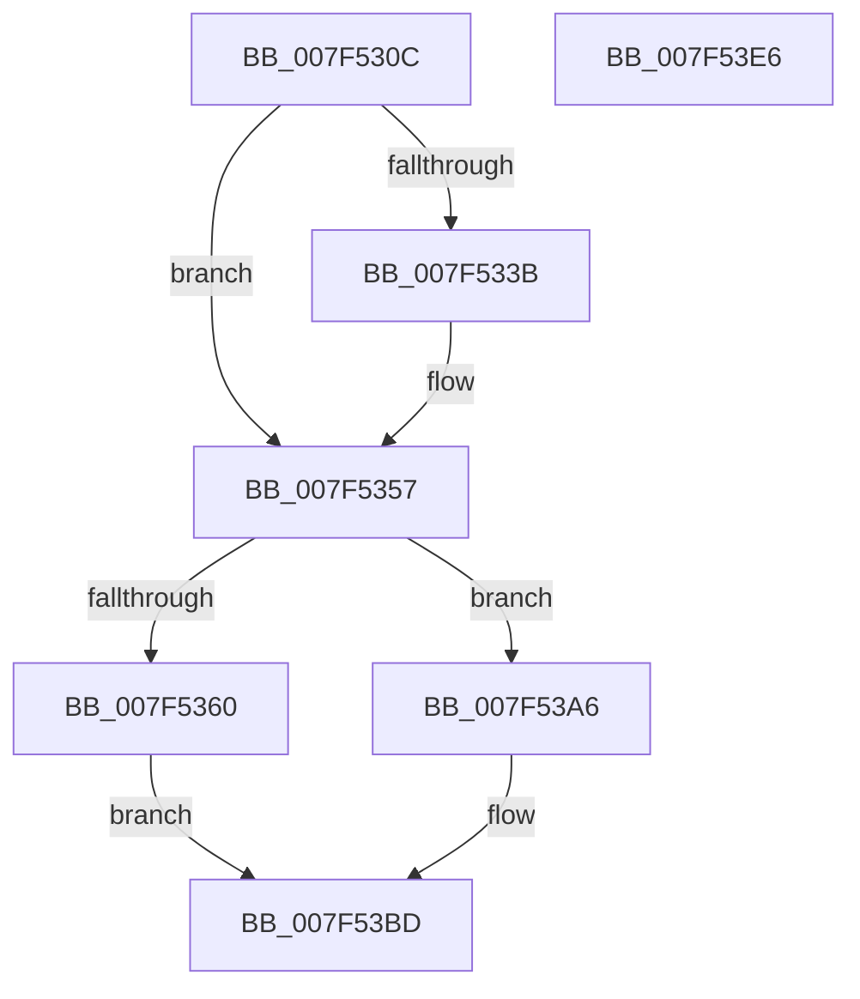

# CmFcpInitializeFeatureUsageProviderSubscription

- RVA: `0x007F530C`–`0x007F53E7` (길이 `219` bytes)
- VA: `0x00000001407F530C`
- 실행 섹션: `PAGE`
- PDB 이름 있음: `예`; PDB Function 태그: `아니요`
- unwind 정보 RVA: `0x0005C954`
- 디코드: `54`개 명령, `219/219` bytes 표시
- 미해석 바이트: `0` (있으면 어셈블리에 `.byte`로 보존)

> 이 문서는 커널 이미지의 기계어와 PDB 기호를 분석해 생성했습니다. 4번과 5번은 함수 원형과 자료형을 바이너리 사용 방식에서 추정한 C 해석이며 원본 소스 복구 결과는 아닙니다.

## 1. Dependencies

- 직접 호출 지점: **4**; 고유 호출 대상: **3**
- 직접 호출자로 확인된 함수: **1**
- RIP 상대 이미지 참조: **3**

### Outgoing calls
- `0x007F5331` → [memset](../../text/6C/memset_function_006C6C40.md) (function, `0x006C6C40`)
- `0x007F5357` → [Feature_Servicing_FixWarmRebootIssueOnLowCoreCPUs__private_IsEnabledDeviceUsageNoInline](../../text/66/Feature_Servicing_FixWarmRebootIssueOnLowCoreCPUs__private_IsEnabledDeviceUsageNoInline_function_0066B68C.md) (function, `0x0066B68C`)
- `0x007F536D` → [memset](../../text/6C/memset_function_006C6C40.md) (function, `0x006C6C40`)
- `0x007F53AD` → [CmFcpUsageProviderWorkItemInitialize](../../text/66/CmFcpUsageProviderWorkItemInitialize_function_0066B4B8.md) (function, `0x0066B4B8`)

### Direct callers
- [CmFcpManagerAllocateUsageProviderSubscription](../AD/CmFcpManagerAllocateUsageProviderSubscription_function_00AD2E54.md) at `0x00AD2EC5`

### Static image references
- `0x007F5376` → RVA `0x0049F4E0` (`CmpWorkItemWrapper`; read)
- `0x007F538A` → RVA `0x00AF7AB0` (`CmFcpFeatureUsageProviderSubscriptionWrapper`; read)
- `0x007F53C2` → RVA `0x00EF72E0` (`.data`; read)

## 2. Other-region calls and transfers

- 다른 실행 섹션으로 향하는 call: **4**
  - `0x007F5331` → [memset](../../text/6C/memset_function_006C6C40.md) (`PAGE` → `.text`)
  - `0x007F5357` → [Feature_Servicing_FixWarmRebootIssueOnLowCoreCPUs__private_IsEnabledDeviceUsageNoInline](../../text/66/Feature_Servicing_FixWarmRebootIssueOnLowCoreCPUs__private_IsEnabledDeviceUsageNoInline_function_0066B68C.md) (`PAGE` → `.text`)
  - `0x007F536D` → [memset](../../text/6C/memset_function_006C6C40.md) (`PAGE` → `.text`)
  - `0x007F53AD` → [CmFcpUsageProviderWorkItemInitialize](../../text/66/CmFcpUsageProviderWorkItemInitialize_function_0066B4B8.md) (`PAGE` → `.text`)
- 별도 외부 분기/꼬리 이동을 확인하지 못했습니다.

## 3. Assembly (complete function range)

```asm
007F530C  48 89 5C 24 08                  mov qword ptr [rsp + 8], rbx
007F5311  48 89 6C 24 10                  mov qword ptr [rsp + 0x10], rbp
007F5316  48 89 74 24 18                  mov qword ptr [rsp + 0x18], rsi
007F531B  57                              push rdi
007F531C  48 83 EC 20                     sub rsp, 0x20
007F5320  49 8B E8                        mov rbp, r8
007F5323  33 D2                           xor edx, edx
007F5325  41 B8 90 00 00 00               mov r8d, 0x90
007F532B  49 8B F1                        mov rsi, r9
007F532E  48 8B F9                        mov rdi, rcx
007F5331  E8 0A 19 ED FF                  call 0x1406c6c40
007F5336  48 85 F6                        test rsi, rsi
007F5339  74 1C                           je 0x1407f5357
007F533B  48 8B 06                        mov rax, qword ptr [rsi]
007F533E  48 89 47 70                     mov qword ptr [rdi + 0x70], rax
007F5342  48 8B 46 08                     mov rax, qword ptr [rsi + 8]
007F5346  48 89 47 78                     mov qword ptr [rdi + 0x78], rax
007F534A  8B 46 18                        mov eax, dword ptr [rsi + 0x18]
007F534D  89 87 80 00 00 00               mov dword ptr [rdi + 0x80], eax
007F5353  48 8B 76 10                     mov rsi, qword ptr [rsi + 0x10]
007F5357  E8 30 63 E7 FF                  call 0x14066b68c
007F535C  85 C0                           test eax, eax
007F535E  75 46                           jne 0x1407f53a6
007F5360  48 8D 5F 10                     lea rbx, [rdi + 0x10]
007F5364  33 D2                           xor edx, edx
007F5366  48 8B CB                        mov rcx, rbx
007F5369  44 8D 40 40                     lea r8d, [rax + 0x40]
007F536D  E8 CE 18 ED FF                  call 0x1406c6c40
007F5372  48 83 23 00                     and qword ptr [rbx], 0
007F5376  48 8D 05 63 A1 CA FF            lea rax, [rip - 0x355e9d]
007F537D  83 63 28 00                     and dword ptr [rbx + 0x28], 0
007F5381  48 83 63 20 00                  and qword ptr [rbx + 0x20], 0
007F5386  48 89 43 10                     mov qword ptr [rbx + 0x10], rax
007F538A  48 8D 05 1F 27 30 00            lea rax, [rip + 0x30271f]
007F5391  48 89 43 30                     mov qword ptr [rbx + 0x30], rax
007F5395  48 89 5B 18                     mov qword ptr [rbx + 0x18], rbx
007F5399  C7 43 2C 04 00 00 00            mov dword ptr [rbx + 0x2c], 4
007F53A0  48 89 73 38                     mov qword ptr [rbx + 0x38], rsi
007F53A4  EB 17                           jmp 0x1407f53bd
007F53A6  48 8D 4F 10                     lea rcx, [rdi + 0x10]
007F53AA  4C 8B CE                        mov r9, rsi
007F53AD  E8 06 61 E7 FF                  call 0x14066b4b8
007F53B2  48 C7 87 88 00 00 00 01 00 00 00  mov qword ptr [rdi + 0x88], 1
007F53BD  48 83 67 68 00                  and qword ptr [rdi + 0x68], 0
007F53C2  48 8D 05 17 1F 70 00            lea rax, [rip + 0x701f17]
007F53C9  48 8B 5C 24 30                  mov rbx, qword ptr [rsp + 0x30]
007F53CE  48 8B 74 24 40                  mov rsi, qword ptr [rsp + 0x40]
007F53D3  48 89 6F 50                     mov qword ptr [rdi + 0x50], rbp
007F53D7  48 8B 6C 24 38                  mov rbp, qword ptr [rsp + 0x38]
007F53DC  48 89 47 58                     mov qword ptr [rdi + 0x58], rax
007F53E0  48 83 C4 20                     add rsp, 0x20
007F53E4  5F                              pop rdi
007F53E5  C3                              ret
007F53E6  CC                              int3
```

## 4. C-style interpretation (structured pseudocode)

```c
__int64 __fastcall CmFcpInitializeFeatureUsageProviderSubscription(__int64 a1, int a2, __int64 a3, __int64 a4)
{
    __int64 result;
    __int64 v_rsi;
    __int64 v_rsp;
    unsigned __int64 v_stack_p10;
    unsigned __int64 v_stack_p18;
    unsigned __int64 v_stack_p8;

    v_stack_p8 = v_rbx;
    v_stack_p10 = v_rbp;
    v_stack_p18 = v_rsi;
    v_rsp = (v_rsp) - (32);
    a2 = 0;
    result = memset(a1, a2, 144, a4);
    v_rsi = a4;
    if (a4 != 0) {
        result = *(unsigned __int64 *)(a4);
        *(unsigned __int64 *)(a1 + 112) = result;
        result = *(unsigned __int64 *)(a4 + 8);
        *(unsigned __int64 *)(a1 + 120) = result;
        result = *(unsigned int *)(a4 + 24);
        *(unsigned int *)(a1 + 128) = (unsigned int)(result);
        v_rsi = *(unsigned __int64 *)(a4 + 16);
    }
    result = Feature_Servicing_FixWarmRebootIssueOnLowCoreCPUs__private_IsEnabledDeviceUsageNoInline(a1, a2, 144, a4);
    if ((unsigned int)(result) != 0) goto loc_007F53A6;
    a2 = 0;
    result = memset(a1 + 16, a2, result + 64, a4);
    *(unsigned __int64 *)(a1 + 16 + 16) = v_rip - 3497629;
    *(unsigned __int64 *)(a1 + 16 + 48) = v_rip + 3155743;
    *(unsigned __int64 *)(a1 + 16 + 24) = a1 + 16;
    *(unsigned int *)(a1 + 16 + 44) = 4;
    *(unsigned __int64 *)(a1 + 16 + 56) = v_rsi;
    goto loc_007F53BD;
loc_007F53A6:
    result = CmFcpUsageProviderWorkItemInitialize(a1 + 16, a2, result + 64, v_rsi);
    *(unsigned __int64 *)(a1 + 136) = 1;
loc_007F53BD:
    *(unsigned __int64 *)(a1 + 80) = a3;
    *(unsigned __int64 *)(a1 + 88) = v_rip + 7347991;
    v_rsp = (v_rsp) + (32);
    return v_rip + 7347991;
}
```

## 5. (Beta) C Style

```c
int64_t CmFcpInitializeFeatureUsageProviderSubscription(void *Arg1, int32_t Arg2, int64_t Arg3, int64_t Arg4)
{
    uint8_t *arg1 = (uint8_t *)Arg1;

    int64_t result;
    int64_t local_rsi;
    int64_t local_rsp;
    uint64_t v_stack_p10;
    uint64_t v_stack_p18;
    uint64_t v_stack_p8;

    v_stack_p8 = local_rbx;
    v_stack_p10 = local_rbp;
    v_stack_p18 = local_rsi;
    local_rsp = (local_rsp) - (32);
    Arg2 = 0;
    result = memset(Arg1, Arg2, 144, Arg4);
    local_rsi = Arg4;
    if (Arg4 != 0) {
        result = *(uint64_t *)(Arg4);
        *(uint64_t *)(arg1 + 0x70) = result;
        result = *(uint64_t *)(Arg4 + 0x8);
        *(uint64_t *)(arg1 + 0x78) = result;
        result = *(uint32_t *)(Arg4 + 0x18);
        *(uint32_t *)(arg1 + 0x80) = (uint32_t)(result);
        local_rsi = *(uint64_t *)(Arg4 + 0x10);
    }
    result = Feature_Servicing_FixWarmRebootIssueOnLowCoreCPUs__private_IsEnabledDeviceUsageNoInline(Arg1, Arg2, 144, Arg4);
    if ((uint32_t)(result) != 0) goto loc_007F53A6;
    Arg2 = 0;
    result = memset(Arg1 + 16, Arg2, result + 64, Arg4);
    *(uint64_t *)(arg1 + 0x10 + 0x10) = v_rip - 3497629;
    *(uint64_t *)(arg1 + 0x10 + 0x30) = v_rip + 3155743;
    *(void **)(arg1 + 0x10 + 0x18) = Arg1 + 16;
    *(uint32_t *)(arg1 + 0x10 + 0x2C) = 4;
    *(uint64_t *)(arg1 + 0x10 + 0x38) = local_rsi;
    goto loc_007F53BD;
loc_007F53A6:
    result = CmFcpUsageProviderWorkItemInitialize(Arg1 + 16, Arg2, result + 64, local_rsi);
    *(uint64_t *)(arg1 + 0x88) = 1;
loc_007F53BD:
    *(uint64_t *)(arg1 + 0x50) = Arg3;
    *(uint64_t *)(arg1 + 0x58) = v_rip + 7347991;
    local_rsp = (local_rsp) + (32);
    return v_rip + 7347991;
}
```

### 관측된 메모리 오프셋

구조체 형식이 확인되지 않은 접근은 인자 기준의 오프셋으로만 기록했습니다.

| 기준 인자 | 오프셋 표현 | 폭 (bit) | 접근 |
|---|---:|---:|---|
| `Arg1` | `+ 0x0` | `64` | `R/W` |
| `Arg1` | `+ 0x10` | `64` | `R` |
| `Arg1` | `+ 0x10` | `64` | `W` |
| `Arg1` | `+ 0x18` | `64` | `W` |
| `Arg1` | `+ 0x20` | `64` | `R/W` |
| `Arg1` | `+ 0x28` | `32` | `R/W` |
| `Arg1` | `+ 0x2C` | `32` | `W` |
| `Arg1` | `+ 0x30` | `64` | `W` |
| `Arg1` | `+ 0x38` | `64` | `W` |
| `Arg1` | `+ 0x50` | `64` | `W` |
| `Arg1` | `+ 0x58` | `64` | `W` |
| `Arg1` | `+ 0x68` | `64` | `R/W` |
| `Arg1` | `+ 0x70` | `64` | `W` |
| `Arg1` | `+ 0x78` | `64` | `W` |
| `Arg1` | `+ 0x80` | `32` | `W` |
| `Arg1` | `+ 0x88` | `64` | `W` |

## 6. Execution-region graph

[열기: 2D/3D 그래프와 함수 탐색 컨트롤 패널](../../../control-panel.html?section=page&rva=0x007F530C&view=graph)

- 2D 그래프는 위에서 아래로 흐르고, 3D 그래프는 빈 공간을 드래그해 회전합니다. Shift+드래그는 이동, 휠은 확대·축소, 함수 노드 선택은 대상 보고서 이동입니다.

### Static fallback


