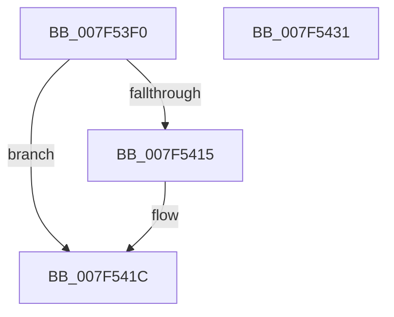

# CmFcpManagerAddBufferIntoPublishListAndSetPublishState

- RVA: `0x007F53F0`–`0x007F5432` (길이 `66` bytes)
- VA: `0x00000001407F53F0`
- 실행 섹션: `PAGE`
- PDB 이름 있음: `예`; PDB Function 태그: `아니요`
- unwind 정보 RVA: `0x000DB714`
- 디코드: `20`개 명령, `66/66` bytes 표시
- 미해석 바이트: `0` (있으면 어셈블리에 `.byte`로 보존)

> 이 문서는 커널 이미지의 기계어와 PDB 기호를 분석해 생성했습니다. 4번과 5번은 함수 원형과 자료형을 바이너리 사용 방식에서 추정한 C 해석이며 원본 소스 복구 결과는 아닙니다.

## 1. Dependencies

- 직접 호출 지점: **0**; 고유 호출 대상: **0**
- 직접 호출자로 확인된 함수: **2**
- RIP 상대 이미지 참조: **0**

### Outgoing calls
- 직접 디코드된 call 명령이 없습니다.

### Direct callers
- [CmFcpManagerPublishFeatureUsageData](../AB/CmFcpManagerPublishFeatureUsageData_function_00ABC468.md) at `0x00ABC5A5`
- [CmFcManagerStartRuntimePhase](../../init/C5/CmFcManagerStartRuntimePhase_function_00C5DC70.md) at `0x00C5E172`

### Static image references
- 디코드된 RIP-relative 메모리 참조가 없습니다.

## 2. Other-region calls and transfers

- 다른 실행 섹션으로 향하는 call: **0**
- 별도 외부 분기/꼬리 이동을 확인하지 못했습니다.

## 3. Assembly (complete function range)

```asm
007F53F0  8B 81 30 07 00 00               mov eax, dword ptr [rcx + 0x730]
007F53F6  48 81 C1 B0 05 00 00            add rcx, 0x5b0
007F53FD  83 E0 E7                        and eax, 0xffffffe7
007F5400  83 C8 04                        or eax, 4
007F5403  C1 E8 02                        shr eax, 2
007F5406  89 42 18                        mov dword ptr [rdx + 0x18], eax
007F5409  48 8B 41 08                     mov rax, qword ptr [rcx + 8]
007F540D  4C 8B 01                        mov r8, qword ptr [rcx]
007F5410  48 39 08                        cmp qword ptr [rax], rcx
007F5413  74 07                           je 0x1407f541c
007F5415  B9 03 00 00 00                  mov ecx, 3
007F541A  CD 29                           int 0x29
007F541C  48 89 42 08                     mov qword ptr [rdx + 8], rax
007F5420  4C 3B C1                        cmp r8, rcx
007F5423  48 89 0A                        mov qword ptr [rdx], rcx
007F5426  48 89 10                        mov qword ptr [rax], rdx
007F5429  0F 94 C0                        sete al
007F542C  48 89 51 08                     mov qword ptr [rcx + 8], rdx
007F5430  C3                              ret
007F5431  CC                              int3
```

## 4. C-style interpretation (structured pseudocode)

```c
__int64 __fastcall CmFcpManagerAddBufferIntoPublishListAndSetPublishState(__int64 a1, __int64 a2)
{
    __int64 result;

    a1 = (a1) + (0x5B0ULL);
    result = (unsigned int)(((unsigned int)(*(unsigned int *)(a1 + 1840))) & (0xFFFFFFE7ULL));
    result = (unsigned int)((result) | (4));
    result = (unsigned int)((result) >> (2));
    *(unsigned int *)(a2 + 24) = (unsigned int)(result);
    if ((*(unsigned __int64 *)(*(unsigned __int64 *)(a1 + 8))) != a1) {
        a1 = 3;
    }
    *(unsigned __int64 *)(a2 + 8) = *(unsigned __int64 *)(a1 + 8);
    *(unsigned __int64 *)(a2) = a1;
    *(unsigned __int64 *)(*(unsigned __int64 *)(a1 + 8)) = a2;
    result = ((*(unsigned __int64 *)(a1)) == a1) ? 1 : 0;
    *(unsigned __int64 *)(a1 + 8) = a2;
    return result;
}
```

## 5. (Beta) C Style

```c
int64_t CmFcpManagerAddBufferIntoPublishListAndSetPublishState(void *Arg1, void *Arg2)
{
    uint8_t *arg1 = (uint8_t *)Arg1;
    uint8_t *arg2 = (uint8_t *)Arg2;

    int64_t result;

    Arg1 = (Arg1) + (0x5B0ULL);
    result = (uint32_t)(((uint32_t)(*(uint32_t *)(arg1 + 0x730))) & (0xFFFFFFE7ULL));
    result = (uint32_t)((result) | (4));
    result = (uint32_t)((result) >> (2));
    *(uint32_t *)(arg2 + 0x18) = (uint32_t)(result);
    if ((*(uint64_t *)(*(uint64_t *)(arg1 + 0x8))) != Arg1) {
        Arg1 = 3;
    }
    *(uint64_t *)(arg2 + 0x8) = *(uint64_t *)(arg1 + 0x8);
    *(void **)(arg2) = Arg1;
    *(void **)(*(uint64_t *)(arg1 + 0x8)) = Arg2;
    result = ((*(uint64_t *)(arg1)) == Arg1) ? 1 : 0;
    *(void **)(arg1 + 0x8) = Arg2;
    return result;
}
```

### 관측된 메모리 오프셋

구조체 형식이 확인되지 않은 접근은 인자 기준의 오프셋으로만 기록했습니다.

| 기준 인자 | 오프셋 표현 | 폭 (bit) | 접근 |
|---|---:|---:|---|
| `Arg1` | `+ 0x0` | `64` | `R` |
| `Arg1` | `+ 0x8` | `64` | `R` |
| `Arg1` | `+ 0x730` | `32` | `R` |
| `Arg2` | `+ 0x0` | `64` | `W` |
| `Arg2` | `+ 0x8` | `64` | `W` |
| `Arg2` | `+ 0x18` | `32` | `W` |

## 6. Execution-region graph

[열기: 2D/3D 그래프와 함수 탐색 컨트롤 패널](../../../control-panel.html?section=page&rva=0x007F53F0&view=graph)

- 2D 그래프는 위에서 아래로 흐르고, 3D 그래프는 빈 공간을 드래그해 회전합니다. Shift+드래그는 이동, 휠은 확대·축소, 함수 노드 선택은 대상 보고서 이동입니다.

### Static fallback


