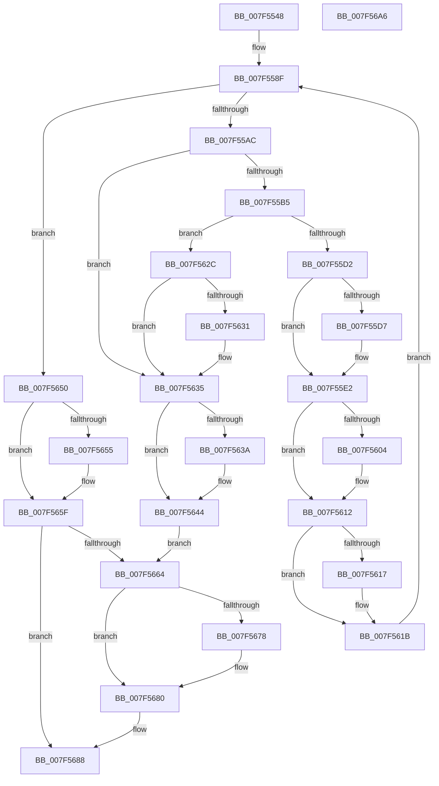

# CmFcpManagerPublishFeatureUsageDataIfNearCapacity

- RVA: `0x007F5548`–`0x007F56A7` (길이 `351` bytes)
- VA: `0x00000001407F5548`
- 실행 섹션: `PAGE`
- PDB 이름 있음: `예`; PDB Function 태그: `아니요`
- unwind 정보 RVA: `0x00060300`
- 디코드: `99`개 명령, `351/351` bytes 표시
- 미해석 바이트: `0` (있으면 어셈블리에 `.byte`로 보존)

> 이 문서는 커널 이미지의 기계어와 PDB 기호를 분석해 생성했습니다. 4번과 5번은 함수 원형과 자료형을 바이너리 사용 방식에서 추정한 C 해석이며 원본 소스 복구 결과는 아닙니다.

## 1. Dependencies

- 직접 호출 지점: **13**; 고유 호출 대상: **10**
- 직접 호출자로 확인된 함수: **1**
- RIP 상대 이미지 참조: **0**

### Outgoing calls
- `0x007F5582` → [RtlAcquireSwapReference](../../text/37/RtlAcquireSwapReference_function_00378684.md) (function, `0x00378684`)
- `0x007F559F` → [CmFcpManagerFeatureUsageBufferNearCapacityThreshold](../../text/4C/CmFcpManagerFeatureUsageBufferNearCapacityThreshold_function_004C6FB0.md) (function, `0x004C6FB0`)
- `0x007F55C5` → [KeAbPreAcquire](../../text/21/KeAbPreAcquire_function_00210230.md) (function, `0x00210230`)
- `0x007F55DD` → [KeAbPostReleaseEx](../../text/26/KeAbPostReleaseEx_function_00262210.md) (function, `0x00262210`)
- `0x007F55E7` → [RtlReleaseSwapReference](../../text/37/RtlReleaseSwapReference_function_0037885C.md) (function, `0x0037885C`)
- `0x007F55F4` → [KeAbPreAcquire](../../text/21/KeAbPreAcquire_function_00210230.md) (function, `0x00210230`)
- `0x007F560D` → [ExfAcquirePushLockExclusiveEx](../../text/20/ExfAcquirePushLockExclusiveEx_function_0020FC90.md) (function, `0x0020FC90`)
- `0x007F563F` → [RtlReleaseSwapReference](../../text/37/RtlReleaseSwapReference_function_0037885C.md) (function, `0x0037885C`)
- `0x007F5649` → [CmFcpManagerPublishFeatureUsageData](../AB/CmFcpManagerPublishFeatureUsageData_function_00ABC468.md) (function, `0x00ABC468`)
- `0x007F565A` → [RtlReleaseSwapReference](../../text/37/RtlReleaseSwapReference_function_0037885C.md) (function, `0x0037885C`)
- `0x007F567B` → [ExfTryToWakePushLock](../../text/26/ExfTryToWakePushLock_function_00265DD0.md) (function, `0x00265DD0`)
- `0x007F5683` → [KeAbPostRelease](../../text/2E/KeAbPostRelease_function_002E1600.md) (function, `0x002E1600`)
- `0x007F5688` → [KeLeaveCriticalRegion](../../text/25/KeLeaveCriticalRegion_function_0025D8B0.md) (function, `0x0025D8B0`)

### Direct callers
- [CmFcpManagerPublishFeatureUsageDataIfNearCapacityWorker](CmFcpManagerPublishFeatureUsageDataIfNearCapacityWorker_function_007F56B0.md) at `0x007F56BF`

### Static image references
- 디코드된 RIP-relative 메모리 참조가 없습니다.

## 2. Other-region calls and transfers

- 다른 실행 섹션으로 향하는 call: **12**
  - `0x007F5582` → [RtlAcquireSwapReference](../../text/37/RtlAcquireSwapReference_function_00378684.md) (`PAGE` → `.text`)
  - `0x007F559F` → [CmFcpManagerFeatureUsageBufferNearCapacityThreshold](../../text/4C/CmFcpManagerFeatureUsageBufferNearCapacityThreshold_function_004C6FB0.md) (`PAGE` → `.text`)
  - `0x007F55C5` → [KeAbPreAcquire](../../text/21/KeAbPreAcquire_function_00210230.md) (`PAGE` → `.text`)
  - `0x007F55DD` → [KeAbPostReleaseEx](../../text/26/KeAbPostReleaseEx_function_00262210.md) (`PAGE` → `.text`)
  - `0x007F55E7` → [RtlReleaseSwapReference](../../text/37/RtlReleaseSwapReference_function_0037885C.md) (`PAGE` → `.text`)
  - `0x007F55F4` → [KeAbPreAcquire](../../text/21/KeAbPreAcquire_function_00210230.md) (`PAGE` → `.text`)
  - `0x007F560D` → [ExfAcquirePushLockExclusiveEx](../../text/20/ExfAcquirePushLockExclusiveEx_function_0020FC90.md) (`PAGE` → `.text`)
  - `0x007F563F` → [RtlReleaseSwapReference](../../text/37/RtlReleaseSwapReference_function_0037885C.md) (`PAGE` → `.text`)
  - `0x007F565A` → [RtlReleaseSwapReference](../../text/37/RtlReleaseSwapReference_function_0037885C.md) (`PAGE` → `.text`)
  - `0x007F567B` → [ExfTryToWakePushLock](../../text/26/ExfTryToWakePushLock_function_00265DD0.md) (`PAGE` → `.text`)
  - `0x007F5683` → [KeAbPostRelease](../../text/2E/KeAbPostRelease_function_002E1600.md) (`PAGE` → `.text`)
  - `0x007F5688` → [KeLeaveCriticalRegion](../../text/25/KeLeaveCriticalRegion_function_0025D8B0.md) (`PAGE` → `.text`)
- 별도 외부 분기/꼬리 이동을 확인하지 못했습니다.

## 3. Assembly (complete function range)

```asm
007F5548  48 89 5C 24 08                  mov qword ptr [rsp + 8], rbx
007F554D  48 89 6C 24 10                  mov qword ptr [rsp + 0x10], rbp
007F5552  48 89 74 24 18                  mov qword ptr [rsp + 0x18], rsi
007F5557  57                              push rdi
007F5558  41 56                           push r14
007F555A  41 57                           push r15
007F555C  48 83 EC 20                     sub rsp, 0x20
007F5560  65 48 8B 04 25 88 01 00 00      mov rax, qword ptr gs:[0x188]
007F5569  4C 8D B1 B0 03 00 00            lea r14, [rcx + 0x3b0]
007F5570  48 8B E9                        mov rbp, rcx
007F5573  48 83 CB FF                     or rbx, 0xffffffffffffffff
007F5577  49 8B CE                        mov rcx, r14
007F557A  66 01 98 E4 01 00 00            add word ptr [rax + 0x1e4], bx
007F5581  90                              nop
007F5582  E8 FD 30 B8 FF                  call 0x140378684
007F5587  8B F8                           mov edi, eax
007F5589  40 32 F6                        xor sil, sil
007F558C  41 B7 01                        mov r15b, 1
007F558F  8B C7                           mov eax, edi
007F5591  48 8B 8C C5 88 05 00 00         mov rcx, qword ptr [rbp + rax*8 + 0x588]
007F5599  8B 51 10                        mov edx, dword ptr [rcx + 0x10]
007F559C  8B 49 1C                        mov ecx, dword ptr [rcx + 0x1c]
007F559F  E8 0C 1A CD FF                  call 0x1404c6fb0
007F55A4  3B D0                           cmp edx, eax
007F55A6  0F 82 A4 00 00 00               jb 0x1407f5650
007F55AC  40 84 F6                        test sil, sil
007F55AF  0F 85 80 00 00 00               jne 0x1407f5635
007F55B5  33 D2                           xor edx, edx
007F55B7  48 8D B5 D8 05 00 00            lea rsi, [rbp + 0x5d8]
007F55BE  48 8B CE                        mov rcx, rsi
007F55C1  44 8D 42 01                     lea r8d, [rdx + 1]
007F55C5  E8 66 AC A1 FF                  call 0x140210230
007F55CA  F0 48 0F BA 2E 00               lock bts qword ptr [rsi], 0
007F55D0  73 5A                           jae 0x1407f562c
007F55D2  48 85 C0                        test rax, rax
007F55D5  74 0B                           je 0x1407f55e2
007F55D7  48 8B D0                        mov rdx, rax
007F55DA  48 8B CE                        mov rcx, rsi
007F55DD  E8 2E CC A6 FF                  call 0x140262210
007F55E2  8B D7                           mov edx, edi
007F55E4  49 8B CE                        mov rcx, r14
007F55E7  E8 70 32 B8 FF                  call 0x14037885c
007F55EC  45 33 C0                        xor r8d, r8d
007F55EF  33 D2                           xor edx, edx
007F55F1  48 8B CE                        mov rcx, rsi
007F55F4  E8 37 AC A1 FF                  call 0x140210230
007F55F9  F0 48 0F BA 2E 00               lock bts qword ptr [rsi], 0
007F55FF  48 8B F8                        mov rdi, rax
007F5602  73 0E                           jae 0x1407f5612
007F5604  4C 8B C6                        mov r8, rsi
007F5607  48 8B D0                        mov rdx, rax
007F560A  48 8B CE                        mov rcx, rsi
007F560D  E8 7E A6 A1 FF                  call 0x14020fc90
007F5612  48 85 FF                        test rdi, rdi
007F5615  74 04                           je 0x1407f561b
007F5617  C6 47 0A 01                     mov byte ptr [rdi + 0xa], 1
007F561B  49 8B 3E                        mov rdi, qword ptr [r14]
007F561E  40 B6 01                        mov sil, 1
007F5621  83 E7 01                        and edi, 1
007F5624  45 32 FF                        xor r15b, r15b
007F5627  E9 63 FF FF FF                  jmp 0x1407f558f
007F562C  48 85 C0                        test rax, rax
007F562F  74 04                           je 0x1407f5635
007F5631  C6 40 0A 01                     mov byte ptr [rax + 0xa], 1
007F5635  45 84 FF                        test r15b, r15b
007F5638  74 0A                           je 0x1407f5644
007F563A  8B D7                           mov edx, edi
007F563C  49 8B CE                        mov rcx, r14
007F563F  E8 18 32 B8 FF                  call 0x14037885c
007F5644  B2 01                           mov dl, 1
007F5646  48 8B CD                        mov rcx, rbp
007F5649  E8 1A 6E 2C 00                  call 0x140abc468
007F564E  EB 14                           jmp 0x1407f5664
007F5650  45 84 FF                        test r15b, r15b
007F5653  74 0A                           je 0x1407f565f
007F5655  8B D7                           mov edx, edi
007F5657  49 8B CE                        mov rcx, r14
007F565A  E8 FD 31 B8 FF                  call 0x14037885c
007F565F  40 84 F6                        test sil, sil
007F5662  74 24                           je 0x1407f5688
007F5664  48 8D BD D8 05 00 00            lea rdi, [rbp + 0x5d8]
007F566B  F0 48 0F C1 1F                  lock xadd qword ptr [rdi], rbx
007F5670  80 E3 06                        and bl, 6
007F5673  80 FB 02                        cmp bl, 2
007F5676  75 08                           jne 0x1407f5680
007F5678  48 8B CF                        mov rcx, rdi
007F567B  E8 50 07 A7 FF                  call 0x140265dd0
007F5680  48 8B CF                        mov rcx, rdi
007F5683  E8 78 BF AE FF                  call 0x1402e1600
007F5688  E8 23 82 A6 FF                  call 0x14025d8b0
007F568D  48 8B 5C 24 40                  mov rbx, qword ptr [rsp + 0x40]
007F5692  48 8B 6C 24 48                  mov rbp, qword ptr [rsp + 0x48]
007F5697  48 8B 74 24 50                  mov rsi, qword ptr [rsp + 0x50]
007F569C  48 83 C4 20                     add rsp, 0x20
007F56A0  41 5F                           pop r15
007F56A2  41 5E                           pop r14
007F56A4  5F                              pop rdi
007F56A5  C3                              ret
007F56A6  CC                              int3
```

## 4. C-style interpretation (structured pseudocode)

```c
__int64 __fastcall CmFcpManagerPublishFeatureUsageDataIfNearCapacity(__int64 a1)
{
    __int64 result;
    __int64 v_r15;
    __int64 v_rbx;
    __int64 v_rdi;
    __int64 v_rsi;
    __int64 v_rsp;
    unsigned __int64 v_stack_p10;
    unsigned __int64 v_stack_p18;
    unsigned __int64 v_stack_p8;

    v_stack_p8 = v_rbx;
    v_stack_p10 = v_rbp;
    v_stack_p18 = v_rsi;
    v_rsp = (v_rsp) - (32);
    v_rbx = (v_rbx) | (-1);
    result = RtlAcquireSwapReference(a1 + 944, a2, a3, a4);
    v_rsi = 0;
loc_007F558F:
    result = CmFcpManagerFeatureUsageBufferNearCapacityThreshold((unsigned int)(*(unsigned int *)(*(unsigned __int64 *)(a1 + (unsigned int)((unsigned int)((unsigned int)((unsigned int)(result)))) * 8 + 1416) + 28)), (unsigned int)(*(unsigned int *)(*(unsigned __int64 *)(a1 + (unsigned int)((unsigned int)((unsigned int)((unsigned int)(result)))) * 8 + 1416) + 16)), a3, a4);
    if (((unsigned int)((unsigned int)(*(unsigned int *)(*(unsigned __int64 *)(a1 + (unsigned int)((unsigned int)((unsigned int)((unsigned int)(result)))) * 8 + 1416) + 16)))) < ((unsigned int)(result))) goto loc_007F5650;
    if (0 != 0) goto loc_007F5635;
    a2 = 0;
    result = KeAbPreAcquire(a1 + 1496, a2, a2 + 1, a4);
    if (condition_is_above_or_equal) goto loc_007F562C;
    if (result != 0) {
        a2 = result;
        a1 = a1 + 1496;
        result = KeAbPostReleaseEx(a1, a2, a2 + 1, a4);
    }
    result = RtlReleaseSwapReference(a1 + 944, (unsigned int)((unsigned int)((unsigned int)((unsigned int)(result)))), a2 + 1, a4);
    a3 = 0;
    a2 = 0;
    result = KeAbPreAcquire(a1 + 1496, a2, a3, a4);
    if (!(condition_is_above_or_equal)) {
        a3 = a1 + 1496;
        a2 = result;
        a1 = a1 + 1496;
        result = ExfAcquirePushLockExclusiveEx(a1, a2, a3, a4);
    }
    if (result != 0) {
        *(unsigned __int8 *)(result + 10) = 1;
    }
    v_rdi = (unsigned int)((*(unsigned __int64 *)(a1 + 944)) & (1));
    v_r15 = 0;
    goto loc_007F558F;
loc_007F562C:
    if (result != 0) {
        *(unsigned __int8 *)(result + 10) = 1;
    }
    if (0 != 0) {
        a2 = (unsigned int)(v_rdi);
        a1 = a1 + 944;
        result = RtlReleaseSwapReference(a1, a2, a3, a4);
    }
    result = CmFcpManagerPublishFeatureUsageData(a1, 1, a3, a4);
    goto loc_007F5664;
loc_007F5650:
    if (0 != 0) {
        a2 = (unsigned int)(v_rdi);
        a1 = a1 + 944;
        result = RtlReleaseSwapReference(a1, a2, a3, a4);
    }
    if (1 == 0) goto loc_007F5688;
loc_007F5664:
    v_rbx = (unsigned __int8)((v_rbx) & (6));
    if (((unsigned __int8)(v_rbx)) == 2) {
        a1 = a1 + 1496;
        result = ExfTryToWakePushLock(a1, a2, a3, a4);
    }
    result = KeAbPostRelease(a1 + 1496, a2, a3, a4);
loc_007F5688:
    result = KeLeaveCriticalRegion(a1 + 1496, a2, a3, a4);
    v_rsp = (v_rsp) + (32);
    return result;
}
```

## 5. (Beta) C Style

```c
int64_t CmFcpManagerPublishFeatureUsageDataIfNearCapacity(void *Arg1)
{
    uint8_t *arg1 = (uint8_t *)Arg1;

    int64_t result;
    int64_t local_r15;
    int64_t local_rbx;
    int64_t local_rdi;
    int64_t local_rsi;
    int64_t local_rsp;
    uint64_t v_stack_p10;
    uint64_t v_stack_p18;
    uint64_t v_stack_p8;

    v_stack_p8 = local_rbx;
    v_stack_p10 = local_rbp;
    v_stack_p18 = local_rsi;
    local_rsp = (local_rsp) - (32);
    local_rbx = (local_rbx) | (-1);
    result = RtlAcquireSwapReference(Arg1 + 944, a2, a3, a4);
    local_rsi = 0;
loc_007F558F:
    result = CmFcpManagerFeatureUsageBufferNearCapacityThreshold((uint32_t)(*(uint32_t *)(*(uint64_t *)(arg1 + (uint32_t)((uint32_t)((uint32_t)((uint32_t)(result)))) * 8 + 0x588) + 0x1C)), (uint32_t)(*(uint32_t *)(*(uint64_t *)(arg1 + (uint32_t)((uint32_t)((uint32_t)((uint32_t)(result)))) * 8 + 0x588) + 0x10)), a3, a4);
    if (((uint32_t)((uint32_t)(*(uint32_t *)(*(uint64_t *)(arg1 + (uint32_t)((uint32_t)((uint32_t)((uint32_t)(result)))) * 8 + 0x588) + 0x10)))) < ((uint32_t)(result))) goto loc_007F5650;
    if (0 != 0) goto loc_007F5635;
    a2 = 0;
    result = KeAbPreAcquire(Arg1 + 1496, a2, a2 + 1, a4);
    if (condition_is_above_or_equal) goto loc_007F562C;
    if (result != 0) {
        a2 = result;
        Arg1 = Arg1 + 1496;
        result = KeAbPostReleaseEx(Arg1, a2, a2 + 1, a4);
    }
    result = RtlReleaseSwapReference(Arg1 + 944, (uint32_t)((uint32_t)((uint32_t)((uint32_t)(result)))), a2 + 1, a4);
    a3 = 0;
    a2 = 0;
    result = KeAbPreAcquire(Arg1 + 1496, a2, a3, a4);
    if (!(condition_is_above_or_equal)) {
        a3 = Arg1 + 1496;
        a2 = result;
        Arg1 = Arg1 + 1496;
        result = ExfAcquirePushLockExclusiveEx(Arg1, a2, a3, a4);
    }
    if (result != 0) {
        *(uint8_t *)(result + 0xA) = 1;
    }
    local_rdi = (uint32_t)((*(uint64_t *)(arg1 + 0x3B0)) & (1));
    local_r15 = 0;
    goto loc_007F558F;
loc_007F562C:
    if (result != 0) {
        *(uint8_t *)(result + 0xA) = 1;
    }
    if (0 != 0) {
        a2 = (uint32_t)(local_rdi);
        Arg1 = Arg1 + 944;
        result = RtlReleaseSwapReference(Arg1, a2, a3, a4);
    }
    result = CmFcpManagerPublishFeatureUsageData(Arg1, 1, a3, a4);
    goto loc_007F5664;
loc_007F5650:
    if (0 != 0) {
        a2 = (uint32_t)(local_rdi);
        Arg1 = Arg1 + 944;
        result = RtlReleaseSwapReference(Arg1, a2, a3, a4);
    }
    if (1 == 0) goto loc_007F5688;
loc_007F5664:
    local_rbx = (uint8_t)((local_rbx) & (6));
    if (((uint8_t)(local_rbx)) == 2) {
        Arg1 = Arg1 + 1496;
        result = ExfTryToWakePushLock(Arg1, a2, a3, a4);
    }
    result = KeAbPostRelease(Arg1 + 1496, a2, a3, a4);
loc_007F5688:
    result = KeLeaveCriticalRegion(Arg1 + 1496, a2, a3, a4);
    local_rsp = (local_rsp) + (32);
    return result;
}
```

### 관측된 메모리 오프셋

구조체 형식이 확인되지 않은 접근은 인자 기준의 오프셋으로만 기록했습니다.

| 기준 인자 | 오프셋 표현 | 폭 (bit) | 접근 |
|---|---:|---:|---|
| `Arg1` | `+ 0x0` | `64` | `R` |
| `Arg1` | `+ 0x0` | `64` | `R/W` |
| `Arg1` | `+ 0x3B0` | `64` | `R` |
| `Arg1` | `+ 0x588 + rax*8` | `64` | `R` |
| `Arg1` | `+ 0x5D8` | `64` | `R` |

## 6. Execution-region graph

[열기: 2D/3D 그래프와 함수 탐색 컨트롤 패널](../../../control-panel.html?section=page&rva=0x007F5548&view=graph)

- 2D 그래프는 위에서 아래로 흐르고, 3D 그래프는 빈 공간을 드래그해 회전합니다. Shift+드래그는 이동, 휠은 확대·축소, 함수 노드 선택은 대상 보고서 이동입니다.

### Static fallback


