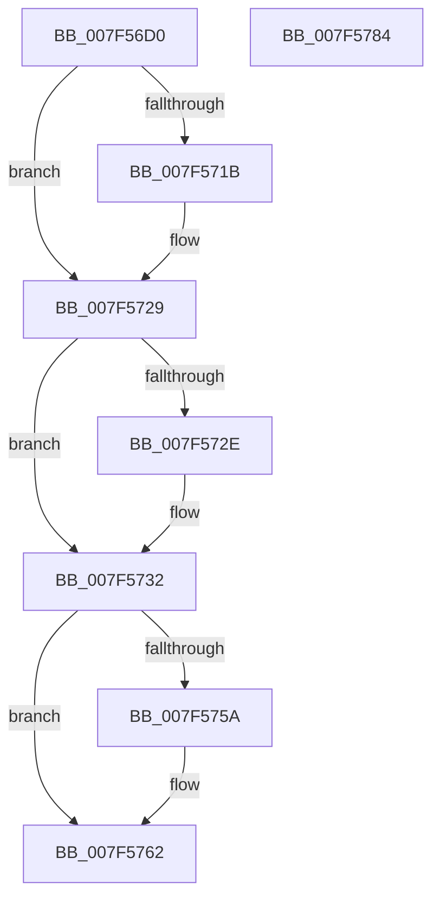

# CmFcpManagerRetryUsageNotificationsWorker

- RVA: `0x007F56D0`–`0x007F5785` (길이 `181` bytes)
- VA: `0x00000001407F56D0`
- 실행 섹션: `PAGE`
- PDB 이름 있음: `예`; PDB Function 태그: `아니요`
- unwind 정보 RVA: `0x0005C954`
- 디코드: `48`개 명령, `181/181` bytes 표시
- 미해석 바이트: `0` (있으면 어셈블리에 `.byte`로 보존)

> 이 문서는 커널 이미지의 기계어와 PDB 기호를 분석해 생성했습니다. 4번과 5번은 함수 원형과 자료형을 바이너리 사용 방식에서 추정한 C 해석이며 원본 소스 복구 결과는 아닙니다.

## 1. Dependencies

- 직접 호출 지점: **7**; 고유 호출 대상: **6**
- 직접 호출자로 확인된 함수: **0**
- RIP 상대 이미지 참조: **0**

### Outgoing calls
- `0x007F570B` → [KeAbPreAcquire](../../text/21/KeAbPreAcquire_function_00210230.md) (function, `0x00210230`)
- `0x007F5724` → [ExfAcquirePushLockExclusiveEx](../../text/20/ExfAcquirePushLockExclusiveEx_function_0020FC90.md) (function, `0x0020FC90`)
- `0x007F573E` → [CmFcpManagerDrainUsageNotifications](../A4/CmFcpManagerDrainUsageNotifications_function_00A451BC.md) (function, `0x00A451BC`)
- `0x007F5748` → [CmFcpManagerDrainUsageNotifications](../A4/CmFcpManagerDrainUsageNotifications_function_00A451BC.md) (function, `0x00A451BC`)
- `0x007F575D` → [ExfTryToWakePushLock](../../text/26/ExfTryToWakePushLock_function_00265DD0.md) (function, `0x00265DD0`)
- `0x007F5765` → [KeAbPostRelease](../../text/2E/KeAbPostRelease_function_002E1600.md) (function, `0x002E1600`)
- `0x007F576A` → [KeLeaveCriticalRegion](../../text/25/KeLeaveCriticalRegion_function_0025D8B0.md) (function, `0x0025D8B0`)

### Direct callers
- 이 함수 시작 RVA로 연결되는 직접 call은 확인되지 않았습니다. 간접 호출은 완전히 역산할 수 없습니다.

### Static image references
- 디코드된 RIP-relative 메모리 참조가 없습니다.

## 2. Other-region calls and transfers

- 다른 실행 섹션으로 향하는 call: **5**
  - `0x007F570B` → [KeAbPreAcquire](../../text/21/KeAbPreAcquire_function_00210230.md) (`PAGE` → `.text`)
  - `0x007F5724` → [ExfAcquirePushLockExclusiveEx](../../text/20/ExfAcquirePushLockExclusiveEx_function_0020FC90.md) (`PAGE` → `.text`)
  - `0x007F575D` → [ExfTryToWakePushLock](../../text/26/ExfTryToWakePushLock_function_00265DD0.md) (`PAGE` → `.text`)
  - `0x007F5765` → [KeAbPostRelease](../../text/2E/KeAbPostRelease_function_002E1600.md) (`PAGE` → `.text`)
  - `0x007F576A` → [KeLeaveCriticalRegion](../../text/25/KeLeaveCriticalRegion_function_0025D8B0.md) (`PAGE` → `.text`)
- 별도 외부 분기/꼬리 이동을 확인하지 못했습니다.

## 3. Assembly (complete function range)

```asm
007F56D0  48 89 5C 24 08                  mov qword ptr [rsp + 8], rbx
007F56D5  48 89 6C 24 10                  mov qword ptr [rsp + 0x10], rbp
007F56DA  48 89 74 24 18                  mov qword ptr [rsp + 0x18], rsi
007F56DF  57                              push rdi
007F56E0  48 83 EC 20                     sub rsp, 0x20
007F56E4  65 48 8B 04 25 88 01 00 00      mov rax, qword ptr gs:[0x188]
007F56ED  48 8D BA 90 01 00 00            lea rdi, [rdx + 0x190]
007F56F4  48 8B EA                        mov rbp, rdx
007F56F7  48 83 CB FF                     or rbx, 0xffffffffffffffff
007F56FB  45 33 C0                        xor r8d, r8d
007F56FE  33 D2                           xor edx, edx
007F5700  48 8B CF                        mov rcx, rdi
007F5703  66 01 98 E4 01 00 00            add word ptr [rax + 0x1e4], bx
007F570A  90                              nop
007F570B  E8 20 AB A1 FF                  call 0x140210230
007F5710  F0 48 0F BA 2F 00               lock bts qword ptr [rdi], 0
007F5716  48 8B F0                        mov rsi, rax
007F5719  73 0E                           jae 0x1407f5729
007F571B  4C 8B C7                        mov r8, rdi
007F571E  48 8B D0                        mov rdx, rax
007F5721  48 8B CF                        mov rcx, rdi
007F5724  E8 67 A5 A1 FF                  call 0x14020fc90
007F5729  48 85 F6                        test rsi, rsi
007F572C  74 04                           je 0x1407f5732
007F572E  C6 46 0A 01                     mov byte ptr [rsi + 0xa], 1
007F5732  B2 01                           mov dl, 1
007F5734  C6 85 99 01 00 00 00            mov byte ptr [rbp + 0x199], 0
007F573B  48 8B CD                        mov rcx, rbp
007F573E  E8 79 FA 24 00                  call 0x140a451bc
007F5743  B2 01                           mov dl, 1
007F5745  48 8B CD                        mov rcx, rbp
007F5748  E8 6F FA 24 00                  call 0x140a451bc
007F574D  F0 48 0F C1 1F                  lock xadd qword ptr [rdi], rbx
007F5752  80 E3 06                        and bl, 6
007F5755  80 FB 02                        cmp bl, 2
007F5758  75 08                           jne 0x1407f5762
007F575A  48 8B CF                        mov rcx, rdi
007F575D  E8 6E 06 A7 FF                  call 0x140265dd0
007F5762  48 8B CF                        mov rcx, rdi
007F5765  E8 96 BE AE FF                  call 0x1402e1600
007F576A  E8 41 81 A6 FF                  call 0x14025d8b0
007F576F  48 8B 5C 24 30                  mov rbx, qword ptr [rsp + 0x30]
007F5774  48 8B 6C 24 38                  mov rbp, qword ptr [rsp + 0x38]
007F5779  48 8B 74 24 40                  mov rsi, qword ptr [rsp + 0x40]
007F577E  48 83 C4 20                     add rsp, 0x20
007F5782  5F                              pop rdi
007F5783  C3                              ret
007F5784  CC                              int3
```

## 4. C-style interpretation (structured pseudocode)

```c
__int64 __fastcall CmFcpManagerRetryUsageNotificationsWorker(__int64 a1, __int64 a2, int a3)
{
    __int64 result;
    __int64 v_rbx;
    __int64 v_rsp;
    unsigned __int64 v_stack_p10;
    unsigned __int64 v_stack_p18;
    unsigned __int64 v_stack_p8;

    v_stack_p8 = v_rbx;
    v_stack_p10 = v_rbp;
    v_stack_p18 = v_rsi;
    v_rsp = (v_rsp) - (32);
    v_rbx = (v_rbx) | (-1);
    a3 = 0;
    a2 = 0;
    result = KeAbPreAcquire(a2 + 400, a2, a3, a4);
    if (!(condition_is_above_or_equal)) {
        a3 = a2 + 400;
        a2 = result;
        a1 = a2 + 400;
        result = ExfAcquirePushLockExclusiveEx(a1, a2, a3, a4);
    }
    if (result != 0) {
        *(unsigned __int8 *)(result + 10) = 1;
    }
    *(unsigned __int8 *)(a2 + 409) = 0;
    result = CmFcpManagerDrainUsageNotifications(a2, 1, a3, a4);
    result = CmFcpManagerDrainUsageNotifications(a2, 1, a3, a4);
    v_rbx = (unsigned __int8)((v_rbx) & (6));
    if (((unsigned __int8)(v_rbx)) == 2) {
        a1 = a2 + 400;
        result = ExfTryToWakePushLock(a1, 1, a3, a4);
    }
    result = KeAbPostRelease(a2 + 400, 1, a3, a4);
    result = KeLeaveCriticalRegion(a2 + 400, 1, a3, a4);
    v_rsp = (v_rsp) + (32);
    return result;
}
```

## 5. (Beta) C Style

```c
int64_t CmFcpManagerRetryUsageNotificationsWorker(int64_t Arg1, void *Arg2, int32_t Arg3)
{
    uint8_t *arg2 = (uint8_t *)Arg2;

    int64_t result;
    int64_t local_rbx;
    int64_t local_rsp;
    uint64_t v_stack_p10;
    uint64_t v_stack_p18;
    uint64_t v_stack_p8;

    v_stack_p8 = local_rbx;
    v_stack_p10 = local_rbp;
    v_stack_p18 = local_rsi;
    local_rsp = (local_rsp) - (32);
    local_rbx = (local_rbx) | (-1);
    Arg3 = 0;
    Arg2 = 0;
    result = KeAbPreAcquire(Arg2 + 400, Arg2, Arg3, a4);
    if (!(condition_is_above_or_equal)) {
        Arg3 = Arg2 + 400;
        Arg2 = result;
        Arg1 = Arg2 + 400;
        result = ExfAcquirePushLockExclusiveEx(Arg1, Arg2, Arg3, a4);
    }
    if (result != 0) {
        *(uint8_t *)(result + 0xA) = 1;
    }
    *(uint8_t *)(arg2 + 0x199) = 0;
    result = CmFcpManagerDrainUsageNotifications(Arg2, 1, Arg3, a4);
    result = CmFcpManagerDrainUsageNotifications(Arg2, 1, Arg3, a4);
    local_rbx = (uint8_t)((local_rbx) & (6));
    if (((uint8_t)(local_rbx)) == 2) {
        Arg1 = Arg2 + 400;
        result = ExfTryToWakePushLock(Arg1, 1, Arg3, a4);
    }
    result = KeAbPostRelease(Arg2 + 400, 1, Arg3, a4);
    result = KeLeaveCriticalRegion(Arg2 + 400, 1, Arg3, a4);
    local_rsp = (local_rsp) + (32);
    return result;
}
```

### 관측된 메모리 오프셋

구조체 형식이 확인되지 않은 접근은 인자 기준의 오프셋으로만 기록했습니다.

| 기준 인자 | 오프셋 표현 | 폭 (bit) | 접근 |
|---|---:|---:|---|
| `Arg2` | `+ 0x0` | `64` | `R/W` |
| `Arg2` | `+ 0x190` | `64` | `R` |
| `Arg2` | `+ 0x199` | `8` | `W` |

## 6. Execution-region graph

[열기: 2D/3D 그래프와 함수 탐색 컨트롤 패널](../../../control-panel.html?section=page&rva=0x007F56D0&view=graph)

- 2D 그래프는 위에서 아래로 흐르고, 3D 그래프는 빈 공간을 드래그해 회전합니다. Shift+드래그는 이동, 휠은 확대·축소, 함수 노드 선택은 대상 보고서 이동입니다.

### Static fallback


