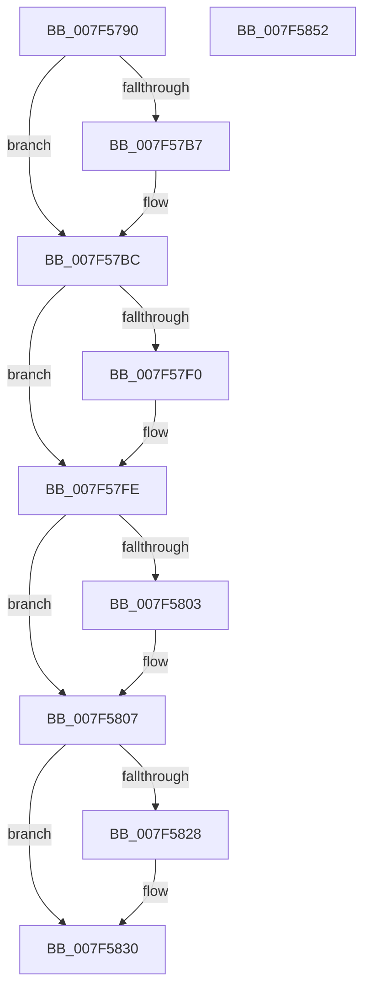

# CmFcpManagerSoftwareHiveReady

- RVA: `0x007F5790`–`0x007F5853` (길이 `195` bytes)
- VA: `0x00000001407F5790`
- 실행 섹션: `PAGE`
- PDB 이름 있음: `예`; PDB Function 태그: `아니요`
- unwind 정보 RVA: `0x0005C954`
- 디코드: `51`개 명령, `195/195` bytes 표시
- 미해석 바이트: `0` (있으면 어셈블리에 `.byte`로 보존)

> 이 문서는 커널 이미지의 기계어와 PDB 기호를 분석해 생성했습니다. 4번과 5번은 함수 원형과 자료형을 바이너리 사용 방식에서 추정한 C 해석이며 원본 소스 복구 결과는 아닙니다.

## 1. Dependencies

- 직접 호출 지점: **8**; 고유 호출 대상: **7**
- 직접 호출자로 확인된 함수: **0**
- RIP 상대 이미지 참조: **0**

### Outgoing calls
- `0x007F57B7` → [CmFcpSubscribeScmWnfStateChange](../../text/66/CmFcpSubscribeScmWnfStateChange_function_0066B41C.md) (function, `0x0066B41C`)
- `0x007F57E0` → [KeAbPreAcquire](../../text/21/KeAbPreAcquire_function_00210230.md) (function, `0x00210230`)
- `0x007F57F9` → [ExfAcquirePushLockExclusiveEx](../../text/20/ExfAcquirePushLockExclusiveEx_function_0020FC90.md) (function, `0x0020FC90`)
- `0x007F580C` → [CmFcpManagerDrainUsageNotifications](../A4/CmFcpManagerDrainUsageNotifications_function_00A451BC.md) (function, `0x00A451BC`)
- `0x007F5816` → [CmFcpManagerDrainUsageNotifications](../A4/CmFcpManagerDrainUsageNotifications_function_00A451BC.md) (function, `0x00A451BC`)
- `0x007F582B` → [ExfTryToWakePushLock](../../text/26/ExfTryToWakePushLock_function_00265DD0.md) (function, `0x00265DD0`)
- `0x007F5833` → [KeAbPostRelease](../../text/2E/KeAbPostRelease_function_002E1600.md) (function, `0x002E1600`)
- `0x007F5838` → [KeLeaveCriticalRegion](../../text/25/KeLeaveCriticalRegion_function_0025D8B0.md) (function, `0x0025D8B0`)

### Direct callers
- 이 함수 시작 RVA로 연결되는 직접 call은 확인되지 않았습니다. 간접 호출은 완전히 역산할 수 없습니다.

### Static image references
- 디코드된 RIP-relative 메모리 참조가 없습니다.

## 2. Other-region calls and transfers

- 다른 실행 섹션으로 향하는 call: **6**
  - `0x007F57B7` → [CmFcpSubscribeScmWnfStateChange](../../text/66/CmFcpSubscribeScmWnfStateChange_function_0066B41C.md) (`PAGE` → `.text`)
  - `0x007F57E0` → [KeAbPreAcquire](../../text/21/KeAbPreAcquire_function_00210230.md) (`PAGE` → `.text`)
  - `0x007F57F9` → [ExfAcquirePushLockExclusiveEx](../../text/20/ExfAcquirePushLockExclusiveEx_function_0020FC90.md) (`PAGE` → `.text`)
  - `0x007F582B` → [ExfTryToWakePushLock](../../text/26/ExfTryToWakePushLock_function_00265DD0.md) (`PAGE` → `.text`)
  - `0x007F5833` → [KeAbPostRelease](../../text/2E/KeAbPostRelease_function_002E1600.md) (`PAGE` → `.text`)
  - `0x007F5838` → [KeLeaveCriticalRegion](../../text/25/KeLeaveCriticalRegion_function_0025D8B0.md) (`PAGE` → `.text`)
- 별도 외부 분기/꼬리 이동을 확인하지 못했습니다.

## 3. Assembly (complete function range)

```asm
007F5790  48 89 5C 24 08                  mov qword ptr [rsp + 8], rbx
007F5795  48 89 6C 24 10                  mov qword ptr [rsp + 0x10], rbp
007F579A  48 89 74 24 18                  mov qword ptr [rsp + 0x18], rsi
007F579F  57                              push rdi
007F57A0  48 83 EC 20                     sub rsp, 0x20
007F57A4  C6 81 98 01 00 00 01            mov byte ptr [rcx + 0x198], 1
007F57AB  48 8B F1                        mov rsi, rcx
007F57AE  80 B9 58 07 00 00 00            cmp byte ptr [rcx + 0x758], 0
007F57B5  74 05                           je 0x1407f57bc
007F57B7  E8 60 5C E7 FF                  call 0x14066b41c
007F57BC  65 48 8B 04 25 88 01 00 00      mov rax, qword ptr gs:[0x188]
007F57C5  48 8D BE 90 01 00 00            lea rdi, [rsi + 0x190]
007F57CC  48 83 CB FF                     or rbx, 0xffffffffffffffff
007F57D0  45 33 C0                        xor r8d, r8d
007F57D3  33 D2                           xor edx, edx
007F57D5  48 8B CF                        mov rcx, rdi
007F57D8  66 01 98 E4 01 00 00            add word ptr [rax + 0x1e4], bx
007F57DF  90                              nop
007F57E0  E8 4B AA A1 FF                  call 0x140210230
007F57E5  F0 48 0F BA 2F 00               lock bts qword ptr [rdi], 0
007F57EB  48 8B E8                        mov rbp, rax
007F57EE  73 0E                           jae 0x1407f57fe
007F57F0  4C 8B C7                        mov r8, rdi
007F57F3  48 8B D0                        mov rdx, rax
007F57F6  48 8B CF                        mov rcx, rdi
007F57F9  E8 92 A4 A1 FF                  call 0x14020fc90
007F57FE  48 85 ED                        test rbp, rbp
007F5801  74 04                           je 0x1407f5807
007F5803  C6 45 0A 01                     mov byte ptr [rbp + 0xa], 1
007F5807  33 D2                           xor edx, edx
007F5809  48 8B CE                        mov rcx, rsi
007F580C  E8 AB F9 24 00                  call 0x140a451bc
007F5811  33 D2                           xor edx, edx
007F5813  48 8B CE                        mov rcx, rsi
007F5816  E8 A1 F9 24 00                  call 0x140a451bc
007F581B  F0 48 0F C1 1F                  lock xadd qword ptr [rdi], rbx
007F5820  80 E3 06                        and bl, 6
007F5823  80 FB 02                        cmp bl, 2
007F5826  75 08                           jne 0x1407f5830
007F5828  48 8B CF                        mov rcx, rdi
007F582B  E8 A0 05 A7 FF                  call 0x140265dd0
007F5830  48 8B CF                        mov rcx, rdi
007F5833  E8 C8 BD AE FF                  call 0x1402e1600
007F5838  E8 73 80 A6 FF                  call 0x14025d8b0
007F583D  48 8B 5C 24 30                  mov rbx, qword ptr [rsp + 0x30]
007F5842  48 8B 6C 24 38                  mov rbp, qword ptr [rsp + 0x38]
007F5847  48 8B 74 24 40                  mov rsi, qword ptr [rsp + 0x40]
007F584C  48 83 C4 20                     add rsp, 0x20
007F5850  5F                              pop rdi
007F5851  C3                              ret
007F5852  CC                              int3
```

## 4. C-style interpretation (structured pseudocode)

```c
__int64 __fastcall CmFcpManagerSoftwareHiveReady(__int64 a1, int a2, int a3)
{
    __int64 result;
    __int64 v_rbx;
    __int64 v_rsp;
    unsigned __int64 v_stack_p10;
    unsigned __int64 v_stack_p18;
    unsigned __int64 v_stack_p8;

    v_stack_p8 = v_rbx;
    v_stack_p10 = v_rbp;
    v_stack_p18 = v_rsi;
    v_rsp = (v_rsp) - (32);
    *(unsigned __int8 *)(a1 + 408) = 1;
    if ((*(unsigned __int8 *)(a1 + 1880)) != 0) {
        result = CmFcpSubscribeScmWnfStateChange(a1, a2, a3, a4);
    }
    v_rbx = (v_rbx) | (-1);
    a3 = 0;
    a2 = 0;
    result = KeAbPreAcquire(a1 + 400, a2, a3, a4);
    if (!(condition_is_above_or_equal)) {
        a3 = a1 + 400;
        a2 = result;
        a1 = a1 + 400;
        result = ExfAcquirePushLockExclusiveEx(a1, a2, a3, a4);
    }
    if (result != 0) {
        *(unsigned __int8 *)(result + 10) = 1;
    }
    a2 = 0;
    result = CmFcpManagerDrainUsageNotifications(a1, a2, a3, a4);
    a2 = 0;
    result = CmFcpManagerDrainUsageNotifications(a1, a2, a3, a4);
    v_rbx = (unsigned __int8)((v_rbx) & (6));
    if (((unsigned __int8)(v_rbx)) == 2) {
        a1 = a1 + 400;
        result = ExfTryToWakePushLock(a1, a2, a3, a4);
    }
    result = KeAbPostRelease(a1 + 400, a2, a3, a4);
    result = KeLeaveCriticalRegion(a1 + 400, a2, a3, a4);
    v_rsp = (v_rsp) + (32);
    return result;
}
```

## 5. (Beta) C Style

```c
int64_t CmFcpManagerSoftwareHiveReady(void *Arg1, int32_t Arg2, int32_t Arg3)
{
    uint8_t *arg1 = (uint8_t *)Arg1;

    int64_t result;
    int64_t local_rbx;
    int64_t local_rsp;
    uint64_t v_stack_p10;
    uint64_t v_stack_p18;
    uint64_t v_stack_p8;

    v_stack_p8 = local_rbx;
    v_stack_p10 = local_rbp;
    v_stack_p18 = local_rsi;
    local_rsp = (local_rsp) - (32);
    *(uint8_t *)(arg1 + 0x198) = 1;
    if ((*(uint8_t *)(arg1 + 0x758)) != 0) {
        result = CmFcpSubscribeScmWnfStateChange(Arg1, Arg2, Arg3, a4);
    }
    local_rbx = (local_rbx) | (-1);
    Arg3 = 0;
    Arg2 = 0;
    result = KeAbPreAcquire(Arg1 + 400, Arg2, Arg3, a4);
    if (!(condition_is_above_or_equal)) {
        Arg3 = Arg1 + 400;
        Arg2 = result;
        Arg1 = Arg1 + 400;
        result = ExfAcquirePushLockExclusiveEx(Arg1, Arg2, Arg3, a4);
    }
    if (result != 0) {
        *(uint8_t *)(result + 0xA) = 1;
    }
    Arg2 = 0;
    result = CmFcpManagerDrainUsageNotifications(Arg1, Arg2, Arg3, a4);
    Arg2 = 0;
    result = CmFcpManagerDrainUsageNotifications(Arg1, Arg2, Arg3, a4);
    local_rbx = (uint8_t)((local_rbx) & (6));
    if (((uint8_t)(local_rbx)) == 2) {
        Arg1 = Arg1 + 400;
        result = ExfTryToWakePushLock(Arg1, Arg2, Arg3, a4);
    }
    result = KeAbPostRelease(Arg1 + 400, Arg2, Arg3, a4);
    result = KeLeaveCriticalRegion(Arg1 + 400, Arg2, Arg3, a4);
    local_rsp = (local_rsp) + (32);
    return result;
}
```

### 관측된 메모리 오프셋

구조체 형식이 확인되지 않은 접근은 인자 기준의 오프셋으로만 기록했습니다.

| 기준 인자 | 오프셋 표현 | 폭 (bit) | 접근 |
|---|---:|---:|---|
| `Arg1` | `+ 0x0` | `64` | `R/W` |
| `Arg1` | `+ 0x190` | `64` | `R` |
| `Arg1` | `+ 0x198` | `8` | `W` |
| `Arg1` | `+ 0x758` | `8` | `R` |

## 6. Execution-region graph

[열기: 2D/3D 그래프와 함수 탐색 컨트롤 패널](../../../control-panel.html?section=page&rva=0x007F5790&view=graph)

- 2D 그래프는 위에서 아래로 흐르고, 3D 그래프는 빈 공간을 드래그해 회전합니다. Shift+드래그는 이동, 휠은 확대·축소, 함수 노드 선택은 대상 보고서 이동입니다.

### Static fallback


