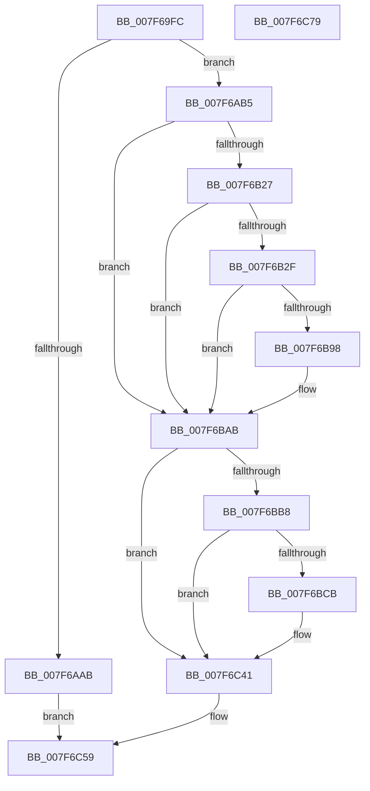

# CmpAddRemoveContainerToCLFSLog

- RVA: `0x007F69FC`–`0x007F6C7A` (길이 `638` bytes)
- VA: `0x00000001407F69FC`
- 실행 섹션: `PAGE`
- PDB 이름 있음: `예`; PDB Function 태그: `아니요`
- unwind 정보 RVA: `0x000D7594`
- 디코드: `153`개 명령, `638/638` bytes 표시
- 미해석 바이트: `0` (있으면 어셈블리에 `.byte`로 보존)

> 이 문서는 커널 이미지의 기계어와 PDB 기호를 분석해 생성했습니다. 4번과 5번은 함수 원형과 자료형을 바이너리 사용 방식에서 추정한 C 해석이며 원본 소스 복구 결과는 아닙니다.

## 1. Dependencies

- 직접 호출 지점: **20**; 고유 호출 대상: **16**
- 직접 호출자로 확인된 함수: **2**
- RIP 상대 이미지 참조: **6**

### Outgoing calls
- `0x007F6A6D` → [RtlInitUnicodeString](../../text/42/RtlInitUnicodeString_function_0042A780.md) (function, `0x0042A780`)
- `0x007F6A9C` → [ExAllocatePool2](../../poolcode/B8/ExAllocatePool2_function_00B820F0.md) (function, `0x00B820F0`)
- `0x007F6ABD` → [RtlAppendUnicodeStringToString](../../text/40/RtlAppendUnicodeStringToString_function_0040FA50.md) (function, `0x0040FA50`)
- `0x007F6ACA` → [RtlAppendUnicodeStringToString](../../text/40/RtlAppendUnicodeStringToString_function_0040FA50.md) (function, `0x0040FA50`)
- `0x007F6AD7` → [RtlAppendUnicodeStringToString](../../text/40/RtlAppendUnicodeStringToString_function_0040FA50.md) (function, `0x0040FA50`)
- `0x007F6AF3` → [sprintf_s](../../text/50/sprintf_s_function_00505E40.md) (function, `0x00505E40`)
- `0x007F6B01` → [RtlInitAnsiString](../../text/47/RtlInitAnsiString_function_00470F40.md) (function, `0x00470F40`)
- `0x007F6B18` → [RtlAnsiStringToUnicodeString](../90/RtlAnsiStringToUnicodeString_function_0090BEA0.md) (function, `0x0090BEA0`)
- `0x007F6B39` → [RtlAppendUnicodeStringToString](../../text/40/RtlAppendUnicodeStringToString_function_0040FA50.md) (function, `0x0040FA50`)
- `0x007F6B46` → [RtlAppendUnicodeStringToString](../../text/40/RtlAppendUnicodeStringToString_function_0040FA50.md) (function, `0x0040FA50`)
- `0x007F6B59` → [PsDisableImpersonation](../9E/PsDisableImpersonation_function_009E89B0.md) (function, `0x009E89B0`)
- `0x007F6B6B` → [KeStackAttachProcess](../../text/21/KeStackAttachProcess_function_00216800.md) (function, `0x00216800`)
- `0x007F6B7B` → `ext-ms-win-fs-clfs-l1-1-0.dll!ClfsAddLogContainer` (import, 간접 대상; import `ext-ms-win-fs-clfs-l1-1-0.dll!ClfsAddLogContainer`)
- `0x007F6B8F` → [KiUnstackDetachProcess](../../text/21/KiUnstackDetachProcess_function_00217D30.md) (function, `0x00217D30`)
- `0x007F6BA6` → [PsRestoreImpersonation](../9E/PsRestoreImpersonation_function_009E6F10.md) (function, `0x009E6F10`)
- `0x007F6BC2` → [tlgKeywordOn](../../text/42/tlgKeywordOn_function_0042EAA0.md) (function, `0x0042EAA0`)
- `0x007F6C3C` → [tlgWriteTransfer_EtwWriteTransfer](../../text/42/tlgWriteTransfer_EtwWriteTransfer_function_004260E0.md) (function, `0x004260E0`)
- `0x007F6C46` → [RtlFreeAnsiString](../9C/RtlFreeAnsiString_function_009C0800.md) (function, `0x009C0800`)
- `0x007F6C52` → [ExFreePoolWithTag](../../poolcode/B8/ExFreePoolWithTag_function_00B82870.md) (function, `0x00B82870`)
- `0x007F6C60` → [_security_check_cookie](../../text/6A/_security_check_cookie_function_006AC640.md) (function, `0x006AC640`)

### Direct callers
- [CmpAddRemoveRMLogContainer](CmpAddRemoveRMLogContainer_function_007F01A0.md) at `0x007F0276`
- [CmpStartCLFSLog](CmpStartCLFSLog_function_007F7228.md) at `0x007F75AC`

### Static image references
- `0x007F6A15` → RVA `0x00E0A740` (`.data`; read)
- `0x007F6AE3` → RVA `0x00B09C60` (` ?? ::NNGAKEGL::`string'`; read)
- `0x007F6B5E` → RVA `0x00FC6AB0` (`ALMOSTRO`; read)
- `0x007F6B7B` → RVA `0x00151228` (`ext-ms-win-fs-clfs-l1-1-0.dll!ClfsAddLogContainer (IAT)`; read)
- `0x007F6BAB` → RVA `0x00E09F58` (`.data`; read)
- `0x007F6BD8` → RVA `0x00057975` (`.rdata`; read)

## 2. Other-region calls and transfers

- 다른 실행 섹션으로 향하는 call: **15**
  - `0x007F6A6D` → [RtlInitUnicodeString](../../text/42/RtlInitUnicodeString_function_0042A780.md) (`PAGE` → `.text`)
  - `0x007F6A9C` → [ExAllocatePool2](../../poolcode/B8/ExAllocatePool2_function_00B820F0.md) (`PAGE` → `POOLCODE`)
  - `0x007F6ABD` → [RtlAppendUnicodeStringToString](../../text/40/RtlAppendUnicodeStringToString_function_0040FA50.md) (`PAGE` → `.text`)
  - `0x007F6ACA` → [RtlAppendUnicodeStringToString](../../text/40/RtlAppendUnicodeStringToString_function_0040FA50.md) (`PAGE` → `.text`)
  - `0x007F6AD7` → [RtlAppendUnicodeStringToString](../../text/40/RtlAppendUnicodeStringToString_function_0040FA50.md) (`PAGE` → `.text`)
  - `0x007F6AF3` → [sprintf_s](../../text/50/sprintf_s_function_00505E40.md) (`PAGE` → `.text`)
  - `0x007F6B01` → [RtlInitAnsiString](../../text/47/RtlInitAnsiString_function_00470F40.md) (`PAGE` → `.text`)
  - `0x007F6B39` → [RtlAppendUnicodeStringToString](../../text/40/RtlAppendUnicodeStringToString_function_0040FA50.md) (`PAGE` → `.text`)
  - `0x007F6B46` → [RtlAppendUnicodeStringToString](../../text/40/RtlAppendUnicodeStringToString_function_0040FA50.md) (`PAGE` → `.text`)
  - `0x007F6B6B` → [KeStackAttachProcess](../../text/21/KeStackAttachProcess_function_00216800.md) (`PAGE` → `.text`)
  - `0x007F6B8F` → [KiUnstackDetachProcess](../../text/21/KiUnstackDetachProcess_function_00217D30.md) (`PAGE` → `.text`)
  - `0x007F6BC2` → [tlgKeywordOn](../../text/42/tlgKeywordOn_function_0042EAA0.md) (`PAGE` → `.text`)
  - `0x007F6C3C` → [tlgWriteTransfer_EtwWriteTransfer](../../text/42/tlgWriteTransfer_EtwWriteTransfer_function_004260E0.md) (`PAGE` → `.text`)
  - `0x007F6C52` → [ExFreePoolWithTag](../../poolcode/B8/ExFreePoolWithTag_function_00B82870.md) (`PAGE` → `POOLCODE`)
  - `0x007F6C60` → [_security_check_cookie](../../text/6A/_security_check_cookie_function_006AC640.md) (`PAGE` → `.text`)
- 별도 외부 분기/꼬리 이동을 확인하지 못했습니다.

## 3. Assembly (complete function range)

```asm
007F69FC  40 55                           push rbp
007F69FE  53                              push rbx
007F69FF  56                              push rsi
007F6A00  57                              push rdi
007F6A01  41 54                           push r12
007F6A03  41 55                           push r13
007F6A05  41 56                           push r14
007F6A07  41 57                           push r15
007F6A09  48 8D 6C 24 C8                  lea rbp, [rsp - 0x38]
007F6A0E  48 81 EC 38 01 00 00            sub rsp, 0x138
007F6A15  48 8B 05 24 3D 61 00            mov rax, qword ptr [rip + 0x613d24]
007F6A1C  48 33 C4                        xor rax, rsp
007F6A1F  48 89 45 20                     mov qword ptr [rbp + 0x20], rax
007F6A23  4C 8B B5 A0 00 00 00            mov r14, qword ptr [rbp + 0xa0]
007F6A2A  0F 57 C0                        xorps xmm0, xmm0
007F6A2D  4C 8B A5 B0 00 00 00            mov r12, qword ptr [rbp + 0xb0]
007F6A34  48 8B DA                        mov rbx, rdx
007F6A37  4C 8B F9                        mov r15, rcx
007F6A3A  0F 57 C9                        xorps xmm1, xmm1
007F6A3D  45 33 ED                        xor r13d, r13d
007F6A40  48 8D 4C 24 50                  lea rcx, [rsp + 0x50]
007F6A45  33 D2                           xor edx, edx
007F6A47  44 89 6C 24 3C                  mov dword ptr [rsp + 0x3c], r13d
007F6A4C  0F 11 44 24 60                  movups xmmword ptr [rsp + 0x60], xmm0
007F6A51  49 8B F1                        mov rsi, r9
007F6A54  49 8B F8                        mov rdi, r8
007F6A57  0F 11 44 24 50                  movups xmmword ptr [rsp + 0x50], xmm0
007F6A5C  0F 11 4C 24 70                  movups xmmword ptr [rsp + 0x70], xmm1
007F6A61  0F 11 45 80                     movups xmmword ptr [rbp - 0x80], xmm0
007F6A65  0F 11 45 90                     movups xmmword ptr [rbp - 0x70], xmm0
007F6A69  0F 11 45 A0                     movups xmmword ptr [rbp - 0x60], xmm0
007F6A6D  E8 0E 3D C3 FF                  call 0x14042a780
007F6A72  41 0F B7 0E                     movzx ecx, word ptr [r14]
007F6A76  41 B8 43 4D 20 20               mov r8d, 0x20204d43
007F6A7C  66 83 C1 22                     add cx, 0x22
007F6A80  66 44 89 6C 24 38               mov word ptr [rsp + 0x38], r13w
007F6A86  66 03 0E                        add cx, word ptr [rsi]
007F6A89  66 03 0F                        add cx, word ptr [rdi]
007F6A8C  66 03 0B                        add cx, word ptr [rbx]
007F6A8F  0F B7 D1                        movzx edx, cx
007F6A92  B9 00 01 00 00                  mov ecx, 0x100
007F6A97  66 89 54 24 3A                  mov word ptr [rsp + 0x3a], dx
007F6A9C  E8 4F B6 38 00                  call 0x140b820f0
007F6AA1  48 89 44 24 40                  mov qword ptr [rsp + 0x40], rax
007F6AA6  48 85 C0                        test rax, rax
007F6AA9  75 0A                           jne 0x1407f6ab5
007F6AAB  B8 9A 00 00 C0                  mov eax, 0xc000009a
007F6AB0  E9 A4 01 00 00                  jmp 0x1407f6c59
007F6AB5  48 8B D3                        mov rdx, rbx
007F6AB8  48 8D 4C 24 38                  lea rcx, [rsp + 0x38]
007F6ABD  E8 8E 8F C1 FF                  call 0x14040fa50
007F6AC2  48 8B D7                        mov rdx, rdi
007F6AC5  48 8D 4C 24 38                  lea rcx, [rsp + 0x38]
007F6ACA  E8 81 8F C1 FF                  call 0x14040fa50
007F6ACF  48 8B D6                        mov rdx, rsi
007F6AD2  48 8D 4C 24 38                  lea rcx, [rsp + 0x38]
007F6AD7  E8 74 8F C1 FF                  call 0x14040fa50
007F6ADC  44 8B 8D A8 00 00 00            mov r9d, dword ptr [rbp + 0xa8]
007F6AE3  4C 8D 05 76 31 31 00            lea r8, [rip + 0x313176]
007F6AEA  BA 10 00 00 00                  mov edx, 0x10
007F6AEF  48 8D 4D 10                     lea rcx, [rbp + 0x10]
007F6AF3  E8 48 F3 D0 FF                  call 0x140505e40
007F6AF8  48 8D 55 10                     lea rdx, [rbp + 0x10]
007F6AFC  48 8D 4C 24 60                  lea rcx, [rsp + 0x60]
007F6B01  E8 3A A4 C7 FF                  call 0x140470f40
007F6B06  BE 01 00 00 00                  mov esi, 1
007F6B0B  48 8D 54 24 60                  lea rdx, [rsp + 0x60]
007F6B10  44 8A C6                        mov r8b, sil
007F6B13  48 8D 4C 24 50                  lea rcx, [rsp + 0x50]
007F6B18  E8 83 53 11 00                  call 0x14090bea0
007F6B1D  8B F8                           mov edi, eax
007F6B1F  85 C0                           test eax, eax
007F6B21  0F 88 84 00 00 00               js 0x1407f6bab
007F6B27  66 83 7C 24 50 20               cmp word ptr [rsp + 0x50], 0x20
007F6B2D  77 7C                           ja 0x1407f6bab
007F6B2F  48 8D 54 24 50                  lea rdx, [rsp + 0x50]
007F6B34  48 8D 4C 24 38                  lea rcx, [rsp + 0x38]
007F6B39  E8 12 8F C1 FF                  call 0x14040fa50
007F6B3E  49 8B D6                        mov rdx, r14
007F6B41  48 8D 4C 24 38                  lea rcx, [rsp + 0x38]
007F6B46  E8 05 8F C1 FF                  call 0x14040fa50
007F6B4B  65 48 8B 0C 25 88 01 00 00      mov rcx, qword ptr gs:[0x188]
007F6B54  48 8D 54 24 70                  lea rdx, [rsp + 0x70]
007F6B59  E8 52 1E 1F 00                  call 0x1409e89b0
007F6B5E  48 8B 0D 4B FF 7C 00            mov rcx, qword ptr [rip + 0x7cff4b]
007F6B65  48 8D 55 80                     lea rdx, [rbp - 0x80]
007F6B69  8A D8                           mov bl, al
007F6B6B  E8 90 FC A1 FF                  call 0x140216800
007F6B70  4C 8D 44 24 38                  lea r8, [rsp + 0x38]
007F6B75  49 8B D4                        mov rdx, r12
007F6B78  49 8B CF                        mov rcx, r15
007F6B7B  48 FF 15 A6 A6 95 FF            call qword ptr [rip - 0x6a595a]
007F6B82  0F 1F 44 00 00                  nop dword ptr [rax + rax]
007F6B87  33 D2                           xor edx, edx
007F6B89  48 8D 4D 80                     lea rcx, [rbp - 0x80]
007F6B8D  8B F8                           mov edi, eax
007F6B8F  E8 9C 11 A2 FF                  call 0x140217d30
007F6B94  84 DB                           test bl, bl
007F6B96  74 13                           je 0x1407f6bab
007F6B98  65 48 8B 0C 25 88 01 00 00      mov rcx, qword ptr gs:[0x188]
007F6BA1  48 8D 54 24 70                  lea rdx, [rsp + 0x70]
007F6BA6  E8 65 03 1F 00                  call 0x1409e6f10
007F6BAB  83 3D A6 33 61 00 05            cmp dword ptr [rip + 0x6133a6], 5
007F6BB2  0F 86 89 00 00 00               jbe 0x1407f6c41
007F6BB8  48 8B D6                        mov rdx, rsi
007F6BBB  48 8D 0D 96 33 61 00            lea rcx, [rip + 0x613396]
007F6BC2  E8 D9 7E C3 FF                  call 0x14042eaa0
007F6BC7  84 C0                           test al, al
007F6BC9  74 76                           je 0x1407f6c41
007F6BCB  48 8D 44 24 30                  lea rax, [rsp + 0x30]
007F6BD0  48 89 55 D8                     mov qword ptr [rbp - 0x28], rdx
007F6BD4  48 89 45 D0                     mov qword ptr [rbp - 0x30], rax
007F6BD8  48 8D 15 96 0D 86 FF            lea rdx, [rip - 0x79f26a]
007F6BDF  48 8D 44 24 48                  lea rax, [rsp + 0x48]
007F6BE4  40 88 74 24 30                  mov byte ptr [rsp + 0x30], sil
007F6BE9  48 89 45 E0                     mov qword ptr [rbp - 0x20], rax
007F6BED  48 8D 0D 64 33 61 00            lea rcx, [rip + 0x613364]
007F6BF4  48 8D 45 08                     lea rax, [rbp + 8]
007F6BF8  89 7C 24 48                     mov dword ptr [rsp + 0x48], edi
007F6BFC  48 89 45 F0                     mov qword ptr [rbp - 0x10], rax
007F6C00  45 33 C9                        xor r9d, r9d
007F6C03  48 8B 44 24 40                  mov rax, qword ptr [rsp + 0x40]
007F6C08  45 33 C0                        xor r8d, r8d
007F6C0B  48 89 45 00                     mov qword ptr [rbp], rax
007F6C0F  0F B7 44 24 38                  movzx eax, word ptr [rsp + 0x38]
007F6C14  89 45 08                        mov dword ptr [rbp + 8], eax
007F6C17  48 8D 45 B0                     lea rax, [rbp - 0x50]
007F6C1B  48 89 44 24 28                  mov qword ptr [rsp + 0x28], rax
007F6C20  C7 44 24 20 06 00 00 00         mov dword ptr [rsp + 0x20], 6
007F6C28  48 C7 45 E8 04 00 00 00         mov qword ptr [rbp - 0x18], 4
007F6C30  48 C7 45 F8 02 00 00 00         mov qword ptr [rbp - 8], 2
007F6C38  44 89 6D 0C                     mov dword ptr [rbp + 0xc], r13d
007F6C3C  E8 9F F4 C2 FF                  call 0x1404260e0
007F6C41  48 8D 4C 24 50                  lea rcx, [rsp + 0x50]
007F6C46  E8 B5 9B 1C 00                  call 0x1409c0800
007F6C4B  48 8B 4C 24 40                  mov rcx, qword ptr [rsp + 0x40]
007F6C50  33 D2                           xor edx, edx
007F6C52  E8 19 BC 38 00                  call 0x140b82870
007F6C57  8B C7                           mov eax, edi
007F6C59  48 8B 4D 20                     mov rcx, qword ptr [rbp + 0x20]
007F6C5D  48 33 CC                        xor rcx, rsp
007F6C60  E8 DB 59 EB FF                  call 0x1406ac640
007F6C65  48 81 C4 38 01 00 00            add rsp, 0x138
007F6C6C  41 5F                           pop r15
007F6C6E  41 5E                           pop r14
007F6C70  41 5D                           pop r13
007F6C72  41 5C                           pop r12
007F6C74  5F                              pop rdi
007F6C75  5E                              pop rsi
007F6C76  5B                              pop rbx
007F6C77  5D                              pop rbp
007F6C78  C3                              ret
007F6C79  CC                              int3
```

## 4. C-style interpretation (structured pseudocode)

```c
__int64 __fastcall CmpAddRemoveContainerToCLFSLog(__int64 a1, __int64 a2, __int64 a3, __int64 a4, __int64 a5, unsigned int a6, __int64 a7)
{
    __int64 result;
    __int64 v_r13;
    __int64 v_rsp;
    unsigned __int64 v_stack_m108;
    unsigned __int64 v_stack_m118;
    unsigned __int64 v_stack_m128;
    unsigned __int64 v_stack_m130;
    unsigned __int64 v_stack_m138;
    unsigned int v_stack_m13C;
    unsigned __int16 v_stack_m13E;
    unsigned __int16 v_stack_m140;
    unsigned __int64 v_stack_m148;
    unsigned __int64 v_stack_m150;
    unsigned int v_stack_m158;
    unsigned __int64 v_stack_m58;
    unsigned __int64 v_stack_m68;
    unsigned int v_stack_m6C;
    unsigned __int64 v_stack_m70;
    unsigned __int64 v_stack_m78;
    unsigned __int64 v_stack_m80;
    unsigned __int64 v_stack_m88;
    unsigned __int64 v_stack_m90;
    unsigned __int64 v_stack_m98;
    unsigned __int64 v_stack_mA0;
    unsigned __int64 v_stack_mA8;
    unsigned __int64 v_stack_mC8;
    unsigned __int64 v_stack_mD8;
    unsigned __int64 v_stack_mE8;
    unsigned __int64 v_stack_mF8;

    v_rsp = (v_rsp) - (312);
    result = (*(unsigned __int64 *)(v_rip + 6372644)) ^ (v_rsp);
    v_stack_m58 = result;
    v_r13 = 0;
    a2 = 0;
    v_stack_m13C = 0;
    v_stack_m118 = v_xmm0;
    v_stack_m128 = v_xmm0;
    v_stack_m108 = v_xmm1;
    v_stack_mF8 = v_xmm0;
    v_stack_mE8 = v_xmm0;
    v_stack_mD8 = v_xmm0;
    result = RtlInitUnicodeString(v_stack_m128, a2, a3, a4);
    a1 = (unsigned __int16)((*(unsigned __int16 *)(a5)) + (34));
    v_stack_m140 = 0;
    a1 = (unsigned __int16)((a1) + (*(unsigned __int16 *)(a4)));
    a1 = (unsigned __int16)((a1) + (*(unsigned __int16 *)(a3)));
    a1 = (unsigned __int16)((a1) + (*(unsigned __int16 *)(a2)));
    v_stack_m13E = (unsigned __int16)((unsigned __int16)(a1));
    result = ExAllocatePool2(256, (unsigned __int16)(a1), (unsigned int)(0x20204D43ULL), a4);
    v_stack_m138 = result;
    if (result != 0) goto loc_007F6AB5;
    goto loc_007F6C59;
loc_007F6AB5:
    result = RtlAppendUnicodeStringToString(v_stack_m140, 0, (unsigned int)(0x20204D43ULL), a4);
    result = RtlAppendUnicodeStringToString(v_stack_m140, a3, (unsigned int)(0x20204D43ULL), a4);
    result = RtlAppendUnicodeStringToString(v_stack_m140, a4, (unsigned int)(0x20204D43ULL), a4);
    result = sprintf_s(v_stack_m68, 16, v_rip + 3223926, (unsigned int)(a6));
    result = RtlInitAnsiString(v_stack_m118, v_stack_m68, v_rip + 3223926, (unsigned int)(a6));
    result = RtlAnsiStringToUnicodeString(v_stack_m128, v_stack_m118, 1, (unsigned int)(a6));
    if (sign_flag) goto loc_007F6BAB;
    if (v_stack_m128 > 32) goto loc_007F6BAB;
    result = RtlAppendUnicodeStringToString(v_stack_m140, v_stack_m128, 1, (unsigned int)(a6));
    result = RtlAppendUnicodeStringToString(v_stack_m140, a5, 1, (unsigned int)(a6));
    result = PsDisableImpersonation(*(unsigned __int64 *)(gs_base + (0 + 392)), v_stack_m108, 1, (unsigned int)(a6));
    result = KeStackAttachProcess(*(unsigned __int64 *)(v_rip + 8191819), v_stack_mF8, 1, (unsigned int)(a6));
    result = ext_ms_win_fs_clfs_l1_1_0_dll_ClfsAddLogContainer(a1, a7, v_stack_m140, (unsigned int)(a6));
    a2 = 0;
    result = KiUnstackDetachProcess(v_stack_mF8, a2, v_stack_m140, (unsigned int)(a6));
    if ((unsigned __int8)((unsigned __int8)(result)) != 0) {
        a1 = *(unsigned __int64 *)(gs_base + (0 + 392));
        a2 = v_stack_m108;
        result = PsRestoreImpersonation(a1, a2, v_stack_m140, (unsigned int)(a6));
    }
    if ((*(unsigned int *)(v_rip + 6370214)) <= 5) goto loc_007F6C41;
    result = tlgKeywordOn(v_rip + 6370198, 1, v_stack_m140, (unsigned int)(a6));
    if ((unsigned __int8)(result) != 0) {
        result = v_stack_m148;
        v_stack_mA0 = 1;
        v_stack_mA8 = result;
        a2 = v_rip - 7991914;
        result = v_stack_m130;
        v_stack_m148 = 1;
        v_stack_m98 = result;
        a1 = v_rip + 6370148;
        result = v_stack_m70;
        v_stack_m130 = (unsigned int)((unsigned int)((unsigned int)(result)));
        v_stack_m88 = result;
        a4 = 0;
        result = v_stack_m138;
        a3 = 0;
        v_stack_m78 = result;
        result = v_stack_m140;
        v_stack_m70 = (unsigned int)(result);
        result = v_stack_mC8;
        v_stack_m150 = result;
        v_stack_m158 = 6;
        v_stack_m90 = 4;
        v_stack_m80 = 2;
        v_stack_m6C = 0;
        result = tlgWriteTransfer_EtwWriteTransfer(a1, a2, a3, a4);
    }
    result = RtlFreeAnsiString(v_stack_m128, a2, a3, a4);
    a2 = 0;
    result = ExFreePoolWithTag(v_stack_m138, a2, a3, a4);
loc_007F6C59:
    a1 = (v_stack_m58) ^ (v_rsp);
    result = _security_check_cookie(a1, a2, a3, a4);
    v_rsp = (v_rsp) + (312);
    return result;
}
```

## 5. (Beta) C Style

```c
int64_t CmpAddRemoveContainerToCLFSLog(int64_t Arg1, void *Arg2, void *Arg3, void *Arg4, void *Arg5, uint32_t Arg6, int64_t Arg7)
{
    uint8_t *arg2 = (uint8_t *)Arg2;
    uint8_t *arg3 = (uint8_t *)Arg3;
    uint8_t *arg4 = (uint8_t *)Arg4;
    uint8_t *arg5 = (uint8_t *)Arg5;

    int64_t result;
    int64_t local_r13;
    int64_t local_rsp;
    uint64_t v_stack_m108;
    uint64_t v_stack_m118;
    uint64_t v_stack_m128;
    uint64_t v_stack_m130;
    uint64_t v_stack_m138;
    uint32_t v_stack_m13C;
    uint16_t v_stack_m13E;
    uint16_t v_stack_m140;
    uint64_t v_stack_m148;
    uint64_t v_stack_m150;
    uint32_t v_stack_m158;
    uint64_t v_stack_m58;
    uint64_t v_stack_m68;
    uint32_t v_stack_m6C;
    uint64_t v_stack_m70;
    uint64_t v_stack_m78;
    uint64_t v_stack_m80;
    uint64_t v_stack_m88;
    uint64_t v_stack_m90;
    uint64_t v_stack_m98;
    uint64_t v_stack_mA0;
    uint64_t v_stack_mA8;
    uint64_t v_stack_mC8;
    uint64_t v_stack_mD8;
    uint64_t v_stack_mE8;
    uint64_t v_stack_mF8;

    local_rsp = (local_rsp) - (312);
    result = (*(uint64_t *)(v_rip + 0x613D24)) ^ (local_rsp);
    v_stack_m58 = result;
    local_r13 = 0;
    Arg2 = 0;
    v_stack_m13C = 0;
    v_stack_m118 = v_xmm0;
    v_stack_m128 = v_xmm0;
    v_stack_m108 = v_xmm1;
    v_stack_mF8 = v_xmm0;
    v_stack_mE8 = v_xmm0;
    v_stack_mD8 = v_xmm0;
    result = RtlInitUnicodeString(v_stack_m128, Arg2, Arg3, Arg4);
    Arg1 = (uint16_t)((*(uint16_t *)(arg5)) + (34));
    v_stack_m140 = 0;
    Arg1 = (uint16_t)((Arg1) + (*(uint16_t *)(arg4)));
    Arg1 = (uint16_t)((Arg1) + (*(uint16_t *)(arg3)));
    Arg1 = (uint16_t)((Arg1) + (*(uint16_t *)(arg2)));
    v_stack_m13E = (uint16_t)((uint16_t)(Arg1));
    result = ExAllocatePool2(256, (uint16_t)(Arg1), (uint32_t)(0x20204D43ULL), Arg4);
    v_stack_m138 = result;
    if (result != 0) goto loc_007F6AB5;
    goto loc_007F6C59;
loc_007F6AB5:
    result = RtlAppendUnicodeStringToString(v_stack_m140, 0, (uint32_t)(0x20204D43ULL), Arg4);
    result = RtlAppendUnicodeStringToString(v_stack_m140, Arg3, (uint32_t)(0x20204D43ULL), Arg4);
    result = RtlAppendUnicodeStringToString(v_stack_m140, Arg4, (uint32_t)(0x20204D43ULL), Arg4);
    result = sprintf_s(v_stack_m68, 16, v_rip + 3223926, (uint32_t)(Arg6));
    result = RtlInitAnsiString(v_stack_m118, v_stack_m68, v_rip + 3223926, (uint32_t)(Arg6));
    result = RtlAnsiStringToUnicodeString(v_stack_m128, v_stack_m118, 1, (uint32_t)(Arg6));
    if (sign_flag) goto loc_007F6BAB;
    if (v_stack_m128 > 32) goto loc_007F6BAB;
    result = RtlAppendUnicodeStringToString(v_stack_m140, v_stack_m128, 1, (uint32_t)(Arg6));
    result = RtlAppendUnicodeStringToString(v_stack_m140, Arg5, 1, (uint32_t)(Arg6));
    result = PsDisableImpersonation(*(uint64_t *)(gs_base + (0 + 0x188)), v_stack_m108, 1, (uint32_t)(Arg6));
    result = KeStackAttachProcess(*(uint64_t *)(v_rip + 0x7CFF4B), v_stack_mF8, 1, (uint32_t)(Arg6));
    result = kernel_indirect_call(Arg1, Arg7, v_stack_m140, (uint32_t)(Arg6));
    Arg2 = 0;
    result = KiUnstackDetachProcess(v_stack_mF8, Arg2, v_stack_m140, (uint32_t)(Arg6));
    if ((uint8_t)((uint8_t)(result)) != 0) {
        Arg1 = *(uint64_t *)(gs_base + (0 + 0x188));
        Arg2 = v_stack_m108;
        result = PsRestoreImpersonation(Arg1, Arg2, v_stack_m140, (uint32_t)(Arg6));
    }
    if ((*(uint32_t *)(v_rip + 0x6133A6)) <= 5) goto loc_007F6C41;
    result = tlgKeywordOn(v_rip + 6370198, 1, v_stack_m140, (uint32_t)(Arg6));
    if ((uint8_t)(result) != 0) {
        result = v_stack_m148;
        v_stack_mA0 = 1;
        v_stack_mA8 = result;
        Arg2 = v_rip - 7991914;
        result = v_stack_m130;
        v_stack_m148 = 1;
        v_stack_m98 = result;
        Arg1 = v_rip + 6370148;
        result = v_stack_m70;
        v_stack_m130 = (uint32_t)((uint32_t)((uint32_t)(result)));
        v_stack_m88 = result;
        Arg4 = 0;
        result = v_stack_m138;
        Arg3 = 0;
        v_stack_m78 = result;
        result = v_stack_m140;
        v_stack_m70 = (uint32_t)(result);
        result = v_stack_mC8;
        v_stack_m150 = result;
        v_stack_m158 = 6;
        v_stack_m90 = 4;
        v_stack_m80 = 2;
        v_stack_m6C = 0;
        result = tlgWriteTransfer_EtwWriteTransfer(Arg1, Arg2, Arg3, Arg4);
    }
    result = RtlFreeAnsiString(v_stack_m128, Arg2, Arg3, Arg4);
    Arg2 = 0;
    result = ExFreePoolWithTag(v_stack_m138, Arg2, Arg3, Arg4);
loc_007F6C59:
    Arg1 = (v_stack_m58) ^ (local_rsp);
    result = _security_check_cookie(Arg1, Arg2, Arg3, Arg4);
    local_rsp = (local_rsp) + (312);
    return result;
}
```

### 관측된 메모리 오프셋

구조체 형식이 확인되지 않은 접근은 인자 기준의 오프셋으로만 기록했습니다.

| 기준 인자 | 오프셋 표현 | 폭 (bit) | 접근 |
|---|---:|---:|---|
| `Arg2` | `+ 0x0` | `16` | `R` |
| `Arg3` | `+ 0x0` | `16` | `R` |
| `Arg4` | `+ 0x0` | `16` | `R` |
| `Arg5` | `+ 0x0` | `16` | `R` |

## 6. Execution-region graph

[열기: 2D/3D 그래프와 함수 탐색 컨트롤 패널](../../../control-panel.html?section=page&rva=0x007F69FC&view=graph)

- 2D 그래프는 위에서 아래로 흐르고, 3D 그래프는 빈 공간을 드래그해 회전합니다. Shift+드래그는 이동, 휠은 확대·축소, 함수 노드 선택은 대상 보고서 이동입니다.

### Static fallback


