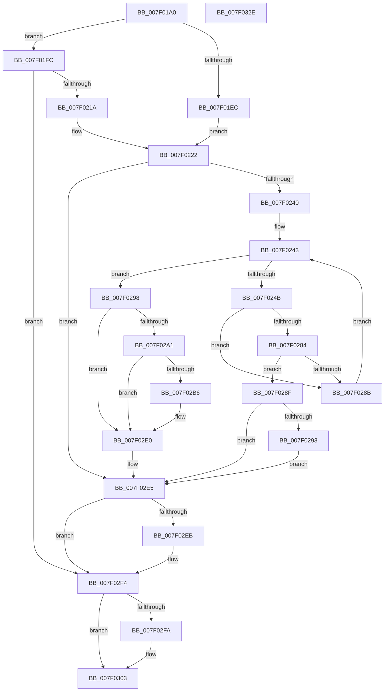

# CmpAddRemoveRMLogContainer

- RVA: `0x007F01A0`–`0x007F032F` (길이 `399` bytes)
- VA: `0x00000001407F01A0`
- 실행 섹션: `PAGE`
- PDB 이름 있음: `예`; PDB Function 태그: `아니요`
- unwind 정보 RVA: `0x000D7180`
- 디코드: `102`개 명령, `399/399` bytes 표시
- 미해석 바이트: `0` (있으면 어셈블리에 `.byte`로 보존)

> 이 문서는 커널 이미지의 기계어와 PDB 기호를 분석해 생성했습니다. 4번과 5번은 함수 원형과 자료형을 바이너리 사용 방식에서 추정한 C 해석이며 원본 소스 복구 결과는 아닙니다.

## 1. Dependencies

- 직접 호출 지점: **8**; 고유 호출 대상: **7**
- 직접 호출자로 확인된 함수: **1**
- RIP 상대 이미지 참조: **8**

### Outgoing calls
- `0x007F020B` → [CmpQueryNameString](../9B/CmpQueryNameString_function_009BA2AC.md) (function, `0x009BA2AC`)
- `0x007F0231` → [RtlStringFromGUIDEx](../91/RtlStringFromGUIDEx_function_00915450.md) (function, `0x00915450`)
- `0x007F0276` → [CmpAddRemoveContainerToCLFSLog](CmpAddRemoveContainerToCLFSLog_function_007F69FC.md) (function, `0x007F69FC`)
- `0x007F02AD` → [tlgKeywordOn](../../text/42/tlgKeywordOn_function_0042EAA0.md) (function, `0x0042EAA0`)
- `0x007F02DB` → [tlgWriteTransfer_EtwWriteTransfer](../../text/42/tlgWriteTransfer_EtwWriteTransfer_function_004260E0.md) (function, `0x004260E0`)
- `0x007F02EF` → [RtlFreeAnsiString](../9C/RtlFreeAnsiString_function_009C0800.md) (function, `0x009C0800`)
- `0x007F02FE` → [RtlFreeAnsiString](../9C/RtlFreeAnsiString_function_009C0800.md) (function, `0x009C0800`)
- `0x007F030C` → [_security_check_cookie](../../text/6A/_security_check_cookie_function_006AC640.md) (function, `0x006AC640`)

### Direct callers
- [sub_00B15EDA](../B1/Unknown_function_00B15EDA.md) at `0x00B15EE2`
- [sub_00B15EDA](../B1/Unknown_function_00B15EDA.md) at `0x00B15F73`

### Static image references
- `0x007F01BF` → RVA `0x00E0A740` (`.data`; read)
- `0x007F01D3` → RVA `0x00EEFC78` (`.data`; read)
- `0x007F01EC` → RVA `0x00E09AE0` (`.data`; read)
- `0x007F01F3` → RVA `0x000013C8` (`.rdata`; read)
- `0x007F0258` → RVA `0x0000BE90` (`.rdata`; read)
- `0x007F025F` → RVA `0x0000BEA0` (`.rdata`; read)
- `0x007F0298` → RVA `0x00E09F58` (`.data`; read)
- `0x007F02C2` → RVA `0x00057287` (`.rdata`; read)

## 2. Other-region calls and transfers

- 다른 실행 섹션으로 향하는 call: **3**
  - `0x007F02AD` → [tlgKeywordOn](../../text/42/tlgKeywordOn_function_0042EAA0.md) (`PAGE` → `.text`)
  - `0x007F02DB` → [tlgWriteTransfer_EtwWriteTransfer](../../text/42/tlgWriteTransfer_EtwWriteTransfer_function_004260E0.md) (`PAGE` → `.text`)
  - `0x007F030C` → [_security_check_cookie](../../text/6A/_security_check_cookie_function_006AC640.md) (`PAGE` → `.text`)
- 별도 외부 분기/꼬리 이동을 확인하지 못했습니다.

## 3. Assembly (complete function range)

```asm
007F01A0  48 8B C4                        mov rax, rsp
007F01A3  48 89 58 10                     mov qword ptr [rax + 0x10], rbx
007F01A7  48 89 70 18                     mov qword ptr [rax + 0x18], rsi
007F01AB  48 89 78 20                     mov qword ptr [rax + 0x20], rdi
007F01AF  55                              push rbp
007F01B0  41 56                           push r14
007F01B2  41 57                           push r15
007F01B4  48 8D 68 A1                     lea rbp, [rax - 0x5f]
007F01B8  48 81 EC 90 00 00 00            sub rsp, 0x90
007F01BF  48 8B 05 7A A5 61 00            mov rax, qword ptr [rip + 0x61a57a]
007F01C6  48 33 C4                        xor rax, rsp
007F01C9  48 89 45 37                     mov qword ptr [rbp + 0x37], rax
007F01CD  45 33 FF                        xor r15d, r15d
007F01D0  48 8B F9                        mov rdi, rcx
007F01D3  48 3B 0D 9E FA 6F 00            cmp rcx, qword ptr [rip + 0x6ffa9e]
007F01DA  4C 89 7D 07                     mov qword ptr [rbp + 7], r15
007F01DE  4C 89 7D 0F                     mov qword ptr [rbp + 0xf], r15
007F01E2  4C 89 7D F7                     mov qword ptr [rbp - 9], r15
007F01E6  4C 89 7D FF                     mov qword ptr [rbp - 1], r15
007F01EA  75 10                           jne 0x1407f01fc
007F01EC  48 8B 05 ED 98 61 00            mov rax, qword ptr [rip + 0x6198ed]
007F01F3  4C 8D 35 CE 11 81 FF            lea r14, [rip - 0x7eee32]
007F01FA  EB 26                           jmp 0x1407f0222
007F01FC  48 8B 49 50                     mov rcx, qword ptr [rcx + 0x50]
007F0200  48 8D 55 07                     lea rdx, [rbp + 7]
007F0204  48 8B 89 08 06 00 00            mov rcx, qword ptr [rcx + 0x608]
007F020B  E8 9C A0 1C 00                  call 0x1409ba2ac
007F0210  8B D8                           mov ebx, eax
007F0212  85 C0                           test eax, eax
007F0214  0F 88 DA 00 00 00               js 0x1407f02f4
007F021A  48 8B 47 50                     mov rax, qword ptr [rdi + 0x50]
007F021E  4C 8D 75 07                     lea r14, [rbp + 7]
007F0222  48 8B 48 40                     mov rcx, qword ptr [rax + 0x40]
007F0226  48 8D 55 F7                     lea rdx, [rbp - 9]
007F022A  48 83 C1 70                     add rcx, 0x70
007F022E  41 B0 01                        mov r8b, 1
007F0231  E8 1A 52 12 00                  call 0x140915450
007F0236  8B D8                           mov ebx, eax
007F0238  85 C0                           test eax, eax
007F023A  0F 88 A5 00 00 00               js 0x1407f02e5
007F0240  8B 77 44                        mov esi, dword ptr [rdi + 0x44]
007F0243  81 FE 00 01 00 00               cmp esi, 0x100
007F0249  73 4D                           jae 0x1407f0298
007F024B  48 8B 4F 58                     mov rcx, qword ptr [rdi + 0x58]
007F024F  48 8D 47 48                     lea rax, [rdi + 0x48]
007F0253  48 89 44 24 30                  mov qword ptr [rsp + 0x30], rax
007F0258  4C 8D 0D 31 BC 81 FF            lea r9, [rip - 0x7e43cf]
007F025F  48 8D 05 3A BC 81 FF            lea rax, [rip - 0x7e43c6]
007F0266  89 74 24 28                     mov dword ptr [rsp + 0x28], esi
007F026A  4C 8D 45 F7                     lea r8, [rbp - 9]
007F026E  48 89 44 24 20                  mov qword ptr [rsp + 0x20], rax
007F0273  49 8B D6                        mov rdx, r14
007F0276  E8 81 67 00 00                  call 0x1407f69fc
007F027B  8B D8                           mov ebx, eax
007F027D  3D 35 00 00 C0                  cmp eax, 0xc0000035
007F0282  74 07                           je 0x1407f028b
007F0284  3D BD 00 00 C0                  cmp eax, 0xc00000bd
007F0289  75 04                           jne 0x1407f028f
007F028B  FF C6                           inc esi
007F028D  EB B4                           jmp 0x1407f0243
007F028F  85 C0                           test eax, eax
007F0291  78 52                           js 0x1407f02e5
007F0293  FF 47 44                        inc dword ptr [rdi + 0x44]
007F0296  EB 4D                           jmp 0x1407f02e5
007F0298  83 3D B9 9C 61 00 05            cmp dword ptr [rip + 0x619cb9], 5
007F029F  76 3F                           jbe 0x1407f02e0
007F02A1  BA 01 00 00 00                  mov edx, 1
007F02A6  48 8D 0D AB 9C 61 00            lea rcx, [rip + 0x619cab]
007F02AD  E8 EE E7 C3 FF                  call 0x14042eaa0
007F02B2  84 C0                           test al, al
007F02B4  74 2A                           je 0x1407f02e0
007F02B6  48 8D 45 17                     lea rax, [rbp + 0x17]
007F02BA  45 33 C9                        xor r9d, r9d
007F02BD  48 89 44 24 28                  mov qword ptr [rsp + 0x28], rax
007F02C2  48 8D 15 BE 6F 86 FF            lea rdx, [rip - 0x799042]
007F02C9  45 33 C0                        xor r8d, r8d
007F02CC  C7 44 24 20 02 00 00 00         mov dword ptr [rsp + 0x20], 2
007F02D4  48 8D 0D 7D 9C 61 00            lea rcx, [rip + 0x619c7d]
007F02DB  E8 00 5E C3 FF                  call 0x1404260e0
007F02E0  BB 9A 00 00 C0                  mov ebx, 0xc000009a
007F02E5  4C 39 7D FF                     cmp qword ptr [rbp - 1], r15
007F02E9  74 09                           je 0x1407f02f4
007F02EB  48 8D 4D F7                     lea rcx, [rbp - 9]
007F02EF  E8 0C 05 1D 00                  call 0x1409c0800
007F02F4  4C 39 7D 0F                     cmp qword ptr [rbp + 0xf], r15
007F02F8  74 09                           je 0x1407f0303
007F02FA  48 8D 4D 07                     lea rcx, [rbp + 7]
007F02FE  E8 FD 04 1D 00                  call 0x1409c0800
007F0303  8B C3                           mov eax, ebx
007F0305  48 8B 4D 37                     mov rcx, qword ptr [rbp + 0x37]
007F0309  48 33 CC                        xor rcx, rsp
007F030C  E8 2F C3 EB FF                  call 0x1406ac640
007F0311  4C 8D 9C 24 90 00 00 00         lea r11, [rsp + 0x90]
007F0319  49 8B 5B 28                     mov rbx, qword ptr [r11 + 0x28]
007F031D  49 8B 73 30                     mov rsi, qword ptr [r11 + 0x30]
007F0321  49 8B 7B 38                     mov rdi, qword ptr [r11 + 0x38]
007F0325  49 8B E3                        mov rsp, r11
007F0328  41 5F                           pop r15
007F032A  41 5E                           pop r14
007F032C  5D                              pop rbp
007F032D  C3                              ret
007F032E  CC                              int3
```

## 4. C-style interpretation (structured pseudocode)

```c
__int64 __fastcall CmpAddRemoveRMLogContainer(__int64 a1)
{
    __int64 result;
    __int64 v_r15;
    __int64 v_rsi;
    __int64 v_rsp;
    unsigned __int64 v_stack_m18;
    unsigned __int64 v_stack_m78;
    unsigned int v_stack_m80;
    unsigned __int64 v_stack_m88;

    *(unsigned __int64 *)(v_rsp + 16) = v_rbx;
    *(unsigned __int64 *)(v_rsp + 24) = v_rsi;
    *(unsigned __int64 *)(v_rsp + 32) = v_rdi;
    v_rsp = (v_rsp) - (144);
    result = (*(unsigned __int64 *)(v_rip + 6399354)) ^ (v_rsp);
    *(unsigned __int64 *)(v_rsp - 95 + 55) = result;
    v_r15 = 0;
    *(unsigned __int64 *)(v_rsp - 95 + 7) = 0;
    *(unsigned __int64 *)(v_rsp - 95 + 15) = 0;
    *(unsigned __int64 *)(v_rsp - 95 - 9) = 0;
    *(unsigned __int64 *)(v_rsp - 95 - 1) = 0;
    if (a1 != (*(unsigned __int64 *)(v_rip + 7338654))) goto loc_007F01FC;
    goto loc_007F0222;
loc_007F01FC:
    result = CmpQueryNameString(*(unsigned __int64 *)(*(unsigned __int64 *)(a1 + 80) + 1544), v_rsp - 95 + 7, a3, a4);
    if (sign_flag) goto loc_007F02F4;
loc_007F0222:
    a1 = (*(unsigned __int64 *)(*(unsigned __int64 *)(a1 + 80) + 64)) + (112);
    result = RtlStringFromGUIDEx(a1, v_rsp - 95 - 9, 1, a4);
    if (sign_flag) goto loc_007F02E5;
loc_007F0243:
    if (((unsigned int)((unsigned int)(*(unsigned int *)(a1 + 68)))) >= 256) goto loc_007F0298;
    v_stack_m78 = a1 + 72;
    v_stack_m80 = (unsigned int)((unsigned int)(*(unsigned int *)(a1 + 68)));
    v_stack_m88 = v_rip - 8274886;
    result = CmpAddRemoveContainerToCLFSLog(*(unsigned __int64 *)(a1 + 88), v_rsp - 95 + 7, v_rsp - 95 - 9, v_rip - 8274895);
    if (((unsigned int)(result)) == 0xC0000035ULL) goto loc_007F028B;
    if (((unsigned int)(result)) != 0xC00000BDULL) goto loc_007F028F;
loc_007F028B:
    v_rsi = (unsigned int)(((unsigned int)(*(unsigned int *)(a1 + 68))) + 1);
    goto loc_007F0243;
loc_007F028F:
    if (sign_flag) goto loc_007F02E5;
    goto loc_007F02E5;
loc_007F0298:
    if ((*(unsigned int *)(v_rip + 6397113)) <= 5) goto loc_007F02E0;
    result = tlgKeywordOn(v_rip + 6397099, 1, v_rsp - 95 - 9, v_rip - 8274895);
    if ((unsigned __int8)(result) != 0) {
        result = v_rsp - 95 + 23;
        a4 = 0;
        v_stack_m80 = result;
        a2 = v_rip - 7966786;
        a3 = 0;
        v_stack_m88 = 2;
        a1 = v_rip + 6397053;
        result = tlgWriteTransfer_EtwWriteTransfer(a1, a2, a3, a4);
    }
loc_007F02E5:
    if ((*(unsigned __int64 *)(v_rsp - 95 - 1)) != 0) {
        a1 = v_rsp - 95 - 9;
        result = RtlFreeAnsiString(a1, a2, a3, a4);
    }
    if ((*(unsigned __int64 *)(v_rsp - 95 + 15)) != 0) {
        a1 = v_rsp - 95 + 7;
        result = RtlFreeAnsiString(a1, a2, a3, a4);
    }
    a1 = (*(unsigned __int64 *)(v_rsp - 95 + 55)) ^ (v_rsp);
    result = _security_check_cookie(a1, a2, a3, a4);
    return result;
}
```

## 5. (Beta) C Style

```c
int64_t CmpAddRemoveRMLogContainer(void *Arg1)
{
    uint8_t *arg1 = (uint8_t *)Arg1;

    int64_t result;
    int64_t local_r15;
    int64_t local_rsi;
    int64_t local_rsp;
    uint64_t v_stack_m18;
    uint64_t v_stack_m78;
    uint32_t v_stack_m80;
    uint64_t v_stack_m88;

    *(uint64_t *)(local_rsp + 0x10) = local_rbx;
    *(uint64_t *)(local_rsp + 0x18) = local_rsi;
    *(uint64_t *)(local_rsp + 0x20) = local_rdi;
    local_rsp = (local_rsp) - (144);
    result = (*(uint64_t *)(v_rip + 0x61A57A)) ^ (local_rsp);
    *(uint64_t *)(local_rsp - 0x5F + 0x37) = result;
    local_r15 = 0;
    *(uint64_t *)(local_rsp - 0x5F + 0x7) = 0;
    *(uint64_t *)(local_rsp - 0x5F + 0xF) = 0;
    *(uint64_t *)(local_rsp - 0x5F - 0x9) = 0;
    *(uint64_t *)(local_rsp - 0x5F - 0x1) = 0;
    if (Arg1 != (*(uint64_t *)(v_rip + 0x6FFA9E))) goto loc_007F01FC;
    goto loc_007F0222;
loc_007F01FC:
    result = CmpQueryNameString(*(uint64_t *)(*(uint64_t *)(arg1 + 0x50) + 0x608), local_rsp - 95 + 7, a3, a4);
    if (sign_flag) goto loc_007F02F4;
loc_007F0222:
    Arg1 = (*(uint64_t *)(*(uint64_t *)(arg1 + 0x50) + 0x40)) + (112);
    result = RtlStringFromGUIDEx(Arg1, local_rsp - 95 - 9, 1, a4);
    if (sign_flag) goto loc_007F02E5;
loc_007F0243:
    if (((uint32_t)((uint32_t)(*(uint32_t *)(arg1 + 0x44)))) >= 256) goto loc_007F0298;
    v_stack_m78 = Arg1 + 72;
    v_stack_m80 = (uint32_t)((uint32_t)(*(uint32_t *)(arg1 + 0x44)));
    v_stack_m88 = v_rip - 8274886;
    result = CmpAddRemoveContainerToCLFSLog(*(uint64_t *)(arg1 + 0x58), local_rsp - 95 + 7, local_rsp - 95 - 9, v_rip - 8274895);
    if (((uint32_t)(result)) == 0xC0000035ULL) goto loc_007F028B;
    if (((uint32_t)(result)) != 0xC00000BDULL) goto loc_007F028F;
loc_007F028B:
    local_rsi = (uint32_t)(((uint32_t)(*(uint32_t *)(arg1 + 0x44))) + 1);
    goto loc_007F0243;
loc_007F028F:
    if (sign_flag) goto loc_007F02E5;
    goto loc_007F02E5;
loc_007F0298:
    if ((*(uint32_t *)(v_rip + 0x619CB9)) <= 5) goto loc_007F02E0;
    result = tlgKeywordOn(v_rip + 6397099, 1, local_rsp - 95 - 9, v_rip - 8274895);
    if ((uint8_t)(result) != 0) {
        result = local_rsp - 95 + 23;
        a4 = 0;
        v_stack_m80 = result;
        a2 = v_rip - 7966786;
        a3 = 0;
        v_stack_m88 = 2;
        Arg1 = v_rip + 6397053;
        result = tlgWriteTransfer_EtwWriteTransfer(Arg1, a2, a3, a4);
    }
loc_007F02E5:
    if ((*(uint64_t *)(local_rsp - 0x5F - 0x1)) != 0) {
        Arg1 = local_rsp - 95 - 9;
        result = RtlFreeAnsiString(Arg1, a2, a3, a4);
    }
    if ((*(uint64_t *)(local_rsp - 0x5F + 0xF)) != 0) {
        Arg1 = local_rsp - 95 + 7;
        result = RtlFreeAnsiString(Arg1, a2, a3, a4);
    }
    Arg1 = (*(uint64_t *)(local_rsp - 0x5F + 0x37)) ^ (local_rsp);
    result = _security_check_cookie(Arg1, a2, a3, a4);
    return result;
}
```

### 관측된 메모리 오프셋

구조체 형식이 확인되지 않은 접근은 인자 기준의 오프셋으로만 기록했습니다.

| 기준 인자 | 오프셋 표현 | 폭 (bit) | 접근 |
|---|---:|---:|---|
| `Arg1` | `+ 0x44` | `32` | `R` |
| `Arg1` | `+ 0x44` | `32` | `R/W` |
| `Arg1` | `+ 0x48` | `64` | `R` |
| `Arg1` | `+ 0x50` | `64` | `R` |
| `Arg1` | `+ 0x58` | `64` | `R` |

## 6. Execution-region graph

[열기: 2D/3D 그래프와 함수 탐색 컨트롤 패널](../../../control-panel.html?section=page&rva=0x007F01A0&view=graph)

- 2D 그래프는 위에서 아래로 흐르고, 3D 그래프는 빈 공간을 드래그해 회전합니다. Shift+드래그는 이동, 휠은 확대·축소, 함수 노드 선택은 대상 보고서 이동입니다.

### Static fallback


