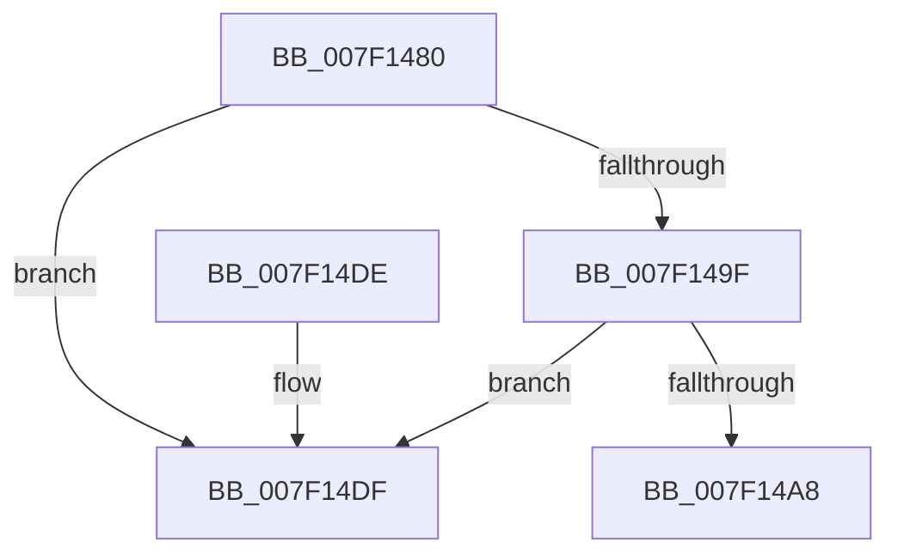

# CmpCleanupDiscardReplacePost

- RVA: `0x007F1480`–`0x007F14E6` (길이 `102` bytes)
- VA: `0x00000001407F1480`
- 실행 섹션: `PAGE`
- PDB 이름 있음: `예`; PDB Function 태그: `아니요`
- unwind 정보 RVA: `0x0006383C`
- 디코드: `31`개 명령, `102/102` bytes 표시
- 미해석 바이트: `0` (있으면 어셈블리에 `.byte`로 보존)

> 이 문서는 커널 이미지의 기계어와 PDB 기호를 분석해 생성했습니다. 4번과 5번은 함수 원형과 자료형을 바이너리 사용 방식에서 추정한 C 해석이며 원본 소스 복구 결과는 아닙니다.

## 1. Dependencies

- 직접 호출 지점: **2**; 고유 호출 대상: **1**
- 직접 호출자로 확인된 함수: **2**
- RIP 상대 이미지 참조: **0**

### Outgoing calls
- `0x007F14B2` → [CmpDereferenceKeyControlBlockWithLock](../86/CmpDereferenceKeyControlBlockWithLock_function_00862B60.md) (function, `0x00862B60`)
- `0x007F14C1` → [CmpDereferenceKeyControlBlockWithLock](../86/CmpDereferenceKeyControlBlockWithLock_function_00862B60.md) (function, `0x00862B60`)

### Direct callers
- [CmpCleanupDiscardReplaceContext](../A5/CmpCleanupDiscardReplaceContext_function_00A54FF8.md) at `0x00A55062`
- [sub_00B16440](../B1/Unknown_function_00B16440.md) at `0x00B16633`

### Static image references
- 디코드된 RIP-relative 메모리 참조가 없습니다.

## 2. Other-region calls and transfers

- 다른 실행 섹션으로 향하는 call: **0**
- 별도 외부 분기/꼬리 이동을 확인하지 못했습니다.

## 3. Assembly (complete function range)

```asm
007F1480  48 89 5C 24 08                  mov qword ptr [rsp + 8], rbx
007F1485  48 89 74 24 10                  mov qword ptr [rsp + 0x10], rsi
007F148A  57                              push rdi
007F148B  48 83 EC 20                     sub rsp, 0x20
007F148F  49 8D 78 10                     lea rdi, [r8 + 0x10]
007F1493  48 8B F2                        mov rsi, rdx
007F1496  48 8B 1F                        mov rbx, qword ptr [rdi]
007F1499  48 39 7B 08                     cmp qword ptr [rbx + 8], rdi
007F149D  75 40                           jne 0x1407f14df
007F149F  48 8B 03                        mov rax, qword ptr [rbx]
007F14A2  48 39 58 08                     cmp qword ptr [rax + 8], rbx
007F14A6  75 37                           jne 0x1407f14df
007F14A8  48 89 07                        mov qword ptr [rdi], rax
007F14AB  45 33 C0                        xor r8d, r8d
007F14AE  48 89 78 08                     mov qword ptr [rax + 8], rdi
007F14B2  E8 A9 16 07 00                  call 0x140862b60
007F14B7  48 8D 4B 88                     lea rcx, [rbx - 0x78]
007F14BB  45 33 C0                        xor r8d, r8d
007F14BE  48 8B D6                        mov rdx, rsi
007F14C1  E8 9A 16 07 00                  call 0x140862b60
007F14C6  48 8B 5C 24 30                  mov rbx, qword ptr [rsp + 0x30]
007F14CB  33 C0                           xor eax, eax
007F14CD  48 39 3F                        cmp qword ptr [rdi], rdi
007F14D0  48 8B 74 24 38                  mov rsi, qword ptr [rsp + 0x38]
007F14D5  0F 94 C0                        sete al
007F14D8  48 83 C4 20                     add rsp, 0x20
007F14DC  5F                              pop rdi
007F14DD  C3                              ret
007F14DE  CC                              int3
007F14DF  B9 03 00 00 00                  mov ecx, 3
007F14E4  CD 29                           int 0x29
```

## 4. C-style interpretation (structured pseudocode)

```c
__int64 __fastcall CmpCleanupDiscardReplacePost(__int64 a1, __int64 a2, __int64 a3)
{
    __int64 result;
    __int64 v_rsp;
    unsigned __int64 v_stack_p10;
    unsigned __int64 v_stack_p8;

    v_stack_p8 = v_rbx;
    v_stack_p10 = v_rsi;
    v_rsp = (v_rsp) - (32);
    if ((*(unsigned __int64 *)(*(unsigned __int64 *)(a3 + 16) + 8)) != (a3 + 16)) goto loc_007F14DF;
    if ((*(unsigned __int64 *)(*(unsigned __int64 *)(*(unsigned __int64 *)(a3 + 16)) + 8)) != (*(unsigned __int64 *)(a3 + 16))) goto loc_007F14DF;
    *(unsigned __int64 *)(a3 + 16) = *(unsigned __int64 *)(*(unsigned __int64 *)(a3 + 16));
    a3 = 0;
    *(unsigned __int64 *)(*(unsigned __int64 *)(*(unsigned __int64 *)(a3 + 16)) + 8) = a3 + 16;
    result = CmpDereferenceKeyControlBlockWithLock(a1, a2, a3, a4);
    a3 = 0;
    result = CmpDereferenceKeyControlBlockWithLock(*(unsigned __int64 *)(a3 + 16) - 120, a2, a3, a4);
    result = 0;
    result = ((*(unsigned __int64 *)(a3 + 16)) == (a3 + 16)) ? 1 : 0;
    v_rsp = (v_rsp) + (32);
    return result;
loc_007F14DF:
    return result;
}
```

## 5. (Beta) C Style

```c
int64_t CmpCleanupDiscardReplacePost(int64_t Arg1, int64_t Arg2, void *Arg3)
{
    uint8_t *arg3 = (uint8_t *)Arg3;

    int64_t result;
    int64_t local_rsp;
    uint64_t v_stack_p10;
    uint64_t v_stack_p8;

    v_stack_p8 = local_rbx;
    v_stack_p10 = local_rsi;
    local_rsp = (local_rsp) - (32);
    if ((*(uint64_t *)(*(uint64_t *)(arg3 + 0x10) + 0x8)) != (Arg3 + 16)) goto loc_007F14DF;
    if ((*(uint64_t *)(*(uint64_t *)(*(uint64_t *)(arg3 + 0x10)) + 0x8)) != (*(uint64_t *)(arg3 + 0x10))) goto loc_007F14DF;
    *(uint64_t *)(arg3 + 0x10) = *(uint64_t *)(*(uint64_t *)(arg3 + 0x10));
    Arg3 = 0;
    *(void **)(*(uint64_t *)(*(uint64_t *)(arg3 + 0x10)) + 0x8) = Arg3 + 16;
    result = CmpDereferenceKeyControlBlockWithLock(Arg1, Arg2, Arg3, a4);
    Arg3 = 0;
    result = CmpDereferenceKeyControlBlockWithLock(*(uint64_t *)(arg3 + 0x10) - 120, Arg2, Arg3, a4);
    result = 0;
    result = ((*(uint64_t *)(arg3 + 0x10)) == (Arg3 + 16)) ? 1 : 0;
    local_rsp = (local_rsp) + (32);
    return result;
loc_007F14DF:
    return result;
}
```

### 관측된 메모리 오프셋

구조체 형식이 확인되지 않은 접근은 인자 기준의 오프셋으로만 기록했습니다.

| 기준 인자 | 오프셋 표현 | 폭 (bit) | 접근 |
|---|---:|---:|---|
| `Arg3` | `+ 0x0` | `64` | `R` |
| `Arg3` | `+ 0x0` | `64` | `W` |
| `Arg3` | `+ 0x10` | `64` | `R` |

## 6. Execution-region graph

[열기: 2D/3D 그래프와 함수 탐색 컨트롤 패널](../../../control-panel.html?section=page&rva=0x007F1480&view=graph)

- 2D 그래프는 위에서 아래로 흐르고, 3D 그래프는 빈 공간을 드래그해 회전합니다. Shift+드래그는 이동, 휠은 확대·축소, 함수 노드 선택은 대상 보고서 이동입니다.

### Static fallback


