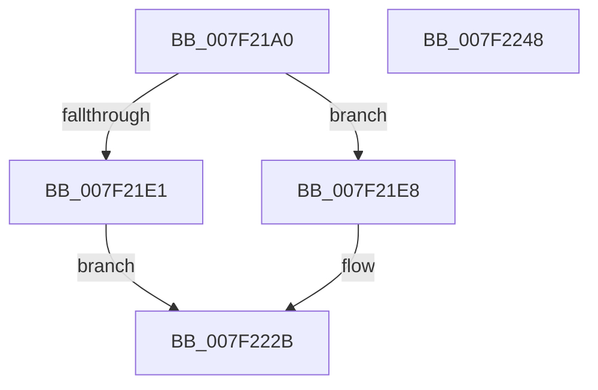

# CmpCopySyncTree

- RVA: `0x007F21A0`–`0x007F2249` (길이 `169` bytes)
- VA: `0x00000001407F21A0`
- 실행 섹션: `PAGE`
- PDB 이름 있음: `예`; PDB Function 태그: `아니요`
- unwind 정보 RVA: `0x00060130`
- 디코드: `47`개 명령, `169/169` bytes 표시
- 미해석 바이트: `0` (있으면 어셈블리에 `.byte`로 보존)

> 이 문서는 커널 이미지의 기계어와 PDB 기호를 분석해 생성했습니다. 4번과 5번은 함수 원형과 자료형을 바이너리 사용 방식에서 추정한 C 해석이며 원본 소스 복구 결과는 아닙니다.

## 1. Dependencies

- 직접 호출 지점: **3**; 고유 호출 대상: **3**
- 직접 호출자로 확인된 함수: **7**
- RIP 상대 이미지 참조: **0**

### Outgoing calls
- `0x007F21D4` → [CmpAllocatePool](../../text/3C/CmpAllocatePool_function_003CD504.md) (function, `0x003CD504`)
- `0x007F221C` → [CmpCopySyncTree2](../85/CmpCopySyncTree2_function_0085BF78.md) (function, `0x0085BF78`)
- `0x007F2226` → [CmSiFreeMemory](../../text/47/CmSiFreeMemory_function_00475D80.md) (function, `0x00475D80`)

### Direct callers
- [CmpSaveBootControlSet](../7D/CmpSaveBootControlSet_function_007DC744.md) at `0x007DCB16`
- [CmRestoreKey](../7D/CmRestoreKey_function_007DCF04.md) at `0x007DD276`
- [CmSaveMergedKeys](../7D/CmSaveMergedKeys_function_007DE040.md) at `0x007DE2A7`
- [CmSaveMergedKeys](../7D/CmSaveMergedKeys_function_007DE040.md) at `0x007DE3B3`
- [CmpLoadHiveVolatile](../7D/CmpLoadHiveVolatile_function_007DE5F0.md) at `0x007DE839`
- [CmpCloneHwProfile](../7E/CmpCloneHwProfile_function_007E303C.md) at `0x007E36D0`
- [CmpPreserveSystemHiveData](CmpPreserveSystemHiveData_function_007F2518.md) at `0x007F26FD`
- [CmpPreserveSystemHiveData](CmpPreserveSystemHiveData_function_007F2518.md) at `0x007F2BD6`
- [sub_00B1845C](../B1/Unknown_function_00B1845C.md) at `0x00B1850A`

### Static image references
- 디코드된 RIP-relative 메모리 참조가 없습니다.

## 2. Other-region calls and transfers

- 다른 실행 섹션으로 향하는 call: **2**
  - `0x007F21D4` → [CmpAllocatePool](../../text/3C/CmpAllocatePool_function_003CD504.md) (`PAGE` → `.text`)
  - `0x007F2226` → [CmSiFreeMemory](../../text/47/CmSiFreeMemory_function_00475D80.md) (`PAGE` → `.text`)
- 별도 외부 분기/꼬리 이동을 확인하지 못했습니다.

## 3. Assembly (complete function range)

```asm
007F21A0  48 8B C4                        mov rax, rsp
007F21A3  48 89 58 08                     mov qword ptr [rax + 8], rbx
007F21A7  48 89 68 10                     mov qword ptr [rax + 0x10], rbp
007F21AB  48 89 70 18                     mov qword ptr [rax + 0x18], rsi
007F21AF  48 89 78 20                     mov qword ptr [rax + 0x20], rdi
007F21B3  41 56                           push r14
007F21B5  48 83 EC 40                     sub rsp, 0x40
007F21B9  49 8B F0                        mov rsi, r8
007F21BC  8B EA                           mov ebp, edx
007F21BE  4C 8B F1                        mov r14, rcx
007F21C1  BA 00 28 00 00                  mov edx, 0x2800
007F21C6  B9 00 01 00 00                  mov ecx, 0x100
007F21CB  41 B8 43 4D 20 20               mov r8d, 0x20204d43
007F21D1  41 8B F9                        mov edi, r9d
007F21D4  E8 2B B3 BD FF                  call 0x1403cd504
007F21D9  48 8B D8                        mov rbx, rax
007F21DC  48 85 C0                        test rax, rax
007F21DF  75 07                           jne 0x1407f21e8
007F21E1  BF 9A 00 00 C0                  mov edi, 0xc000009a
007F21E6  EB 43                           jmp 0x1407f222b
007F21E8  83 60 08 00                     and dword ptr [rax + 8], 0
007F21EC  4D 8B CE                        mov r9, r14
007F21EF  83 60 0C F8                     and dword ptr [rax + 0xc], 0xfffffff8
007F21F3  45 33 C0                        xor r8d, r8d
007F21F6  80 60 10 FC                     and byte ptr [rax + 0x10], 0xfc
007F21FA  BA 00 02 00 00                  mov edx, 0x200
007F21FF  89 28                           mov dword ptr [rax], ebp
007F2201  48 8B CB                        mov rcx, rbx
007F2204  89 78 04                        mov dword ptr [rax + 4], edi
007F2207  8B 44 24 78                     mov eax, dword ptr [rsp + 0x78]
007F220B  89 44 24 30                     mov dword ptr [rsp + 0x30], eax
007F220F  8B 44 24 70                     mov eax, dword ptr [rsp + 0x70]
007F2213  89 44 24 28                     mov dword ptr [rsp + 0x28], eax
007F2217  48 89 74 24 20                  mov qword ptr [rsp + 0x20], rsi
007F221C  E8 57 9D 06 00                  call 0x14085bf78
007F2221  8B F8                           mov edi, eax
007F2223  48 8B CB                        mov rcx, rbx
007F2226  E8 55 3B C8 FF                  call 0x140475d80
007F222B  48 8B 5C 24 50                  mov rbx, qword ptr [rsp + 0x50]
007F2230  8B C7                           mov eax, edi
007F2232  48 8B 7C 24 68                  mov rdi, qword ptr [rsp + 0x68]
007F2237  48 8B 6C 24 58                  mov rbp, qword ptr [rsp + 0x58]
007F223C  48 8B 74 24 60                  mov rsi, qword ptr [rsp + 0x60]
007F2241  48 83 C4 40                     add rsp, 0x40
007F2245  41 5E                           pop r14
007F2247  C3                              ret
007F2248  CC                              int3
```

## 4. C-style interpretation (structured pseudocode)

```c
__int64 __fastcall CmpCopySyncTree(__int64 a1, int a2, __int64 a3, int a4, unsigned int a5, unsigned int a6)
{
    __int64 result;
    __int64 v_rsp;
    unsigned int v_stack_m18;
    unsigned int v_stack_m20;
    unsigned __int64 v_stack_m28;
    unsigned __int64 v_stack_p10;
    unsigned __int64 v_stack_p18;
    unsigned __int64 v_stack_p20;
    unsigned __int64 v_stack_p8;

    *(unsigned __int64 *)(v_rsp + 8) = v_rbx;
    *(unsigned __int64 *)(v_rsp + 16) = v_rbp;
    *(unsigned __int64 *)(v_rsp + 24) = v_rsi;
    *(unsigned __int64 *)(v_rsp + 32) = v_rdi;
    v_rsp = (v_rsp) - (64);
    result = CmpAllocatePool(256, (unsigned int)(0x2800ULL), (unsigned int)(0x20204D43ULL), a4);
    if (result != 0) goto loc_007F21E8;
    goto loc_007F222B;
loc_007F21E8:
    a3 = 0;
    *(unsigned int *)(result) = (unsigned int)((unsigned int)(a2));
    *(unsigned int *)(result + 4) = (unsigned int)((unsigned int)(0xC000009AULL));
    v_stack_m18 = (unsigned int)((unsigned int)(a6));
    v_stack_m20 = (unsigned int)((unsigned int)(a5));
    v_stack_m28 = 0;
    result = CmpCopySyncTree2(result, 512, a3, a1);
    result = CmSiFreeMemory(result, 512, a3, a1);
loc_007F222B:
    v_rsp = (v_rsp) + (64);
    return (unsigned int)((unsigned int)((unsigned int)((unsigned int)(result))));
}
```

## 5. (Beta) C Style

```c
int64_t CmpCopySyncTree(int64_t Arg1, int32_t Arg2, int64_t Arg3, int32_t Arg4, uint32_t Arg5, uint32_t Arg6)
{
    int64_t result;
    int64_t local_rsp;
    uint32_t v_stack_m18;
    uint32_t v_stack_m20;
    uint64_t v_stack_m28;
    uint64_t v_stack_p10;
    uint64_t v_stack_p18;
    uint64_t v_stack_p20;
    uint64_t v_stack_p8;

    *(uint64_t *)(local_rsp + 0x8) = local_rbx;
    *(uint64_t *)(local_rsp + 0x10) = local_rbp;
    *(uint64_t *)(local_rsp + 0x18) = local_rsi;
    *(uint64_t *)(local_rsp + 0x20) = local_rdi;
    local_rsp = (local_rsp) - (64);
    result = CmpAllocatePool(256, (uint32_t)(0x2800ULL), (uint32_t)(0x20204D43ULL), Arg4);
    if (result != 0) goto loc_007F21E8;
    goto loc_007F222B;
loc_007F21E8:
    Arg3 = 0;
    *(uint32_t *)(result) = (uint32_t)((uint32_t)(Arg2));
    *(uint32_t *)(result + 0x4) = (uint32_t)((uint32_t)(0xC000009AULL));
    v_stack_m18 = (uint32_t)((uint32_t)(Arg6));
    v_stack_m20 = (uint32_t)((uint32_t)(Arg5));
    v_stack_m28 = 0;
    result = CmpCopySyncTree2(result, 512, Arg3, Arg1);
    result = CmSiFreeMemory(result, 512, Arg3, Arg1);
loc_007F222B:
    local_rsp = (local_rsp) + (64);
    return (uint32_t)((uint32_t)((uint32_t)((uint32_t)(result))));
}
```

## 6. Execution-region graph

[열기: 2D/3D 그래프와 함수 탐색 컨트롤 패널](../../../control-panel.html?section=page&rva=0x007F21A0&view=graph)

- 2D 그래프는 위에서 아래로 흐르고, 3D 그래프는 빈 공간을 드래그해 회전합니다. Shift+드래그는 이동, 휠은 확대·축소, 함수 노드 선택은 대상 보고서 이동입니다.

### Static fallback


