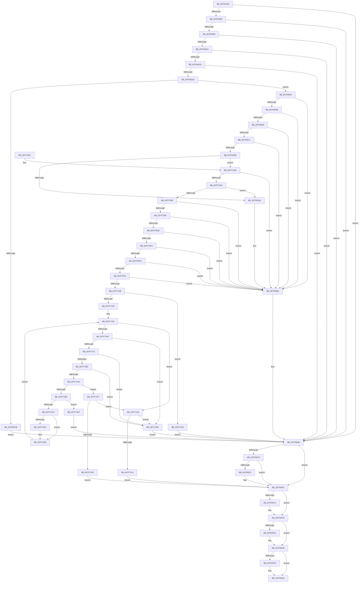

# CmpDeleteCorruptedLogfile

- RVA: `0x007F6C80`–`0x007F7221` (길이 `1,441` bytes)
- VA: `0x00000001407F6C80`
- 실행 섹션: `PAGE`
- PDB 이름 있음: `예`; PDB Function 태그: `아니요`
- unwind 정보 RVA: `0x000D75B8`
- 디코드: `354`개 명령, `1,441/1,441` bytes 표시
- 미해석 바이트: `0` (있으면 어셈블리에 `.byte`로 보존)

> 이 문서는 커널 이미지의 기계어와 PDB 기호를 분석해 생성했습니다. 4번과 5번은 함수 원형과 자료형을 바이너리 사용 방식에서 추정한 C 해석이며 원본 소스 복구 결과는 아닙니다.

## 1. Dependencies

- 직접 호출 지점: **42**; 고유 호출 대상: **11**
- 직접 호출자로 확인된 함수: **2**
- RIP 상대 이미지 참조: **5**

### Outgoing calls
- `0x007F6CFC` → [RtlInitUnicodeString](../../text/42/RtlInitUnicodeString_function_0042A780.md) (function, `0x0042A780`)
- `0x007F6D0C` → [RtlInitUnicodeString](../../text/42/RtlInitUnicodeString_function_0042A780.md) (function, `0x0042A780`)
- `0x007F6D1C` → [RtlInitUnicodeString](../../text/42/RtlInitUnicodeString_function_0042A780.md) (function, `0x0042A780`)
- `0x007F6D28` → [RtlInitUnicodeString](../../text/42/RtlInitUnicodeString_function_0042A780.md) (function, `0x0042A780`)
- `0x007F6D33` → [RtlInitUnicodeString](../../text/42/RtlInitUnicodeString_function_0042A780.md) (function, `0x0042A780`)
- `0x007F6D3F` → [RtlInitUnicodeString](../../text/42/RtlInitUnicodeString_function_0042A780.md) (function, `0x0042A780`)
- `0x007F6D59` → [RtlUShortAdd](../../text/47/RtlUShortAdd_function_00474F70.md) (function, `0x00474F70`)
- `0x007F6D77` → [RtlUShortAdd](../../text/47/RtlUShortAdd_function_00474F70.md) (function, `0x00474F70`)
- `0x007F6D94` → [RtlUShortAdd](../../text/47/RtlUShortAdd_function_00474F70.md) (function, `0x00474F70`)
- `0x007F6DB1` → [RtlUShortAdd](../../text/47/RtlUShortAdd_function_00474F70.md) (function, `0x00474F70`)
- `0x007F6DCD` → [RtlUShortAdd](../../text/47/RtlUShortAdd_function_00474F70.md) (function, `0x00474F70`)
- `0x007F6DEC` → [ExAllocatePool2](../../poolcode/B8/ExAllocatePool2_function_00B820F0.md) (function, `0x00B820F0`)
- `0x007F6E10` → [memset](../../text/6C/memset_function_006C6C40.md) (function, `0x006C6C40`)
- `0x007F6E30` → [RtlUShortAdd](../../text/47/RtlUShortAdd_function_00474F70.md) (function, `0x00474F70`)
- `0x007F6E4D` → [RtlUShortAdd](../../text/47/RtlUShortAdd_function_00474F70.md) (function, `0x00474F70`)
- `0x007F6E66` → [RtlUShortAdd](../../text/47/RtlUShortAdd_function_00474F70.md) (function, `0x00474F70`)
- `0x007F6E80` → [RtlUShortAdd](../../text/47/RtlUShortAdd_function_00474F70.md) (function, `0x00474F70`)
- `0x007F6E9B` → [ExAllocatePool2](../../poolcode/B8/ExAllocatePool2_function_00B820F0.md) (function, `0x00B820F0`)
- `0x007F6ED4` → [tlgKeywordOn](../../text/42/tlgKeywordOn_function_0042EAA0.md) (function, `0x0042EAA0`)
- `0x007F6FB2` → [tlgWriteTransfer_EtwWriteTransfer](../../text/42/tlgWriteTransfer_EtwWriteTransfer_function_004260E0.md) (function, `0x004260E0`)
- `0x007F6FC3` → [ExFreePoolWithTag](../../poolcode/B8/ExFreePoolWithTag_function_00B82870.md) (function, `0x00B82870`)
- `0x007F6FD4` → [ExFreePoolWithTag](../../poolcode/B8/ExFreePoolWithTag_function_00B82870.md) (function, `0x00B82870`)
- `0x007F6FE5` → [ExFreePoolWithTag](../../poolcode/B8/ExFreePoolWithTag_function_00B82870.md) (function, `0x00B82870`)
- `0x007F6FF3` → [_security_check_cookie](../../text/6A/_security_check_cookie_function_006AC640.md) (function, `0x006AC640`)
- `0x007F7018` → [memset](../../text/6C/memset_function_006C6C40.md) (function, `0x006C6C40`)
- `0x007F703B` → [RtlUShortAdd](../../text/47/RtlUShortAdd_function_00474F70.md) (function, `0x00474F70`)
- `0x007F705C` → [ExAllocatePool2](../../poolcode/B8/ExAllocatePool2_function_00B820F0.md) (function, `0x00B820F0`)
- `0x007F7077` → [memset](../../text/6C/memset_function_006C6C40.md) (function, `0x006C6C40`)
- `0x007F7086` → [RtlAppendUnicodeStringToString](../../text/40/RtlAppendUnicodeStringToString_function_0040FA50.md) (function, `0x0040FA50`)
- `0x007F709E` → [RtlAppendUnicodeStringToString](../../text/40/RtlAppendUnicodeStringToString_function_0040FA50.md) (function, `0x0040FA50`)
- `0x007F70B5` → [RtlAppendUnicodeStringToString](../../text/40/RtlAppendUnicodeStringToString_function_0040FA50.md) (function, `0x0040FA50`)
- `0x007F70CD` → [RtlAppendUnicodeStringToString](../../text/40/RtlAppendUnicodeStringToString_function_0040FA50.md) (function, `0x0040FA50`)
- `0x007F70E5` → [RtlAppendUnicodeStringToString](../../text/40/RtlAppendUnicodeStringToString_function_0040FA50.md) (function, `0x0040FA50`)
- `0x007F70F9` → [CmpDeleteCorruptedFile](../../text/66/CmpDeleteCorruptedFile_function_0066DF74.md) (function, `0x0066DF74`)
- `0x007F7116` → [RtlAppendUnicodeStringToString](../../text/40/RtlAppendUnicodeStringToString_function_0040FA50.md) (function, `0x0040FA50`)
- `0x007F712A` → [CmpDeleteCorruptedFile](../../text/66/CmpDeleteCorruptedFile_function_0066DF74.md) (function, `0x0066DF74`)
- `0x007F7163` → [RtlUnicodeStringPrintf](../../text/48/RtlUnicodeStringPrintf_function_0048B984.md) (function, `0x0048B984`)
- `0x007F7182` → [RtlAppendUnicodeStringToString](../../text/40/RtlAppendUnicodeStringToString_function_0040FA50.md) (function, `0x0040FA50`)
- `0x007F7197` → [RtlAppendUnicodeStringToString](../../text/40/RtlAppendUnicodeStringToString_function_0040FA50.md) (function, `0x0040FA50`)
- `0x007F71A7` → [CmpDeleteCorruptedFile](../../text/66/CmpDeleteCorruptedFile_function_0066DF74.md) (function, `0x0066DF74`)
- `0x007F71C6` → [RtlAppendUnicodeStringToString](../../text/40/RtlAppendUnicodeStringToString_function_0040FA50.md) (function, `0x0040FA50`)
- `0x007F71D6` → [CmpDeleteCorruptedFile](../../text/66/CmpDeleteCorruptedFile_function_0066DF74.md) (function, `0x0066DF74`)

### Direct callers
- [CmpStartCLFSLog](CmpStartCLFSLog_function_007F7228.md) at `0x007F73E6`
- [CmpInitCmRM](../87/CmpInitCmRM_function_0087C700.md) at `0x0087CB79`

### Static image references
- `0x007F6C9C` → RVA `0x00E0A740` (`.data`; read)
- `0x007F6D01` → RVA `0x00B09C50` (` ?? ::NNGAKEGL::`string'`; read)
- `0x007F6D11` → RVA `0x00B09C40` (` ?? ::NNGAKEGL::`string'`; read)
- `0x007F6EB6` → RVA `0x00E09F58` (`.data`; read)
- `0x007F6EEE` → RVA `0x000579CB` (`.rdata`; read)

## 2. Other-region calls and transfers

- 다른 실행 섹션으로 향하는 call: **42**
  - `0x007F6CFC` → [RtlInitUnicodeString](../../text/42/RtlInitUnicodeString_function_0042A780.md) (`PAGE` → `.text`)
  - `0x007F6D0C` → [RtlInitUnicodeString](../../text/42/RtlInitUnicodeString_function_0042A780.md) (`PAGE` → `.text`)
  - `0x007F6D1C` → [RtlInitUnicodeString](../../text/42/RtlInitUnicodeString_function_0042A780.md) (`PAGE` → `.text`)
  - `0x007F6D28` → [RtlInitUnicodeString](../../text/42/RtlInitUnicodeString_function_0042A780.md) (`PAGE` → `.text`)
  - `0x007F6D33` → [RtlInitUnicodeString](../../text/42/RtlInitUnicodeString_function_0042A780.md) (`PAGE` → `.text`)
  - `0x007F6D3F` → [RtlInitUnicodeString](../../text/42/RtlInitUnicodeString_function_0042A780.md) (`PAGE` → `.text`)
  - `0x007F6D59` → [RtlUShortAdd](../../text/47/RtlUShortAdd_function_00474F70.md) (`PAGE` → `.text`)
  - `0x007F6D77` → [RtlUShortAdd](../../text/47/RtlUShortAdd_function_00474F70.md) (`PAGE` → `.text`)
  - `0x007F6D94` → [RtlUShortAdd](../../text/47/RtlUShortAdd_function_00474F70.md) (`PAGE` → `.text`)
  - `0x007F6DB1` → [RtlUShortAdd](../../text/47/RtlUShortAdd_function_00474F70.md) (`PAGE` → `.text`)
  - `0x007F6DCD` → [RtlUShortAdd](../../text/47/RtlUShortAdd_function_00474F70.md) (`PAGE` → `.text`)
  - `0x007F6DEC` → [ExAllocatePool2](../../poolcode/B8/ExAllocatePool2_function_00B820F0.md) (`PAGE` → `POOLCODE`)
  - `0x007F6E10` → [memset](../../text/6C/memset_function_006C6C40.md) (`PAGE` → `.text`)
  - `0x007F6E30` → [RtlUShortAdd](../../text/47/RtlUShortAdd_function_00474F70.md) (`PAGE` → `.text`)
  - `0x007F6E4D` → [RtlUShortAdd](../../text/47/RtlUShortAdd_function_00474F70.md) (`PAGE` → `.text`)
  - `0x007F6E66` → [RtlUShortAdd](../../text/47/RtlUShortAdd_function_00474F70.md) (`PAGE` → `.text`)
  - `0x007F6E80` → [RtlUShortAdd](../../text/47/RtlUShortAdd_function_00474F70.md) (`PAGE` → `.text`)
  - `0x007F6E9B` → [ExAllocatePool2](../../poolcode/B8/ExAllocatePool2_function_00B820F0.md) (`PAGE` → `POOLCODE`)
  - `0x007F6ED4` → [tlgKeywordOn](../../text/42/tlgKeywordOn_function_0042EAA0.md) (`PAGE` → `.text`)
  - `0x007F6FB2` → [tlgWriteTransfer_EtwWriteTransfer](../../text/42/tlgWriteTransfer_EtwWriteTransfer_function_004260E0.md) (`PAGE` → `.text`)
  - `0x007F6FC3` → [ExFreePoolWithTag](../../poolcode/B8/ExFreePoolWithTag_function_00B82870.md) (`PAGE` → `POOLCODE`)
  - `0x007F6FD4` → [ExFreePoolWithTag](../../poolcode/B8/ExFreePoolWithTag_function_00B82870.md) (`PAGE` → `POOLCODE`)
  - `0x007F6FE5` → [ExFreePoolWithTag](../../poolcode/B8/ExFreePoolWithTag_function_00B82870.md) (`PAGE` → `POOLCODE`)
  - `0x007F6FF3` → [_security_check_cookie](../../text/6A/_security_check_cookie_function_006AC640.md) (`PAGE` → `.text`)
  - `0x007F7018` → [memset](../../text/6C/memset_function_006C6C40.md) (`PAGE` → `.text`)
  - `0x007F703B` → [RtlUShortAdd](../../text/47/RtlUShortAdd_function_00474F70.md) (`PAGE` → `.text`)
  - `0x007F705C` → [ExAllocatePool2](../../poolcode/B8/ExAllocatePool2_function_00B820F0.md) (`PAGE` → `POOLCODE`)
  - `0x007F7077` → [memset](../../text/6C/memset_function_006C6C40.md) (`PAGE` → `.text`)
  - `0x007F7086` → [RtlAppendUnicodeStringToString](../../text/40/RtlAppendUnicodeStringToString_function_0040FA50.md) (`PAGE` → `.text`)
  - `0x007F709E` → [RtlAppendUnicodeStringToString](../../text/40/RtlAppendUnicodeStringToString_function_0040FA50.md) (`PAGE` → `.text`)
  - `0x007F70B5` → [RtlAppendUnicodeStringToString](../../text/40/RtlAppendUnicodeStringToString_function_0040FA50.md) (`PAGE` → `.text`)
  - `0x007F70CD` → [RtlAppendUnicodeStringToString](../../text/40/RtlAppendUnicodeStringToString_function_0040FA50.md) (`PAGE` → `.text`)
  - `0x007F70E5` → [RtlAppendUnicodeStringToString](../../text/40/RtlAppendUnicodeStringToString_function_0040FA50.md) (`PAGE` → `.text`)
  - `0x007F70F9` → [CmpDeleteCorruptedFile](../../text/66/CmpDeleteCorruptedFile_function_0066DF74.md) (`PAGE` → `.text`)
  - `0x007F7116` → [RtlAppendUnicodeStringToString](../../text/40/RtlAppendUnicodeStringToString_function_0040FA50.md) (`PAGE` → `.text`)
  - `0x007F712A` → [CmpDeleteCorruptedFile](../../text/66/CmpDeleteCorruptedFile_function_0066DF74.md) (`PAGE` → `.text`)
  - `0x007F7163` → [RtlUnicodeStringPrintf](../../text/48/RtlUnicodeStringPrintf_function_0048B984.md) (`PAGE` → `.text`)
  - `0x007F7182` → [RtlAppendUnicodeStringToString](../../text/40/RtlAppendUnicodeStringToString_function_0040FA50.md) (`PAGE` → `.text`)
  - `0x007F7197` → [RtlAppendUnicodeStringToString](../../text/40/RtlAppendUnicodeStringToString_function_0040FA50.md) (`PAGE` → `.text`)
  - `0x007F71A7` → [CmpDeleteCorruptedFile](../../text/66/CmpDeleteCorruptedFile_function_0066DF74.md) (`PAGE` → `.text`)
  - `0x007F71C6` → [RtlAppendUnicodeStringToString](../../text/40/RtlAppendUnicodeStringToString_function_0040FA50.md) (`PAGE` → `.text`)
  - `0x007F71D6` → [CmpDeleteCorruptedFile](../../text/66/CmpDeleteCorruptedFile_function_0066DF74.md) (`PAGE` → `.text`)
- 별도 외부 분기/꼬리 이동을 확인하지 못했습니다.

## 3. Assembly (complete function range)

```asm
007F6C80  40 55                           push rbp
007F6C82  53                              push rbx
007F6C83  56                              push rsi
007F6C84  57                              push rdi
007F6C85  41 54                           push r12
007F6C87  41 55                           push r13
007F6C89  41 56                           push r14
007F6C8B  41 57                           push r15
007F6C8D  48 8D AC 24 78 FF FF FF         lea rbp, [rsp - 0x88]
007F6C95  48 81 EC 88 01 00 00            sub rsp, 0x188
007F6C9C  48 8B 05 9D 3A 61 00            mov rax, qword ptr [rip + 0x613a9d]
007F6CA3  48 33 C4                        xor rax, rsp
007F6CA6  48 89 45 70                     mov qword ptr [rbp + 0x70], rax
007F6CAA  8B B5 F0 00 00 00               mov esi, dword ptr [rbp + 0xf0]
007F6CB0  0F 57 C0                        xorps xmm0, xmm0
007F6CB3  0F 57 C9                        xorps xmm1, xmm1
007F6CB6  48 89 55 90                     mov qword ptr [rbp - 0x70], rdx
007F6CBA  48 8B DA                        mov rbx, rdx
007F6CBD  48 89 4C 24 68                  mov qword ptr [rsp + 0x68], rcx
007F6CC2  45 33 F6                        xor r14d, r14d
007F6CC5  4C 89 4C 24 60                  mov qword ptr [rsp + 0x60], r9
007F6CCA  33 D2                           xor edx, edx
007F6CCC  44 89 74 24 30                  mov dword ptr [rsp + 0x30], r14d
007F6CD1  48 8D 4C 24 38                  lea rcx, [rsp + 0x38]
007F6CD6  4D 8B E0                        mov r12, r8
007F6CD9  0F 11 44 24 38                  movups xmmword ptr [rsp + 0x38], xmm0
007F6CDE  33 FF                           xor edi, edi
007F6CE0  45 33 ED                        xor r13d, r13d
007F6CE3  0F 11 4D C0                     movups xmmword ptr [rbp - 0x40], xmm1
007F6CE7  45 33 FF                        xor r15d, r15d
007F6CEA  0F 11 45 98                     movups xmmword ptr [rbp - 0x68], xmm0
007F6CEE  0F 11 4C 24 50                  movups xmmword ptr [rsp + 0x50], xmm1
007F6CF3  0F 11 45 B0                     movups xmmword ptr [rbp - 0x50], xmm0
007F6CF7  0F 11 4C 24 70                  movups xmmword ptr [rsp + 0x70], xmm1
007F6CFC  E8 7F 3A C3 FF                  call 0x14042a780
007F6D01  48 8D 15 48 2F 31 00            lea rdx, [rip + 0x312f48]
007F6D08  48 8D 4D C0                     lea rcx, [rbp - 0x40]
007F6D0C  E8 6F 3A C3 FF                  call 0x14042a780
007F6D11  48 8D 15 28 2F 31 00            lea rdx, [rip + 0x312f28]
007F6D18  48 8D 4D 98                     lea rcx, [rbp - 0x68]
007F6D1C  E8 5F 3A C3 FF                  call 0x14042a780
007F6D21  33 D2                           xor edx, edx
007F6D23  48 8D 4C 24 50                  lea rcx, [rsp + 0x50]
007F6D28  E8 53 3A C3 FF                  call 0x14042a780
007F6D2D  33 D2                           xor edx, edx
007F6D2F  48 8D 4D B0                     lea rcx, [rbp - 0x50]
007F6D33  E8 48 3A C3 FF                  call 0x14042a780
007F6D38  33 D2                           xor edx, edx
007F6D3A  48 8D 4C 24 70                  lea rcx, [rsp + 0x70]
007F6D3F  E8 3C 3A C3 FF                  call 0x14042a780
007F6D44  48 8B 44 24 68                  mov rax, qword ptr [rsp + 0x68]
007F6D49  4C 8D 44 24 3A                  lea r8, [rsp + 0x3a]
007F6D4E  0F B7 13                        movzx edx, word ptr [rbx]
007F6D51  0F B7 08                        movzx ecx, word ptr [rax]
007F6D54  66 89 4C 24 3A                  mov word ptr [rsp + 0x3a], cx
007F6D59  E8 12 E2 C7 FF                  call 0x140474f70
007F6D5E  8B D8                           mov ebx, eax
007F6D60  85 C0                           test eax, eax
007F6D62  0F 88 4E 01 00 00               js 0x1407f6eb6
007F6D68  41 0F B7 14 24                  movzx edx, word ptr [r12]
007F6D6D  4C 8D 44 24 3A                  lea r8, [rsp + 0x3a]
007F6D72  0F B7 4C 24 3A                  movzx ecx, word ptr [rsp + 0x3a]
007F6D77  E8 F4 E1 C7 FF                  call 0x140474f70
007F6D7C  8B D8                           mov ebx, eax
007F6D7E  85 C0                           test eax, eax
007F6D80  0F 88 30 01 00 00               js 0x1407f6eb6
007F6D86  0F B7 55 C0                     movzx edx, word ptr [rbp - 0x40]
007F6D8A  4C 8D 44 24 3A                  lea r8, [rsp + 0x3a]
007F6D8F  0F B7 4C 24 3A                  movzx ecx, word ptr [rsp + 0x3a]
007F6D94  E8 D7 E1 C7 FF                  call 0x140474f70
007F6D99  8B D8                           mov ebx, eax
007F6D9B  85 C0                           test eax, eax
007F6D9D  0F 88 13 01 00 00               js 0x1407f6eb6
007F6DA3  0F B7 55 98                     movzx edx, word ptr [rbp - 0x68]
007F6DA7  4C 8D 44 24 3A                  lea r8, [rsp + 0x3a]
007F6DAC  0F B7 4C 24 3A                  movzx ecx, word ptr [rsp + 0x3a]
007F6DB1  E8 BA E1 C7 FF                  call 0x140474f70
007F6DB6  8B D8                           mov ebx, eax
007F6DB8  85 C0                           test eax, eax
007F6DBA  0F 88 F6 00 00 00               js 0x1407f6eb6
007F6DC0  0F B7 4C 24 3A                  movzx ecx, word ptr [rsp + 0x3a]
007F6DC5  8D 57 02                        lea edx, [rdi + 2]
007F6DC8  4C 8D 44 24 3A                  lea r8, [rsp + 0x3a]
007F6DCD  E8 9E E1 C7 FF                  call 0x140474f70
007F6DD2  8B D8                           mov ebx, eax
007F6DD4  85 C0                           test eax, eax
007F6DD6  0F 88 DA 00 00 00               js 0x1407f6eb6
007F6DDC  0F B7 54 24 3A                  movzx edx, word ptr [rsp + 0x3a]
007F6DE1  B9 00 01 00 00                  mov ecx, 0x100
007F6DE6  41 B8 43 4D 20 20               mov r8d, 0x20204d43
007F6DEC  E8 FF B2 38 00                  call 0x140b820f0
007F6DF1  48 89 44 24 40                  mov qword ptr [rsp + 0x40], rax
007F6DF6  48 85 C0                        test rax, rax
007F6DF9  75 0A                           jne 0x1407f6e05
007F6DFB  BB 9A 00 00 C0                  mov ebx, 0xc000009a
007F6E00  E9 B1 00 00 00                  jmp 0x1407f6eb6
007F6E05  44 0F B7 44 24 3A               movzx r8d, word ptr [rsp + 0x3a]
007F6E0B  33 D2                           xor edx, edx
007F6E0D  48 8B C8                        mov rcx, rax
007F6E10  E8 2B FE EC FF                  call 0x1406c6c40
007F6E15  0F B7 4C 24 3A                  movzx ecx, word ptr [rsp + 0x3a]
007F6E1A  4C 8D 44 24 52                  lea r8, [rsp + 0x52]
007F6E1F  44 0F B7 B5 00 01 00 00         movzx r14d, word ptr [rbp + 0x100]
007F6E27  41 0F B7 D6                     movzx edx, r14w
007F6E2B  66 89 4C 24 52                  mov word ptr [rsp + 0x52], cx
007F6E30  E8 3B E1 C7 FF                  call 0x140474f70
007F6E35  8B D8                           mov ebx, eax
007F6E37  85 C0                           test eax, eax
007F6E39  78 78                           js 0x1407f6eb3
007F6E3B  48 8B 54 24 60                  mov rdx, qword ptr [rsp + 0x60]
007F6E40  4C 8D 44 24 52                  lea r8, [rsp + 0x52]
007F6E45  0F B7 4C 24 52                  movzx ecx, word ptr [rsp + 0x52]
007F6E4A  0F B7 12                        movzx edx, word ptr [rdx]
007F6E4D  E8 1E E1 C7 FF                  call 0x140474f70
007F6E52  8B D8                           mov ebx, eax
007F6E54  85 C0                           test eax, eax
007F6E56  78 5B                           js 0x1407f6eb3
007F6E58  0F B7 55 98                     movzx edx, word ptr [rbp - 0x68]
007F6E5C  4C 8D 44 24 52                  lea r8, [rsp + 0x52]
007F6E61  0F B7 4C 24 52                  movzx ecx, word ptr [rsp + 0x52]
007F6E66  E8 05 E1 C7 FF                  call 0x140474f70
007F6E6B  8B D8                           mov ebx, eax
007F6E6D  85 C0                           test eax, eax
007F6E6F  78 42                           js 0x1407f6eb3
007F6E71  0F B7 4C 24 52                  movzx ecx, word ptr [rsp + 0x52]
007F6E76  4C 8D 44 24 52                  lea r8, [rsp + 0x52]
007F6E7B  BA 02 00 00 00                  mov edx, 2
007F6E80  E8 EB E0 C7 FF                  call 0x140474f70
007F6E85  8B D8                           mov ebx, eax
007F6E87  85 C0                           test eax, eax
007F6E89  78 28                           js 0x1407f6eb3
007F6E8B  0F B7 54 24 52                  movzx edx, word ptr [rsp + 0x52]
007F6E90  B9 00 01 00 00                  mov ecx, 0x100
007F6E95  41 B8 43 4D 20 20               mov r8d, 0x20204d43
007F6E9B  E8 50 B2 38 00                  call 0x140b820f0
007F6EA0  48 89 44 24 58                  mov qword ptr [rsp + 0x58], rax
007F6EA5  48 85 C0                        test rax, rax
007F6EA8  0F 85 5F 01 00 00               jne 0x1407f700d
007F6EAE  BB 9A 00 00 C0                  mov ebx, 0xc000009a
007F6EB3  44 8B F7                        mov r14d, edi
007F6EB6  83 3D 9B 30 61 00 05            cmp dword ptr [rip + 0x61309b], 5
007F6EBD  0F 86 F4 00 00 00               jbe 0x1407f6fb7
007F6EC3  48 BA 00 00 00 00 00 40 00 00   movabs rdx, 0x400000000000
007F6ECD  48 8D 0D 84 30 61 00            lea rcx, [rip + 0x613084]
007F6ED4  E8 C7 7B C3 FF                  call 0x14042eaa0
007F6ED9  84 C0                           test al, al
007F6EDB  0F 84 D6 00 00 00               je 0x1407f6fb7
007F6EE1  48 8D 44 24 30                  lea rax, [rsp + 0x30]
007F6EE6  89 5C 24 30                     mov dword ptr [rsp + 0x30], ebx
007F6EEA  48 89 45 F0                     mov qword ptr [rbp - 0x10], rax
007F6EEE  48 8D 15 D6 0A 86 FF            lea rdx, [rip - 0x79f52a]
007F6EF5  48 8D 45 80                     lea rax, [rbp - 0x80]
007F6EF9  48 C7 45 F8 04 00 00 00         mov qword ptr [rbp - 8], 4
007F6F01  48 89 45 00                     mov qword ptr [rbp], rax
007F6F05  48 8D 0D 4C 30 61 00            lea rcx, [rip + 0x61304c]
007F6F0C  48 8D 45 84                     lea rax, [rbp - 0x7c]
007F6F10  44 89 7D 80                     mov dword ptr [rbp - 0x80], r15d
007F6F14  48 89 45 10                     mov qword ptr [rbp + 0x10], rax
007F6F18  45 33 C9                        xor r9d, r9d
007F6F1B  48 8D 45 88                     lea rax, [rbp - 0x78]
007F6F1F  48 C7 45 08 04 00 00 00         mov qword ptr [rbp + 8], 4
007F6F27  48 89 45 20                     mov qword ptr [rbp + 0x20], rax
007F6F2B  45 33 C0                        xor r8d, r8d
007F6F2E  48 8D 45 90                     lea rax, [rbp - 0x70]
007F6F32  89 7D 84                        mov dword ptr [rbp - 0x7c], edi
007F6F35  48 89 45 30                     mov qword ptr [rbp + 0x30], rax
007F6F39  8B 85 F0 00 00 00               mov eax, dword ptr [rbp + 0xf0]
007F6F3F  89 44 24 60                     mov dword ptr [rsp + 0x60], eax
007F6F43  48 8D 44 24 60                  lea rax, [rsp + 0x60]
007F6F48  48 89 45 40                     mov qword ptr [rbp + 0x40], rax
007F6F4C  48 8D 44 24 68                  lea rax, [rsp + 0x68]
007F6F51  48 89 45 50                     mov qword ptr [rbp + 0x50], rax
007F6F55  48 8D 45 98                     lea rax, [rbp - 0x68]
007F6F59  48 89 45 60                     mov qword ptr [rbp + 0x60], rax
007F6F5D  48 8D 45 D0                     lea rax, [rbp - 0x30]
007F6F61  48 89 44 24 28                  mov qword ptr [rsp + 0x28], rax
007F6F66  C7 44 24 20 0A 00 00 00         mov dword ptr [rsp + 0x20], 0xa
007F6F6E  48 C7 45 18 04 00 00 00         mov qword ptr [rbp + 0x18], 4
007F6F76  44 89 75 88                     mov dword ptr [rbp - 0x78], r14d
007F6F7A  48 C7 45 28 04 00 00 00         mov qword ptr [rbp + 0x28], 4
007F6F82  44 89 6D 90                     mov dword ptr [rbp - 0x70], r13d
007F6F86  48 C7 45 38 04 00 00 00         mov qword ptr [rbp + 0x38], 4
007F6F8E  48 C7 45 48 04 00 00 00         mov qword ptr [rbp + 0x48], 4
007F6F96  89 74 24 68                     mov dword ptr [rsp + 0x68], esi
007F6F9A  48 C7 45 58 04 00 00 00         mov qword ptr [rbp + 0x58], 4
007F6FA2  48 C7 45 98 00 00 00 01         mov qword ptr [rbp - 0x68], 0x1000000
007F6FAA  48 C7 45 68 08 00 00 00         mov qword ptr [rbp + 0x68], 8
007F6FB2  E8 29 F1 C2 FF                  call 0x1404260e0
007F6FB7  48 8B 4C 24 40                  mov rcx, qword ptr [rsp + 0x40]
007F6FBC  48 85 C9                        test rcx, rcx
007F6FBF  74 07                           je 0x1407f6fc8
007F6FC1  33 D2                           xor edx, edx
007F6FC3  E8 A8 B8 38 00                  call 0x140b82870
007F6FC8  48 8B 4C 24 58                  mov rcx, qword ptr [rsp + 0x58]
007F6FCD  48 85 C9                        test rcx, rcx
007F6FD0  74 07                           je 0x1407f6fd9
007F6FD2  33 D2                           xor edx, edx
007F6FD4  E8 97 B8 38 00                  call 0x140b82870
007F6FD9  48 8B 4C 24 78                  mov rcx, qword ptr [rsp + 0x78]
007F6FDE  48 85 C9                        test rcx, rcx
007F6FE1  74 07                           je 0x1407f6fea
007F6FE3  33 D2                           xor edx, edx
007F6FE5  E8 86 B8 38 00                  call 0x140b82870
007F6FEA  8B C3                           mov eax, ebx
007F6FEC  48 8B 4D 70                     mov rcx, qword ptr [rbp + 0x70]
007F6FF0  48 33 CC                        xor rcx, rsp
007F6FF3  E8 48 56 EB FF                  call 0x1406ac640
007F6FF8  48 81 C4 88 01 00 00            add rsp, 0x188
007F6FFF  41 5F                           pop r15
007F7001  41 5E                           pop r14
007F7003  41 5D                           pop r13
007F7005  41 5C                           pop r12
007F7007  5F                              pop rdi
007F7008  5E                              pop rsi
007F7009  5B                              pop rbx
007F700A  5D                              pop rbp
007F700B  C3                              ret
007F700C  CC                              int3
007F700D  44 0F B7 44 24 52               movzx r8d, word ptr [rsp + 0x52]
007F7013  33 D2                           xor edx, edx
007F7015  48 8B C8                        mov rcx, rax
007F7018  E8 23 FC EC FF                  call 0x1406c6c40
007F701D  0F 28 44 24 50                  movaps xmm0, xmmword ptr [rsp + 0x50]
007F7022  4C 8D 44 24 72                  lea r8, [rsp + 0x72]
007F7027  BA 02 00 00 00                  mov edx, 2
007F702C  66 0F 7F 45 B0                  movdqa xmmword ptr [rbp - 0x50], xmm0
007F7031  41 0F B7 CE                     movzx ecx, r14w
007F7035  66 44 89 74 24 72               mov word ptr [rsp + 0x72], r14w
007F703B  E8 30 DF C7 FF                  call 0x140474f70
007F7040  8B D8                           mov ebx, eax
007F7042  85 C0                           test eax, eax
007F7044  0F 88 69 FE FF FF               js 0x1407f6eb3
007F704A  0F B7 5C 24 72                  movzx ebx, word ptr [rsp + 0x72]
007F704F  41 B8 43 4D 20 20               mov r8d, 0x20204d43
007F7055  8B D3                           mov edx, ebx
007F7057  B9 00 01 00 00                  mov ecx, 0x100
007F705C  E8 8F B0 38 00                  call 0x140b820f0
007F7061  48 89 44 24 78                  mov qword ptr [rsp + 0x78], rax
007F7066  48 85 C0                        test rax, rax
007F7069  0F 84 3F FE FF FF               je 0x1407f6eae
007F706F  44 8B C3                        mov r8d, ebx
007F7072  33 D2                           xor edx, edx
007F7074  48 8B C8                        mov rcx, rax
007F7077  E8 C4 FB EC FF                  call 0x1406c6c40
007F707C  48 8B 54 24 68                  mov rdx, qword ptr [rsp + 0x68]
007F7081  48 8D 4C 24 38                  lea rcx, [rsp + 0x38]
007F7086  E8 C5 89 C1 FF                  call 0x14040fa50
007F708B  8B D8                           mov ebx, eax
007F708D  85 C0                           test eax, eax
007F708F  0F 88 1E FE FF FF               js 0x1407f6eb3
007F7095  48 8B 55 90                     mov rdx, qword ptr [rbp - 0x70]
007F7099  48 8D 4C 24 38                  lea rcx, [rsp + 0x38]
007F709E  E8 AD 89 C1 FF                  call 0x14040fa50
007F70A3  8B D8                           mov ebx, eax
007F70A5  85 C0                           test eax, eax
007F70A7  0F 88 06 FE FF FF               js 0x1407f6eb3
007F70AD  49 8B D4                        mov rdx, r12
007F70B0  48 8D 4C 24 38                  lea rcx, [rsp + 0x38]
007F70B5  E8 96 89 C1 FF                  call 0x14040fa50
007F70BA  8B D8                           mov ebx, eax
007F70BC  85 C0                           test eax, eax
007F70BE  0F 88 EF FD FF FF               js 0x1407f6eb3
007F70C4  48 8D 54 24 38                  lea rdx, [rsp + 0x38]
007F70C9  48 8D 4D B0                     lea rcx, [rbp - 0x50]
007F70CD  E8 7E 89 C1 FF                  call 0x14040fa50
007F70D2  8B D8                           mov ebx, eax
007F70D4  85 C0                           test eax, eax
007F70D6  0F 88 D7 FD FF FF               js 0x1407f6eb3
007F70DC  48 8D 55 C0                     lea rdx, [rbp - 0x40]
007F70E0  48 8D 4C 24 38                  lea rcx, [rsp + 0x38]
007F70E5  E8 66 89 C1 FF                  call 0x14040fa50
007F70EA  8B D8                           mov ebx, eax
007F70EC  85 C0                           test eax, eax
007F70EE  0F 88 BF FD FF FF               js 0x1407f6eb3
007F70F4  48 8D 4C 24 38                  lea rcx, [rsp + 0x38]
007F70F9  E8 76 6E E7 FF                  call 0x14066df74
007F70FE  8B D8                           mov ebx, eax
007F7100  85 C0                           test eax, eax
007F7102  0F 88 AB FD FF FF               js 0x1407f6eb3
007F7108  48 8D 55 98                     lea rdx, [rbp - 0x68]
007F710C  BF 01 00 00 00                  mov edi, 1
007F7111  48 8D 4C 24 38                  lea rcx, [rsp + 0x38]
007F7116  E8 35 89 C1 FF                  call 0x14040fa50
007F711B  8B D8                           mov ebx, eax
007F711D  85 C0                           test eax, eax
007F711F  0F 88 F4 00 00 00               js 0x1407f7219
007F7125  48 8D 4C 24 38                  lea rcx, [rsp + 0x38]
007F712A  E8 45 6E E7 FF                  call 0x14066df74
007F712F  44 0F B7 75 B0                  movzx r14d, word ptr [rbp - 0x50]
007F7134  8B F8                           mov edi, eax
007F7136  C1 FF 1F                        sar edi, 0x1f
007F7139  44 8B F8                        mov r15d, eax
007F713C  83 C7 02                        add edi, 2
007F713F  45 8B E5                        mov r12d, r13d
007F7142  45 33 C9                        xor r9d, r9d
007F7145  83 FE FF                        cmp esi, -1
007F7148  0F 83 C2 00 00 00               jae 0x1407f7210
007F714E  48 8B 95 F8 00 00 00            mov rdx, qword ptr [rbp + 0xf8]
007F7155  48 8D 4C 24 70                  lea rcx, [rsp + 0x70]
007F715A  44 8B C6                        mov r8d, esi
007F715D  66 44 89 4C 24 70               mov word ptr [rsp + 0x70], r9w
007F7163  E8 1C 48 C9 FF                  call 0x14048b984
007F7168  8B D8                           mov ebx, eax
007F716A  85 C0                           test eax, eax
007F716C  0F 88 94 00 00 00               js 0x1407f7206
007F7172  48 8D 54 24 70                  lea rdx, [rsp + 0x70]
007F7177  66 44 89 74 24 50               mov word ptr [rsp + 0x50], r14w
007F717D  48 8D 4C 24 50                  lea rcx, [rsp + 0x50]
007F7182  E8 C9 88 C1 FF                  call 0x14040fa50
007F7187  8B D8                           mov ebx, eax
007F7189  85 C0                           test eax, eax
007F718B  78 79                           js 0x1407f7206
007F718D  48 8B 54 24 60                  mov rdx, qword ptr [rsp + 0x60]
007F7192  48 8D 4C 24 50                  lea rcx, [rsp + 0x50]
007F7197  E8 B4 88 C1 FF                  call 0x14040fa50
007F719C  8B D8                           mov ebx, eax
007F719E  85 C0                           test eax, eax
007F71A0  78 64                           js 0x1407f7206
007F71A2  48 8D 4C 24 50                  lea rcx, [rsp + 0x50]
007F71A7  E8 C8 6D E7 FF                  call 0x14066df74
007F71AC  45 33 C9                        xor r9d, r9d
007F71AF  8B D8                           mov ebx, eax
007F71B1  85 C0                           test eax, eax
007F71B3  78 42                           js 0x1407f71f7
007F71B5  41 FF C4                        inc r12d
007F71B8  48 8D 55 98                     lea rdx, [rbp - 0x68]
007F71BC  48 8D 4C 24 50                  lea rcx, [rsp + 0x50]
007F71C1  44 89 64 24 30                  mov dword ptr [rsp + 0x30], r12d
007F71C6  E8 85 88 C1 FF                  call 0x14040fa50
007F71CB  8B D8                           mov ebx, eax
007F71CD  85 C0                           test eax, eax
007F71CF  78 1E                           js 0x1407f71ef
007F71D1  48 8D 4C 24 50                  lea rcx, [rsp + 0x50]
007F71D6  E8 99 6D E7 FF                  call 0x14066df74
007F71DB  45 33 C9                        xor r9d, r9d
007F71DE  44 8B F8                        mov r15d, eax
007F71E1  85 C0                           test eax, eax
007F71E3  78 03                           js 0x1407f71e8
007F71E5  41 FF C5                        inc r13d
007F71E8  FF C6                           inc esi
007F71EA  E9 56 FF FF FF                  jmp 0x1407f7145
007F71EF  45 8B F4                        mov r14d, r12d
007F71F2  E9 BF FC FF FF                  jmp 0x1407f6eb6
007F71F7  3D 34 00 00 C0                  cmp eax, 0xc0000034
007F71FC  75 12                           jne 0x1407f7210
007F71FE  41 8B D9                        mov ebx, r9d
007F7201  E9 B1 FD FF FF                  jmp 0x1407f6fb7
007F7206  44 8B 74 24 30                  mov r14d, dword ptr [rsp + 0x30]
007F720B  E9 A6 FC FF FF                  jmp 0x1407f6eb6
007F7210  85 DB                           test ebx, ebx
007F7212  78 F2                           js 0x1407f7206
007F7214  E9 9E FD FF FF                  jmp 0x1407f6fb7
007F7219  45 8B F5                        mov r14d, r13d
007F721C  E9 95 FC FF FF                  jmp 0x1407f6eb6
```

## 4. C-style interpretation (structured pseudocode)

```c
__int64 __fastcall CmpDeleteCorruptedLogfile(__int64 a1, __int64 a2, __int64 a3, __int64 a4, unsigned int a5, __int64 a6, unsigned __int16 a7)
{
    __int64 result;
    __int64 v_r12;
    __int64 v_r13;
    __int64 v_r14;
    __int64 v_r15;
    __int64 v_rdi;
    __int64 v_rsi;
    __int64 v_rsp;
    unsigned __int64 v_stack_m108;
    unsigned __int64 v_stack_m118;
    unsigned __int64 v_stack_m130;
    unsigned __int64 v_stack_m138;
    unsigned __int64 v_stack_m140;
    unsigned __int64 v_stack_m144;
    unsigned __int64 v_stack_m148;
    unsigned __int64 v_stack_m150;
    unsigned __int64 v_stack_m158;
    unsigned __int64 v_stack_m160;
    unsigned __int64 v_stack_m168;
    unsigned __int64 v_stack_m170;
    unsigned __int64 v_stack_m176;
    unsigned __int64 v_stack_m178;
    unsigned __int64 v_stack_m188;
    unsigned __int64 v_stack_m18E;
    unsigned __int64 v_stack_m190;
    unsigned int v_stack_m198;
    unsigned __int64 v_stack_m1A0;
    unsigned int v_stack_m1A8;
    unsigned __int64 v_stack_m58;
    unsigned __int64 v_stack_m60;
    unsigned __int64 v_stack_m68;
    unsigned __int64 v_stack_m70;
    unsigned __int64 v_stack_m78;
    unsigned __int64 v_stack_m80;
    unsigned __int64 v_stack_m88;
    unsigned __int64 v_stack_m90;
    unsigned __int64 v_stack_m98;
    unsigned __int64 v_stack_mA0;
    unsigned __int64 v_stack_mA8;
    unsigned __int64 v_stack_mB0;
    unsigned __int64 v_stack_mB8;
    unsigned __int64 v_stack_mC0;
    unsigned __int64 v_stack_mC8;
    unsigned __int64 v_stack_mD0;
    unsigned __int64 v_stack_mD8;
    unsigned __int64 v_stack_mF8;
    unsigned int v_stack_p30;
    unsigned __int64 v_stack_p38;
    unsigned __int64 v_stack_p50;
    unsigned __int16 v_stack_p52;
    unsigned __int64 v_stack_p60;
    unsigned __int64 v_stack_p68;
    unsigned __int64 v_stack_p70;
    unsigned __int64 v_stack_p72;
    unsigned __int64 v_stack_p78;

    v_rsp = (v_rsp) - (392);
    result = (*(unsigned __int64 *)(v_rip + 6371997)) ^ (v_rsp);
    v_stack_m58 = result;
    v_stack_m138 = a2;
    v_stack_m160 = a1;
    v_r14 = 0;
    v_stack_m168 = a4;
    a2 = 0;
    v_stack_m198 = 0;
    v_stack_m190 = v_xmm0;
    v_rdi = 0;
    v_r13 = 0;
    v_stack_m108 = v_xmm1;
    v_r15 = 0;
    v_stack_m130 = v_xmm0;
    v_stack_m178 = v_xmm1;
    v_stack_m118 = v_xmm0;
    v_stack_m158 = v_xmm1;
    result = RtlInitUnicodeString(v_stack_m190, a2, a3, a4);
    result = RtlInitUnicodeString(v_stack_m108, v_rip + 3223368, a3, a4);
    result = RtlInitUnicodeString(v_stack_m130, v_rip + 3223336, a3, a4);
    a2 = 0;
    result = RtlInitUnicodeString(v_stack_m178, a2, a3, a4);
    a2 = 0;
    result = RtlInitUnicodeString(v_stack_m118, a2, a3, a4);
    a2 = 0;
    result = RtlInitUnicodeString(v_stack_m158, a2, a3, a4);
    v_stack_m18E = (unsigned __int16)(*(unsigned __int16 *)(v_stack_m160));
    result = RtlUShortAdd(*(unsigned __int16 *)(v_stack_m160), *(unsigned __int16 *)(a2), v_stack_m18E, a4);
    if (sign_flag) goto loc_007F6EB6;
    result = RtlUShortAdd(v_stack_m18E, *(unsigned __int16 *)(a3), v_stack_m18E, a4);
    if (sign_flag) goto loc_007F6EB6;
    result = RtlUShortAdd(v_stack_m18E, v_stack_m108, v_stack_m18E, a4);
    if (sign_flag) goto loc_007F6EB6;
    result = RtlUShortAdd(v_stack_m18E, v_stack_m130, v_stack_m18E, a4);
    if (sign_flag) goto loc_007F6EB6;
    result = RtlUShortAdd(v_stack_m18E, v_rdi + 2, v_stack_m18E, a4);
    if (sign_flag) goto loc_007F6EB6;
    result = ExAllocatePool2(256, v_stack_m18E, (unsigned int)(0x20204D43ULL), a4);
    v_stack_m188 = result;
    if (result != 0) goto loc_007F6E05;
    goto loc_007F6EB6;
loc_007F6E05:
    a2 = 0;
    result = memset(result, a2, v_stack_m18E, a4);
    v_stack_m176 = (unsigned __int16)(v_stack_m18E);
    result = RtlUShortAdd(v_stack_m18E, a7, v_stack_m176, a4);
    if (sign_flag) goto loc_007F6EB3;
    result = RtlUShortAdd(v_stack_m176, *(unsigned __int16 *)(v_stack_m168), v_stack_m176, a4);
    if (sign_flag) goto loc_007F6EB3;
    result = RtlUShortAdd(v_stack_m176, v_stack_m130, v_stack_m176, a4);
    if (sign_flag) goto loc_007F6EB3;
    result = RtlUShortAdd(v_stack_m176, 2, v_stack_m176, a4);
    if (sign_flag) goto loc_007F6EB3;
    result = ExAllocatePool2(256, v_stack_m176, (unsigned int)(0x20204D43ULL), a4);
    v_stack_m170 = result;
    if (result != 0) goto loc_007F700D;
loc_007F6EAE:
loc_007F6EB3:
loc_007F6EB6:
    if ((*(unsigned int *)(v_rip + 6369435)) <= 5) goto loc_007F6FB7;
    result = tlgKeywordOn(v_rip + 6369412, v_stack_m176, (unsigned int)(0x20204D43ULL), a4);
    if ((unsigned __int8)(result) != 0) {
        result = v_stack_m198;
        v_stack_m198 = (unsigned int)((unsigned int)(0xC000009AULL));
        v_stack_mD8 = result;
        a2 = v_rip - 7992618;
        result = v_stack_m148;
        v_stack_mD0 = 4;
        v_stack_mC8 = result;
        a1 = v_rip + 6369356;
        result = v_stack_m144;
        v_stack_m148 = 0;
        v_stack_mB8 = result;
        a4 = 0;
        result = v_stack_m140;
        v_stack_mC0 = 4;
        v_stack_mA8 = result;
        a3 = 0;
        result = v_stack_m138;
        v_stack_m144 = 0;
        v_stack_m98 = result;
        result = a5;
        v_stack_m168 = (unsigned int)(result);
        result = v_stack_m168;
        v_stack_m88 = result;
        result = v_stack_m160;
        v_stack_m78 = result;
        result = v_stack_m130;
        v_stack_m68 = result;
        result = v_stack_mF8;
        v_stack_m1A0 = result;
        v_stack_m1A8 = 10;
        v_stack_mB0 = 4;
        v_stack_m140 = 0;
        v_stack_mA0 = 4;
        v_stack_m138 = 0;
        v_stack_m90 = 4;
        v_stack_m80 = 4;
        v_stack_m160 = (unsigned int)((unsigned int)(a5));
        v_stack_m70 = 4;
        v_stack_m130 = 0x1000000ULL;
        v_stack_m60 = 8;
        result = tlgWriteTransfer_EtwWriteTransfer(a1, a2, a3, a4);
    }
    if (v_stack_m188 != 0) {
        a2 = 0;
        result = ExFreePoolWithTag(v_stack_m188, a2, a3, a4);
    }
    if (v_stack_m170 != 0) {
        a2 = 0;
        result = ExFreePoolWithTag(v_stack_m170, a2, a3, a4);
    }
    if (v_stack_m150 != 0) {
        a2 = 0;
        result = ExFreePoolWithTag(v_stack_m150, a2, a3, a4);
    }
    a1 = (v_stack_m58) ^ (v_rsp);
    result = _security_check_cookie(a1, a2, a3, a4);
    v_rsp = (v_rsp) + (392);
    return result;
loc_007F700D:
    a2 = 0;
    result = memset(result, a2, v_stack_p52, a4);
    v_stack_m118 = v_xmm0;
    v_stack_p72 = 0;
    result = RtlUShortAdd(0, 2, v_stack_p72, a4);
    if (sign_flag) goto loc_007F6EB3;
    result = ExAllocatePool2(256, (unsigned int)((unsigned int)(v_stack_p72)), (unsigned int)(0x20204D43ULL), a4);
    v_stack_p78 = result;
    if (result == 0) goto loc_007F6EAE;
    a2 = 0;
    result = memset(result, a2, (unsigned int)((unsigned int)(v_stack_p72)), a4);
    result = RtlAppendUnicodeStringToString(v_stack_p38, v_stack_p68, (unsigned int)((unsigned int)(v_stack_p72)), a4);
    if (sign_flag) goto loc_007F6EB3;
    result = RtlAppendUnicodeStringToString(v_stack_p38, v_stack_m138, (unsigned int)((unsigned int)(v_stack_p72)), a4);
    if (sign_flag) goto loc_007F6EB3;
    result = RtlAppendUnicodeStringToString(v_stack_p38, 0, (unsigned int)((unsigned int)(v_stack_p72)), a4);
    if (sign_flag) goto loc_007F6EB3;
    result = RtlAppendUnicodeStringToString(v_stack_m118, v_stack_p38, (unsigned int)((unsigned int)(v_stack_p72)), a4);
    if (sign_flag) goto loc_007F6EB3;
    result = RtlAppendUnicodeStringToString(v_stack_p38, v_stack_m108, (unsigned int)((unsigned int)(v_stack_p72)), a4);
    if (sign_flag) goto loc_007F6EB3;
    result = CmpDeleteCorruptedFile(v_stack_p38, v_stack_m108, (unsigned int)((unsigned int)(v_stack_p72)), a4);
    if (sign_flag) goto loc_007F6EB3;
    result = RtlAppendUnicodeStringToString(v_stack_p38, v_stack_m130, (unsigned int)((unsigned int)(v_stack_p72)), a4);
    if (sign_flag) goto loc_007F7219;
    result = CmpDeleteCorruptedFile(v_stack_p38, v_stack_m130, (unsigned int)((unsigned int)(v_stack_p72)), a4);
    v_rdi = (unsigned int)(((unsigned int)((unsigned int)(result))) >> (31));
    v_rdi = (unsigned int)((v_rdi) + (2));
    a4 = 0;
loc_007F7145:
    if (((unsigned int)((unsigned int)(a5))) >= -1) goto loc_007F7210;
    v_stack_p70 = 0;
    result = RtlUnicodeStringPrintf(v_stack_p70, a6, (unsigned int)((unsigned int)((unsigned int)(a5))), a4);
    if (sign_flag) goto loc_007F7206;
    v_stack_p50 = (unsigned __int16)(v_stack_m118);
    result = RtlAppendUnicodeStringToString(v_stack_p50, v_stack_p70, (unsigned int)((unsigned int)((unsigned int)(a5))), a4);
    if (sign_flag) goto loc_007F7206;
    result = RtlAppendUnicodeStringToString(v_stack_p50, v_stack_p60, (unsigned int)((unsigned int)((unsigned int)(a5))), a4);
    if (sign_flag) goto loc_007F7206;
    result = CmpDeleteCorruptedFile(v_stack_p50, v_stack_p60, (unsigned int)((unsigned int)((unsigned int)(a5))), a4);
    a4 = 0;
    if (sign_flag) goto loc_007F71F7;
    v_r12 = (unsigned int)((0) + 1);
    v_stack_p30 = (unsigned int)(v_r12);
    result = RtlAppendUnicodeStringToString(v_stack_p50, v_stack_m130, (unsigned int)((unsigned int)((unsigned int)(a5))), a4);
    if (sign_flag) goto loc_007F71EF;
    result = CmpDeleteCorruptedFile(v_stack_p50, v_stack_m130, (unsigned int)((unsigned int)((unsigned int)(a5))), a4);
    a4 = 0;
    if (!(sign_flag)) {
        v_r13 = (unsigned int)((v_r13) + 1);
    }
    v_rsi = (unsigned int)(((unsigned int)(a5)) + 1);
    goto loc_007F7145;
loc_007F71EF:
    goto loc_007F6EB6;
loc_007F71F7:
    if (((unsigned int)(result)) != 0xC0000034ULL) goto loc_007F7210;
    goto loc_007F6FB7;
loc_007F7206:
    goto loc_007F6EB6;
loc_007F7210:
    if (sign_flag) goto loc_007F7206;
    goto loc_007F6FB7;
loc_007F7219:
    goto loc_007F6EB6;
}
```

## 5. (Beta) C Style

```c
int64_t CmpDeleteCorruptedLogfile(int64_t Arg1, void *Arg2, void *Arg3, int64_t Arg4, uint32_t Arg5, int64_t Arg6, uint16_t Arg7)
{
    uint8_t *arg2 = (uint8_t *)Arg2;
    uint8_t *arg3 = (uint8_t *)Arg3;

    int64_t result;
    int64_t local_r12;
    int64_t local_r13;
    int64_t local_r14;
    int64_t local_r15;
    int64_t local_rdi;
    int64_t local_rsi;
    int64_t local_rsp;
    uint64_t v_stack_m108;
    uint64_t v_stack_m118;
    uint64_t v_stack_m130;
    uint64_t v_stack_m138;
    uint64_t v_stack_m140;
    uint64_t v_stack_m144;
    uint64_t v_stack_m148;
    uint64_t v_stack_m150;
    uint64_t v_stack_m158;
    uint64_t v_stack_m160;
    uint64_t v_stack_m168;
    uint64_t v_stack_m170;
    uint64_t v_stack_m176;
    uint64_t v_stack_m178;
    uint64_t v_stack_m188;
    uint64_t v_stack_m18E;
    uint64_t v_stack_m190;
    uint32_t v_stack_m198;
    uint64_t v_stack_m1A0;
    uint32_t v_stack_m1A8;
    uint64_t v_stack_m58;
    uint64_t v_stack_m60;
    uint64_t v_stack_m68;
    uint64_t v_stack_m70;
    uint64_t v_stack_m78;
    uint64_t v_stack_m80;
    uint64_t v_stack_m88;
    uint64_t v_stack_m90;
    uint64_t v_stack_m98;
    uint64_t v_stack_mA0;
    uint64_t v_stack_mA8;
    uint64_t v_stack_mB0;
    uint64_t v_stack_mB8;
    uint64_t v_stack_mC0;
    uint64_t v_stack_mC8;
    uint64_t v_stack_mD0;
    uint64_t v_stack_mD8;
    uint64_t v_stack_mF8;
    uint32_t v_stack_p30;
    uint64_t v_stack_p38;
    uint64_t v_stack_p50;
    uint16_t v_stack_p52;
    uint64_t v_stack_p60;
    uint64_t v_stack_p68;
    uint64_t v_stack_p70;
    uint64_t v_stack_p72;
    uint64_t v_stack_p78;

    local_rsp = (local_rsp) - (392);
    result = (*(uint64_t *)(v_rip + 0x613A9D)) ^ (local_rsp);
    v_stack_m58 = result;
    v_stack_m138 = Arg2;
    v_stack_m160 = Arg1;
    local_r14 = 0;
    v_stack_m168 = Arg4;
    Arg2 = 0;
    v_stack_m198 = 0;
    v_stack_m190 = v_xmm0;
    local_rdi = 0;
    local_r13 = 0;
    v_stack_m108 = v_xmm1;
    local_r15 = 0;
    v_stack_m130 = v_xmm0;
    v_stack_m178 = v_xmm1;
    v_stack_m118 = v_xmm0;
    v_stack_m158 = v_xmm1;
    result = RtlInitUnicodeString(v_stack_m190, Arg2, Arg3, Arg4);
    result = RtlInitUnicodeString(v_stack_m108, v_rip + 3223368, Arg3, Arg4);
    result = RtlInitUnicodeString(v_stack_m130, v_rip + 3223336, Arg3, Arg4);
    Arg2 = 0;
    result = RtlInitUnicodeString(v_stack_m178, Arg2, Arg3, Arg4);
    Arg2 = 0;
    result = RtlInitUnicodeString(v_stack_m118, Arg2, Arg3, Arg4);
    Arg2 = 0;
    result = RtlInitUnicodeString(v_stack_m158, Arg2, Arg3, Arg4);
    v_stack_m18E = (uint16_t)(*(uint16_t *)(v_stack_m160));
    result = RtlUShortAdd(*(uint16_t *)(v_stack_m160), *(uint16_t *)(arg2), v_stack_m18E, Arg4);
    if (sign_flag) goto loc_007F6EB6;
    result = RtlUShortAdd(v_stack_m18E, *(uint16_t *)(arg3), v_stack_m18E, Arg4);
    if (sign_flag) goto loc_007F6EB6;
    result = RtlUShortAdd(v_stack_m18E, v_stack_m108, v_stack_m18E, Arg4);
    if (sign_flag) goto loc_007F6EB6;
    result = RtlUShortAdd(v_stack_m18E, v_stack_m130, v_stack_m18E, Arg4);
    if (sign_flag) goto loc_007F6EB6;
    result = RtlUShortAdd(v_stack_m18E, local_rdi + 2, v_stack_m18E, Arg4);
    if (sign_flag) goto loc_007F6EB6;
    result = ExAllocatePool2(256, v_stack_m18E, (uint32_t)(0x20204D43ULL), Arg4);
    v_stack_m188 = result;
    if (result != 0) goto loc_007F6E05;
    goto loc_007F6EB6;
loc_007F6E05:
    Arg2 = 0;
    result = memset(result, Arg2, v_stack_m18E, Arg4);
    v_stack_m176 = (uint16_t)(v_stack_m18E);
    result = RtlUShortAdd(v_stack_m18E, Arg7, v_stack_m176, Arg4);
    if (sign_flag) goto loc_007F6EB3;
    result = RtlUShortAdd(v_stack_m176, *(uint16_t *)(v_stack_m168), v_stack_m176, Arg4);
    if (sign_flag) goto loc_007F6EB3;
    result = RtlUShortAdd(v_stack_m176, v_stack_m130, v_stack_m176, Arg4);
    if (sign_flag) goto loc_007F6EB3;
    result = RtlUShortAdd(v_stack_m176, 2, v_stack_m176, Arg4);
    if (sign_flag) goto loc_007F6EB3;
    result = ExAllocatePool2(256, v_stack_m176, (uint32_t)(0x20204D43ULL), Arg4);
    v_stack_m170 = result;
    if (result != 0) goto loc_007F700D;
loc_007F6EAE:
loc_007F6EB3:
loc_007F6EB6:
    if ((*(uint32_t *)(v_rip + 0x61309B)) <= 5) goto loc_007F6FB7;
    result = tlgKeywordOn(v_rip + 6369412, v_stack_m176, (uint32_t)(0x20204D43ULL), Arg4);
    if ((uint8_t)(result) != 0) {
        result = v_stack_m198;
        v_stack_m198 = (uint32_t)((uint32_t)(0xC000009AULL));
        v_stack_mD8 = result;
        Arg2 = v_rip - 7992618;
        result = v_stack_m148;
        v_stack_mD0 = 4;
        v_stack_mC8 = result;
        Arg1 = v_rip + 6369356;
        result = v_stack_m144;
        v_stack_m148 = 0;
        v_stack_mB8 = result;
        Arg4 = 0;
        result = v_stack_m140;
        v_stack_mC0 = 4;
        v_stack_mA8 = result;
        Arg3 = 0;
        result = v_stack_m138;
        v_stack_m144 = 0;
        v_stack_m98 = result;
        result = Arg5;
        v_stack_m168 = (uint32_t)(result);
        result = v_stack_m168;
        v_stack_m88 = result;
        result = v_stack_m160;
        v_stack_m78 = result;
        result = v_stack_m130;
        v_stack_m68 = result;
        result = v_stack_mF8;
        v_stack_m1A0 = result;
        v_stack_m1A8 = 10;
        v_stack_mB0 = 4;
        v_stack_m140 = 0;
        v_stack_mA0 = 4;
        v_stack_m138 = 0;
        v_stack_m90 = 4;
        v_stack_m80 = 4;
        v_stack_m160 = (uint32_t)((uint32_t)(Arg5));
        v_stack_m70 = 4;
        v_stack_m130 = 0x1000000ULL;
        v_stack_m60 = 8;
        result = tlgWriteTransfer_EtwWriteTransfer(Arg1, Arg2, Arg3, Arg4);
    }
    if (v_stack_m188 != 0) {
        Arg2 = 0;
        result = ExFreePoolWithTag(v_stack_m188, Arg2, Arg3, Arg4);
    }
    if (v_stack_m170 != 0) {
        Arg2 = 0;
        result = ExFreePoolWithTag(v_stack_m170, Arg2, Arg3, Arg4);
    }
    if (v_stack_m150 != 0) {
        Arg2 = 0;
        result = ExFreePoolWithTag(v_stack_m150, Arg2, Arg3, Arg4);
    }
    Arg1 = (v_stack_m58) ^ (local_rsp);
    result = _security_check_cookie(Arg1, Arg2, Arg3, Arg4);
    local_rsp = (local_rsp) + (392);
    return result;
loc_007F700D:
    Arg2 = 0;
    result = memset(result, Arg2, v_stack_p52, Arg4);
    v_stack_m118 = v_xmm0;
    v_stack_p72 = 0;
    result = RtlUShortAdd(0, 2, v_stack_p72, Arg4);
    if (sign_flag) goto loc_007F6EB3;
    result = ExAllocatePool2(256, (uint32_t)((uint32_t)(v_stack_p72)), (uint32_t)(0x20204D43ULL), Arg4);
    v_stack_p78 = result;
    if (result == 0) goto loc_007F6EAE;
    Arg2 = 0;
    result = memset(result, Arg2, (uint32_t)((uint32_t)(v_stack_p72)), Arg4);
    result = RtlAppendUnicodeStringToString(v_stack_p38, v_stack_p68, (uint32_t)((uint32_t)(v_stack_p72)), Arg4);
    if (sign_flag) goto loc_007F6EB3;
    result = RtlAppendUnicodeStringToString(v_stack_p38, v_stack_m138, (uint32_t)((uint32_t)(v_stack_p72)), Arg4);
    if (sign_flag) goto loc_007F6EB3;
    result = RtlAppendUnicodeStringToString(v_stack_p38, 0, (uint32_t)((uint32_t)(v_stack_p72)), Arg4);
    if (sign_flag) goto loc_007F6EB3;
    result = RtlAppendUnicodeStringToString(v_stack_m118, v_stack_p38, (uint32_t)((uint32_t)(v_stack_p72)), Arg4);
    if (sign_flag) goto loc_007F6EB3;
    result = RtlAppendUnicodeStringToString(v_stack_p38, v_stack_m108, (uint32_t)((uint32_t)(v_stack_p72)), Arg4);
    if (sign_flag) goto loc_007F6EB3;
    result = CmpDeleteCorruptedFile(v_stack_p38, v_stack_m108, (uint32_t)((uint32_t)(v_stack_p72)), Arg4);
    if (sign_flag) goto loc_007F6EB3;
    result = RtlAppendUnicodeStringToString(v_stack_p38, v_stack_m130, (uint32_t)((uint32_t)(v_stack_p72)), Arg4);
    if (sign_flag) goto loc_007F7219;
    result = CmpDeleteCorruptedFile(v_stack_p38, v_stack_m130, (uint32_t)((uint32_t)(v_stack_p72)), Arg4);
    local_rdi = (uint32_t)(((uint32_t)((uint32_t)(result))) >> (31));
    local_rdi = (uint32_t)((local_rdi) + (2));
    Arg4 = 0;
loc_007F7145:
    if (((uint32_t)((uint32_t)(Arg5))) >= -1) goto loc_007F7210;
    v_stack_p70 = 0;
    result = RtlUnicodeStringPrintf(v_stack_p70, Arg6, (uint32_t)((uint32_t)((uint32_t)(Arg5))), Arg4);
    if (sign_flag) goto loc_007F7206;
    v_stack_p50 = (uint16_t)(v_stack_m118);
    result = RtlAppendUnicodeStringToString(v_stack_p50, v_stack_p70, (uint32_t)((uint32_t)((uint32_t)(Arg5))), Arg4);
    if (sign_flag) goto loc_007F7206;
    result = RtlAppendUnicodeStringToString(v_stack_p50, v_stack_p60, (uint32_t)((uint32_t)((uint32_t)(Arg5))), Arg4);
    if (sign_flag) goto loc_007F7206;
    result = CmpDeleteCorruptedFile(v_stack_p50, v_stack_p60, (uint32_t)((uint32_t)((uint32_t)(Arg5))), Arg4);
    Arg4 = 0;
    if (sign_flag) goto loc_007F71F7;
    local_r12 = (uint32_t)((0) + 1);
    v_stack_p30 = (uint32_t)(local_r12);
    result = RtlAppendUnicodeStringToString(v_stack_p50, v_stack_m130, (uint32_t)((uint32_t)((uint32_t)(Arg5))), Arg4);
    if (sign_flag) goto loc_007F71EF;
    result = CmpDeleteCorruptedFile(v_stack_p50, v_stack_m130, (uint32_t)((uint32_t)((uint32_t)(Arg5))), Arg4);
    Arg4 = 0;
    if (!(sign_flag)) {
        local_r13 = (uint32_t)((local_r13) + 1);
    }
    local_rsi = (uint32_t)(((uint32_t)(Arg5)) + 1);
    goto loc_007F7145;
loc_007F71EF:
    goto loc_007F6EB6;
loc_007F71F7:
    if (((uint32_t)(result)) != 0xC0000034ULL) goto loc_007F7210;
    goto loc_007F6FB7;
loc_007F7206:
    goto loc_007F6EB6;
loc_007F7210:
    if (sign_flag) goto loc_007F7206;
    goto loc_007F6FB7;
loc_007F7219:
    goto loc_007F6EB6;
}
```

### 관측된 메모리 오프셋

구조체 형식이 확인되지 않은 접근은 인자 기준의 오프셋으로만 기록했습니다.

| 기준 인자 | 오프셋 표현 | 폭 (bit) | 접근 |
|---|---:|---:|---|
| `Arg2` | `+ 0x0` | `16` | `R` |
| `Arg3` | `+ 0x0` | `16` | `R` |

## 6. Execution-region graph

[열기: 2D/3D 그래프와 함수 탐색 컨트롤 패널](../../../control-panel.html?section=page&rva=0x007F6C80&view=graph)

- 2D 그래프는 위에서 아래로 흐르고, 3D 그래프는 빈 공간을 드래그해 회전합니다. Shift+드래그는 이동, 휠은 확대·축소, 함수 노드 선택은 대상 보고서 이동입니다.

### Static fallback


