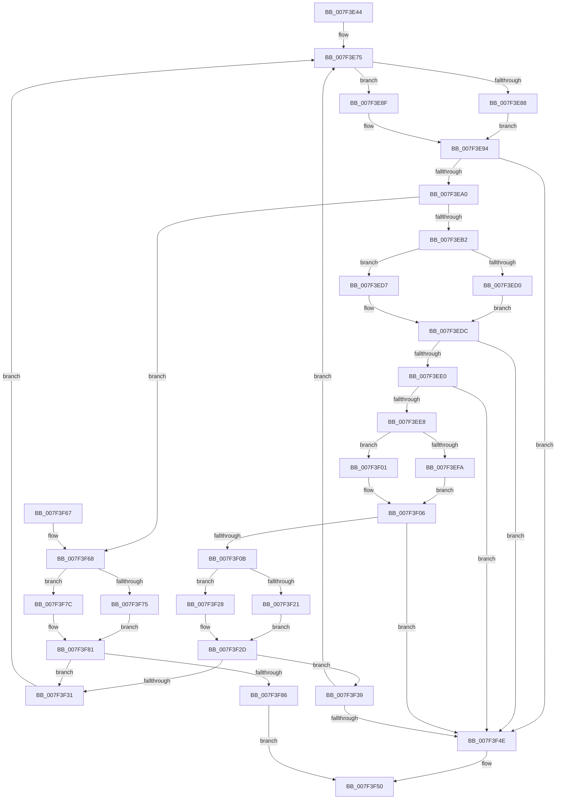

# CmpDeleteTree

- RVA: `0x007F3E44`–`0x007F3F8A` (길이 `326` bytes)
- VA: `0x00000001407F3E44`
- 실행 섹션: `PAGE`
- PDB 이름 있음: `예`; PDB Function 태그: `아니요`
- unwind 정보 RVA: `0x000D739C`
- 디코드: `98`개 명령, `326/326` bytes 표시
- 미해석 바이트: `0` (있으면 어셈블리에 `.byte`로 보존)

> 이 문서는 커널 이미지의 기계어와 PDB 기호를 분석해 생성했습니다. 4번과 5번은 함수 원형과 자료형을 바이너리 사용 방식에서 추정한 C 해석이며 원본 소스 복구 결과는 아닙니다.

## 1. Dependencies

- 직접 호출 지점: **12**; 고유 호출 대상: **6**
- 직접 호출자로 확인된 함수: **2**
- RIP 상대 이미지 참조: **0**

### Outgoing calls
- `0x007F3E88` → [HvpGetCellFlat](../85/HvpGetCellFlat_function_00854C60.md) (function, `0x00854C60`)
- `0x007F3E8F` → [HvpGetCellPaged](../85/HvpGetCellPaged_function_00854CB0.md) (function, `0x00854CB0`)
- `0x007F3EB9` → [CmpFindSubKeyByNumber](../85/CmpFindSubKeyByNumber_function_0085C930.md) (function, `0x0085C930`)
- `0x007F3ED0` → [HvpReleaseCellFlat](../85/HvpReleaseCellFlat_function_0085CC20.md) (function, `0x0085CC20`)
- `0x007F3ED7` → [HvpReleaseCellPaged](../85/HvpReleaseCellPaged_function_00855F40.md) (function, `0x00855F40`)
- `0x007F3EFA` → [HvpGetCellFlat](../85/HvpGetCellFlat_function_00854C60.md) (function, `0x00854C60`)
- `0x007F3F01` → [HvpGetCellPaged](../85/HvpGetCellPaged_function_00854CB0.md) (function, `0x00854CB0`)
- `0x007F3F21` → [HvpReleaseCellFlat](../85/HvpReleaseCellFlat_function_0085CC20.md) (function, `0x0085CC20`)
- `0x007F3F28` → [HvpReleaseCellPaged](../85/HvpReleaseCellPaged_function_00855F40.md) (function, `0x00855F40`)
- `0x007F3F41` → [CmpFreeKeyByCell](../84/CmpFreeKeyByCell_function_0084AD70.md) (function, `0x0084AD70`)
- `0x007F3F75` → [HvpReleaseCellFlat](../85/HvpReleaseCellFlat_function_0085CC20.md) (function, `0x0085CC20`)
- `0x007F3F7C` → [HvpReleaseCellPaged](../85/HvpReleaseCellPaged_function_00855F40.md) (function, `0x00855F40`)

### Direct callers
- [CmRestoreKey](../7D/CmRestoreKey_function_007DCF04.md) at `0x007DDA2B`
- [CmRestoreKey](../7D/CmRestoreKey_function_007DCF04.md) at `0x007DDAD2`
- [CmpSyncSubKeysAfterDelete](../AC/CmpSyncSubKeysAfterDelete_function_00AC5980.md) at `0x00AC5A60`

### Static image references
- 디코드된 RIP-relative 메모리 참조가 없습니다.

## 2. Other-region calls and transfers

- 다른 실행 섹션으로 향하는 call: **0**
- 별도 외부 분기/꼬리 이동을 확인하지 못했습니다.

## 3. Assembly (complete function range)

```asm
007F3E44  48 89 5C 24 18                  mov qword ptr [rsp + 0x18], rbx
007F3E49  48 89 74 24 20                  mov qword ptr [rsp + 0x20], rsi
007F3E4E  55                              push rbp
007F3E4F  57                              push rdi
007F3E50  41 55                           push r13
007F3E52  41 56                           push r14
007F3E54  41 57                           push r15
007F3E56  48 8B EC                        mov rbp, rsp
007F3E59  48 83 EC 20                     sub rsp, 0x20
007F3E5D  45 33 ED                        xor r13d, r13d
007F3E60  44 8B FA                        mov r15d, edx
007F3E63  83 4D 30 FF                     or dword ptr [rbp + 0x30], 0xffffffff
007F3E67  48 8B D9                        mov rbx, rcx
007F3E6A  44 89 6D 38                     mov dword ptr [rbp + 0x38], r13d
007F3E6E  44 8B F2                        mov r14d, edx
007F3E71  44 89 6D 34                     mov dword ptr [rbp + 0x34], r13d
007F3E75  F6 83 8C 00 00 00 01            test byte ptr [rbx + 0x8c], 1
007F3E7C  4C 8D 45 30                     lea r8, [rbp + 0x30]
007F3E80  41 8B D6                        mov edx, r14d
007F3E83  48 8B CB                        mov rcx, rbx
007F3E86  74 07                           je 0x1407f3e8f
007F3E88  E8 D3 0D 06 00                  call 0x140854c60
007F3E8D  EB 05                           jmp 0x1407f3e94
007F3E8F  E8 1C 0E 06 00                  call 0x140854cb0
007F3E94  48 8B D0                        mov rdx, rax
007F3E97  48 85 C0                        test rax, rax
007F3E9A  0F 84 AE 00 00 00               je 0x1407f3f4e
007F3EA0  8B 78 10                        mov edi, dword ptr [rax + 0x10]
007F3EA3  48 8B CB                        mov rcx, rbx
007F3EA6  8B 40 18                        mov eax, dword ptr [rax + 0x18]
007F3EA9  03 42 14                        add eax, dword ptr [rdx + 0x14]
007F3EAC  0F 84 B6 00 00 00               je 0x1407f3f68
007F3EB2  4C 8D 4D 38                     lea r9, [rbp + 0x38]
007F3EB6  45 33 C0                        xor r8d, r8d
007F3EB9  E8 72 8A 06 00                  call 0x14085c930
007F3EBE  F6 83 8C 00 00 00 01            test byte ptr [rbx + 0x8c], 1
007F3EC5  48 8D 55 30                     lea rdx, [rbp + 0x30]
007F3EC9  8B F8                           mov edi, eax
007F3ECB  48 8B CB                        mov rcx, rbx
007F3ECE  74 07                           je 0x1407f3ed7
007F3ED0  E8 4B 8D 06 00                  call 0x14085cc20
007F3ED5  EB 05                           jmp 0x1407f3edc
007F3ED7  E8 64 20 06 00                  call 0x140855f40
007F3EDC  85 FF                           test edi, edi
007F3EDE  78 6E                           js 0x1407f3f4e
007F3EE0  8B 7D 38                        mov edi, dword ptr [rbp + 0x38]
007F3EE3  83 FF FF                        cmp edi, -1
007F3EE6  74 66                           je 0x1407f3f4e
007F3EE8  F6 83 8C 00 00 00 01            test byte ptr [rbx + 0x8c], 1
007F3EEF  4C 8D 45 30                     lea r8, [rbp + 0x30]
007F3EF3  8B D7                           mov edx, edi
007F3EF5  48 8B CB                        mov rcx, rbx
007F3EF8  74 07                           je 0x1407f3f01
007F3EFA  E8 61 0D 06 00                  call 0x140854c60
007F3EFF  EB 05                           jmp 0x1407f3f06
007F3F01  E8 AA 0D 06 00                  call 0x140854cb0
007F3F06  48 85 C0                        test rax, rax
007F3F09  74 43                           je 0x1407f3f4e
007F3F0B  8B 70 18                        mov esi, dword ptr [rax + 0x18]
007F3F0E  48 8D 55 30                     lea rdx, [rbp + 0x30]
007F3F12  03 70 14                        add esi, dword ptr [rax + 0x14]
007F3F15  48 8B CB                        mov rcx, rbx
007F3F18  F6 83 8C 00 00 00 01            test byte ptr [rbx + 0x8c], 1
007F3F1F  74 07                           je 0x1407f3f28
007F3F21  E8 FA 8C 06 00                  call 0x14085cc20
007F3F26  EB 05                           jmp 0x1407f3f2d
007F3F28  E8 13 20 06 00                  call 0x140855f40
007F3F2D  85 F6                           test esi, esi
007F3F2F  74 08                           je 0x1407f3f39
007F3F31  44 8B F7                        mov r14d, edi
007F3F34  E9 3C FF FF FF                  jmp 0x1407f3e75
007F3F39  41 B0 01                        mov r8b, 1
007F3F3C  8B D7                           mov edx, edi
007F3F3E  48 8B CB                        mov rcx, rbx
007F3F41  E8 2A 6E 05 00                  call 0x14084ad70
007F3F46  85 C0                           test eax, eax
007F3F48  0F 89 27 FF FF FF               jns 0x1407f3e75
007F3F4E  32 C0                           xor al, al
007F3F50  48 8B 5C 24 60                  mov rbx, qword ptr [rsp + 0x60]
007F3F55  48 8B 74 24 68                  mov rsi, qword ptr [rsp + 0x68]
007F3F5A  48 83 C4 20                     add rsp, 0x20
007F3F5E  41 5F                           pop r15
007F3F60  41 5E                           pop r14
007F3F62  41 5D                           pop r13
007F3F64  5F                              pop rdi
007F3F65  5D                              pop rbp
007F3F66  C3                              ret
007F3F67  CC                              int3
007F3F68  F6 83 8C 00 00 00 01            test byte ptr [rbx + 0x8c], 1
007F3F6F  48 8D 55 30                     lea rdx, [rbp + 0x30]
007F3F73  74 07                           je 0x1407f3f7c
007F3F75  E8 A6 8C 06 00                  call 0x14085cc20
007F3F7A  EB 05                           jmp 0x1407f3f81
007F3F7C  E8 BF 1F 06 00                  call 0x140855f40
007F3F81  45 3B F7                        cmp r14d, r15d
007F3F84  75 AB                           jne 0x1407f3f31
007F3F86  B0 01                           mov al, 1
007F3F88  EB C6                           jmp 0x1407f3f50
```

## 4. C-style interpretation (structured pseudocode)

```c
__int64 __fastcall CmpDeleteTree(__int64 a1, int a2)
{
    __int64 result;
    __int64 v_r13;
    __int64 v_rsi;
    __int64 v_rsp;
    unsigned int v_stack_p10;
    unsigned __int64 v_stack_p18;
    unsigned __int64 v_stack_p20;
    unsigned int v_stack_p8;
    unsigned int v_stack_pC;

    v_stack_p18 = v_rbx;
    v_stack_p20 = v_rsi;
    v_rsp = (v_rsp) - (32);
    v_r13 = 0;
    v_stack_p10 = 0;
    v_stack_pC = 0;
loc_007F3E75:
    if (((*(unsigned __int8 *)(a1 + 140)) & (1)) == 0) goto loc_007F3E8F;
    result = HvpGetCellFlat(a1, (unsigned int)((unsigned int)((unsigned int)(a2))), v_stack_p8, a4);
    goto loc_007F3E94;
loc_007F3E8F:
    result = HvpGetCellPaged(a1, (unsigned int)((unsigned int)((unsigned int)(a2))), v_stack_p8, a4);
loc_007F3E94:
    if (result == 0) goto loc_007F3F4E;
    result = (unsigned int)(((unsigned int)(*(unsigned int *)(result + 24))) + (*(unsigned int *)(result + 20)));
    if (condition_is_equal) goto loc_007F3F68;
    a3 = 0;
    result = CmpFindSubKeyByNumber(a1, result, a3, v_stack_p10);
    if (((*(unsigned __int8 *)(a1 + 140)) & (1)) == 0) goto loc_007F3ED7;
    result = HvpReleaseCellFlat(a1, v_stack_p8, a3, v_stack_p10);
    goto loc_007F3EDC;
loc_007F3ED7:
    result = HvpReleaseCellPaged(a1, v_stack_p8, a3, v_stack_p10);
loc_007F3EDC:
    if (sign_flag) goto loc_007F3F4E;
    if (((unsigned int)((unsigned int)(v_stack_p10))) == -1) goto loc_007F3F4E;
    if (((*(unsigned __int8 *)(a1 + 140)) & (1)) == 0) goto loc_007F3F01;
    result = HvpGetCellFlat(a1, (unsigned int)((unsigned int)((unsigned int)(v_stack_p10))), v_stack_p8, v_stack_p10);
    goto loc_007F3F06;
loc_007F3F01:
    result = HvpGetCellPaged(a1, (unsigned int)((unsigned int)((unsigned int)(v_stack_p10))), v_stack_p8, v_stack_p10);
loc_007F3F06:
    if (result == 0) goto loc_007F3F4E;
    v_rsi = (unsigned int)(((unsigned int)(*(unsigned int *)(result + 24))) + (*(unsigned int *)(result + 20)));
    if (((*(unsigned __int8 *)(a1 + 140)) & (1)) == 0) goto loc_007F3F28;
    result = HvpReleaseCellFlat(a1, v_stack_p8, v_stack_p8, v_stack_p10);
    goto loc_007F3F2D;
loc_007F3F28:
    result = HvpReleaseCellPaged(a1, v_stack_p8, v_stack_p8, v_stack_p10);
loc_007F3F2D:
    if ((unsigned int)(v_rsi) == 0) goto loc_007F3F39;
loc_007F3F31:
    goto loc_007F3E75;
loc_007F3F39:
    result = CmpFreeKeyByCell(a1, (unsigned int)((unsigned int)((unsigned int)(v_stack_p10))), 1, v_stack_p10);
    if (!sign_flag) goto loc_007F3E75;
loc_007F3F4E:
    result = 0;
loc_007F3F50:
    v_rsp = (v_rsp) + (32);
    return result;
loc_007F3F68:
    if (((*(unsigned __int8 *)(v_stack_p18 + 140)) & (1)) == 0) goto loc_007F3F7C;
    result = HvpReleaseCellFlat(a1, v_stack_p8, 1, v_stack_p10);
    goto loc_007F3F81;
loc_007F3F7C:
    result = HvpReleaseCellPaged(a1, v_stack_p8, 1, v_stack_p10);
loc_007F3F81:
    if (((unsigned int)((unsigned int)((unsigned int)((unsigned int)(v_stack_p10))))) != ((unsigned int)((unsigned int)(a2)))) goto loc_007F3F31;
    goto loc_007F3F50;
}
```

## 5. (Beta) C Style

```c
int64_t CmpDeleteTree(void *Arg1, int32_t Arg2)
{
    uint8_t *arg1 = (uint8_t *)Arg1;

    int64_t result;
    int64_t local_r13;
    int64_t local_rsi;
    int64_t local_rsp;
    uint32_t v_stack_p10;
    uint64_t v_stack_p18;
    uint64_t v_stack_p20;
    uint32_t v_stack_p8;
    uint32_t v_stack_pC;

    v_stack_p18 = local_rbx;
    v_stack_p20 = local_rsi;
    local_rsp = (local_rsp) - (32);
    local_r13 = 0;
    v_stack_p10 = 0;
    v_stack_pC = 0;
loc_007F3E75:
    if (((*(uint8_t *)(arg1 + 0x8C)) & (1)) == 0) goto loc_007F3E8F;
    result = HvpGetCellFlat(Arg1, (uint32_t)((uint32_t)((uint32_t)(Arg2))), v_stack_p8, a4);
    goto loc_007F3E94;
loc_007F3E8F:
    result = HvpGetCellPaged(Arg1, (uint32_t)((uint32_t)((uint32_t)(Arg2))), v_stack_p8, a4);
loc_007F3E94:
    if (result == 0) goto loc_007F3F4E;
    result = (uint32_t)(((uint32_t)(*(uint32_t *)(result + 0x18))) + (*(uint32_t *)(result + 0x14)));
    if (condition_is_equal) goto loc_007F3F68;
    a3 = 0;
    result = CmpFindSubKeyByNumber(Arg1, result, a3, v_stack_p10);
    if (((*(uint8_t *)(arg1 + 0x8C)) & (1)) == 0) goto loc_007F3ED7;
    result = HvpReleaseCellFlat(Arg1, v_stack_p8, a3, v_stack_p10);
    goto loc_007F3EDC;
loc_007F3ED7:
    result = HvpReleaseCellPaged(Arg1, v_stack_p8, a3, v_stack_p10);
loc_007F3EDC:
    if (sign_flag) goto loc_007F3F4E;
    if (((uint32_t)((uint32_t)(v_stack_p10))) == -1) goto loc_007F3F4E;
    if (((*(uint8_t *)(arg1 + 0x8C)) & (1)) == 0) goto loc_007F3F01;
    result = HvpGetCellFlat(Arg1, (uint32_t)((uint32_t)((uint32_t)(v_stack_p10))), v_stack_p8, v_stack_p10);
    goto loc_007F3F06;
loc_007F3F01:
    result = HvpGetCellPaged(Arg1, (uint32_t)((uint32_t)((uint32_t)(v_stack_p10))), v_stack_p8, v_stack_p10);
loc_007F3F06:
    if (result == 0) goto loc_007F3F4E;
    local_rsi = (uint32_t)(((uint32_t)(*(uint32_t *)(result + 0x18))) + (*(uint32_t *)(result + 0x14)));
    if (((*(uint8_t *)(arg1 + 0x8C)) & (1)) == 0) goto loc_007F3F28;
    result = HvpReleaseCellFlat(Arg1, v_stack_p8, v_stack_p8, v_stack_p10);
    goto loc_007F3F2D;
loc_007F3F28:
    result = HvpReleaseCellPaged(Arg1, v_stack_p8, v_stack_p8, v_stack_p10);
loc_007F3F2D:
    if ((uint32_t)(local_rsi) == 0) goto loc_007F3F39;
loc_007F3F31:
    goto loc_007F3E75;
loc_007F3F39:
    result = CmpFreeKeyByCell(Arg1, (uint32_t)((uint32_t)((uint32_t)(v_stack_p10))), 1, v_stack_p10);
    if (!sign_flag) goto loc_007F3E75;
loc_007F3F4E:
    result = 0;
loc_007F3F50:
    local_rsp = (local_rsp) + (32);
    return result;
loc_007F3F68:
    if (((*(uint8_t *)(v_stack_p18 + 0x8C)) & (1)) == 0) goto loc_007F3F7C;
    result = HvpReleaseCellFlat(Arg1, v_stack_p8, 1, v_stack_p10);
    goto loc_007F3F81;
loc_007F3F7C:
    result = HvpReleaseCellPaged(Arg1, v_stack_p8, 1, v_stack_p10);
loc_007F3F81:
    if (((uint32_t)((uint32_t)((uint32_t)((uint32_t)(v_stack_p10))))) != ((uint32_t)((uint32_t)(Arg2)))) goto loc_007F3F31;
    goto loc_007F3F50;
}
```

### 관측된 메모리 오프셋

구조체 형식이 확인되지 않은 접근은 인자 기준의 오프셋으로만 기록했습니다.

| 기준 인자 | 오프셋 표현 | 폭 (bit) | 접근 |
|---|---:|---:|---|
| `Arg1` | `+ 0x8C` | `8` | `R` |

## 6. Execution-region graph

[열기: 2D/3D 그래프와 함수 탐색 컨트롤 패널](../../../control-panel.html?section=page&rva=0x007F3E44&view=graph)

- 2D 그래프는 위에서 아래로 흐르고, 3D 그래프는 빈 공간을 드래그해 회전합니다. Shift+드래그는 이동, 휠은 확대·축소, 함수 노드 선택은 대상 보고서 이동입니다.

### Static fallback


