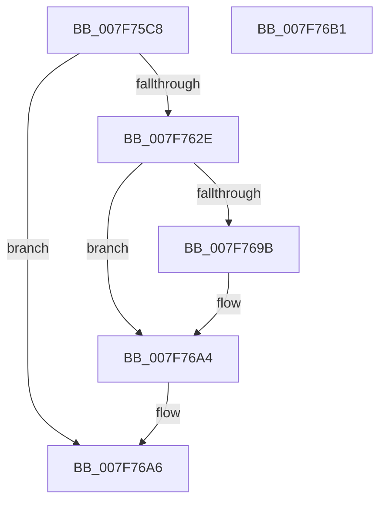

# CmpDoReDoCreateKey

- RVA: `0x007F75C8`–`0x007F76B2` (길이 `234` bytes)
- VA: `0x00000001407F75C8`
- 실행 섹션: `PAGE`
- PDB 이름 있음: `예`; PDB Function 태그: `아니요`
- unwind 정보 RVA: `0x000BF3E8`
- 디코드: `66`개 명령, `234/234` bytes 표시
- 미해석 바이트: `0` (있으면 어셈블리에 `.byte`로 보존)

> 이 문서는 커널 이미지의 기계어와 PDB 기호를 분석해 생성했습니다. 4번과 5번은 함수 원형과 자료형을 바이너리 사용 방식에서 추정한 C 해석이며 원본 소스 복구 결과는 아닙니다.

## 1. Dependencies

- 직접 호출 지점: **5**; 고유 호출 대상: **4**
- 직접 호출자로 확인된 함수: **1**
- RIP 상대 이미지 참조: **0**

### Outgoing calls
- `0x007F760F` → [CmpSplitParentKeyName](../../pagecmrc/BC/CmpSplitParentKeyName_function_00BC9F10.md) (function, `0x00BC9F10`)
- `0x007F7625` → [CmpDoReOpenTransKey](CmpDoReOpenTransKey_function_007F78E8.md) (function, `0x007F78E8`)
- `0x007F7688` → [ZwCreateKey](../../text/6A/ZwCreateKey_function_006AD470.md) (function, `0x006AD470`)
- `0x007F7692` → [ZwClose](../../text/6A/ZwClose_function_006AD2B0.md) (function, `0x006AD2B0`)
- `0x007F769F` → [ZwClose](../../text/6A/ZwClose_function_006AD2B0.md) (function, `0x006AD2B0`)

### Direct callers
- [CmpDoReDoRecord](CmpDoReDoRecord_function_007F76B8.md) at `0x007F78C5`

### Static image references
- 디코드된 RIP-relative 메모리 참조가 없습니다.

## 2. Other-region calls and transfers

- 다른 실행 섹션으로 향하는 call: **4**
  - `0x007F760F` → [CmpSplitParentKeyName](../../pagecmrc/BC/CmpSplitParentKeyName_function_00BC9F10.md) (`PAGE` → `PAGECMRC`)
  - `0x007F7688` → [ZwCreateKey](../../text/6A/ZwCreateKey_function_006AD470.md) (`PAGE` → `.text`)
  - `0x007F7692` → [ZwClose](../../text/6A/ZwClose_function_006AD2B0.md) (`PAGE` → `.text`)
  - `0x007F769F` → [ZwClose](../../text/6A/ZwClose_function_006AD2B0.md) (`PAGE` → `.text`)
- 별도 외부 분기/꼬리 이동을 확인하지 못했습니다.

## 3. Assembly (complete function range)

```asm
007F75C8  40 55                           push rbp
007F75CA  53                              push rbx
007F75CB  57                              push rdi
007F75CC  48 8D 6C 24 B9                  lea rbp, [rsp - 0x47]
007F75D1  48 81 EC 90 00 00 00            sub rsp, 0x90
007F75D8  48 83 65 77 00                  and qword ptr [rbp + 0x77], 0
007F75DD  4C 8D 45 07                     lea r8, [rbp + 7]
007F75E1  33 C0                           xor eax, eax
007F75E3  48 8B D9                        mov rbx, rcx
007F75E6  21 45 33                        and dword ptr [rbp + 0x33], eax
007F75E9  48 8D 4A 20                     lea rcx, [rdx + 0x20]
007F75ED  48 21 45 7F                     and qword ptr [rbp + 0x7f], rax
007F75F1  48 8B FA                        mov rdi, rdx
007F75F4  21 45 6F                        and dword ptr [rbp + 0x6f], eax
007F75F7  48 8D 55 F7                     lea rdx, [rbp - 9]
007F75FB  0F 57 C0                        xorps xmm0, xmm0
007F75FE  89 45 1B                        mov dword ptr [rbp + 0x1b], eax
007F7601  21 45 1B                        and dword ptr [rbp + 0x1b], eax
007F7604  0F 57 C9                        xorps xmm1, xmm1
007F7607  0F 11 45 F7                     movups xmmword ptr [rbp - 9], xmm0
007F760B  0F 11 4D 07                     movups xmmword ptr [rbp + 7], xmm1
007F760F  E8 FC 28 3D 00                  call 0x140bc9f10
007F7614  4C 8D 4D 77                     lea r9, [rbp + 0x77]
007F7618  48 8B CB                        mov rcx, rbx
007F761B  48 8D 55 F7                     lea rdx, [rbp - 9]
007F761F  41 B8 06 00 02 00               mov r8d, 0x20006
007F7625  E8 BE 02 00 00                  call 0x1407f78e8
007F762A  85 C0                           test eax, eax
007F762C  78 78                           js 0x1407f76a6
007F762E  48 83 65 3F 00                  and qword ptr [rbp + 0x3f], 0
007F7633  48 8D 45 07                     lea rax, [rbp + 7]
007F7637  48 8B 5D 77                     mov rbx, qword ptr [rbp + 0x77]
007F763B  4C 8D 45 17                     lea r8, [rbp + 0x17]
007F763F  48 89 45 27                     mov qword ptr [rbp + 0x27], rax
007F7643  48 8D 4D 7F                     lea rcx, [rbp + 0x7f]
007F7647  48 8B 47 38                     mov rax, qword ptr [rdi + 0x38]
007F764B  48 89 45 37                     mov qword ptr [rbp + 0x37], rax
007F764F  8B 47 30                        mov eax, dword ptr [rdi + 0x30]
007F7652  FF C8                           dec eax
007F7654  C7 45 17 30 00 00 00            mov dword ptr [rbp + 0x17], 0x30
007F765B  F7 D8                           neg eax
007F765D  48 89 5D 1F                     mov qword ptr [rbp + 0x1f], rbx
007F7661  48 8D 45 6F                     lea rax, [rbp + 0x6f]
007F7665  C7 45 2F 40 13 00 00            mov dword ptr [rbp + 0x2f], 0x1340
007F766C  1B D2                           sbb edx, edx
007F766E  48 89 44 24 30                  mov qword ptr [rsp + 0x30], rax
007F7673  83 C2 09                        add edx, 9
007F7676  45 33 C9                        xor r9d, r9d
007F7679  89 54 24 28                     mov dword ptr [rsp + 0x28], edx
007F767D  BA 3F 00 0F 00                  mov edx, 0xf003f
007F7682  48 83 64 24 20 00               and qword ptr [rsp + 0x20], 0
007F7688  E8 E3 5D EB FF                  call 0x1406ad470
007F768D  48 8B CB                        mov rcx, rbx
007F7690  8B F8                           mov edi, eax
007F7692  E8 19 5C EB FF                  call 0x1406ad2b0
007F7697  85 FF                           test edi, edi
007F7699  78 09                           js 0x1407f76a4
007F769B  48 8B 4D 7F                     mov rcx, qword ptr [rbp + 0x7f]
007F769F  E8 0C 5C EB FF                  call 0x1406ad2b0
007F76A4  8B C7                           mov eax, edi
007F76A6  48 81 C4 90 00 00 00            add rsp, 0x90
007F76AD  5F                              pop rdi
007F76AE  5B                              pop rbx
007F76AF  5D                              pop rbp
007F76B0  C3                              ret
007F76B1  CC                              int3
```

## 4. C-style interpretation (structured pseudocode)

```c
__int64 __fastcall CmpDoReDoCreateKey(__int64 a1, __int64 a2)
{
    __int64 result;
    __int64 v_rsp;
    unsigned __int64 v_stack_m20;
    unsigned __int64 v_stack_m28;
    unsigned int v_stack_m2C;
    unsigned int v_stack_m30;
    unsigned __int64 v_stack_m38;
    unsigned __int64 v_stack_m40;
    unsigned int v_stack_m44;
    unsigned __int64 v_stack_m48;
    unsigned __int64 v_stack_m58;
    unsigned __int64 v_stack_m5F;
    unsigned __int64 v_stack_m68;
    unsigned __int64 v_stack_m78;
    unsigned int v_stack_m80;
    unsigned __int64 v_stack_m88;
    unsigned int v_stack_p10;
    unsigned __int64 v_stack_p18;
    unsigned __int64 v_stack_p20;

    v_rsp = (v_rsp) - (144);
    result = 0;
    v_stack_m44 = 0;
    v_stack_m68 = v_xmm0;
    v_stack_m58 = v_xmm1;
    result = CmpSplitParentKeyName(a2 + 32, v_stack_m68, v_stack_m58, a4);
    result = CmpDoReOpenTransKey(a1, v_stack_m68, (unsigned int)(0x20006ULL), v_stack_p18);
    if (sign_flag) goto loc_007F76A6;
    v_stack_m38 = v_stack_m58;
    v_stack_m28 = *(unsigned __int64 *)(a2 + 56);
    result = (unsigned int)(((unsigned int)(*(unsigned int *)(a2 + 48))) - 1);
    v_stack_m48 = 48;
    result = (unsigned int)(-(result));
    v_stack_m40 = v_stack_p18;
    v_stack_m30 = 0x1340ULL;
    v_stack_m78 = v_stack_p10;
    a2 = (unsigned int)((v_stack_m68) + (9));
    a4 = 0;
    v_stack_m80 = (unsigned int)(a2);
    result = ZwCreateKey(v_stack_p20, (unsigned int)(0xF003FULL), v_stack_m48, a4);
    result = ZwClose(v_stack_p18, (unsigned int)(0xF003FULL), v_stack_m48, a4);
    if (!(sign_flag)) {
        a1 = v_stack_p20;
        result = ZwClose(a1, (unsigned int)(0xF003FULL), v_stack_m48, a4);
    }
loc_007F76A6:
    v_rsp = (v_rsp) + (144);
    return (unsigned int)((unsigned int)((unsigned int)((unsigned int)(result))));
}
```

## 5. (Beta) C Style

```c
int64_t CmpDoReDoCreateKey(int64_t Arg1, void *Arg2)
{
    uint8_t *arg2 = (uint8_t *)Arg2;

    int64_t result;
    int64_t local_rsp;
    uint64_t v_stack_m20;
    uint64_t v_stack_m28;
    uint32_t v_stack_m2C;
    uint32_t v_stack_m30;
    uint64_t v_stack_m38;
    uint64_t v_stack_m40;
    uint32_t v_stack_m44;
    uint64_t v_stack_m48;
    uint64_t v_stack_m58;
    uint64_t v_stack_m5F;
    uint64_t v_stack_m68;
    uint64_t v_stack_m78;
    uint32_t v_stack_m80;
    uint64_t v_stack_m88;
    uint32_t v_stack_p10;
    uint64_t v_stack_p18;
    uint64_t v_stack_p20;

    local_rsp = (local_rsp) - (144);
    result = 0;
    v_stack_m44 = 0;
    v_stack_m68 = v_xmm0;
    v_stack_m58 = v_xmm1;
    result = CmpSplitParentKeyName(Arg2 + 32, v_stack_m68, v_stack_m58, a4);
    result = CmpDoReOpenTransKey(Arg1, v_stack_m68, (uint32_t)(0x20006ULL), v_stack_p18);
    if (sign_flag) goto loc_007F76A6;
    v_stack_m38 = v_stack_m58;
    v_stack_m28 = *(uint64_t *)(arg2 + 0x38);
    result = (uint32_t)(((uint32_t)(*(uint32_t *)(arg2 + 0x30))) - 1);
    v_stack_m48 = 48;
    result = (uint32_t)(-(result));
    v_stack_m40 = v_stack_p18;
    v_stack_m30 = 0x1340ULL;
    v_stack_m78 = v_stack_p10;
    Arg2 = (uint32_t)((v_stack_m68) + (9));
    a4 = 0;
    v_stack_m80 = (uint32_t)(Arg2);
    result = ZwCreateKey(v_stack_p20, (uint32_t)(0xF003FULL), v_stack_m48, a4);
    result = ZwClose(v_stack_p18, (uint32_t)(0xF003FULL), v_stack_m48, a4);
    if (!(sign_flag)) {
        Arg1 = v_stack_p20;
        result = ZwClose(Arg1, (uint32_t)(0xF003FULL), v_stack_m48, a4);
    }
loc_007F76A6:
    local_rsp = (local_rsp) + (144);
    return (uint32_t)((uint32_t)((uint32_t)((uint32_t)(result))));
}
```

### 관측된 메모리 오프셋

구조체 형식이 확인되지 않은 접근은 인자 기준의 오프셋으로만 기록했습니다.

| 기준 인자 | 오프셋 표현 | 폭 (bit) | 접근 |
|---|---:|---:|---|
| `Arg2` | `+ 0x20` | `64` | `R` |
| `Arg2` | `+ 0x30` | `32` | `R` |
| `Arg2` | `+ 0x38` | `64` | `R` |

## 6. Execution-region graph

[열기: 2D/3D 그래프와 함수 탐색 컨트롤 패널](../../../control-panel.html?section=page&rva=0x007F75C8&view=graph)

- 2D 그래프는 위에서 아래로 흐르고, 3D 그래프는 빈 공간을 드래그해 회전합니다. Shift+드래그는 이동, 휠은 확대·축소, 함수 노드 선택은 대상 보고서 이동입니다.

### Static fallback


