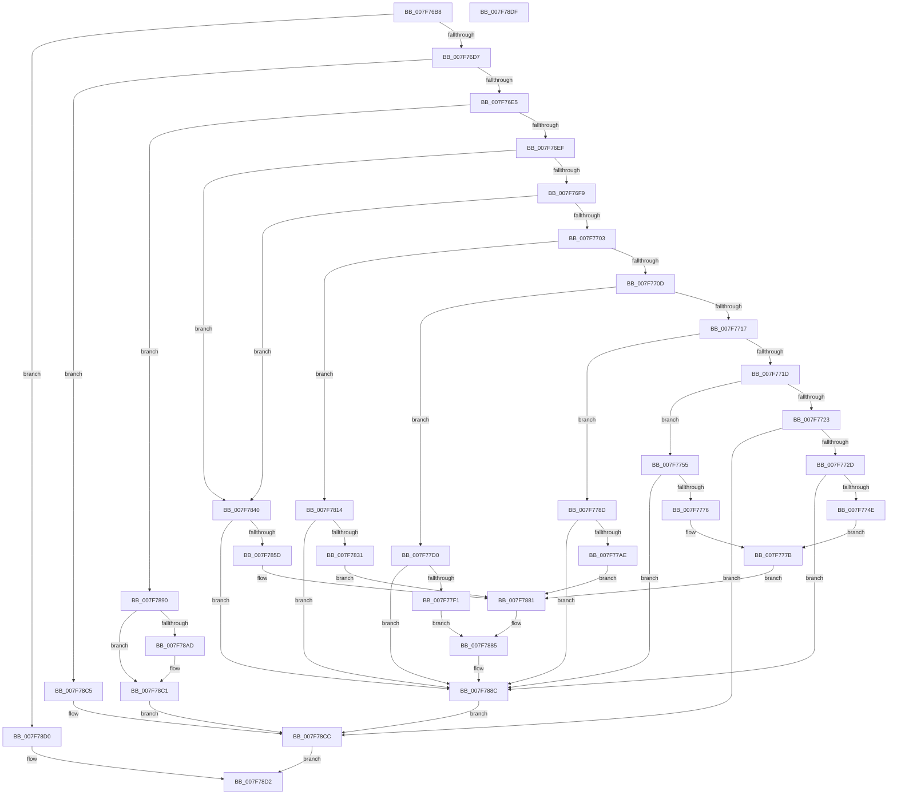

# CmpDoReDoRecord

- RVA: `0x007F76B8`–`0x007F78E0` (길이 `552` bytes)
- VA: `0x00000001407F76B8`
- 실행 섹션: `PAGE`
- PDB 이름 있음: `예`; PDB Function 태그: `아니요`
- unwind 정보 RVA: `0x000D7604`
- 디코드: `147`개 명령, `552/552` bytes 표시
- 미해석 바이트: `0` (있으면 어셈블리에 `.byte`로 보존)

> 이 문서는 커널 이미지의 기계어와 PDB 기호를 분석해 생성했습니다. 4번과 5번은 함수 원형과 자료형을 바이너리 사용 방식에서 추정한 C 해석이며 원본 소스 복구 결과는 아닙니다.

## 1. Dependencies

- 직접 호출 지점: **16**; 고유 호출 대상: **8**
- 직접 호출자로 확인된 함수: **1**
- RIP 상대 이미지 참조: **0**

### Outgoing calls
- `0x007F773F` → [CmpDoReOpenTransKey](CmpDoReOpenTransKey_function_007F78E8.md) (function, `0x007F78E8`)
- `0x007F7767` → [CmpDoReOpenTransKey](CmpDoReOpenTransKey_function_007F78E8.md) (function, `0x007F78E8`)
- `0x007F7783` → [ZwSetSecurityObject](../../text/6B/ZwSetSecurityObject_function_006B0810.md) (function, `0x006B0810`)
- `0x007F779F` → [CmpDoReOpenTransKey](CmpDoReOpenTransKey_function_007F78E8.md) (function, `0x007F78E8`)
- `0x007F77C6` → [ZwSetInformationKey](../../text/6B/ZwSetInformationKey_function_006B0630.md) (function, `0x006B0630`)
- `0x007F77E2` → [CmpDoReOpenTransKey](CmpDoReOpenTransKey_function_007F78E8.md) (function, `0x007F78E8`)
- `0x007F7809` → [ZwSetInformationKey](../../text/6B/ZwSetInformationKey_function_006B0630.md) (function, `0x006B0630`)
- `0x007F7826` → [CmpDoReOpenTransKey](CmpDoReOpenTransKey_function_007F78E8.md) (function, `0x007F78E8`)
- `0x007F7839` → [ZwDeleteValueKey](../../text/6A/ZwDeleteValueKey_function_006AECB0.md) (function, `0x006AECB0`)
- `0x007F7852` → [CmpDoReOpenTransKey](CmpDoReOpenTransKey_function_007F78E8.md) (function, `0x007F78E8`)
- `0x007F787C` → [ZwSetValueKey](../../text/6A/ZwSetValueKey_function_006ADCD0.md) (function, `0x006ADCD0`)
- `0x007F7887` → [ZwClose](../../text/6A/ZwClose_function_006AD2B0.md) (function, `0x006AD2B0`)
- `0x007F78A2` → [CmpDoReOpenTransKey](CmpDoReOpenTransKey_function_007F78E8.md) (function, `0x007F78E8`)
- `0x007F78B1` → [ZwDeleteKey](../../text/6A/ZwDeleteKey_function_006AEC50.md) (function, `0x006AEC50`)
- `0x007F78BC` → [ZwClose](../../text/6A/ZwClose_function_006AD2B0.md) (function, `0x006AD2B0`)
- `0x007F78C5` → [CmpDoReDoCreateKey](CmpDoReDoCreateKey_function_007F75C8.md) (function, `0x007F75C8`)

### Direct callers
- [CmpRmReDoPhase](CmpRmReDoPhase_function_007F0794.md) at `0x007F08D1`

### Static image references
- 디코드된 RIP-relative 메모리 참조가 없습니다.

## 2. Other-region calls and transfers

- 다른 실행 섹션으로 향하는 call: **8**
  - `0x007F7783` → [ZwSetSecurityObject](../../text/6B/ZwSetSecurityObject_function_006B0810.md) (`PAGE` → `.text`)
  - `0x007F77C6` → [ZwSetInformationKey](../../text/6B/ZwSetInformationKey_function_006B0630.md) (`PAGE` → `.text`)
  - `0x007F7809` → [ZwSetInformationKey](../../text/6B/ZwSetInformationKey_function_006B0630.md) (`PAGE` → `.text`)
  - `0x007F7839` → [ZwDeleteValueKey](../../text/6A/ZwDeleteValueKey_function_006AECB0.md) (`PAGE` → `.text`)
  - `0x007F787C` → [ZwSetValueKey](../../text/6A/ZwSetValueKey_function_006ADCD0.md) (`PAGE` → `.text`)
  - `0x007F7887` → [ZwClose](../../text/6A/ZwClose_function_006AD2B0.md) (`PAGE` → `.text`)
  - `0x007F78B1` → [ZwDeleteKey](../../text/6A/ZwDeleteKey_function_006AEC50.md) (`PAGE` → `.text`)
  - `0x007F78BC` → [ZwClose](../../text/6A/ZwClose_function_006AD2B0.md) (`PAGE` → `.text`)
- 별도 외부 분기/꼬리 이동을 확인하지 못했습니다.

## 3. Assembly (complete function range)

```asm
007F76B8  48 89 5C 24 08                  mov qword ptr [rsp + 8], rbx
007F76BD  55                              push rbp
007F76BE  56                              push rsi
007F76BF  57                              push rdi
007F76C0  48 8B EC                        mov rbp, rsp
007F76C3  48 83 EC 30                     sub rsp, 0x30
007F76C7  8B 42 08                        mov eax, dword ptr [rdx + 8]
007F76CA  33 DB                           xor ebx, ebx
007F76CC  48 8B FA                        mov rdi, rdx
007F76CF  A8 1C                           test al, 0x1c
007F76D1  0F 85 F9 01 00 00               jne 0x1407f78d0
007F76D7  44 8B 42 0C                     mov r8d, dword ptr [rdx + 0xc]
007F76DB  41 83 E8 01                     sub r8d, 1
007F76DF  0F 84 E0 01 00 00               je 0x1407f78c5
007F76E5  41 83 E8 01                     sub r8d, 1
007F76E9  0F 84 A1 01 00 00               je 0x1407f7890
007F76EF  41 83 E8 01                     sub r8d, 1
007F76F3  0F 84 47 01 00 00               je 0x1407f7840
007F76F9  41 83 E8 01                     sub r8d, 1
007F76FD  0F 84 3D 01 00 00               je 0x1407f7840
007F7703  41 83 E8 01                     sub r8d, 1
007F7707  0F 84 07 01 00 00               je 0x1407f7814
007F770D  41 83 E8 01                     sub r8d, 1
007F7711  0F 84 B9 00 00 00               je 0x1407f77d0
007F7717  41 83 E8 01                     sub r8d, 1
007F771B  74 70                           je 0x1407f778d
007F771D  41 83 E8 01                     sub r8d, 1
007F7721  74 32                           je 0x1407f7755
007F7723  41 83 F8 02                     cmp r8d, 2
007F7727  0F 85 9F 01 00 00               jne 0x1407f78cc
007F772D  48 83 C2 20                     add rdx, 0x20
007F7731  48 89 5D 28                     mov qword ptr [rbp + 0x28], rbx
007F7735  4C 8D 4D 28                     lea r9, [rbp + 0x28]
007F7739  41 B8 00 00 0C 01               mov r8d, 0x10c0000
007F773F  E8 A4 01 00 00                  call 0x1407f78e8
007F7744  8B F0                           mov esi, eax
007F7746  85 C0                           test eax, eax
007F7748  0F 88 3E 01 00 00               js 0x1407f788c
007F774E  BA 80 01 01 00                  mov edx, 0x10180
007F7753  EB 26                           jmp 0x1407f777b
007F7755  48 83 C2 20                     add rdx, 0x20
007F7759  48 89 5D 28                     mov qword ptr [rbp + 0x28], rbx
007F775D  4C 8D 4D 28                     lea r9, [rbp + 0x28]
007F7761  41 B8 00 00 04 00               mov r8d, 0x40000
007F7767  E8 7C 01 00 00                  call 0x1407f78e8
007F776C  8B F0                           mov esi, eax
007F776E  85 C0                           test eax, eax
007F7770  0F 88 16 01 00 00               js 0x1407f788c
007F7776  BA 04 00 00 00                  mov edx, 4
007F777B  4C 8B 47 38                     mov r8, qword ptr [rdi + 0x38]
007F777F  48 8B 4D 28                     mov rcx, qword ptr [rbp + 0x28]
007F7783  E8 88 90 EB FF                  call 0x1406b0810
007F7788  E9 F4 00 00 00                  jmp 0x1407f7881
007F778D  48 83 C2 20                     add rdx, 0x20
007F7791  48 89 5D 28                     mov qword ptr [rbp + 0x28], rbx
007F7795  4C 8D 4D 28                     lea r9, [rbp + 0x28]
007F7799  41 B8 02 00 00 00               mov r8d, 2
007F779F  E8 44 01 00 00                  call 0x1407f78e8
007F77A4  8B F0                           mov esi, eax
007F77A6  85 C0                           test eax, eax
007F77A8  0F 88 DE 00 00 00               js 0x1407f788c
007F77AE  48 8B 47 30                     mov rax, qword ptr [rdi + 0x30]
007F77B2  4C 8D 45 30                     lea r8, [rbp + 0x30]
007F77B6  48 8B 4D 28                     mov rcx, qword ptr [rbp + 0x28]
007F77BA  41 B9 08 00 00 00               mov r9d, 8
007F77C0  33 D2                           xor edx, edx
007F77C2  48 89 45 30                     mov qword ptr [rbp + 0x30], rax
007F77C6  E8 65 8E EB FF                  call 0x1406b0630
007F77CB  E9 B1 00 00 00                  jmp 0x1407f7881
007F77D0  48 83 C2 20                     add rdx, 0x20
007F77D4  48 89 5D 30                     mov qword ptr [rbp + 0x30], rbx
007F77D8  4C 8D 4D 30                     lea r9, [rbp + 0x30]
007F77DC  41 B8 02 00 00 00               mov r8d, 2
007F77E2  E8 01 01 00 00                  call 0x1407f78e8
007F77E7  8B F0                           mov esi, eax
007F77E9  85 C0                           test eax, eax
007F77EB  0F 88 9B 00 00 00               js 0x1407f788c
007F77F1  8B 47 30                        mov eax, dword ptr [rdi + 0x30]
007F77F4  4C 8D 45 28                     lea r8, [rbp + 0x28]
007F77F8  48 8B 4D 30                     mov rcx, qword ptr [rbp + 0x30]
007F77FC  41 B9 04 00 00 00               mov r9d, 4
007F7802  89 45 28                        mov dword ptr [rbp + 0x28], eax
007F7805  41 8D 51 FD                     lea edx, [r9 - 3]
007F7809  E8 22 8E EB FF                  call 0x1406b0630
007F780E  48 8B 4D 30                     mov rcx, qword ptr [rbp + 0x30]
007F7812  EB 71                           jmp 0x1407f7885
007F7814  48 83 C2 20                     add rdx, 0x20
007F7818  48 89 5D 28                     mov qword ptr [rbp + 0x28], rbx
007F781C  4C 8D 4D 28                     lea r9, [rbp + 0x28]
007F7820  41 B8 02 00 00 00               mov r8d, 2
007F7826  E8 BD 00 00 00                  call 0x1407f78e8
007F782B  8B F0                           mov esi, eax
007F782D  85 C0                           test eax, eax
007F782F  78 5B                           js 0x1407f788c
007F7831  48 8B 4D 28                     mov rcx, qword ptr [rbp + 0x28]
007F7835  48 8D 57 30                     lea rdx, [rdi + 0x30]
007F7839  E8 72 74 EB FF                  call 0x1406aecb0
007F783E  EB 41                           jmp 0x1407f7881
007F7840  48 83 C2 20                     add rdx, 0x20
007F7844  48 89 5D 28                     mov qword ptr [rbp + 0x28], rbx
007F7848  4C 8D 4D 28                     lea r9, [rbp + 0x28]
007F784C  41 B8 02 00 00 00               mov r8d, 2
007F7852  E8 91 00 00 00                  call 0x1407f78e8
007F7857  8B F0                           mov esi, eax
007F7859  85 C0                           test eax, eax
007F785B  78 2F                           js 0x1407f788c
007F785D  8B 47 44                        mov eax, dword ptr [rdi + 0x44]
007F7860  48 8D 57 30                     lea rdx, [rdi + 0x30]
007F7864  44 8B 4F 40                     mov r9d, dword ptr [rdi + 0x40]
007F7868  45 33 C0                        xor r8d, r8d
007F786B  48 8B 4D 28                     mov rcx, qword ptr [rbp + 0x28]
007F786F  89 44 24 28                     mov dword ptr [rsp + 0x28], eax
007F7873  48 8B 47 48                     mov rax, qword ptr [rdi + 0x48]
007F7877  48 89 44 24 20                  mov qword ptr [rsp + 0x20], rax
007F787C  E8 4F 64 EB FF                  call 0x1406adcd0
007F7881  48 8B 4D 28                     mov rcx, qword ptr [rbp + 0x28]
007F7885  8B F0                           mov esi, eax
007F7887  E8 24 5A EB FF                  call 0x1406ad2b0
007F788C  8B DE                           mov ebx, esi
007F788E  EB 3C                           jmp 0x1407f78cc
007F7890  48 83 C2 20                     add rdx, 0x20
007F7894  48 89 5D 28                     mov qword ptr [rbp + 0x28], rbx
007F7898  4C 8D 4D 28                     lea r9, [rbp + 0x28]
007F789C  41 B8 00 00 01 00               mov r8d, 0x10000
007F78A2  E8 41 00 00 00                  call 0x1407f78e8
007F78A7  8B F8                           mov edi, eax
007F78A9  85 C0                           test eax, eax
007F78AB  78 14                           js 0x1407f78c1
007F78AD  48 8B 4D 28                     mov rcx, qword ptr [rbp + 0x28]
007F78B1  E8 9A 73 EB FF                  call 0x1406aec50
007F78B6  48 8B 4D 28                     mov rcx, qword ptr [rbp + 0x28]
007F78BA  8B F8                           mov edi, eax
007F78BC  E8 EF 59 EB FF                  call 0x1406ad2b0
007F78C1  8B DF                           mov ebx, edi
007F78C3  EB 07                           jmp 0x1407f78cc
007F78C5  E8 FE FC FF FF                  call 0x1407f75c8
007F78CA  8B D8                           mov ebx, eax
007F78CC  8B C3                           mov eax, ebx
007F78CE  EB 02                           jmp 0x1407f78d2
007F78D0  33 C0                           xor eax, eax
007F78D2  48 8B 5C 24 50                  mov rbx, qword ptr [rsp + 0x50]
007F78D7  48 83 C4 30                     add rsp, 0x30
007F78DB  5F                              pop rdi
007F78DC  5E                              pop rsi
007F78DD  5D                              pop rbp
007F78DE  C3                              ret
007F78DF  CC                              int3
```

## 4. C-style interpretation (structured pseudocode)

```c
__int64 __fastcall CmpDoReDoRecord(__int64 a1, __int64 a2)
{
    __int64 result;
    __int64 v_rbx;
    __int64 v_rdi;
    __int64 v_rsp;
    unsigned int v_stack_m20;
    unsigned __int64 v_stack_m28;
    unsigned __int64 v_stack_p10;
    unsigned __int64 v_stack_p18;
    unsigned __int64 v_stack_p8;

    v_stack_p8 = v_rbx;
    v_rsp = (v_rsp) - (48);
    v_rbx = 0;
    if ((((unsigned __int8)((unsigned int)(*(unsigned int *)(a2 + 8)))) & (28)) != 0) goto loc_007F78D0;
    a3 = (unsigned int)(((unsigned int)(*(unsigned int *)(a2 + 12))) - (1));
    if (condition_is_equal) goto loc_007F78C5;
    a3 = (unsigned int)((a3) - (1));
    if (condition_is_equal) goto loc_007F7890;
    a3 = (unsigned int)((a3) - (1));
    if (condition_is_equal) goto loc_007F7840;
    a3 = (unsigned int)((a3) - (1));
    if (condition_is_equal) goto loc_007F7840;
    a3 = (unsigned int)((a3) - (1));
    if (condition_is_equal) goto loc_007F7814;
    a3 = (unsigned int)((a3) - (1));
    if (condition_is_equal) goto loc_007F77D0;
    a3 = (unsigned int)((a3) - (1));
    if (condition_is_equal) goto loc_007F778D;
    a3 = (unsigned int)((a3) - (1));
    if (condition_is_equal) goto loc_007F7755;
    if (((unsigned int)(a3)) != 2) goto loc_007F78CC;
    a2 = (a2) + (32);
    v_stack_p10 = 0;
    result = CmpDoReOpenTransKey(a1, a2, (unsigned int)(0x10C0000ULL), v_stack_p10);
    if (sign_flag) goto loc_007F788C;
    goto loc_007F777B;
loc_007F7755:
    a2 = ((unsigned int)(0x10180ULL)) + (32);
    v_stack_p10 = 0;
    result = CmpDoReOpenTransKey(a1, a2, (unsigned int)(0x40000ULL), v_stack_p10);
    if (sign_flag) goto loc_007F788C;
loc_007F777B:
    result = ZwSetSecurityObject(v_stack_p10, 4, *(unsigned __int64 *)(a2 + 56), v_stack_p10);
    goto loc_007F7881;
loc_007F778D:
    a2 = (4) + (32);
    v_stack_p10 = 0;
    result = CmpDoReOpenTransKey(v_stack_p10, a2, 2, v_stack_p10);
    if (sign_flag) goto loc_007F788C;
    a2 = 0;
    v_stack_p18 = *(unsigned __int64 *)(a2 + 48);
    result = ZwSetInformationKey(v_stack_p10, a2, v_stack_p18, 8);
    goto loc_007F7881;
loc_007F77D0:
    a2 = (a2) + (32);
    v_stack_p18 = 0;
    result = CmpDoReOpenTransKey(v_stack_p10, a2, 2, v_stack_p18);
    if (sign_flag) goto loc_007F788C;
    v_stack_p10 = (unsigned int)((unsigned int)(*(unsigned int *)(a2 + 48)));
    result = ZwSetInformationKey(v_stack_p18, 4 - 3, v_stack_p10, 4);
    goto loc_007F7885;
loc_007F7814:
    a2 = (4 - 3) + (32);
    v_stack_p10 = 0;
    result = CmpDoReOpenTransKey(v_stack_p18, a2, 2, v_stack_p10);
    if (sign_flag) goto loc_007F788C;
    result = ZwDeleteValueKey(v_stack_p10, a2 + 48, 2, v_stack_p10);
    goto loc_007F7881;
loc_007F7840:
    a2 = (a2 + 48) + (32);
    v_stack_p10 = 0;
    result = CmpDoReOpenTransKey(v_stack_p10, a2, 2, v_stack_p10);
    if (sign_flag) goto loc_007F788C;
    a3 = 0;
    v_stack_m20 = (unsigned int)((unsigned int)(*(unsigned int *)(a2 + 68)));
    v_stack_m28 = *(unsigned __int64 *)(a2 + 72);
    result = ZwSetValueKey(v_stack_p10, a2 + 48, a3, (unsigned int)(*(unsigned int *)(a2 + 64)));
loc_007F7881:
loc_007F7885:
    result = ZwClose(v_stack_p10, a2 + 48, a3, (unsigned int)(*(unsigned int *)(a2 + 64)));
loc_007F788C:
    goto loc_007F78CC;
loc_007F7890:
    a2 = (a2 + 48) + (32);
    v_stack_p10 = (unsigned int)((unsigned int)((unsigned int)((unsigned int)(result))));
    result = CmpDoReOpenTransKey(v_stack_p10, a2, (unsigned int)(0x10000ULL), v_stack_p10);
    v_rdi = (unsigned int)((unsigned int)(result));
    if (!(sign_flag)) {
        a1 = v_stack_p10;
        result = ZwDeleteKey(a1, a2, (unsigned int)(0x10000ULL), v_stack_p10);
        a1 = v_stack_p10;
        v_rdi = (unsigned int)(result);
        result = ZwClose(a1, a2, (unsigned int)(0x10000ULL), v_stack_p10);
    }
    goto loc_007F78CC;
loc_007F78C5:
    result = CmpDoReDoCreateKey(a1, a2, (unsigned int)(0x10000ULL), v_stack_p10);
loc_007F78CC:
    goto loc_007F78D2;
loc_007F78D0:
    result = 0;
loc_007F78D2:
    v_rsp = (v_rsp) + (48);
    return result;
}
```

## 5. (Beta) C Style

```c
int64_t CmpDoReDoRecord(int64_t Arg1, void *Arg2)
{
    uint8_t *arg2 = (uint8_t *)Arg2;

    int64_t result;
    int64_t local_rbx;
    int64_t local_rdi;
    int64_t local_rsp;
    uint32_t v_stack_m20;
    uint64_t v_stack_m28;
    uint64_t v_stack_p10;
    uint64_t v_stack_p18;
    uint64_t v_stack_p8;

    v_stack_p8 = local_rbx;
    local_rsp = (local_rsp) - (48);
    local_rbx = 0;
    if ((((uint8_t)((uint32_t)(*(uint32_t *)(arg2 + 0x8)))) & (28)) != 0) goto loc_007F78D0;
    a3 = (uint32_t)(((uint32_t)(*(uint32_t *)(arg2 + 0xC))) - (1));
    if (condition_is_equal) goto loc_007F78C5;
    a3 = (uint32_t)((a3) - (1));
    if (condition_is_equal) goto loc_007F7890;
    a3 = (uint32_t)((a3) - (1));
    if (condition_is_equal) goto loc_007F7840;
    a3 = (uint32_t)((a3) - (1));
    if (condition_is_equal) goto loc_007F7840;
    a3 = (uint32_t)((a3) - (1));
    if (condition_is_equal) goto loc_007F7814;
    a3 = (uint32_t)((a3) - (1));
    if (condition_is_equal) goto loc_007F77D0;
    a3 = (uint32_t)((a3) - (1));
    if (condition_is_equal) goto loc_007F778D;
    a3 = (uint32_t)((a3) - (1));
    if (condition_is_equal) goto loc_007F7755;
    if (((uint32_t)(a3)) != 2) goto loc_007F78CC;
    Arg2 = (Arg2) + (32);
    v_stack_p10 = 0;
    result = CmpDoReOpenTransKey(Arg1, Arg2, (uint32_t)(0x10C0000ULL), v_stack_p10);
    if (sign_flag) goto loc_007F788C;
    goto loc_007F777B;
loc_007F7755:
    Arg2 = ((uint32_t)(0x10180ULL)) + (32);
    v_stack_p10 = 0;
    result = CmpDoReOpenTransKey(Arg1, Arg2, (uint32_t)(0x40000ULL), v_stack_p10);
    if (sign_flag) goto loc_007F788C;
loc_007F777B:
    result = ZwSetSecurityObject(v_stack_p10, 4, *(uint64_t *)(arg2 + 0x38), v_stack_p10);
    goto loc_007F7881;
loc_007F778D:
    Arg2 = (4) + (32);
    v_stack_p10 = 0;
    result = CmpDoReOpenTransKey(v_stack_p10, Arg2, 2, v_stack_p10);
    if (sign_flag) goto loc_007F788C;
    Arg2 = 0;
    v_stack_p18 = *(uint64_t *)(arg2 + 0x30);
    result = ZwSetInformationKey(v_stack_p10, Arg2, v_stack_p18, 8);
    goto loc_007F7881;
loc_007F77D0:
    Arg2 = (Arg2) + (32);
    v_stack_p18 = 0;
    result = CmpDoReOpenTransKey(v_stack_p10, Arg2, 2, v_stack_p18);
    if (sign_flag) goto loc_007F788C;
    v_stack_p10 = (uint32_t)((uint32_t)(*(uint32_t *)(arg2 + 0x30)));
    result = ZwSetInformationKey(v_stack_p18, 4 - 3, v_stack_p10, 4);
    goto loc_007F7885;
loc_007F7814:
    Arg2 = (4 - 3) + (32);
    v_stack_p10 = 0;
    result = CmpDoReOpenTransKey(v_stack_p18, Arg2, 2, v_stack_p10);
    if (sign_flag) goto loc_007F788C;
    result = ZwDeleteValueKey(v_stack_p10, Arg2 + 48, 2, v_stack_p10);
    goto loc_007F7881;
loc_007F7840:
    Arg2 = (Arg2 + 48) + (32);
    v_stack_p10 = 0;
    result = CmpDoReOpenTransKey(v_stack_p10, Arg2, 2, v_stack_p10);
    if (sign_flag) goto loc_007F788C;
    a3 = 0;
    v_stack_m20 = (uint32_t)((uint32_t)(*(uint32_t *)(arg2 + 0x44)));
    v_stack_m28 = *(uint64_t *)(arg2 + 0x48);
    result = ZwSetValueKey(v_stack_p10, Arg2 + 48, a3, (uint32_t)(*(uint32_t *)(arg2 + 0x40)));
loc_007F7881:
loc_007F7885:
    result = ZwClose(v_stack_p10, Arg2 + 48, a3, (uint32_t)(*(uint32_t *)(arg2 + 0x40)));
loc_007F788C:
    goto loc_007F78CC;
loc_007F7890:
    Arg2 = (Arg2 + 48) + (32);
    v_stack_p10 = (uint32_t)((uint32_t)((uint32_t)((uint32_t)(result))));
    result = CmpDoReOpenTransKey(v_stack_p10, Arg2, (uint32_t)(0x10000ULL), v_stack_p10);
    local_rdi = (uint32_t)((uint32_t)(result));
    if (!(sign_flag)) {
        Arg1 = v_stack_p10;
        result = ZwDeleteKey(Arg1, Arg2, (uint32_t)(0x10000ULL), v_stack_p10);
        Arg1 = v_stack_p10;
        local_rdi = (uint32_t)(result);
        result = ZwClose(Arg1, Arg2, (uint32_t)(0x10000ULL), v_stack_p10);
    }
    goto loc_007F78CC;
loc_007F78C5:
    result = CmpDoReDoCreateKey(Arg1, Arg2, (uint32_t)(0x10000ULL), v_stack_p10);
loc_007F78CC:
    goto loc_007F78D2;
loc_007F78D0:
    result = 0;
loc_007F78D2:
    local_rsp = (local_rsp) + (48);
    return result;
}
```

### 관측된 메모리 오프셋

구조체 형식이 확인되지 않은 접근은 인자 기준의 오프셋으로만 기록했습니다.

| 기준 인자 | 오프셋 표현 | 폭 (bit) | 접근 |
|---|---:|---:|---|
| `Arg2` | `+ 0x8` | `32` | `R` |
| `Arg2` | `+ 0xC` | `32` | `R` |
| `Arg2` | `+ 0x30` | `32` | `R` |
| `Arg2` | `+ 0x30` | `64` | `R` |
| `Arg2` | `+ 0x38` | `64` | `R` |
| `Arg2` | `+ 0x40` | `32` | `R` |
| `Arg2` | `+ 0x44` | `32` | `R` |
| `Arg2` | `+ 0x48` | `64` | `R` |

## 6. Execution-region graph

[열기: 2D/3D 그래프와 함수 탐색 컨트롤 패널](../../../control-panel.html?section=page&rva=0x007F76B8&view=graph)

- 2D 그래프는 위에서 아래로 흐르고, 3D 그래프는 빈 공간을 드래그해 회전합니다. Shift+드래그는 이동, 휠은 확대·축소, 함수 노드 선택은 대상 보고서 이동입니다.

### Static fallback


