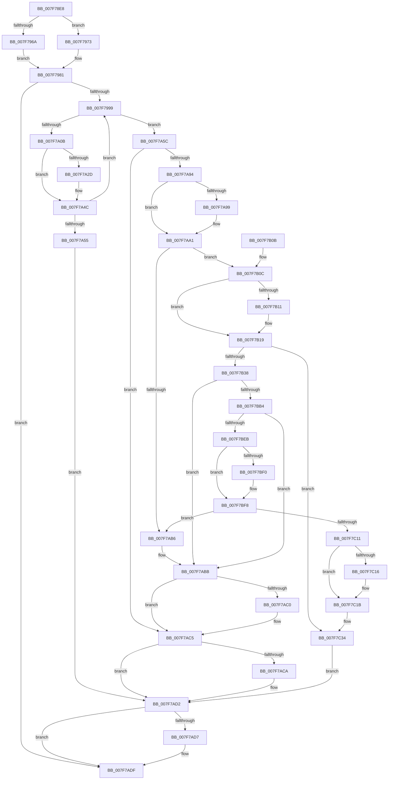

# CmpDoReOpenTransKey

- RVA: `0x007F78E8`–`0x007F7C49` (길이 `865` bytes)
- VA: `0x00000001407F78E8`
- 실행 섹션: `PAGE`
- PDB 이름 있음: `예`; PDB Function 태그: `아니요`
- unwind 정보 RVA: `0x000D75DC`
- 디코드: `217`개 명령, `865/865` bytes 표시
- 미해석 바이트: `0` (있으면 어셈블리에 `.byte`로 보존)

> 이 문서는 커널 이미지의 기계어와 PDB 기호를 분석해 생성했습니다. 4번과 5번은 함수 원형과 자료형을 바이너리 사용 방식에서 추정한 C 해석이며 원본 소스 복구 결과는 아닙니다.

## 1. Dependencies

- 직접 호출 지점: **24**; 고유 호출 대상: **14**
- 직접 호출자로 확인된 함수: **2**
- RIP 상대 이미지 참조: **4**

### Outgoing calls
- `0x007F7941` → [memset](../../text/6C/memset_function_006C6C40.md) (function, `0x006C6C40`)
- `0x007F796A` → [CmpTestRegistryLock](../../text/66/CmpTestRegistryLock_function_0066AC84.md) (function, `0x0066AC84`)
- `0x007F797A` → [ExIsResourceAcquiredSharedLite](../../text/34/ExIsResourceAcquiredSharedLite_function_00341B10.md) (function, `0x00341B10`)
- `0x007F799D` → [CmpInitializeParseContext](../87/CmpInitializeParseContext_function_008767F0.md) (function, `0x008767F0`)
- `0x007F79F4` → [ObOpenObjectByName](../89/ObOpenObjectByName_function_00899F50.md) (function, `0x00899F50`)
- `0x007F7A02` → [CmpCleanupParseContext](../87/CmpCleanupParseContext_function_00876910.md) (function, `0x00876910`)
- `0x007F7A1A` → [CmpSplitParentKeyName](../../pagecmrc/BC/CmpSplitParentKeyName_function_00BC9F10.md) (function, `0x00BC9F10`)
- `0x007F7A1F` → [Feature_Servicing_RemainingPathForLocalKeyName__private_IsEnabledDeviceUsageNoInline](../../text/66/Feature_Servicing_RemainingPathForLocalKeyName__private_IsEnabledDeviceUsageNoInline_function_0066E038.md) (function, `0x0066E038`)
- `0x007F7A84` → [ObReferenceObjectByHandle](../86/ObReferenceObjectByHandle_function_00868DB0.md) (function, `0x00868DB0`)
- `0x007F7A99` → [CmpLockRegistry](../../pagecmrc/BC/CmpLockRegistry_function_00BC9B34.md) (function, `0x00BC9B34`)
- `0x007F7AC0` → [CmpUnlockRegistry](../../pagecmrc/BC/CmpUnlockRegistry_function_00BC9A84.md) (function, `0x00BC9A84`)
- `0x007F7ACD` → [ObfDereferenceObject](../../text/2F/ObfDereferenceObject_function_002F9350.md) (function, `0x002F9350`)
- `0x007F7ADA` → [ZwClose](../../text/6A/ZwClose_function_006AD2B0.md) (function, `0x006AD2B0`)
- `0x007F7AEB` → [_security_check_cookie](../../text/6A/_security_check_cookie_function_006AC640.md) (function, `0x006AC640`)
- `0x007F7B11` → [CmpUnlockRegistry](../../pagecmrc/BC/CmpUnlockRegistry_function_00BC9A84.md) (function, `0x00BC9A84`)
- `0x007F7B24` → [ObfDereferenceObject](../../text/2F/ObfDereferenceObject_function_002F9350.md) (function, `0x002F9350`)
- `0x007F7B3C` → [CmpInitializeParseContext](../87/CmpInitializeParseContext_function_008767F0.md) (function, `0x008767F0`)
- `0x007F7B97` → [ObOpenObjectByName](../89/ObOpenObjectByName_function_00899F50.md) (function, `0x00899F50`)
- `0x007F7BA5` → [CmpCleanupParseContext](../87/CmpCleanupParseContext_function_00876910.md) (function, `0x00876910`)
- `0x007F7BD7` → [ObReferenceObjectByHandle](../86/ObReferenceObjectByHandle_function_00868DB0.md) (function, `0x00868DB0`)
- `0x007F7BF0` → [CmpLockRegistry](../../pagecmrc/BC/CmpLockRegistry_function_00BC9B34.md) (function, `0x00BC9B34`)
- `0x007F7C16` → [CmpUnlockRegistry](../../pagecmrc/BC/CmpUnlockRegistry_function_00BC9A84.md) (function, `0x00BC9A84`)
- `0x007F7C22` → [ObfDereferenceObject](../../text/2F/ObfDereferenceObject_function_002F9350.md) (function, `0x002F9350`)
- `0x007F7C2A` → [ZwClose](../../text/6A/ZwClose_function_006AD2B0.md) (function, `0x006AD2B0`)

### Direct callers
- [CmpDoReDoCreateKey](CmpDoReDoCreateKey_function_007F75C8.md) at `0x007F7625`
- [CmpDoReDoRecord](CmpDoReDoRecord_function_007F76B8.md) at `0x007F773F`
- [CmpDoReDoRecord](CmpDoReDoRecord_function_007F76B8.md) at `0x007F7767`
- [CmpDoReDoRecord](CmpDoReDoRecord_function_007F76B8.md) at `0x007F779F`
- [CmpDoReDoRecord](CmpDoReDoRecord_function_007F76B8.md) at `0x007F77E2`
- [CmpDoReDoRecord](CmpDoReDoRecord_function_007F76B8.md) at `0x007F7826`
- [CmpDoReDoRecord](CmpDoReDoRecord_function_007F76B8.md) at `0x007F7852`
- [CmpDoReDoRecord](CmpDoReDoRecord_function_007F76B8.md) at `0x007F78A2`

### Static image references
- `0x007F7907` → RVA `0x00E0A740` (`.data`; read)
- `0x007F7946` → RVA `0x00EF7108` (`.data`; read)
- `0x007F7973` → RVA `0x00EF7110` (`.data`; read)
- `0x007F79A2` → RVA `0x00FC6AC0` (`ALMOSTRO`; read)

## 2. Other-region calls and transfers

- 다른 실행 섹션으로 향하는 call: **16**
  - `0x007F7941` → [memset](../../text/6C/memset_function_006C6C40.md) (`PAGE` → `.text`)
  - `0x007F796A` → [CmpTestRegistryLock](../../text/66/CmpTestRegistryLock_function_0066AC84.md) (`PAGE` → `.text`)
  - `0x007F797A` → [ExIsResourceAcquiredSharedLite](../../text/34/ExIsResourceAcquiredSharedLite_function_00341B10.md) (`PAGE` → `.text`)
  - `0x007F7A1A` → [CmpSplitParentKeyName](../../pagecmrc/BC/CmpSplitParentKeyName_function_00BC9F10.md) (`PAGE` → `PAGECMRC`)
  - `0x007F7A1F` → [Feature_Servicing_RemainingPathForLocalKeyName__private_IsEnabledDeviceUsageNoInline](../../text/66/Feature_Servicing_RemainingPathForLocalKeyName__private_IsEnabledDeviceUsageNoInline_function_0066E038.md) (`PAGE` → `.text`)
  - `0x007F7A99` → [CmpLockRegistry](../../pagecmrc/BC/CmpLockRegistry_function_00BC9B34.md) (`PAGE` → `PAGECMRC`)
  - `0x007F7AC0` → [CmpUnlockRegistry](../../pagecmrc/BC/CmpUnlockRegistry_function_00BC9A84.md) (`PAGE` → `PAGECMRC`)
  - `0x007F7ACD` → [ObfDereferenceObject](../../text/2F/ObfDereferenceObject_function_002F9350.md) (`PAGE` → `.text`)
  - `0x007F7ADA` → [ZwClose](../../text/6A/ZwClose_function_006AD2B0.md) (`PAGE` → `.text`)
  - `0x007F7AEB` → [_security_check_cookie](../../text/6A/_security_check_cookie_function_006AC640.md) (`PAGE` → `.text`)
  - `0x007F7B11` → [CmpUnlockRegistry](../../pagecmrc/BC/CmpUnlockRegistry_function_00BC9A84.md) (`PAGE` → `PAGECMRC`)
  - `0x007F7B24` → [ObfDereferenceObject](../../text/2F/ObfDereferenceObject_function_002F9350.md) (`PAGE` → `.text`)
  - `0x007F7BF0` → [CmpLockRegistry](../../pagecmrc/BC/CmpLockRegistry_function_00BC9B34.md) (`PAGE` → `PAGECMRC`)
  - `0x007F7C16` → [CmpUnlockRegistry](../../pagecmrc/BC/CmpUnlockRegistry_function_00BC9A84.md) (`PAGE` → `PAGECMRC`)
  - `0x007F7C22` → [ObfDereferenceObject](../../text/2F/ObfDereferenceObject_function_002F9350.md) (`PAGE` → `.text`)
  - `0x007F7C2A` → [ZwClose](../../text/6A/ZwClose_function_006AD2B0.md) (`PAGE` → `.text`)
- 별도 외부 분기/꼬리 이동을 확인하지 못했습니다.

## 3. Assembly (complete function range)

```asm
007F78E8  48 89 5C 24 08                  mov qword ptr [rsp + 8], rbx
007F78ED  55                              push rbp
007F78EE  56                              push rsi
007F78EF  57                              push rdi
007F78F0  41 54                           push r12
007F78F2  41 55                           push r13
007F78F4  41 56                           push r14
007F78F6  41 57                           push r15
007F78F8  48 8D AC 24 60 FE FF FF         lea rbp, [rsp - 0x1a0]
007F7900  48 81 EC A0 02 00 00            sub rsp, 0x2a0
007F7907  48 8B 05 32 2E 61 00            mov rax, qword ptr [rip + 0x612e32]
007F790E  48 33 C4                        xor rax, rsp
007F7911  48 89 85 90 01 00 00            mov qword ptr [rbp + 0x190], rax
007F7918  41 8B F8                        mov edi, r8d
007F791B  44 89 44 24 48                  mov dword ptr [rsp + 0x48], r8d
007F7920  48 8B DA                        mov rbx, rdx
007F7923  4C 89 4D B0                     mov qword ptr [rbp - 0x50], r9
007F7927  4C 8B E9                        mov r13, rcx
007F792A  45 33 E4                        xor r12d, r12d
007F792D  33 D2                           xor edx, edx
007F792F  44 89 65 84                     mov dword ptr [rbp - 0x7c], r12d
007F7933  41 B8 D0 01 00 00               mov r8d, 0x1d0
007F7939  44 89 65 9C                     mov dword ptr [rbp - 0x64], r12d
007F793D  48 8D 4D C0                     lea rcx, [rbp - 0x40]
007F7941  E8 FA F2 EC FF                  call 0x1406c6c40
007F7946  83 3D BB F7 6F 00 01            cmp dword ptr [rip + 0x6ff7bb], 1
007F794D  0F 57 C0                        xorps xmm0, xmm0
007F7950  0F 10 0B                        movups xmm1, xmmword ptr [rbx]
007F7953  4C 89 64 24 58                  mov qword ptr [rsp + 0x58], r12
007F7958  0F 11 44 24 70                  movups xmmword ptr [rsp + 0x70], xmm0
007F795D  4C 89 64 24 50                  mov qword ptr [rsp + 0x50], r12
007F7962  F3 0F 7F 4C 24 60               movdqu xmmword ptr [rsp + 0x60], xmm1
007F7968  75 09                           jne 0x1407f7973
007F796A  E8 15 33 E7 FF                  call 0x14066ac84
007F796F  84 C0                           test al, al
007F7971  EB 0E                           jmp 0x1407f7981
007F7973  48 8B 0D 96 F7 6F 00            mov rcx, qword ptr [rip + 0x6ff796]
007F797A  E8 91 A1 B4 FF                  call 0x140341b10
007F797F  85 C0                           test eax, eax
007F7981  41 0F 95 C7                     setne r15b
007F7985  45 8A F4                        mov r14b, r12b
007F7988  BE 3E 00 00 C0                  mov esi, 0xc000003e
007F798D  66 44 39 64 24 60               cmp word ptr [rsp + 0x60], r12w
007F7993  0F 84 46 01 00 00               je 0x1407f7adf
007F7999  48 8D 4D C0                     lea rcx, [rbp - 0x40]
007F799D  E8 4E EE 07 00                  call 0x1408767f0
007F79A2  48 8B 15 17 F1 7C 00            mov rdx, qword ptr [rip + 0x7cf117]
007F79A9  48 8D 44 24 60                  lea rax, [rsp + 0x60]
007F79AE  48 89 45 90                     mov qword ptr [rbp - 0x70], rax
007F79B2  48 8D 4D 80                     lea rcx, [rbp - 0x80]
007F79B6  48 8D 44 24 50                  lea rax, [rsp + 0x50]
007F79BB  C7 45 D8 08 00 00 00            mov dword ptr [rbp - 0x28], 8
007F79C2  48 89 44 24 30                  mov qword ptr [rsp + 0x30], rax
007F79C7  0F 57 C0                        xorps xmm0, xmm0
007F79CA  48 8D 45 C0                     lea rax, [rbp - 0x40]
007F79CE  C7 45 80 30 00 00 00            mov dword ptr [rbp - 0x80], 0x30
007F79D5  48 89 44 24 28                  mov qword ptr [rsp + 0x28], rax
007F79DA  45 33 C9                        xor r9d, r9d
007F79DD  45 33 C0                        xor r8d, r8d
007F79E0  89 7C 24 20                     mov dword ptr [rsp + 0x20], edi
007F79E4  4C 89 65 88                     mov qword ptr [rbp - 0x78], r12
007F79E8  C7 45 98 40 13 00 00            mov dword ptr [rbp - 0x68], 0x1340
007F79EF  F3 0F 7F 45 A0                  movdqu xmmword ptr [rbp - 0x60], xmm0
007F79F4  E8 57 25 0A 00                  call 0x140899f50
007F79F9  41 8A D7                        mov dl, r15b
007F79FC  48 8D 4D C0                     lea rcx, [rbp - 0x40]
007F7A00  8B F0                           mov esi, eax
007F7A02  E8 09 EF 07 00                  call 0x140876910
007F7A07  85 F6                           test esi, esi
007F7A09  79 51                           jns 0x1407f7a5c
007F7A0B  4C 8D 44 24 70                  lea r8, [rsp + 0x70]
007F7A10  48 8D 54 24 60                  lea rdx, [rsp + 0x60]
007F7A15  48 8D 4C 24 60                  lea rcx, [rsp + 0x60]
007F7A1A  E8 F1 24 3D 00                  call 0x140bc9f10
007F7A1F  E8 14 66 E7 FF                  call 0x14066e038
007F7A24  0F B7 4C 24 60                  movzx ecx, word ptr [rsp + 0x60]
007F7A29  85 C0                           test eax, eax
007F7A2B  74 1F                           je 0x1407f7a4c
007F7A2D  0F B7 03                        movzx eax, word ptr [rbx]
007F7A30  66 2B C1                        sub ax, cx
007F7A33  66 83 E8 02                     sub ax, 2
007F7A37  66 89 44 24 70                  mov word ptr [rsp + 0x70], ax
007F7A3C  0F B7 43 02                     movzx eax, word ptr [rbx + 2]
007F7A40  66 2B C1                        sub ax, cx
007F7A43  66 83 E8 02                     sub ax, 2
007F7A47  66 89 44 24 72                  mov word ptr [rsp + 0x72], ax
007F7A4C  66 85 C9                        test cx, cx
007F7A4F  0F 85 44 FF FF FF               jne 0x1407f7999
007F7A55  48 8B 5C 24 50                  mov rbx, qword ptr [rsp + 0x50]
007F7A5A  EB 76                           jmp 0x1407f7ad2
007F7A5C  48 8B 5C 24 50                  mov rbx, qword ptr [rsp + 0x50]
007F7A61  48 8D 44 24 40                  lea rax, [rsp + 0x40]
007F7A66  4C 8B 05 53 F0 7C 00            mov r8, qword ptr [rip + 0x7cf053]
007F7A6D  48 8B CB                        mov rcx, rbx
007F7A70  4C 89 64 24 28                  mov qword ptr [rsp + 0x28], r12
007F7A75  45 33 C9                        xor r9d, r9d
007F7A78  33 D2                           xor edx, edx
007F7A7A  4C 89 64 24 40                  mov qword ptr [rsp + 0x40], r12
007F7A7F  48 89 44 24 20                  mov qword ptr [rsp + 0x20], rax
007F7A84  E8 27 13 07 00                  call 0x140868db0
007F7A89  48 8B 7C 24 40                  mov rdi, qword ptr [rsp + 0x40]
007F7A8E  8B F0                           mov esi, eax
007F7A90  85 C0                           test eax, eax
007F7A92  78 31                           js 0x1407f7ac5
007F7A94  45 84 FF                        test r15b, r15b
007F7A97  75 08                           jne 0x1407f7aa1
007F7A99  E8 96 20 3D 00                  call 0x140bc9b34
007F7A9E  41 B6 01                        mov r14b, 1
007F7AA1  48 8B 47 08                     mov rax, qword ptr [rdi + 8]
007F7AA5  48 8B 48 20                     mov rcx, qword ptr [rax + 0x20]
007F7AA9  48 8B 81 38 10 00 00            mov rax, qword ptr [rcx + 0x1038]
007F7AB0  49 39 45 40                     cmp qword ptr [r13 + 0x40], rax
007F7AB4  74 56                           je 0x1407f7b0c
007F7AB6  BE 3E 00 00 C0                  mov esi, 0xc000003e
007F7ABB  45 84 F6                        test r14b, r14b
007F7ABE  74 05                           je 0x1407f7ac5
007F7AC0  E8 BF 1F 3D 00                  call 0x140bc9a84
007F7AC5  48 85 FF                        test rdi, rdi
007F7AC8  74 08                           je 0x1407f7ad2
007F7ACA  48 8B CF                        mov rcx, rdi
007F7ACD  E8 7E 18 B0 FF                  call 0x1402f9350
007F7AD2  48 85 DB                        test rbx, rbx
007F7AD5  74 08                           je 0x1407f7adf
007F7AD7  48 8B CB                        mov rcx, rbx
007F7ADA  E8 D1 57 EB FF                  call 0x1406ad2b0
007F7ADF  8B C6                           mov eax, esi
007F7AE1  48 8B 8D 90 01 00 00            mov rcx, qword ptr [rbp + 0x190]
007F7AE8  48 33 CC                        xor rcx, rsp
007F7AEB  E8 50 4B EB FF                  call 0x1406ac640
007F7AF0  48 8B 9C 24 E0 02 00 00         mov rbx, qword ptr [rsp + 0x2e0]
007F7AF8  48 81 C4 A0 02 00 00            add rsp, 0x2a0
007F7AFF  41 5F                           pop r15
007F7B01  41 5E                           pop r14
007F7B03  41 5D                           pop r13
007F7B05  41 5C                           pop r12
007F7B07  5F                              pop rdi
007F7B08  5E                              pop rsi
007F7B09  5D                              pop rbp
007F7B0A  C3                              ret
007F7B0B  CC                              int3
007F7B0C  45 84 F6                        test r14b, r14b
007F7B0F  74 08                           je 0x1407f7b19
007F7B11  E8 6E 1F 3D 00                  call 0x140bc9a84
007F7B16  45 8A F4                        mov r14b, r12b
007F7B19  4D 8D 65 58                     lea r12, [r13 + 0x58]
007F7B1D  48 8B CF                        mov rcx, rdi
007F7B20  4C 89 67 40                     mov qword ptr [rdi + 0x40], r12
007F7B24  E8 27 18 B0 FF                  call 0x1402f9350
007F7B29  33 C0                           xor eax, eax
007F7B2B  8B F8                           mov edi, eax
007F7B2D  66 39 44 24 70                  cmp word ptr [rsp + 0x70], ax
007F7B32  0F 84 FC 00 00 00               je 0x1407f7c34
007F7B38  48 8D 4D C0                     lea rcx, [rbp - 0x40]
007F7B3C  E8 AF EC 07 00                  call 0x1408767f0
007F7B41  48 8B 15 78 EF 7C 00            mov rdx, qword ptr [rip + 0x7cef78]
007F7B48  48 8D 44 24 70                  lea rax, [rsp + 0x70]
007F7B4D  48 89 45 90                     mov qword ptr [rbp - 0x70], rax
007F7B51  48 8D 4D 80                     lea rcx, [rbp - 0x80]
007F7B55  48 8D 44 24 58                  lea rax, [rsp + 0x58]
007F7B5A  C7 45 D8 08 00 00 00            mov dword ptr [rbp - 0x28], 8
007F7B61  48 89 44 24 30                  mov qword ptr [rsp + 0x30], rax
007F7B66  0F 57 C0                        xorps xmm0, xmm0
007F7B69  48 8D 45 C0                     lea rax, [rbp - 0x40]
007F7B6D  C7 45 80 30 00 00 00            mov dword ptr [rbp - 0x80], 0x30
007F7B74  48 89 44 24 28                  mov qword ptr [rsp + 0x28], rax
007F7B79  45 33 C9                        xor r9d, r9d
007F7B7C  8B 44 24 48                     mov eax, dword ptr [rsp + 0x48]
007F7B80  45 33 C0                        xor r8d, r8d
007F7B83  89 44 24 20                     mov dword ptr [rsp + 0x20], eax
007F7B87  48 89 5D 88                     mov qword ptr [rbp - 0x78], rbx
007F7B8B  C7 45 98 40 13 00 00            mov dword ptr [rbp - 0x68], 0x1340
007F7B92  F3 0F 7F 45 A0                  movdqu xmmword ptr [rbp - 0x60], xmm0
007F7B97  E8 B4 23 0A 00                  call 0x140899f50
007F7B9C  41 8A D7                        mov dl, r15b
007F7B9F  48 8D 4D C0                     lea rcx, [rbp - 0x40]
007F7BA3  8B F0                           mov esi, eax
007F7BA5  E8 66 ED 07 00                  call 0x140876910
007F7BAA  33 C0                           xor eax, eax
007F7BAC  85 F6                           test esi, esi
007F7BAE  0F 88 07 FF FF FF               js 0x1407f7abb
007F7BB4  4C 8B 05 05 EF 7C 00            mov r8, qword ptr [rip + 0x7cef05]
007F7BBB  45 33 C9                        xor r9d, r9d
007F7BBE  48 89 44 24 28                  mov qword ptr [rsp + 0x28], rax
007F7BC3  33 D2                           xor edx, edx
007F7BC5  48 89 44 24 40                  mov qword ptr [rsp + 0x40], rax
007F7BCA  48 8B CB                        mov rcx, rbx
007F7BCD  48 8D 44 24 40                  lea rax, [rsp + 0x40]
007F7BD2  48 89 44 24 20                  mov qword ptr [rsp + 0x20], rax
007F7BD7  E8 D4 11 07 00                  call 0x140868db0
007F7BDC  48 8B 7C 24 40                  mov rdi, qword ptr [rsp + 0x40]
007F7BE1  8B F0                           mov esi, eax
007F7BE3  85 C0                           test eax, eax
007F7BE5  0F 88 D0 FE FF FF               js 0x1407f7abb
007F7BEB  45 84 FF                        test r15b, r15b
007F7BEE  75 08                           jne 0x1407f7bf8
007F7BF0  E8 3F 1F 3D 00                  call 0x140bc9b34
007F7BF5  41 B6 01                        mov r14b, 1
007F7BF8  48 8B 47 08                     mov rax, qword ptr [rdi + 8]
007F7BFC  48 8B 48 20                     mov rcx, qword ptr [rax + 0x20]
007F7C00  48 8B 81 38 10 00 00            mov rax, qword ptr [rcx + 0x1038]
007F7C07  49 39 45 40                     cmp qword ptr [r13 + 0x40], rax
007F7C0B  0F 85 A5 FE FF FF               jne 0x1407f7ab6
007F7C11  45 84 F6                        test r14b, r14b
007F7C14  74 05                           je 0x1407f7c1b
007F7C16  E8 69 1E 3D 00                  call 0x140bc9a84
007F7C1B  48 8B CF                        mov rcx, rdi
007F7C1E  4C 89 67 40                     mov qword ptr [rdi + 0x40], r12
007F7C22  E8 29 17 B0 FF                  call 0x1402f9350
007F7C27  48 8B CB                        mov rcx, rbx
007F7C2A  E8 81 56 EB FF                  call 0x1406ad2b0
007F7C2F  48 8B 5C 24 58                  mov rbx, qword ptr [rsp + 0x58]
007F7C34  48 8B 45 B0                     mov rax, qword ptr [rbp - 0x50]
007F7C38  45 33 E4                        xor r12d, r12d
007F7C3B  41 8B F4                        mov esi, r12d
007F7C3E  48 89 18                        mov qword ptr [rax], rbx
007F7C41  41 8B DC                        mov ebx, r12d
007F7C44  E9 89 FE FF FF                  jmp 0x1407f7ad2
```

## 4. C-style interpretation (structured pseudocode)

```c
__int64 __fastcall CmpDoReOpenTransKey(__int64 a1, __int64 a2, int a3, __int64 a4)
{
    __int64 result;
    __int64 v_r12;
    __int64 v_r14;
    __int64 v_r15;
    __int64 v_rsp;
    unsigned __int64 v_stack_m1D8;
    unsigned int v_stack_m200;
    unsigned __int64 v_stack_m218;
    unsigned __int64 v_stack_m228;
    unsigned __int64 v_stack_m238;
    unsigned int v_stack_m23C;
    unsigned int v_stack_m240;
    unsigned __int64 v_stack_m248;
    unsigned __int64 v_stack_m250;
    unsigned int v_stack_m254;
    unsigned __int64 v_stack_m258;
    unsigned __int16 v_stack_m266;
    unsigned __int64 v_stack_m268;
    unsigned __int64 v_stack_m278;
    unsigned __int64 v_stack_m280;
    unsigned __int64 v_stack_m288;
    unsigned int v_stack_m290;
    unsigned __int64 v_stack_m298;
    unsigned __int64 v_stack_m2A8;
    unsigned __int64 v_stack_m2B0;
    unsigned int v_stack_m2B8;
    unsigned __int64 v_stack_m48;
    unsigned int v_stack_p20;
    unsigned __int64 v_stack_p28;
    unsigned __int64 v_stack_p30;
    unsigned __int64 v_stack_p40;
    unsigned int v_stack_p48;
    unsigned __int64 v_stack_p58;
    unsigned __int16 v_stack_p70;
    unsigned __int64 v_stack_p8;

    v_stack_p8 = v_rbx;
    v_rsp = (v_rsp) - (672);
    result = (*(unsigned __int64 *)(v_rip + 6368818)) ^ (v_rsp);
    v_stack_m48 = result;
    v_stack_m290 = a3;
    v_stack_m228 = a4;
    v_r12 = 0;
    a2 = 0;
    v_stack_m254 = 0;
    v_stack_m23C = 0;
    result = memset(v_stack_m218, a2, 464, a4);
    v_stack_m280 = 0;
    v_stack_m268 = v_xmm0;
    v_stack_m288 = 0;
    v_stack_m278 = v_xmm1;
    if ((*(unsigned int *)(v_rip + 7337915)) != 1) goto loc_007F7973;
    result = CmpTestRegistryLock(v_stack_m218, a2, 464, a4);
    goto loc_007F7981;
loc_007F7973:
    result = ExIsResourceAcquiredSharedLite(*(unsigned __int64 *)(v_rip + 7337878), a2, 464, a4);
loc_007F7981:
    v_r15 = ((unsigned int)(result) != 0) ? 1 : 0;
    if (v_stack_m278 == 0) goto loc_007F7ADF;
loc_007F7999:
    result = CmpInitializeParseContext(v_stack_m218, a2, 464, a4);
    v_stack_m248 = v_stack_m278;
    v_stack_m200 = 8;
    v_stack_m2A8 = v_stack_m288;
    v_stack_m258 = 48;
    v_stack_m2B0 = v_stack_m218;
    a4 = 0;
    a3 = 0;
    v_stack_m2B8 = (unsigned int)((unsigned int)(a3));
    v_stack_m250 = 0;
    v_stack_m240 = 0x1340ULL;
    v_stack_m238 = v_xmm0;
    result = ObOpenObjectByName(v_stack_m258, *(unsigned __int64 *)(v_rip + 8188183), a3, a4);
    result = CmpCleanupParseContext(v_stack_m218, (unsigned __int8)(v_r15), a3, a4);
    if (!sign_flag) goto loc_007F7A5C;
    result = CmpSplitParentKeyName(v_stack_m278, v_stack_m278, v_stack_m268, a4);
    result = Feature_Servicing_RemainingPathForLocalKeyName__private_IsEnabledDeviceUsageNoInline(v_stack_m278, v_stack_m278, v_stack_m268, a4);
    if ((unsigned int)(result) != 0) {
        result = *(unsigned __int16 *)(a2);
        result = (unsigned __int16)((result) - ((unsigned __int16)(v_stack_m278)));
        result = (unsigned __int16)((result) - (2));
        v_stack_m268 = (unsigned __int16)(result);
        result = *(unsigned __int16 *)(a2 + 2);
        result = (unsigned __int16)((result) - ((unsigned __int16)(v_stack_m278)));
        result = (unsigned __int16)((result) - (2));
        v_stack_m266 = (unsigned __int16)(result);
    }
    if ((unsigned __int16)(v_stack_m278) != 0) goto loc_007F7999;
    goto loc_007F7AD2;
loc_007F7A5C:
    v_stack_m2B0 = 0;
    a4 = 0;
    a2 = 0;
    v_stack_m298 = 0;
    v_stack_m2B8 = v_stack_m298;
    result = ObReferenceObjectByHandle(v_stack_m288, a2, *(unsigned __int64 *)(v_rip + 8187987), a4);
    if (sign_flag) goto loc_007F7AC5;
    v_r14 = 0;
    if ((unsigned __int8)(v_r15) == 0) {
        result = CmpLockRegistry(v_stack_m288, a2, *(unsigned __int64 *)(v_rip + 8187987), a4);
        v_r14 = 1;
    }
    if ((*(unsigned __int64 *)(a1 + 64)) == (*(unsigned __int64 *)(*(unsigned __int64 *)(*(unsigned __int64 *)(v_stack_m298 + 8) + 32) + 4152))) goto loc_007F7B0C;
loc_007F7AB6:
loc_007F7ABB:
    result = *(unsigned __int64 *)(*(unsigned __int64 *)(*(unsigned __int64 *)(v_stack_m298 + 8) + 32) + 4152);
    if ((unsigned __int8)(v_r14) != 0) {
        result = CmpUnlockRegistry(*(unsigned __int64 *)(*(unsigned __int64 *)(v_stack_m298 + 8) + 32), a2, *(unsigned __int64 *)(v_rip + 8187987), a4);
    }
    if (v_stack_m298 != 0) {
        a1 = v_stack_m298;
        result = ObfDereferenceObject(a1, a2, *(unsigned __int64 *)(v_rip + 8187987), a4);
    }
    if (v_stack_m288 != 0) {
        a1 = v_stack_m288;
        result = ZwClose(a1, a2, *(unsigned __int64 *)(v_rip + 8187987), a4);
    }
    a1 = (v_stack_m48) ^ (v_rsp);
    result = _security_check_cookie(a1, a2, *(unsigned __int64 *)(v_rip + 8187987), a4);
    v_rsp = (v_rsp) + (672);
    return result;
loc_007F7B0C:
    if ((unsigned __int8)(v_r14) != 0) {
        result = CmpUnlockRegistry(a1, a2, *(unsigned __int64 *)(v_rip + 8187987), a4);
        v_r14 = 0;
    }
    *(unsigned __int64 *)(v_stack_m298 + 64) = a1 + 88;
    result = ObfDereferenceObject(v_stack_m298, a2, *(unsigned __int64 *)(v_rip + 8187987), a4);
    result = 0;
    if (v_stack_p70 == 0) goto loc_007F7C34;
    result = CmpInitializeParseContext(v_stack_m218, a2, *(unsigned __int64 *)(v_rip + 8187987), a4);
    v_stack_m248 = v_stack_p70;
    v_stack_m200 = 8;
    v_stack_p30 = v_stack_p58;
    v_stack_m258 = 48;
    v_stack_p28 = v_stack_m218;
    a4 = 0;
    a3 = 0;
    v_stack_p20 = (unsigned int)((unsigned int)(v_stack_p48));
    v_stack_m250 = v_stack_p8;
    v_stack_m240 = 0x1340ULL;
    v_stack_m238 = v_xmm0;
    result = ObOpenObjectByName(v_stack_m258, *(unsigned __int64 *)(v_rip + 8187768), a3, a4);
    result = CmpCleanupParseContext(v_stack_m218, (unsigned __int8)(v_r15), a3, a4);
    result = 0;
    if (sign_flag) goto loc_007F7ABB;
    a4 = 0;
    v_stack_p28 = 0;
    a2 = 0;
    v_stack_p40 = 0;
    v_stack_p20 = v_stack_p40;
    result = ObReferenceObjectByHandle(v_stack_p8, a2, *(unsigned __int64 *)(v_rip + 8187653), a4);
    if (sign_flag) goto loc_007F7ABB;
    if ((unsigned __int8)(v_r15) == 0) {
        result = CmpLockRegistry(v_stack_p8, a2, *(unsigned __int64 *)(v_rip + 8187653), a4);
        v_r14 = 1;
    }
    if ((*(unsigned __int64 *)(a1 + 64)) != (*(unsigned __int64 *)(*(unsigned __int64 *)(*(unsigned __int64 *)(v_stack_p40 + 8) + 32) + 4152))) goto loc_007F7AB6;
    result = *(unsigned __int64 *)(*(unsigned __int64 *)(*(unsigned __int64 *)(v_stack_p40 + 8) + 32) + 4152);
    if ((unsigned __int8)(v_r14) != 0) {
        result = CmpUnlockRegistry(*(unsigned __int64 *)(*(unsigned __int64 *)(v_stack_p40 + 8) + 32), a2, *(unsigned __int64 *)(v_rip + 8187653), a4);
    }
    *(unsigned __int64 *)(v_stack_p40 + 64) = a1 + 88;
    result = ObfDereferenceObject(v_stack_p40, a2, *(unsigned __int64 *)(v_rip + 8187653), a4);
    result = ZwClose(v_stack_p8, a2, *(unsigned __int64 *)(v_rip + 8187653), a4);
loc_007F7C34:
    v_r12 = 0;
    *(unsigned __int64 *)(v_stack_m228) = v_stack_p58;
    goto loc_007F7AD2;
}
```

## 5. (Beta) C Style

```c
int64_t CmpDoReOpenTransKey(void *Arg1, void *Arg2, int32_t Arg3, int64_t Arg4)
{
    uint8_t *arg1 = (uint8_t *)Arg1;
    uint8_t *arg2 = (uint8_t *)Arg2;

    int64_t result;
    int64_t local_r12;
    int64_t local_r14;
    int64_t local_r15;
    int64_t local_rsp;
    uint64_t v_stack_m1D8;
    uint32_t v_stack_m200;
    uint64_t v_stack_m218;
    uint64_t v_stack_m228;
    uint64_t v_stack_m238;
    uint32_t v_stack_m23C;
    uint32_t v_stack_m240;
    uint64_t v_stack_m248;
    uint64_t v_stack_m250;
    uint32_t v_stack_m254;
    uint64_t v_stack_m258;
    uint16_t v_stack_m266;
    uint64_t v_stack_m268;
    uint64_t v_stack_m278;
    uint64_t v_stack_m280;
    uint64_t v_stack_m288;
    uint32_t v_stack_m290;
    uint64_t v_stack_m298;
    uint64_t v_stack_m2A8;
    uint64_t v_stack_m2B0;
    uint32_t v_stack_m2B8;
    uint64_t v_stack_m48;
    uint32_t v_stack_p20;
    uint64_t v_stack_p28;
    uint64_t v_stack_p30;
    uint64_t v_stack_p40;
    uint32_t v_stack_p48;
    uint64_t v_stack_p58;
    uint16_t v_stack_p70;
    uint64_t v_stack_p8;

    v_stack_p8 = local_rbx;
    local_rsp = (local_rsp) - (672);
    result = (*(uint64_t *)(v_rip + 0x612E32)) ^ (local_rsp);
    v_stack_m48 = result;
    v_stack_m290 = Arg3;
    v_stack_m228 = Arg4;
    local_r12 = 0;
    Arg2 = 0;
    v_stack_m254 = 0;
    v_stack_m23C = 0;
    result = memset(v_stack_m218, Arg2, 464, Arg4);
    v_stack_m280 = 0;
    v_stack_m268 = v_xmm0;
    v_stack_m288 = 0;
    v_stack_m278 = v_xmm1;
    if ((*(uint32_t *)(v_rip + 0x6FF7BB)) != 1) goto loc_007F7973;
    result = CmpTestRegistryLock(v_stack_m218, Arg2, 464, Arg4);
    goto loc_007F7981;
loc_007F7973:
    result = ExIsResourceAcquiredSharedLite(*(uint64_t *)(v_rip + 0x6FF796), Arg2, 464, Arg4);
loc_007F7981:
    local_r15 = ((uint32_t)(result) != 0) ? 1 : 0;
    if (v_stack_m278 == 0) goto loc_007F7ADF;
loc_007F7999:
    result = CmpInitializeParseContext(v_stack_m218, Arg2, 464, Arg4);
    v_stack_m248 = v_stack_m278;
    v_stack_m200 = 8;
    v_stack_m2A8 = v_stack_m288;
    v_stack_m258 = 48;
    v_stack_m2B0 = v_stack_m218;
    Arg4 = 0;
    Arg3 = 0;
    v_stack_m2B8 = (uint32_t)((uint32_t)(Arg3));
    v_stack_m250 = 0;
    v_stack_m240 = 0x1340ULL;
    v_stack_m238 = v_xmm0;
    result = ObOpenObjectByName(v_stack_m258, *(uint64_t *)(v_rip + 0x7CF117), Arg3, Arg4);
    result = CmpCleanupParseContext(v_stack_m218, (uint8_t)(local_r15), Arg3, Arg4);
    if (!sign_flag) goto loc_007F7A5C;
    result = CmpSplitParentKeyName(v_stack_m278, v_stack_m278, v_stack_m268, Arg4);
    result = Feature_Servicing_RemainingPathForLocalKeyName__private_IsEnabledDeviceUsageNoInline(v_stack_m278, v_stack_m278, v_stack_m268, Arg4);
    if ((uint32_t)(result) != 0) {
        result = *(uint16_t *)(arg2);
        result = (uint16_t)((result) - ((uint16_t)(v_stack_m278)));
        result = (uint16_t)((result) - (2));
        v_stack_m268 = (uint16_t)(result);
        result = *(uint16_t *)(arg2 + 0x2);
        result = (uint16_t)((result) - ((uint16_t)(v_stack_m278)));
        result = (uint16_t)((result) - (2));
        v_stack_m266 = (uint16_t)(result);
    }
    if ((uint16_t)(v_stack_m278) != 0) goto loc_007F7999;
    goto loc_007F7AD2;
loc_007F7A5C:
    v_stack_m2B0 = 0;
    Arg4 = 0;
    Arg2 = 0;
    v_stack_m298 = 0;
    v_stack_m2B8 = v_stack_m298;
    result = ObReferenceObjectByHandle(v_stack_m288, Arg2, *(uint64_t *)(v_rip + 0x7CF053), Arg4);
    if (sign_flag) goto loc_007F7AC5;
    local_r14 = 0;
    if ((uint8_t)(local_r15) == 0) {
        result = CmpLockRegistry(v_stack_m288, Arg2, *(uint64_t *)(v_rip + 0x7CF053), Arg4);
        local_r14 = 1;
    }
    if ((*(uint64_t *)(arg1 + 0x40)) == (*(uint64_t *)(*(uint64_t *)(*(uint64_t *)(v_stack_m298 + 0x8) + 0x20) + 0x1038))) goto loc_007F7B0C;
loc_007F7AB6:
loc_007F7ABB:
    result = *(uint64_t *)(*(uint64_t *)(*(uint64_t *)(v_stack_m298 + 0x8) + 0x20) + 0x1038);
    if ((uint8_t)(local_r14) != 0) {
        result = CmpUnlockRegistry(*(uint64_t *)(*(uint64_t *)(v_stack_m298 + 0x8) + 0x20), Arg2, *(uint64_t *)(v_rip + 0x7CF053), Arg4);
    }
    if (v_stack_m298 != 0) {
        Arg1 = v_stack_m298;
        result = ObfDereferenceObject(Arg1, Arg2, *(uint64_t *)(v_rip + 0x7CF053), Arg4);
    }
    if (v_stack_m288 != 0) {
        Arg1 = v_stack_m288;
        result = ZwClose(Arg1, Arg2, *(uint64_t *)(v_rip + 0x7CF053), Arg4);
    }
    Arg1 = (v_stack_m48) ^ (local_rsp);
    result = _security_check_cookie(Arg1, Arg2, *(uint64_t *)(v_rip + 0x7CF053), Arg4);
    local_rsp = (local_rsp) + (672);
    return result;
loc_007F7B0C:
    if ((uint8_t)(local_r14) != 0) {
        result = CmpUnlockRegistry(Arg1, Arg2, *(uint64_t *)(v_rip + 0x7CF053), Arg4);
        local_r14 = 0;
    }
    *(void **)(v_stack_m298 + 0x40) = Arg1 + 88;
    result = ObfDereferenceObject(v_stack_m298, Arg2, *(uint64_t *)(v_rip + 0x7CF053), Arg4);
    result = 0;
    if (v_stack_p70 == 0) goto loc_007F7C34;
    result = CmpInitializeParseContext(v_stack_m218, Arg2, *(uint64_t *)(v_rip + 0x7CF053), Arg4);
    v_stack_m248 = v_stack_p70;
    v_stack_m200 = 8;
    v_stack_p30 = v_stack_p58;
    v_stack_m258 = 48;
    v_stack_p28 = v_stack_m218;
    Arg4 = 0;
    Arg3 = 0;
    v_stack_p20 = (uint32_t)((uint32_t)(v_stack_p48));
    v_stack_m250 = v_stack_p8;
    v_stack_m240 = 0x1340ULL;
    v_stack_m238 = v_xmm0;
    result = ObOpenObjectByName(v_stack_m258, *(uint64_t *)(v_rip + 0x7CEF78), Arg3, Arg4);
    result = CmpCleanupParseContext(v_stack_m218, (uint8_t)(local_r15), Arg3, Arg4);
    result = 0;
    if (sign_flag) goto loc_007F7ABB;
    Arg4 = 0;
    v_stack_p28 = 0;
    Arg2 = 0;
    v_stack_p40 = 0;
    v_stack_p20 = v_stack_p40;
    result = ObReferenceObjectByHandle(v_stack_p8, Arg2, *(uint64_t *)(v_rip + 0x7CEF05), Arg4);
    if (sign_flag) goto loc_007F7ABB;
    if ((uint8_t)(local_r15) == 0) {
        result = CmpLockRegistry(v_stack_p8, Arg2, *(uint64_t *)(v_rip + 0x7CEF05), Arg4);
        local_r14 = 1;
    }
    if ((*(uint64_t *)(arg1 + 0x40)) != (*(uint64_t *)(*(uint64_t *)(*(uint64_t *)(v_stack_p40 + 0x8) + 0x20) + 0x1038))) goto loc_007F7AB6;
    result = *(uint64_t *)(*(uint64_t *)(*(uint64_t *)(v_stack_p40 + 0x8) + 0x20) + 0x1038);
    if ((uint8_t)(local_r14) != 0) {
        result = CmpUnlockRegistry(*(uint64_t *)(*(uint64_t *)(v_stack_p40 + 0x8) + 0x20), Arg2, *(uint64_t *)(v_rip + 0x7CEF05), Arg4);
    }
    *(void **)(v_stack_p40 + 0x40) = Arg1 + 88;
    result = ObfDereferenceObject(v_stack_p40, Arg2, *(uint64_t *)(v_rip + 0x7CEF05), Arg4);
    result = ZwClose(v_stack_p8, Arg2, *(uint64_t *)(v_rip + 0x7CEF05), Arg4);
loc_007F7C34:
    local_r12 = 0;
    *(uint64_t *)(v_stack_m228) = v_stack_p58;
    goto loc_007F7AD2;
}
```

### 관측된 메모리 오프셋

구조체 형식이 확인되지 않은 접근은 인자 기준의 오프셋으로만 기록했습니다.

| 기준 인자 | 오프셋 표현 | 폭 (bit) | 접근 |
|---|---:|---:|---|
| `Arg1` | `+ 0x40` | `64` | `R` |
| `Arg1` | `+ 0x58` | `64` | `R` |
| `Arg2` | `+ 0x0` | `16` | `R` |
| `Arg2` | `+ 0x0` | `128` | `R` |
| `Arg2` | `+ 0x2` | `16` | `R` |

## 6. Execution-region graph

[열기: 2D/3D 그래프와 함수 탐색 컨트롤 패널](../../../control-panel.html?section=page&rva=0x007F78E8&view=graph)

- 2D 그래프는 위에서 아래로 흐르고, 3D 그래프는 빈 공간을 드래그해 회전합니다. Shift+드래그는 이동, 휠은 확대·축소, 함수 노드 선택은 대상 보고서 이동입니다.

### Static fallback


