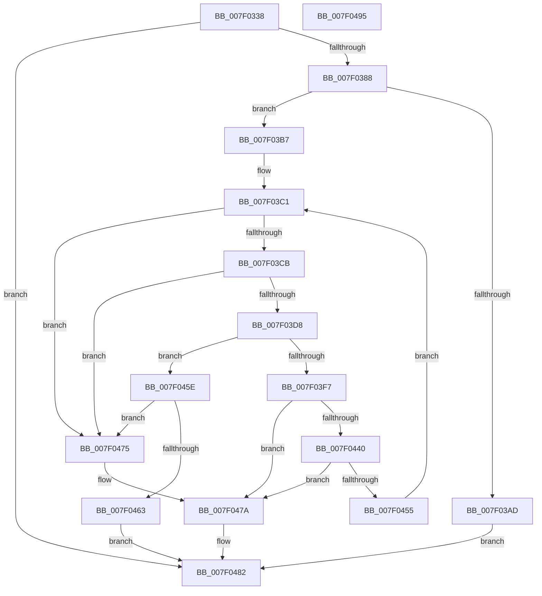

# CmpDoReadTxRBigLogRecord

- RVA: `0x007F0338`–`0x007F0496` (길이 `350` bytes)
- VA: `0x00000001407F0338`
- 실행 섹션: `PAGE`
- PDB 이름 있음: `예`; PDB Function 태그: `아니요`
- unwind 정보 RVA: `0x000D714C`
- 디코드: `105`개 명령, `350/350` bytes 표시
- 미해석 바이트: `0` (있으면 어셈블리에 `.byte`로 보존)

> 이 문서는 커널 이미지의 기계어와 PDB 기호를 분석해 생성했습니다. 4번과 5번은 함수 원형과 자료형을 바이너리 사용 방식에서 추정한 C 해석이며 원본 소스 복구 결과는 아닙니다.

## 1. Dependencies

- 직접 호출 지점: **6**; 고유 호출 대상: **5**
- 직접 호출자로 확인된 함수: **1**
- RIP 상대 이미지 참조: **1**

### Outgoing calls
- `0x007F0379` → [CmpVerifyBigLogRecordChunk](CmpVerifyBigLogRecordChunk_function_007F10A0.md) (function, `0x007F10A0`)
- `0x007F03A0` → [CmpAllocatePool](../../text/3C/CmpAllocatePool_function_003CD504.md) (function, `0x003CD504`)
- `0x007F03E2` → [memcpy](../../text/6C/memcpy_function_006C6840.md) (function, `0x006C6840`)
- `0x007F042E` → `ext-ms-win-fs-clfs-l1-1-0.dll!ClfsReadNextLogRecord` (import, 간접 대상; import `ext-ms-win-fs-clfs-l1-1-0.dll!ClfsReadNextLogRecord`)
- `0x007F044A` → [CmpVerifyBigLogRecordChunk](CmpVerifyBigLogRecordChunk_function_007F10A0.md) (function, `0x007F10A0`)
- `0x007F047D` → [CmSiFreeMemory](../../text/47/CmSiFreeMemory_function_00475D80.md) (function, `0x00475D80`)

### Direct callers
- [CmpRmReDoPhase](CmpRmReDoPhase_function_007F0794.md) at `0x007F088C`

### Static image references
- `0x007F042E` → RVA `0x001511D0` (`ext-ms-win-fs-clfs-l1-1-0.dll!ClfsReadNextLogRecord (IAT)`; read)

## 2. Other-region calls and transfers

- 다른 실행 섹션으로 향하는 call: **3**
  - `0x007F03A0` → [CmpAllocatePool](../../text/3C/CmpAllocatePool_function_003CD504.md) (`PAGE` → `.text`)
  - `0x007F03E2` → [memcpy](../../text/6C/memcpy_function_006C6840.md) (`PAGE` → `.text`)
  - `0x007F047D` → [CmSiFreeMemory](../../text/47/CmSiFreeMemory_function_00475D80.md) (`PAGE` → `.text`)
- 별도 외부 분기/꼬리 이동을 확인하지 못했습니다.

## 3. Assembly (complete function range)

```asm
007F0338  4C 89 4C 24 20                  mov qword ptr [rsp + 0x20], r9
007F033D  48 89 4C 24 08                  mov qword ptr [rsp + 8], rcx
007F0342  55                              push rbp
007F0343  53                              push rbx
007F0344  56                              push rsi
007F0345  57                              push rdi
007F0346  41 54                           push r12
007F0348  41 55                           push r13
007F034A  41 56                           push r14
007F034C  41 57                           push r15
007F034E  48 8B EC                        mov rbp, rsp
007F0351  48 83 EC 78                     sub rsp, 0x78
007F0355  45 33 E4                        xor r12d, r12d
007F0358  48 89 55 D8                     mov qword ptr [rbp - 0x28], rdx
007F035C  48 8B FA                        mov rdi, rdx
007F035F  4C 89 65 F0                     mov qword ptr [rbp - 0x10], r12
007F0363  48 8B CF                        mov rcx, rdi
007F0366  4C 89 65 E8                     mov qword ptr [rbp - 0x18], r12
007F036A  41 8B D0                        mov edx, r8d
007F036D  4C 89 65 E0                     mov qword ptr [rbp - 0x20], r12
007F0371  44 88 65 58                     mov byte ptr [rbp + 0x58], r12b
007F0375  44 89 45 50                     mov dword ptr [rbp + 0x50], r8d
007F0379  E8 22 0D 00 00                  call 0x1407f10a0
007F037E  8B D8                           mov ebx, eax
007F0380  85 C0                           test eax, eax
007F0382  0F 88 FA 00 00 00               js 0x1407f0482
007F0388  44 8B 7F 04                     mov r15d, dword ptr [rdi + 4]
007F038C  B9 00 01 00 00                  mov ecx, 0x100
007F0391  8B 47 30                        mov eax, dword ptr [rdi + 0x30]
007F0394  41 8B D7                        mov edx, r15d
007F0397  41 B8 43 4D 20 20               mov r8d, 0x20204d43
007F039D  89 45 C8                        mov dword ptr [rbp - 0x38], eax
007F03A0  E8 5F D1 BD FF                  call 0x1403cd504
007F03A5  48 8B F0                        mov rsi, rax
007F03A8  48 85 C0                        test rax, rax
007F03AB  75 0A                           jne 0x1407f03b7
007F03AD  BB 9A 00 00 C0                  mov ebx, 0xc000009a
007F03B2  E9 CB 00 00 00                  jmp 0x1407f0482
007F03B7  45 8B EC                        mov r13d, r12d
007F03BA  48 89 45 D0                     mov qword ptr [rbp - 0x30], rax
007F03BE  45 8B F7                        mov r14d, r15d
007F03C1  44 39 6F 34                     cmp dword ptr [rdi + 0x34], r13d
007F03C5  0F 85 AA 00 00 00               jne 0x1407f0475
007F03CB  44 8B 67 38                     mov r12d, dword ptr [rdi + 0x38]
007F03CF  45 3B E6                        cmp r12d, r14d
007F03D2  0F 87 9D 00 00 00               ja 0x1407f0475
007F03D8  48 8D 57 40                     lea rdx, [rdi + 0x40]
007F03DC  45 8B C4                        mov r8d, r12d
007F03DF  48 8B C8                        mov rcx, rax
007F03E2  E8 59 64 ED FF                  call 0x1406c6840
007F03E7  4C 01 65 D0                     add qword ptr [rbp - 0x30], r12
007F03EB  45 2B F4                        sub r14d, r12d
007F03EE  41 FF C5                        inc r13d
007F03F1  44 3B 6D C8                     cmp r13d, dword ptr [rbp - 0x38]
007F03F5  73 67                           jae 0x1407f045e
007F03F7  48 8B 4D 48                     mov rcx, qword ptr [rbp + 0x48]
007F03FB  48 8D 45 E0                     lea rax, [rbp - 0x20]
007F03FF  48 89 44 24 38                  mov qword ptr [rsp + 0x38], rax
007F0404  4C 8D 4D 58                     lea r9, [rbp + 0x58]
007F0408  48 8D 45 E8                     lea rax, [rbp - 0x18]
007F040C  C6 45 58 01                     mov byte ptr [rbp + 0x58], 1
007F0410  48 89 44 24 30                  mov qword ptr [rsp + 0x30], rax
007F0415  4C 8D 45 50                     lea r8, [rbp + 0x50]
007F0419  48 8D 45 F0                     lea rax, [rbp - 0x10]
007F041D  45 33 E4                        xor r12d, r12d
007F0420  48 89 44 24 28                  mov qword ptr [rsp + 0x28], rax
007F0425  48 8D 55 D8                     lea rdx, [rbp - 0x28]
007F0429  4C 89 64 24 20                  mov qword ptr [rsp + 0x20], r12
007F042E  48 FF 15 9B 0D 96 FF            call qword ptr [rip - 0x69f265]
007F0435  0F 1F 44 00 00                  nop dword ptr [rax + rax]
007F043A  8B D8                           mov ebx, eax
007F043C  85 C0                           test eax, eax
007F043E  78 3A                           js 0x1407f047a
007F0440  48 8B 7D D8                     mov rdi, qword ptr [rbp - 0x28]
007F0444  8B 55 50                        mov edx, dword ptr [rbp + 0x50]
007F0447  48 8B CF                        mov rcx, rdi
007F044A  E8 51 0C 00 00                  call 0x1407f10a0
007F044F  8B D8                           mov ebx, eax
007F0451  85 C0                           test eax, eax
007F0453  78 25                           js 0x1407f047a
007F0455  48 8B 45 D0                     mov rax, qword ptr [rbp - 0x30]
007F0459  E9 63 FF FF FF                  jmp 0x1407f03c1
007F045E  45 85 F6                        test r14d, r14d
007F0461  75 12                           jne 0x1407f0475
007F0463  48 8B 45 60                     mov rax, qword ptr [rbp + 0x60]
007F0467  33 DB                           xor ebx, ebx
007F0469  48 89 30                        mov qword ptr [rax], rsi
007F046C  48 8B 45 68                     mov rax, qword ptr [rbp + 0x68]
007F0470  44 89 38                        mov dword ptr [rax], r15d
007F0473  EB 0D                           jmp 0x1407f0482
007F0475  BB 3E 00 00 C0                  mov ebx, 0xc000003e
007F047A  48 8B CE                        mov rcx, rsi
007F047D  E8 FE 58 C8 FF                  call 0x140475d80
007F0482  8B C3                           mov eax, ebx
007F0484  48 83 C4 78                     add rsp, 0x78
007F0488  41 5F                           pop r15
007F048A  41 5E                           pop r14
007F048C  41 5D                           pop r13
007F048E  41 5C                           pop r12
007F0490  5F                              pop rdi
007F0491  5E                              pop rsi
007F0492  5B                              pop rbx
007F0493  5D                              pop rbp
007F0494  C3                              ret
007F0495  CC                              int3
```

## 4. C-style interpretation (structured pseudocode)

```c
__int64 __fastcall CmpDoReadTxRBigLogRecord(__int64 a1, __int64 a2, int a3, __int64 a4, __int64 a5)
{
    __int64 result;
    __int64 v_r12;
    __int64 v_r13;
    __int64 v_r14;
    __int64 v_rbx;
    __int64 v_rsp;
    unsigned __int64 v_stack_m50;
    unsigned __int64 v_stack_m58;
    unsigned __int64 v_stack_m60;
    unsigned __int64 v_stack_m68;
    unsigned __int64 v_stack_m70;
    unsigned int v_stack_m78;
    unsigned __int64 v_stack_m80;
    unsigned __int64 v_stack_m88;
    unsigned __int64 v_stack_m90;
    unsigned __int64 v_stack_m98;
    unsigned int v_stack_p10;
    unsigned __int8 v_stack_p18;
    unsigned __int64 v_stack_p20;
    unsigned __int64 v_stack_p8;

    v_stack_p20 = a4;
    v_stack_p8 = a1;
    v_rsp = (v_rsp) - (120);
    v_r12 = 0;
    v_stack_m68 = a2;
    v_stack_m50 = 0;
    v_stack_m58 = 0;
    v_stack_m60 = 0;
    v_stack_p18 = 0;
    v_stack_p10 = a3;
    result = CmpVerifyBigLogRecordChunk(a2, (unsigned int)(a3), a3, a4);
    if (sign_flag) goto loc_007F0482;
    v_stack_m78 = (unsigned int)((unsigned int)(*(unsigned int *)(a2 + 48)));
    result = CmpAllocatePool(256, (unsigned int)((unsigned int)((unsigned int)(*(unsigned int *)(a2 + 4)))), (unsigned int)(0x20204D43ULL), a4);
    if (result != 0) goto loc_007F03B7;
    goto loc_007F0482;
loc_007F03B7:
    v_stack_m70 = result;
loc_007F03C1:
    if ((*(unsigned int *)(a2 + 52)) != 0) goto loc_007F0475;
    if (((unsigned int)((unsigned int)(*(unsigned int *)(a2 + 56)))) > ((unsigned int)((unsigned int)((unsigned int)((unsigned int)(*(unsigned int *)(a2 + 4))))))) goto loc_007F0475;
    result = memcpy(result, a2 + 64, (unsigned int)((unsigned int)((unsigned int)(*(unsigned int *)(a2 + 56)))), a4);
    v_r14 = (unsigned int)(((unsigned int)((unsigned int)((unsigned int)(*(unsigned int *)(a2 + 4))))) - ((unsigned int)((unsigned int)(*(unsigned int *)(a2 + 56)))));
    v_r13 = (unsigned int)((0) + 1);
    if (((unsigned int)(v_r13)) >= v_stack_m78) goto loc_007F045E;
    v_stack_m80 = v_stack_m60;
    v_stack_p18 = 1;
    v_stack_m88 = v_stack_m58;
    v_r12 = 0;
    v_stack_m90 = v_stack_m50;
    v_stack_m98 = 0;
    result = ext_ms_win_fs_clfs_l1_1_0_dll_ClfsReadNextLogRecord(v_stack_p8, v_stack_m68, v_stack_p10, v_stack_p18);
    if (sign_flag) goto loc_007F047A;
    result = CmpVerifyBigLogRecordChunk(v_stack_m68, (unsigned int)(v_stack_p10), v_stack_p10, v_stack_p18);
    if (sign_flag) goto loc_007F047A;
    goto loc_007F03C1;
loc_007F045E:
    if ((unsigned int)(v_r14) != 0) goto loc_007F0475;
    v_rbx = 0;
    *(unsigned __int64 *)(v_stack_p20) = result;
    *(unsigned int *)(a5) = (unsigned int)((unsigned int)(*(unsigned int *)(a2 + 4)));
    goto loc_007F0482;
loc_007F0475:
loc_007F047A:
    result = CmSiFreeMemory(result, (unsigned int)(v_stack_p10), v_stack_p10, v_stack_p18);
loc_007F0482:
    v_rsp = (v_rsp) + (120);
    return (unsigned int)((unsigned int)((unsigned int)(0xC000003EULL)));
}
```

## 5. (Beta) C Style

```c
int64_t CmpDoReadTxRBigLogRecord(int64_t Arg1, void *Arg2, int32_t Arg3, int64_t Arg4, void *Arg5)
{
    uint8_t *arg2 = (uint8_t *)Arg2;
    uint8_t *arg5 = (uint8_t *)Arg5;

    int64_t result;
    int64_t local_r12;
    int64_t local_r13;
    int64_t local_r14;
    int64_t local_rbx;
    int64_t local_rsp;
    uint64_t v_stack_m50;
    uint64_t v_stack_m58;
    uint64_t v_stack_m60;
    uint64_t v_stack_m68;
    uint64_t v_stack_m70;
    uint32_t v_stack_m78;
    uint64_t v_stack_m80;
    uint64_t v_stack_m88;
    uint64_t v_stack_m90;
    uint64_t v_stack_m98;
    uint32_t v_stack_p10;
    uint8_t v_stack_p18;
    uint64_t v_stack_p20;
    uint64_t v_stack_p8;

    v_stack_p20 = Arg4;
    v_stack_p8 = Arg1;
    local_rsp = (local_rsp) - (120);
    local_r12 = 0;
    v_stack_m68 = Arg2;
    v_stack_m50 = 0;
    v_stack_m58 = 0;
    v_stack_m60 = 0;
    v_stack_p18 = 0;
    v_stack_p10 = Arg3;
    result = CmpVerifyBigLogRecordChunk(Arg2, (uint32_t)(Arg3), Arg3, Arg4);
    if (sign_flag) goto loc_007F0482;
    v_stack_m78 = (uint32_t)((uint32_t)(*(uint32_t *)(arg2 + 0x30)));
    result = CmpAllocatePool(256, (uint32_t)((uint32_t)((uint32_t)(*(uint32_t *)(arg2 + 0x4)))), (uint32_t)(0x20204D43ULL), Arg4);
    if (result != 0) goto loc_007F03B7;
    goto loc_007F0482;
loc_007F03B7:
    v_stack_m70 = result;
loc_007F03C1:
    if ((*(uint32_t *)(arg2 + 0x34)) != 0) goto loc_007F0475;
    if (((uint32_t)((uint32_t)(*(uint32_t *)(arg2 + 0x38)))) > ((uint32_t)((uint32_t)((uint32_t)((uint32_t)(*(uint32_t *)(arg2 + 0x4))))))) goto loc_007F0475;
    result = memcpy(result, Arg2 + 64, (uint32_t)((uint32_t)((uint32_t)(*(uint32_t *)(arg2 + 0x38)))), Arg4);
    local_r14 = (uint32_t)(((uint32_t)((uint32_t)((uint32_t)(*(uint32_t *)(arg2 + 0x4))))) - ((uint32_t)((uint32_t)(*(uint32_t *)(arg2 + 0x38)))));
    local_r13 = (uint32_t)((0) + 1);
    if (((uint32_t)(local_r13)) >= v_stack_m78) goto loc_007F045E;
    v_stack_m80 = v_stack_m60;
    v_stack_p18 = 1;
    v_stack_m88 = v_stack_m58;
    local_r12 = 0;
    v_stack_m90 = v_stack_m50;
    v_stack_m98 = 0;
    result = kernel_indirect_call(v_stack_p8, v_stack_m68, v_stack_p10, v_stack_p18);
    if (sign_flag) goto loc_007F047A;
    result = CmpVerifyBigLogRecordChunk(v_stack_m68, (uint32_t)(v_stack_p10), v_stack_p10, v_stack_p18);
    if (sign_flag) goto loc_007F047A;
    goto loc_007F03C1;
loc_007F045E:
    if ((uint32_t)(local_r14) != 0) goto loc_007F0475;
    local_rbx = 0;
    *(uint64_t *)(v_stack_p20) = result;
    *(uint32_t *)(arg5) = (uint32_t)((uint32_t)(*(uint32_t *)(arg2 + 0x4)));
    goto loc_007F0482;
loc_007F0475:
loc_007F047A:
    result = CmSiFreeMemory(result, (uint32_t)(v_stack_p10), v_stack_p10, v_stack_p18);
loc_007F0482:
    local_rsp = (local_rsp) + (120);
    return (uint32_t)((uint32_t)((uint32_t)(0xC000003EULL)));
}
```

### 관측된 메모리 오프셋

구조체 형식이 확인되지 않은 접근은 인자 기준의 오프셋으로만 기록했습니다.

| 기준 인자 | 오프셋 표현 | 폭 (bit) | 접근 |
|---|---:|---:|---|
| `Arg2` | `+ 0x4` | `32` | `R` |
| `Arg2` | `+ 0x30` | `32` | `R` |
| `Arg5` | `+ 0x0` | `32` | `W` |

## 6. Execution-region graph

[열기: 2D/3D 그래프와 함수 탐색 컨트롤 패널](../../../control-panel.html?section=page&rva=0x007F0338&view=graph)

- 2D 그래프는 위에서 아래로 흐르고, 3D 그래프는 빈 공간을 드래그해 회전합니다. Shift+드래그는 이동, 휠은 확대·축소, 함수 노드 선택은 대상 보고서 이동입니다.

### Static fallback


