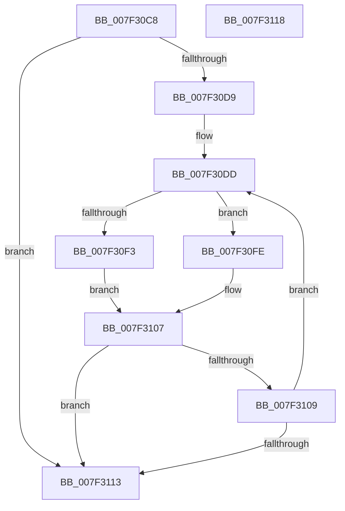

# CmpFindCellInIndex

- RVA: `0x007F30C8`–`0x007F3119` (길이 `81` bytes)
- VA: `0x00000001407F30C8`
- 실행 섹션: `PAGE`
- PDB 이름 있음: `예`; PDB Function 태그: `아니요`
- unwind 정보 RVA: `0x000DB714`
- 디코드: `24`개 명령, `81/81` bytes 표시
- 미해석 바이트: `0` (있으면 어셈블리에 `.byte`로 보존)

> 이 문서는 커널 이미지의 기계어와 PDB 기호를 분석해 생성했습니다. 4번과 5번은 함수 원형과 자료형을 바이너리 사용 방식에서 추정한 C 해석이며 원본 소스 복구 결과는 아닙니다.

## 1. Dependencies

- 직접 호출 지점: **0**; 고유 호출 대상: **0**
- 직접 호출자로 확인된 함수: **1**
- RIP 상대 이미지 참조: **0**

### Outgoing calls
- 직접 디코드된 call 명령이 없습니다.

### Direct callers
- [CmpRemoveSubKeyCellNoCellRef](CmpRemoveSubKeyCellNoCellRef_function_007F3284.md) at `0x007F33A1`
- [CmpRemoveSubKeyCellNoCellRef](CmpRemoveSubKeyCellNoCellRef_function_007F3284.md) at `0x007F33FE`
- [CmpRemoveSubKeyCellNoCellRef](CmpRemoveSubKeyCellNoCellRef_function_007F3284.md) at `0x007F34DB`

### Static image references
- 디코드된 RIP-relative 메모리 참조가 없습니다.

## 2. Other-region calls and transfers

- 다른 실행 섹션으로 향하는 call: **0**
- 별도 외부 분기/꼬리 이동을 확인하지 못했습니다.

## 3. Assembly (complete function range)

```asm
007F30C8  44 0F B7 51 02                  movzx r10d, word ptr [rcx + 2]
007F30CD  45 33 C0                        xor r8d, r8d
007F30D0  4C 8B C9                        mov r9, rcx
007F30D3  66 45 3B C2                     cmp r8w, r10w
007F30D7  73 3A                           jae 0x1407f3113
007F30D9  44 0F B7 19                     movzx r11d, word ptr [rcx]
007F30DD  B9 6C 66 00 00                  mov ecx, 0x666c
007F30E2  41 0F B7 C3                     movzx eax, r11w
007F30E6  66 2B C1                        sub ax, cx
007F30E9  B9 FF FD 00 00                  mov ecx, 0xfdff
007F30EE  66 85 C1                        test cx, ax
007F30F1  74 0B                           je 0x1407f30fe
007F30F3  41 0F B7 C0                     movzx eax, r8w
007F30F7  41 39 54 81 04                  cmp dword ptr [r9 + rax*4 + 4], edx
007F30FC  EB 09                           jmp 0x1407f3107
007F30FE  41 0F B7 C8                     movzx ecx, r8w
007F3102  41 39 54 C9 04                  cmp dword ptr [r9 + rcx*8 + 4], edx
007F3107  74 0A                           je 0x1407f3113
007F3109  66 41 FF C0                     inc r8w
007F310D  66 45 3B C2                     cmp r8w, r10w
007F3111  72 CA                           jb 0x1407f30dd
007F3113  41 0F B7 C0                     movzx eax, r8w
007F3117  C3                              ret
007F3118  CC                              int3
```

## 4. C-style interpretation (structured pseudocode)

```c
__int64 __fastcall CmpFindCellInIndex(__int64 a1, int a2, int a3)
{
    __int64 result;

    a3 = 0;
    if (0 >= ((unsigned __int16)(*(unsigned __int16 *)(a1 + 2)))) goto loc_007F3113;
loc_007F30DD:
    result = (unsigned __int16)(((unsigned __int16)(*(unsigned __int16 *)(a1))) - ((unsigned __int16)((unsigned int)(0x666CULL))));
    if ((((unsigned __int16)((unsigned int)(0xFDFFULL))) & ((unsigned __int16)(result))) == 0) goto loc_007F30FE;
    goto loc_007F3107;
loc_007F30FE:
loc_007F3107:
    if ((*(unsigned int *)(a1 + 0 * 8 + 4)) == a2) goto loc_007F3113;
    a3 = (unsigned __int16)((a3) + 1);
    if (((unsigned __int16)(a3)) < ((unsigned __int16)(*(unsigned __int16 *)(a1 + 2)))) goto loc_007F30DD;
loc_007F3113:
    return (unsigned __int16)(a3);
}
```

## 5. (Beta) C Style

```c
int64_t CmpFindCellInIndex(void *Arg1, int32_t Arg2, int32_t Arg3)
{
    uint8_t *arg1 = (uint8_t *)Arg1;

    int64_t result;

    Arg3 = 0;
    if (0 >= ((uint16_t)(*(uint16_t *)(arg1 + 0x2)))) goto loc_007F3113;
loc_007F30DD:
    result = (uint16_t)(((uint16_t)(*(uint16_t *)(arg1))) - ((uint16_t)((uint32_t)(0x666CULL))));
    if ((((uint16_t)((uint32_t)(0xFDFFULL))) & ((uint16_t)(result))) == 0) goto loc_007F30FE;
    goto loc_007F3107;
loc_007F30FE:
loc_007F3107:
    if ((*(uint32_t *)(arg1 + 0x0 * 8 + 0x4)) == Arg2) goto loc_007F3113;
    Arg3 = (uint16_t)((Arg3) + 1);
    if (((uint16_t)(Arg3)) < ((uint16_t)(*(uint16_t *)(arg1 + 0x2)))) goto loc_007F30DD;
loc_007F3113:
    return (uint16_t)(Arg3);
}
```

### 관측된 메모리 오프셋

구조체 형식이 확인되지 않은 접근은 인자 기준의 오프셋으로만 기록했습니다.

| 기준 인자 | 오프셋 표현 | 폭 (bit) | 접근 |
|---|---:|---:|---|
| `Arg1` | `+ 0x0` | `16` | `R` |
| `Arg1` | `+ 0x2` | `16` | `R` |
| `Arg1` | `+ 0x4 + rax*4` | `32` | `R` |
| `Arg1` | `+ 0x4 + rcx*8` | `32` | `R` |

## 6. Execution-region graph

[열기: 2D/3D 그래프와 함수 탐색 컨트롤 패널](../../../control-panel.html?section=page&rva=0x007F30C8&view=graph)

- 2D 그래프는 위에서 아래로 흐르고, 3D 그래프는 빈 공간을 드래그해 회전합니다. Shift+드래그는 이동, 휠은 확대·축소, 함수 노드 선택은 대상 보고서 이동입니다.

### Static fallback


