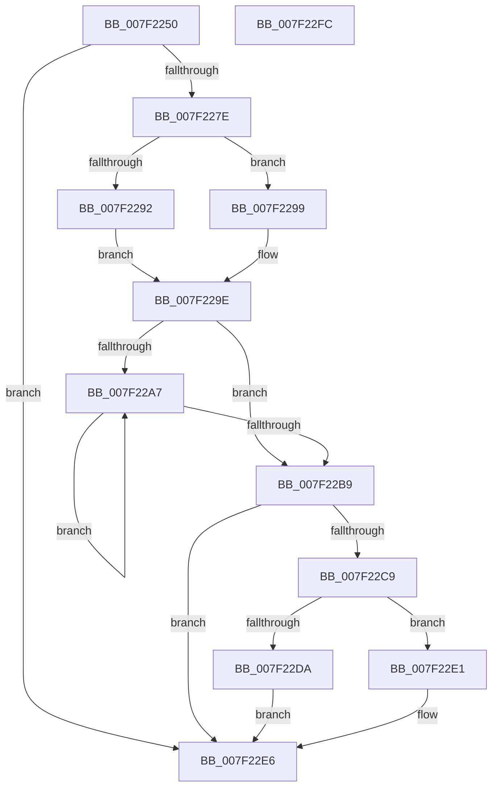

# CmpFreeKeyValueList

- RVA: `0x007F2250`–`0x007F22FD` (길이 `173` bytes)
- VA: `0x00000001407F2250`
- 실행 섹션: `PAGE`
- PDB 이름 있음: `예`; PDB Function 태그: `아니요`
- unwind 정보 RVA: `0x0008CED4`
- 디코드: `50`개 명령, `173/173` bytes 표시
- 미해석 바이트: `0` (있으면 어셈블리에 `.byte`로 보존)

> 이 문서는 커널 이미지의 기계어와 PDB 기호를 분석해 생성했습니다. 4번과 5번은 함수 원형과 자료형을 바이너리 사용 방식에서 추정한 C 해석이며 원본 소스 복구 결과는 아닙니다.

## 1. Dependencies

- 직접 호출 지점: **7**; 고유 호출 대상: **7**
- 직접 호출자로 확인된 함수: **2**
- RIP 상대 이미지 참조: **0**

### Outgoing calls
- `0x007F2274` → [HvpGetCellContextInitialize](../85/HvpGetCellContextInitialize_function_00855F10.md) (function, `0x00855F10`)
- `0x007F2292` → [HvpGetCellFlat](../85/HvpGetCellFlat_function_00854C60.md) (function, `0x00854C60`)
- `0x007F2299` → [HvpGetCellPaged](../85/HvpGetCellPaged_function_00854CB0.md) (function, `0x00854CB0`)
- `0x007F22AE` → [CmpFreeValue](../84/CmpFreeValue_function_0084AF98.md) (function, `0x0084AF98`)
- `0x007F22BF` → [HvFreeCell](../85/HvFreeCell_function_0085A72C.md) (function, `0x0085A72C`)
- `0x007F22DA` → [HvpReleaseCellFlat](../85/HvpReleaseCellFlat_function_0085CC20.md) (function, `0x0085CC20`)
- `0x007F22E1` → [HvpReleaseCellPaged](../85/HvpReleaseCellPaged_function_00855F40.md) (function, `0x00855F40`)

### Direct callers
- [CmpSyncKeyValues](CmpSyncKeyValues_function_007F2DF4.md) at `0x007F3070`
- [CmpFullPromoteSingleKeyFromKeyNodeStacks](../8B/CmpFullPromoteSingleKeyFromKeyNodeStacks_function_008B1A40.md) at `0x008B1ED3`

### Static image references
- 디코드된 RIP-relative 메모리 참조가 없습니다.

## 2. Other-region calls and transfers

- 다른 실행 섹션으로 향하는 call: **0**
- 별도 외부 분기/꼬리 이동을 확인하지 못했습니다.

## 3. Assembly (complete function range)

```asm
007F2250  48 8B C4                        mov rax, rsp
007F2253  48 89 58 08                     mov qword ptr [rax + 8], rbx
007F2257  48 89 70 18                     mov qword ptr [rax + 0x18], rsi
007F225B  48 89 78 20                     mov qword ptr [rax + 0x20], rdi
007F225F  41 56                           push r14
007F2261  48 83 EC 20                     sub rsp, 0x20
007F2265  48 83 60 10 00                  and qword ptr [rax + 0x10], 0
007F226A  48 8B D9                        mov rbx, rcx
007F226D  48 8D 48 10                     lea rcx, [rax + 0x10]
007F2271  48 8B FA                        mov rdi, rdx
007F2274  E8 97 3C 06 00                  call 0x140855f10
007F2279  83 3A 00                        cmp dword ptr [rdx], 0
007F227C  74 68                           je 0x1407f22e6
007F227E  F6 83 8C 00 00 00 01            test byte ptr [rbx + 0x8c], 1
007F2285  4C 8D 44 24 38                  lea r8, [rsp + 0x38]
007F228A  8B 52 04                        mov edx, dword ptr [rdx + 4]
007F228D  48 8B CB                        mov rcx, rbx
007F2290  74 07                           je 0x1407f2299
007F2292  E8 C9 29 06 00                  call 0x140854c60
007F2297  EB 05                           jmp 0x1407f229e
007F2299  E8 12 2A 06 00                  call 0x140854cb0
007F229E  33 F6                           xor esi, esi
007F22A0  4C 8B F0                        mov r14, rax
007F22A3  39 37                           cmp dword ptr [rdi], esi
007F22A5  76 12                           jbe 0x1407f22b9
007F22A7  41 8B 14 B6                     mov edx, dword ptr [r14 + rsi*4]
007F22AB  48 8B CB                        mov rcx, rbx
007F22AE  E8 E5 8C 05 00                  call 0x14084af98
007F22B3  FF C6                           inc esi
007F22B5  3B 37                           cmp esi, dword ptr [rdi]
007F22B7  72 EE                           jb 0x1407f22a7
007F22B9  8B 57 04                        mov edx, dword ptr [rdi + 4]
007F22BC  48 8B CB                        mov rcx, rbx
007F22BF  E8 68 84 06 00                  call 0x14085a72c
007F22C4  4D 85 F6                        test r14, r14
007F22C7  74 1D                           je 0x1407f22e6
007F22C9  F6 83 8C 00 00 00 01            test byte ptr [rbx + 0x8c], 1
007F22D0  48 8D 54 24 38                  lea rdx, [rsp + 0x38]
007F22D5  48 8B CB                        mov rcx, rbx
007F22D8  74 07                           je 0x1407f22e1
007F22DA  E8 41 A9 06 00                  call 0x14085cc20
007F22DF  EB 05                           jmp 0x1407f22e6
007F22E1  E8 5A 3C 06 00                  call 0x140855f40
007F22E6  48 8B 5C 24 30                  mov rbx, qword ptr [rsp + 0x30]
007F22EB  48 8B 74 24 40                  mov rsi, qword ptr [rsp + 0x40]
007F22F0  48 8B 7C 24 48                  mov rdi, qword ptr [rsp + 0x48]
007F22F5  48 83 C4 20                     add rsp, 0x20
007F22F9  41 5E                           pop r14
007F22FB  C3                              ret
007F22FC  CC                              int3
```

## 4. C-style interpretation (structured pseudocode)

```c
__int64 __fastcall CmpFreeKeyValueList(__int64 a1, __int64 a2)
{
    __int64 result;
    __int64 v_rsi;
    __int64 v_rsp;
    unsigned __int64 v_stack_p10;
    unsigned __int64 v_stack_p18;
    unsigned __int64 v_stack_p20;
    unsigned __int64 v_stack_p8;

    *(unsigned __int64 *)(v_rsp + 8) = v_rbx;
    *(unsigned __int64 *)(v_rsp + 24) = v_rsi;
    *(unsigned __int64 *)(v_rsp + 32) = v_rdi;
    v_rsp = (v_rsp) - (32);
    result = HvpGetCellContextInitialize(v_rsp + 16, a2, a3, a4);
    if ((*(unsigned int *)(a2)) == 0) goto loc_007F22E6;
    if (((*(unsigned __int8 *)(a1 + 140)) & (1)) == 0) goto loc_007F2299;
    result = HvpGetCellFlat(a1, (unsigned int)(*(unsigned int *)(a2 + 4)), v_stack_p10, a4);
    goto loc_007F229E;
loc_007F2299:
    result = HvpGetCellPaged(a1, (unsigned int)(*(unsigned int *)(a2 + 4)), v_stack_p10, a4);
loc_007F229E:
    v_rsi = 0;
    if ((*(unsigned int *)(a2)) <= 0) goto loc_007F22B9;
loc_007F22A7:
    result = CmpFreeValue(a1, (unsigned int)(*(unsigned int *)(result + v_rsi * 4)), v_stack_p10, a4);
    v_rsi = (unsigned int)((v_rsi) + 1);
    if (((unsigned int)(v_rsi)) < (*(unsigned int *)(a2))) goto loc_007F22A7;
loc_007F22B9:
    result = HvFreeCell(a1, (unsigned int)(*(unsigned int *)(a2 + 4)), v_stack_p10, a4);
    if (result == 0) goto loc_007F22E6;
    if (((*(unsigned __int8 *)(a1 + 140)) & (1)) == 0) goto loc_007F22E1;
    result = HvpReleaseCellFlat(a1, v_stack_p10, v_stack_p10, a4);
    goto loc_007F22E6;
loc_007F22E1:
    result = HvpReleaseCellPaged(a1, v_stack_p10, v_stack_p10, a4);
loc_007F22E6:
    v_rsp = (v_rsp) + (32);
    return result;
}
```

## 5. (Beta) C Style

```c
int64_t CmpFreeKeyValueList(void *Arg1, void *Arg2)
{
    uint8_t *arg1 = (uint8_t *)Arg1;
    uint8_t *arg2 = (uint8_t *)Arg2;

    int64_t result;
    int64_t local_rsi;
    int64_t local_rsp;
    uint64_t v_stack_p10;
    uint64_t v_stack_p18;
    uint64_t v_stack_p20;
    uint64_t v_stack_p8;

    *(uint64_t *)(local_rsp + 0x8) = local_rbx;
    *(uint64_t *)(local_rsp + 0x18) = local_rsi;
    *(uint64_t *)(local_rsp + 0x20) = local_rdi;
    local_rsp = (local_rsp) - (32);
    result = HvpGetCellContextInitialize(local_rsp + 16, Arg2, a3, a4);
    if ((*(uint32_t *)(arg2)) == 0) goto loc_007F22E6;
    if (((*(uint8_t *)(arg1 + 0x8C)) & (1)) == 0) goto loc_007F2299;
    result = HvpGetCellFlat(Arg1, (uint32_t)(*(uint32_t *)(arg2 + 0x4)), v_stack_p10, a4);
    goto loc_007F229E;
loc_007F2299:
    result = HvpGetCellPaged(Arg1, (uint32_t)(*(uint32_t *)(arg2 + 0x4)), v_stack_p10, a4);
loc_007F229E:
    local_rsi = 0;
    if ((*(uint32_t *)(arg2)) <= 0) goto loc_007F22B9;
loc_007F22A7:
    result = CmpFreeValue(Arg1, (uint32_t)(*(uint32_t *)(result + local_rsi * 4)), v_stack_p10, a4);
    local_rsi = (uint32_t)((local_rsi) + 1);
    if (((uint32_t)(local_rsi)) < (*(uint32_t *)(arg2))) goto loc_007F22A7;
loc_007F22B9:
    result = HvFreeCell(Arg1, (uint32_t)(*(uint32_t *)(arg2 + 0x4)), v_stack_p10, a4);
    if (result == 0) goto loc_007F22E6;
    if (((*(uint8_t *)(arg1 + 0x8C)) & (1)) == 0) goto loc_007F22E1;
    result = HvpReleaseCellFlat(Arg1, v_stack_p10, v_stack_p10, a4);
    goto loc_007F22E6;
loc_007F22E1:
    result = HvpReleaseCellPaged(Arg1, v_stack_p10, v_stack_p10, a4);
loc_007F22E6:
    local_rsp = (local_rsp) + (32);
    return result;
}
```

### 관측된 메모리 오프셋

구조체 형식이 확인되지 않은 접근은 인자 기준의 오프셋으로만 기록했습니다.

| 기준 인자 | 오프셋 표현 | 폭 (bit) | 접근 |
|---|---:|---:|---|
| `Arg1` | `+ 0x8C` | `8` | `R` |
| `Arg2` | `+ 0x0` | `32` | `R` |
| `Arg2` | `+ 0x4` | `32` | `R` |

## 6. Execution-region graph

[열기: 2D/3D 그래프와 함수 탐색 컨트롤 패널](../../../control-panel.html?section=page&rva=0x007F2250&view=graph)

- 2D 그래프는 위에서 아래로 흐르고, 3D 그래프는 빈 공간을 드래그해 회전합니다. Shift+드래그는 이동, 휠은 확대·축소, 함수 노드 선택은 대상 보고서 이동입니다.

### Static fallback


