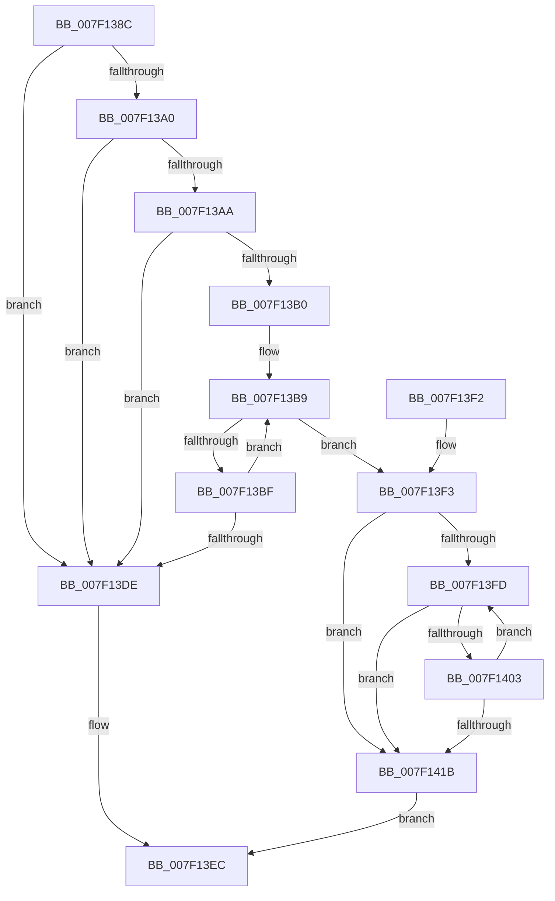

# CmpGetNextName

- RVA: `0x007F138C`–`0x007F1443` (길이 `183` bytes)
- VA: `0x00000001407F138C`
- 실행 섹션: `PAGE`
- PDB 이름 있음: `예`; PDB Function 태그: `아니요`
- unwind 정보 RVA: `0x000D71C8`
- 디코드: `53`개 명령, `183/183` bytes 표시
- 미해석 바이트: `0` (있으면 어셈블리에 `.byte`로 보존)

> 이 문서는 커널 이미지의 기계어와 PDB 기호를 분석해 생성했습니다. 4번과 5번은 함수 원형과 자료형을 바이너리 사용 방식에서 추정한 C 해석이며 원본 소스 복구 결과는 아닙니다.

## 1. Dependencies

- 직접 호출 지점: **0**; 고유 호출 대상: **0**
- 직접 호출자로 확인된 함수: **3**
- RIP 상대 이미지 참조: **0**

### Outgoing calls
- 직접 디코드된 call 명령이 없습니다.

### Direct callers
- [CmpWalkUnicodeStringPath](CmpWalkUnicodeStringPath_function_007F3704.md) at `0x007F373D`
- [CmpFindHiveSubKey](../../init/C5/CmpFindHiveSubKey_function_00C5C398.md) at `0x00C5C3EE`
- [CmpGetKnownHivePathNode](../../init/C5/CmpGetKnownHivePathNode_function_00C5C85C.md) at `0x00C5C8C3`

### Static image references
- 디코드된 RIP-relative 메모리 참조가 없습니다.

## 2. Other-region calls and transfers

- 다른 실행 섹션으로 향하는 call: **0**
- 별도 외부 분기/꼬리 이동을 확인하지 못했습니다.

## 3. Assembly (complete function range)

```asm
007F138C  48 89 5C 24 08                  mov qword ptr [rsp + 8], rbx
007F1391  48 8B 41 08                     mov rax, qword ptr [rcx + 8]
007F1395  45 33 DB                        xor r11d, r11d
007F1398  4C 8B D2                        mov r10, rdx
007F139B  48 85 C0                        test rax, rax
007F139E  74 3E                           je 0x1407f13de
007F13A0  44 0F B7 09                     movzx r9d, word ptr [rcx]
007F13A4  66 45 85 C9                     test r9w, r9w
007F13A8  74 34                           je 0x1407f13de
007F13AA  66 44 39 18                     cmp word ptr [rax], r11w
007F13AE  74 2E                           je 0x1407f13de
007F13B0  41 0F B7 D1                     movzx edx, r9w
007F13B4  BB FE FF 00 00                  mov ebx, 0xfffe
007F13B9  66 83 38 5C                     cmp word ptr [rax], 0x5c
007F13BD  75 34                           jne 0x1407f13f3
007F13BF  66 01 59 02                     add word ptr [rcx + 2], bx
007F13C3  66 41 83 E9 02                  sub r9w, 2
007F13C8  48 83 C0 02                     add rax, 2
007F13CC  66 44 89 09                     mov word ptr [rcx], r9w
007F13D0  48 89 41 08                     mov qword ptr [rcx + 8], rax
007F13D4  41 0F B7 D1                     movzx edx, r9w
007F13D8  66 45 85 C9                     test r9w, r9w
007F13DC  75 DB                           jne 0x1407f13b9
007F13DE  41 C6 00 01                     mov byte ptr [r8], 1
007F13E2  B0 01                           mov al, 1
007F13E4  4D 89 5A 08                     mov qword ptr [r10 + 8], r11
007F13E8  66 45 89 1A                     mov word ptr [r10], r11w
007F13EC  48 8B 5C 24 08                  mov rbx, qword ptr [rsp + 8]
007F13F1  C3                              ret
007F13F2  CC                              int3
007F13F3  49 89 42 08                     mov qword ptr [r10 + 8], rax
007F13F7  66 45 85 C9                     test r9w, r9w
007F13FB  74 1E                           je 0x1407f141b
007F13FD  66 83 38 5C                     cmp word ptr [rax], 0x5c
007F1401  74 18                           je 0x1407f141b
007F1403  66 01 59 02                     add word ptr [rcx + 2], bx
007F1407  48 83 C0 02                     add rax, 2
007F140B  66 83 EA 02                     sub dx, 2
007F140F  48 89 41 08                     mov qword ptr [rcx + 8], rax
007F1413  66 89 11                        mov word ptr [rcx], dx
007F1416  66 85 D2                        test dx, dx
007F1419  75 E2                           jne 0x1407f13fd
007F141B  0F B7 49 08                     movzx ecx, word ptr [rcx + 8]
007F141F  66 41 2B 4A 08                  sub cx, word ptr [r10 + 8]
007F1424  66 85 D2                        test dx, dx
007F1427  66 41 89 0A                     mov word ptr [r10], cx
007F142B  66 41 89 4A 02                  mov word ptr [r10 + 2], cx
007F1430  0F 94 C0                        sete al
007F1433  41 88 00                        mov byte ptr [r8], al
007F1436  B8 00 02 00 00                  mov eax, 0x200
007F143B  66 3B C8                        cmp cx, ax
007F143E  0F 96 C0                        setbe al
007F1441  EB A9                           jmp 0x1407f13ec
```

## 4. C-style interpretation (structured pseudocode)

```c
__int64 __fastcall CmpGetNextName(__int64 a1, __int64 a2, __int64 a3)
{
    __int64 result;
    __int64 v_r11;
    unsigned __int64 v_stack_p8;

    v_stack_p8 = v_rbx;
    v_r11 = 0;
    if (*(unsigned __int64 *)(a1 + 8) == 0) goto loc_007F13DE;
    if ((unsigned __int16)(*(unsigned __int16 *)(a1)) == 0) goto loc_007F13DE;
    if ((*(unsigned __int16 *)(*(unsigned __int64 *)(a1 + 8))) == 0) goto loc_007F13DE;
loc_007F13B9:
    if ((*(unsigned __int16 *)(*(unsigned __int64 *)(a1 + 8))) != 92) goto loc_007F13F3;
    a4 = (unsigned __int16)((*(unsigned __int16 *)(a1)) - (2));
    result = (*(unsigned __int64 *)(a1 + 8)) + (2);
    *(unsigned __int16 *)(a1) = (unsigned __int16)(a4);
    *(unsigned __int64 *)(a1 + 8) = result;
    if ((unsigned __int16)(a4) != 0) goto loc_007F13B9;
loc_007F13DE:
    *(unsigned __int8 *)(a3) = 1;
    *(unsigned __int64 *)(a2 + 8) = 0;
    *(unsigned __int16 *)(a2) = 0;
loc_007F13EC:
    return 1;
loc_007F13F3:
    *(unsigned __int64 *)(a2 + 8) = 1;
    if ((unsigned __int16)(a4) == 0) goto loc_007F141B;
loc_007F13FD:
    if ((*(unsigned __int16 *)(1)) == 92) goto loc_007F141B;
    result = (1) + (2);
    a2 = (unsigned __int16)(((unsigned __int16)(a4)) - (2));
    *(unsigned __int64 *)(a1 + 8) = result;
    *(unsigned __int16 *)(a1) = (unsigned __int16)(a2);
    if ((unsigned __int16)(a2) != 0) goto loc_007F13FD;
loc_007F141B:
    a1 = (unsigned __int16)((*(unsigned __int16 *)(a1 + 8)) - (*(unsigned __int16 *)(a2 + 8)));
    *(unsigned __int16 *)(a2) = (unsigned __int16)(a1);
    *(unsigned __int16 *)(a2 + 2) = (unsigned __int16)(a1);
    result = ((unsigned __int16)(a2) == 0) ? 1 : 0;
    *(unsigned __int8 *)(a3) = (unsigned __int8)(result);
    result = (((unsigned __int16)(a1)) <= 512) ? 1 : 0;
    goto loc_007F13EC;
}
```

## 5. (Beta) C Style

```c
int64_t CmpGetNextName(void *Arg1, void *Arg2, void *Arg3)
{
    uint8_t *arg1 = (uint8_t *)Arg1;
    uint8_t *arg2 = (uint8_t *)Arg2;
    uint8_t *arg3 = (uint8_t *)Arg3;

    int64_t result;
    int64_t local_r11;
    uint64_t v_stack_p8;

    v_stack_p8 = local_rbx;
    local_r11 = 0;
    if (*(uint64_t *)(arg1 + 0x8) == 0) goto loc_007F13DE;
    if ((uint16_t)(*(uint16_t *)(arg1)) == 0) goto loc_007F13DE;
    if ((*(uint16_t *)(*(uint64_t *)(arg1 + 0x8))) == 0) goto loc_007F13DE;
loc_007F13B9:
    if ((*(uint16_t *)(*(uint64_t *)(arg1 + 0x8))) != 92) goto loc_007F13F3;
    a4 = (uint16_t)((*(uint16_t *)(arg1)) - (2));
    result = (*(uint64_t *)(arg1 + 0x8)) + (2);
    *(uint16_t *)(arg1) = (uint16_t)(a4);
    *(uint64_t *)(arg1 + 0x8) = result;
    if ((uint16_t)(a4) != 0) goto loc_007F13B9;
loc_007F13DE:
    *(uint8_t *)(arg3) = 1;
    *(uint64_t *)(arg2 + 0x8) = 0;
    *(uint16_t *)(arg2) = 0;
loc_007F13EC:
    return 1;
loc_007F13F3:
    *(uint64_t *)(arg2 + 0x8) = 1;
    if ((uint16_t)(a4) == 0) goto loc_007F141B;
loc_007F13FD:
    if ((*(uint16_t *)(1)) == 92) goto loc_007F141B;
    result = (1) + (2);
    Arg2 = (uint16_t)(((uint16_t)(a4)) - (2));
    *(uint64_t *)(arg1 + 0x8) = result;
    *(uint16_t *)(arg1) = (uint16_t)(Arg2);
    if ((uint16_t)(Arg2) != 0) goto loc_007F13FD;
loc_007F141B:
    Arg1 = (uint16_t)((*(uint16_t *)(arg1 + 0x8)) - (*(uint16_t *)(arg2 + 0x8)));
    *(uint16_t *)(arg2) = (uint16_t)(Arg1);
    *(uint16_t *)(arg2 + 0x2) = (uint16_t)(Arg1);
    result = ((uint16_t)(Arg2) == 0) ? 1 : 0;
    *(uint8_t *)(arg3) = (uint8_t)(result);
    result = (((uint16_t)(Arg1)) <= 512) ? 1 : 0;
    goto loc_007F13EC;
}
```

### 관측된 메모리 오프셋

구조체 형식이 확인되지 않은 접근은 인자 기준의 오프셋으로만 기록했습니다.

| 기준 인자 | 오프셋 표현 | 폭 (bit) | 접근 |
|---|---:|---:|---|
| `Arg1` | `+ 0x0` | `16` | `R` |
| `Arg1` | `+ 0x0` | `16` | `W` |
| `Arg1` | `+ 0x2` | `16` | `R/W` |
| `Arg1` | `+ 0x8` | `16` | `R` |
| `Arg1` | `+ 0x8` | `64` | `R` |
| `Arg1` | `+ 0x8` | `64` | `W` |
| `Arg2` | `+ 0x0` | `16` | `W` |
| `Arg2` | `+ 0x2` | `16` | `W` |
| `Arg2` | `+ 0x8` | `16` | `R` |
| `Arg2` | `+ 0x8` | `64` | `W` |
| `Arg3` | `+ 0x0` | `8` | `W` |

## 6. Execution-region graph

[열기: 2D/3D 그래프와 함수 탐색 컨트롤 패널](../../../control-panel.html?section=page&rva=0x007F138C&view=graph)

- 2D 그래프는 위에서 아래로 흐르고, 3D 그래프는 빈 공간을 드래그해 회전합니다. Shift+드래그는 이동, 휠은 확대·축소, 함수 노드 선택은 대상 보고서 이동입니다.

### Static fallback


