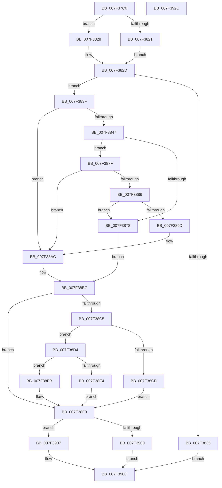

# CmpGetValueForAudit

- RVA: `0x007F37C0`–`0x007F392D` (길이 `365` bytes)
- VA: `0x00000001407F37C0`
- 실행 섹션: `PAGE`
- PDB 이름 있음: `예`; PDB Function 태그: `아니요`
- unwind 정보 RVA: `0x000BD7D8`
- 디코드: `108`개 명령, `365/365` bytes 표시
- 미해석 바이트: `0` (있으면 어셈블리에 `.byte`로 보존)

> 이 문서는 커널 이미지의 기계어와 PDB 기호를 분석해 생성했습니다. 4번과 5번은 함수 원형과 자료형을 바이너리 사용 방식에서 추정한 C 해석이며 원본 소스 복구 결과는 아닙니다.

## 1. Dependencies

- 직접 호출 지점: **12**; 고유 호출 대상: **9**
- 직접 호출자로 확인된 함수: **2**
- RIP 상대 이미지 참조: **0**

### Outgoing calls
- `0x007F3800` → [HvpGetCellContextInitialize](../85/HvpGetCellContextInitialize_function_00855F10.md) (function, `0x00855F10`)
- `0x007F380C` → [HvpGetCellContextInitialize](../85/HvpGetCellContextInitialize_function_00855F10.md) (function, `0x00855F10`)
- `0x007F3821` → [HvpGetCellFlat](../85/HvpGetCellFlat_function_00854C60.md) (function, `0x00854C60`)
- `0x007F3828` → [HvpGetCellPaged](../85/HvpGetCellPaged_function_00854CB0.md) (function, `0x00854CB0`)
- `0x007F386F` → [CmpGetValueData](../85/CmpGetValueData_function_00856DB0.md) (function, `0x00856DB0`)
- `0x007F3890` → [CmpAllocatePool](../../text/3C/CmpAllocatePool_function_003CD504.md) (function, `0x003CD504`)
- `0x007F38A7` → [memcpy](../../text/6C/memcpy_function_006C6840.md) (function, `0x006C6840`)
- `0x007F38CD` → [ExFreePoolWithTag](../../poolcode/B8/ExFreePoolWithTag_function_00B82870.md) (function, `0x00B82870`)
- `0x007F38E4` → [HvpReleaseCellFlat](../85/HvpReleaseCellFlat_function_0085CC20.md) (function, `0x0085CC20`)
- `0x007F38EB` → [HvpReleaseCellPaged](../85/HvpReleaseCellPaged_function_00855F40.md) (function, `0x00855F40`)
- `0x007F3900` → [HvpReleaseCellFlat](../85/HvpReleaseCellFlat_function_0085CC20.md) (function, `0x0085CC20`)
- `0x007F3907` → [HvpReleaseCellPaged](../85/HvpReleaseCellPaged_function_00855F40.md) (function, `0x00855F40`)

### Direct callers
- [CmDeleteValueKey](../84/CmDeleteValueKey_function_008476E8.md) at `0x00848317`
- [sub_00B160F4](../B1/Unknown_function_00B160F4.md) at `0x00B16260`

### Static image references
- 디코드된 RIP-relative 메모리 참조가 없습니다.

## 2. Other-region calls and transfers

- 다른 실행 섹션으로 향하는 call: **3**
  - `0x007F3890` → [CmpAllocatePool](../../text/3C/CmpAllocatePool_function_003CD504.md) (`PAGE` → `.text`)
  - `0x007F38A7` → [memcpy](../../text/6C/memcpy_function_006C6840.md) (`PAGE` → `.text`)
  - `0x007F38CD` → [ExFreePoolWithTag](../../poolcode/B8/ExFreePoolWithTag_function_00B82870.md) (`PAGE` → `POOLCODE`)
- 별도 외부 분기/꼬리 이동을 확인하지 못했습니다.

## 3. Assembly (complete function range)

```asm
007F37C0  48 89 5C 24 10                  mov qword ptr [rsp + 0x10], rbx
007F37C5  48 89 74 24 18                  mov qword ptr [rsp + 0x18], rsi
007F37CA  48 89 7C 24 20                  mov qword ptr [rsp + 0x20], rdi
007F37CF  55                              push rbp
007F37D0  41 54                           push r12
007F37D2  41 55                           push r13
007F37D4  41 56                           push r14
007F37D6  41 57                           push r15
007F37D8  48 8B EC                        mov rbp, rsp
007F37DB  48 83 EC 60                     sub rsp, 0x60
007F37DF  33 DB                           xor ebx, ebx
007F37E1  48 8B F9                        mov rdi, rcx
007F37E4  48 8D 4D F0                     lea rcx, [rbp - 0x10]
007F37E8  48 89 5D F0                     mov qword ptr [rbp - 0x10], rbx
007F37EC  48 89 5D E8                     mov qword ptr [rbp - 0x18], rbx
007F37F0  45 8B E9                        mov r13d, r9d
007F37F3  48 89 5D F8                     mov qword ptr [rbp - 8], rbx
007F37F7  4D 8B F8                        mov r15, r8
007F37FA  88 5D 30                        mov byte ptr [rbp + 0x30], bl
007F37FD  44 8B E2                        mov r12d, edx
007F3800  E8 0B 27 06 00                  call 0x140855f10
007F3805  48 8D 4D E8                     lea rcx, [rbp - 0x18]
007F3809  44 8B F3                        mov r14d, ebx
007F380C  E8 FF 26 06 00                  call 0x140855f10
007F3811  F6 87 8C 00 00 00 01            test byte ptr [rdi + 0x8c], 1
007F3818  4C 8D 45 E8                     lea r8, [rbp - 0x18]
007F381C  48 8B CF                        mov rcx, rdi
007F381F  74 07                           je 0x1407f3828
007F3821  E8 3A 14 06 00                  call 0x140854c60
007F3826  EB 05                           jmp 0x1407f382d
007F3828  E8 83 14 06 00                  call 0x140854cb0
007F382D  48 8B F0                        mov rsi, rax
007F3830  48 85 C0                        test rax, rax
007F3833  75 0A                           jne 0x1407f383f
007F3835  BB 9A 00 00 C0                  mov ebx, 0xc000009a
007F383A  E9 CD 00 00 00                  jmp 0x1407f390c
007F383F  89 5D E0                        mov dword ptr [rbp - 0x20], ebx
007F3842  39 5E 04                        cmp dword ptr [rsi + 4], ebx
007F3845  74 65                           je 0x1407f38ac
007F3847  48 8D 45 F0                     lea rax, [rbp - 0x10]
007F384B  4C 8B C6                        mov r8, rsi
007F384E  48 89 44 24 30                  mov qword ptr [rsp + 0x30], rax
007F3853  4C 8D 4D E0                     lea r9, [rbp - 0x20]
007F3857  48 8D 45 30                     lea rax, [rbp + 0x30]
007F385B  41 8B D4                        mov edx, r12d
007F385E  48 89 44 24 28                  mov qword ptr [rsp + 0x28], rax
007F3863  48 8B CF                        mov rcx, rdi
007F3866  48 8D 45 F8                     lea rax, [rbp - 8]
007F386A  48 89 44 24 20                  mov qword ptr [rsp + 0x20], rax
007F386F  E8 3C 35 06 00                  call 0x140856db0
007F3874  84 C0                           test al, al
007F3876  75 07                           jne 0x1407f387f
007F3878  BB 9A 00 00 C0                  mov ebx, 0xc000009a
007F387D  EB 3D                           jmp 0x1407f38bc
007F387F  8B 5D E0                        mov ebx, dword ptr [rbp - 0x20]
007F3882  85 DB                           test ebx, ebx
007F3884  74 26                           je 0x1407f38ac
007F3886  45 8B C5                        mov r8d, r13d
007F3889  8B D3                           mov edx, ebx
007F388B  B9 00 01 00 00                  mov ecx, 0x100
007F3890  E8 6F 9C BD FF                  call 0x1403cd504
007F3895  4C 8B F0                        mov r14, rax
007F3898  48 85 C0                        test rax, rax
007F389B  74 DB                           je 0x1407f3878
007F389D  48 8B 55 F8                     mov rdx, qword ptr [rbp - 8]
007F38A1  44 8B C3                        mov r8d, ebx
007F38A4  48 8B C8                        mov rcx, rax
007F38A7  E8 94 2F ED FF                  call 0x1406c6840
007F38AC  8B 46 0C                        mov eax, dword ptr [rsi + 0xc]
007F38AF  41 89 5F 04                     mov dword ptr [r15 + 4], ebx
007F38B3  33 DB                           xor ebx, ebx
007F38B5  41 89 07                        mov dword ptr [r15], eax
007F38B8  4D 89 77 08                     mov qword ptr [r15 + 8], r14
007F38BC  48 8B 4D F8                     mov rcx, qword ptr [rbp - 8]
007F38C0  48 85 C9                        test rcx, rcx
007F38C3  74 2B                           je 0x1407f38f0
007F38C5  80 7D 30 00                     cmp byte ptr [rbp + 0x30], 0
007F38C9  74 09                           je 0x1407f38d4
007F38CB  33 D2                           xor edx, edx
007F38CD  E8 9E EF 38 00                  call 0x140b82870
007F38D2  EB 1C                           jmp 0x1407f38f0
007F38D4  F6 87 8C 00 00 00 01            test byte ptr [rdi + 0x8c], 1
007F38DB  48 8D 55 F0                     lea rdx, [rbp - 0x10]
007F38DF  48 8B CF                        mov rcx, rdi
007F38E2  74 07                           je 0x1407f38eb
007F38E4  E8 37 93 06 00                  call 0x14085cc20
007F38E9  EB 05                           jmp 0x1407f38f0
007F38EB  E8 50 26 06 00                  call 0x140855f40
007F38F0  F6 87 8C 00 00 00 01            test byte ptr [rdi + 0x8c], 1
007F38F7  48 8D 55 E8                     lea rdx, [rbp - 0x18]
007F38FB  48 8B CF                        mov rcx, rdi
007F38FE  74 07                           je 0x1407f3907
007F3900  E8 1B 93 06 00                  call 0x14085cc20
007F3905  EB 05                           jmp 0x1407f390c
007F3907  E8 34 26 06 00                  call 0x140855f40
007F390C  4C 8D 5C 24 60                  lea r11, [rsp + 0x60]
007F3911  8B C3                           mov eax, ebx
007F3913  49 8B 5B 38                     mov rbx, qword ptr [r11 + 0x38]
007F3917  49 8B 73 40                     mov rsi, qword ptr [r11 + 0x40]
007F391B  49 8B 7B 48                     mov rdi, qword ptr [r11 + 0x48]
007F391F  49 8B E3                        mov rsp, r11
007F3922  41 5F                           pop r15
007F3924  41 5E                           pop r14
007F3926  41 5D                           pop r13
007F3928  41 5C                           pop r12
007F392A  5D                              pop rbp
007F392B  C3                              ret
007F392C  CC                              int3
```

## 4. C-style interpretation (structured pseudocode)

```c
__int64 __fastcall CmpGetValueForAudit(__int64 a1, int a2, __int64 a3, int a4)
{
    __int64 result;
    __int64 v_rbx;
    __int64 v_rsp;
    unsigned __int64 v_stack_m28;
    unsigned __int64 v_stack_m30;
    unsigned __int64 v_stack_m38;
    unsigned __int64 v_stack_m40;
    unsigned int v_stack_m48;
    unsigned __int64 v_stack_m58;
    unsigned __int64 v_stack_m60;
    unsigned __int64 v_stack_m68;
    unsigned __int64 v_stack_p10;
    unsigned __int64 v_stack_p18;
    unsigned __int64 v_stack_p20;
    unsigned __int8 v_stack_p8;

    v_stack_p10 = v_rbx;
    v_stack_p18 = v_rsi;
    v_stack_p20 = v_rdi;
    v_rsp = (v_rsp) - (96);
    v_rbx = 0;
    v_stack_m38 = 0;
    v_stack_m40 = 0;
    v_stack_m30 = 0;
    v_stack_p8 = 0;
    result = HvpGetCellContextInitialize(v_stack_m38, a2, a3, a4);
    result = HvpGetCellContextInitialize(v_stack_m40, a2, a3, a4);
    if (((*(unsigned __int8 *)(a1 + 140)) & (1)) == 0) goto loc_007F3828;
    result = HvpGetCellFlat(a1, a2, v_stack_m40, a4);
    goto loc_007F382D;
loc_007F3828:
    result = HvpGetCellPaged(a1, a2, v_stack_m40, a4);
loc_007F382D:
    if (result != 0) goto loc_007F383F;
    goto loc_007F390C;
loc_007F383F:
    v_stack_m48 = (unsigned int)((unsigned int)(0xC000009AULL));
    if ((*(unsigned int *)(result + 4)) == ((unsigned int)((unsigned int)(0xC000009AULL)))) goto loc_007F38AC;
    v_stack_m58 = v_stack_m38;
    v_stack_m60 = v_stack_p8;
    v_stack_m68 = v_stack_m30;
    result = CmpGetValueData(a1, (unsigned int)((unsigned int)((unsigned int)(a2))), result, v_stack_m48);
    if ((unsigned __int8)(result) != 0) goto loc_007F387F;
loc_007F3878:
    goto loc_007F38BC;
loc_007F387F:
    if ((unsigned int)((unsigned int)(v_stack_m48)) == 0) goto loc_007F38AC;
    result = CmpAllocatePool(256, (unsigned int)((unsigned int)((unsigned int)(v_stack_m48))), (unsigned int)((unsigned int)((unsigned int)(a4))), v_stack_m48);
    if (result == 0) goto loc_007F3878;
    result = memcpy(result, v_stack_m30, (unsigned int)((unsigned int)((unsigned int)(v_stack_m48))), v_stack_m48);
loc_007F38AC:
    *(unsigned int *)(a3 + 4) = (unsigned int)((unsigned int)(v_stack_m48));
    v_rbx = 0;
    *(unsigned int *)(a3) = (unsigned int)((unsigned int)(*(unsigned int *)(result + 12)));
    *(unsigned __int64 *)(a3 + 8) = result;
loc_007F38BC:
    if (v_stack_m30 == 0) goto loc_007F38F0;
    if (v_stack_p8 == 0) goto loc_007F38D4;
    a2 = 0;
    result = ExFreePoolWithTag(v_stack_m30, a2, (unsigned int)((unsigned int)((unsigned int)(v_stack_m48))), v_stack_m48);
    goto loc_007F38F0;
loc_007F38D4:
    if (((*(unsigned __int8 *)(a1 + 140)) & (1)) == 0) goto loc_007F38EB;
    result = HvpReleaseCellFlat(a1, v_stack_m38, (unsigned int)((unsigned int)((unsigned int)(v_stack_m48))), v_stack_m48);
    goto loc_007F38F0;
loc_007F38EB:
    result = HvpReleaseCellPaged(a1, v_stack_m38, (unsigned int)((unsigned int)((unsigned int)(v_stack_m48))), v_stack_m48);
loc_007F38F0:
    if (((*(unsigned __int8 *)(a1 + 140)) & (1)) == 0) goto loc_007F3907;
    result = HvpReleaseCellFlat(a1, v_stack_m40, (unsigned int)((unsigned int)((unsigned int)(v_stack_m48))), v_stack_m48);
    goto loc_007F390C;
loc_007F3907:
    result = HvpReleaseCellPaged(a1, v_stack_m40, (unsigned int)((unsigned int)((unsigned int)(v_stack_m48))), v_stack_m48);
loc_007F390C:
    return 0;
}
```

## 5. (Beta) C Style

```c
int64_t CmpGetValueForAudit(void *Arg1, int32_t Arg2, void *Arg3, int32_t Arg4)
{
    uint8_t *arg1 = (uint8_t *)Arg1;
    uint8_t *arg3 = (uint8_t *)Arg3;

    int64_t result;
    int64_t local_rbx;
    int64_t local_rsp;
    uint64_t v_stack_m28;
    uint64_t v_stack_m30;
    uint64_t v_stack_m38;
    uint64_t v_stack_m40;
    uint32_t v_stack_m48;
    uint64_t v_stack_m58;
    uint64_t v_stack_m60;
    uint64_t v_stack_m68;
    uint64_t v_stack_p10;
    uint64_t v_stack_p18;
    uint64_t v_stack_p20;
    uint8_t v_stack_p8;

    v_stack_p10 = local_rbx;
    v_stack_p18 = local_rsi;
    v_stack_p20 = local_rdi;
    local_rsp = (local_rsp) - (96);
    local_rbx = 0;
    v_stack_m38 = 0;
    v_stack_m40 = 0;
    v_stack_m30 = 0;
    v_stack_p8 = 0;
    result = HvpGetCellContextInitialize(v_stack_m38, Arg2, Arg3, Arg4);
    result = HvpGetCellContextInitialize(v_stack_m40, Arg2, Arg3, Arg4);
    if (((*(uint8_t *)(arg1 + 0x8C)) & (1)) == 0) goto loc_007F3828;
    result = HvpGetCellFlat(Arg1, Arg2, v_stack_m40, Arg4);
    goto loc_007F382D;
loc_007F3828:
    result = HvpGetCellPaged(Arg1, Arg2, v_stack_m40, Arg4);
loc_007F382D:
    if (result != 0) goto loc_007F383F;
    goto loc_007F390C;
loc_007F383F:
    v_stack_m48 = (uint32_t)((uint32_t)(0xC000009AULL));
    if ((*(uint32_t *)(result + 0x4)) == ((uint32_t)((uint32_t)(0xC000009AULL)))) goto loc_007F38AC;
    v_stack_m58 = v_stack_m38;
    v_stack_m60 = v_stack_p8;
    v_stack_m68 = v_stack_m30;
    result = CmpGetValueData(Arg1, (uint32_t)((uint32_t)((uint32_t)(Arg2))), result, v_stack_m48);
    if ((uint8_t)(result) != 0) goto loc_007F387F;
loc_007F3878:
    goto loc_007F38BC;
loc_007F387F:
    if ((uint32_t)((uint32_t)(v_stack_m48)) == 0) goto loc_007F38AC;
    result = CmpAllocatePool(256, (uint32_t)((uint32_t)((uint32_t)(v_stack_m48))), (uint32_t)((uint32_t)((uint32_t)(Arg4))), v_stack_m48);
    if (result == 0) goto loc_007F3878;
    result = memcpy(result, v_stack_m30, (uint32_t)((uint32_t)((uint32_t)(v_stack_m48))), v_stack_m48);
loc_007F38AC:
    *(uint32_t *)(arg3 + 0x4) = (uint32_t)((uint32_t)(v_stack_m48));
    local_rbx = 0;
    *(uint32_t *)(arg3) = (uint32_t)((uint32_t)(*(uint32_t *)(result + 0xC)));
    *(uint64_t *)(arg3 + 0x8) = result;
loc_007F38BC:
    if (v_stack_m30 == 0) goto loc_007F38F0;
    if (v_stack_p8 == 0) goto loc_007F38D4;
    Arg2 = 0;
    result = ExFreePoolWithTag(v_stack_m30, Arg2, (uint32_t)((uint32_t)((uint32_t)(v_stack_m48))), v_stack_m48);
    goto loc_007F38F0;
loc_007F38D4:
    if (((*(uint8_t *)(arg1 + 0x8C)) & (1)) == 0) goto loc_007F38EB;
    result = HvpReleaseCellFlat(Arg1, v_stack_m38, (uint32_t)((uint32_t)((uint32_t)(v_stack_m48))), v_stack_m48);
    goto loc_007F38F0;
loc_007F38EB:
    result = HvpReleaseCellPaged(Arg1, v_stack_m38, (uint32_t)((uint32_t)((uint32_t)(v_stack_m48))), v_stack_m48);
loc_007F38F0:
    if (((*(uint8_t *)(arg1 + 0x8C)) & (1)) == 0) goto loc_007F3907;
    result = HvpReleaseCellFlat(Arg1, v_stack_m40, (uint32_t)((uint32_t)((uint32_t)(v_stack_m48))), v_stack_m48);
    goto loc_007F390C;
loc_007F3907:
    result = HvpReleaseCellPaged(Arg1, v_stack_m40, (uint32_t)((uint32_t)((uint32_t)(v_stack_m48))), v_stack_m48);
loc_007F390C:
    return 0;
}
```

### 관측된 메모리 오프셋

구조체 형식이 확인되지 않은 접근은 인자 기준의 오프셋으로만 기록했습니다.

| 기준 인자 | 오프셋 표현 | 폭 (bit) | 접근 |
|---|---:|---:|---|
| `Arg1` | `+ 0x8C` | `8` | `R` |
| `Arg3` | `+ 0x0` | `32` | `W` |
| `Arg3` | `+ 0x4` | `32` | `W` |
| `Arg3` | `+ 0x8` | `64` | `W` |

## 6. Execution-region graph

[열기: 2D/3D 그래프와 함수 탐색 컨트롤 패널](../../../control-panel.html?section=page&rva=0x007F37C0&view=graph)

- 2D 그래프는 위에서 아래로 흐르고, 3D 그래프는 빈 공간을 드래그해 회전합니다. Shift+드래그는 이동, 휠은 확대·축소, 함수 노드 선택은 대상 보고서 이동입니다.

### Static fallback


