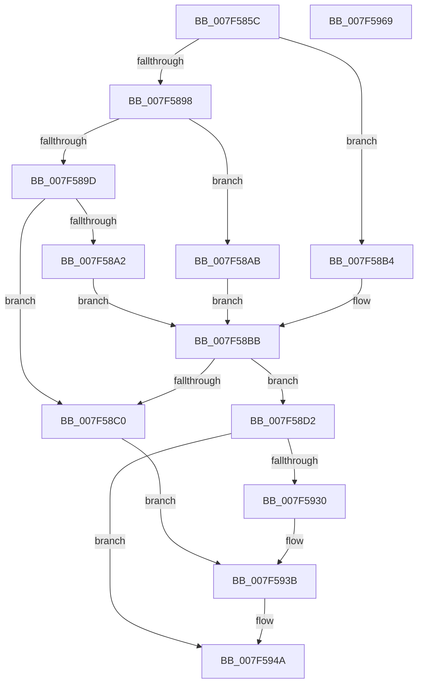

# CmpHiveCacheAcknowledgeOplockBreak

- RVA: `0x007F585C`–`0x007F596A` (길이 `270` bytes)
- VA: `0x00000001407F585C`
- 실행 섹션: `PAGE`
- PDB 이름 있음: `예`; PDB Function 태그: `아니요`
- unwind 정보 RVA: `0x000D74C8`
- 디코드: `68`개 명령, `270/270` bytes 표시
- 미해석 바이트: `0` (있으면 어셈블리에 `.byte`로 보존)

> 이 문서는 커널 이미지의 기계어와 PDB 기호를 분석해 생성했습니다. 4번과 5번은 함수 원형과 자료형을 바이너리 사용 방식에서 추정한 C 해석이며 원본 소스 복구 결과는 아닙니다.

## 1. Dependencies

- 직접 호출 지점: **3**; 고유 호출 대상: **3**
- 직접 호출자로 확인된 함수: **1**
- RIP 상대 이미지 참조: **1**

### Outgoing calls
- `0x007F5925` → [ZwFsControlFile](../../text/6A/ZwFsControlFile_function_006AD7F0.md) (function, `0x006AD7F0`)
- `0x007F5945` → [SetFailureLocation](../../text/46/SetFailureLocation_function_0046EF54.md) (function, `0x0046EF54`)
- `0x007F5953` → [_security_check_cookie](../../text/6A/_security_check_cookie_function_006AC640.md) (function, `0x006AC640`)

### Direct callers
- [CmpHiveCachePopulateHiveEntryThread](CmpHiveCachePopulateHiveEntryThread_function_007F5FD0.md) at `0x007F6338`

### Static image references
- `0x007F586E` → RVA `0x00E0A740` (`.data`; read)

## 2. Other-region calls and transfers

- 다른 실행 섹션으로 향하는 call: **3**
  - `0x007F5925` → [ZwFsControlFile](../../text/6A/ZwFsControlFile_function_006AD7F0.md) (`PAGE` → `.text`)
  - `0x007F5945` → [SetFailureLocation](../../text/46/SetFailureLocation_function_0046EF54.md) (`PAGE` → `.text`)
  - `0x007F5953` → [_security_check_cookie](../../text/6A/_security_check_cookie_function_006AC640.md) (`PAGE` → `.text`)
- 별도 외부 분기/꼬리 이동을 확인하지 못했습니다.

## 3. Assembly (complete function range)

```asm
007F585C  48 89 5C 24 10                  mov qword ptr [rsp + 0x10], rbx
007F5861  55                              push rbp
007F5862  48 8D 6C 24 A9                  lea rbp, [rsp - 0x57]
007F5867  48 81 EC 90 00 00 00            sub rsp, 0x90
007F586E  48 8B 05 CB 4E 61 00            mov rax, qword ptr [rip + 0x614ecb]
007F5875  48 33 C4                        xor rax, rsp
007F5878  48 89 45 4F                     mov qword ptr [rbp + 0x4f], rax
007F587C  33 C0                           xor eax, eax
007F587E  0F 57 C0                        xorps xmm0, xmm0
007F5881  48 89 45 47                     mov qword ptr [rbp + 0x47], rax
007F5885  48 89 45 27                     mov qword ptr [rbp + 0x27], rax
007F5889  89 45 2F                        mov dword ptr [rbp + 0x2f], eax
007F588C  0F 11 45 37                     movups xmmword ptr [rbp + 0x37], xmm0
007F5890  0F 11 45 17                     movups xmmword ptr [rbp + 0x17], xmm0
007F5894  85 D2                           test edx, edx
007F5896  74 1C                           je 0x1407f58b4
007F5898  83 EA 01                        sub edx, 1
007F589B  74 0E                           je 0x1407f58ab
007F589D  83 FA 01                        cmp edx, 1
007F58A0  75 1E                           jne 0x1407f58c0
007F58A2  48 8B 89 C0 00 00 00            mov rcx, qword ptr [rcx + 0xc0]
007F58A9  EB 10                           jmp 0x1407f58bb
007F58AB  48 8B 89 B8 00 00 00            mov rcx, qword ptr [rcx + 0xb8]
007F58B2  EB 07                           jmp 0x1407f58bb
007F58B4  48 8B 89 B0 00 00 00            mov rcx, qword ptr [rcx + 0xb0]
007F58BB  48 85 C9                        test rcx, rcx
007F58BE  75 12                           jne 0x1407f58d2
007F58C0  BB 0D 00 00 C0                  mov ebx, 0xc000000d
007F58C5  C7 44 24 20 10 00 00 00         mov dword ptr [rsp + 0x20], 0x10
007F58CD  44 8B CB                        mov r9d, ebx
007F58D0  EB 69                           jmp 0x1407f593b
007F58D2  21 45 2B                        and dword ptr [rbp + 0x2b], eax
007F58D5  BA 0C 00 00 00                  mov edx, 0xc
007F58DA  45 33 C9                        xor r9d, r9d
007F58DD  C7 45 27 01 00 0C 00            mov dword ptr [rbp + 0x27], 0xc0001
007F58E4  45 33 C0                        xor r8d, r8d
007F58E7  C7 45 2F 02 00 00 00            mov dword ptr [rbp + 0x2f], 2
007F58EE  C7 45 37 01 00 18 00            mov dword ptr [rbp + 0x37], 0x180001
007F58F5  8D 42 0C                        lea eax, [rdx + 0xc]
007F58F8  89 44 24 48                     mov dword ptr [rsp + 0x48], eax
007F58FC  48 8D 45 37                     lea rax, [rbp + 0x37]
007F5900  48 89 44 24 40                  mov qword ptr [rsp + 0x40], rax
007F5905  48 8D 45 27                     lea rax, [rbp + 0x27]
007F5909  89 54 24 38                     mov dword ptr [rsp + 0x38], edx
007F590D  33 D2                           xor edx, edx
007F590F  48 89 44 24 30                  mov qword ptr [rsp + 0x30], rax
007F5914  48 8D 45 17                     lea rax, [rbp + 0x17]
007F5918  C7 44 24 28 40 02 09 00         mov dword ptr [rsp + 0x28], 0x90240
007F5920  48 89 44 24 20                  mov qword ptr [rsp + 0x20], rax
007F5925  E8 C6 7E EB FF                  call 0x1406ad7f0
007F592A  8B D8                           mov ebx, eax
007F592C  85 C0                           test eax, eax
007F592E  74 1A                           je 0x1407f594a
007F5930  C7 44 24 20 20 00 00 00         mov dword ptr [rsp + 0x20], 0x20
007F5938  44 8B C8                        mov r9d, eax
007F593B  41 B8 2F 00 00 00               mov r8d, 0x2f
007F5941  33 D2                           xor edx, edx
007F5943  33 C9                           xor ecx, ecx
007F5945  E8 0A 96 C7 FF                  call 0x14046ef54
007F594A  8B C3                           mov eax, ebx
007F594C  48 8B 4D 4F                     mov rcx, qword ptr [rbp + 0x4f]
007F5950  48 33 CC                        xor rcx, rsp
007F5953  E8 E8 6C EB FF                  call 0x1406ac640
007F5958  48 8B 9C 24 A8 00 00 00         mov rbx, qword ptr [rsp + 0xa8]
007F5960  48 81 C4 90 00 00 00            add rsp, 0x90
007F5967  5D                              pop rbp
007F5968  C3                              ret
007F5969  CC                              int3
```

## 4. C-style interpretation (structured pseudocode)

```c
__int64 __fastcall CmpHiveCacheAcknowledgeOplockBreak(__int64 a1, int a2, int a3)
{
    __int64 result;
    __int64 v_rsp;
    unsigned __int64 v_stack_m10;
    unsigned __int64 v_stack_m18;
    unsigned __int64 v_stack_m28;
    unsigned int v_stack_m30;
    unsigned int v_stack_m34;
    unsigned __int64 v_stack_m38;
    unsigned __int64 v_stack_m48;
    unsigned int v_stack_m50;
    unsigned __int64 v_stack_m58;
    unsigned __int64 v_stack_m5F;
    unsigned int v_stack_m60;
    unsigned __int64 v_stack_m68;
    unsigned int v_stack_m70;
    unsigned int v_stack_m78;
    unsigned __int64 v_stack_p10;

    v_stack_p10 = v_rbx;
    v_rsp = (v_rsp) - (144);
    result = (*(unsigned __int64 *)(v_rip + 6377163)) ^ (v_rsp);
    v_stack_m10 = result;
    result = 0;
    v_stack_m18 = 0;
    v_stack_m38 = 0;
    v_stack_m30 = 0;
    v_stack_m28 = v_xmm0;
    v_stack_m48 = v_xmm0;
    if (a2 == 0) goto loc_007F58B4;
    a2 = (unsigned int)((a2) - (1));
    if (condition_is_equal) goto loc_007F58AB;
    if (a2 != 1) goto loc_007F58C0;
    goto loc_007F58BB;
loc_007F58AB:
    goto loc_007F58BB;
loc_007F58B4:
loc_007F58BB:
    if (*(unsigned __int64 *)(*(unsigned __int64 *)(*(unsigned __int64 *)(a1 + 192) + 184) + 176) != 0) goto loc_007F58D2;
loc_007F58C0:
    v_stack_m78 = 16;
    goto loc_007F593B;
loc_007F58D2:
    a4 = 0;
    v_stack_m38 = 0xC0001ULL;
    a3 = 0;
    v_stack_m30 = 2;
    v_stack_m28 = 0x180001ULL;
    v_stack_m50 = (unsigned int)(12 + 12);
    v_stack_m58 = v_stack_m28;
    v_stack_m60 = 12;
    a2 = 0;
    v_stack_m68 = v_stack_m38;
    v_stack_m70 = 0x90240ULL;
    v_stack_m78 = v_stack_m48;
    result = ZwFsControlFile(*(unsigned __int64 *)(*(unsigned __int64 *)(*(unsigned __int64 *)(a1 + 192) + 184) + 176), a2, a3, a4);
    if ((unsigned int)(result) == 0) goto loc_007F594A;
    v_stack_m78 = 32;
loc_007F593B:
    a2 = 0;
    a1 = 0;
    result = SetFailureLocation(a1, a2, 47, (unsigned int)((unsigned int)(result)));
loc_007F594A:
    a1 = (v_stack_m10) ^ (v_rsp);
    result = _security_check_cookie(a1, a2, 47, (unsigned int)((unsigned int)(result)));
    v_rsp = (v_rsp) + (144);
    return result;
}
```

## 5. (Beta) C Style

```c
int64_t CmpHiveCacheAcknowledgeOplockBreak(void *Arg1, int32_t Arg2, int32_t Arg3)
{
    uint8_t *arg1 = (uint8_t *)Arg1;

    int64_t result;
    int64_t local_rsp;
    uint64_t v_stack_m10;
    uint64_t v_stack_m18;
    uint64_t v_stack_m28;
    uint32_t v_stack_m30;
    uint32_t v_stack_m34;
    uint64_t v_stack_m38;
    uint64_t v_stack_m48;
    uint32_t v_stack_m50;
    uint64_t v_stack_m58;
    uint64_t v_stack_m5F;
    uint32_t v_stack_m60;
    uint64_t v_stack_m68;
    uint32_t v_stack_m70;
    uint32_t v_stack_m78;
    uint64_t v_stack_p10;

    v_stack_p10 = local_rbx;
    local_rsp = (local_rsp) - (144);
    result = (*(uint64_t *)(v_rip + 0x614ECB)) ^ (local_rsp);
    v_stack_m10 = result;
    result = 0;
    v_stack_m18 = 0;
    v_stack_m38 = 0;
    v_stack_m30 = 0;
    v_stack_m28 = v_xmm0;
    v_stack_m48 = v_xmm0;
    if (Arg2 == 0) goto loc_007F58B4;
    Arg2 = (uint32_t)((Arg2) - (1));
    if (condition_is_equal) goto loc_007F58AB;
    if (Arg2 != 1) goto loc_007F58C0;
    goto loc_007F58BB;
loc_007F58AB:
    goto loc_007F58BB;
loc_007F58B4:
loc_007F58BB:
    if (*(uint64_t *)(*(uint64_t *)(*(uint64_t *)(arg1 + 0xC0) + 0xB8) + 0xB0) != 0) goto loc_007F58D2;
loc_007F58C0:
    v_stack_m78 = 16;
    goto loc_007F593B;
loc_007F58D2:
    a4 = 0;
    v_stack_m38 = 0xC0001ULL;
    Arg3 = 0;
    v_stack_m30 = 2;
    v_stack_m28 = 0x180001ULL;
    v_stack_m50 = (uint32_t)(12 + 12);
    v_stack_m58 = v_stack_m28;
    v_stack_m60 = 12;
    Arg2 = 0;
    v_stack_m68 = v_stack_m38;
    v_stack_m70 = 0x90240ULL;
    v_stack_m78 = v_stack_m48;
    result = ZwFsControlFile(*(uint64_t *)(*(uint64_t *)(*(uint64_t *)(arg1 + 0xC0) + 0xB8) + 0xB0), Arg2, Arg3, a4);
    if ((uint32_t)(result) == 0) goto loc_007F594A;
    v_stack_m78 = 32;
loc_007F593B:
    Arg2 = 0;
    Arg1 = 0;
    result = SetFailureLocation(Arg1, Arg2, 47, (uint32_t)((uint32_t)(result)));
loc_007F594A:
    Arg1 = (v_stack_m10) ^ (local_rsp);
    result = _security_check_cookie(Arg1, Arg2, 47, (uint32_t)((uint32_t)(result)));
    local_rsp = (local_rsp) + (144);
    return result;
}
```

### 관측된 메모리 오프셋

구조체 형식이 확인되지 않은 접근은 인자 기준의 오프셋으로만 기록했습니다.

| 기준 인자 | 오프셋 표현 | 폭 (bit) | 접근 |
|---|---:|---:|---|
| `Arg1` | `+ 0xB0` | `64` | `R` |
| `Arg1` | `+ 0xB8` | `64` | `R` |
| `Arg1` | `+ 0xC0` | `64` | `R` |

## 6. Execution-region graph

[열기: 2D/3D 그래프와 함수 탐색 컨트롤 패널](../../../control-panel.html?section=page&rva=0x007F585C&view=graph)

- 2D 그래프는 위에서 아래로 흐르고, 3D 그래프는 빈 공간을 드래그해 회전합니다. Shift+드래그는 이동, 휠은 확대·축소, 함수 노드 선택은 대상 보고서 이동입니다.

### Static fallback


