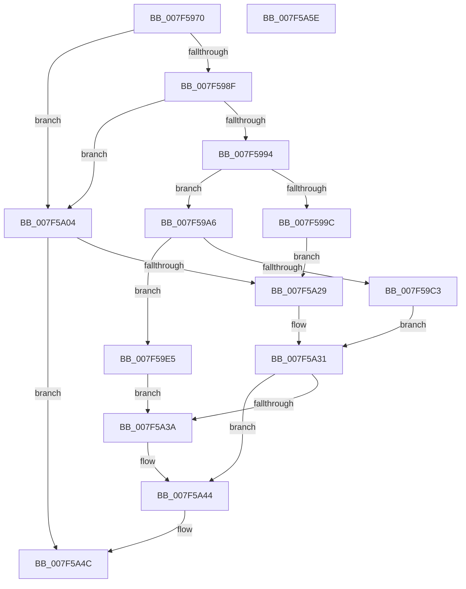

# CmpHiveCacheClaimHiveEntry

- RVA: `0x007F5970`–`0x007F5A5F` (길이 `239` bytes)
- VA: `0x00000001407F5970`
- 실행 섹션: `PAGE`
- PDB 이름 있음: `예`; PDB Function 태그: `아니요`
- unwind 정보 RVA: `0x000794E0`
- 디코드: `59`개 명령, `239/239` bytes 표시
- 미해석 바이트: `0` (있으면 어셈블리에 `.byte`로 보존)

> 이 문서는 커널 이미지의 기계어와 PDB 기호를 분석해 생성했습니다. 4번과 5번은 함수 원형과 자료형을 바이너리 사용 방식에서 추정한 C 해석이며 원본 소스 복구 결과는 아닙니다.

## 1. Dependencies

- 직접 호출 지점: **6**; 고유 호출 대상: **4**
- 직접 호출자로 확인된 함수: **1**
- RIP 상대 이미지 참조: **0**

### Outgoing calls
- `0x007F59AD` → [CmSiWaitForSingleEvent](../../text/49/CmSiWaitForSingleEvent_function_0049E4BC.md) (function, `0x0049E4BC`)
- `0x007F59B5` → [CmpHiveCacheEntryLockAcquire](CmpHiveCacheEntryLockAcquire_function_007F5CD8.md) (function, `0x007F5CD8`)
- `0x007F59DE` → [SetFailureLocation](../../text/46/SetFailureLocation_function_0046EF54.md) (function, `0x0046EF54`)
- `0x007F5A1F` → [SetFailureLocation](../../text/46/SetFailureLocation_function_0046EF54.md) (function, `0x0046EF54`)
- `0x007F5A2C` → [CmpHiveCacheEntryLockAcquire](CmpHiveCacheEntryLockAcquire_function_007F5CD8.md) (function, `0x007F5CD8`)
- `0x007F5A47` → [CmpHiveCacheEntryLockRelease](CmpHiveCacheEntryLockRelease_function_007F5D3C.md) (function, `0x007F5D3C`)

### Direct callers
- [CmpMachineHiveCacheClaimEntry](../7E/CmpMachineHiveCacheClaimEntry_function_007E8DFC.md) at `0x007E8E21`

### Static image references
- 디코드된 RIP-relative 메모리 참조가 없습니다.

## 2. Other-region calls and transfers

- 다른 실행 섹션으로 향하는 call: **3**
  - `0x007F59AD` → [CmSiWaitForSingleEvent](../../text/49/CmSiWaitForSingleEvent_function_0049E4BC.md) (`PAGE` → `.text`)
  - `0x007F59DE` → [SetFailureLocation](../../text/46/SetFailureLocation_function_0046EF54.md) (`PAGE` → `.text`)
  - `0x007F5A1F` → [SetFailureLocation](../../text/46/SetFailureLocation_function_0046EF54.md) (`PAGE` → `.text`)
- 별도 외부 분기/꼬리 이동을 확인하지 못했습니다.

## 3. Assembly (complete function range)

```asm
007F5970  48 89 5C 24 08                  mov qword ptr [rsp + 8], rbx
007F5975  48 89 74 24 10                  mov qword ptr [rsp + 0x10], rsi
007F597A  57                              push rdi
007F597B  48 83 EC 30                     sub rsp, 0x30
007F597F  49 8B F9                        mov rdi, r9
007F5982  48 8B D9                        mov rbx, rcx
007F5985  BE 01 00 00 00                  mov esi, 1
007F598A  48 85 C9                        test rcx, rcx
007F598D  74 75                           je 0x1407f5a04
007F598F  4D 85 C9                        test r9, r9
007F5992  74 70                           je 0x1407f5a04
007F5994  39 B1 50 01 00 00               cmp dword ptr [rcx + 0x150], esi
007F599A  75 0A                           jne 0x1407f59a6
007F599C  BF 02 00 00 C0                  mov edi, 0xc0000002
007F59A1  E9 83 00 00 00                  jmp 0x1407f5a29
007F59A6  48 81 C1 10 01 00 00            add rcx, 0x110
007F59AD  E8 0A 8B CA FF                  call 0x14049e4bc
007F59B2  48 8B CB                        mov rcx, rbx
007F59B5  E8 1E 03 00 00                  call 0x1407f5cd8
007F59BA  83 BB A8 00 00 00 02            cmp dword ptr [rbx + 0xa8], 2
007F59C1  74 22                           je 0x1407f59e5
007F59C3  48 8B 4C 24 60                  mov rcx, qword ptr [rsp + 0x60]
007F59C8  33 D2                           xor edx, edx
007F59CA  BF 89 01 00 C0                  mov edi, 0xc0000189
007F59CF  C7 44 24 20 20 00 00 00         mov dword ptr [rsp + 0x20], 0x20
007F59D7  44 8B CF                        mov r9d, edi
007F59DA  44 8D 42 2A                     lea r8d, [rdx + 0x2a]
007F59DE  E8 71 95 C7 FF                  call 0x14046ef54
007F59E3  EB 4C                           jmp 0x1407f5a31
007F59E5  48 8B 83 70 01 00 00            mov rax, qword ptr [rbx + 0x170]
007F59EC  48 83 A3 70 01 00 00 00         and qword ptr [rbx + 0x170], 0
007F59F4  48 89 07                        mov qword ptr [rdi], rax
007F59F7  8A 83 7C 01 00 00               mov al, byte ptr [rbx + 0x17c]
007F59FD  88 47 08                        mov byte ptr [rdi + 8], al
007F5A00  33 FF                           xor edi, edi
007F5A02  EB 36                           jmp 0x1407f5a3a
007F5A04  48 8B 4C 24 60                  mov rcx, qword ptr [rsp + 0x60]
007F5A09  33 D2                           xor edx, edx
007F5A0B  BF 0D 00 00 C0                  mov edi, 0xc000000d
007F5A10  C7 44 24 20 10 00 00 00         mov dword ptr [rsp + 0x20], 0x10
007F5A18  44 8B CF                        mov r9d, edi
007F5A1B  44 8D 42 2A                     lea r8d, [rdx + 0x2a]
007F5A1F  E8 30 95 C7 FF                  call 0x14046ef54
007F5A24  48 85 DB                        test rbx, rbx
007F5A27  74 23                           je 0x1407f5a4c
007F5A29  48 8B CB                        mov rcx, rbx
007F5A2C  E8 A7 02 00 00                  call 0x1407f5cd8
007F5A31  83 BB A8 00 00 00 04            cmp dword ptr [rbx + 0xa8], 4
007F5A38  74 0A                           je 0x1407f5a44
007F5A3A  C7 83 A8 00 00 00 03 00 00 00   mov dword ptr [rbx + 0xa8], 3
007F5A44  48 8B CB                        mov rcx, rbx
007F5A47  E8 F0 02 00 00                  call 0x1407f5d3c
007F5A4C  48 8B 5C 24 40                  mov rbx, qword ptr [rsp + 0x40]
007F5A51  8B C7                           mov eax, edi
007F5A53  48 8B 74 24 48                  mov rsi, qword ptr [rsp + 0x48]
007F5A58  48 83 C4 30                     add rsp, 0x30
007F5A5C  5F                              pop rdi
007F5A5D  C3                              ret
007F5A5E  CC                              int3
```

## 4. C-style interpretation (structured pseudocode)

```c
__int64 __fastcall CmpHiveCacheClaimHiveEntry(__int64 a1, int a2, __int64 a3, __int64 a4, __int64 a5)
{
    __int64 result;
    __int64 v_rdi;
    __int64 v_rsp;
    unsigned int v_stack_m18;
    unsigned __int64 v_stack_p10;
    unsigned __int64 v_stack_p8;

    v_stack_p8 = v_rbx;
    v_stack_p10 = v_rsi;
    v_rsp = (v_rsp) - (48);
    if (a1 == 0) goto loc_007F5A04;
    if (a4 == 0) goto loc_007F5A04;
    if ((*(unsigned int *)(a1 + 336)) != 1) goto loc_007F59A6;
    goto loc_007F5A29;
loc_007F59A6:
    a1 = (a1) + (272);
    result = CmSiWaitForSingleEvent(a1, a2, a3, a4);
    result = CmpHiveCacheEntryLockAcquire(a1, a2, a3, a4);
    if ((*(unsigned int *)(a1 + 168)) == 2) goto loc_007F59E5;
    a2 = 0;
    v_stack_m18 = 32;
    result = SetFailureLocation(a5, a2, a2 + 42, (unsigned int)((unsigned int)((unsigned int)(0xC0000189ULL))));
    goto loc_007F5A31;
loc_007F59E5:
    *(unsigned __int64 *)((unsigned int)(0xC0000189ULL)) = *(unsigned __int64 *)(a1 + 368);
    *(unsigned __int8 *)((unsigned int)(0xC0000189ULL) + 8) = (unsigned __int8)(*(unsigned __int8 *)(a1 + 380));
    v_rdi = 0;
    goto loc_007F5A3A;
loc_007F5A04:
    a2 = 0;
    v_stack_m18 = 16;
    result = SetFailureLocation(a5, a2, a2 + 42, (unsigned int)((unsigned int)((unsigned int)(0xC000000DULL))));
    if (a1 == 0) goto loc_007F5A4C;
loc_007F5A29:
    result = CmpHiveCacheEntryLockAcquire(a1, a2, a2 + 42, (unsigned int)((unsigned int)((unsigned int)(0xC000000DULL))));
loc_007F5A31:
    if ((*(unsigned int *)(a1 + 168)) != 4) {
        *(unsigned int *)(a1 + 168) = 3;
    }
    result = CmpHiveCacheEntryLockRelease(a1, a2, a2 + 42, (unsigned int)((unsigned int)((unsigned int)(0xC000000DULL))));
loc_007F5A4C:
    v_rsp = (v_rsp) + (48);
    return (unsigned int)((unsigned int)((unsigned int)(0xC000000DULL)));
}
```

## 5. (Beta) C Style

```c
int64_t CmpHiveCacheClaimHiveEntry(void *Arg1, int32_t Arg2, int64_t Arg3, void *Arg4, int64_t Arg5)
{
    uint8_t *arg1 = (uint8_t *)Arg1;
    uint8_t *arg4 = (uint8_t *)Arg4;

    int64_t result;
    int64_t local_rdi;
    int64_t local_rsp;
    uint32_t v_stack_m18;
    uint64_t v_stack_p10;
    uint64_t v_stack_p8;

    v_stack_p8 = local_rbx;
    v_stack_p10 = local_rsi;
    local_rsp = (local_rsp) - (48);
    if (Arg1 == NULL) goto loc_007F5A04;
    if (Arg4 == NULL) goto loc_007F5A04;
    if ((*(uint32_t *)(arg1 + 0x150)) != 1) goto loc_007F59A6;
    goto loc_007F5A29;
loc_007F59A6:
    Arg1 = (Arg1) + (272);
    result = CmSiWaitForSingleEvent(Arg1, Arg2, Arg3, Arg4);
    result = CmpHiveCacheEntryLockAcquire(Arg1, Arg2, Arg3, Arg4);
    if ((*(uint32_t *)(arg1 + 0xA8)) == 2) goto loc_007F59E5;
    Arg2 = 0;
    v_stack_m18 = 32;
    result = SetFailureLocation(Arg5, Arg2, Arg2 + 42, (uint32_t)((uint32_t)((uint32_t)(0xC0000189ULL))));
    goto loc_007F5A31;
loc_007F59E5:
    *(uint64_t *)((uint32_t)(0xC0000189ULL)) = *(uint64_t *)(arg1 + 0x170);
    *(uint8_t *)((uint32_t)(0xC0000189ULL) + 0x8) = (uint8_t)(*(uint8_t *)(arg1 + 0x17C));
    local_rdi = 0;
    goto loc_007F5A3A;
loc_007F5A04:
    Arg2 = 0;
    v_stack_m18 = 16;
    result = SetFailureLocation(Arg5, Arg2, Arg2 + 42, (uint32_t)((uint32_t)((uint32_t)(0xC000000DULL))));
    if (Arg1 == NULL) goto loc_007F5A4C;
loc_007F5A29:
    result = CmpHiveCacheEntryLockAcquire(Arg1, Arg2, Arg2 + 42, (uint32_t)((uint32_t)((uint32_t)(0xC000000DULL))));
loc_007F5A31:
    if ((*(uint32_t *)(arg1 + 0xA8)) != 4) {
        *(uint32_t *)(arg1 + 0xA8) = 3;
    }
    result = CmpHiveCacheEntryLockRelease(Arg1, Arg2, Arg2 + 42, (uint32_t)((uint32_t)((uint32_t)(0xC000000DULL))));
loc_007F5A4C:
    local_rsp = (local_rsp) + (48);
    return (uint32_t)((uint32_t)((uint32_t)(0xC000000DULL)));
}
```

### 관측된 메모리 오프셋

구조체 형식이 확인되지 않은 접근은 인자 기준의 오프셋으로만 기록했습니다.

| 기준 인자 | 오프셋 표현 | 폭 (bit) | 접근 |
|---|---:|---:|---|
| `Arg1` | `+ 0xA8` | `32` | `R` |
| `Arg1` | `+ 0x170` | `64` | `R` |
| `Arg1` | `+ 0x170` | `64` | `R/W` |
| `Arg1` | `+ 0x17C` | `8` | `R` |
| `Arg4` | `+ 0x0` | `64` | `W` |
| `Arg4` | `+ 0x8` | `8` | `W` |

## 6. Execution-region graph

[열기: 2D/3D 그래프와 함수 탐색 컨트롤 패널](../../../control-panel.html?section=page&rva=0x007F5970&view=graph)

- 2D 그래프는 위에서 아래로 흐르고, 3D 그래프는 빈 공간을 드래그해 회전합니다. Shift+드래그는 이동, 휠은 확대·축소, 함수 노드 선택은 대상 보고서 이동입니다.

### Static fallback


