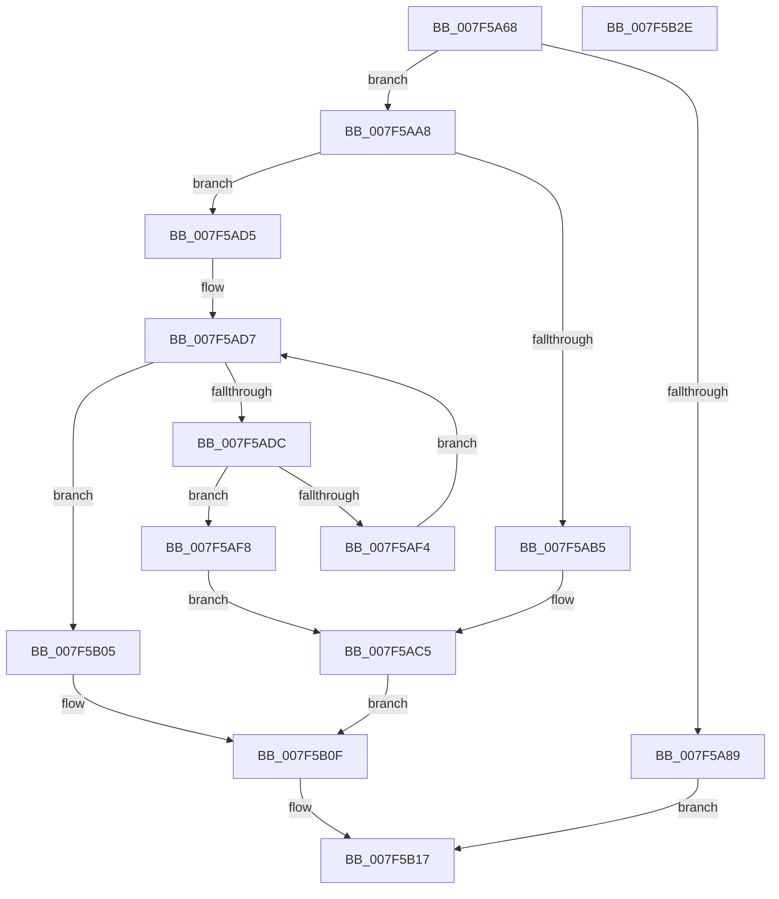

# CmpHiveCacheCreateHiveEntry

- RVA: `0x007F5A68`–`0x007F5B2F` (길이 `199` bytes)
- VA: `0x00000001407F5A68`
- 실행 섹션: `PAGE`
- PDB 이름 있음: `예`; PDB Function 태그: `아니요`
- unwind 정보 RVA: `0x00066400`
- 디코드: `57`개 명령, `199/199` bytes 표시
- 미해석 바이트: `0` (있으면 어셈블리에 `.byte`로 보존)

> 이 문서는 커널 이미지의 기계어와 PDB 기호를 분석해 생성했습니다. 4번과 5번은 함수 원형과 자료형을 바이너리 사용 방식에서 추정한 C 해석이며 원본 소스 복구 결과는 아닙니다.

## 1. Dependencies

- 직접 호출 지점: **5**; 고유 호출 대상: **4**
- 직접 호출자로 확인된 함수: **1**
- RIP 상대 이미지 참조: **0**

### Outgoing calls
- `0x007F5AA1` → [SetFailureLocation](../../text/46/SetFailureLocation_function_0046EF54.md) (function, `0x0046EF54`)
- `0x007F5AA8` → [CmpHiveCacheEntryLockAcquire](CmpHiveCacheEntryLockAcquire_function_007F5CD8.md) (function, `0x007F5CD8`)
- `0x007F5ACE` → [SetFailureLocation](../../text/46/SetFailureLocation_function_0046EF54.md) (function, `0x0046EF54`)
- `0x007F5AE9` → [CmSiCreateEvent](../../text/47/CmSiCreateEvent_function_00478F6C.md) (function, `0x00478F6C`)
- `0x007F5B12` → [CmpHiveCacheEntryLockRelease](CmpHiveCacheEntryLockRelease_function_007F5D3C.md) (function, `0x007F5D3C`)

### Direct callers
- [CmpBuildMachineHiveCache](../7E/CmpBuildMachineHiveCache_function_007E8B74.md) at `0x007E8C67`

### Static image references
- 디코드된 RIP-relative 메모리 참조가 없습니다.

## 2. Other-region calls and transfers

- 다른 실행 섹션으로 향하는 call: **3**
  - `0x007F5AA1` → [SetFailureLocation](../../text/46/SetFailureLocation_function_0046EF54.md) (`PAGE` → `.text`)
  - `0x007F5ACE` → [SetFailureLocation](../../text/46/SetFailureLocation_function_0046EF54.md) (`PAGE` → `.text`)
  - `0x007F5AE9` → [CmSiCreateEvent](../../text/47/CmSiCreateEvent_function_00478F6C.md) (`PAGE` → `.text`)
- 별도 외부 분기/꼬리 이동을 확인하지 못했습니다.

## 3. Assembly (complete function range)

```asm
007F5A68  48 8B C4                        mov rax, rsp
007F5A6B  48 89 58 08                     mov qword ptr [rax + 8], rbx
007F5A6F  48 89 68 10                     mov qword ptr [rax + 0x10], rbp
007F5A73  48 89 70 18                     mov qword ptr [rax + 0x18], rsi
007F5A77  57                              push rdi
007F5A78  48 83 EC 30                     sub rsp, 0x30
007F5A7C  33 DB                           xor ebx, ebx
007F5A7E  48 8B EA                        mov rbp, rdx
007F5A81  48 8B F9                        mov rdi, rcx
007F5A84  48 85 C9                        test rcx, rcx
007F5A87  75 1F                           jne 0x1407f5aa8
007F5A89  44 8D 41 28                     lea r8d, [rcx + 0x28]
007F5A8D  C7 40 E8 10 00 00 00            mov dword ptr [rax - 0x18], 0x10
007F5A94  BB 0D 00 00 C0                  mov ebx, 0xc000000d
007F5A99  33 D2                           xor edx, edx
007F5A9B  44 8B CB                        mov r9d, ebx
007F5A9E  48 8B CD                        mov rcx, rbp
007F5AA1  E8 AE 94 C7 FF                  call 0x14046ef54
007F5AA6  EB 6F                           jmp 0x1407f5b17
007F5AA8  E8 2B 02 00 00                  call 0x1407f5cd8
007F5AAD  39 9F A8 00 00 00               cmp dword ptr [rdi + 0xa8], ebx
007F5AB3  74 20                           je 0x1407f5ad5
007F5AB5  BB 89 01 00 C0                  mov ebx, 0xc0000189
007F5ABA  C7 44 24 20 20 00 00 00         mov dword ptr [rsp + 0x20], 0x20
007F5AC2  44 8B CB                        mov r9d, ebx
007F5AC5  33 D2                           xor edx, edx
007F5AC7  48 8B CD                        mov rcx, rbp
007F5ACA  44 8D 42 28                     lea r8d, [rdx + 0x28]
007F5ACE  E8 81 94 C7 FF                  call 0x14046ef54
007F5AD3  EB 3A                           jmp 0x1407f5b0f
007F5AD5  33 F6                           xor esi, esi
007F5AD7  83 FE 06                        cmp esi, 6
007F5ADA  73 29                           jae 0x1407f5b05
007F5ADC  8B D6                           mov edx, esi
007F5ADE  48 83 C2 0D                     add rdx, 0xd
007F5AE2  48 C1 E2 04                     shl rdx, 4
007F5AE6  48 03 D7                        add rdx, rdi
007F5AE9  E8 7E 34 C8 FF                  call 0x140478f6c
007F5AEE  8B D8                           mov ebx, eax
007F5AF0  85 C0                           test eax, eax
007F5AF2  78 04                           js 0x1407f5af8
007F5AF4  FF C6                           inc esi
007F5AF6  EB DF                           jmp 0x1407f5ad7
007F5AF8  C7 44 24 20 30 00 00 00         mov dword ptr [rsp + 0x20], 0x30
007F5B00  44 8B C8                        mov r9d, eax
007F5B03  EB C0                           jmp 0x1407f5ac5
007F5B05  C7 87 A8 00 00 00 01 00 00 00   mov dword ptr [rdi + 0xa8], 1
007F5B0F  48 8B CF                        mov rcx, rdi
007F5B12  E8 25 02 00 00                  call 0x1407f5d3c
007F5B17  48 8B 6C 24 48                  mov rbp, qword ptr [rsp + 0x48]
007F5B1C  8B C3                           mov eax, ebx
007F5B1E  48 8B 5C 24 40                  mov rbx, qword ptr [rsp + 0x40]
007F5B23  48 8B 74 24 50                  mov rsi, qword ptr [rsp + 0x50]
007F5B28  48 83 C4 30                     add rsp, 0x30
007F5B2C  5F                              pop rdi
007F5B2D  C3                              ret
007F5B2E  CC                              int3
```

## 4. C-style interpretation (structured pseudocode)

```c
__int64 __fastcall CmpHiveCacheCreateHiveEntry(__int64 a1, __int64 a2)
{
    __int64 result;
    __int64 v_rbx;
    __int64 v_rsi;
    __int64 v_rsp;
    unsigned int v_stack_m18;
    unsigned __int64 v_stack_p10;
    unsigned __int64 v_stack_p18;
    unsigned __int64 v_stack_p8;

    *(unsigned __int64 *)(v_rsp + 8) = v_rbx;
    *(unsigned __int64 *)(v_rsp + 16) = v_rbp;
    *(unsigned __int64 *)(v_rsp + 24) = v_rsi;
    v_rsp = (v_rsp) - (48);
    v_rbx = 0;
    if (a1 != 0) goto loc_007F5AA8;
    *(unsigned int *)(v_rsp - 24) = 16;
    a2 = 0;
    result = SetFailureLocation(0, a2, a1 + 40, (unsigned int)((unsigned int)((unsigned int)(0xC000000DULL))));
    goto loc_007F5B17;
loc_007F5AA8:
    result = CmpHiveCacheEntryLockAcquire(0, a2, a1 + 40, (unsigned int)((unsigned int)((unsigned int)(0xC000000DULL))));
    if ((*(unsigned int *)(a1 + 168)) == ((unsigned int)((unsigned int)(0xC000000DULL)))) goto loc_007F5AD5;
    v_stack_m18 = 32;
loc_007F5AC5:
    a2 = 0;
    result = SetFailureLocation(0, a2, a2 + 40, (unsigned int)((unsigned int)((unsigned int)(0xC0000189ULL))));
    goto loc_007F5B0F;
loc_007F5AD5:
    v_rsi = 0;
loc_007F5AD7:
    if (0 >= 6) goto loc_007F5B05;
    a2 = (0) + (13);
    a2 = (a2) << (4);
    a2 = (a2) + (a1);
    result = CmSiCreateEvent(0, a2, a2 + 40, (unsigned int)((unsigned int)((unsigned int)(0xC0000189ULL))));
    if (sign_flag) goto loc_007F5AF8;
    v_rsi = (unsigned int)((v_rsi) + 1);
    goto loc_007F5AD7;
loc_007F5AF8:
    v_stack_m18 = 48;
    goto loc_007F5AC5;
loc_007F5B05:
    *(unsigned int *)(a1 + 168) = 1;
loc_007F5B0F:
    result = CmpHiveCacheEntryLockRelease(a1, a2, a2 + 40, (unsigned int)((unsigned int)(result)));
loc_007F5B17:
    v_rsp = (v_rsp) + (48);
    return (unsigned int)((unsigned int)((unsigned int)((unsigned int)(result))));
}
```

## 5. (Beta) C Style

```c
int64_t CmpHiveCacheCreateHiveEntry(void *Arg1, int64_t Arg2)
{
    uint8_t *arg1 = (uint8_t *)Arg1;

    int64_t result;
    int64_t local_rbx;
    int64_t local_rsi;
    int64_t local_rsp;
    uint32_t v_stack_m18;
    uint64_t v_stack_p10;
    uint64_t v_stack_p18;
    uint64_t v_stack_p8;

    *(uint64_t *)(local_rsp + 0x8) = local_rbx;
    *(uint64_t *)(local_rsp + 0x10) = local_rbp;
    *(uint64_t *)(local_rsp + 0x18) = local_rsi;
    local_rsp = (local_rsp) - (48);
    local_rbx = 0;
    if (Arg1 != NULL) goto loc_007F5AA8;
    *(uint32_t *)(local_rsp - 0x18) = 16;
    Arg2 = 0;
    result = SetFailureLocation(0, Arg2, Arg1 + 40, (uint32_t)((uint32_t)((uint32_t)(0xC000000DULL))));
    goto loc_007F5B17;
loc_007F5AA8:
    result = CmpHiveCacheEntryLockAcquire(0, Arg2, Arg1 + 40, (uint32_t)((uint32_t)((uint32_t)(0xC000000DULL))));
    if ((*(uint32_t *)(arg1 + 0xA8)) == ((uint32_t)((uint32_t)(0xC000000DULL)))) goto loc_007F5AD5;
    v_stack_m18 = 32;
loc_007F5AC5:
    Arg2 = 0;
    result = SetFailureLocation(0, Arg2, Arg2 + 40, (uint32_t)((uint32_t)((uint32_t)(0xC0000189ULL))));
    goto loc_007F5B0F;
loc_007F5AD5:
    local_rsi = 0;
loc_007F5AD7:
    if (0 >= 6) goto loc_007F5B05;
    Arg2 = (0) + (13);
    Arg2 = (Arg2) << (4);
    Arg2 = (Arg2) + (Arg1);
    result = CmSiCreateEvent(0, Arg2, Arg2 + 40, (uint32_t)((uint32_t)((uint32_t)(0xC0000189ULL))));
    if (sign_flag) goto loc_007F5AF8;
    local_rsi = (uint32_t)((local_rsi) + 1);
    goto loc_007F5AD7;
loc_007F5AF8:
    v_stack_m18 = 48;
    goto loc_007F5AC5;
loc_007F5B05:
    *(uint32_t *)(arg1 + 0xA8) = 1;
loc_007F5B0F:
    result = CmpHiveCacheEntryLockRelease(Arg1, Arg2, Arg2 + 40, (uint32_t)((uint32_t)(result)));
loc_007F5B17:
    local_rsp = (local_rsp) + (48);
    return (uint32_t)((uint32_t)((uint32_t)((uint32_t)(result))));
}
```

### 관측된 메모리 오프셋

구조체 형식이 확인되지 않은 접근은 인자 기준의 오프셋으로만 기록했습니다.

| 기준 인자 | 오프셋 표현 | 폭 (bit) | 접근 |
|---|---:|---:|---|
| `Arg1` | `+ 0xA8` | `32` | `R` |
| `Arg1` | `+ 0xA8` | `32` | `W` |

## 6. Execution-region graph

[열기: 2D/3D 그래프와 함수 탐색 컨트롤 패널](../../../control-panel.html?section=page&rva=0x007F5A68&view=graph)

- 2D 그래프는 위에서 아래로 흐르고, 3D 그래프는 빈 공간을 드래그해 회전합니다. Shift+드래그는 이동, 휠은 확대·축소, 함수 노드 선택은 대상 보고서 이동입니다.

### Static fallback


