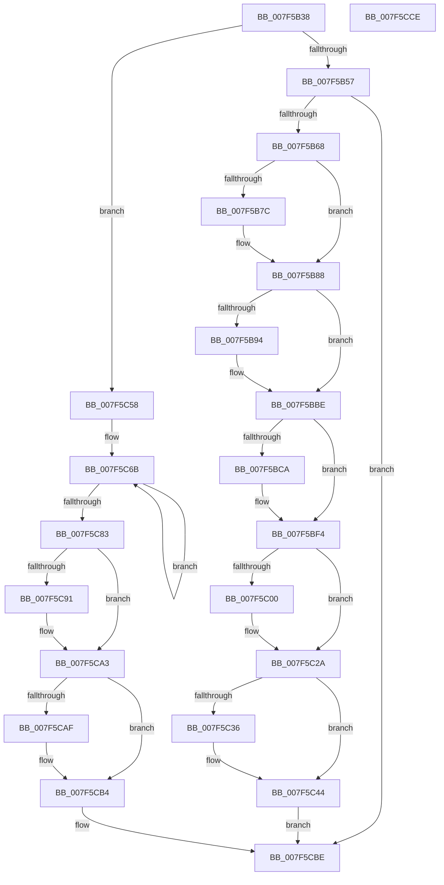

# CmpHiveCacheEntryCleanup

- RVA: `0x007F5B38`–`0x007F5CCF` (길이 `407` bytes)
- VA: `0x00000001407F5B38`
- 실행 섹션: `PAGE`
- PDB 이름 있음: `예`; PDB Function 태그: `아니요`
- unwind 정보 RVA: `0x0008E1D0`
- 디코드: `89`개 명령, `407/407` bytes 표시
- 미해석 바이트: `0` (있으면 어셈블리에 `.byte`로 보존)

> 이 문서는 커널 이미지의 기계어와 PDB 기호를 분석해 생성했습니다. 4번과 5번은 함수 원형과 자료형을 바이너리 사용 방식에서 추정한 C 해석이며 원본 소스 복구 결과는 아닙니다.

## 1. Dependencies

- 직접 호출 지점: **13**; 고유 호출 대상: **9**
- 직접 호출자로 확인된 함수: **5**
- RIP 상대 이미지 참조: **0**

### Outgoing calls
- `0x007F5B7C` → [CmpDestroyHive](../9B/CmpDestroyHive_function_009B1708.md) (function, `0x009B1708`)
- `0x007F5BA6` → [ZwSetInformationObject](../../text/6A/ZwSetInformationObject_function_006ADC50.md) (function, `0x006ADC50`)
- `0x007F5BB2` → [ZwClose](../../text/6A/ZwClose_function_006AD2B0.md) (function, `0x006AD2B0`)
- `0x007F5BDC` → [ZwSetInformationObject](../../text/6A/ZwSetInformationObject_function_006ADC50.md) (function, `0x006ADC50`)
- `0x007F5BE8` → [ZwClose](../../text/6A/ZwClose_function_006AD2B0.md) (function, `0x006AD2B0`)
- `0x007F5C12` → [ZwSetInformationObject](../../text/6A/ZwSetInformationObject_function_006ADC50.md) (function, `0x006ADC50`)
- `0x007F5C1E` → [ZwClose](../../text/6A/ZwClose_function_006AD2B0.md) (function, `0x006AD2B0`)
- `0x007F5C38` → [PnpUnregisterPlugPlayNotification](../../text/47/PnpUnregisterPlugPlayNotification_function_0047AFAC.md) (function, `0x0047AFAC`)
- `0x007F5C4B` → [CmSiSetEvent](../../text/66/CmSiSetEvent_function_0066DE78.md) (function, `0x0066DE78`)
- `0x007F5C5F` → [CmSiWaitForSingleEvent](../../text/49/CmSiWaitForSingleEvent_function_0049E4BC.md) (function, `0x0049E4BC`)
- `0x007F5C6E` → [CmSiEventTupleCleanup](../../text/48/CmSiEventTupleCleanup_function_00487E8C.md) (function, `0x00487E8C`)
- `0x007F5C91` → [CmSiFreeMemory](../../text/47/CmSiFreeMemory_function_00475D80.md) (function, `0x00475D80`)
- `0x007F5CAF` → [NtClose](../86/NtClose_function_00868870.md) (function, `0x00868870`)

### Direct callers
- [CmpLoadHiveThread](../7D/CmpLoadHiveThread_function_007DB040.md) at `0x007DB3F5`
- [CmpMachineHiveCacheClaimEntry](../7E/CmpMachineHiveCacheClaimEntry_function_007E8DFC.md) at `0x007E8E4D`
- [CmpMachineHiveCacheClaimEntry](../7E/CmpMachineHiveCacheClaimEntry_function_007E8DFC.md) at `0x007E8E5C`
- [CmpMachineHiveCachePopulateEntry](../7E/CmpMachineHiveCachePopulateEntry_function_007E8E88.md) at `0x007E8F18`
- [CmpHiveCachePnpNotificationCallback](CmpHiveCachePnpNotificationCallback_function_007F5D80.md) at `0x007F5E3B`
- [CmpHiveCachePopulateHiveEntryThread](CmpHiveCachePopulateHiveEntryThread_function_007F5FD0.md) at `0x007F6347`
- [CmpHiveCachePopulateHiveEntryThread](CmpHiveCachePopulateHiveEntryThread_function_007F5FD0.md) at `0x007F638D`

### Static image references
- 디코드된 RIP-relative 메모리 참조가 없습니다.

## 2. Other-region calls and transfers

- 다른 실행 섹션으로 향하는 call: **11**
  - `0x007F5BA6` → [ZwSetInformationObject](../../text/6A/ZwSetInformationObject_function_006ADC50.md) (`PAGE` → `.text`)
  - `0x007F5BB2` → [ZwClose](../../text/6A/ZwClose_function_006AD2B0.md) (`PAGE` → `.text`)
  - `0x007F5BDC` → [ZwSetInformationObject](../../text/6A/ZwSetInformationObject_function_006ADC50.md) (`PAGE` → `.text`)
  - `0x007F5BE8` → [ZwClose](../../text/6A/ZwClose_function_006AD2B0.md) (`PAGE` → `.text`)
  - `0x007F5C12` → [ZwSetInformationObject](../../text/6A/ZwSetInformationObject_function_006ADC50.md) (`PAGE` → `.text`)
  - `0x007F5C1E` → [ZwClose](../../text/6A/ZwClose_function_006AD2B0.md) (`PAGE` → `.text`)
  - `0x007F5C38` → [PnpUnregisterPlugPlayNotification](../../text/47/PnpUnregisterPlugPlayNotification_function_0047AFAC.md) (`PAGE` → `.text`)
  - `0x007F5C4B` → [CmSiSetEvent](../../text/66/CmSiSetEvent_function_0066DE78.md) (`PAGE` → `.text`)
  - `0x007F5C5F` → [CmSiWaitForSingleEvent](../../text/49/CmSiWaitForSingleEvent_function_0049E4BC.md) (`PAGE` → `.text`)
  - `0x007F5C6E` → [CmSiEventTupleCleanup](../../text/48/CmSiEventTupleCleanup_function_00487E8C.md) (`PAGE` → `.text`)
  - `0x007F5C91` → [CmSiFreeMemory](../../text/47/CmSiFreeMemory_function_00475D80.md) (`PAGE` → `.text`)
- 별도 외부 분기/꼬리 이동을 확인하지 못했습니다.

## 3. Assembly (complete function range)

```asm
007F5B38  48 89 5C 24 08                  mov qword ptr [rsp + 8], rbx
007F5B3D  48 89 74 24 18                  mov qword ptr [rsp + 0x18], rsi
007F5B42  57                              push rdi
007F5B43  48 83 EC 20                     sub rsp, 0x20
007F5B47  BE 06 00 00 00                  mov esi, 6
007F5B4C  48 8B D9                        mov rbx, rcx
007F5B4F  3B D6                           cmp edx, esi
007F5B51  0F 84 01 01 00 00               je 0x1407f5c58
007F5B57  BE 04 00 00 00                  mov esi, 4
007F5B5C  39 B1 A8 00 00 00               cmp dword ptr [rcx + 0xa8], esi
007F5B62  0F 84 56 01 00 00               je 0x1407f5cbe
007F5B68  89 91 AC 00 00 00               mov dword ptr [rcx + 0xac], edx
007F5B6E  33 FF                           xor edi, edi
007F5B70  48 8B 89 70 01 00 00            mov rcx, qword ptr [rcx + 0x170]
007F5B77  48 85 C9                        test rcx, rcx
007F5B7A  74 0C                           je 0x1407f5b88
007F5B7C  E8 87 BB 1B 00                  call 0x1409b1708
007F5B81  48 89 BB 70 01 00 00            mov qword ptr [rbx + 0x170], rdi
007F5B88  48 8B 8B B0 00 00 00            mov rcx, qword ptr [rbx + 0xb0]
007F5B8F  48 85 C9                        test rcx, rcx
007F5B92  74 2A                           je 0x1407f5bbe
007F5B94  41 B9 02 00 00 00               mov r9d, 2
007F5B9A  66 89 7C 24 38                  mov word ptr [rsp + 0x38], di
007F5B9F  4C 8D 44 24 38                  lea r8, [rsp + 0x38]
007F5BA4  8B D6                           mov edx, esi
007F5BA6  E8 A5 80 EB FF                  call 0x1406adc50
007F5BAB  48 8B 8B B0 00 00 00            mov rcx, qword ptr [rbx + 0xb0]
007F5BB2  E8 F9 76 EB FF                  call 0x1406ad2b0
007F5BB7  48 89 BB B0 00 00 00            mov qword ptr [rbx + 0xb0], rdi
007F5BBE  48 8B 8B B8 00 00 00            mov rcx, qword ptr [rbx + 0xb8]
007F5BC5  48 85 C9                        test rcx, rcx
007F5BC8  74 2A                           je 0x1407f5bf4
007F5BCA  41 B9 02 00 00 00               mov r9d, 2
007F5BD0  66 89 7C 24 38                  mov word ptr [rsp + 0x38], di
007F5BD5  4C 8D 44 24 38                  lea r8, [rsp + 0x38]
007F5BDA  8B D6                           mov edx, esi
007F5BDC  E8 6F 80 EB FF                  call 0x1406adc50
007F5BE1  48 8B 8B B8 00 00 00            mov rcx, qword ptr [rbx + 0xb8]
007F5BE8  E8 C3 76 EB FF                  call 0x1406ad2b0
007F5BED  48 89 BB B8 00 00 00            mov qword ptr [rbx + 0xb8], rdi
007F5BF4  48 8B 8B C0 00 00 00            mov rcx, qword ptr [rbx + 0xc0]
007F5BFB  48 85 C9                        test rcx, rcx
007F5BFE  74 2A                           je 0x1407f5c2a
007F5C00  41 B9 02 00 00 00               mov r9d, 2
007F5C06  66 89 7C 24 38                  mov word ptr [rsp + 0x38], di
007F5C0B  4C 8D 44 24 38                  lea r8, [rsp + 0x38]
007F5C10  8B D6                           mov edx, esi
007F5C12  E8 39 80 EB FF                  call 0x1406adc50
007F5C17  48 8B 8B C0 00 00 00            mov rcx, qword ptr [rbx + 0xc0]
007F5C1E  E8 8D 76 EB FF                  call 0x1406ad2b0
007F5C23  48 89 BB C0 00 00 00            mov qword ptr [rbx + 0xc0], rdi
007F5C2A  48 8B 8B 58 01 00 00            mov rcx, qword ptr [rbx + 0x158]
007F5C31  48 85 C9                        test rcx, rcx
007F5C34  74 0E                           je 0x1407f5c44
007F5C36  B2 01                           mov dl, 1
007F5C38  E8 6F 53 C8 FF                  call 0x14047afac
007F5C3D  48 89 BB 58 01 00 00            mov qword ptr [rbx + 0x158], rdi
007F5C44  48 8D 8B 00 01 00 00            lea rcx, [rbx + 0x100]
007F5C4B  E8 28 82 E7 FF                  call 0x14066de78
007F5C50  89 B3 A8 00 00 00               mov dword ptr [rbx + 0xa8], esi
007F5C56  EB 66                           jmp 0x1407f5cbe
007F5C58  48 81 C1 20 01 00 00            add rcx, 0x120
007F5C5F  E8 58 88 CA FF                  call 0x14049e4bc
007F5C64  48 8D BB D0 00 00 00            lea rdi, [rbx + 0xd0]
007F5C6B  48 8B CF                        mov rcx, rdi
007F5C6E  E8 19 22 C9 FF                  call 0x140487e8c
007F5C73  0F 57 C0                        xorps xmm0, xmm0
007F5C76  0F 11 07                        movups xmmword ptr [rdi], xmm0
007F5C79  48 83 C7 10                     add rdi, 0x10
007F5C7D  48 83 EE 01                     sub rsi, 1
007F5C81  75 E8                           jne 0x1407f5c6b
007F5C83  48 8B 8B 40 01 00 00            mov rcx, qword ptr [rbx + 0x140]
007F5C8A  33 FF                           xor edi, edi
007F5C8C  48 85 C9                        test rcx, rcx
007F5C8F  74 12                           je 0x1407f5ca3
007F5C91  E8 EA 00 C8 FF                  call 0x140475d80
007F5C96  48 89 BB 40 01 00 00            mov qword ptr [rbx + 0x140], rdi
007F5C9D  89 BB 38 01 00 00               mov dword ptr [rbx + 0x138], edi
007F5CA3  48 8B 8B 68 01 00 00            mov rcx, qword ptr [rbx + 0x168]
007F5CAA  48 85 C9                        test rcx, rcx
007F5CAD  74 05                           je 0x1407f5cb4
007F5CAF  E8 BC 2B 07 00                  call 0x140868870
007F5CB4  C7 83 A8 00 00 00 05 00 00 00   mov dword ptr [rbx + 0xa8], 5
007F5CBE  48 8B 5C 24 30                  mov rbx, qword ptr [rsp + 0x30]
007F5CC3  48 8B 74 24 40                  mov rsi, qword ptr [rsp + 0x40]
007F5CC8  48 83 C4 20                     add rsp, 0x20
007F5CCC  5F                              pop rdi
007F5CCD  C3                              ret
007F5CCE  CC                              int3
```

## 4. C-style interpretation (structured pseudocode)

```c
__int64 __fastcall CmpHiveCacheEntryCleanup(__int64 a1, int a2)
{
    __int64 result;
    __int64 v_rdi;
    __int64 v_rsi;
    __int64 v_rsp;
    unsigned __int16 v_stack_p10;
    unsigned __int64 v_stack_p18;
    unsigned __int64 v_stack_p8;

    v_stack_p8 = v_rbx;
    v_stack_p18 = v_rsi;
    v_rsp = (v_rsp) - (32);
    if (a2 == 6) goto loc_007F5C58;
    if ((*(unsigned int *)(a1 + 168)) == 4) goto loc_007F5CBE;
    *(unsigned int *)(a1 + 172) = a2;
    v_rdi = 0;
    if (*(unsigned __int64 *)(a1 + 368) != 0) {
        result = CmpDestroyHive(*(unsigned __int64 *)(a1 + 368), a2, a3, a4);
        *(unsigned __int64 *)(a1 + 368) = 0;
    }
    if (*(unsigned __int64 *)(a1 + 176) != 0) {
        a4 = 2;
        v_stack_p10 = 0;
        a3 = v_stack_p10;
        a2 = 4;
        result = ZwSetInformationObject(*(unsigned __int64 *)(a1 + 176), a2, a3, a4);
        a1 = *(unsigned __int64 *)(a1 + 176);
        result = ZwClose(a1, a2, a3, a4);
        *(unsigned __int64 *)(a1 + 176) = 0;
    }
    if (*(unsigned __int64 *)(a1 + 184) != 0) {
        a4 = 2;
        v_stack_p10 = 0;
        a3 = v_stack_p10;
        a2 = 4;
        result = ZwSetInformationObject(*(unsigned __int64 *)(a1 + 184), a2, a3, a4);
        a1 = *(unsigned __int64 *)(a1 + 184);
        result = ZwClose(a1, a2, a3, a4);
        *(unsigned __int64 *)(a1 + 184) = 0;
    }
    if (*(unsigned __int64 *)(a1 + 192) != 0) {
        a4 = 2;
        v_stack_p10 = 0;
        a3 = v_stack_p10;
        a2 = 4;
        result = ZwSetInformationObject(*(unsigned __int64 *)(a1 + 192), a2, a3, a4);
        a1 = *(unsigned __int64 *)(a1 + 192);
        result = ZwClose(a1, a2, a3, a4);
        *(unsigned __int64 *)(a1 + 192) = 0;
    }
    if (*(unsigned __int64 *)(a1 + 344) != 0) {
        a2 = 1;
        result = PnpUnregisterPlugPlayNotification(*(unsigned __int64 *)(a1 + 344), a2, a3, a4);
        *(unsigned __int64 *)(a1 + 344) = 0;
    }
    result = CmSiSetEvent(a1 + 256, a2, a3, a4);
    *(unsigned int *)(a1 + 168) = 4;
    goto loc_007F5CBE;
loc_007F5C58:
    a1 = (a1 + 256) + (288);
    result = CmSiWaitForSingleEvent(a1, a2, a3, a4);
loc_007F5C6B:
    result = CmSiEventTupleCleanup(a1 + 208, a2, a3, a4);
    *(unsigned __int64 *)(a1 + 208) = v_xmm0;
    v_rdi = (a1 + 208) + (16);
    v_rsi = (4) - (1);
    if (condition_is_not_equal) goto loc_007F5C6B;
    v_rdi = 0;
    if (*(unsigned __int64 *)(a1 + 320) != 0) {
        result = CmSiFreeMemory(*(unsigned __int64 *)(a1 + 320), a2, a3, a4);
        *(unsigned __int64 *)(a1 + 320) = 0;
        *(unsigned int *)(a1 + 312) = 0;
    }
    if (*(unsigned __int64 *)(a1 + 360) != 0) {
        result = NtClose(*(unsigned __int64 *)(a1 + 360), a2, a3, a4);
    }
    *(unsigned int *)(a1 + 168) = 5;
loc_007F5CBE:
    v_rsp = (v_rsp) + (32);
    return result;
}
```

## 5. (Beta) C Style

```c
int64_t CmpHiveCacheEntryCleanup(void *Arg1, int32_t Arg2)
{
    uint8_t *arg1 = (uint8_t *)Arg1;

    int64_t result;
    int64_t local_rdi;
    int64_t local_rsi;
    int64_t local_rsp;
    uint16_t v_stack_p10;
    uint64_t v_stack_p18;
    uint64_t v_stack_p8;

    v_stack_p8 = local_rbx;
    v_stack_p18 = local_rsi;
    local_rsp = (local_rsp) - (32);
    if (Arg2 == 6) goto loc_007F5C58;
    if ((*(uint32_t *)(arg1 + 0xA8)) == 4) goto loc_007F5CBE;
    *(uint32_t *)(arg1 + 0xAC) = Arg2;
    local_rdi = 0;
    if (*(uint64_t *)(arg1 + 0x170) != 0) {
        result = CmpDestroyHive(*(uint64_t *)(arg1 + 0x170), Arg2, a3, a4);
        *(uint64_t *)(arg1 + 0x170) = 0;
    }
    if (*(uint64_t *)(arg1 + 0xB0) != 0) {
        a4 = 2;
        v_stack_p10 = 0;
        a3 = v_stack_p10;
        Arg2 = 4;
        result = ZwSetInformationObject(*(uint64_t *)(arg1 + 0xB0), Arg2, a3, a4);
        Arg1 = *(uint64_t *)(arg1 + 0xB0);
        result = ZwClose(Arg1, Arg2, a3, a4);
        *(uint64_t *)(arg1 + 0xB0) = 0;
    }
    if (*(uint64_t *)(arg1 + 0xB8) != 0) {
        a4 = 2;
        v_stack_p10 = 0;
        a3 = v_stack_p10;
        Arg2 = 4;
        result = ZwSetInformationObject(*(uint64_t *)(arg1 + 0xB8), Arg2, a3, a4);
        Arg1 = *(uint64_t *)(arg1 + 0xB8);
        result = ZwClose(Arg1, Arg2, a3, a4);
        *(uint64_t *)(arg1 + 0xB8) = 0;
    }
    if (*(uint64_t *)(arg1 + 0xC0) != 0) {
        a4 = 2;
        v_stack_p10 = 0;
        a3 = v_stack_p10;
        Arg2 = 4;
        result = ZwSetInformationObject(*(uint64_t *)(arg1 + 0xC0), Arg2, a3, a4);
        Arg1 = *(uint64_t *)(arg1 + 0xC0);
        result = ZwClose(Arg1, Arg2, a3, a4);
        *(uint64_t *)(arg1 + 0xC0) = 0;
    }
    if (*(uint64_t *)(arg1 + 0x158) != 0) {
        Arg2 = 1;
        result = PnpUnregisterPlugPlayNotification(*(uint64_t *)(arg1 + 0x158), Arg2, a3, a4);
        *(uint64_t *)(arg1 + 0x158) = 0;
    }
    result = CmSiSetEvent(Arg1 + 256, Arg2, a3, a4);
    *(uint32_t *)(arg1 + 0xA8) = 4;
    goto loc_007F5CBE;
loc_007F5C58:
    Arg1 = (Arg1 + 256) + (288);
    result = CmSiWaitForSingleEvent(Arg1, Arg2, a3, a4);
loc_007F5C6B:
    result = CmSiEventTupleCleanup(Arg1 + 208, Arg2, a3, a4);
    *(uint64_t *)(arg1 + 0xD0) = v_xmm0;
    local_rdi = (Arg1 + 208) + (16);
    local_rsi = (4) - (1);
    if (condition_is_not_equal) goto loc_007F5C6B;
    local_rdi = 0;
    if (*(uint64_t *)(arg1 + 0x140) != 0) {
        result = CmSiFreeMemory(*(uint64_t *)(arg1 + 0x140), Arg2, a3, a4);
        *(uint64_t *)(arg1 + 0x140) = 0;
        *(uint32_t *)(arg1 + 0x138) = 0;
    }
    if (*(uint64_t *)(arg1 + 0x168) != 0) {
        result = NtClose(*(uint64_t *)(arg1 + 0x168), Arg2, a3, a4);
    }
    *(uint32_t *)(arg1 + 0xA8) = 5;
loc_007F5CBE:
    local_rsp = (local_rsp) + (32);
    return result;
}
```

### 관측된 메모리 오프셋

구조체 형식이 확인되지 않은 접근은 인자 기준의 오프셋으로만 기록했습니다.

| 기준 인자 | 오프셋 표현 | 폭 (bit) | 접근 |
|---|---:|---:|---|
| `Arg1` | `+ 0x0` | `128` | `R` |
| `Arg1` | `+ 0xA8` | `32` | `R` |
| `Arg1` | `+ 0xA8` | `32` | `W` |
| `Arg1` | `+ 0xAC` | `32` | `W` |
| `Arg1` | `+ 0xB0` | `64` | `R` |
| `Arg1` | `+ 0xB0` | `64` | `W` |
| `Arg1` | `+ 0xB8` | `64` | `R` |
| `Arg1` | `+ 0xB8` | `64` | `W` |
| `Arg1` | `+ 0xC0` | `64` | `R` |
| `Arg1` | `+ 0xC0` | `64` | `W` |
| `Arg1` | `+ 0xD0` | `64` | `R` |
| `Arg1` | `+ 0x100` | `64` | `R` |
| `Arg1` | `+ 0x138` | `32` | `W` |
| `Arg1` | `+ 0x140` | `64` | `R` |
| `Arg1` | `+ 0x140` | `64` | `W` |
| `Arg1` | `+ 0x158` | `64` | `R` |
| `Arg1` | `+ 0x158` | `64` | `W` |
| `Arg1` | `+ 0x168` | `64` | `R` |
| `Arg1` | `+ 0x170` | `64` | `R` |
| `Arg1` | `+ 0x170` | `64` | `W` |

## 6. Execution-region graph

[열기: 2D/3D 그래프와 함수 탐색 컨트롤 패널](../../../control-panel.html?section=page&rva=0x007F5B38&view=graph)

- 2D 그래프는 위에서 아래로 흐르고, 3D 그래프는 빈 공간을 드래그해 회전합니다. Shift+드래그는 이동, 휠은 확대·축소, 함수 노드 선택은 대상 보고서 이동입니다.

### Static fallback


